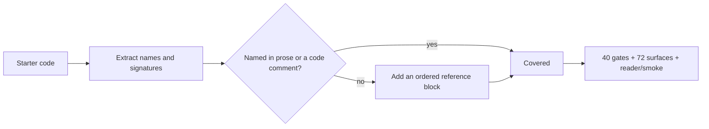

# Starter provenance audit — all prose tracks

This audit extends the earlier `track-p` provenance pass to every prose lesson track. It checks, beside each starter:

- every starter/local name has an origin or value;
- every function states the rule it implements, not only its intent;
- every constant states its result on the branch that runs;
- a function parameter that reuses an outer name is called out.

The audit is name-aware: Python starters are parsed with `ast`, C/C++ declarations and parameters are extracted separately, and a name counts as explained only when it appears in the lesson prose or in a comment/docstring beside the code. Existing explanations are left untouched.

## Coverage

| Track | Starter lessons | Names audited | Unexplained | Weak rules | Shadowed names |
|---|---:|---:|---:|---:|---:|
| Stage 0 | 11 | 10 Python + C++ names | 0 | 0 | 0 |
| Ramp | 6 | 121 | 0 | 0 | 0 |
| Steps 3–10 (`00`–`08`) | 23 | 473 | 0 | 0 | 0 |
| Track P (previous pass) | 15 | 113 | 0 | 0 | 0 |
| **Total** | **55** | **717** | **0** | **0** | **0** |

The 40 non-`track-p` starter lessons contain 604 parsed Python/C++ names. The twelve Falstad/C++ starters without additional notes already state their component values and limits inline; they contributed no unexplained names. The 28 Python starters with gaps now carry an ordered reference block. Ordered lists are used deliberately: the reader renders every unordered list as a task checklist, and these are reference material, not tasks.

## Workflow track

The non-Python workflow surface has seven templates. Their named cards and values were checked against the lesson arithmetic:

| Template | Checked values |
|---|---|
| Winding draw vs driver limit | `12.0 / 2.4 = 5.00 A`; `5.00 > 3.20 A`, so the answer is limited to `3.2 A` |
| Sensor scaling/range | `512 / 1024 * 3.3 = 1.65 V` at the pin; equal divider doubles it to `3.30 V`, at the reference rail |
| PID step/saturation | `wn = sqrt(8) = 2.828 rad/s`, `zeta = 2/(2*2.828) = 0.354`; peak command `14 V` is a simulation result above the `12 V` supply |
| Function from examples | `1.0/0.5 = 2.0`; `0.0/0.5 = 0.0`; `3.0/0.5 = 6.0` |
| Debug a failing run | `12.0/3.0 = 4.0` vs `12.0/2.4 = 5.0`, which explains the assertion |
| Loop/running total | `12.0 + 11.4 + 12.3 = 35.7`; empty-list case returns `0.0` |
| Blank | One empty Given card; no numeric claim |

## Practice modules

The 50 advanced practice modules (46 with runnable TODO blocks) are the optional depth tier, separate from the 55 prose starter lessons. Their function docstrings and TODO prompts state the rule for each exercise, and the module suites exercise those contracts. They are not counted as prose tracks in the table above.

## Verification

- Provenance audit: 604 names, 0 unexplained, 0 weak function rules, 0 shadowed names.
- `scripts/check_all.py`: 40/40 fast gates.
- `npm run check:snapshot`: 72/72 surfaces on the existing `docs/surface-snapshot.json` baseline, no re-record.
- `npm run test:reader`: 35/35.
- `scripts/check_term_order.py`: 107 glossary terms, 0 violations.
- `npm run test:smoke`: passed.
- `npm run build`: passed.
- `git diff --check`: clean.

No starter code, full solution, expected output, or baseline was changed by this audit.
