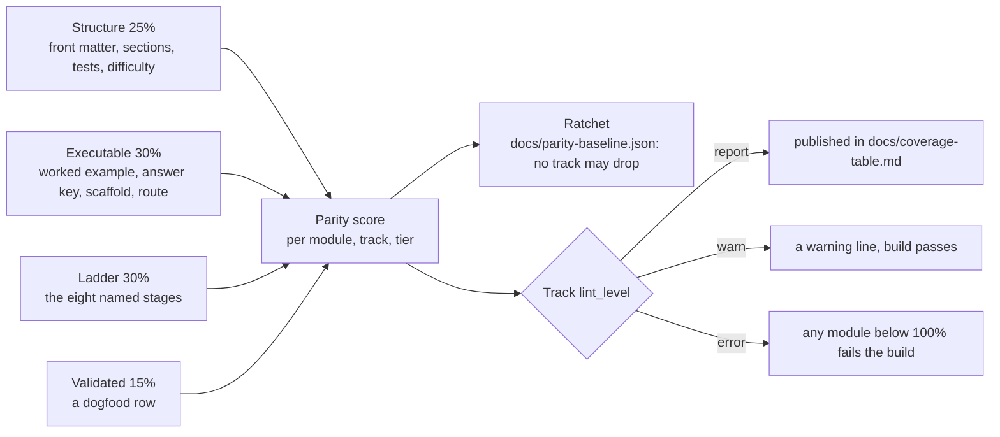

# QUALITY_SPEC — Tier Parity for the Advanced Bridge Modules

The goal of the Tier 2/3 plan is that an advanced module is as good as a Tier 1 lesson: the same
structure, the same automatic grading, the same workbench support, the same teach-measure-break-it
ladder. "As good as Tier 1" is too vague to finish, so this file is the contract, and
[`scripts/module_parity.py`](../scripts/module_parity.py) is the implementation. Run it, read
[`docs/coverage-table.md`](coverage-table.md), and the question "how far is this module?" has a number.

Applies to the **44 bridge modules** in `modules/` (16 Tier 1, 18 Tier 2, 10 Tier 3). The 24 legacy
modules are superseded and out of scope.



## 1. The four layers

Parity = **Structure 25% + Executable 30% + Ladder 30% + Validated 15%**, over the items that are
measurable in this repository today. Each layer is scored as the fraction of its items present.

| Layer | Item | What it is |
| :--- | :--- | :--- |
| Structure | `front_matter_contract` | The keys `lint_modules.REQUIRED_FRONT_MATTER` demands |
| Structure | `numbered_sections` | `## 1. Why it matters` … `## 10. Next modules`, exact titles, in order |
| Structure | `checkpoint_tests` | `### Skip test` **and** `### Gate test`, with `[Recall]`, `[Apply]`, `[Transfer]` |
| Structure | `difficulty_label` | The block in §2 below, complete and in range |
| Structure | `tier3_two_levels` | Tier 3 only: `### Use & Understand` **and** `### Derive & Extend` |
| Executable | `worked_example_runs` | A `python` block in `## 4. Worked example` with an `Expected output:` block — the pair `scripts/validate_modules.py` executes and diffs in CI |
| Executable | `checkpoint_answer_key` | A `**Answer key:**` block that asserts the exercise's numbers |
| Executable | `learner_exercise_scaffold` | A `python` scaffold with `TODO`s for the learner, plus a full solution in `## 5. Exercise` |
| Executable | `verification_route_declared` | The `verification:` key of §2 |
| Executable | `shared_plant` | The `plant:` decision of §2: `tier1_arm_motor` **and** a real `import mechalab_plant` in the module, or `none` with a `plant_note:` reason |
| Ladder | the eight stages | `1_recall`, `2_see_it`, `3_predict`, `4_worked_example`, `5_practice_host`, `6_break_it`, `7_transfer`, `8_integrate` |
| Validated | `dogfood_logged` | A row for the module in [`docs/dogfood-log.md`](dogfood-log.md) — the author's first pass |
| Validated | `behavioural_grading` | An `exercises/<module>/exercise.json` package whose three-way check passes (`scripts/run_exercise.py`) |

The two Validated items are deliberately separate, and neither implies mastery. A dogfood row is the
author doing the exercise once; an exercise package is the *grading* being real — starter fails,
reference passes, common wrong implementations fail. `docs/coverage-table.md` publishes them as
separate columns alongside the delayed-transfer and independent-learner columns, which are still
empty. So a module at 100% means **100% of the requirements instrumented today**, not demonstrated
learner retention, and a green number cannot be read as one.

**Existence is gated too.** `scripts/check_exercise_coverage.py` fails the build when a bridge
module ships no `exercises/<module>/` package, or ships an incomplete one, or when
`docs/exercise-baseline.json` still lists a module that has since gained a package. The baseline is
a ratchet: it can only shrink, and `--update-baseline` is the deliberate act of removing an entry.

Two ladder stages are measured by their **named marker**, not by a loose keyword, because a bare
mention of "predict" is not a Predict step:

- `3_predict` — the literal line `**Predict first (before you run it):**`, and the paragraph under it
  must ask for committed numbers (the convention every rewritten track uses);
- `6_break_it` — a `### Break it on purpose` heading whose bullets are `**Inject**`, `**Symptom**`,
  `**Diagnose**` and `**Fix**`.

`scripts/lint_modules.py` reports these **same two markers**, so a published ladder number means one
thing. They did not start out that way: the linter's first read was a keyword alternation
(`\bpredict\b`, `fault|diagnos|miswir`) and it published 12/44 and 20/44 where the named markers find
**7/44** — a read that flatters the content, which is the greenwashing this section exists to
prevent. The loose read is gone, and both tools now print the named-marker counts.

**A scaffold is not a module.** `scripts/new_module.py` writes the marker `TODO-AUTHOR` into every
hole it leaves; a module still carrying it scores **0** on every item, and `scripts/lint_modules.py`
rejects it outright.

**One plant.** An advanced exercise runs on the Tier 1 capstone's own arm, not on fresh toy numbers:
`resources/plants/mechalab_plant.py` (executable model) and `resources/plants/tier1_arm_motor.yaml`
(values with provenance) are embedded into the workbench by `scripts/generate_plant_data.py`, so
`import mechalab_plant` works in the browser runner. `tests/test_plant.py` proves the YAML and the
module agree, that every value cites a lesson, and that the plant reproduces the capstone's published
numbers (0.0000 mm IK→FK, 2.40 mm peak / 0.91 mm RMS tracking error, 412 dropped frames at
115.2 kbaud). Whether a given module uses it is scored as **`executable:shared_plant`** (§1 and §2)
and published per module and per track in [`docs/coverage-table.md`](coverage-table.md); the plant,
its provenance rule and the workbench import contract are documented in
[`resources/plants/README.md`](../resources/plants/README.md), and its named model levels — A the
joint-space arm, B the local linear model, C coupled dynamics (specified only), D actuator/sensor
primitives — in [`docs/MODEL_LEVELS.md`](MODEL_LEVELS.md). A richer lesson adds a level; it does not
replace the one whose numbers are published.

## 2. The two metadata blocks

```yaml
difficulty:
  math: 3           # 1..5 — new mathematical objects this module introduces
  coding: 3         # 1..5 — new code/SDK surface
  tools: 2          # 0..5 — new tools (0 = none); a module with tools >= 3 and math >= 4 is a
                    #        candidate to split, since a new tool and a new concept in one lesson
                    #        is the most common cause of overload at this level
  hardware_risk: low    # low | medium | high  (high = supervised bench work only)
  simulation: full      # full | partial | none — can this be done without hardware?
verification: browser   # browser | ci-native | artifact | rubric
plant: tier1_arm_motor  # tier1_arm_motor | none — this exercise runs on the shared plant,
                        # or says why it does not (see `plant_note:`)
plant_note: "…"         # required when `plant: none`: the reason, in a sentence, for a reviewer
```

`verification` is how this module's work is actually checked, so coverage stays honest when the work
cannot run in a browser: `browser` (the in-page Python runner), `ci-native` (compiled and tested on
the runner, e.g. embedded C), `artifact` (a file the learner edits that a tool then checks, e.g.
KiCad ERC/DRC, a URDF), `rubric` (a supervised or tool-lab checklist).

**Every module must carry at least one `browser` or `ci-native` exercise**, whatever its main lab is,
so the concept stays gradable when the tool work is not.

`plant` is the plan's "uses the shared plant where relevant" rule, made checkable, and it is the one
item here that is scored but **not** optional-by-omission:

- `plant: tier1_arm_motor` scores only when the module really imports the shared model
  (`import mechalab_plant`, i.e. the exercise runs on the arm every other exercise runs on); a
declaration with no import is a mention, not use, and scores zero.
- `plant: none` scores when `plant_note:` carries at least a sentence of reason, because a module
  about a KiCad file, a URDF or a ROS 2 topic need not run on the arm — but it has to say so where a
  reviewer can read it.
- A missing key, an unknown value and an unexplained `none` all score zero, so a module that ignores
  the plant is visible in its own score and in the `Shared plant` column of
  [`docs/coverage-table.md`](coverage-table.md) rather than implied by silence.

## 3. The two gates

| Gate | File | What it does |
| :--- | :--- | :--- |
| **Ratchet** | [`docs/parity-baseline.json`](parity-baseline.json) | `--check` fails if any track or module drops below its recorded score. Raise it deliberately with `--update-baseline`; it cannot fall by accident. The baseline also records `instrumented_items`, the measured items at the moment it was taken: when the item set changes, `--check` says *the scored item set changed* and names what was added, because a newly instrumented requirement lowers every score without any content moving — that is a re-record, not a regression, and it should be one deliberate commit with the reason written into `recorded_note`. |
| **Level** | `modules/_index.yaml` → `tracks: <track>: lint_level:` | `report` (default), `warn` (missing items print a warning), `error` (any module below 100% fails the build). |

Flipping a track to `lint_level: error` is the plan's visible **"this track is done"** signal. Do it
only when every module in the track is at 100% *and* its dogfood log is complete.

```bash
python3 scripts/module_parity.py                    # refresh docs/coverage-table.md + print the table
python3 scripts/module_parity.py --check             # CI: table in sync, ratchet held, error tracks clean
python3 scripts/module_parity.py --json              # machine-readable scores and missing items
python3 scripts/module_parity.py --update-baseline   # record today's scores as the new floor
```

## 4. What is not instrumented yet

These are part of the plan and are **listed, not scored** — no artifact exists for them yet, and
scoring them zero would hide the work behind a number:

- **Behavioural tests for module exercises.** `INSTRUCTOR_TESTS` in
  `scripts/generate_python_lessons_data.py` covers the beginner lessons only (48 of them today; the
  count lives in the lesson directories, not in this file); module exercises have no equivalent
  multi-input/boundary harness, and no three-way gate (starter fails, solution passes, spoof fails)
  runs against them. What the reference module does have is its own published claims re-derived from
  the plant in `tests/test_plant.py`, which is a guard, not that harness.
- **Module exercises in the workbench.** Only lessons are generated into the app, so no module exercise
  runs in a browser and the Pages E2E suite tests no Tier 2/3 exercise.
- **Maths-claims audit.** Absolute claims (`guaranteed`, `always`, `never`, `positive definite`) with
  their stated assumptions, and a counterexample test where a claim is easy to get wrong.
- **Retention and arrival times.** Whether a Transfer task still passes 1-2 weeks later, and how long
  a real beginner takes. [`docs/dogfood-log.md`](dogfood-log.md) records **author-dogfood** only; the
  beginner pilot is a later step and its numbers must be labelled separately.

## 5. Definition of done for one module

All of these, in order. The first four are what the score measures; the rest is the human review the
score cannot do.

- [ ] ≤2 new ideas declared and accurate; `prereqs` point at real refreshers
- [ ] The difficulty block and the `verification:` route are filled in truthfully
- [ ] All eight ladder stages carry real content (no scaffold marker left)
- [ ] The worked example's `Expected output:` is executed and diffed by CI
- [ ] The exercise has a learner-facing scaffold with TODOs, and an answer-key self-check
- [ ] The Break-it fault is realistic and its diagnosis names the tell that separates it from a
      different fault
- [ ] The Transfer task changes parameters or requirements and is graded by behaviour only
- [ ] Absolute maths claims state their assumptions
- [ ] You have done the module yourself, logged it in `docs/dogfood-log.md`, and fixed what broke
- [ ] The track is still at or above its ratchet, and `scripts/module_parity.py --check` is green

The reference module that satisfies all of these today is `02-mechanics.T2.02a` — see §7.

## 6. Working a track

1. `python3 scripts/module_parity.py` — read the missing items per module.
2. Triage each module: **polish** (gaps only), **fill** (thin or unverifiable), or **split**
   (>2 ideas, or a maths jump plus a new tool). Splitting grows the module count; that is the point,
   because smaller steps are what make Tier 1 work.
3. Fill the cheapest layer first: the difficulty block and `verification:` route are metadata, then
   the two ladder stages, then the learner scaffold, then the dogfood row.
4. `--update-baseline` when the scores rise, so the ratchet follows you up.
5. Flip the track to `lint_level: error` when it reaches 100%.

## 7. The reference module — `02-mechanics.T2.02a`

`modules/02-mechanics.T2.02a.md` (6-DOF counting, `SE(3)`, the Jacobian and parallel-axis inertia) is
the first module at a genuine **100%**, and it is the template every later module copies — not because
it is long, but because every scored item in it has a real artifact and every number it publishes is
reproducible on demand.

| Item | What it looks like there |
| :--- | :--- |
| `front_matter_contract`, `numbered_sections`, `checkpoint_tests` | the ten numbered sections, a `### Skip test` and a `### Gate test`, and the `[Recall]` / `[Apply]` / `[Transfer]` tags |
| `difficulty_label` | `math: 4`, `coding: 3`, `tools: 0`, `hardware_risk: low`, `simulation: full` — a trailing `# comment` on each value is fine, because that is how the block is written here in §2 |
| `worked_example_runs` | §4 multiplies two `T ∈ SE(3)` by hand, checks the tip against `plant.fk`, checks `det J` against `L1 L2 sin q2`, maps a tip force with `Jᵀ`, and rebuilds the plant's gravity torque from the link CoM Jacobians |
| `checkpoint_answer_key` | both answer keys are python blocks whose `assert`s are the pass mark |
| `learner_exercise_scaffold` | §5's scaffold carries five `TODO`s with `...` bodies, so it runs and grades nothing until you write it |
| `verification_route_declared` | `verification: ci-native`, with §6 naming the two scripts that execute and diff it |
| `shared_plant` | `plant: tier1_arm_motor` **and** a real `import mechalab_plant`: the arm's own links, inertias and figure-8 |
| the eight ladder stages | a `**Predict first (before you run it):**` asking for four committed numbers, and a `### Break it on purpose` whose fault is one token wide with a measured symptom and a stated tell |
| `dogfood_logged` | a row in [`docs/dogfood-log.md`](dogfood-log.md), with the two course bugs the run found |

What keeps it honest, and what a later module inherits:

- **Its numbers are executed, never remembered.** `scripts/validate_modules.py` and
  `scripts/run_all_labs.py` execute the worked example on the runner and diff its stdout;
  `tests/test_module_parity.py` asserts it still scores 100%, and that the baseline records today's
  item set; `tests/test_plant.py` re-derives its published claims from the plant (the fault's
  `0.0736 N·m`, its `0.3549°` hold error, the `0.0677 N·m` worst mismatch) and re-runs its Transfer
  block, requiring the output the module prints.
- **Copy the shape, not the numbers.** A later module answers its own `plant:` decision
  (`tier1_arm_motor` with a real import, or `none` with a reason), writes its own scaffold and its own
  planted fault, and changes parameters or requirements in its own Transfer task.
- **Finishing one module does not finish a track.** `02` stays at `lint_level: report`: two of its
  three modules are still far below 100%, which is exactly what a per-module score is for.

Effort, as a guide only (the plan's estimate): a micro-lesson built to this standard, with tests, is
**4-8 hours** of writing and verifying, plus the time to do it yourself as a learner.
