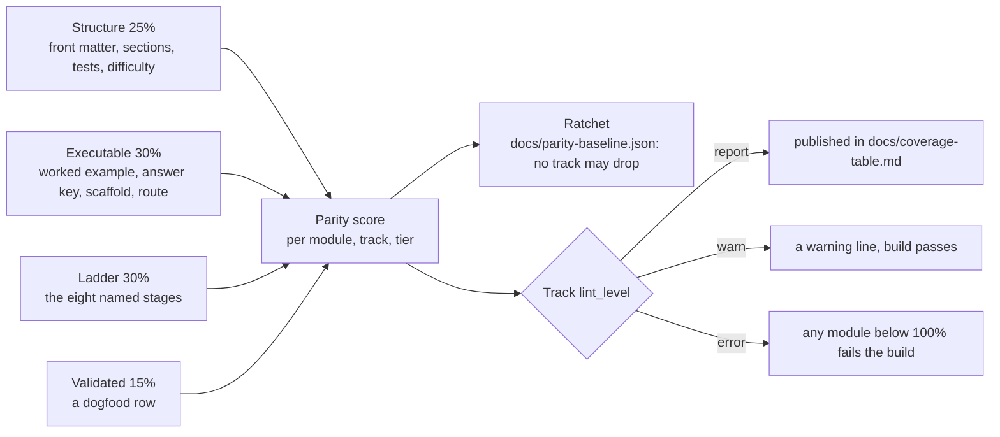

# QUALITY_SPEC — Tier Parity for the Advanced Bridge Modules

The goal of the Tier 2/3 plan is that an advanced module is as good as a Tier 1 lesson: the same
structure, the same automatic grading, the same workbench support, the same teach-measure-break-it
ladder. "As good as Tier 1" is too vague to finish, so this file is the contract, and
[`scripts/module_parity.py`](../scripts/module_parity.py) is the implementation. Run it, read
[`docs/coverage-table.md`](coverage-table.md), and the question "how far is this module?" has a number.

Applies to the **44 bridge modules** in `modules/` (16 Tier 1, 18 Tier 2, 10 Tier 3). The 24 legacy
modules are superseded and out of scope.



## 1. The four layers

Parity = **Structure 25% + Executable 30% + Ladder 30% + Validated 15%**, over the items that are
measurable in this repository today. Each layer is scored as the fraction of its items present.

| Layer | Item | What it is |
| :--- | :--- | :--- |
| Structure | `front_matter_contract` | The keys `lint_modules.REQUIRED_FRONT_MATTER` demands |
| Structure | `numbered_sections` | `## 1. Why it matters` … `## 10. Next modules`, exact titles, in order |
| Structure | `checkpoint_tests` | `### Skip test` **and** `### Gate test`, with `[Recall]`, `[Apply]`, `[Transfer]` |
| Structure | `difficulty_label` | The block in §2 below, complete and in range |
| Structure | `tier3_two_levels` | Tier 3 only: `### Use & Understand` **and** `### Derive & Extend` |
| Executable | `worked_example_runs` | A `python` block in `## 4. Worked example` with an `Expected output:` block — the pair `scripts/validate_modules.py` executes and diffs in CI |
| Executable | `checkpoint_answer_key` | A `**Answer key:**` block that asserts the exercise's numbers |
| Executable | `learner_exercise_scaffold` | A `python` scaffold with `TODO`s for the learner, plus a full solution in `## 5. Exercise` |
| Executable | `verification_route_declared` | The `verification:` key of §2 |
| Ladder | the eight stages | `1_recall`, `2_see_it`, `3_predict`, `4_worked_example`, `5_practice_host`, `6_break_it`, `7_transfer`, `8_integrate` |
| Validated | `dogfood_logged` | A row for the module in [`docs/dogfood-log.md`](dogfood-log.md) |

Two ladder stages are measured by their **named marker**, not by a loose keyword, because a bare
mention of "predict" is not a Predict step:

- `3_predict` — the literal line `**Predict first (before you run it):**`, and the paragraph under it
  must ask for committed numbers (the convention every rewritten track uses);
- `6_break_it` — a `### Break it on purpose` heading whose bullets are `**Inject**`, `**Symptom**`,
  `**Diagnose**` and `**Fix**`.

`scripts/lint_modules.py` reports these **same two markers**, so a published ladder number means one
thing. They did not start out that way: the linter's first read was a keyword alternation
(`\bpredict\b`, `fault|diagnos|miswir`) and it published 12/44 and 20/44 where the named markers find
**7/44** — a read that flatters the content, which is the greenwashing this section exists to
prevent. The loose read is gone, and both tools now print the named-marker counts.

**A scaffold is not a module.** `scripts/new_module.py` writes the marker `TODO-AUTHOR` into every
hole it leaves; a module still carrying it scores **0** on every item, and `scripts/lint_modules.py`
rejects it outright.

## 2. The two metadata blocks

```yaml
difficulty:
  math: 3           # 1..5 — new mathematical objects this module introduces
  coding: 3         # 1..5 — new code/SDK surface
  tools: 2          # 0..5 — new tools (0 = none); a module with tools >= 3 and math >= 4 is a
                    #        candidate to split, since a new tool and a new concept in one lesson
                    #        is the most common cause of overload at this level
  hardware_risk: low    # low | medium | high  (high = supervised bench work only)
  simulation: full      # full | partial | none — can this be done without hardware?
verification: browser   # browser | ci-native | artifact | rubric
```

`verification` is how this module's work is actually checked, so coverage stays honest when the work
cannot run in a browser: `browser` (the in-page Python runner), `ci-native` (compiled and tested on
the runner, e.g. embedded C), `artifact` (a file the learner edits that a tool then checks, e.g.
KiCad ERC/DRC, a URDF), `rubric` (a supervised or tool-lab checklist).

**Every module must carry at least one `browser` or `ci-native` exercise**, whatever its main lab is,
so the concept stays gradable when the tool work is not.

## 3. The two gates

| Gate | File | What it does |
| :--- | :--- | :--- |
| **Ratchet** | [`docs/parity-baseline.json`](parity-baseline.json) | `--check` fails if any track or module drops below its recorded score. Raise it deliberately with `--update-baseline`; it cannot fall by accident. |
| **Level** | `modules/_index.yaml` → `tracks: <track>: lint_level:` | `report` (default), `warn` (missing items print a warning), `error` (any module below 100% fails the build). |

Flipping a track to `lint_level: error` is the plan's visible **"this track is done"** signal. Do it
only when every module in the track is at 100% *and* its dogfood log is complete.

```bash
python3 scripts/module_parity.py                    # refresh docs/coverage-table.md + print the table
python3 scripts/module_parity.py --check             # CI: table in sync, ratchet held, error tracks clean
python3 scripts/module_parity.py --json              # machine-readable scores and missing items
python3 scripts/module_parity.py --update-baseline   # record today's scores as the new floor
```

## 4. What is not instrumented yet

These are part of the plan and are **listed, not scored** — no artifact exists for them yet, and
scoring them zero would hide the work behind a number:

- **Behavioural tests for module exercises.** `INSTRUCTOR_TESTS` in
  `scripts/generate_python_lessons_data.py` covers the 36 beginner lessons only; module exercises have
  no equivalent multi-input/boundary harness, and no three-way gate (starter fails, solution passes,
  spoof fails) runs against them.
- **Module exercises in the workbench.** Only lessons are generated into the app, so no module exercise
  runs in a browser and the Pages E2E suite tests no Tier 2/3 exercise.
- **Maths-claims audit.** Absolute claims (`guaranteed`, `always`, `never`, `positive definite`) with
  their stated assumptions, and a counterexample test where a claim is easy to get wrong.
- **Retention and arrival times.** Whether a Transfer task still passes 1-2 weeks later, and how long
  a real beginner takes. [`docs/dogfood-log.md`](dogfood-log.md) records **author-dogfood** only; the
  beginner pilot is a later step and its numbers must be labelled separately.

## 5. Definition of done for one module

All of these, in order. The first four are what the score measures; the rest is the human review the
score cannot do.

- [ ] ≤2 new ideas declared and accurate; `prereqs` point at real refreshers
- [ ] The difficulty block and the `verification:` route are filled in truthfully
- [ ] All eight ladder stages carry real content (no scaffold marker left)
- [ ] The worked example's `Expected output:` is executed and diffed by CI
- [ ] The exercise has a learner-facing scaffold with TODOs, and an answer-key self-check
- [ ] The Break-it fault is realistic and its diagnosis names the tell that separates it from a
      different fault
- [ ] The Transfer task changes parameters or requirements and is graded by behaviour only
- [ ] Absolute maths claims state their assumptions
- [ ] You have done the module yourself, logged it in `docs/dogfood-log.md`, and fixed what broke
- [ ] The track is still at or above its ratchet, and `scripts/module_parity.py --check` is green

## 6. Working a track

1. `python3 scripts/module_parity.py` — read the missing items per module.
2. Triage each module: **polish** (gaps only), **fill** (thin or unverifiable), or **split**
   (>2 ideas, or a maths jump plus a new tool). Splitting grows the module count; that is the point,
   because smaller steps are what make Tier 1 work.
3. Fill the cheapest layer first: the difficulty block and `verification:` route are metadata, then
   the two ladder stages, then the learner scaffold, then the dogfood row.
4. `--update-baseline` when the scores rise, so the ratchet follows you up.
5. Flip the track to `lint_level: error` when it reaches 100%.

Effort, as a guide only (the plan's estimate): a micro-lesson built to this standard, with tests, is
**4-8 hours** of writing and verifying, plus the time to do it yourself as a learner.
