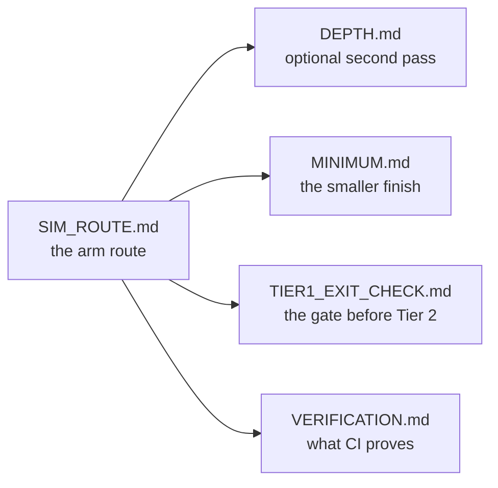

# docs/ — the maps, the checks, and the evidence

Everything here is secondary to the lessons: read [`README.md`](../README.md) first, then
[`track-p/P.1`](../track-p/P.1-variables-and-data-types.md). These pages answer "where am I going",
"what counts as finished", and "how is that claim checked".

## Where am I going

| Page | What it is |
| :--- | :--- |
| [`SIM_ROUTE.md`](SIM_ROUTE.md) | The arm route page by page: all ten steps, every lesson and Tier 1 module, with focused hours. Generated from [`scripts/route_model.py`](../scripts/route_model.py). |
| [`DEPTH.md`](DEPTH.md) | The optional second pass: the 23 Tier 2/3 modules, in the same step order. |
| [`MINIMUM.md`](MINIMUM.md) | The smaller finish that still builds the arm: 47 pages. |
| [`ROUTE.md`](ROUTE.md) | The same ten steps with the arm/depth split explained once. |
| [`CURRICULUM.md`](CURRICULUM.md) | The architecture map: which track supplies what to the capstone. |
| [`EXTENSIONS.md`](EXTENSIONS.md) | The ten optional modules outside both passes, and the ROS 2 install alternative. |
| [`TIER1_EXIT_CHECK.md`](TIER1_EXIT_CHECK.md) | The fourteen-item, paper-only check before Tier 2, each miss mapped to its ramp lesson. |

## How a claim is checked

| Page | What it is |
| :--- | :--- |
| [`VERIFICATION.md`](VERIFICATION.md) | Every badge and every check CI runs, and what each one would catch. |
| [`ASSESSMENTS.md`](ASSESSMENTS.md) | The skip tests, ladder gates and safety gates across the module set. |
| [`QUALITY_SPEC.md`](QUALITY_SPEC.md) | The rules a page must satisfy to ship (sections, asserts, resources). |
| [`STEP_SIZE_AUDIT.md`](STEP_SIZE_AUDIT.md) | Word counts and prerequisite breaks for the pages nearest the flag line. |
| [`UNVERIFIED_CITATIONS.md`](UNVERIFIED_CITATIONS.md) | The external links a host would not answer, kept visible rather than dropped. |
| [`coverage-table.md`](coverage-table.md) | Concept coverage across the modules. |

## The story and the repository

| Page | What it is |
| :--- | :--- |
| [`STORY.md`](STORY.md) | The Last Hands: the premise, the ten missions and what each earns, the Black Box, and the five rules the story may never break. |
| [`CONTENT.md`](CONTENT.md) | The content pipeline: `content/` as the source of truth, the schemas, `npm run build:content`, what `--check` proves, and how a rename resolves through `aliases.yaml`. |
| [`REPO_GAME.md`](REPO_GAME.md) | The repository as the game board: the four issue forms, the PR template, the labels and the ten milestones — and what is deliberately not automated. |
| [`VISUALS.md`](VISUALS.md) | The pictures beside the words: the 72 named scenes and their twelve kinds, a page's own Mermaid flowchart drawn as a numbered route or — when it branches — as a graph, the draggable arm hologram, the reading-pace gate that keeps a beginner page from becoming a wall of prose, the rules a figure may not break (no motion, no hard-coded colour, no unlabelled picture, no redrawn graph), what the kit costs, and the checks that keep a figure honest. |
| [`AUDIO.md`](AUDIO.md) | Sound: off by default and armed by a gesture, the settings panel and its switches, the mixer and its limiter, the seven interface ticks and their pacing, the room's four layers, the two CC0 lo-fi beds with the drone as their fallback, the recorded rain, what ducks a run, and how focus stays quiet. |

## Accounts and administration

| Page | What it is |
| :--- | :--- |
| [`ACCOUNTS.md`](ACCOUNTS.md) | Optional sign-in (Google, email + password, emailed link), what syncs and what never leaves the browser, export and delete, and the staging-first setup: migrations, redirect allow-list, the Google callback, Edge Functions and build variables. |
| [`ADMIN.md`](ADMIN.md) | The admin area: the first admin out of band, the server-side role and MFA checks, the announcement and the one feature flag, the audit log, and curriculum changes leaving as reviewed pull requests. |

## Building the workbench

| Page | What it is |
| :--- | :--- |
| [`RESET.md`](RESET.md) | Starting over: the eleven parts and what each one owns, the two-press rule and the backup beside it, the watermark that stops cloud sync undoing a reset, and the limits (a second device, the XP ledger). |
| [`THEME.md`](THEME.md) | Every colour token in both palettes side by side, the utility that reaches each one, and the rules that keep a tab legible in both modes. Checked against [`app/src/index.css`](../app/src/index.css) by [`tests/test_theme_docs.py`](../tests/test_theme_docs.py). |
| [`PLAN-2.1a.md`](PLAN-2.1a.md) | The study-confidence release, revised from a review: every finding checked against the code and marked verified, stale or fixed, then ordered into the retention rule (authored work is never evicted), reading inside the lesson, a quiet first screen, measured performance and one beginner sitting. §0 (trust fixes), §1 (retention: authored work is never evicted), §2 (the lesson reader beside the editor, with the reading position kept and GitHub demoted to a source link), §3 (a quiet first screen, with the type scale measured in a browser), §4 (the six visit moments, timed on a laptop and a throttled phone) and §5 (the sitting instrument: one record per beginner, a debrief, the observation ticket rendered from it, and the 7–14 day transfer check) are in this repository now, with their suites. §5 has no participant rows yet — those need three beginners, not a commit. |
| [`PLAN-2.0-GAP.md`](PLAN-2.0-GAP.md) | The workspace plan mapped against the code, and closed: every row says what shipped and names the command or step that proves it, ending with a summary of what the phase guarantees and what stays a boundary. Checked by [`scripts/check_plan_rows.py`](../scripts/check_plan_rows.py) — no row may reopen, every row must name something runnable, and every count it quotes is resolved against [`plan-facts.json`](plan-facts.json). |
| [`plan-facts.json`](plan-facts.json) | The numbers the 2.0 page quotes and what owns each one: the gate list, the tab registry, the surface snapshot, the prose index, the error index, the committed firmware, the measured bundle total and the exercise sources. `scripts/check_plan_rows.py` recomputes them, so a stale number fails a push instead of waiting for a sweep. |
| [`weight-budget.json`](weight-budget.json) | What the built bundle may cost, in gzipped bytes: the shell totals, the largest chunk, and today's measurement — with a second block for the `signed_in` build CI makes, which carries the account library, so the same source is budgeted in both of its shapes. The account panel, the learner dashboard and the admin area are lazy chunks, so a visitor who never opens them does not wait for them. Enforced by `npm run check:weight`, whose rules a unit suite pins — including that the `dist/` it measures is not older than the sources it claims to describe, and that a stub chunk is not mistaken for a loaded library. When `dist/` is the local-only build the gate builds the signed-in shape beside it (`dist-signed-in/`, removed after measuring), so the shape CI ships is graded before a push rather than only on the runner. |
| [`a11y-allowlist.json`](a11y-allowlist.json) | Exceptions to the axe gate (`npm run check:axe`), each with a reason. Empty, and stale entries fail, so an exception cannot outlive what it excused. |
| [`lighthouse-allowlist.json`](lighthouse-allowlist.json) | Exceptions to the Lighthouse gate (`npm run check:lighthouse`), which runs `best-practices`, `seo` and `accessibility` on the built bundle. One entry (`valid-source-maps`), same three-way ratchet: unlisted fails, wider fails, stale fails. Both default palettes are audited (dark, then light), each pinned in the browser and verified there before the audit, so neither the operator's desktop nor a bare runner decides which palette is graded. Performance is not a category this gate runs. |
| [`surface-snapshot.json`](surface-snapshot.json) | The painted surface of all 52 surface/palette combinations (twelve tabs and Home) — region geometry (2 px tolerance), control counts, resolved colours, type and tokens — compared by `npm run check:snapshot`. Not a pixel diff, deliberately: see the script's header. Font stacks are recorded with the platform aliases (`-apple-system`, `BlinkMacSystemFont`, `system-ui`) removed, because Chrome prints those differently on macOS and Linux and the app does not choose them. Re-record with `--record` and read the diff. |
| [`PERF.md`](PERF.md) | The visit, timed: six moments (navigation → lesson text, the pane → first keystroke, first and warm runs → output, a lesson switch, a reload → draft restored) on a laptop and on a throttled phone, with the machine and date beside every number. Written by `npm run test:perf -- --record`; the page and its ceilings are checked without a browser by `npm run test:perf:unit`. |
| [`perf-budget.json`](perf-budget.json) | The ceilings `npm run test:perf` grades against, per profile and per moment, at roughly three to four times the recorded value: a regression that matters fails, a busy afternoon does not. |

## When you are stuck or coming back

- [`ERROR_EXPLAINER.md`](ERROR_EXPLAINER.md) — the failure you are looking at, by traceback and by symptom.
- [`REENTRY.md`](REENTRY.md) — a five-task, twenty-minute way back in after weeks away.
- [`PILOT.md`](PILOT.md) and [`pilot-results.md`](pilot-results.md) — how the beginner test is run and what it found. The results page is generated from the participant folders by [`scripts/pilot_results.py`](../scripts/pilot_results.py), with `--check` failing when the page and the folders disagree; its author walk is written in [`AUTHOR_WALK.md`](AUTHOR_WALK.md), because a narrative is not a count.
- [`PILOT_KIT.md`](PILOT_KIT.md) — the operator's run book for one sitting: the dry run, the sitting record (one `--stop` per place they stopped), the export check while the participant is still there, the closed row, and the aggregate.
- [`BEGINNER_TEST.md`](BEGINNER_TEST.md), [`friction-report.md`](friction-report.md), [`dogfood-log.md`](dogfood-log.md) — the sitting notes behind the difficulty fixes.

## Assets

| File | What it is |
| :--- | :--- |
| [`media/arm-sim.gif`](media/arm-sim.gif) | The hero animation in the root README: the 2-DOF arm tracking its figure-8, captured from the simulator. |
| [`media/social-preview.png`](media/social-preview.png) | The 1200x630 GitHub social preview. Regenerate with `node scripts/generate_social_preview.mjs` (it reads the lesson count from disk), then upload it by hand under **Settings → General → Social preview** - GitHub has no API for that slot. |

## Contributing

Rules and the local suite are in [`CONTRIBUTING.md`](../CONTRIBUTING.md); the app's token reference is
[`THEME.md`](THEME.md). Generated pages
(`SIM_ROUTE.md`, `DEPTH.md`, `MINIMUM.md`, the route tables) are written by
[`scripts/generate_sim_route.py`](../scripts/generate_sim_route.py); edit the model or the lesson
front matter, then re-run the generator, never the numbers by hand.
