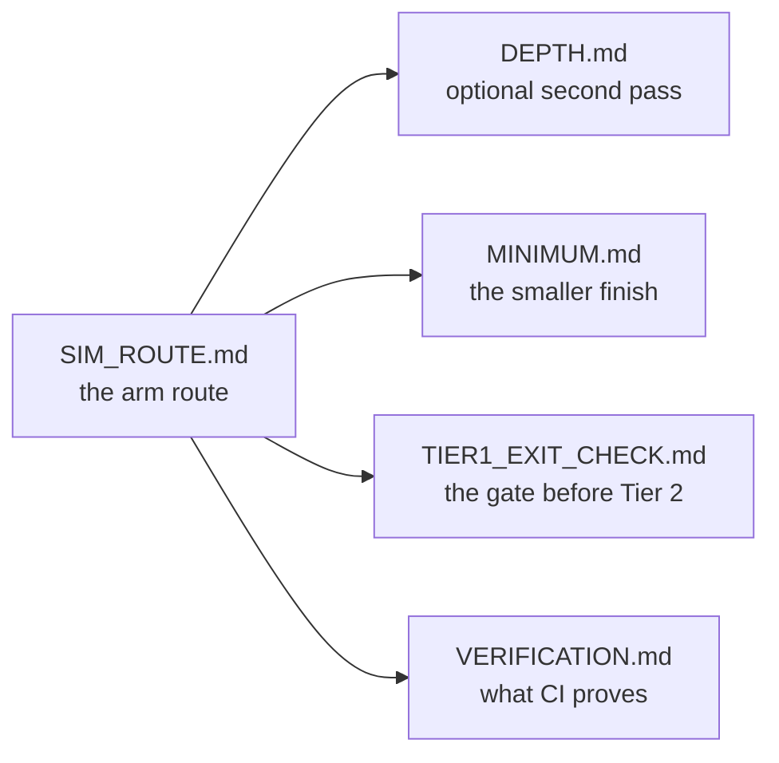

# docs/ — the maps, the checks, and the evidence

Everything here is secondary to the lessons: read [`README.md`](../README.md) first, then
[`track-p/P.1`](../track-p/P.1-variables-and-data-types.md). These pages answer "where am I going",
"what counts as finished", and "how is that claim checked".

## Where am I going

| Page | What it is |
| :--- | :--- |
| [`SIM_ROUTE.md`](SIM_ROUTE.md) | The arm route page by page: all ten steps, every lesson and Tier 1 module, with focused hours. Generated from [`scripts/route_model.py`](../scripts/route_model.py). |
| [`DEPTH.md`](DEPTH.md) | The optional second pass: the 23 Tier 2/3 modules, in the same step order. |
| [`MINIMUM.md`](MINIMUM.md) | The smaller finish that still builds the arm: 47 pages. |
| [`ROUTE.md`](ROUTE.md) | The same ten steps with the arm/depth split explained once. |
| [`CURRICULUM.md`](CURRICULUM.md) | The architecture map: which track supplies what to the capstone. |
| [`EXTENSIONS.md`](EXTENSIONS.md) | The ten optional modules outside both passes, and the ROS 2 install alternative. |
| [`TIER1_EXIT_CHECK.md`](TIER1_EXIT_CHECK.md) | The fourteen-item, paper-only check before Tier 2, each miss mapped to its ramp lesson. |

## How a claim is checked

| Page | What it is |
| :--- | :--- |
| [`VERIFICATION.md`](VERIFICATION.md) | Every badge and every check CI runs, and what each one would catch. |
| [`ASSESSMENTS.md`](ASSESSMENTS.md) | The skip tests, ladder gates and safety gates across the module set. |
| [`QUALITY_SPEC.md`](QUALITY_SPEC.md) | The rules a page must satisfy to ship (sections, asserts, resources). |
| [`STEP_SIZE_AUDIT.md`](STEP_SIZE_AUDIT.md) | Word counts and prerequisite breaks for the pages nearest the flag line. |
| [`UNVERIFIED_CITATIONS.md`](UNVERIFIED_CITATIONS.md) | The external links a host would not answer, kept visible rather than dropped. |
| [`coverage-table.md`](coverage-table.md) | Concept coverage across the modules. |

## Building the workbench

| Page | What it is |
| :--- | :--- |
| [`THEME.md`](THEME.md) | Every colour token in both palettes side by side, the utility that reaches each one, and the rules that keep a tab legible in both modes. Checked against [`app/src/index.css`](../app/src/index.css) by [`tests/test_theme_docs.py`](../tests/test_theme_docs.py). |
| [`PLAN-2.0-GAP.md`](PLAN-2.0-GAP.md) | The workspace plan mapped against the code as it ships: what is already in production, what is partial, what is missing, and the order to build the rest. |
| [`weight-budget.json`](weight-budget.json) | What the built bundle may cost, in gzipped bytes: the shell totals, the largest chunk, and today's measurement. Enforced by `npm run check:weight`, whose rules a unit suite pins. |
| [`a11y-allowlist.json`](a11y-allowlist.json) | Exceptions to the axe gate (`npm run check:axe`), each with a reason. Empty, and stale entries fail, so an exception cannot outlive what it excused. |

## When you are stuck or coming back

- [`ERROR_EXPLAINER.md`](ERROR_EXPLAINER.md) — the failure you are looking at, by traceback and by symptom.
- [`REENTRY.md`](REENTRY.md) — a five-task, twenty-minute way back in after weeks away.
- [`PILOT.md`](PILOT.md) and [`pilot-results.md`](pilot-results.md) — how the beginner test is run and what it found.
- [`BEGINNER_TEST.md`](BEGINNER_TEST.md), [`friction-report.md`](friction-report.md), [`dogfood-log.md`](dogfood-log.md) — the sitting notes behind the difficulty fixes.

## Assets

| File | What it is |
| :--- | :--- |
| [`media/arm-sim.gif`](media/arm-sim.gif) | The hero animation in the root README: the 2-DOF arm tracking its figure-8, captured from the simulator. |
| [`media/social-preview.png`](media/social-preview.png) | The 1200x630 GitHub social preview. Regenerate with `node scripts/generate_social_preview.mjs` (it reads the lesson count from disk), then upload it by hand under **Settings → General → Social preview** - GitHub has no API for that slot. |

## Contributing

Rules and the local suite are in [`CONTRIBUTING.md`](../CONTRIBUTING.md); the app's token reference is
[`THEME.md`](THEME.md). Generated pages
(`SIM_ROUTE.md`, `DEPTH.md`, `MINIMUM.md`, the route tables) are written by
[`scripts/generate_sim_route.py`](../scripts/generate_sim_route.py); edit the model or the lesson
front matter, then re-run the generator, never the numbers by hand.
