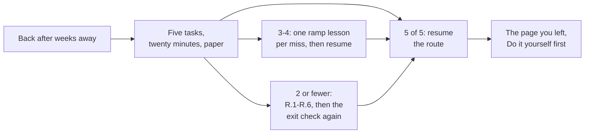

# Coming back after a break — a twenty-minute return path

Weeks away do not delete the ideas; they delete the **arithmetic under them**. A learner who could read a
rate off two encoder counts comes back able to explain what a rate is and unable to get `18.408` without
a unit error. The rest of this repository is written for someone moving forward, so a returning learner
either re-reads a track they already know or restarts from a page they do not need.

This page is the third option: a **five-task paper check, twenty minutes, no notes**, and a table that
sends each miss to the one ramp lesson that repairs it, then straight back to the page you left. It
reuses the numbers in [`docs/TIER1_EXIT_CHECK.md`](TIER1_EXIT_CHECK.md) rather than inventing new ones,
so the two pages cannot disagree.

## 1. The check

Five tasks, chosen so that between them they touch **all six** ramp lessons. Paper only: writing the
arithmetic down is the whole measurement — a right answer reached by memory is the thing that has rotted.

| # | Task | Ramp lesson | Exit item |
| :--- | :--- | :--- | :--- |
| 1 | An encoder reads **24 counts** in **2 ms**, 4096 counts per turn. Give the speed in rad/s, and say what a negative answer would mean. | R.1 | 1 |
| 2 | A joint starts at **1.2 rad** and its velocity trace accumulates **+0.9 rad**. Where is it now, and what would the code report if `q0` were dropped? | R.2 | 8 |
| 3 | A joint sits at `[0.10 rad, 1.0 rad/s]` with `dt = 10 ms` and acceleration `20 rad/s²`. Give the next state, then write that tick as `x + dt (A x + B u)` with `A = [[0, 1], [0, −2.5]]`, `B = [[0], [50]]`, `u = 0.4` and give `A x`. | R.3, R.4 | 11, 12 |
| 4 | Add the arrows `3∠0°` and `4∠90°`. Give the length and the angle, and say what adding the lengths would have given. | R.5 | 13 |
| 5 | A first-order lag has `τ = 0.05 s`. Give its corner frequency in Hz, and the gain and phase there. | R.6 | 14 |

Mark each one ✅ or ❌. A task with the right number and the wrong unit is a miss: that is exactly the
failure this check exists to find.

<strong>Answer key — open after all five are written down</strong>

1. `24 / 0.002 = 12 000 counts/s`, then `× 2π/4096 = 18.408 rad/s`. A negative rate means the joint moved
   toward −q, not that the measurement failed.
2. `1.2 + 0.9 = 2.1 rad`. Without `q0` the code reports `0.9 rad`: a correct area and a 1.2 rad pose error.
3. `qd = 1.0 + 20 × 0.01 = 1.2 rad/s`; `q = 0.10 + 1.0 × 0.01 = 0.110 rad`, using the **old** speed (the
   new-speed variant gives `0.112 rad`). `A x = [1.0, −2.5]`, and row 1 is the speed rate.
4. `√(3² + 4²) = 5` at `atan2(4, 3) = 53.130°`. Adding lengths gives 7, which is only right if the two
   arrows point the same way.
5. `ω = 1/0.05 = 20 rad/s = 3.183099 Hz`; gain `1/√2 = 0.7071`, phase `−45°`.

## 2. Where the score sends you

| Score | Reading | What to do — and when you are back |
| :--- | :--- | :--- |
| **5 / 5** | The habits survived the break | Resume at the page you left (§3). No ramp, no re-reading. |
| **3–4 / 5** | One or two operations went cold | Do the ramp lesson for each miss (0.75–1.0 h typical each), then resume. A miss on task 3 needs both R.3 and R.4, because the tick and the matrix form are one operation. |
| **2 or fewer** | The arithmetic is gone, the ideas are not | Do R.1–R.6 in order (target 5–6 h across all six), then retake [`docs/TIER1_EXIT_CHECK.md`](TIER1_EXIT_CHECK.md) out of 14 and follow its table. |

A miss costs **one lesson**, never a tier. Nothing here asks you to redo Track P or Stage 0: if you
finished them, the only thing to re-enter is the arithmetic, and the ramp is six short lessons written
for exactly that.

## 3. Picking up the thread

| Where you stopped | What to open | First hour |
| :--- | :--- | :--- |
| Mid-lesson, `Do it yourself` unfinished | The same lesson, at its Starter Code | Run the starter as-is, fill the TODOs, compare against Expected Output. Do not reread the Learn section first. |
| Between pages — last one finished, next not started | The **next** page's first section and its `Do it yourself` | One page, one run. The hour ends with that page's output matching, not with a plan. |
| After Gate 1→2, before Tier 2 | The check in §1, then the first Tier 2 page | If the check is 5/5, start [`00-foundations.T2.00a`](../modules/00-foundations.T2.00a.md) directly; if not, the ramp first. |

The rule underneath the table: **a page is re-entered by running its code, not by reading it.** Reading
produces the feeling of recall that this page exists to distrust. Run the starter, let the output differ
from Expected Output, and the gap names itself.

## 4. What to skip on the way back

- **The placement quiz (`Gate P→0`)** — it places a beginner, and you are not one any more. Retake it only
  if you never finished Track P.
- **Tier 1 pages whose packages still pass.** `python3 scripts/run_exercise.py --only 00-foundations.T2.00a`
  re-grades that package in under a second; a passing run is better evidence than a reread, and a failing
  one tells you the one page to open. Without `--only` the same command grades every package, which is
  what you want at a milestone, not on the way back.
- **The six practical gates** in the Workbench's Tier 1 Exit Review, unless you never sat them. The maths
  half is the half that rots; the practical half needs a bench and a person.
- **The bench itself.** Nothing in this page needs hardware, and rebuilding a setup is the most reliable
  way to turn a twenty-minute return into a lost weekend.

## 5. The first sitting back

Take the check first (20 minutes), then put **25 minutes** into the page it points at, and stop there —
even mid-`Do it yourself`. A first sitting that ends with a page's output matching is a return; one that
ends with a re-read of three tracks is a second break waiting to happen.

## How this page is kept honest

The numbers in §1 are not retyped from memory: `tests/test_reentry.py` requires every task's exit item to
exist, to name the same ramp lesson this table claims, and every decimal in the answer key to appear in
[`docs/TIER1_EXIT_CHECK.md`](TIER1_EXIT_CHECK.md). It also checks the five tasks touch all six ramp
lessons between them — a task set that quietly stopped sampling R.4 would pass a link check and fail a
returning learner. If the exit check's answer to item 11 changes, this page fails CI until it changes too.
