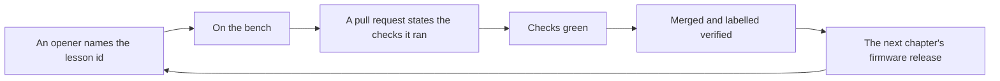

# The repository is the game board

The site tells one story, and the repository is where that story is written, reviewed and released.
Nothing here is a separate product: a Work Order is a task, a Field Service Call is a bug, a Black Box
Voice is a recording, and the ten milestones are the ten missions.

## Openers

| Form | What it is | Lands in |
| :--- | :--- | :--- |
| **Work Order** (`.github/ISSUE_TEMPLATE/work-order.yml`) | A content task: a lesson, a mission, a recording, a reward rule, a surface. Asks for the id and the command that would prove it. | `content/`, a page, or the app |
| **Field Service Call** | A fault. Asks for the build and the content version from the footer, so it can be reproduced. | the code or a lesson |
| **Black Box Voice** | A contributor's recording. 120 words, one concrete mistake, a voice and a credit. | `content/blackbox/NN-slug.md` |
| **Leave a Recording** | A learner's Chapter 10 recording, for the community archive. Optional and public; asks for consent. | `community/archive/` (maintainer review) |

Every form is a YAML file with `labels:` and required fields, so an incomplete report cannot be filed
and the right label is applied without a maintainer's first triage.

## Labels

[`.github/labels.yml`](../.github/labels.yml) is the reviewed list — work, field, and state. Sync it
with `gh label create` (or a label-sync action pointed at the file). Nothing here runs on its own, so
labels cannot change behind a pull request's back.

## Milestones

[`.github/milestones.yml`](../.github/milestones.yml) names the ten missions. Closing one is what
makes a chapter a release candidate: its Work Orders are the lessons, recordings and rules the mission
needs, and the release note names the firmware version the chapter shipped as. The milestone number is
the mission's spine step, so a milestone and a mission cannot disagree.

## Pull requests

[`.github/pull_request_template.md`](../.github/pull_request_template.md) asks the four things a
review needs: what changes for the learner, which lesson or mission id it touches, the checks that
were run, and the five hard rules (rewards follow verified work; nothing learning-related is locked;
sound is opt-in; reduced motion still holds; a starter still fails and a solution still passes).

A content change names its file under `content/` and commits the rebuilt bundle beside it —
`npm run check:content` fails if only one of them landed.

## What is deliberately not automated

- **No leaderboard and no contributor streaks.** The game rewards a learner's verified work; a
  contributor's reward is the change landing.
- **No bot that merges.** The Leave a Recording form is reviewed by a person, because it is published
  under a handle and cannot be un-published quietly.
- **No CI auto-grading of submitted solutions.** It needs graders that run outside the browser; until
  that exists, a submission is a description, not a score.
