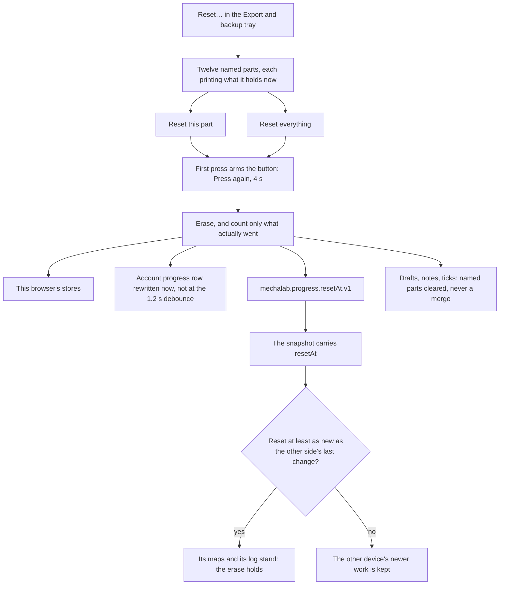

# Starting over — resetting progress, wholly or by part

Every other store in this app only grows. A restore merges, a tick once set stays set, and a review
card follows the more-reviewed copy — all of that is right for a learner who changed laptops, and all
of it is wrong for the one case this page is about: *"I want to start again."* The only lever used to
be the browser's own "clear site data", which takes the theme, the sound choice and the layout with
it, because those live in the same bucket.

The reset panel is the deliberate opposite of the backup, in the same vocabulary. It is opened by
**Reset…** at the end of the header's *Export and backup* tray, and it can erase one part or all of
them. The rules live in [`app/src/progressReset.ts`](../app/src/progressReset.ts); the panel is
[`app/src/components/ResetProgressDialog.tsx`](../app/src/components/ResetProgressDialog.tsx), behind a
lazy boundary so a learner who never opens it never downloads it.



## The twelve parts

| Part | What it erases | The copy it also clears |
| :--- | :--- | :--- |
| Lessons | the verdicts, the self-marked ticks, the grader stamps | the account's progress row |
| Lesson checklists | the ticks made in a lesson's bullet checklists; the lesson text and notes stay | the account's workspace row (opt-in) |
| Milestones | the roadmap ticks; the roadmap and the lessons stay | the account's progress row |
| XP and awards | the ledger: levels, proof marks, the Scrap they paid for | this browser only |
| Practice cards | the review schedule and its history; the cards return from your highlights | this browser only |
| Notes and highlights | what you wrote beside a lesson and the passages you marked | the account's workspace row (opt-in) |
| Drafts and versions | the unfinished editor text per lesson and the versions each Run filed | the account's workspace row (opt-in) |
| Learning log | every open, run, hint and verdict — what the exports and the trail read | the account's progress row |
| Sittings | the clock: when you worked and for how long | this browser only |
| Predictions | what you guessed the output would be before running it | this browser only |
| Onboarding | the first-run tour, the prologue and the two dismissed hints — resetting replays them | this browser only |
| Where I was | the lesson the next visit reopens, the last page you landed on, your reading places | this browser only |

**Preferences are not here on purpose.** The theme, the sound levels, the layout and dock, the keymap
and the breakpoints are choices about a screen rather than work, and each already has its own control
(Sound's Reset, the shortcut sheet's Reset all keys, the palette's four modes). A reset that silently
flipped one back would be a second, unasked-for change. `scripts/e2e_reset.mjs` pins that: it seeds a
theme and a sound choice, presses **Reset everything**, and asserts both keys are byte-for-byte what
they were.

## Two presses, and a backup first

Nothing is erased on one press. A row's button and the footer's **Reset everything** both arm on the
first press (the label says *Press again*) and erase on the second, within four seconds; the armed
state belongs to one target at a time and clears itself. A browser `confirm()` was the alternative and
it is worse: it cannot print the counts, it cannot offer the backup, and it blocks the same thread the
stores are read on.

Erasing is final — there is no undo — so the panel's footer puts **Back up first** beside the
destructive control, and it writes the same `.zip` the header's *Back Up* writes. The archive's own
`README.txt` says what it holds and what a restore merges, so the way back is documented in the file
itself.

Every row prints what is stored *now* — `2 verified · 1 self-marked`, `1 draft · 1 version`, `3 of 4
seen` — because "erase my progress" is only a safe offer when the screen says what progress means. A
part with nothing in it is skipped rather than written back as an empty store, so a second press cannot
look like it did something, and the sentence afterwards counts only what was actually erased:
`Reset 4 items · Lessons, Predictions`.

## A part opens: one lesson, one award, one day

A part is a door as well as a button. **Choose** opens the row into the items the store actually holds,
and each item has its own erase — because erasing nine lessons to un-verify one is a bigger mistake
than the one being fixed. [`app/src/resetItems.ts`](../app/src/resetItems.ts) answers each part with
its items, and an item is the unit a learner would name:

| Part | An item is |
| :--- | :--- |
| Lessons | one lesson id, with its verdict, its self-mark and its grader stamp |
| Milestones | one roadmap tick |
| XP and awards | one award in the ledger |
| Practice cards | one review card, labelled with its quote |
| Notes and highlights | one lesson's note and every highlight on it |
| Drafts and versions | one lesson's draft and the versions each Run filed |
| Learning log | **one day** of events — a list of five thousand rows is not a list |
| Sittings | one stretch of work, with its length and run count |
| Predictions | one lesson's commit |
| Onboarding | one of the four marks (tour, prologue, Start Here, the editor's first guide) |
| Where I was | the last lesson, the last page, or one lesson's reading place |

The items always add up to the row: `scripts/test_reset.mjs` asserts, for every part, that the sum of
its item counts is the number on the row, so a second counting model cannot drift from the first. One
item still takes two presses, and an item the store does not have erases nothing and stays quiet. A
single lesson or milestone still writes the watermark, because it is a part the account holds; a single
note, draft or checklist reports the workspace copy instead.

## The watermark, and why an empty map is not enough

Cloud sync's rule is "never lose work": a flag true on either side stays true. That is what makes two
devices safe, and it is exactly what would undo a reset. After erasing, this browser uploads an empty
snapshot, and that empty snapshot is indistinguishable from "this device has nothing to say" — so the
next sign-in would union the account's old flags straight back in, silently.

So a reset of a part the account also holds writes `mechalab.progress.resetAt.v1`, and the snapshot
carries it as `resetAt` ([`app/src/progressMerge.ts`](../app/src/progressMerge.ts)). A snapshot whose
reset is at least as new as the other side's last change wins outright: its maps are taken as they are
and its log is the log. A reset *older* than the other side's change loses, which is the case that has
to keep a second device's newer work alive.

`App` rewrites the account's row immediately on a reset rather than waiting for the 1.2 s debounce
([`app/src/App.tsx`](../app/src/App.tsx)), because a tab closed inside that window would leave the old
flags on the server and meet them again at the next sign-in. Drafts, notes and checklist ticks are the
opt-in workspace row, and that row merges by rule — so a reset writes the named parts away instead
(`resetWorkspace` in [`app/src/workspaceSync.ts`](../app/src/workspaceSync.ts)); otherwise the erased
work would arrive back from the account at the next sync. It clears only what was reset: erasing drafts
must not take the account's notes or its ticks with it.

## What it cannot do

- **A second device that syncs after the reset is newer than it.** The watermark settles this browser
  and the account row; another machine still behind, which uploads later, wins by the ordinary merge
  rule. Closing that needs a per-account deletion clock on the server, which is a schema change this
  feature does not need.
- **Resetting Lessons leaves the XP ledger** unless that row is erased too. The parts are independent
  by design; **Reset everything** is the one press that closes the gap.
- **It does not touch the lesson text, the curriculum, or the account itself.** Signing out and
  deleting an account are separate actions in the account panel.

## How it is checked

```bash
npm run test:reset       # the registry, the counts, one part vs its neighbours, the watermark, the event
npm run test:merge       # the reset rule in cloud sync: newer reset drops the old side, older reset cannot
npm run test:e2e:reset   # Chromium: a backup first, one part then two, everything, preferences kept, no reload
```

Both suites ride `npm run test:workbench` as `reset` and `reset2e`, so CI runs them with the rest of the
matrix. The event a reset dispatches is `mechalab:progress-reset`; `App` listens, re-reads the three
progress maps and bumps the same `storeNonce` a restore uses, which is why a milestone unticks on screen
without a reload.
