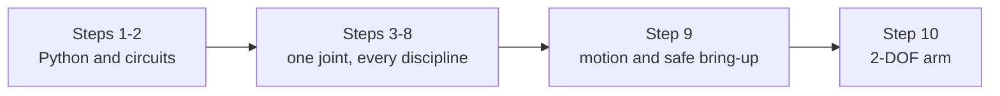

# The full route map

> **Audience:** maintainers, and learners who have finished a few steps and want the whole
> map. The front page deliberately shows only **Steps 1-10**; this page keeps the ten steps and
> the two finish lines. The internal ids and the depth matrix are in [`CURRICULUM.md`](CURRICULUM.md).



## Read here, run there

The course has two surfaces, and they do different jobs. Use both, in this order:

| Surface | Use it for | What it does not do |
| :--- | :--- | :--- |
| The lesson page on GitHub | Reading: the idea, the worked example, the resources, the checklist | Run or grade anything. GitHub is read-only for a learner, so nothing you type there is saved. |
| [The MechaLab workbench](https://tle47.github.io/Mechatronics-Roadmap/) (Tab 2) | Typing the code, running it, the hint ladder, the graded checks, your progress | Teach the idea; the page carries that. |

Every lesson in Tab 2 shows its own page path with a **Read this page on GitHub ↗** link, and every
page opens with the same **Run this in the workbench** callout naming its own id, so a learner who
arrives from a search result is told where to run it before reading anything else. Every page runs
in the same tab, so a learner never has to guess which one to open: read on the page, run in the
workbench, and the lesson only counts once the workbench verifies it. **Export Progress
(.md)** and **Export Learning Log (.json)** are the two records of that; neither leaves your browser
unless you hand it over.

## Where the ids and depth live

The step-to-folder/id map, the full depth matrix, and the CI checks that keep them aligned are
in [`CURRICULUM.md`](CURRICULUM.md). This page stays learner-facing: ten steps, two finish lines,
and the arm they build.

## What "complete" means

There are three finish lines, and all are real:

- **Minimum viable finish** - Track P, Stage 0, every Tier 1 bridge, the five lessons the
  capstone opens, and the capstone itself. That is one working, verified 2-DOF arm at about
  half the focused hours; the exact page list is [`MINIMUM.md`](MINIMUM.md). Stop here and
  you are done, not behind.
- **Arm route** - all 48 prose lessons plus the 17 arm modules, page by page in
  [`SIM_ROUTE.md`](SIM_ROUTE.md). That is **≈120–210 focused hours**, and it contains no depth
  modules and no Extensions. Stop here and the arm is finished.
- **Full course** - the arm route plus the optional depth pass in [`DEPTH.md`](DEPTH.md):
  **≈200–290 focused hours** for 40 practice modules (17 arm + 23 depth) plus all 48 lessons.
  The depth pass comes after the arm and explains why it works rather than replacing it.

Everything in Extensions is graded and badgeable but optional, and outside both routes. The front
page gives the focused-hours label and the calendar estimate; an hour target is not elapsed time.

## One arm, ten steps

The same joint and 2-DOF arm recur from Step 3 to Step 10. Each page follows the same teaching
sequence: recall, see it, predict, work through, practise with support, break it on purpose,
transfer, integrate.

| Step | You build | The joint or arm question it answers |
| ---: | :--- | :--- |
| 1 | Python and units | Can I write the formula and check it? |
| 2 | Circuits and an Uno | Can I make a light respond to a knob, safely? |
| 3 | A joint model | How does torque become motion, and how fast? |
| 4 | A motor drive | How do I reverse a motor and survive its switching? |
| 5 | Arm geometry | Where is the tip, and what angles put it there? |
| 6 | Encoders | Where is the joint, really, and how clean is that number? |
| 7 | A fixed-rate loop | Can the controller run every millisecond without blocking? |
| 8 | PID and a filter | Will it hold position against gravity without oscillating? |
| 9 | Paths and safe bring-up | Can it follow a smooth path and fail safe? |
| 10 | The capstone | Does the whole arm track a figure-8 and survive planted faults? |

## What a finished page looks like

The same joint before and after the control step, so a learner can see what the route is for:

```python
# Before: blocking loop, unclamped windup, no gravity compensation.
# delay(10) freezes the CPU; integral_sum winds up under saturation (37.2% overshoot).
error = target_rad - measured_rad
integral_sum += error * 0.010
pwm_cmd = Kp * error + Ki * integral_sum + Kd * (error - prev_error) / 0.010

# After Step 8: 1 kHz timer ISR, clamping anti-windup, gravity feedforward.
# Overshoot drops 37.2% -> 4.7%, and the derivative acts on measurement.
tau_grav = m * g * L_com * math.cos(q_rad)
u_raw = tau_grav + Kp * (q_des - q_rad) - Kd * q_dot + i_term
u_cmd = max(-u_max, min(u_max, u_raw))
```

## Hardware, if you choose it

| Route | What it adds | Expected help and safety boundary |
| :--- | :--- | :--- |
| **Simulation (\$0)** | Nothing: the route exactly as written, in Pyodide, Falstad, Wokwi, MuJoCo and a ROS 2 container | **Self-guided:** hints, the school-math ramp and the tool first-run labs are designed to be enough |
| **Optional low-voltage bench** | Breadboard, meter, and a motor up to 12 V (Arduino Uno, `DRV8833`/`TB6612FNG`, `AS5600`, 2-DOF desktop arm) | **Occasional help is reasonable**, especially for first-time breadboarding and soldering |
| **Supervised production practice** | Schematic/PCB review, SIL/HIL fault injection, 24 V/15 A or 48 V/30 A commissioning | **Requires experienced review and a pre-bring-up sign-off;** never energise high-energy hardware alone |

The bill of materials is in [`resources/lab-workbench-bom.md`](../resources/lab-workbench-bom.md).
