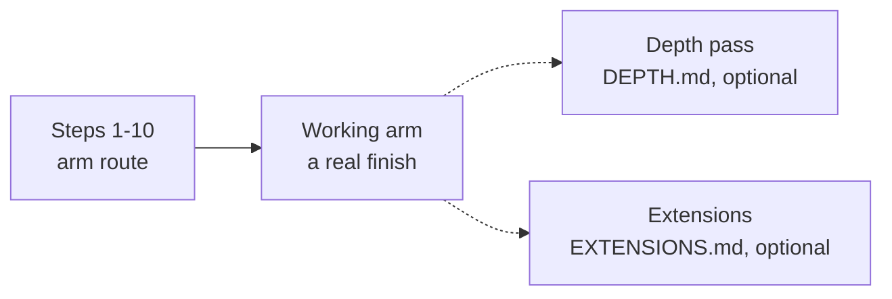

# The arm route: ten steps to one working arm

<!-- Generated by scripts/generate_sim_route.py - do not edit by hand.
     Focused hours are summed from each page's own metadata (`est_hours`,
     `typical_hours`, `slow_learner_hours`); the second column of a range is the
     slow-learner figure. They exclude setup, debugging and re-reading. -->

This page is the **arm route only**: all the prose lessons, every Tier 1 bridge, and the
capstone. It contains no depth modules and no Extensions, so nothing on it is optional.
Take Steps 1-10 in order and stop at the working arm.

After it, there are two further layers, each with its own generated page: the **depth
pass** in [`DEPTH.md`](DEPTH.md) (23 Tier 2/3 modules, taken in the same step order) and
the **Extensions** in [`EXTENSIONS.md`](EXTENSIONS.md). Neither is required for the arm.

**Arm route total: ≈120–210 focused hours** for 17 arm modules and all 48 lessons. The depth pass is 80 hours; the full course is ≈200–290.

**Route status: `author-dogfood`** — the author has run every page and no outside learner has finished this route, so every hour is a target rather than a measurement.

Track P's lesson ids skip `P.13` on purpose: saved progress and every link are keyed by
lesson id, so `P.14` keeps the number it shipped with. The gap is not a missing lesson.

## Arm route (required)

| Stage | Item | Focused hours |
| :--- | :--- | ---: |
| Step 1 · Python and the maths a robot needs | `P.1` Variables and Fundamental Data Types | 1-3 |
| Step 1 · Python and the maths a robot needs | `P.2` Computer Arithmetic and Order of Operations | 1-2.5 |
| Step 1 · Python and the maths a robot needs | `P.3` Conditional Decisions (if/elif/else) and Command Clamping | 1.5-3.5 |
| Step 1 · Python and the maths a robot needs | `P.4` Ordered Lists and Repeating Actions with for Loops | 1.5-3.5 |
| Step 1 · Python and the maths a robot needs | `P.5` Reusable Functions (def/return) and while Loops | 1.5-3.5 |
| Step 1 · Python and the maths a robot needs | `P.6` Loading Modules (import) and Automated Self-Checks (assert) | 1-3 |
| Step 1 · Python and the maths a robot needs | `P.7` Base SI Units and Metric Prefixes (M, k, m, µ) | 1-2.5 |
| Step 1 · Python and the maths a robot needs | `P.8` Cycle Frequency (Hz), Period (T = 1/f) and Binary Bits (2^N) | 1-3 |
| Step 1 · Python and the maths a robot needs | `P.9` Rearranging Physics Formulas and Linear Range Scaling | 1-3 |
| Step 1 · Python and the maths a robot needs | `P.10` Radians, Rotational Speed (rad/s) and Right-Triangle Trigonometry | 1.5-3.5 |
| Step 1 · Python and the maths a robot needs | `P.11` Reading Time-Series Graphs — Slope and Area | 1.5-3.5 |
| Step 1 · Python and the maths a robot needs | `P.12` Linear Forces (F = ma) and Lever Torque (tau = m*g*L*cos(theta)) | 1.5-3.5 |
| Step 1 · Python and the maths a robot needs | `P.14` Reading a Datasheet Table — Unit Columns, Min/Typ/Max & Safe Operating Bounds | 0.75-2 |
| Step 1 · Python and the maths a robot needs | `P.M` Track P Milestone — Gravity-Holding Robot Arm Link Simulator | 1-2.5 |
| Step 1 · Python and the maths a robot needs | **14 lessons, together** | ≈17–43 |
| Step 2 · Circuits and your first microcontroller | `S0.0` Why Electricity Is Like Water Flow — Effort, Flow & Pipe Constriction | 0.75-2 |
| Step 2 · Circuits and your first microcontroller | `S0.1` Closed DC Circuits, Ground Reference (0 V) and Ohm's Law | 1-3 |
| Step 2 · Circuits and your first microcontroller | `S0.2` Series vs. Parallel Resistor Networks, Voltage Dividers and Potentiometers | 1.5-3.5 |
| Step 2 · Circuits and your first microcontroller | `S0.3` Reading Schematics, Breadboards and Short Circuits | 1-3 |
| Step 2 · Circuits and your first microcontroller | `S0.4` Diodes, LEDs, Forward Voltage Drop (V_f) and Resistor Power Ratings (P = VI) | 1.5-3.5 |
| Step 2 · Circuits and your first microcontroller | `S0.5` Virtual Multimeters (Voltmeter vs. Ammeter) and Current-Limited (CC/CV) Bench Supplies | 1-3 |
| Step 2 · Circuits and your first microcontroller | `S0.6` Capacitors — Charge Storage (tau = R*C) and Power-Rail Decoupling | 1.5-3 |
| Step 2 · Circuits and your first microcontroller | `S0.7` Meet the Microcontroller (Arduino Uno 5 V) — Digital I/O and INPUT_PULLUP | 1.5-3.5 |
| Step 2 · Circuits and your first microcontroller | `S0.8` Reading Analog Sensors — The 10-Bit ADC (analogRead) and Serial Monitor | 1.5-3 |
| Step 2 · Circuits and your first microcontroller | `S0.9` Switching Power Smoothly — PWM Duty Cycle and analogWrite() | 1.5-3 |
| Step 2 · Circuits and your first microcontroller | `S0.M` Stage 0 Milestone — Potentiometer LED Dimmer with Safety Kill-Switch | 1-2.5 |
| Step 2 · Circuits and your first microcontroller | **11 lessons, together** | ≈14–33 |
| Step 3 · Make a joint move: foundations | `00.1` Cross-Domain Power (P = Effort * Flow) and First-Order Lag | 1.5-3.5 |
| Step 3 · Make a joint move: foundations | `00.2` Second-Order Motion — Springs (F_s = -k*x), Dampers (F_d = -b*v) and Damping Regimes | 1.5-3.5 |
| Step 3 · Make a joint move: foundations | `00.3` Engineering Modeling Discipline — 4-Step Workflow, Dimensional Checks and Sign Conventions | 1-3 |
| Step 3 · Make a joint move: foundations | `00-foundations.T1.00a` Running Python, Variables, Loops, Functions & Tracebacks **· arm** | 3 |
| Step 3 · Make a joint move: foundations | `00-foundations.T1.00b` Lists, Dictionaries, NumPy Arrays, Plotting & Git/Terminal Basics **· arm** | 3.5 |
| Step 3 · Make a joint move: foundations | `00-foundations.T1.00c` SI Units, Engineering Prefixes & Dimensional Analysis **· arm** | 2.5 |
| Step 3 · Make a joint move: foundations | `00-foundations.T1.00d` Linear Equations, Unit-Circle Trig, Radians, atan2 & 2D Vectors **· arm** | 3.5 |
| Step 3 · Make a joint move: foundations | `00-foundations.T1.00e` Position, Velocity, Acceleration, Force, Mass, Energy & Torque in a Loop **· arm** | 4 |
| Step 3 · Make a joint move: foundations | **3 lessons + 5 arm modules, together** | ≈21–27 |
| Step 4 · Power the joint: electronics | `01.1` High-Current Switching — MOSFETs, Inductors (Motor Coils) and Flyback Diodes | 1.5-3.5 |
| Step 4 · Power the joint: electronics | `01.2` Bidirectional DC Motor Control — H-Bridges, Shoot-Through and Stall Current | 1.5-3.5 |
| Step 4 · Power the joint: electronics | `01.3` Multi-Rail Robot Power — Linear (LDO) vs. Switching (Buck) Regulators and Power Budgets | 1.5-3 |
| Step 4 · Power the joint: electronics | `01.4` Quiet Sensor Signals — Star Grounding and Passive RC Low-Pass Filters (f_c = 1/(2*pi*R*C)) | 1.5-3.5 |
| Step 4 · Power the joint: electronics | `01-electronics.T1.01a` Voltage, Current, Resistance, Ohm's Law, KVL/KCL & Voltage Dividers **· arm** | 3 |
| Step 4 · Power the joint: electronics | `01-electronics.T1.01b` Low-Side MOSFET Switching, PWM Duty Cycle & H-Bridge Polarity Reversal **· arm** | 3.5 |
| Step 4 · Power the joint: electronics | `01-electronics.T1.01c` Multimeter, Current-Limited Bench Supply, Breadboard & ESD/Short-Circuit Safety **· arm** | 2.5 |
| Step 4 · Power the joint: electronics | `01-electronics.T1.01d` Capacitors, Inductors, RC Time Constants & Inductive Flyback **· arm** | 3 |
| Step 4 · Power the joint: electronics | **4 lessons + 4 arm modules, together** | ≈18–26 |
| Step 5 · Build the arm: mechanics | `02.1` 2D Coordinate Frames and 1-Link Planar Arm Forward Kinematics | 1-3 |
| Step 5 · Build the arm: mechanics | `02.2` 2-Link Planar Arm Forward Kinematics (theta_1, theta_2 -> x, y) | 1.5-3.5 |
| Step 5 · Build the arm: mechanics | `02.3` 2-Link Planar Arm Inverse Kinematics (x, y -> theta_1, theta_2) and Reachability | 1.5-4 |
| Step 5 · Build the arm: mechanics | `02.4` Rotational Dynamics (tau_net = I_rot * alpha), Gear Ratios (N) and Reflected Inertia | 1.5-3.5 |
| Step 5 · Build the arm: mechanics | `02.5` Practical Robot Mechanisms — Double-Shear Bearings, Timing Belts and 3D-Printed Parts | 1.5-3 |
| Step 5 · Build the arm: mechanics | `02-mechanics.T1.02a` Free-Body Diagrams, Gravity Lever-Arm Torque & Gear Speed/Torque Power Scaling **· arm** | 3.5 |
| Step 5 · Build the arm: mechanics | **5 lessons + 1 arm module, together** | ≈10–20 |
| Step 6 · Measure the joint: sensors | `03.1` Quadrature Encoders (4x Counting) and 12-Bit Magnetic Angle Sensors | 1.5-3.5 |
| Step 6 · Measure the joint: sensors | `03.2` 3-Phase Brushless Motors, Pole Pairs and 90-Degree Electrical Torque Lead | 1.5-3.5 |
| Step 6 · Measure the joint: sensors | `03.3` Track 02 + 03 Integration Micro-Lab — Read Dual Encoders to Compute 2-Link End-Effector Position | 0.35-1 |
| Step 6 · Measure the joint: sensors | `03-sensors.T1.03a` Electromagnets, Permanent Magnets, Pole Pairs, Quadrature Pulses & Faraday Back-EMF **· arm** | 3.5 |
| Step 6 · Measure the joint: sensors | **3 lessons + 1 arm module, together** | ≈7–11 |
| Step 7 · Run it in real time: embedded C | `04.1` Fixed-Width C/C++ Types (uint16_t), volatile ISR Flags and 1 kHz Timer Loops | 1.5-3.5 |
| Step 7 · Run it in real time: embedded C | `04.2` Packed Binary Telemetry Structs (struct.pack), CRC-8 & UART Bandwidth Budgets | 1.5-3.5 |
| Step 7 · Run it in real time: embedded C | `04.3` Python-to-C Bridge (Part 3) — C Structs as Labeled Boxes & Pointers as Box Addresses | 1-3 |
| Step 7 · Run it in real time: embedded C | `04-embedded.T1.04a` From Python to C/Arduino: Fixed-Width Types, Bitwise Masks, Structs & Pointers **· arm** | 3.5 |
| Step 7 · Run it in real time: embedded C | `04-embedded.T1.04b` Non-Blocking millis()/micros() State Machines, Hardware Interrupts (ISRs) & volatile **· arm** | 3.5 |
| Step 7 · Run it in real time: embedded C | **3 lessons + 2 arm modules, together** | ≈11–17 |
| Step 8 · Make it hold still: control | `05.1` PID Virtual Spring-Damper Control and Integrator Anti-Windup Clamping | 1.5-3.5 |
| Step 8 · Make it hold still: control | `05.2` Gyroscope Drift, Accelerometer Tilt (atan2) and 2-Line Complementary IMU Fusion | 1.5-3.5 |
| Step 8 · Make it hold still: control | `05-control.T1.05a` Open-Loop vs. Closed-Loop Feedback, P/I/D Physical Roles & Actuator Saturation **· arm** | 3.5 |
| Step 8 · Make it hold still: control | **2 lessons + 1 arm module, together** | ≈6–10 |
| Step 9 · Plan motion and bring it up safely | `06.1` Rest-to-Rest Cubic Polynomial Trajectories and Joint-Space Gravity Feedforward | 1.5-3.5 |
| Step 9 · Plan motion and bring it up safely | `07.1` 10-Step Smoke-Free Hardware Bring-Up and Single-Tone Sine-Sweep System Identification | 1.5-3.5 |
| Step 9 · Plan motion and bring it up safely | `06-robotics.T1.06a` 1D Point-to-Point Motion, Boundary Conditions & Virtual Joint Spring-Damper **· arm** | 3.5 |
| Step 9 · Plan motion and bring it up safely | `07-systems.T1.07a` Industrial State Machines, Cyclic PLC Scan, E-Stop Chains & Sine-Sweep Gain/Phase **· arm** | 3.5 |
| Step 9 · Plan motion and bring it up safely | **2 lessons + 2 arm modules, together** | ≈10–14 |
| Step 10 · Put it together: the 2-DOF arm | `08.1` Tier 1 Boss Milestone — 1 kHz 2-DOF Compliant Arm Plant, Figure-8 PD Control & CRC-8 Telemetry | 2-4.5 |
| Step 10 · Put it together: the 2-DOF arm | `08-capstones.T3.07a` System Error/Latency Budgeting, Cross-Domain Interface Contracts & Pre-Bring-Up Safety Sign-Off **· arm** | 4.5 |
| Step 10 · Put it together: the 2-DOF arm | **1 lesson + 1 arm module, together** | ≈6–9 |
| **Arm route total** | **17 arm modules + all 48 lessons (65 pages)** | **120.35-210** |

These are **focused hours**: time with the page open, excluding setup, debugging and
re-reading. The low end is every page's `est_hours` / `typical_hours`; the high end is
its `slow_learner_hours` where the page states one. The README gives the calendar
estimate these become once first-time overhead is counted.

**Estimate coverage:** The route's high end is a slow-learner figure on 48 of 65 pages and a single estimate on the other 17, so plan against it as a floor and expect it to rise as those pages are measured.

Nothing in this table is hand-entered, and `--check` fails when it drifts from the pages.

The stage rows above are rounded to whole hours with the same allocation as the README's
step table, so `16.75-42.5` appears as `≈17–43` in both places; the page rows and the
arm total keep the exact sums (`120.35-210`).

## What is not on this page

- **The depth pass** - 23 Tier 2/3 modules, 80 focused hours, in [`DEPTH.md`](DEPTH.md). Take it after this route, in the same step order. Nothing on this
  page depends on it.
- **The minimum finish** - 47 pages, 93-151 focused hours, in [`MINIMUM.md`](MINIMUM.md). A smaller finish that still builds the arm.
- **The Extensions** - 10 optional modules, 47.5 focused hours, in
  [`EXTENSIONS.md`](EXTENSIONS.md). A third layer, outside both routes.

## Why this split

- **Every page here is arm work.** Every Tier 1 bridge in Steps 3-9 supplies the plant, the
  units or the tool the next step assumes, and the capstone consumes them.
- **The prose lessons are arm reading.** They are the explanations and predictions each
  practice page assumes; none of them is depth practice.
- **The depth pass is a second route, not a prerequisite.** It returns to Track 00 for the
  Tier 2 foundations ladder, then follows the same step order through each track's Tier 2
  work and the Tier 3 depth line. Nothing the arm checks depends on it.
