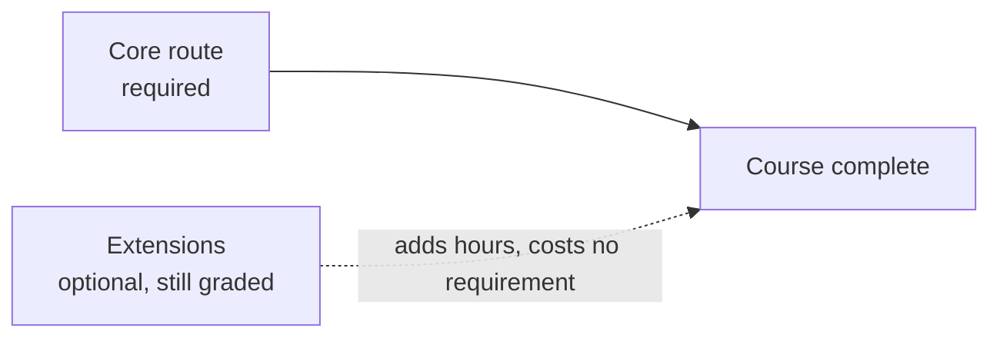

# The simulation route: what is required, what is optional

<!-- Generated by scripts/generate_sim_route.py - do not edit by hand.
     Hours are summed from each page's own metadata (`est_hours`, `typical_hours`,
     `slow_learner_hours`); the second column of a range is the slow-learner figure. -->

Finishing the course means finishing **the Core route** below. Everything under
Extensions is real, graded and badgeable - it is simply not required, so a learner can
stop at Core completion and still hold every skill the Core names.

**Route status: `author-dogfood`** — the author has run every page and no outside learner has finished this route, so every hour is a target rather than a measurement.

## Core route (required)

| Stage | Item | Hours |
| :--- | :--- | ---: |
| Track P - programming from zero | `P.1` Variables and Fundamental Data Types | 1-3 |
| Track P - programming from zero | `P.2` Computer Arithmetic and Order of Operations | 1-2.5 |
| Track P - programming from zero | `P.3` Conditional Decisions (if/elif/else) and Command Clamping | 1.5-3.5 |
| Track P - programming from zero | `P.4` Ordered Lists and Repeating Actions with for Loops | 1.5-3.5 |
| Track P - programming from zero | `P.5` Reusable Functions (def/return) and while Loops | 1.5-3.5 |
| Track P - programming from zero | `P.6` Loading Modules (import) and Automated Self-Checks (assert) | 1-3 |
| Track P - programming from zero | `P.7` Base SI Units and Metric Prefixes (M, k, m, µ) | 1-2.5 |
| Track P - programming from zero | `P.8` Cycle Frequency (Hz), Period (T = 1/f) and Binary Bits (2^N) | 1-3 |
| Track P - programming from zero | `P.9` Rearranging Physics Formulas and Linear Range Scaling | 1-3 |
| Track P - programming from zero | `P.10` Radians, Rotational Speed (rad/s) and Right-Triangle Trigonometry | 1.5-3.5 |
| Track P - programming from zero | `P.11` Reading Time-Series Graphs — Slope and Area | 1.5-3.5 |
| Track P - programming from zero | `P.12` Linear Forces (F = ma) and Lever Torque (tau = m*g*L*cos(theta)) | 1.5-3.5 |
| Track P - programming from zero | `P.14` Reading a Datasheet Table — Unit Columns, Min/Typ/Max & Safe Operating Bounds | 0.75-2 |
| Track P - programming from zero | **13 lessons, together** | 40 |
| Stage 0 - why electricity behaves like flow | `S0.0` Why Electricity Is Like Water Flow — Effort, Flow & Pipe Constriction | 0.75-2 |
| Stage 0 - why electricity behaves like flow | `S0.1` Closed DC Circuits, Ground Reference (0 V) and Ohm's Law | 1-3 |
| Stage 0 - why electricity behaves like flow | `S0.2` Series vs. Parallel Resistor Networks, Voltage Dividers and Potentiometers | 1.5-3.5 |
| Stage 0 - why electricity behaves like flow | `S0.3` Reading Schematics, Breadboards and Short Circuits | 1-3 |
| Stage 0 - why electricity behaves like flow | `S0.4` Diodes, LEDs, Forward Voltage Drop (V_f) and Resistor Power Ratings (P = VI) | 1.5-3.5 |
| Stage 0 - why electricity behaves like flow | `S0.5` Virtual Multimeters (Voltmeter vs. Ammeter) and Current-Limited (CC/CV) Bench Supplies | 1-3 |
| Stage 0 - why electricity behaves like flow | `S0.6` Capacitors — Charge Storage (tau = R*C) and Power-Rail Decoupling | 1.5-3 |
| Stage 0 - why electricity behaves like flow | `S0.7` Meet the Microcontroller (Arduino Uno 5 V) — Digital I/O and INPUT_PULLUP | 1.5-3.5 |
| Stage 0 - why electricity behaves like flow | `S0.8` Reading Analog Sensors — The 10-Bit ADC (analogRead) and Serial Monitor | 1.5-3 |
| Stage 0 - why electricity behaves like flow | `S0.9` Switching Power Smoothly — PWM Duty Cycle and analogWrite() | 1.5-3 |
| Stage 0 - why electricity behaves like flow | `S0.M` Stage 0 Milestone — Potentiometer LED Dimmer with Safety Kill-Switch | 1-2.5 |
| Stage 0 - why electricity behaves like flow | **11 lessons, together** | 33 |
| Tier 1 | `00-foundations.T1.00a` Running Python, Variables, Loops, Functions & Tracebacks | 3 |
| Tier 1 | `00-foundations.T1.00b` Lists, Dictionaries, NumPy Arrays, Plotting & Git/Terminal Basics | 3.5 |
| Tier 1 | `00-foundations.T1.00c` SI Units, Engineering Prefixes & Dimensional Analysis | 2.5 |
| Tier 1 | `00-foundations.T1.00d` Linear Equations, Unit-Circle Trig, Radians, atan2 & 2D Vectors | 3.5 |
| Tier 1 | `00-foundations.T1.00e` Position, Velocity, Acceleration, Force, Mass, Energy & Torque in a Loop | 4 |
| Tier 1 | `01-electronics.T1.01a` Voltage, Current, Resistance, Ohm's Law, KVL/KCL & Voltage Dividers | 3 |
| Tier 1 | `01-electronics.T1.01b` Low-Side MOSFET Switching, PWM Duty Cycle & H-Bridge Polarity Reversal | 3.5 |
| Tier 1 | `01-electronics.T1.01c` Multimeter, Current-Limited Bench Supply, Breadboard & ESD/Short-Circuit Safety | 2.5 |
| Tier 1 | `01-electronics.T1.01d` Capacitors, Inductors, RC Time Constants & Inductive Flyback | 3 |
| Tier 1 | `02-mechanics.T1.02a` Free-Body Diagrams, Gravity Lever-Arm Torque & Gear Speed/Torque Power Scaling | 3.5 |
| Tier 1 | `03-sensors.T1.03a` Electromagnets, Permanent Magnets, Pole Pairs, Quadrature Pulses & Faraday Back-EMF | 3.5 |
| Tier 1 | `04-embedded.T1.04a` From Python to C/Arduino: Fixed-Width Types, Bitwise Masks, Structs & Pointers | 3.5 |
| Tier 1 | `04-embedded.T1.04b` Non-Blocking millis()/micros() State Machines, Hardware Interrupts (ISRs) & volatile | 3.5 |
| Tier 1 | `05-control.T1.05a` Open-Loop vs. Closed-Loop Feedback, P/I/D Physical Roles & Actuator Saturation | 3.5 |
| Tier 1 | `06-robotics.T1.06a` 1D Point-to-Point Motion, Boundary Conditions & Virtual Joint Spring-Damper | 3.5 |
| Tier 1 | `07-systems.T1.07a` Industrial State Machines, Cyclic PLC Scan, E-Stop Chains & Sine-Sweep Gain/Phase | 3.5 |
| Tier 1 | **16 modules, together** | 53 |
| Tier 2 | `00-foundations.T2.00a` Numerical Derivatives & Integrals: Backward Difference and the Running Sum | 2 |
| Tier 2 | `00-foundations.T2.00g` Matrix-Vector Multiplication & the One-Step State Update | 3 |
| Tier 2 | `00-foundations.T2.00b` Vectors, Dot & Cross Products, Linear Independence & Change of Basis | 3.5 |
| Tier 2 | `00-foundations.T2.00c` First- & Second-Order ODEs, Characteristic Roots, Natural Frequency & Damping Ratio | 4.5 |
| Tier 2 | `00-foundations.T2.00d` Complex Numbers, Euler's Formula & Phasors | 2 |
| Tier 2 | `00-foundations.T2.00h` Winding Impedance, Transfer Functions, Decibels & the Resonance Peak | 3 |
| Tier 2 | `00-foundations.T2.00e` Laplace Transform, Poles/Zeros, Continuous State-Space (x_dot = Ax + Bu) & Euler/Tustin Discretization | 4.5 |
| Tier 2 | `00-foundations.T2.00f` Nyquist Sampling & Aliasing, Pre-Warped Tustin Biquad Filters & Gaussian Covariance | 4.5 |
| Tier 2 | `01-electronics.T2.01a` Operational Amplifiers, Differential Shunt Amplification, Common-Mode Voltage & Kelvin Sensing | 4 |
| Tier 2 | `01-electronics.T2.01b` Parasitic Loop Inductance (4-Layer Stackup), Bootstrap Gate Drivers & 48 V Pre-Charge/TVS Clamping | 4.5 |
| Tier 2 | `02-mechanics.T2.02a` 6-DOF Rigid-Body Degrees of Freedom, 3D Homogeneous Transforms (SE(3)), Velocity Jacobians & Parallel-Axis Inertia | 4.5 |
| Tier 2 | `03-sensors.T2.03a` Three-Phase Stator Reference Frames (abc -> alpha-beta -> d-q), Phase-Locked Loops & Sensor Random Walk | 4.5 |
| Tier 2 | `04-embedded.T2.04a` Vendor HAL Drivers (SPI/I2C), Bare-Metal Register Basics (MMIO/BSRR) & Ping-Pong DMA Buffers | 4 |
| Tier 2 | `04-embedded.T2.04b` RTOS Tasks, FreeRTOS Preemptive Scheduling, Priority Inversion & CAN Bus Bitwise Arbitration | 4 |
| Tier 2 | `05-control.T2.05a` Gain/Phase Margin, Sensitivity Waterbed (S+T=1), Luenberger State Observers & Bryson's Rule for LQR | 4.5 |
| Tier 2 | `06-robotics.T2.06a` ROS 2 Computational Graph (Nodes, Executors, Topics, Services, Actions, QoS), TF2 Frames, URDF & ros2_control | 5.5 |
| Tier 2 | `06-robotics.T2.06b` ROS 2 Operations: Launch & Parameter Composition, Deterministic rosbag2 Recording/Replay & Simulator Integration (Gazebo / MuJoCo) | 4.5 |
| Tier 2 | `07-systems.T2.07a` Regenerative Braking Shunt Choppers, CAN-FD CRC-16 + Rolling-Counter Watchdogs & SIL/HIL Fault Injection | 4.5 |
| Tier 2 | **18 modules, together** | 71.5 |
| Tier 3 | `00-foundations.T3.00a` Skew-Symmetric Hat Map [omega]_x, Matrix Exponential e^{At}, Rodrigues' Formula & Energy Conservation | 5 |
| Tier 3 | `02-mechanics.T3.02a` 6D Spatial Twists & Wrenches, Screw Axes in SE(3), Notch Flexure Stiffness & Recursive Newton-Euler Passivity | 5 |
| Tier 3 | `05-control.T3.05a` Joseph-Form Covariance Update, Suboptimal Kalman Gains & NEES Consistency | 2 |
| Tier 3 | `05-control.T3.05b` Rodrigues on SO(3), Multiplicative Error Injection & the ESKF Reset | 2 |
| Tier 3 | `05-control.T3.05c` Control Barrier Functions, Forward Invariance & the 1D CBF-QP Safety Filter | 2 |
| Tier 3 | `08-capstones.T3.07a` System Error/Latency Budgeting, Cross-Domain Interface Contracts & Pre-Bring-Up Safety Sign-Off | 4.5 |
| Tier 3 | **6 modules, together** | 20.5 |
| **Core total** | **40 modules + the prose tracks above** | **174.5-218** |

The low end is every page's `est_hours` / `typical_hours`; the high end is its
`slow_learner_hours`. Nothing in this table is hand-entered, and `--check` fails when it
drifts from the pages.

## Extensions (optional, still graded)

| Tier | Item | Hours |
| :--- | :--- | ---: |
| 3 | `01-electronics.T3.01a` 6-Layer Flux-Canceling Return Planes, Constant Group-Delay Bessel Filters, SAR ADC Charge-Bucket Settling & Cauer Thermal RC Networks | 5 |
| 3 | `03-sensors.T3.03a` Rotating-Frame Cross-Coupling (omega_e L i), Min-Max SVPWM Bus Utilization (1/sqrt(3)) & Encoder Harmonic Calibration | 4.5 |
| 2 | `04-embedded.T2.04c` Zephyr RTOS: West Workspaces, Devicetree Hardware Binding, Kconfig & Static Kernel Primitives | 4 |
| 2 | `04-embedded.T2.04d` micro-ROS on Microcontrollers: XRCE-DDS Client-Agent Transport, Static rclc_executor & MCU-to-ROS 2 Bridging | 4 |
| 3 | `04-embedded.T3.04a` Center-Aligned PWM Midpoint ADC Triggering, Q1.31 Fixed-Point Arithmetic & Lock-Free SeqLock | 5 |
| 3 | `06-robotics.T3.06a` PyTorch Tensors, Automatic Differentiation (autograd), Loss Functions & Behavior Cloning on Trajectory Logs | 5 |
| 3 | `06-robotics.T3.06b` Markov Decision Processes (MDPs), Policy Gradient / PPO, Action Chunking & Sim-to-Real Safety Wrappers | 5.5 |
| 3 | `07-systems.T3.06a` OPC UA Information Models, IEC 63278 Asset Administration Shell (AAS) Submodels & ISO 13849-1 Performance Level d (PLd) | 4.5 |
| - | **8 modules** | **37.5** |

Each extension keeps its own graded package, Break-it case and badge. Taking one adds
hours; skipping one costs nothing on the Core route.

## Why this split

- Every Tier 1 bridge is required because each one supplies the plant, the units or the
  tool that Tier 2 assumes.
- Every Tier 2 module on the route is required because the Tier 3 depth line uses it: the
  covariance and ESKF work sits on the linear-algebra and estimation ladder, and the
  constrained-control module sits on the control ladder. The two exceptions are named below,
  with the sentence that earns each one.
- Tier 3 requires one depth line - rotation foundations, Joseph covariance, ESKF reset,
  constrained control, one simulation capstone - so a learner reaches a working
  estimation-and-safety stack without first finishing every capstone.

## Why two Tier 2 modules are optional

- **`04-embedded.T2.04c`** (Zephyr RTOS: West Workspaces, Devicetree Hardware Binding, Kconfig & Static Kernel Primitives): Zephyr is a second RTOS toolchain (west, devicetree, Kconfig) on top of the FreeRTOS unit that already teaches preemption, priority inversion and a static kernel; the Core's timing work needs the concepts, not a second build system.
- **`04-embedded.T2.04d`** (micro-ROS on Microcontrollers: XRCE-DDS Client-Agent Transport, Static rclc_executor & MCU-to-ROS 2 Bridging): micro-ROS bridges a microcontroller to a ROS 2 graph, and the Core's integration checkpoint runs trajectory, estimator and controller on the plant in the browser; the bridge is real work but nothing on the required route consumes it.

Both stay in their track's ladder, keep their graded package and their badge, and keep their
browser-verifiable exercise - moving them changes what is required, not what exists.
