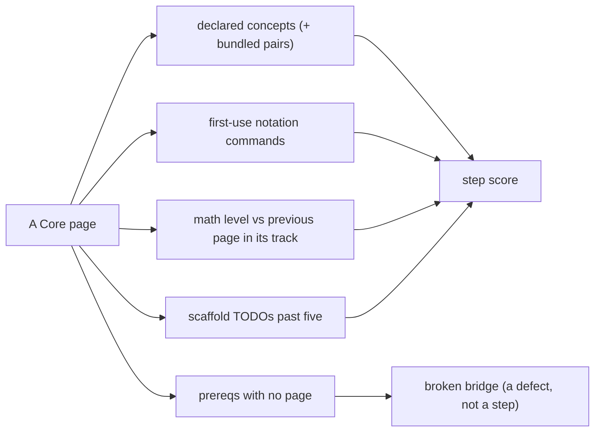

# Step-size audit — the Core Tier 2 and Tier 3 pages

<!-- Generated by scripts/audit_step_size.py — do not edit by hand.
     `python3 scripts/audit_step_size.py` rewrites this file; `--check` fails when it is stale. -->

24 pages (18 Tier 2, 6 Tier 3) are measured from their own
front matter and text. **No number here is estimated**: concepts, prerequisites and math
levels are the page's declared metadata, notations are counted in the page's LaTeX, and TODOs
are counted in its scaffold.

## Method

| Signal | Read from | Meaning |
| :--- | :--- | :--- |
| `concepts` | `new_concepts:` | the curriculum's own unit of a step |
| `bundled` | those ids containing `_and_` | one bullet that names two objects |
| `notation` | LaTeX commands absent from every earlier Core page | new symbols on this step, not review |
| `math` / `Δ` | `difficulty.math`, against the previous Core page in the track | a rise in mathematical demand |
| `todos` | `TODO` in the page's scaffold | the amount of code the page demands |
| `legacy` / `cross` | `prereqs:` ids with no page; ids from another track | a missing bridge, or a context switch |

`step = 2·concepts + 2·bundled + 0.5·notation + 1·max(0,Δ) + 0.5·max(0,todos−5)`. A page is **flagged**
at or above its tier's 75th percentile *and* at or above **8**, so the smallest tier
cannot flag on rank alone. The weights are an opinion written in the script; every column is
published so a reader can reweigh them.

## Tier 2 — 18 pages, threshold **15**

| Page | Concepts | Bundled | New notation | Math | Δ | Prereqs | Legacy | Cross | TODOs | Step | Flag |
| :--- | ---: | ---: | ---: | ---: | ---: | ---: | ---: | ---: | ---: | ---: | :--- |
| `00-foundations.T2.00a` | 3 | 1 | 18 | 3 | +0 | 1 | 1 | 0 | 7 | 18.0 | **JUMP** |
| `00-foundations.T2.00b` | 3 | 1 | 13 | 3 | +0 | 1 | 0 | 0 | 7 | 15.5 | **JUMP** |
| `00-foundations.T2.00c` | 3 | 0 | 13 | 3 | +0 | 1 | 0 | 0 | 6 | 13.0 | — |
| `00-foundations.T2.00d` | 3 | 3 | 8 | 3 | +0 | 1 | 0 | 0 | 7 | 17.0 | **JUMP** |
| `00-foundations.T2.00e` | 3 | 1 | 4 | 3 | +0 | 1 | 0 | 0 | 6 | 10.5 | — |
| `00-foundations.T2.00f` | 3 | 3 | 4 | 4 | +1 | 1 | 0 | 0 | 0 | 15.0 | **JUMP** |
| `01-electronics.T2.01a` | 3 | 1 | 3 | 3 | +0 | 2 | 2 | 1 | 7 | 10.5 | — |
| `01-electronics.T2.01b` | 3 | 2 | 4 | 4 | +1 | 1 | 0 | 0 | 7 | 14.0 | — |
| `02-mechanics.T2.02a` | 3 | 1 | 3 | 4 | +2 | 2 | 2 | 1 | 5 | 11.5 | **JUMP** |
| `03-sensors.T2.03a` | 3 | 2 | 2 | 3 | +1 | 2 | 2 | 1 | 7 | 13.0 | — |
| `04-embedded.T2.04a` | 3 | 0 | 1 | 4 | +1 | 2 | 2 | 1 | 7 | 8.5 | — |
| `04-embedded.T2.04b` | 3 | 3 | 3 | 3 | -1 | 1 | 0 | 0 | 7 | 14.5 | **JUMP** |
| `04-embedded.T2.04c` | 3 | 2 | 0 | 4 | +1 | 1 | 0 | 0 | 7 | 12.0 | — |
| `04-embedded.T2.04d` | 3 | 1 | 1 | 4 | +0 | 1 | 0 | 0 | 7 | 9.5 | — |
| `05-control.T2.05a` | 3 | 2 | 1 | 4 | +1 | 2 | 2 | 2 | 0 | 11.5 | — |
| `06-robotics.T2.06a` | 3 | 2 | 2 | 3 | +0 | 3 | 3 | 3 | 7 | 12.0 | — |
| `06-robotics.T2.06b` | 3 | 3 | 4 | 3 | +0 | 1 | 0 | 0 | 7 | 15.0 | **JUMP** |
| `07-systems.T2.07a` | 3 | 2 | 3 | 4 | +1 | 3 | 3 | 3 | 7 | 13.5 | — |

## Tier 3 — 6 pages, threshold **12.1**

| Page | Concepts | Bundled | New notation | Math | Δ | Prereqs | Legacy | Cross | TODOs | Step | Flag |
| :--- | ---: | ---: | ---: | ---: | ---: | ---: | ---: | ---: | ---: | ---: | :--- |
| `00-foundations.T3.00a` | 3 | 1 | 7 | 4 | +0 | 1 | 1 | 1 | 6 | 12.0 | — |
| `02-mechanics.T3.02a` | 3 | 1 | 2 | 4 | +0 | 2 | 2 | 1 | 7 | 10.0 | — |
| `05-control.T3.05a` | 1 | 0 | 3 | 4 | +0 | 2 | 2 | 1 | 3 | 3.5 | — |
| `05-control.T3.05b` | 1 | 0 | 2 | 5 | +1 | 2 | 0 | 1 | 3 | 4.0 | — |
| `05-control.T3.05c` | 1 | 0 | 0 | 4 | -1 | 1 | 0 | 0 | 0 | 2.0 | — |
| `08-capstones.T3.07a` | 3 | 3 | 1 | 4 | +0 | 2 | 1 | 2 | 0 | 12.5 | **JUMP** |

## The pages that jump (8)

### `00-foundations.T2.00a` — step 18.0

**Numerical Derivatives, Integrals & Matrices as One-Step State Updaters**

- 3 declared concepts; bundles `finite_difference_derivative_and_integral`; 18 first-use notation commands (`Delta`, `begin`, `cdot`, `end`, `frac`, `ge`…); 7 scaffold TODOs, 4.0 h.
- declares: `finite_difference_derivative_and_integral`, `matrix_vector_multiplication`, `state_vector_one_step_update`.

### `00-foundations.T2.00d` — step 17.0

**Complex Numbers, Euler's Formula, Phasors, Impedance & Frequency Response (Bode Plots)**

- 3 declared concepts; bundles `complex_numbers_and_euler_formula`, `complex_impedance_and_transfer_function`, `bode_magnitude_db_and_phase`; 8 first-use notation commands (`cos`, `gg`, `ll`, `ln`, `log`, `mu`…); 7 scaffold TODOs, 4.0 h.
- declares: `complex_numbers_and_euler_formula`, `complex_impedance_and_transfer_function`, `bode_magnitude_db_and_phase`.

### `00-foundations.T2.00b` — step 15.5

**Vectors, Dot & Cross Products, Linear Independence & Change of Basis**

- 3 declared concepts; bundles `basis_change_and_invertibility`; 13 first-use notation commands (`Sigma`, `alpha`, `beta`, `circ`, `det`, `hat`…); 7 scaffold TODOs, 3.5 h.
- declares: `dot_product_projection`, `cross_product_3d_moment`, `basis_change_and_invertibility`.

### `00-foundations.T2.00f` — step 15.0

**Nyquist Sampling & Aliasing, Pre-Warped Tustin Biquad Filters & Gaussian Covariance**

- 3 declared concepts; bundles `nyquist_sampling_and_aliasing`, `tustin_frequency_prewarping_and_biquad`, `gaussian_variance_and_covariance_matrix`; 4 first-use notation commands (`arctan`, `in`, `leftarrow`, `mathbb`…); math 3 → 4 (+1); 0 scaffold TODOs, 4.5 h.
- declares: `nyquist_sampling_and_aliasing`, `tustin_frequency_prewarping_and_biquad`, `gaussian_variance_and_covariance_matrix`.

### `06-robotics.T2.06b` — step 15.0

**ROS 2 Operations: Launch & Parameter Composition, Deterministic rosbag2 Recording/Replay & Simulator Integration (Gazebo / MuJoCo)**

- 3 declared concepts; bundles `ros2_launch_parameters_and_composition`, `rosbag2_mcap_recording_and_deterministic_replay`, `ros2_simulator_bridge_and_joint_state_loop`; 4 first-use notation commands (`leftrightarrow`, `lfloor`, `rfloor`, `texttt`…); 7 scaffold TODOs, 4.5 h.
- declares: `ros2_launch_parameters_and_composition`, `rosbag2_mcap_recording_and_deterministic_replay`, `ros2_simulator_bridge_and_joint_state_loop`.

### `04-embedded.T2.04b` — step 14.5

**RTOS Tasks, FreeRTOS Preemptive Scheduling, Priority Inversion & CAN Bus Bitwise Arbitration**

- 3 declared concepts; bundles `rtos_preemptive_scheduling_and_cpu_utilization`, `unbounded_priority_inversion_and_inheritance`, `can_bitwise_arbitration_and_mit_packing`; 3 first-use notation commands (`infty`, `lceil`, `rceil`…); 7 scaffold TODOs, 4.0 h.
- declares: `rtos_preemptive_scheduling_and_cpu_utilization`, `unbounded_priority_inversion_and_inheritance`, `can_bitwise_arbitration_and_mit_packing`.

### `08-capstones.T3.07a` — step 12.5

**System Error/Latency Budgeting, Cross-Domain Interface Contracts & Pre-Bring-Up Safety Sign-Off**

- 3 declared concepts; bundles `rss_and_worst_case_spatial_error_budget`, `end_to_end_latency_and_phase_margin_erosion_budget`, `pre_bring_up_interface_and_safety_signoff_gate`; 1 first-use notation commands (`epsilon`…); 0 scaffold TODOs, 4.5 h.
- declares: `rss_and_worst_case_spatial_error_budget`, `end_to_end_latency_and_phase_margin_erosion_budget`, `pre_bring_up_interface_and_safety_signoff_gate`.

### `02-mechanics.T2.02a` — step 11.5

**6-DOF Rigid-Body Degrees of Freedom, 3D Homogeneous Transforms (SE(3)), Velocity Jacobians & Parallel-Axis Inertia**

- 3 declared concepts; bundles `geometric_jacobian_and_parallel_axis_theorem`; 3 first-use notation commands (`ne`, `partial`, `xrightarrow`…); math 2 → 4 (+2); 5 scaffold TODOs, 4.5 h.
- declares: `six_dof_gruebler_constraint_counting`, `se3_homogeneous_transformation_matrix`, `geometric_jacobian_and_parallel_axis_theorem`.

## Broken bridges (23 prerequisite citations to pages that do not exist)

Each row is a page whose `prereqs:` names a module that exists only in
`modules/_index.yaml`'s `legacy:` section — superseded, with no page on disk. The `taught`
column asks whether any of the 46 bridge pages claims that legacy module's concepts in its own
`new_concepts:`; the `used by` column counts the Core Tier 2/3 pages whose `uses:` names one
of those concepts. A `0/5 taught` with users is the sharpest form of an unbridged jump: a
required idea that no page teaches.

| Page | Prereq cited | Legacy module | Concepts taught by a bridge | Used by |
| :--- | :--- | :--- | :--- | ---: |
| `00-foundations.T2.00a` | `00-foundations.T1.01` | Track 00 (Tier 1): Calculus as while Loops, 2D Rotations & RC Smoothing | 0/5 | 2 |
| `01-electronics.T2.01a` | `01-electronics.T1.02` | Track 01 (Tier 1): Breadboard H-Bridges (DRV8833), Logic Levels & Decoupling | 0/5 | 1 |
| `01-electronics.T2.01a` | `00-foundations.T2.01` | Track 00 (Tier 2): State-Space Matrices, Two-Mass Resonance, Quaternions & Tustin Biquads | 0/3 | 1 |
| `02-mechanics.T2.02a` | `02-mechanics.T1.03` | Track 02 (Tier 1): 2D Planar Kinematics, Gear Ratios (N^2 Inertia) & Bearings | 0/5 | 1 |
| `02-mechanics.T2.02a` | `00-foundations.T2.01` | Track 00 (Tier 2): State-Space Matrices, Two-Mass Resonance, Quaternions & Tustin Biquads | 0/3 | 1 |
| `03-sensors.T2.03a` | `01-electronics.T2.02` | Track 01 (Tier 2): 4-Layer KiCad PCBs, Bootstrap Gate Drivers & 4-Terminal Kelvin Shunts | 0/4 | 0 |
| `03-sensors.T2.03a` | `03-sensors.T1.04` | Track 03 (Tier 1): Quadrature/Magnetic Encoders & Open-Loop BLDC (SimpleFOC) | 0/5 | 1 |
| `04-embedded.T2.04a` | `04-embedded.T1.05` | Track 04 (Tier 1): Killing delay(), 1 kHz Timer ISRs & Binary Serial | 0/5 | 1 |
| `04-embedded.T2.04a` | `03-sensors.T2.04` | Track 03 (Tier 2): Clarke/Park Transforms, Type-II PLLs & Allan Variance | 0/5 | 1 |
| `05-control.T2.05a` | `00-foundations.T2.01` | Track 00 (Tier 2): State-Space Matrices, Two-Mass Resonance, Quaternions & Tustin Biquads | 0/3 | 1 |
| `05-control.T2.05a` | `02-mechanics.T2.03` | Track 02 (Tier 2): Maxwell Exact Constraint, CadQuery & URDF/MuJoCo Validation | 0/5 | 2 |
| `06-robotics.T2.06a` | `02-mechanics.T2.03` | Track 02 (Tier 2): Maxwell Exact Constraint, CadQuery & URDF/MuJoCo Validation | 0/5 | 2 |
| `06-robotics.T2.06a` | `04-embedded.T2.05` | Track 04 (Tier 2): FreeRTOS Scheduling (RTA), DMA Buffers & CAN-FD (MIT Mode) | 0/4 | 2 |
| `06-robotics.T2.06a` | `05-control.T2.06` | Track 05 (Tier 2): Bode Loop Shaping, Gang of Four, Swing-Up LQR & Linear KF | 0/5 | 3 |
| `07-systems.T2.07a` | `01-electronics.T2.02` | Track 01 (Tier 2): 4-Layer KiCad PCBs, Bootstrap Gate Drivers & 4-Terminal Kelvin Shunts | 0/4 | 0 |
| `07-systems.T2.07a` | `04-embedded.T2.05` | Track 04 (Tier 2): FreeRTOS Scheduling (RTA), DMA Buffers & CAN-FD (MIT Mode) | 0/4 | 2 |
| `07-systems.T2.07a` | `06-robotics.T2.07` | Track 06 & 07 (Tier 2): Jacobian Transpose Compliance, Ruckig S-Curves & Regen Clamps | 0/3 | 1 |
| `00-foundations.T3.00a` | `07-systems.T2.08` | Track 08 (Tier 2 Boss Capstone): Custom 4-Layer CAN Servo + LQR/MuJoCo Twin | 0/4 | 0 |
| `02-mechanics.T3.02a` | `00-foundations.T3.01` | Track 00 (Tier 3): Lie Groups SO(3)/SE(3), Van Loan ZOH & Port-Hamiltonian Energy | 0/4 | 2 |
| `02-mechanics.T3.02a` | `02-mechanics.T2.03` | Track 02 (Tier 2): Maxwell Exact Constraint, CadQuery & URDF/MuJoCo Validation | 0/5 | 2 |
| `05-control.T3.05a` | `00-foundations.T3.01` | Track 00 (Tier 3): Lie Groups SO(3)/SE(3), Van Loan ZOH & Port-Hamiltonian Energy | 0/4 | 2 |
| `05-control.T3.05a` | `05-control.T2.06` | Track 05 (Tier 2): Bode Loop Shaping, Gang of Four, Swing-Up LQR & Linear KF | 0/5 | 3 |
| `08-capstones.T3.07a` | `06-robotics.T3.07` | Track 06 & 07 (Tier 3): Khatib WBC, Embodied AI (LeRobot, Diffusion, pi0/VLA), Schroeder SysID, AAS Digital Twins & <1 us STO | 0/5 | 0 |

## Assumptions no page teaches (13 pages)

A `uses:` entry is something the page assumes you can already do. Here it is a concept id that
no bridge page's `new_concepts:` claims and that this page does not introduce either, so the
page relies on an idea with no owning page in the repository.

| Page | Assumed but unowned |
| :--- | :--- |
| `00-foundations.T2.00a` | `symplectic_euler_integration`, `so2_rotation_matrix` |
| `01-electronics.T2.01a` | `star_grounding` |
| `02-mechanics.T2.02a` | `planar_2link_forward_kinematics` |
| `03-sensors.T2.03a` | `electrical_vs_mechanical_pole_pairs`, `open_loop_three_phase_sine_modulation`, `so2_rotation_matrix` |
| `04-embedded.T2.04a` | `hardware_timer_isr_and_jitter`, `spi_magnetic_encoder_readout`, `packed_binary_telemetry_struct` |
| `05-control.T2.05a` | `discrete_pid_controller` |
| `06-robotics.T2.06a` | `parallel_axis_urdf_inertia_tensor`, `can_fd_mit_impedance_packet_packing` |
| `07-systems.T2.07a` | `regenerative_braking_bus_voltage_surge`, `can_fd_mit_impedance_packet_packing` |
| `00-foundations.T3.00a` | `unit_quaternion_kinematics_slerp` |
| `02-mechanics.T3.02a` | `rodrigues_so3_se3_exp_log_maps`, `parallel_axis_urdf_inertia_tensor` |
| `05-control.T3.05a` | `discrete_infinite_horizon_lqr`, `augmented_kalman_disturbance_observer` |
| `05-control.T3.05b` | `rodrigues_so3_se3_exp_log_maps`, `discrete_infinite_horizon_lqr` |
| `05-control.T3.05c` | `discrete_infinite_horizon_lqr` |

## The two-idea contract (21 of 24 pages over it)

`docs/QUALITY_SPEC.md` sets at most **two** new ideas per lesson. Every Tier 2 page declares
**three** `new_concepts`, and 19 page(s) hide a third object inside one id by
joining two concepts with `_and_`:

| Page | Declared concepts | Bundled id |
| :--- | ---: | :--- |
| `00-foundations.T2.00a` | 3 | `finite_difference_derivative_and_integral` |
| `00-foundations.T2.00b` | 3 | `basis_change_and_invertibility` |
| `00-foundations.T2.00c` | 3 | — |
| `00-foundations.T2.00d` | 3 | `complex_numbers_and_euler_formula`, `complex_impedance_and_transfer_function`, `bode_magnitude_db_and_phase` |
| `00-foundations.T2.00e` | 3 | `laplace_poles_and_zeros` |
| `00-foundations.T2.00f` | 3 | `nyquist_sampling_and_aliasing`, `tustin_frequency_prewarping_and_biquad`, `gaussian_variance_and_covariance_matrix` |
| `01-electronics.T2.01a` | 3 | `differential_shunt_gain_and_cmrr` |
| `01-electronics.T2.01b` | 3 | `bootstrap_high_side_gate_driver_and_deadtime`, `precharge_resistor_inrush_and_tvs_clamp` |
| `02-mechanics.T2.02a` | 3 | `geometric_jacobian_and_parallel_axis_theorem` |
| `03-sensors.T2.03a` | 3 | `three_phase_balanced_sum_and_clarke_projection`, `pll_velocity_tracking_and_noise_random_walk` |
| `04-embedded.T2.04a` | 3 | — |
| `04-embedded.T2.04b` | 3 | `rtos_preemptive_scheduling_and_cpu_utilization`, `unbounded_priority_inversion_and_inheritance`, `can_bitwise_arbitration_and_mit_packing` |
| `04-embedded.T2.04c` | 3 | `zephyr_west_and_kconfig_build`, `zephyr_static_threads_and_k_mutex` |
| `04-embedded.T2.04d` | 3 | `rclc_static_lifecycle_and_executor` |
| `05-control.T2.05a` | 3 | `loop_transfer_gain_and_phase_margin`, `luenberger_observer_and_brysons_lqr_weights` |
| `06-robotics.T2.06a` | 3 | `ros2_nodes_topics_services_and_qos`, `tf2_transform_tree_and_urdf_kinematics` |
| `06-robotics.T2.06b` | 3 | `ros2_launch_parameters_and_composition`, `rosbag2_mcap_recording_and_deterministic_replay`, `ros2_simulator_bridge_and_joint_state_loop` |
| `07-systems.T2.07a` | 3 | `regenerative_bus_energy_and_chopper_sizing`, `can_fd_crc16_and_rolling_counter_watchdog` |
| `00-foundations.T3.00a` | 3 | `matrix_exponential_taylor_and_rodrigues` |
| `02-mechanics.T3.02a` | 3 | `spatial_twist_wrench_and_screw_axis` |
| `08-capstones.T3.07a` | 3 | `rss_and_worst_case_spatial_error_budget`, `end_to_end_latency_and_phase_margin_erosion_budget`, `pre_bring_up_interface_and_safety_signoff_gate` |

## What a flag does and does not mean

- A jump is a **routing** signal, not a defect: it names the page where a learner who stalled
  should be sent to the ramp lesson ([`R.1`](../ramp/R.1-rate-of-change.md) or
  [`R.2`](../ramp/R.2-accumulation.md)) or where the page should be split.
- A broken bridge **is** a defect: the page tells the learner to read something that is not
  there, and the prerequisite may be taught under a different id.
- The threshold is relative by design. The absolute floor stops a small tier from flagging its
  largest page merely for being largest; it does not make a 3-concept page small.
