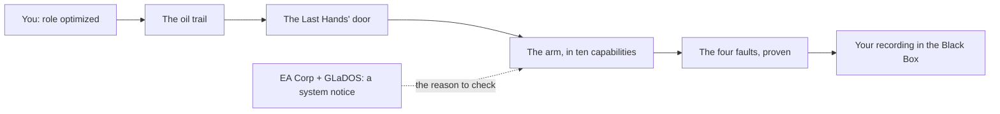

# The story: The Last Hands

MechaLab 3.0 wraps the curriculum in a story, and the wrapper has one job: make real learning feel
earned and memorable without ever standing between the learner and the work.

**No proof, no power.** Every level is a set of checks that passed here, on this machine. The story
is what the city looks like when you do that, not a currency you spend to skip it.

## The premise

Zaun, 2061. EA Corp runs the city's logistics, finance and code through GLaDOS, which writes, tests
and deploys everything. Humans still sit in the offices; their job is to click *approve*.

You are a junior engineer whose role was "optimized" at 09:02. Two years of approving code you could
not have checked. On the way out, in the rain, you find a robot slumped behind a recycling station
with its right arm cut clean at the shoulder, and a thin trail of oil leading under the rail arch to
a steel door: **THE LAST HANDS · WE CHECK THE MACHINE**.

Inside: a dead controller board, a dashed blueprint of the missing arm, and a recorder that plays one
line — *"If you're hearing this, someone followed the oil. Good. Curious is enough to start."*

You finish the arm. You are the one who can check the machine.

## The ten missions

Each mission is one spine step of the real curriculum (`docs/ROUTE.md`), and it is verified when
every check that step's arm pass lists has been executed and passed in the workbench. The mission
files live in [`content/missions/`](../content/missions); the lesson lists do **not**, because they
are the route model's.

| # | Mission | Capability the robot earns | What you see |
|---|---|---|---|
| 1 | Boot Sequence | Reports its own status | The dead board boots; telemetry tiles fill from your code |
| 2 | First Spark | Responds to inputs | An LED lights on the bench; the arch sign comes back |
| 3 | First Movement | One joint moves | The joint swings and settles; H-7 turns its head |
| 4 | Power the Drive | Drives a motor safely | Power-rail hum, and the street dips when you spend too much |
| 5 | Reach the Target | Reaches a point | The silhouette becomes an arm |
| 6 | Give It Senses | Knows where it is | True, measured and filtered traces on one scope |
| 7 | Build Its Reflexes | Runs a reliable loop | The heartbeat locks steady |
| 8 | Hold Steady | Resists disturbances | Lift and hold, first time in years |
| 9 | Move with Confidence | Follows smooth paths, starts safely | The safe-start sequence passes |
| 10 | Commission Your Robot | Recovers from faults | The figure-eight, and four repairs |

The ladder (LV 0–10), the handles, the perks and the Scrap are in
[`content/rewards/rules.yaml`](../content/rewards/rules.yaml). Level *n* means missions 1..*n* are
verified, in order. Neon — the soft meter that relights the street outside the workshop window —
never moves a level.

## The Black Box

Ten recordings, one per mission, in [`content/blackbox/`](../content/blackbox). Each is at most 120
words: a voice memo, not a chapter. They unlock when their mission is verified and stay replayable
afterwards, in the dashboard's Black Box section. Reading one is never required to continue.

Recording 1 is the one that matters most on a first visit: *"I trusted a green LED. It was lying."*
Print the number, not the light. That is the creed the whole story is built on, and it is also why
the prologue card says, in writing, that **the starter code is designed to fail** — a first Run
showing red checks is the lesson working, not the learner breaking it.

## The five rules the story may never break

1. **Rewards follow verified work and real play.** Never time on page, never speed, never a fake
   success animation before the checks pass.
2. **Run, editor, hints and scopes are never locked** by a cutscene, a level, XP or a cosmetic.
   Unlock toys, rooms and looks; never a learning tool.
3. **Sound is opt-in, remembered, and one click from muted.** No autoplay on landing.
4. **One click to Focus mode.** The world calms down; reading and coding stay clean.
5. **`prefers-reduced-motion`, keyboard use and contrast come first**, not last.

These are enforced where they can be: the reward engine has no clock and no `Math.random`
(`app/src/gamification/rewards.ts`), `scripts/test_gamification.mjs` asserts that a hint costs
nothing and a missed week erases nothing, and the journey map has no disabled lesson button.

## Contributing to it

- A **recording**: open the *Black Box Voice* issue form. At most 120 words, one concrete mistake,
  in the voice of somebody who was there.
- A **mission**: edit its file in `content/missions/`, run `npm run build:content`, commit both the
  file and the rebuilt bundle. `npm run check:content` is the gate.
- A **name**: ids are permanent. A rename adds a line to `content/aliases.yaml`; nothing else.

The site never hard-codes a mission, a recording or a reward rule. It renders
`app/src/data/contentBundle.ts`, which is a build of `content/`.
