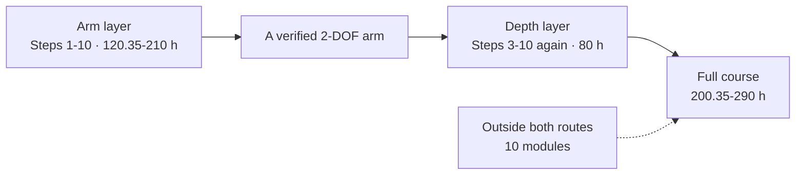

# The ten-step syllabus: what each step costs

> **Audience:** anyone planning the course, and maintainers who need the numbers to be
> true. There is one order - **Steps 1-10** - and one cost column, **focused hours**,
> summed from each page's own front matter by `scripts/generate_step_docs.py`. To change a
> number, change the page's metadata and re-run the generator; a hand-typed subtotal is
> what let this page quote 326.5 h for a 200-290 h route.

## A. How to read the cost

- **Focused hours** are time with the page open: the reading, the worked example, the
  exercise and its checks. They exclude setup, debugging and re-reading, which is why the
  front page's calendar estimate multiplies this column by 5-10. An hour target is not
  elapsed time.
- **Three layers, one order.** The **arm layer** is every Tier 1 bridge plus the Step 10
  capstone: take it in Steps 1-10 and you have a working, verified 2-DOF arm. The **Depth 2
  pass** is the Tier 2 practice modules; the **Depth 3 pass** is the Tier 3 modules that
  derive and validate. Both are a second pass in the same step order, after Step 10, and
  nothing on the arm consumes them.
- **Pages outside both routes.** A further 10 modules are graded and badgeable but not required; they are neither depth, and are listed at the end of this page and in each track README as the optional pages.
- **Every row is a page.** The lesson rows are the prose lessons, the module rows are the
  graded `modules/*.md` packages, and no page appears in two steps.

## B. The ten steps, costed

| Step | Lessons | Arm layer | Depth 2 · practice | Depth 3 · derive | Focused hours |
| :--- | ---: | :--- | :--- | :--- | ---: |
| **1 · Python and the maths a robot needs** ([Track P](../track-p/README.md)) | 14 | — | — | — | **16.75-42.5** |
| **2 · Circuits and your first microcontroller** ([Stage 0](../stage-0/README.md)) | 11 | — | — | — | **13.75-33** |
| **3 · Make a joint move: foundations** ([Track 00](../00-foundations/README.md)) | 3 | 5 modules · 20.5-26.5 h | 10 modules · 29.5 h | 1 module · 5 h | **55-61** |
| **4 · Power the joint: electronics** ([Track 01](../01-electronics-and-power/README.md)) | 4 | 4 modules · 18-25.5 h | 2 modules · 8.5 h | — | **26.5-34** |
| **5 · Build the arm: mechanics** ([Track 02](../02-mechanics-kinematics-dynamics/README.md)) | 5 | 1 module · 10.5-20.5 h | 1 module · 4.5 h | 1 module · 5 h | **20-30** |
| **6 · Measure the joint: sensors** ([Track 03](../03-sensors-and-actuators/README.md)) | 3 | 1 module · 6.85-11.5 h | 1 module · 4.5 h | — | **11.35-16** |
| **7 · Run it in real time: embedded C** ([Track 04](../04-embedded-and-realtime/README.md)) | 3 | 2 modules · 11-17 h | 2 modules · 8 h | — | **19-25** |
| **8 · Make it hold still: control** ([Track 05](../05-control-and-estimation/README.md)) | 2 | 1 module · 6.5-10.5 h | 1 module · 4.5 h | 3 modules · 6 h | **17-21** |
| **9 · Plan motion and bring it up safely** ([Track 06](../06-robotics-and-autonomy/README.md) + [Track 07](../07-systems-hil-and-production/README.md)) | 2 | 2 modules · 10-14 h | 1 module · 4.5 h | — | **14.5-18.5** |
| **10 · Put it together: the 2-DOF arm** ([Track 08](../08-capstone-projects/README.md)) | 1 | 1 module · 6.5-9 h | — | — | **6.5-9** |
| **Arm route, Steps 1-10** | 48 | 17 modules · 120.35-210 h | — | — | **120.35-210** |
| **Depth 2 pass, after Step 10** | — | — | 18 modules · 64 h | — | **64** |
| **Depth 3 pass, after Step 10** | — | — | — | 5 modules · 16 h | **16** |
| **Depth pass, after Step 10** | — | — | 18 modules | 5 modules | **80** |
| **Full course** | 48 | 17 modules | 18 modules | 5 modules | **200.35-290** |

The arm route is **120.35-210 focused hours**, the depth pass adds **80** - of which Depth 2 practice is **64** and Depth 3 derivation is **16** - and the full course is **200.35-290**. The minimum viable finish - every Tier 1 bridge plus the capstone and the 5 lessons it opens - is **93-151 focused hours**; its page list is [`MINIMUM.md`](MINIMUM.md).

## C. The teaching sequence every page follows

Every lesson and every module runs the same eight moves, so a learner proves prediction,
fault diagnosis and transfer rather than copying a worked example:

1. **Recall** - a quick check of the prerequisite concepts from the dependency graph.
2. **See it** - a diagram, waveform or interactive workbench animation.
3. **Predict** - commit to a quantitative or directional prediction before running anything.
4. **Work through** - one complete worked example with intermediate units and values.
5. **Practice with support** - starter code with `TODO`s, or a guided simulation with a
   three-step hint ladder.
6. **Break it on purpose** - inject a parameter error or a common fault and diagnose it.
7. **Transfer** - a modified-parameter or unseen-boundary scenario, checked by behavioral
   tests.
8. **Integrate** - apply the skill to the recurring 2-DOF arm in this or the next step.

Each page also surfaces five difficulty dimensions: **Math level**, **coding level**, **new
tools**, **hardware risk** (`None/Sim`, `Low-Voltage <=12V`, `High-Energy Review
Required`) and **simulation-capable status**. Beginner lessons add at most two new ideas;
bridge modules at most three.

The depth layer's Tier 3 pages split into two levels, and both are graded:

- **Level A - Use & Understand:** what the method (`SO(3)`, FOC, ESKF, MPC, CBF-QP) does,
  when to reach for it, how to run it in the workbench, and how to check it is physically
  sane (units, energy, covariance bounds).
- **Level B - Derive & Extend:** the Lie-algebra, Riccati or QP derivation, the fixed-point
  and concurrency implementation, and the worst-case timing and thermal bounds.

## D. Every step, page by page

### Step 1 · Python and the maths a robot needs

> Read a formula, write it in Python, and check your own answer.

Starts at [`P.1`](../track-p/P.1-variables-and-data-types.md) · **16.75-42.5 focused hours** · 14 lessons.

| Page | What it teaches | Layer | Focused hours |
| :--- | :--- | :--- | ---: |
| [`P.1`](../track-p/P.1-variables-and-data-types.md) | Variables and Fundamental Data Types | lesson | 1-3 |
| [`P.2`](../track-p/P.2-arithmetic-and-order-of-operations.md) | Computer Arithmetic and Order of Operations | lesson | 1-2.5 |
| [`P.3`](../track-p/P.3-decisions-and-clamping.md) | Conditional Decisions (if/elif/else) and Command Clamping | lesson | 1.5-3.5 |
| [`P.4`](../track-p/P.4-lists-and-for-loops.md) | Ordered Lists and Repeating Actions with for Loops | lesson | 1.5-3.5 |
| [`P.5`](../track-p/P.5-functions-and-while-loops.md) | Reusable Functions (def/return) and while Loops | lesson | 1.5-3.5 |
| [`P.6`](../track-p/P.6-modules-and-automated-asserts.md) | Loading Modules (import) and Automated Self-Checks (assert) | lesson | 1-3 |
| [`P.7`](../track-p/P.7-si-units-and-metric-prefixes.md) | Base SI Units and Metric Prefixes (M, k, m, µ) | lesson | 1-2.5 |
| [`P.8`](../track-p/P.8-frequency-and-binary-bits.md) | Cycle Frequency (Hz), Period (T = 1/f) and Binary Bits (2^N) | lesson | 1-3 |
| [`P.9`](../track-p/P.9-rearranging-formulas-and-scaling.md) | Rearranging Physics Formulas and Linear Range Scaling | lesson | 1-3 |
| [`P.10`](../track-p/P.10-radians-and-right-triangle-trig.md) | Radians, Rotational Speed (rad/s) and Right-Triangle Trigonometry | lesson | 1.5-3.5 |
| [`P.11`](../track-p/P.11-reading-time-series-graphs.md) | Reading Time-Series Graphs — Slope and Area | lesson | 1.5-3.5 |
| [`P.12`](../track-p/P.12-forces-and-lever-torque.md) | Linear Forces (F = ma) and Lever Torque (tau = m*g*L*cos(theta)) | lesson | 1.5-3.5 |
| [`P.14`](../track-p/P.14-reading-a-datasheet-table.md) | Reading a Datasheet Table — Unit Columns, Min/Typ/Max & Safe Operating Bounds | lesson | 0.75-2 |
| [`P.M`](../track-p/P.M-track-p-milestone.md) | Track P Milestone — Gravity-Holding Robot Arm Link Simulator | lesson | 1-2.5 |

### Step 2 · Circuits and your first microcontroller

> Light an LED, read a knob, and dim it with PWM without breaking anything.

Starts at [`S0.0`](../stage-0/S0.0-why-electricity-is-like-flow.md) · **13.75-33 focused hours** · 11 lessons.

| Page | What it teaches | Layer | Focused hours |
| :--- | :--- | :--- | ---: |
| [`S0.0`](../stage-0/S0.0-why-electricity-is-like-flow.md) | Why Electricity Is Like Water Flow — Effort, Flow & Pipe Constriction | lesson | 0.75-2 |
| [`S0.1`](../stage-0/S0.1-closed-circuits-and-ohms-law.md) | Closed DC Circuits, Ground Reference (0 V) and Ohm's Law | lesson | 1-3 |
| [`S0.2`](../stage-0/S0.2-series-parallel-and-voltage-dividers.md) | Series vs. Parallel Resistor Networks, Voltage Dividers and Potentiometers | lesson | 1.5-3.5 |
| [`S0.3`](../stage-0/S0.3-breadboards-and-short-circuits.md) | Reading Schematics, Breadboards and Short Circuits | lesson | 1-3 |
| [`S0.4`](../stage-0/S0.4-leds-and-resistor-power.md) | Diodes, LEDs, Forward Voltage Drop (V_f) and Resistor Power Ratings (P = VI) | lesson | 1.5-3.5 |
| [`S0.5`](../stage-0/S0.5-multimeters-and-current-limited-supplies.md) | Virtual Multimeters (Voltmeter vs. Ammeter) and Current-Limited (CC/CV) Bench Supplies | lesson | 1-3 |
| [`S0.6`](../stage-0/S0.6-capacitors-and-decoupling.md) | Capacitors — Charge Storage (tau = R*C) and Power-Rail Decoupling | lesson | 1.5-3 |
| [`S0.7`](../stage-0/S0.7-arduino-uno-digital-io-and-pullups.md) | Meet the Microcontroller (Arduino Uno 5 V) — Digital I/O and INPUT_PULLUP | lesson | 1.5-3.5 |
| [`S0.8`](../stage-0/S0.8-adc-analog-read-and-serial-monitor.md) | Reading Analog Sensors — The 10-Bit ADC (analogRead) and Serial Monitor | lesson | 1.5-3 |
| [`S0.9`](../stage-0/S0.9-pwm-duty-cycle-and-analog-write.md) | Switching Power Smoothly — PWM Duty Cycle and analogWrite() | lesson | 1.5-3 |
| [`S0.M`](../stage-0/S0.M-stage-0-milestone.md) | Stage 0 Milestone — Potentiometer LED Dimmer with Safety Kill-Switch | lesson | 1-2.5 |

### Step 3 · Make a joint move: foundations

> Model a spring, a damper, and a motor as one joint that responds to torque.

Starts at [`00.1`](../00-foundations/00.1-effort-flow-and-first-order-lag.md) · **55-61 focused hours** · 3 lessons · 5 arm modules · 10 Depth 2 modules · 1 Depth 3 module.

| Page | What it teaches | Layer | Focused hours |
| :--- | :--- | :--- | ---: |
| [`00.1`](../00-foundations/00.1-effort-flow-and-first-order-lag.md) | Cross-Domain Power (P = Effort * Flow) and First-Order Lag | lesson | 1.5-3.5 |
| [`00.2`](../00-foundations/00.2-mass-spring-damper-oscillations.md) | Second-Order Motion — Springs (F_s = -k*x), Dampers (F_d = -b*v) and Damping Regimes | lesson | 1.5-3.5 |
| [`00.3`](../00-foundations/00.3-modeling-discipline-and-sanity-checks.md) | Engineering Modeling Discipline — 4-Step Workflow, Dimensional Checks and Sign Conventions | lesson | 1-3 |
| [`00-foundations.T1.00a`](../modules/00-foundations.T1.00a.md) | Running Python, Variables, Loops, Functions & Tracebacks | arm | 3 |
| [`00-foundations.T1.00b`](../modules/00-foundations.T1.00b.md) | Lists, Dictionaries, NumPy Arrays, Plotting & Git/Terminal Basics | arm | 3.5 |
| [`00-foundations.T1.00c`](../modules/00-foundations.T1.00c.md) | SI Units, Engineering Prefixes & Dimensional Analysis | arm | 2.5 |
| [`00-foundations.T1.00d`](../modules/00-foundations.T1.00d.md) | Linear Equations, Unit-Circle Trig, Radians, atan2 & 2D Vectors | arm | 3.5 |
| [`00-foundations.T1.00e`](../modules/00-foundations.T1.00e.md) | Position, Velocity, Acceleration, Force, Mass, Energy & Torque in a Loop | arm | 4 |
| [`00-foundations.T2.00a`](../modules/00-foundations.T2.00a.md) | Numerical Derivatives & Integrals: Backward Difference and the Running Sum | depth 2 | 2 |
| [`00-foundations.T2.00b`](../modules/00-foundations.T2.00b.md) | Vectors, Dot & Cross Products, Linear Independence & Change of Basis | depth 2 | 3.5 |
| [`00-foundations.T2.00c`](../modules/00-foundations.T2.00c.md) | First- & Second-Order ODEs, Characteristic Roots, Natural Frequency & Damping Ratio | depth 2 | 4.5 |
| [`00-foundations.T2.00d`](../modules/00-foundations.T2.00d.md) | Complex Numbers, Euler's Formula & Phasors | depth 2 | 2 |
| [`00-foundations.T2.00e`](../modules/00-foundations.T2.00e.md) | Laplace Transform, Poles/Zeros, Continuous State-Space (x_dot = Ax + Bu) & Euler/Tustin Discretization | depth 2 | 4.5 |
| [`00-foundations.T2.00f`](../modules/00-foundations.T2.00f.md) | Nyquist Sampling, Aliasing & the Analog Anti-Alias Filter | depth 2 | 2 |
| [`00-foundations.T2.00g`](../modules/00-foundations.T2.00g.md) | Matrix-Vector Multiplication & the One-Step State Update | depth 2 | 3 |
| [`00-foundations.T2.00h`](../modules/00-foundations.T2.00h.md) | Winding Impedance, Transfer Functions, Decibels & the Resonance Peak | depth 2 | 3 |
| [`00-foundations.T2.00i`](../modules/00-foundations.T2.00i.md) | Pre-Warped Tustin Biquads: Where the Notch Really Lands | depth 2 | 2.5 |
| [`00-foundations.T2.00j`](../modules/00-foundations.T2.00j.md) | Gaussian Variance, Covariance & the Predict Step | depth 2 | 2.5 |
| [`00-foundations.T3.00a`](../modules/00-foundations.T3.00a.md) | Skew-Symmetric Hat Map [omega]_x, Matrix Exponential e^{At}, Rodrigues' Formula & Energy Conservation | depth 3 | 5 |

### Step 4 · Power the joint: electronics

> Switch a motor both ways, budget its current, and keep the switching noise out.

Starts at [`01.1`](../01-electronics-and-power/01.1-mosfet-inductor-flyback.md) · **26.5-34 focused hours** · 4 lessons · 4 arm modules · 2 Depth 2 modules.

| Page | What it teaches | Layer | Focused hours |
| :--- | :--- | :--- | ---: |
| [`01.1`](../01-electronics-and-power/01.1-mosfet-inductor-flyback.md) | High-Current Switching — MOSFETs, Inductors (Motor Coils) and Flyback Diodes | lesson | 1.5-3.5 |
| [`01.2`](../01-electronics-and-power/01.2-h-bridge-and-stall-current.md) | Bidirectional DC Motor Control — H-Bridges, Shoot-Through and Stall Current | lesson | 1.5-3.5 |
| [`01.3`](../01-electronics-and-power/01.3-power-regulators-and-power-budget.md) | Multi-Rail Robot Power — Linear (LDO) vs. Switching (Buck) Regulators and Power Budgets | lesson | 1.5-3 |
| [`01.4`](../01-electronics-and-power/01.4-grounding-and-rc-lowpass-filters.md) | Quiet Sensor Signals — Star Grounding and Passive RC Low-Pass Filters (f_c = 1/(2*pi*R*C)) | lesson | 1.5-3.5 |
| [`01-electronics.T1.01a`](../modules/01-electronics.T1.01a.md) | Voltage, Current, Resistance, Ohm's Law, KVL/KCL & Voltage Dividers | arm | 3 |
| [`01-electronics.T1.01b`](../modules/01-electronics.T1.01b.md) | Low-Side MOSFET Switching, PWM Duty Cycle & H-Bridge Polarity Reversal | arm | 3.5 |
| [`01-electronics.T1.01c`](../modules/01-electronics.T1.01c.md) | Multimeter, Current-Limited Bench Supply, Breadboard & ESD/Short-Circuit Safety | arm | 2.5 |
| [`01-electronics.T1.01d`](../modules/01-electronics.T1.01d.md) | Capacitors, Inductors, RC Time Constants & Inductive Flyback | arm | 3 |
| [`01-electronics.T2.01a`](../modules/01-electronics.T2.01a.md) | Operational Amplifiers, Differential Shunt Amplification, Common-Mode Voltage & Kelvin Sensing | depth 2 | 4 |
| [`01-electronics.T2.01b`](../modules/01-electronics.T2.01b.md) | Parasitic Loop Inductance (4-Layer Stackup), Bootstrap Gate Drivers & 48 V Pre-Charge/TVS Clamping | depth 2 | 4.5 |

### Step 5 · Build the arm: mechanics

> Turn joint angles into a tip position, and a tip position back into joint angles.

Starts at [`02.1`](../02-mechanics-kinematics-dynamics/02.1-1d-link-fk-and-coord-frames.md) · **20-30 focused hours** · 5 lessons · 1 arm module · 1 Depth 2 module · 1 Depth 3 module.

| Page | What it teaches | Layer | Focused hours |
| :--- | :--- | :--- | ---: |
| [`02.1`](../02-mechanics-kinematics-dynamics/02.1-1d-link-fk-and-coord-frames.md) | 2D Coordinate Frames and 1-Link Planar Arm Forward Kinematics | lesson | 1-3 |
| [`02.2`](../02-mechanics-kinematics-dynamics/02.2-2link-planar-forward-kinematics.md) | 2-Link Planar Arm Forward Kinematics (theta_1, theta_2 -> x, y) | lesson | 1.5-3.5 |
| [`02.3`](../02-mechanics-kinematics-dynamics/02.3-2link-planar-inverse-kinematics.md) | 2-Link Planar Arm Inverse Kinematics (x, y -> theta_1, theta_2) and Reachability | lesson | 1.5-4 |
| [`02.4`](../02-mechanics-kinematics-dynamics/02.4-rotational-inertia-and-gear-ratios.md) | Rotational Dynamics (tau_net = I_rot * alpha), Gear Ratios (N) and Reflected Inertia | lesson | 1.5-3.5 |
| [`02.5`](../02-mechanics-kinematics-dynamics/02.5-bearings-belts-and-3d-printing.md) | Practical Robot Mechanisms — Double-Shear Bearings, Timing Belts and 3D-Printed Parts | lesson | 1.5-3 |
| [`02-mechanics.T1.02a`](../modules/02-mechanics.T1.02a.md) | Free-Body Diagrams, Gravity Lever-Arm Torque & Gear Speed/Torque Power Scaling | arm | 3.5 |
| [`02-mechanics.T2.02a`](../modules/02-mechanics.T2.02a.md) | 6-DOF Rigid-Body Degrees of Freedom, 3D Homogeneous Transforms (SE(3)), Velocity Jacobians & Parallel-Axis Inertia | depth 2 | 4.5 |
| [`02-mechanics.T3.02a`](../modules/02-mechanics.T3.02a.md) | 6D Spatial Twists & Wrenches, Screw Axes in SE(3), Notch Flexure Stiffness & Recursive Newton-Euler Passivity | depth 3 | 5 |

### Step 6 · Measure the joint: sensors

> Read an encoder, compute a clean angle, and know how much to trust it.

Starts at [`03.1`](../03-sensors-and-actuators/03.1-quadrature-and-magnetic-encoders.md) · **11.35-16 focused hours** · 3 lessons · 1 arm module · 1 Depth 2 module.

| Page | What it teaches | Layer | Focused hours |
| :--- | :--- | :--- | ---: |
| [`03.1`](../03-sensors-and-actuators/03.1-quadrature-and-magnetic-encoders.md) | Quadrature Encoders (4x Counting) and 12-Bit Magnetic Angle Sensors | lesson | 1.5-3.5 |
| [`03.2`](../03-sensors-and-actuators/03.2-three-phase-bldc-and-electrical-angle.md) | 3-Phase Brushless Motors, Pole Pairs and 90-Degree Electrical Torque Lead | lesson | 1.5-3.5 |
| [`03.3`](../03-sensors-and-actuators/03.3-encoder-to-fk-integration-microlab.md) | Track 02 + 03 Integration Micro-Lab — Read Dual Encoders to Compute 2-Link End-Effector Position | lesson | 0.35-1 |
| [`03-sensors.T1.03a`](../modules/03-sensors.T1.03a.md) | Electromagnets, Permanent Magnets, Pole Pairs, Quadrature Pulses & Faraday Back-EMF | arm | 3.5 |
| [`03-sensors.T2.03a`](../modules/03-sensors.T2.03a.md) | Three-Phase Stator Reference Frames (abc -> alpha-beta -> d-q), Phase-Locked Loops & Sensor Random Walk | depth 2 | 4.5 |

### Step 7 · Run it in real time: embedded C

> Move a fixed-rate control loop off Python and onto a microcontroller.

Starts at [`04.1`](../04-embedded-and-realtime/04.1-c-types-and-hardware-timer-isr.md) · **19-25 focused hours** · 3 lessons · 2 arm modules · 2 Depth 2 modules.

| Page | What it teaches | Layer | Focused hours |
| :--- | :--- | :--- | ---: |
| [`04.1`](../04-embedded-and-realtime/04.1-c-types-and-hardware-timer-isr.md) | Fixed-Width C/C++ Types (uint16_t), volatile ISR Flags and 1 kHz Timer Loops | lesson | 1.5-3.5 |
| [`04.2`](../04-embedded-and-realtime/04.2-packed-structs-and-crc8-telemetry.md) | Packed Binary Telemetry Structs (struct.pack), CRC-8 & UART Bandwidth Budgets | lesson | 1.5-3.5 |
| [`04.3`](../04-embedded-and-realtime/04.3-structs-and-pointers-labeled-boxes.md) | Python-to-C Bridge (Part 3) — C Structs as Labeled Boxes & Pointers as Box Addresses | lesson | 1-3 |
| [`04-embedded.T1.04a`](../modules/04-embedded.T1.04a.md) | From Python to C/Arduino: Fixed-Width Types, Bitwise Masks, Structs & Pointers | arm | 3.5 |
| [`04-embedded.T1.04b`](../modules/04-embedded.T1.04b.md) | Non-Blocking millis()/micros() State Machines, Hardware Interrupts (ISRs) & volatile | arm | 3.5 |
| [`04-embedded.T2.04a`](../modules/04-embedded.T2.04a.md) | Vendor HAL Drivers (SPI/I2C), Bare-Metal Register Basics (MMIO/BSRR) & Ping-Pong DMA Buffers | depth 2 | 4 |
| [`04-embedded.T2.04b`](../modules/04-embedded.T2.04b.md) | RTOS Tasks, FreeRTOS Preemptive Scheduling, Priority Inversion & CAN Bus Bitwise Arbitration | depth 2 | 4 |

Optional pages in this step's folder - graded, not required: [`04-embedded.T2.04c`](../modules/04-embedded.T2.04c.md), [`04-embedded.T2.04d`](../modules/04-embedded.T2.04d.md).

### Step 8 · Make it hold still: control

> Tune a PID that holds the arm against gravity without overshooting.

Starts at [`05.1`](../05-control-and-estimation/05.1-pid-virtual-spring-damper-and-anti-windup.md) · **17-21 focused hours** · 2 lessons · 1 arm module · 1 Depth 2 module · 3 Depth 3 modules.

| Page | What it teaches | Layer | Focused hours |
| :--- | :--- | :--- | ---: |
| [`05.1`](../05-control-and-estimation/05.1-pid-virtual-spring-damper-and-anti-windup.md) | PID Virtual Spring-Damper Control and Integrator Anti-Windup Clamping | lesson | 1.5-3.5 |
| [`05.2`](../05-control-and-estimation/05.2-complementary-imu-sensor-fusion.md) | Gyroscope Drift, Accelerometer Tilt (atan2) and 2-Line Complementary IMU Fusion | lesson | 1.5-3.5 |
| [`05-control.T1.05a`](../modules/05-control.T1.05a.md) | Open-Loop vs. Closed-Loop Feedback, P/I/D Physical Roles & Actuator Saturation | arm | 3.5 |
| [`05-control.T2.05a`](../modules/05-control.T2.05a.md) | Gain/Phase Margin, Sensitivity Waterbed (S+T=1), Luenberger State Observers & Bryson's Rule for LQR | depth 2 | 4.5 |
| [`05-control.T3.05a`](../modules/05-control.T3.05a.md) | Joseph-Form Covariance Update, Suboptimal Kalman Gains & NEES Consistency | depth 3 | 2 |
| [`05-control.T3.05b`](../modules/05-control.T3.05b.md) | Rodrigues on SO(3), Multiplicative Error Injection & the ESKF Reset | depth 3 | 2 |
| [`05-control.T3.05c`](../modules/05-control.T3.05c.md) | Control Barrier Functions, Forward Invariance & the 1D CBF-QP Safety Filter | depth 3 | 2 |

### Step 9 · Plan motion and bring it up safely

> Smooth a path, identify the plant, and run a bring-up that fails safe.

Starts at [`06.1`](../06-robotics-and-autonomy/06.1-cubic-trajectories-and-compliant-joints.md) · **14.5-18.5 focused hours** · 2 lessons · 2 arm modules · 1 Depth 2 module.

| Page | What it teaches | Layer | Focused hours |
| :--- | :--- | :--- | ---: |
| [`06.1`](../06-robotics-and-autonomy/06.1-cubic-trajectories-and-compliant-joints.md) | Rest-to-Rest Cubic Polynomial Trajectories and Joint-Space Gravity Feedforward | lesson | 1.5-3.5 |
| [`07.1`](../07-systems-hil-and-production/07.1-safe-bringup-and-sine-sweep-sysid.md) | 10-Step Smoke-Free Hardware Bring-Up and Single-Tone Sine-Sweep System Identification | lesson | 1.5-3.5 |
| [`06-robotics.T1.06a`](../modules/06-robotics.T1.06a.md) | 1D Point-to-Point Motion, Boundary Conditions & Virtual Joint Spring-Damper | arm | 3.5 |
| [`07-systems.T1.07a`](../modules/07-systems.T1.07a.md) | Industrial State Machines, Cyclic PLC Scan, E-Stop Chains & Sine-Sweep Gain/Phase | arm | 3.5 |
| [`07-systems.T2.07a`](../modules/07-systems.T2.07a.md) | Regenerative Braking Shunt Choppers, CAN-FD CRC-16 + Rolling-Counter Watchdogs & SIL/HIL Fault Injection | depth 2 | 4.5 |

Optional pages in this step's folder - graded, not required: [`06-robotics.T2.06a`](../modules/06-robotics.T2.06a.md), [`06-robotics.T2.06b`](../modules/06-robotics.T2.06b.md).

### Step 10 · Put it together: the 2-DOF arm

> Run a figure-8 path on a simulated arm, then recover from four planted faults.

Starts at [`08.1`](../08-capstone-projects/08.1-tier1-2dof-compliant-arm-capstone.md) · **6.5-9 focused hours** · 1 lesson · 1 arm module.

| Page | What it teaches | Layer | Focused hours |
| :--- | :--- | :--- | ---: |
| [`08.1`](../08-capstone-projects/08.1-tier1-2dof-compliant-arm-capstone.md) | Tier 1 Boss Milestone — 1 kHz 2-DOF Compliant Arm Plant, Figure-8 PD Control & CRC-8 Telemetry | lesson | 2-4.5 |
| [`08-capstones.T3.07a`](../modules/08-capstones.T3.07a.md) | System Error/Latency Budgeting, Cross-Domain Interface Contracts & Pre-Bring-Up Safety Sign-Off | arm | 4.5 |

## E. Three finish lines, and the help each needs

| Route | What "complete" means | Expected help and safety boundary |
| :--- | :--- | :--- |
| **1. Learn & simulate (\$0)** | Every lesson, exercise, simulator lab, planted-fault diagnostic and capstone, in the browser or with the supplied tools (`Pyodide`, Falstad, Wokwi, MuJoCo, ROS 2). | Built-in hints, maths refreshers and tool first-run labs are designed to be enough for self-study. |
| **2. Build (optional low-voltage bench)** | Assemble and test the optional `<=12 V` hardware (`Arduino Uno`, `DRV8833`/`TB6612FNG`, `AS5600`, a 2-DOF desktop arm), or run the depth firmware on a known-good reference board. | Occasional help is reasonable, especially the first breadboard, the first solder joint and the first current-limited bench. |
| **3. Production practice (supervised sign-off)** | Design reviews, SIL/HIL fault injection, and commissioning of custom `24 V/15 A` or `48 V/30 A` hardware. | Requires an experienced engineer's review and a formal pre-bring-up safety sign-off; not a solo beginner promise. |

## F. Fast-track entries

Every bridge page carries its own Skip Test, and every ladder ends in a Gate test that
spans every concept it introduces; 80% skips it, and 100% of the safety items is
mandatory. A skipped page saves its own hours, which is what the table's last column
sums - no entry claims hours it does not remove. The gates are catalogued in
[`ASSESSMENTS.md`](ASSESSMENTS.md).

| You already know | Pages to skip | Saves |
| :--- | :--- | ---: |
| **Software / CS engineer** - Python, Git, C pointers and a Linux shell | `00-foundations.T1.00a`, `00-foundations.T1.00b`, `04-embedded.T1.04a` | 10 h |
| **Mechanical engineer** - SI units, vectors, free-body diagrams, $SE(3)$ and ODEs | `00-foundations.T1.00c`, `00-foundations.T1.00d`, `00-foundations.T1.00e`, `02-mechanics.T1.02a`, `00-foundations.T2.00b`, `00-foundations.T2.00c`, `02-mechanics.T2.02a` | 26 h |
| **Electrical / embedded engineer** - Ohm's law, RC/RL, MOSFET PWM, op-amps, SPI/DMA and an RTOS | `01-electronics.T1.01a`, `01-electronics.T1.01b`, `01-electronics.T1.01c`, `01-electronics.T1.01d`, `04-embedded.T1.04a`, `04-embedded.T1.04b`, `01-electronics.T2.01a`, `01-electronics.T2.01b`, `04-embedded.T2.04a`, `04-embedded.T2.04b` | 35.5 h |

## G. Modules outside both routes

10 modules are graded, badgeable and not needed for the arm or either depth pass. They sit outside both routes, and the track READMEs list them as the optional pages rather than as a fourth depth.

| Module | Focused hours |
| :--- | ---: |
| [`01-electronics.T3.01a`](../modules/01-electronics.T3.01a.md) 6-Layer Flux-Canceling Return Planes, Constant Group-Delay Bessel Filters, SAR ADC Charge-Bucket Settling & Cauer Thermal RC Networks | 5 |
| [`03-sensors.T3.03a`](../modules/03-sensors.T3.03a.md) Rotating-Frame Cross-Coupling (omega_e L i), Min-Max SVPWM Bus Utilization (1/sqrt(3)) & Encoder Harmonic Calibration | 4.5 |
| [`04-embedded.T2.04c`](../modules/04-embedded.T2.04c.md) Zephyr RTOS: West Workspaces, Devicetree Hardware Binding, Kconfig & Static Kernel Primitives | 4 |
| [`04-embedded.T2.04d`](../modules/04-embedded.T2.04d.md) micro-ROS on Microcontrollers: XRCE-DDS Client-Agent Transport, Static rclc_executor & MCU-to-ROS 2 Bridging | 4 |
| [`04-embedded.T3.04a`](../modules/04-embedded.T3.04a.md) Center-Aligned PWM Midpoint ADC Triggering, Q1.31 Fixed-Point Arithmetic & Lock-Free SeqLock | 5 |
| [`06-robotics.T2.06a`](../modules/06-robotics.T2.06a.md) ROS 2 Computational Graph (Nodes, Executors, Topics, Services, Actions, QoS), TF2 Frames, URDF & ros2_control | 5.5 |
| [`06-robotics.T2.06b`](../modules/06-robotics.T2.06b.md) ROS 2 Operations: Launch & Parameter Composition, Deterministic rosbag2 Recording/Replay & Simulator Integration (Gazebo / MuJoCo) | 4.5 |
| [`06-robotics.T3.06a`](../modules/06-robotics.T3.06a.md) PyTorch Tensors, Automatic Differentiation (autograd), Loss Functions & Behavior Cloning on Trajectory Logs | 5 |
| [`06-robotics.T3.06b`](../modules/06-robotics.T3.06b.md) Markov Decision Processes (MDPs), Policy Gradient / PPO, Action Chunking & Sim-to-Real Safety Wrappers | 5.5 |
| [`07-systems.T3.06a`](../modules/07-systems.T3.06a.md) OPC UA Information Models, IEC 63278 Asset Administration Shell (AAS) Submodels & ISO 13849-1 Performance Level d (PLd) | 4.5 |
| **10 modules** | **47.5** |

## H. Validation protocol

Every hour here is a provisional target until an outside beginner finishes the route. The
pilot logs, per lesson, in
[`.github/ISSUE_TEMPLATE/beginner-timing-log.md`](../.github/ISSUE_TEMPLATE/beginner-timing-log.md):

1. **Where help was needed** - the hint or error that the built-in ladder could not carry.
2. **Total time** - setup, coding and debugging, not just the scheduled lesson time.
3. **First-attempt pass rate and delayed transfer** - whether the modified-parameter
   version still works one to two weeks later.
