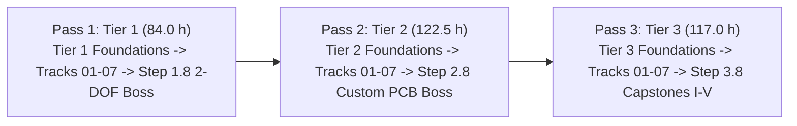

# MechaLab Complete Curriculum Syllabus (~8 hrs/week Tier-First Study Plan)

> **Target Audience:** Absolute beginners (assumes only basic computer literacy, arithmetic, and English reading; programming, algebra, trigonometry, SI units, and physics are taught from scratch inside the **Tier 1 Foundations** on-ramp).  
> **Graduate Goal:** By the end of this curriculum, a learner can design, simulate, build, program, and tune a multi-DOF mechatronic system (such as a custom-PCB 2-DOF or 6-DOF robot arm with closed-loop FOC/PID/LQR/CBF control, FreeRTOS/Zephyr/micro-ROS firmware, ROS 2 `ros2_control` integration, and a learned PyTorch/LeRobot policy), diagnosing faults across power electronics, mechanics, sensors, firmware, control, and safety layers.

---

## 1. Tier-First Curriculum Architecture (Foundations Integrated into Each Tier)




Although `00-foundations` is stored in Track 00 for repository organization, **learners never study all of Track 00 upfront as a standalone course.** Instead, the curriculum is strictly **Tier-First**: you start each Tier with that Tier's **Foundations Ladder**, apply those exact tools across **Tracks 01–07** in the same Tier, and complete that Tier's **Integration Boss Capstone** before leveling up to the next Tier:

```text
Tier 1 (Phase 1 — Beginner / Breakout Pass: 24 modules, 84.0 hrs)
├── Tier 1 Foundations          (T1.00a → T1.00b → T1.00c → T1.00d → T1.00e ──► Step 1.1: 00-foundations.T1.01)
├── Electronics & Power         (T1.01a → T1.01c → T1.01d → T1.01b          ──► Step 1.2: 01-electronics.T1.02)
├── Mechanics                   (T1.02a                                     ──► Step 1.3: 02-mechanics.T1.03)
├── Sensors & Actuators         (T1.03a                                     ──► Step 1.4: 03-sensors.T1.04)
├── Embedded & Realtime         (T1.04a → T1.04b                            ──► Step 1.5: 04-embedded.T1.05)
├── Control & Estimation        (T1.05a                                     ──► Step 1.6: 05-control.T1.06)
├── Robotics & Autonomy         (T1.06a                                     ──► Step 1.7: 06-robotics.T1.07)
├── Systems / Production        (T1.07a                                     ──► Step 1.8 Safety & SysID Prep)
└── Tier 1 integration step     (Step 1.8 Boss: 07-systems.T1.08 — Breadboard/Breakout 2-DOF Compliant Robot)

Tier 2 (Phase 2 — Intermediate / Applied Pass: 26 modules, 122.5 hrs)
├── Tier 2 Foundations          (T2.00a → T2.00b → T2.00c → T2.00d → T2.00e → T2.00f ──► Step 2.1: 00-foundations.T2.01)
├── Electronics & Power         (T2.01a → T2.01b                                     ──► Step 2.2: 01-electronics.T2.02)
├── Mechanics                   (T2.02a                                              ──► Step 2.3: 02-mechanics.T2.03)
├── Sensors & Actuators         (T2.03a                                              ──► Step 2.4: 03-sensors.T2.04)
├── Embedded & Realtime         (T2.04a → T2.04b → T2.04c (Zephyr) → T2.04d (uROS)   ──► Step 2.5: 04-embedded.T2.05)
├── Control & Estimation        (T2.05a                                              ──► Step 2.6: 05-control.T2.06)
├── Robotics & Autonomy         (T2.06a (ROS 2 Core) → T2.06b (Launch/Bag/Sim)       ──► Step 2.7: 06-robotics.T2.07)
├── Systems / Production        (T2.07a (Regen Chopper, CAN-FD Watchdog & HIL)       ──► Step 2.8 Systems & HIL Prep)
└── Tier 2 integration step     (Step 2.8 Boss: 07-systems.T2.08 — Custom 4-Layer CAN Servo + LQR/MuJoCo Twin)

Tier 3 (Phase 3 — Advanced / Production Pass: 18 modules, 117.0 hrs)
├── Tier 3 Foundations          (T3.00a                     ──► Step 3.1: 00-foundations.T3.01)
├── Electronics & Power         (T3.01a                     ──► Step 3.2: 01-electronics.T3.02)
├── Mechanics                   (T3.02a                     ──► Step 3.3: 02-mechanics.T3.03)
├── Sensors & Actuators         (T3.03a                     ──► Step 3.4: 03-sensors.T3.04)
├── Embedded & Realtime         (T3.04a                     ──► Step 3.5: 04-embedded.T3.05)
├── Control & Estimation        (T3.05a                     ──► Step 3.6: 05-control.T3.06)
├── Robotics & Autonomy         (T3.06a → T3.06b            ──► Step 3.7: 06-robotics.T3.07)
├── Systems / Production        (T3.06a (OPC UA / AAS / PLd)──► Step 3.7 Industrial & Safety Qualification)
└── Tier 3 integration step     (T3.07a ──► Step 3.8 Boss: 08-capstones.T3.08 — Production Capstones I–V)
```

| Tier / Pass | Bridge Modules (`modules/`) | Legacy Track Steps (`README.md`) | Total Modules | Estimated Hours | Pacing (~8 hrs/wk) |
| :--- | :--- | :--- | :--- | :--- | :--- |
| **🟢 Tier 1 (Beginner / Breakout Pass)** | 16 Bridge Modules (`53.0 hrs`) | 8 Legacy Steps (`31.0 hrs`) | 24 Modules | **84.0 hrs** | Weeks 1–11 |
| **🔵 Tier 2 (Intermediate / Applied Pass)** | 18 Bridge Modules (`77.5 hrs`) | 8 Legacy Steps (`45.0 hrs`) | 26 Modules | **122.5 hrs** | Weeks 12–26 |
| **🟣 Tier 3 (Advanced / Production Pass)** | 10 Bridge Modules (`49.0 hrs`) | 8 Legacy Steps (`68.0 hrs`) | 18 Modules | **117.0 hrs** | Weeks 27–41 |
| **Total Curriculum (100% Sim-Capable)** | **44 Bridge Modules (`179.5 hrs`)** | **24 Legacy Steps (`144.0 hrs`)** | **68 Modules** | **323.5 hrs** | **~41 Weeks** |

---

## 2. Fast-Track Skip Paths (For Experienced Learners)

Every bridge module (`modules/*.md`) includes a **4–6 question Skip Test** (`§7 Checkpoint -> ### Skip test`), and the final module of each of the 25 bridge ladders includes an **8-question Ladder Gate Test** (`§7 Checkpoint -> ### Gate test`). Passing any Gate Test with $\ge 80\%$ ($100\%$ on safety items after reading `## Safety notes`) skips that entire bridge ladder:

1. **Software / CS Engineer Entry (Already fluent in Python, Git, C pointers & Linux):**
   - Pass the Gate Test in [`00-foundations.T1.00e.md`](../modules/00-foundations.T1.00e.md) (or skip `T1.00a` and `T1.00b` via their Skip Tests) and `04-embedded.T1.04a.md` $\implies$ **saves ~10.0 hours** in Tier 1.
2. **Mechanical Engineer Entry (Already fluent in SI units, vectors, FBDs, $SE(3)$, and ODEs):**
   - Pass the Skip/Gate Tests in `00-foundations.T1.00c`–`T1.00e`, `02-mechanics.T1.02a`, `00-foundations.T2.00b`–`T2.00c`, and `02-mechanics.T2.02a` $\implies$ **saves ~25.5 hours** across Tiers 1–2.
3. **Electrical / Embedded Engineer Entry (Already fluent in Ohm's law, RC/RL, MOSFET PWM, Op-Amps, SPI/DMA & RTOS):**
   - Pass the Gate Tests in [`01-electronics.T1.01b.md`](../modules/01-electronics.T1.01b.md) *(completing mandatory safety items)*, [`04-embedded.T1.04b.md`](../modules/04-embedded.T1.04b.md), [`01-electronics.T2.01b.md`](../modules/01-electronics.T2.01b.md), and [`04-embedded.T2.04d.md`](../modules/04-embedded.T2.04d.md) $\implies$ **saves ~39.5 hours** across Tiers 1–2.

---

## 3. Complete Week-by-Week Tier-First Study Schedule (~8 Hours / Week)

### 🟢 PHASE 1: Tier 1 — Beginner / Intuitive Pass (Weeks 1–11 · 84.0 Hours)

| Week | Module ID & File | Title & Core Concepts Taught | Est. Hours | Prereqs |
| :--- | :--- | :--- | :--- | :--- |
| **Wk 1** | [`00-foundations.T1.00a`](../modules/00-foundations.T1.00a.md) | **Tier 1 Foundations 1:** Running Python, Variables, Loops, Functions & Tracebacks | 3.0 h | `[]` *(Entry)* |
| **Wk 1** | [`00-foundations.T1.00b`](../modules/00-foundations.T1.00b.md) | **Tier 1 Foundations 2:** Lists, Dictionaries, NumPy Arrays, Plotting & Git/Terminal Basics | 3.5 h | `T1.00a` |
| **Wk 2** | [`00-foundations.T1.00c`](../modules/00-foundations.T1.00c.md) | **Tier 1 Foundations 3:** SI Units, Engineering Prefixes & Dimensional Analysis | 2.5 h | `T1.00b` |
| **Wk 2** | [`00-foundations.T1.00d`](../modules/00-foundations.T1.00d.md) | **Tier 1 Foundations 4:** Linear Equations, Unit-Circle Trig, Radians, `atan2` & 2D Vectors | 3.5 h | `T1.00c` |
| **Wk 3** | [`00-foundations.T1.00e`](../modules/00-foundations.T1.00e.md) | **Tier 1 Foundations 5:** Position, Velocity, Acceleration, Force, Mass, Energy & Torque *(Gate Test 1)* | 4.0 h | `T1.00d` |
| **Wk 3** | [`00-foundations.T1.01`](../00-foundations/README.md#tier-1-beginner--intuitive) | **Legacy Step 1.1 (Tier 1 Foundations):** Calculus as `while` Loops, 2D Rotations & RC Smoothing | 3.5 h | `T1.00e` |
| **Wk 4** | [`01-electronics.T1.01a`](../modules/01-electronics.T1.01a.md) | **Track 01 Bridge 1:** Voltage, Current, Resistance, Ohm's Law, KVL/KCL & Dividers | 3.0 h | `T1.00e` |
| **Wk 4** | [`01-electronics.T1.01c`](../modules/01-electronics.T1.01c.md) | **Track 01 Bridge 2:** Multimeter, Bench Supply, Breadboard & ESD/Short Safety *(Safety Gate)* | 2.5 h | `T1.01a` |
| **Wk 4** | [`01-electronics.T1.01d`](../modules/01-electronics.T1.01d.md) | **Track 01 Bridge 3:** Capacitors, Inductors, RC Time Constants & Inductive Flyback | 3.0 h | `T1.01c` |
| **Wk 5** | [`01-electronics.T1.01b`](../modules/01-electronics.T1.01b.md) | **Track 01 Bridge 4:** Low-Side MOSFET Switching, PWM & H-Bridge Polarity *(Gate Test 2)* | 3.5 h | `T1.01d` |
| **Wk 5** | [`01-electronics.T1.02`](../01-electronics-and-power/README.md#tier-1-beginner--intuitive) | **Legacy Step 1.2:** Breadboard H-Bridges (`DRV8833`), Logic Levels & Decoupling | 3.5 h | `T1.01, T1.01b` |
| **Wk 6** | [`02-mechanics.T1.02a`](../modules/02-mechanics.T1.02a.md) | **Track 02 Bridge:** Free-Body Diagrams, Static Torque, Gears & Inertia *(Gate Test 3)* | 3.5 h | `T1.01` |
| **Wk 6** | [`02-mechanics.T1.03`](../02-mechanics-kinematics-dynamics/README.md#tier-1-beginner--intuitive) | **Legacy Step 1.3:** 2D Planar Kinematics, Gear Ratios ($N^2$ Inertia) & Bearings | 4.0 h | `T1.01, T1.02a` |
| **Wk 7** | [`03-sensors.T1.03a`](../modules/03-sensors.T1.03a.md) | **Track 03 Bridge:** Electromagnets, Pole Pairs, Quadrature & Back-EMF *(Gate Test 4)* | 3.5 h | `T1.02` |
| **Wk 7** | [`03-sensors.T1.04`](../03-sensors-and-actuators/README.md#tier-1-beginner--intuitive) | **Legacy Step 1.4:** Quadrature/Magnetic Encoders & Open-Loop BLDC (`SimpleFOC`) | 4.0 h | `T1.02, T1.03a` |
| **Wk 8** | [`04-embedded.T1.04a`](../modules/04-embedded.T1.04a.md) | **Track 04 Bridge 1:** From Python to C/Arduino: Fixed-Width Types, Bitwise Masks, Structs & Pointers | 3.5 h | `T1.00b` |
| **Wk 8** | [`04-embedded.T1.04b`](../modules/04-embedded.T1.04b.md) | **Track 04 Bridge 2:** Non-Blocking `millis()` State Machines, ISRs & `volatile` *(Gate Test 5)* | 3.5 h | `T1.04a` |
| **Wk 9** | [`04-embedded.T1.05`](../04-embedded-and-realtime/README.md#tier-1-beginner--intuitive) | **Legacy Step 1.5:** Killing `delay()`, $1\text{ kHz}$ Timer ISRs & Binary Serial | 3.5 h | `T1.02, T1.04b` |
| **Wk 9** | [`05-control.T1.05a`](../modules/05-control.T1.05a.md) | **Track 05 Bridge:** Open vs. Closed Loop, P/I/D Physical Roles & Saturation *(Gate Test 6)* | 3.5 h | `T1.01, T1.05` |
| **Wk 10** | [`05-control.T1.06`](../05-control-and-estimation/README.md#tier-1-beginner--intuitive) | **Legacy Step 1.6:** PID Virtual Spring-Damper, Anti-Windup & Complementary IMU | 4.0 h | `T1.01, T1.05, T1.05a` |
| **Wk 10** | [`06-robotics.T1.06a`](../modules/06-robotics.T1.06a.md) | **Track 06 Bridge:** 1D Point-to-Point Motion, Boundary Conditions & Joint Springs *(Gate Test 7)* | 3.5 h | `T1.03, T1.06` |
| **Wk 11** | [`06-robotics.T1.07`](../06-robotics-and-autonomy/README.md#tier-1-beginner--intuitive) | **Legacy Step 1.7:** Cubic Trajectories, Joint Springs & 10-Step Safe Bring-Up | 4.0 h | `T1.03, T1.06, T1.06a` |
| **Wk 11** | [`07-systems.T1.07a`](../modules/07-systems.T1.07a.md) | **Track 07 Bridge:** Industrial State Machines, Cyclic PLC Scan, E-Stop & Sine Sweep *(Gate Test 8)* | 3.5 h | `T1.07` |
| **Wk 11** | [`07-systems.T1.08`](../08-capstone-projects/README.md#tier-1-capstone-builds-beginner--breakout-pass) | **Legacy Step 1.8 (Tier 1 Integration Boss):** Breadboard/Breakout 2-DOF Compliant Desktop Robot | 4.5 h | `T1.07, T1.07a` |

---

### 🔵 PHASE 2: Tier 2 — Intermediate / Applied Pass (Weeks 12–26 · 122.5 Hours)

| Week | Module ID & File | Title & Core Concepts Taught | Est. Hours | Prereqs |
| :--- | :--- | :--- | :--- | :--- |
| **Wk 12** | [`00-foundations.T2.00a`](../modules/00-foundations.T2.00a.md) | **Tier 2 Foundations 1:** Numerical Derivatives, Integrals & Matrices as State Updaters | 4.0 h | `T1.01` |
| **Wk 12** | [`00-foundations.T2.00b`](../modules/00-foundations.T2.00b.md) | **Tier 2 Foundations 2:** Vectors, Dot & Cross Products, Linear Independence & Basis Change | 3.5 h | `T2.00a` |
| **Wk 13** | [`00-foundations.T2.00c`](../modules/00-foundations.T2.00c.md) | **Tier 2 Foundations 3:** 1st- & 2nd-Order ODEs, Characteristic Roots, $\omega_n$ & $\zeta$ | 4.5 h | `T2.00b` |
| **Wk 13** | [`00-foundations.T2.00d`](../modules/00-foundations.T2.00d.md) | **Tier 2 Foundations 4:** Complex Numbers, Euler's Formula, Phasors & Bode Plots | 4.0 h | `T2.00c` |
| **Wk 14** | [`00-foundations.T2.00e`](../modules/00-foundations.T2.00e.md) | **Tier 2 Foundations 5:** Laplace Transform, Poles/Zeros, State-Space $\dot{x}=Ax+Bu$ & Discretization | 4.5 h | `T2.00d` |
| **Wk 14** | [`00-foundations.T2.00f`](../modules/00-foundations.T2.00f.md) | **Tier 2 Foundations 6:** Sampling, Aliasing, z-Transform, Pre-Warped Tustin Biquads & Covariance *(Gate Test 9)* | 4.5 h | `T2.00e` |
| **Wk 15** | [`00-foundations.T2.01`](../00-foundations/README.md#tier-2-intermediate--applied) | **Legacy Step 2.1 (Tier 2 Foundations):** State-Space Matrices, Two-Mass Resonance, Quaternions & Tustin Biquads | 5.5 h | `T1.08, T2.00e, T2.00f` |
| **Wk 16** | [`01-electronics.T2.01a`](../modules/01-electronics.T2.01a.md) | **Track 01 T2 Bridge 1:** Op-Amps, Differential Shunt Amplification, CMRR & Kelvin Sensing | 4.0 h | `T1.02, T2.01` |
| **Wk 16** | [`01-electronics.T2.01b`](../modules/01-electronics.T2.01b.md) | **Track 01 T2 Bridge 2:** KiCad 4-Layer Stackup, $L\,di/dt$, Bootstrap Drivers & $48\text{ V}$ Pre-Charge *(Gate Test 10)* | 4.5 h | `T2.01a` |
| **Wk 17** | [`01-electronics.T2.02`](../01-electronics-and-power/README.md#tier-2-intermediate--applied) | **Legacy Step 2.2:** 4-Layer KiCad PCBs, Bootstrap Gate Drivers & 4-Terminal Kelvin Shunts | 5.5 h | `T1.02, T2.01, T2.01b` |
| **Wk 17** | [`02-mechanics.T2.02a`](../modules/02-mechanics.T2.02a.md) | **Track 02 T2 Bridge:** 6-DOF Constraint Counting, $SE(3)$ Transforms, Jacobians & Parallel-Axis Inertia *(Gate Test 11)* | 4.5 h | `T1.03, T2.01` |
| **Wk 18** | [`02-mechanics.T2.03`](../02-mechanics-kinematics-dynamics/README.md#tier-2-intermediate--applied) | **Legacy Step 2.3:** Maxwell Exact Constraint, `CadQuery` & URDF/MuJoCo Validation | 5.5 h | `T1.03, T2.01, T2.02a` |
| **Wk 19** | [`03-sensors.T2.03a`](../modules/03-sensors.T2.03a.md) | **Track 03 T2 Bridge:** Clarke/Park Reference Frames, PLL Velocity Tracking & Random Walk *(Gate Test 12)* | 4.5 h | `T2.02, T1.04` |
| **Wk 19** | [`03-sensors.T2.04`](../03-sensors-and-actuators/README.md#tier-2-intermediate--applied) | **Legacy Step 2.4:** Clarke/Park Transforms, Type-II PLLs & Allan Variance | 5.5 h | `T2.02, T1.04, T2.03a` |
| **Wk 20** | [`04-embedded.T2.04a`](../modules/04-embedded.T2.04a.md) | **Track 04 T2 Bridge 1:** SPI/I2C Bus Transactions, DMA Ping-Pong Ring Buffers & Zero-CPU Peripherals | 4.0 h | `T1.05, T2.04` |
| **Wk 20** | [`04-embedded.T2.04b`](../modules/04-embedded.T2.04b.md) | **Track 04 T2 Bridge 2:** RTOS Tasks, FreeRTOS Preemptive Scheduling, Priority Inversion & CAN Arbitration | 4.0 h | `T2.04a` |
| **Wk 21** | [`04-embedded.T2.04c`](../modules/04-embedded.T2.04c.md) | **Track 04 T2 Bridge 3:** Zephyr RTOS: West Workspaces, Devicetree Hardware Binding, Kconfig & Static Kernel Primitives | 4.0 h | `T2.04b` |
| **Wk 21** | [`04-embedded.T2.04d`](../modules/04-embedded.T2.04d.md) | **Track 04 T2 Bridge 4:** micro-ROS on Microcontrollers: XRCE-DDS Client-Agent, Static `rclc_executor` & Clock Sync *(Gate Test 13)* | 4.0 h | `T2.04c` |
| **Wk 22** | [`04-embedded.T2.05`](../04-embedded-and-realtime/README.md#tier-2-intermediate--applied) | **Legacy Step 2.5:** FreeRTOS Scheduling (RTA), DMA Buffers & CAN-FD (`MIT Mode`) | 5.5 h | `T1.05, T2.04, T2.04b, T2.04d` |
| **Wk 23** | [`05-control.T2.05a`](../modules/05-control.T2.05a.md) | **Track 05 T2 Bridge:** Gain/Phase Margin, Sensitivity Waterbed ($S+T=1$), Luenberger Observers & Bryson LQR *(Gate Test 14)* | 4.5 h | `T2.01, T2.03` |
| **Wk 23** | [`05-control.T2.06`](../05-control-and-estimation/README.md#tier-2-intermediate--applied) | **Legacy Step 2.6:** Bode Loop Shaping, Gang of Four, Swing-Up LQR & Linear KF | 5.5 h | `T2.01, T2.03, T2.05a` |
| **Wk 24** | [`06-robotics.T2.06a`](../modules/06-robotics.T2.06a.md) | **Track 06 T2 Bridge 1:** ROS 2 Computational Graph (Nodes, Executors, Topics, Services, Actions, QoS), TF2, URDF & `ros2_control` | 5.5 h | `T2.03, T2.05, T2.06` |
| **Wk 24** | [`06-robotics.T2.06b`](../modules/06-robotics.T2.06b.md) | **Track 06 T2 Bridge 2:** ROS 2 Operations: Launch & Composition, Deterministic `rosbag2` MCAP Replay & Simulator Integration *(Gate Test 15)* | 4.5 h | `T2.06a` |
| **Wk 25** | [`06-robotics.T2.07`](../06-robotics-and-autonomy/README.md#tier-2-intermediate--applied) | **Legacy Step 2.7:** Jacobian Transpose Compliance, `Ruckig` S-Curves & Regen Clamps | 6.0 h | `T2.03, T2.06, T2.06a, T2.06b` |
| **Wk 25** | [`07-systems.T2.07a`](../modules/07-systems.T2.07a.md) | **Track 07 T2 Bridge:** Regenerative Braking Shunt Choppers, CAN-FD CRC-16 + Rolling-Counter Watchdogs & SIL/HIL Fault Injection *(Gate Test 16)* | 4.5 h | `T2.02, T2.05, T2.07` |
| **Wk 26** | [`07-systems.T2.08`](../08-capstone-projects/README.md#tier-2-capstone-builds-intermediate--applied-pass) | **Legacy Step 2.8 (Tier 2 Integration Boss):** Custom 4-Layer CAN Servo + LQR/MuJoCo Digital Twin | 6.0 h | `T2.02, T2.05, T2.07, T2.07a` |

---

### 🟣 PHASE 3: Tier 3 — Advanced / Production Pass (Weeks 27–41 · 117.0 Hours)

| Week | Module ID & File | Title & Core Concepts Taught | Est. Hours | Prereqs |
| :--- | :--- | :--- | :--- | :--- |
| **Wk 27** | [`00-foundations.T3.00a`](../modules/00-foundations.T3.00a.md) | **Tier 3 Foundations Bridge:** Skew-Symmetric Hat Map $[\omega]_\times$, Matrix Exponential $e^{At}$, Rodrigues & Energy *(Gate Test 17)* | 5.0 h | `T2.08` |
| **Wk 28** | [`00-foundations.T3.01`](../00-foundations/README.md#tier-3-advanced--production) | **Legacy Step 3.1 (Tier 3 Foundations):** Lie Groups $SO(3)/SE(3)$, Van Loan ZOH & Port-Hamiltonian Energy | 8.0 h | `T2.08, T3.00a` |
| **Wk 29** | [`01-electronics.T3.01a`](../modules/01-electronics.T3.01a.md) | **Track 01 T3 Bridge:** 6-Layer Flux-Canceling Planes, Bessel AFE, SAR Charge-Bucket Settling & Cauer Thermal RC *(Gate Test 18)* | 5.0 h | `T2.02, T3.01` |
| **Wk 30** | [`01-electronics.T3.02`](../01-electronics-and-power/README.md#tier-3-advanced--production) | **Legacy Step 3.2:** 6-Layer $<2\text{ nH}$ $48\text{ V}/30\text{ A}$ Inverter, Bessel AFE & SAR Charge Buckets | 8.0 h | `T2.02, T3.01, T3.01a` |
| **Wk 31** | [`02-mechanics.T3.02a`](../modules/02-mechanics.T3.02a.md) | **Track 02 T3 Bridge:** 6D Spatial Twists/Wrenches, Screw Axes in $SE(3)$, Notch Flexure Stiffness & Two-Pass RNEA *(Gate Test 19)* | 5.0 h | `T3.01, T2.03` |
| **Wk 32** | [`02-mechanics.T3.03`](../02-mechanics-kinematics-dynamics/README.md#tier-3-advanced--production) | **Legacy Step 3.3:** Screw PoE, `Ti-6Al-4V` Flexures, Featherstone $O(n)$ RNEA & GPU Physics (`Newton` / `Isaac Lab`) | 8.5 h | `T3.01, T2.03, T3.02a` |
| **Wk 33** | [`03-sensors.T3.03a`](../modules/03-sensors.T3.03a.md) | **Track 03 T3 Bridge:** Rotating-Frame Cross-Coupling ($\omega_e L i$), Min-Max SVPWM ($1/\sqrt{3}$) & Encoder Harmonic LUT *(Gate Test 20)* | 4.5 h | `T3.02, T2.04` |
| **Wk 34** | [`03-sensors.T3.04`](../03-sensors-and-actuators/README.md#tier-3-advanced--production) | **Legacy Step 3.4:** $25\text{–}40\text{ kHz}$ Decoupled $d$-$q$ FOC, SVPWM & Harmonic LUT | 8.0 h | `T3.02, T2.04, T3.03a` |
| **Wk 35** | [`04-embedded.T3.04a`](../modules/04-embedded.T3.04a.md) | **Track 04 T3 Bridge:** Center-Aligned PWM Midpoint ADC Triggering, Q1.31 CORDIC & Wait-Free `SeqLock` *(Gate Test 21)* | 5.0 h | `T3.04, T2.05` |
| **Wk 36** | [`04-embedded.T3.05`](../04-embedded-and-realtime/README.md#tier-3-advanced--production) | **Legacy Step 3.5:** Bare-Metal `TIM1`$\to$`ADC`, CORDIC, Embedded Rust (`Embassy`/`RTIC`) & C++20 `WaitFreeSeqLock` | 8.5 h | `T3.04, T2.05, T3.04a` |
| **Wk 37** | [`05-control.T3.05a`](../modules/05-control.T3.05a.md) | **Track 05 T3 Bridge:** Joseph-Form Covariance Symmetry, Tangent-Space ESKF Reset on $SO(3)$, Box QP & CBFs *(Gate Test 22)* | 5.0 h | `T3.01, T2.06` |
| **Wk 38** | [`05-control.T3.06`](../05-control-and-estimation/README.md#tier-3-advanced--production) | **Legacy Step 3.6:** Joseph-Form Manifold ESKF, Embedded MPC (`acados`/`TinyMPC`) & Control Barrier QPs | 8.5 h | `T3.01, T2.06, T3.05a` |
| **Wk 39** | [`06-robotics.T3.06a`](../modules/06-robotics.T3.06a.md) | **Track 06 T3 Bridge 1:** PyTorch Tensors, Automatic Differentiation (`autograd`), Loss Functions & Behavior Cloning | 5.0 h | `T2.07` |
| **Wk 39** | [`06-robotics.T3.06b`](../modules/06-robotics.T3.06b.md) | **Track 06 T3 Bridge 2:** MDPs, Policy Gradient / PPO, Action Chunking & Sim-to-Real Safety Wrappers *(Gate Test 23)* | 5.5 h | `T3.06a` |
| **Wk 40** | [`07-systems.T3.06a`](../modules/07-systems.T3.06a.md) | **Track 07 T3 Bridge:** OPC UA Information Models, IEC 63278 AAS Submodels & ISO 13849-1 PLd *(Gate Test 24)* | 4.5 h | `T3.06b, T2.08` |
| **Wk 40** | [`06-robotics.T3.07`](../07-systems-hil-and-production/README.md#tier-3-advanced--production) | **Legacy Step 3.7:** Khatib WBC, Embodied AI (`LeRobot`, Diffusion, $\pi_0$/VLA), Schroeder SysID, AAS & $<1\ \mu\text{s}$ STO | 9.0 h | `T3.03, T3.06, T3.06b, T3.06a` |
| **Wk 41** | [`08-capstones.T3.07a`](../modules/08-capstones.T3.07a.md) | **Track 08 T3 Bridge:** System Error/Latency Budgeting, Interface Contracts & Pre-Bring-Up Safety Sign-Off *(Gate Test 25)* | 4.5 h | `T3.07, 07-systems.T3.06a` |
| **Wk 41** | [`08-capstones.T3.08`](../08-capstone-projects/README.md#tier-3-capstone-builds-advanced--production-pass) | **Legacy Step 3.8 (Tier 3 Production Mastery):** Full Production Capstones I–V & Open Robot Platforms | 9.5 h | `T3.02, T3.04, T3.05, T3.07, T3.07a` |
