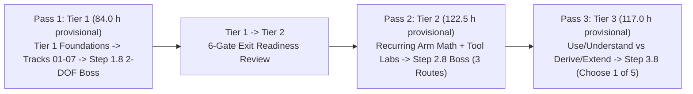

# MechaLab Complete Curriculum Syllabus (~8 hrs/week Tier-First Study Plan)

> **Target Audience:** Absolute beginners (assumes only basic computer literacy, arithmetic, and English reading; programming, algebra, trigonometry, SI units, and physics are taught from scratch inside the **Track P + Stage 0 Entry Ramp** and **Tier 1 Foundations** ladder).  
> **Graduate Goal:** By the end of this curriculum, a learner can design, simulate, program, and tune a multi-DOF mechatronic system (evolving **one recurring 2-DOF robot arm spine** from a scalar Tier 1 joint model to a Tier 2 state-space/LQR/ROS 2 digital twin and a Tier 3 FOC/ESKF/CBF-QP production design), diagnosing faults across power electronics, mechanics, sensors, firmware, control, and safety layers.

---

## 0. Three Completion Routes, Reconciled Time Estimates & 8-Step Teaching Ladder

### A. What "Complete" Means Across Routes

Self-guided simulation and engineering design are achievable self-study goals across all three tiers; **independent physical commissioning of high-energy hardware ($24\text{ V}/15\text{ A}$ servos or $48\text{ V}/30\text{ A}$ inverters) is not a beginner self-study promise:**

| Route | What "Complete" Means | Expected Help & Safety Boundary |
| :--- | :--- | :--- |
| **1. Learn & Simulate (\$0)** | Complete lessons, behavioral tests, simulator labs, planted-fault diagnostics, and capstones in the browser or supplied software tools (`Pyodide`, `Falstad`, `Wokwi`, `MuJoCo`, `ROS 2`). | **Built-in hints, math refreshers, and tool first-run labs** are designed to be sufficient for self-study. |
| **2. Build (Optional Low-Voltage Bench)** | Assemble and test optional low-voltage ($\le 12\text{ V}$) hardware (`Arduino Uno`, `DRV8833`/`TB6612FNG`, `AS5600` encoder, 2-DOF desktop arm) or run Tier 2 firmware on a known-good reference board. | **Occasional help is reasonable**, especially for first-time breadboarding, soldering, and current-limited (`CC/CV`) bench work. |
| **3. Production Practice (Supervised Sign-Off)** | Complete design reviews, SIL/HIL fault injection, and commissioning of custom Tier 2 ($24\text{ V}/15\text{ A}$) or Tier 3 ($48\text{ V}/30\text{ A}$) hardware. | **Requires experienced engineering review & formal pre-bring-up safety sign-off;** not a solo beginner self-study promise. |

### B. Reconciled Provisional Time Estimates (`Track P` + `Stage 0` + `Passes 1–3`)

All hour estimates in this syllabus are **provisional engineering targets** pending empirical validation with true beginners via **[`.github/ISSUE_TEMPLATE/beginner-timing-log.md`](../.github/ISSUE_TEMPLATE/beginner-timing-log.md)**:

| Curriculum Stage | Files / Modules | Provisional Time Estimate | Notes & Pacing (~8 hrs/wk) |
| :--- | :--- | :--- | :--- |
| **Entry Ramp: Track P (`track-p/`)** | 14 Python Lessons (`P.1–P.14` + `P.M`) | **~10.5–14.0 hrs** *(unmeasured target)* | Overlaps & scaffolds `00-foundations.T1.00a–e`; includes `P.14` (`DRV8833` datasheet table) & **Gate P→0** 15-min check. |
| **Entry Ramp: Stage 0 (`stage-0/`)** | 11 Lessons (`S0.0` Python + `S0.1–S0.M` Falstad/Wokwi) | **~8.5–11.0 hrs** *(unmeasured target)* | Pre-teaches `Effort × Flow` water analogies (`S0.0`), 5-min Falstad twins before every Arduino sketch, and a 4-row C-from-Python sidebar (`S0.7`). |
| **🟢 Pass 1: Tier 1 (`modules/` + `00.1–08.1`)** | 16 Bridge Modules (`53.0 h`) + 8 Legacy Steps (`31.0 h`) = **24 Modules** *(paired with 23 Pass 1 Beginner Lessons)* | **84.0 hrs** *(provisional)* | **Weeks 1–11** · Includes `03.3` FK/Encoder Micro-Lab, 3-part Python→C bridge (`04.1–04.3`), 4-Stage `08.1` Boss & **Gate 1→2 Exit Project**. |
| **🔵 Pass 2: Tier 2 (`modules/` + Track T2)** | 18 Bridge Modules (`77.5 h`) + 8 Legacy Steps (`45.0 h`) = **26 Modules** | **122.5 hrs** *(provisional)* | **Weeks 12–26** · Includes recurring arm math ladder, 4 Tool First-Run Labs & 3 Hardware Evidence Routes. |
| **🟣 Pass 3: Tier 3 (`modules/` + Track T3)** | 10 Bridge Modules (`49.0 h`) + 8 Legacy Steps (`68.0 h`) = **18 Modules** | **117.0 hrs** *(provisional)* | **Weeks 27–41** · Two-level study (*Use & Understand* vs. *Derive & Extend*); **Step 3.8 (`9.5 h`) requires choosing 1 of Capstones I–V**. |
| **Formal 3-Pass Module Total** | **44 Bridge + 24 Legacy = 68 Modules** | **323.5 hrs** *(provisional)* | **~41 Weeks** (at ~8 hrs/wk; **`~342.5–348.5 hrs` / ~43–44 Weeks** including `Track P` + `Stage 0`). |

### C. Unified 8-Step Teaching Ladder & 5-Dimension Difficulty Labels

Every concept across Tiers 1–3 follows the same **8-Step Teaching Ladder** so learners prove prediction, fault diagnosis, and transfer—not just copying a worked example:
1. **Recall:** A quick check of prerequisite concepts from the dependency graph.
2. **See it:** A physical diagram, waveform plot, or interactive workbench animation.
3. **Predict:** Commit to a quantitative or directional prediction before running code or simulation.
4. **Work through:** Step through one complete worked example with intermediate units and values shown.
5. **Practice with support:** Complete starter code (`TODO`s) or a guided simulation with progressive 3-step hints.
6. **Break it on purpose:** Inject a parameter error or common hardware/software fault and diagnose the symptom.
7. **Transfer:** Solve a modified-parameter or unseen boundary scenario verified by instructor behavioral tests.
8. **Integrate:** Apply the skill directly to the **recurring 2-DOF robot arm spine** in the current or next track.

In addition to the $\le 2$ new ideas rule (beginner lessons) and $\le 3$ new concepts rule (bridge modules), every stage surfaces five difficulty dimensions: **Math Level**, **Coding Level**, **New Tools Introduced**, **Hardware Risk Level** (`None/Sim`, `Low-Voltage <=12V`, `High-Energy Review Required`), and **100% Simulation-Capable Status**.

---

## 1. Tier-First Curriculum Architecture (Foundations Integrated into Each Tier)



Although `00-foundations` is stored in Track 00 for repository organization, **learners never study all of Track 00 upfront as a standalone course.** Instead, the curriculum is strictly **Tier-First**: you start each Tier with that Tier's **Foundations Ladder** applied to the recurring robot arm/joint, use those exact tools across **Tracks 01–07** in the same Tier, and complete that Tier's **Integration Boss Capstone** before leveling up:

```text
Tier 1 (Phase 1 — Beginner / Breakout Pass: 24 modules, 84.0 hrs provisional)
├── Tier 1 Foundations          (T1.00a → T1.00b → T1.00c → T1.00d → T1.00e ──► Step 1.1: 00-foundations.T1.01)
├── Electronics & Power         (T1.01a → T1.01c → T1.01d → T1.01b          ──► Step 1.2: 01-electronics.T1.02)
├── Mechanics                   (T1.02a                                     ──► Step 1.3: 02-mechanics.T1.03)
├── Sensors & Actuators         (T1.03a                                     ──► Step 1.4: 03-sensors.T1.04)
├── Embedded & Realtime         (T1.04a → T1.04b                            ──► Step 1.5: 04-embedded.T1.05)
├── Control & Estimation        (T1.05a                                     ──► Step 1.6: 05-control.T1.06)
├── Robotics & Autonomy         (T1.06a                                     ──► Step 1.7: 06-robotics.T1.07)
├── Systems / Production        (T1.07a                                     ──► Step 1.8 Safety & SysID Prep)
└── Tier 1 integration step     (Step 1.8 Boss: 07-systems.T1.08 — Breadboard/Breakout 2-DOF Compliant Robot)

Tier 2 (Phase 2 — Intermediate / Applied Pass: 26 modules, 122.5 hrs provisional)
├── Tier 2 Foundations          (T2.00a → T2.00b → T2.00c → T2.00d → T2.00e → T2.00f ──► Step 2.1: 00-foundations.T2.01)
├── Electronics & Power         (T2.01a → T2.01b                                     ──► Step 2.2: 01-electronics.T2.02)
├── Mechanics                   (T2.02a                                              ──► Step 2.3: 02-mechanics.T2.03)
├── Sensors & Actuators         (T2.03a                                              ──► Step 2.4: 03-sensors.T2.04)
├── Embedded & Realtime         (T2.04a → T2.04b → T2.04c (Zephyr) → T2.04d (uROS)   ──► Step 2.5: 04-embedded.T2.05)
├── Control & Estimation        (T2.05a                                              ──► Step 2.6: 05-control.T2.06)
├── Robotics & Autonomy         (T2.06a (ROS 2 Core) → T2.06b (Launch/Bag/Sim)       ──► Step 2.7: 06-robotics.T2.07)
├── Systems / Production        (T2.07a (Regen Chopper, CAN-FD Watchdog & HIL)       ──► Step 2.8 Systems & HIL Prep)
└── Tier 2 integration step     (Step 2.8 Boss: 07-systems.T2.08 — CAN Servo + LQR/MuJoCo Twin via Sim / Ref-Board / Custom PCB)

Tier 3 (Phase 3 — Advanced / Production Pass: 18 modules, 117.0 hrs provisional)
├── Tier 3 Foundations          (T3.00a                     ──► Step 3.1: 00-foundations.T3.01)
├── Electronics & Power         (T3.01a                     ──► Step 3.2: 01-electronics.T3.02)
├── Mechanics                   (T3.02a                     ──► Step 3.3: 02-mechanics.T3.03)
├── Sensors & Actuators         (T3.03a                     ──► Step 3.4: 03-sensors.T3.04)
├── Embedded & Realtime         (T3.04a                     ──► Step 3.5: 04-embedded.T3.05)
├── Control & Estimation        (T3.05a                     ──► Step 3.6: 05-control.T3.06)
├── Robotics & Autonomy         (T3.06a → T3.06b            ──► Step 3.7: 06-robotics.T3.07)
├── Systems / Production        (T3.06a (OPC UA / AAS / PLd)──► Step 3.7 Industrial & Safety Qualification)
└── Tier 3 integration step     (T3.07a ──► Step 3.8 Boss: 08-capstones.T3.08 — Choose 1 of Capstones I–V)
```

---

## 2. Fast-Track Skip Paths & TierTransition Readiness Reviews

### A. Experienced Learner Skip Paths
Every bridge module (`modules/*.md`) includes a **4–6 question Skip Test** (`§7 Checkpoint -> ### Skip test`), and the final module of each of the 25 bridge ladders includes an **8-question Ladder Gate Test** (`§7 Checkpoint -> ### Gate test`). Passing any Gate Test with $\ge 80\%$ ($100\%$ on safety items after reading `## Safety notes`) skips that entire bridge ladder:

1. **Software / CS Engineer Entry (Already fluent in Python, Git, C pointers & Linux):**
   - Pass the Gate Test in [`00-foundations.T1.00e.md`](../modules/00-foundations.T1.00e.md) (or skip `T1.00a` and `T1.00b` via their Skip Tests) and `04-embedded.T1.04a.md` $\implies$ **saves ~10.0 hours** in Tier 1.
2. **Mechanical Engineer Entry (Already fluent in SI units, vectors, FBDs, $SE(3)$, and ODEs):**
   - Pass the Skip/Gate Tests in `00-foundations.T1.00c`–`T1.00e`, `02-mechanics.T1.02a`, `00-foundations.T2.00b`–`T2.00c`, and `02-mechanics.T2.02a` $\implies$ **saves ~25.5 hours** across Tiers 1–2.
3. **Electrical / Embedded Engineer Entry (Already fluent in Ohm's law, RC/RL, MOSFET PWM, Op-Amps, SPI/DMA & RTOS):**
   - Pass the Gate Tests in [`01-electronics.T1.01b.md`](../modules/01-electronics.T1.01b.md) *(completing mandatory safety items)*, [`04-embedded.T1.04b.md`](../modules/04-embedded.T1.04b.md), [`01-electronics.T2.01b.md`](../modules/01-electronics.T2.01b.md), and [`04-embedded.T2.04d.md`](../modules/04-embedded.T2.04d.md) $\implies$ **saves ~39.5 hours** across Tiers 1–2.

### B. Gate P→0 (15-Min Check) & Gate 1→2 ("Tier 1 Exit" 6-Gate Review + Self-Administered Position-Loop Project)
1. **Gate P→0 (Track P → Stage 0 15-Minute Placement Check in Tab 3):**
   - Write a function with a loop and an `assert` ($\to$ targeted review: [`P.5`](../track-p/P.5-functions-and-while-loops.md) / [`P.6`](../track-p/P.6-modules-and-automated-asserts.md));
   - Convert 3 quantities between SI prefixes: $15\text{ mA} \to 0.015\text{ A}$, $4.7\text{ k}\Omega \to 4700\ \Omega$, $500\ \mu\text{s} \to 0.0005\text{ s}$ ($\to$ targeted review: [`P.7`](../track-p/P.7-si-units-and-metric-prefixes.md));
   - Read one row from the `DRV8833` datasheet table (`VM: 2.7–10.8 V` operating vs. `11.8 V` abs max) ($\to$ targeted review: [`P.14`](../track-p/P.14-reading-a-datasheet-table.md)).
2. **Gate 1→2 ("Tier 1 Exit" 6-Gate Readiness Review + 2–3 Hour Self-Administered Project with Tests Only):**
   - **Self-Administered Exit Project Spec:** *"Given a joint motor's parameters ($J = 0.02\text{ kg}\cdot\text{m}^2$, $b = 0.05\text{ N}\cdot\text{m}\cdot\text{s/rad}$, $m = 0.35\text{ kg}$, $L_{\text{com}} = 0.12\text{ m}$, $\tau_{\max} = 2.0\text{ N}\cdot\text{m}$, $\Delta t = 1\text{ ms}$), build a simulated closed-loop position controller with clamping anti-windup that meets **$\le 2\%$ overshoot** and **settles within $\pm 2\%$ in $< 0.5\text{ s}$**; log and plot the response."*
   - **6 Practical Readiness Gates (with Targeted Refresher Routing instead of "Start Over"):**

| Exit Gate | Practical Demonstration Required | Targeted Refresher If Not Ready |
| :--- | :--- | :--- |
| **1. System Block Diagram** | Trace the closed-loop signal & power path (`Trajectory -> IK -> PD + Gravity FF -> PWM/H-Bridge -> Arm Plant -> Encoder -> Feedback`). | [`Lesson 00.1`](../00-foundations/00.1-effort-flow-and-first-order-lag.md) & [`Lesson 05.1`](../05-control-and-estimation/05.1-pid-virtual-spring-damper-and-anti-windup.md) |
| **2. Parameter-Change Prediction** | Predict how doubling link mass $m$, gear ratio $N$, or derivative gain $K_d$ changes natural frequency $\omega_n$, damping $\zeta$, and reflected inertia $J_{\text{refl}} = J_{\text{load}}/N^2$. | [`Lesson 00.2`](../00-foundations/00.2-mass-spring-damper-oscillations.md) & [`Lesson 02.4`](../02-mechanics-kinematics-dynamics/02.4-rotational-inertia-and-gear-ratios.md) |
| **3. Error & Fault Isolation** | Read a Python traceback, `CRC-8` frame error, `uint8_t`/`uint16_t` rollover spike, or C pass-by-value struct bug and isolate the fault. | [`Lesson 04.1`](../04-embedded-and-realtime/04.1-c-types-and-hardware-timer-isr.md), [`Lesson 04.2`](../04-embedded-and-realtime/04.2-packed-structs-and-crc8-telemetry.md) & [`Lesson 04.3`](../04-embedded-and-realtime/04.3-structs-and-pointers-labeled-boxes.md) |
| **4. Sensor Graph Interpretation** | Estimate velocity from encoder position slope, identify high-frequency accelerometer vibration vs. slow gyro bias drift, and read RC cutoff attenuation. | [`Lesson P.11`](../track-p/P.11-reading-time-series-graphs.md), [`Lesson 01.4`](../01-electronics-and-power/01.4-grounding-and-rc-lowpass-filters.md) & [`Lesson 05.2`](../05-control-and-estimation/05.2-complementary-imu-sensor-fusion.md) |
| **5. Demonstrated Safety Checks** | Verify current-limited (`CC/CV`) supply foldback, positive encoder sign check (`+u -> +dtheta`), and flyback clamping before enabling closed-loop power. | [`Lesson S0.5`](../stage-0/S0.5-multimeters-and-current-limited-supplies.md), [`Lesson 01.1`](../01-electronics-and-power/01.1-mosfet-inductor-flyback.md) & [`Lesson 07.1`](../07-systems-hil-and-production/07.1-safe-bringup-and-sine-sweep-sysid.md) |
| **6. Capstone Transfer Variation** | Complete the 4-Stage `Lesson 08.1` 2-DOF arm capstone (*Predict → R2 Retarget → R4 3 Broken Versions → R5 Trajectory Spec*) and pass all behavioral assertions. | [`Lesson 03.3`](../03-sensors-and-actuators/03.3-encoder-to-fk-integration-microlab.md), [`Lesson 06.1`](../06-robotics-and-autonomy/06.1-cubic-trajectories-and-compliant-joints.md) & [`Lesson 08.1`](../08-capstone-projects/08.1-tier1-2dof-compliant-arm-capstone.md) |

### C. Tier 2 Transitions: Recurring Arm Math Spine, Tool First-Run Labs & 3 Hardware Evidence Routes
1. **Two rigs on purpose: a small teaching model per module, then the shared arm in every graded package.** The six Tier 2 Foundations modules each open on the smallest rig that isolates the new idea — a cart on a spring in `T2.00a`, a lever-and-force cross product in `T2.00b`, a $J = 0.02\text{ kg}\cdot\text{m}^2$ shaft with $k = 8.0\text{ N}\cdot\text{m/rad}$ and $b = 0.40\text{ N}\cdot\text{m}\cdot\text{s/rad}$ in `T2.00c`, a $\omega_n = 100\text{ rad/s}$, $\zeta = 0.05$ structure in `T2.00d`, a $J = 1\text{ kg}\cdot\text{m}^2$, $b = 4$, $k = 100$ model at $T_s = 0.05\text{ s}$ in `T2.00e`, and an $850\text{ Hz}$ notch at $f_s = 4\text{ kHz}$ in `T2.00f`.
   - Those numbers are **not** the capstone joint, and this is deliberate: [`tier1_arm_motor.yaml`](../resources/plants/tier1_arm_motor.yaml) records joint inertias $I_1 = 0.008$, $I_2 = 0.003\text{ kg}\cdot\text{m}^2$ with damping $b_1 = 0.04$, $b_2 = 0.02\text{ N}\cdot\text{m}\cdot\text{s/rad}$. `T2.00c`'s $J = 0.02$ is a teaching shaft chosen so $\omega_n$ and $\zeta$ come out to $20.0\text{ rad/s}$ and $0.50$; reading it as the plant's shoulder inertia is wrong by a factor of $2.5$.
   - What *is* shared is the exercise: every one of the six graded packages ends in a transfer suite that runs the capstone arm, so the learner meets the plant the Tier 1 capstone built even though the worked example is a smaller rig.
   - `T2.00a` estimates joint velocity $\dot{q}$ and integrated position error, then replays the arm's 12-bit AS5600 trace (4096 counts/rev, wrapped across zero).
   - `T2.00b` packs `[q, dq]` into a 2D state vector, updates it via matrix multiplication, and takes the arm's own moment and Jacobian.
   - `T2.00c` solves the 2nd-order ODE $J\ddot{q} + b\dot{q} + K_p q = \tau$ to predict oscillation and settling, then drives the plant's elbow and its motor ($L/R$).
   - `T2.00d` constructs phasor and Bode magnitude/phase numbers, then *measures* the plant's elbow response by lock-in projection rather than reusing its own transfer function.
   - `T2.00e` writes $\dot{x} = Ax + Bu$ and discretizes it as $x_{k+1} = A_d x_k + B_d u_k$, with the plant's elbow damping counted in its poles and step size.
   - `T2.00f` designs a pre-warped Tustin biquad notch and propagates the state covariance $P$ on the plant's encoder stream.
2. **Decoupled Tool First-Run Labs (Learn the Tool Before the Engineering Assessment):**
   - **KiCad First-Run (`T2.01b`):** Open a supplied known-good schematic, run ERC/DRC, change one silkscreen/test-point label, and inspect the 4-layer 3D PCB viewer before designing current-sense layouts.
   - **CAD & URDF First-Run (`T2.02a`):** Change one link length parameter (`l1_m = 0.10 -> 0.15 m`) in the supplied `CadQuery`/URDF file and observe the workspace change in the simulator before deriving $6\times n$ Jacobians.
   - **RTOS First-Run (`T2.04b`):** Build and run a supplied 2-task FreeRTOS/Zephyr starter project, then change one task period (`1 ms -> 2 ms`) and inspect trace timing before writing DMA/CAN-FD drivers.
   - **ROS 2 First-Run (`T2.06a–b`):** Run one supplied node, inspect `/joint_states` with `ros2 topic echo`, and replay a known `rosbag2` MCAP recording before building a custom `ros2_control` pipeline.
3. **Three Equivalent Tier 2 Hardware Evidence Routes (Custom PCB Fabrication Is Optional):**
   - **Route A — Simulation Evidence Route (\$0):** Inspect and modify the supplied KiCad layout, run automated DRC/netlist/thermal checks (`scripts/run_all_labs.py`), and demonstrate the `Step 2.8` CAN-FD + LQR servo in the MuJoCo/browser digital twin.
   - **Route B — Reference-Board Evidence Route:** Run your RTOS, CAN-FD, and LQR/FOC firmware on an off-the-shelf reference board (`B-G431B-ESC1`, `ODrive Micro`, or `SimpleFOCShield` + `STM32G4`) with current-limited bench bring-up.
   - **Route C — Custom-Hardware Evidence Route:** Design, fabricate, assemble, and bring up your own 4-layer PCB following peer design review and the 10-step pre-power checklist.

### D. Tier 3 Scope: Two-Level Study Modes, 5 Concept Ladders & "Choose 1 of 5" Capstone Rule
1. **Two Study Levels in Every Tier 3 Module:**
   - **Level A — Use & Understand (Supported Entry from Tier 1/2):** Learn what the method (`SO(3)`, `FOC`, `ESKF`, `MPC`, `CBF-QP`) does, when to use it, how to run it in the interactive browser workbench or Python/C++ reference sim, and how to check physical plausibility (units, energy conservation, covariance bounds).
   - **Level B — Derive & Extend (Full Mathematical & Production Depth):** Work through the full Lie-algebra/Riccati/QP derivations, fixed-point `Q1.31` / wait-free `SeqLock` implementation details, and worst-case WCET/thermal bounds.
2. **Five Incremental Concept Ladders:**
   - **Rotations (`T3.00a`):** 2D rotation (`02.1`) $\to$ 3D rotation matrix $\to$ frame composition $\to$ unit quaternion $\to$ skew-symmetric hat map $[\omega]_\times$ & matrix exponential $\to$ $SE(3)$ rigid motion.
   - **State Estimation (`T3.05a`):** Noisy sensor sample $\to$ mean & variance $\to$ 1D complementary/exponential filter (`05.2`) $\to$ linear Kalman filter (`T2.05a`) $\to$ 3D orientation error $\to$ Joseph-form manifold ESKF.
   - **Safety Constraints (`T3.05a`):** Clamp a 1D command (`P.3`) $\to$ keep a 1D point away from a wall $\to$ write a 1D barrier inequality $\dot{h}(x) + \gamma h(x) \ge 0$ $\to$ solve a 1-variable box QP $\to$ apply `CBF-QP` to the 2-DOF arm.
   - **Field-Oriented Control (`T3.03a`):** 3-phase sine waves (`03.2`) $\to$ rotating stator vector animation $\to$ Clarke/Park transform prediction + phase-swap fault diagnosis (`T2.03a`) $\to$ decoupled $d$-$q$ PI current loop $\to$ SVPWM & ADC midpoint trigger.
   - **Real-Time Concurrency (`T3.04a`):** Timed `while` loop (`P.5`) $\to$ $1\text{ kHz}$ timer ISR + `volatile` (`04.1`) $\to$ RTOS task priority (`T2.04b`) $\to$ DMA ping-pong buffer $\to$ torn-read race condition diagnosis $\to$ wait-free `SeqLock`.
3. **Explicit Step 3.8 Capstone Scope (`Choose 1 of 5 Capstones`):**
   - The `9.5-hour` provisional estimate for **Step 3.8 (`08-capstones.T3.08`)** covers **completing ONE chosen capstone** from Capstones I–V (e.g., *Capstone I: High-Density Actuator*, *Capstone II: Furuta Pendulum*, *Capstone III: 6-DOF Arm*, *Capstone IV: Planar Hopper*, or *Capstone V: Indoor AMR*) in simulation/design-review mode, or completing a comparative trade-study across the supplied reference simulations. Physical energization of any $>20\text{ V}$ or $>5\text{ A}$ system requires external experienced engineering review.

---

## 3. Complete Week-by-Week Tier-First Study Schedule (~8 Hours / Week, Provisional Estimates)

### 🟢 PHASE 1: Tier 1 — Beginner / Intuitive Pass (Weeks 1–11 · 84.0 Hours Provisional)

| Week | Module ID & File | Title & Core Concepts Taught | Est. Hours | Prereqs |
| :--- | :--- | :--- | :--- | :--- |
| **Wk 1** | [`00-foundations.T1.00a`](../modules/00-foundations.T1.00a.md) | **Tier 1 Foundations 1:** Running Python, Variables, Loops, Functions & Tracebacks | 3.0 h | `[]` *(Entry)* |
| **Wk 1** | [`00-foundations.T1.00b`](../modules/00-foundations.T1.00b.md) | **Tier 1 Foundations 2:** Lists, Dictionaries, NumPy Arrays, Plotting & Git/Terminal Basics | 3.5 h | `T1.00a` |
| **Wk 2** | [`00-foundations.T1.00c`](../modules/00-foundations.T1.00c.md) | **Tier 1 Foundations 3:** SI Units, Engineering Prefixes & Dimensional Analysis | 2.5 h | `T1.00b` |
| **Wk 2** | [`00-foundations.T1.00d`](../modules/00-foundations.T1.00d.md) | **Tier 1 Foundations 4:** Linear Equations, Unit-Circle Trig, Radians, `atan2` & 2D Vectors | 3.5 h | `T1.00c` |
| **Wk 3** | [`00-foundations.T1.00e`](../modules/00-foundations.T1.00e.md) | **Tier 1 Foundations 5:** Position, Velocity, Acceleration, Force, Mass, Energy & Torque *(Gate Test 1)* | 4.0 h | `T1.00d` |
| **Wk 3** | [`00-foundations.T1.01`](../00-foundations/README.md#tier-1-beginner--intuitive) | **Legacy Step 1.1 (Tier 1 Foundations):** Calculus as `while` Loops, 2D Rotations & RC Smoothing | 3.5 h | `T1.00e` |
| **Wk 4** | [`01-electronics.T1.01a`](../modules/01-electronics.T1.01a.md) | **Track 01 Bridge 1:** Voltage, Current, Resistance, Ohm's Law, KVL/KCL & Dividers | 3.0 h | `T1.00e` |
| **Wk 4** | [`01-electronics.T1.01c`](../modules/01-electronics.T1.01c.md) | **Track 01 Bridge 2:** Multimeter, Bench Supply, Breadboard & ESD/Short Safety *(Safety Gate)* | 2.5 h | `T1.01a` |
| **Wk 4** | [`01-electronics.T1.01d`](../modules/01-electronics.T1.01d.md) | **Track 01 Bridge 3:** Capacitors, Inductors, RC Time Constants & Inductive Flyback | 3.0 h | `T1.01c` |
| **Wk 5** | [`01-electronics.T1.01b`](../modules/01-electronics.T1.01b.md) | **Track 01 Bridge 4:** Low-Side MOSFET Switching, PWM & H-Bridge Polarity *(Gate Test 2)* | 3.5 h | `T1.01d` |
| **Wk 5** | [`01-electronics.T1.02`](../01-electronics-and-power/README.md#tier-1-beginner--intuitive) | **Legacy Step 1.2:** Breadboard H-Bridges (`DRV8833` $2.7\text{–}10.8\text{ V}$ / `TB6612FNG` $12\text{ V}$), Logic Levels & Decoupling | 3.5 h | `T1.01, T1.01b` |
| **Wk 6** | [`02-mechanics.T1.02a`](../modules/02-mechanics.T1.02a.md) | **Track 02 Bridge:** Free-Body Diagrams, Static Torque, Gears & Inertia *(Gate Test 3)* | 3.5 h | `T1.01` |
| **Wk 6** | [`02-mechanics.T1.03`](../02-mechanics-kinematics-dynamics/README.md#tier-1-beginner--intuitive) | **Legacy Step 1.3:** 2D Planar Kinematics, Gear Ratios ($N^2$ Inertia) & Bearings | 4.0 h | `T1.01, T1.02a` |
| **Wk 7** | [`03-sensors.T1.03a`](../modules/03-sensors.T1.03a.md) | **Track 03 Bridge:** Electromagnets, Pole Pairs, Quadrature & Back-EMF *(Gate Test 4)* | 3.5 h | `T1.02` |
| **Wk 7** | [`03-sensors.T1.04`](../03-sensors-and-actuators/README.md#tier-1-beginner--intuitive) | **Legacy Step 1.4:** Quadrature/Magnetic Encoders & Open-Loop BLDC (`SimpleFOC`) | 4.0 h | `T1.02, T1.03a` |
| **Wk 8** | [`04-embedded.T1.04a`](../modules/04-embedded.T1.04a.md) | **Track 04 Bridge 1:** From Python to C/Arduino: Fixed-Width Types, Bitwise Masks, Structs & Pointers | 3.5 h | `T1.00b` |
| **Wk 8** | [`04-embedded.T1.04b`](../modules/04-embedded.T1.04b.md) | **Track 04 Bridge 2:** Non-Blocking `millis()` State Machines, ISRs & `volatile` *(Gate Test 5)* | 3.5 h | `T1.04a` |
| **Wk 9** | [`04-embedded.T1.05`](../04-embedded-and-realtime/README.md#tier-1-beginner--intuitive) | **Legacy Step 1.5:** Killing `delay()`, $1\text{ kHz}$ Timer ISRs & Binary Serial | 3.5 h | `T1.02, T1.04b` |
| **Wk 9** | [`05-control.T1.05a`](../modules/05-control.T1.05a.md) | **Track 05 Bridge:** Open vs. Closed Loop, P/I/D Physical Roles & Saturation *(Gate Test 6)* | 3.5 h | `T1.01, T1.05` |
| **Wk 10** | [`05-control.T1.06`](../05-control-and-estimation/README.md#tier-1-beginner--intuitive) | **Legacy Step 1.6:** PID Virtual Spring-Damper, Anti-Windup & Complementary IMU | 4.0 h | `T1.01, T1.05, T1.05a` |
| **Wk 10** | [`06-robotics.T1.06a`](../modules/06-robotics.T1.06a.md) | **Track 06 Bridge:** 1D Point-to-Point Motion, Boundary Conditions & Joint Springs *(Gate Test 7)* | 3.5 h | `T1.03, T1.06` |
| **Wk 11** | [`06-robotics.T1.07`](../06-robotics-and-autonomy/README.md#tier-1-beginner--intuitive) | **Legacy Step 1.7:** Cubic Trajectories, Joint Springs & 10-Step Safe Bring-Up | 4.0 h | `T1.03, T1.06, T1.06a` |
| **Wk 11** | [`07-systems.T1.07a`](../modules/07-systems.T1.07a.md) | **Track 07 Bridge:** Industrial State Machines, Cyclic PLC Scan, E-Stop & Sine Sweep *(Gate Test 8)* | 3.5 h | `T1.07` |
| **Wk 11** | [`07-systems.T1.08`](../08-capstone-projects/README.md#tier-1-capstone-builds-beginner--breakout-pass) | **Legacy Step 1.8 (Tier 1 Integration Boss):** Breadboard/Breakout 2-DOF Compliant Desktop Robot + **6-Gate Exit Readiness Review** | 4.5 h | `T1.07, T1.07a` |

---

### 🔵 PHASE 2: Tier 2 — Intermediate / Applied Pass (Weeks 12–26 · 122.5 Hours Provisional)

| Week | Module ID & File | Title & Core Concepts Taught | Est. Hours | Prereqs |
| :--- | :--- | :--- | :--- | :--- |
| **Wk 12** | [`00-foundations.T2.00a`](../modules/00-foundations.T2.00a.md) | **Tier 2 Foundations 1 (Recurring Arm Spine):** Numerical Derivatives, Integrals & Matrices as Joint State Updaters | 4.0 h | `T1.01` |
| **Wk 12** | [`00-foundations.T2.00b`](../modules/00-foundations.T2.00b.md) | **Tier 2 Foundations 2 (Recurring Arm Spine):** Vectors, Dot & Cross Products, Linear Independence & Basis Change | 3.5 h | `T2.00a` |
| **Wk 13** | [`00-foundations.T2.00c`](../modules/00-foundations.T2.00c.md) | **Tier 2 Foundations 3 (Recurring Arm Spine):** 1st- & 2nd-Order Joint ODEs, Characteristic Roots, $\omega_n$ & $\zeta$ | 4.5 h | `T2.00b` |
| **Wk 13** | [`00-foundations.T2.00d`](../modules/00-foundations.T2.00d.md) | **Tier 2 Foundations 4 (Recurring Arm Spine):** Complex Numbers, Euler's Formula, Phasors & Joint Bode Plots | 4.0 h | `T2.00c` |
| **Wk 14** | [`00-foundations.T2.00e`](../modules/00-foundations.T2.00e.md) | **Tier 2 Foundations 5 (Recurring Arm Spine):** Laplace Transform, Poles/Zeros, State-Space $\dot{x}=Ax+Bu$ & Discretization | 4.5 h | `T2.00d` |
| **Wk 14** | [`00-foundations.T2.00f`](../modules/00-foundations.T2.00f.md) | **Tier 2 Foundations 6 (Recurring Arm Spine):** Sampling, Aliasing, z-Transform, Pre-Warped Tustin Biquads & Covariance *(Gate Test 9)* | 4.5 h | `T2.00e` |
| **Wk 15** | [`00-foundations.T2.01`](../00-foundations/README.md#tier-2-intermediate--applied) | **Legacy Step 2.1 (Tier 2 Foundations):** State-Space Matrices, Two-Mass Resonance, Quaternions & Tustin Biquads | 5.5 h | `T1.08, T2.00e, T2.00f` |
| **Wk 16** | [`01-electronics.T2.01a`](../modules/01-electronics.T2.01a.md) | **Track 01 T2 Bridge 1:** Op-Amps, Differential Shunt Amplification, CMRR & Kelvin Sensing | 4.0 h | `T1.02, T2.01` |
| **Wk 16** | [`01-electronics.T2.01b`](../modules/01-electronics.T2.01b.md) | **Track 01 T2 Bridge 2 (+ KiCad First-Run Lab):** KiCad 4-Layer Stackup, $L\,di/dt$, Bootstrap Drivers & $48\text{ V}$ Pre-Charge *(Gate Test 10)* | 4.5 h | `T2.01a` |
| **Wk 17** | [`01-electronics.T2.02`](../01-electronics-and-power/README.md#tier-2-intermediate--applied) | **Legacy Step 2.2:** 4-Layer KiCad PCBs, Bootstrap Gate Drivers & 4-Terminal Kelvin Shunts *(Sim / Ref-Board / Custom PCB Routes)* | 5.5 h | `T1.02, T2.01, T2.01b` |
| **Wk 17** | [`02-mechanics.T2.02a`](../modules/02-mechanics.T2.02a.md) | **Track 02 T2 Bridge (+ CAD/URDF First-Run Lab):** 6-DOF Constraint Counting, $SE(3)$ Transforms, Jacobians & Inertia *(Gate Test 11)* | 4.5 h | `T1.03, T2.01` |
| **Wk 18** | [`02-mechanics.T2.03`](../02-mechanics-kinematics-dynamics/README.md#tier-2-intermediate--applied) | **Legacy Step 2.3:** Maxwell Exact Constraint, `CadQuery` & URDF/MuJoCo Validation | 5.5 h | `T1.03, T2.01, T2.02a` |
| **Wk 19** | [`03-sensors.T2.03a`](../modules/03-sensors.T2.03a.md) | **Track 03 T2 Bridge:** Clarke/Park Reference Frames, PLL Velocity Tracking & Random Walk *(Gate Test 12)* | 4.5 h | `T2.02, T1.04` |
| **Wk 19** | [`03-sensors.T2.04`](../03-sensors-and-actuators/README.md#tier-2-intermediate--applied) | **Legacy Step 2.4:** Clarke/Park Transforms, Type-II PLLs & Allan Variance | 5.5 h | `T2.02, T1.04, T2.03a` |
| **Wk 20** | [`04-embedded.T2.04a`](../modules/04-embedded.T2.04a.md) | **Track 04 T2 Bridge 1:** SPI/I2C Bus Transactions, DMA Ping-Pong Ring Buffers & Zero-CPU Peripherals | 4.0 h | `T1.05, T2.04` |
| **Wk 20** | [`04-embedded.T2.04b`](../modules/04-embedded.T2.04b.md) | **Track 04 T2 Bridge 2 (+ RTOS First-Run Lab):** RTOS Tasks, FreeRTOS Preemptive Scheduling, Priority Inversion & CAN Arbitration | 4.0 h | `T2.04a` |
| **Wk 21** | [`04-embedded.T2.04c`](../modules/04-embedded.T2.04c.md) | **Track 04 T2 Bridge 3:** Zephyr RTOS: West Workspaces, Devicetree Hardware Binding, Kconfig & Static Kernel Primitives | 4.0 h | `T2.04b` |
| **Wk 21** | [`04-embedded.T2.04d`](../modules/04-embedded.T2.04d.md) | **Track 04 T2 Bridge 4:** micro-ROS on Microcontrollers: XRCE-DDS Client-Agent, Static `rclc_executor` & Clock Sync *(Gate Test 13)* | 4.0 h | `T2.04c` |
| **Wk 22** | [`04-embedded.T2.05`](../04-embedded-and-realtime/README.md#tier-2-intermediate--applied) | **Legacy Step 2.5:** FreeRTOS Scheduling (RTA), DMA Buffers & CAN-FD (`MIT Mode`) | 5.5 h | `T1.05, T2.04, T2.04b, T2.04d` |
| **Wk 23** | [`05-control.T2.05a`](../modules/05-control.T2.05a.md) | **Track 05 T2 Bridge:** Gain/Phase Margin, Sensitivity Waterbed ($S+T=1$), Luenberger Observers & Bryson LQR *(Gate Test 14)* | 4.5 h | `T2.01, T2.03` |
| **Wk 23** | [`05-control.T2.06`](../05-control-and-estimation/README.md#tier-2-intermediate--applied) | **Legacy Step 2.6:** Bode Loop Shaping, Gang of Four, Swing-Up LQR & Linear KF | 5.5 h | `T2.01, T2.03, T2.05a` |
| **Wk 24** | [`06-robotics.T2.06a`](../modules/06-robotics.T2.06a.md) | **Track 06 T2 Bridge 1 (+ ROS 2 First-Run Lab):** ROS 2 Computational Graph, TF2, URDF & `ros2_control` | 5.5 h | `T2.03, T2.05, T2.06` |
| **Wk 24** | [`06-robotics.T2.06b`](../modules/06-robotics.T2.06b.md) | **Track 06 T2 Bridge 2:** ROS 2 Operations: Launch & Composition, Deterministic `rosbag2` MCAP Replay & Simulator Integration *(Gate Test 15)* | 4.5 h | `T2.06a` |
| **Wk 25** | [`06-robotics.T2.07`](../06-robotics-and-autonomy/README.md#tier-2-intermediate--applied) | **Legacy Step 2.7:** Jacobian Transpose Compliance, `Ruckig` S-Curves & Regen Clamps | 6.0 h | `T2.03, T2.06, T2.06a, T2.06b` |
| **Wk 25** | [`07-systems.T2.07a`](../modules/07-systems.T2.07a.md) | **Track 07 T2 Bridge:** Regenerative Braking Shunt Choppers, CAN-FD CRC-16 + Rolling-Counter Watchdogs & SIL/HIL Fault Injection *(Gate Test 16)* | 4.5 h | `T2.02, T2.05, T2.07` |
| **Wk 26** | [`07-systems.T2.08`](../08-capstone-projects/README.md#tier-2-capstone-builds-intermediate--applied-pass) | **Legacy Step 2.8 (Tier 2 Integration Boss):** CAN Servo + LQR/MuJoCo Digital Twin *(Complete via Sim, Reference-Board, or Custom-PCB Route)* | 6.0 h | `T2.02, T2.05, T2.07, T2.07a` |

---

### 🟣 PHASE 3: Tier 3 — Advanced / Production Pass (Weeks 27–41 · 117.0 Hours Provisional)

| Week | Module ID & File | Title & Core Concepts Taught *(Each Offers Level A: Use & Understand + Level B: Derive & Extend)* | Est. Hours | Prereqs |
| :--- | :--- | :--- | :--- | :--- |
| **Wk 27** | [`00-foundations.T3.00a`](../modules/00-foundations.T3.00a.md) | **Tier 3 Foundations Bridge (Rotations Ladder):** Skew-Symmetric Hat Map $[\omega]_\times$, Matrix Exponential $e^{At}$, Rodrigues & Energy *(Gate Test 17)* | 5.0 h | `T2.08` |
| **Wk 28** | [`00-foundations.T3.01`](../00-foundations/README.md#tier-3-advanced--production) | **Legacy Step 3.1 (Tier 3 Foundations):** Lie Groups $SO(3)/SE(3)$, Van Loan ZOH & Port-Hamiltonian Energy | 8.0 h | `T2.08, T3.00a` |
| **Wk 29** | [`01-electronics.T3.01a`](../modules/01-electronics.T3.01a.md) | **Track 01 T3 Bridge:** 6-Layer Flux-Canceling Planes, Bessel AFE, SAR Charge-Bucket Settling & Cauer Thermal RC *(Gate Test 18)* | 5.0 h | `T2.02, T3.01` |
| **Wk 30** | [`01-electronics.T3.02`](../01-electronics-and-power/README.md#tier-3-advanced--production) | **Legacy Step 3.2:** 6-Layer $<2\text{ nH}$ $48\text{ V}/30\text{ A}$ Inverter, Bessel AFE & SAR Charge Buckets *(Sim/Design Review; HW Requires Sign-Off)* | 8.0 h | `T2.02, T3.01, T3.01a` |
| **Wk 31** | [`02-mechanics.T3.02a`](../modules/02-mechanics.T3.02a.md) | **Track 02 T3 Bridge:** 6D Spatial Twists/Wrenches, Screw Axes in $SE(3)$, Notch Flexure Stiffness & Two-Pass RNEA *(Gate Test 19)* | 5.0 h | `T3.01, T2.03` |
| **Wk 32** | [`02-mechanics.T3.03`](../02-mechanics-kinematics-dynamics/README.md#tier-3-advanced--production) | **Legacy Step 3.3:** Screw PoE, `Ti-6Al-4V` Flexures, Featherstone $O(n)$ RNEA & GPU Physics (`Newton` / `Isaac Lab`) | 8.5 h | `T3.01, T2.03, T3.02a` |
| **Wk 33** | [`03-sensors.T3.03a`](../modules/03-sensors.T3.03a.md) | **Track 03 T3 Bridge (FOC Ladder):** Rotating-Frame Cross-Coupling ($\omega_e L i$), Min-Max SVPWM ($1/\sqrt{3}$) & Encoder Harmonic LUT *(Gate Test 20)* | 4.5 h | `T3.02, T2.04` |
| **Wk 34** | [`03-sensors.T3.04`](../03-sensors-and-actuators/README.md#tier-3-advanced--production) | **Legacy Step 3.4:** $25\text{–}40\text{ kHz}$ Decoupled $d$-$q$ FOC, SVPWM & Harmonic LUT | 8.0 h | `T3.02, T2.04, T3.03a` |
| **Wk 35** | [`04-embedded.T3.04a`](../modules/04-embedded.T3.04a.md) | **Track 04 T3 Bridge (Real-Time Ladder):** Center-Aligned PWM Midpoint ADC Triggering, Q1.31 CORDIC & Wait-Free `SeqLock` *(Gate Test 21)* | 5.0 h | `T3.04, T2.05` |
| **Wk 36** | [`04-embedded.T3.05`](../04-embedded-and-realtime/README.md#tier-3-advanced--production) | **Legacy Step 3.5:** Bare-Metal `TIM1`$\to$`ADC`, CORDIC, Embedded Rust (`Embassy`/`RTIC`) & C++20 `WaitFreeSeqLock` | 8.5 h | `T3.04, T2.05, T3.04a` |
| **Wk 37** | [`05-control.T3.05a`](../modules/05-control.T3.05a.md) | **Track 05 T3 Bridge (Estimation & Safety Ladders):** Joseph-Form Covariance, Tangent-Space ESKF Reset, Box QP & CBFs *(Gate Test 22)* | 5.0 h | `T3.01, T2.06` |
| **Wk 38** | [`05-control.T3.06`](../05-control-and-estimation/README.md#tier-3-advanced--production) | **Legacy Step 3.6:** Joseph-Form Manifold ESKF, Embedded MPC (`acados`/`TinyMPC`) & Control Barrier QPs | 8.5 h | `T3.01, T2.06, T3.05a` |
| **Wk 39** | [`06-robotics.T3.06a`](../modules/06-robotics.T3.06a.md) | **Track 06 T3 Bridge 1:** PyTorch Tensors, Automatic Differentiation (`autograd`), Loss Functions & Behavior Cloning | 5.0 h | `T2.07` |
| **Wk 39** | [`06-robotics.T3.06b`](../modules/06-robotics.T3.06b.md) | **Track 06 T3 Bridge 2:** MDPs, Policy Gradient / PPO, Action Chunking & Sim-to-Real Safety Wrappers *(Gate Test 23)* | 5.5 h | `T3.06a` |
| **Wk 40** | [`07-systems.T3.06a`](../modules/07-systems.T3.06a.md) | **Track 07 T3 Bridge:** OPC UA Information Models, IEC 63278 AAS Submodels & ISO 13849-1 PLd *(Gate Test 24)* | 4.5 h | `T3.06b, T2.08` |
| **Wk 40** | [`06-robotics.T3.07`](../07-systems-hil-and-production/README.md#tier-3-advanced--production) | **Legacy Step 3.7:** Khatib WBC, Embodied AI (`LeRobot`, Diffusion, $\pi_0$/VLA), Schroeder SysID, AAS & $<1\ \mu\text{s}$ STO | 9.0 h | `T3.03, T3.06, T3.06b, T3.06a` |
| **Wk 41** | [`08-capstones.T3.07a`](../modules/08-capstones.T3.07a.md) | **Track 08 T3 Bridge:** System Error/Latency Budgeting, Interface Contracts & Pre-Bring-Up Safety Sign-Off *(Gate Test 25)* | 4.5 h | `T3.07, 07-systems.T3.06a` |
| **Wk 41** | [`08-capstones.T3.08`](../08-capstone-projects/README.md#tier-3-capstone-builds-advanced--production-pass) | **Legacy Step 3.8 (Tier 3 Production Mastery):** **Choose 1 of Capstones I–V** (Sim/Design-Review Completion or Supervised Hardware) | 9.5 h | `T3.02, T3.04, T3.05, T3.07, T3.07a` |

---

## 4. Beginner Pilot Validation Protocol

To empirically validate how much external help beginners need across `Track P`, `Stage 0`, and `Pass 1`, external beginner pilots log:
1. **Confusion & Hint Escalation Points:** Which instructions or error messages required help beyond the built-in 3-step hint ladder.
2. **Total Time Spent (Setup + Coding + Debugging):** Logged per lesson via [`.github/ISSUE_TEMPLATE/beginner-timing-log.md`](../.github/ISSUE_TEMPLATE/beginner-timing-log.md).
3. **First-Attempt Behavioral Pass Rate & Delayed Transfer:** Whether the learner can solve a modified-parameter version 1–2 weeks later and explain their capstone design decisions.
