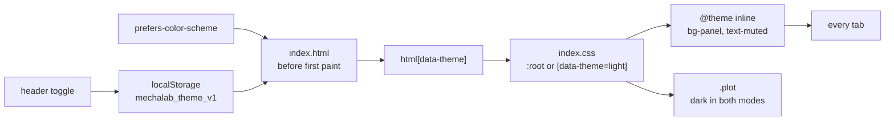

# Theme tokens: both palettes, and which one to reach for

> Read this before adding a colour to a tab. MechaLab has a light and a dark palette that share one
> set of names; a component that names a token is themed for free, and one that names a hex is broken
> in the other mode. Every value below is the one in [`app/src/index.css`](../app/src/index.css), and
> [`tests/test_theme_docs.py`](../tests/test_theme_docs.py) fails when this page and the stylesheet
> disagree.

`<html data-theme="light|dark">` re-points every token. That is the whole mechanism: components name
utilities (`bg-panel`, `text-muted`, `border-line`), `@theme inline` resolves those utilities to the
custom properties, and one attribute on the root element swaps the property values.



There is no per-component theme branch and no `dark:` variant anywhere in the app, so a tab cannot be
half themed — it either names tokens or it shows a literal colour in one of the two modes.

## Surfaces

Dark is the default: the work is a canvas, an editor and a plot, so the palette is a bench
instrument's panel colour. Light is a warm paper sheet, not a filter over the dark one.

| Token | Utility family | Dark | Light | Use it for |
| :--- | :--- | :--- | :--- | :--- |
| `--bg` | `canvas` | `#070b12` | `#f8f6f2` | The page behind every panel; `body` and the header's translucent fill. |
| `--panel` | `panel` | `#0e1624` | `#ffffff` | The default card fill — every `.surface` and most tab bodies. |
| `--panel-2` | `raise` | `#162234` | `#f1eee8` | One step up: buttons, chips, table headers, the row you are on. |
| `--panel-3` | `elevate` | `#1f2f47` | `#e6e1d8` | Hover and pressed states, and anything sitting above a panel. |

## Lines

| Token | Utility family | Dark | Light | Use it for |
| :--- | :--- | :--- | :--- | :--- |
| `--border` | `line` | `#24344c` | `#dcd5c9` | The 1px edge every surface gets. |
| `--border-soft` | `line-soft` | `#182436` | `#eae5db` | Dividers *inside* one panel, where a full-strength line would chop it up. |
| `--border-strong` | `line-strong` | `#35506f` | `#b8ad9b` | A control's edge when it has to be found: `.kbd`, chips, hover. |

## Ink

| Token | Utility family | Dark | Light | Use it for |
| :--- | :--- | :--- | :--- | :--- |
| `--text` | `ink` | `#eef4ff` | `#141a24` | Headings, and any text that must lead the eye. |
| `--body` | `body` | `#cbd5e1` | `#2b3646` | Long-form reading copy: lessons, explanations, captions with sentences in them. |
| `--muted` | `muted` | `#9fb0c9` | `#4d5a6d` | Secondary labels and the caption beside a value. |
| `--dim` | `faint` | `#7a8aa3` | `#626d7e` | 10–12px uppercase eyebrows and hints. It is the dimmest text allowed: 4.57:1 on `--panel-2` in dark. |
| `--inverse` | `inverse` | `#06101c` | `#ffffff` | Text drawn *on* an accent fill (`.btn-primary`, `.skip-link`). |

## Signals

The accents are used as 12px text — status chips, metric captions, legend keys — far more than as
fills, so the light palette darkens each one until it clears 4.5:1 on `--panel`.

| Token | Utility family | Dark | Light | Use it for |
| :--- | :--- | :--- | :--- | :--- |
| `--accent` | `accent` | `#38bdf8` | `#0d6b64` | "Powered on": the active tab, a live readout, the arm's traces. |
| `--accent-strong` | `accent-strong` | `#0ea5e9` | `#115e59` | Hover and pressed states of an accent fill. |
| `--accent-soft` | — | `rgba(56, 189, 248, 0.14)` | `rgba(13, 148, 136, 0.12)` | The wash behind the active nav item. The one tint with no utility: use `var(--accent-soft)`. |
| `--emerald` | `emerald` | `#34d399` | `#047857` | Passed, verified, inside tolerance. |
| `--emerald-strong` | `emerald-strong` | `#10b981` | `#065f46` | The same signal, pressed or on a fill. |
| `--amber` | `amber` | `#fbbf24` | `#a16207` | Caution: near the limit, a fault not yet repaired. |
| `--amber-strong` | `amber-strong` | `#f59e0b` | `#854d0e` | The same signal, pressed or on a fill. |
| `--rose` | `rose` | `#fb7185` | `#be123c` | Failed, unsafe, over the line. |
| `--rose-strong` | `rose-strong` | `#f43f5e` | `#9f1239` | The same signal, pressed or on a fill. |
| `--purple` | `purple` | `#c084fc` | `#7e22ce` | Capstone identity, and the second series in a legend. |
| `--purple-strong` | `purple-strong` | `#a855f7` | `#6b21a8` | The same signal, pressed or on a fill. |

## Plots

A canvas or an SVG chart is a photograph of an instrument face, so it stays dark in both themes: its
grid and traces were drawn against this ink, and a white plot with the same curves is unreadable.

| Token | Utility family | Dark | Light | Use it for |
| :--- | :--- | :--- | :--- | :--- |
| `--plot` | `plot` | `#070a12` | `#070a12` | The face of a chart. Deliberately identical in both modes. |
| `--plot-line` | — | `#1e293b` | `#1e293b` | Grid and axes inside `.plot`. No utility; the `.plot` class already sets it, otherwise `var(--plot-line)`. |

## Pick the token

| You are styling | Reach for |
| :--- | :--- |
| A panel that holds content | `bg-panel` + `border-line`, or the `.surface` class |
| Something raised inside a panel | `bg-raise` |
| A hover or a pressed state | `bg-elevate` + `border-line-strong` |
| A heading, or the number that matters | `text-ink` |
| A paragraph of reading | `text-body` |
| A caption beside a value | `text-muted` |
| A 10–12px uppercase eyebrow | `text-faint` — the dimmest text that still clears 4.5:1 |
| Text drawn on an accent fill | `text-inverse` |
| A pass | `text-emerald`, or `bg-emerald/20` for a wash |
| Near the limit | `text-amber`, or `bg-amber/20` |
| A failure or a risk | `text-rose`, or `bg-rose/20` |
| A chart, a plot, a canvas | the `.plot` class — never `bg-panel` |
| A focused control | nothing: `:focus-visible` already paints `--ring` |
| A tint of an accent | `bg-emerald/20`, not a hand-mixed rgba |
| Depth on a raised card | `--shadow-sm` / `--shadow-md` / `--shadow-lg`; light mode overrides all three |

## Rules that keep both modes legible

1. **No literal colour in a component.** The exception is canvas and SVG plotting code, which draws
   traces in literal plot colours tuned against `--plot` — which is exactly why `--plot` never
   changes. A hex in a `className` or `style` is a bug the light theme shows immediately.
2. **Accents are text first.** `text-emerald` on `bg-panel` is legible in both modes because the light
   value was darkened for that job. `bg-emerald` with dark text on it is not — use `text-inverse`
   with an accent fill, and treat the fill as decoration.
3. **`--dim` is measured, not decorative.** Eyebrows are 10–12px, so the "dim" ink has to stay above
   the 4.5:1 floor instead of being a grey that looks right on the designer's monitor.
4. **Plots stay dark.** Light mode is warm paper *around* instrument faces, not a white plot with
   invisible curves. A new chart goes on `.plot`.
5. **Name the role, not the colour.** A token called `--banana` ages badly; `--amber` does not. If two
   roles need the same value today, they are still two tokens when the palettes diverge later.
6. **Adding a token is four edits:** the `:root` block, the `[data-theme="light"]` block, a line in
   `@theme inline` so the utilities exist, and a row in this page. The last two are checked.

## The rest of the scale

These do not change between themes — with the exception of the shadows and the ring, which light mode
softens because a 60% black shadow on white paper reads as a smudge.

```css
/* Radii, and the alias components should use */
--r-sm: 8px;  --r-md: 12px;  --r-lg: 16px;  --r-xl: 22px;  --r-full: 999px;
--radius: var(--r-md);

/* Elevation — dark values; light mode keeps the geometry and drops the alpha */
--shadow-sm: 0 1px 2px rgba(2, 6, 16, 0.5);
--shadow-md: 0 8px 24px rgba(2, 6, 16, 0.45);
--shadow-lg: 0 24px 64px rgba(2, 6, 16, 0.6);
--ring: 0 0 0 2px var(--bg), 0 0 0 4px rgba(56, 189, 248, 0.65);

/* Type: one fluid scale, so a heading is the same size at every breakpoint's extremes */
--step--1: clamp(0.76rem, 0.74rem + 0.1vw, 0.82rem);   /* eyebrow, chip */
--step-0:  clamp(0.95rem, 0.92rem + 0.14vw, 1.02rem);  /* body */
--step-1:  clamp(1.1rem, 1.04rem + 0.3vw, 1.3rem);     /* card title */
--step-2:  clamp(1.35rem, 1.22rem + 0.6vw, 1.75rem);   /* section */
--step-3:  clamp(1.7rem, 1.45rem + 1.1vw, 2.4rem);     /* page */
--lh-body: 1.6;  --lh-tight: 1.15;  --measure: 68ch;

/* Rhythm: 4px base, and the shell's one maximum width */
--s-1: 4px;  --s-2: 8px;  --s-3: 12px;  --s-4: 16px;  --s-5: 24px;  --s-6: 32px;  --s-7: 48px;
--shell-max: 1560px;

/* Motion: short and purposeful, and off under prefers-reduced-motion */
--ease-out: cubic-bezier(0.16, 1, 0.3, 1);
--ease-spring: cubic-bezier(0.34, 1.56, 0.64, 1);
--t-fast: 120ms;  --t-base: 200ms;
```

## Where the mechanism lives

| File | What it owns |
| :--- | :--- |
| [`app/src/index.css`](../app/src/index.css) | The tokens, both palettes, `@theme inline` (which is what makes `bg-panel` exist), and `.plot`. |
| [`app/index.html`](../app/index.html) | Sets `data-theme` before first paint, from the stored pick or `prefers-color-scheme`, so nothing flashes; owns `meta[name="theme-color"]`. |
| [`app/src/theme.ts`](../app/src/theme.ts) | The rules: `mechalab_theme_v1`, resolve/toggle/label, and the fallback when storage is corrupt or blocked. |
| [`app/src/useTheme.ts`](../app/src/useTheme.ts) | Mounts those rules once, in the header, and writes the attribute in an effect (React 19 renders twice). |
| [`app/src/components/Header.tsx`](../app/src/components/Header.tsx) | `btn-theme-toggle`, the only control that changes the theme. |

Three rules hold the behaviour together: a first visit stores nothing and follows the OS; a pick is
explicit and wins from then on, even if the OS flips at sunset; and everything imports cleanly on the
server, so the dark shell can render before the attribute is corrected.

## Verify a change

```bash
npm run test:theme      # the rules: stored pick, OS default, data-theme, blocked storage (no browser)
npm run test:theme:e2e  # Chromium: the toggle contract, then every tab in both modes
python3 tests/test_theme_docs.py   # this page against index.css
```

- **`test:theme`** pins what a reader cannot see — a first visit writes nothing, `mechalab_theme_v1`
  wins after a click, a corrupt key or a throwing store falls back instead of breaking the shell.
- **`test:theme:e2e`** drives the toggle, checks the choice survives a reload and an OS flip, then
  composites every visible text run in every tab over the backgrounds it actually sits on. It fails
  below 3:1 and reports anything under its size minimum; the current floor is 4.5:1 across the
  tab/theme pairs. `--warnings` names the runs between 3:1 and their minimum, `--screenshots` writes
  one PNG per tab per theme to `.fb-scratch/theme/`.
- **`test_theme_docs.py`** is the anti-drift check for this page: both values of every colour token,
  every utility in `@theme inline`, and the presence of every property in `:root`. It cannot tell you
  a colour is ugly — only that the table and the stylesheet still say the same thing.

The browser sweep is its own CI step rather than a seventh parallel suite, because a seventh suite
pushed the older ones past their 30 s click timeouts. The front page carries the short version under
[Verify the theme](../README.md#verify-the-theme); [`app/README.md`](../app/README.md#light-and-dark)
explains the toggle's behaviour.
