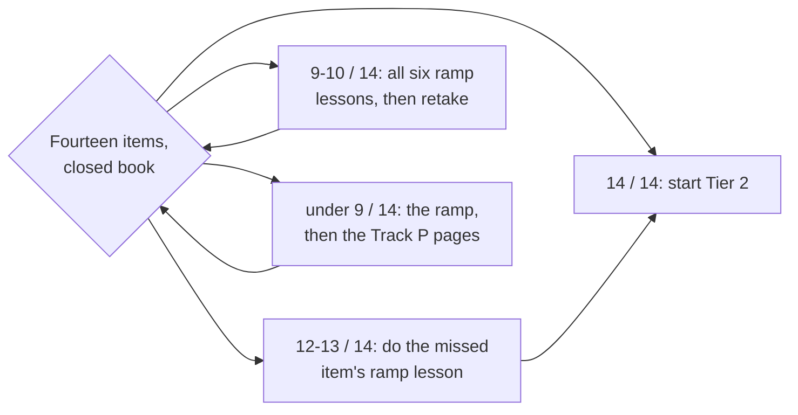

# Gate 1→2: Tier 1 Exit Check — the maths half, mapped to the ramp lessons

Fourteen items, ~40–50 minutes, closed book and paper-only. This is the **maths** half of the Tier 1
exit: it checks the six operations every Tier 2 module assumes you can already do — read a rate off a
trace, accumulate rates into a state, hold that state as a list advanced tick by tick, write one tick as
a matrix multiply, add two rotations as one number, and read a gain and a phase at one frequency — and
every miss sends you to the exact ramp lesson that repairs it.
The six **practical** gates (block diagram, parameter scaling, telemetry fault, units on a bench, a
closed loop that settles, a bring-up you can explain) are the other half and live in the Workbench:
**Tab 10 → Placement & Readiness → Tier 1 Exit Review**, whose gates point at the Track P, Track 00 and
Track 02–04 lessons that teach them.

A miss is not a verdict on Tier 1. It is a named lesson to do before the first Tier 2 page.

**Coming back after weeks away?** Do not retake all fourteen cold. [`docs/REENTRY.md`](REENTRY.md) is a
five-task, twenty-minute subset of this check that sends each miss to its ramp lesson and then back to
the page you left.

## How to score it

| Score | Reading | What to do next |
| :--- | :--- | :--- |
| 14 / 14 | Ready | Start [`00-foundations.T2.00a`](../modules/00-foundations.T2.00a.md) |
| 12–13 / 14, at most one miss per lesson | Ready with a gap | Do the ramp lesson for the missed item, then start Tier 2 |
| 9–10 / 14, or two misses in one lesson | Not yet | Do **all six** ramp lessons ([`R.1`](../ramp/R.1-rate-of-change.md) to [`R.6`](../ramp/R.6-frequency-response.md)), then retake |
| < 9 / 14 | Start at the ramp | R.1–R.6, then the Track P lessons they cite, then retake |

Mark each item ✅ or ❌. Write the arithmetic down: a right answer with no working does not count, because
Tier 2 asks you to show the derivation.

## The fourteen items

| # | Item | You pass if | If you miss it | Ramp lesson |
| :--- | :--- | :--- | :--- | :--- |
| 1 | An encoder reads **24 counts** in **2 ms**; 4096 counts per turn. Give the joint speed in rad/s. | `18.408 rad/s`, with the two conversions shown (`counts/s`, then × 2π/4096). | [R.1](../ramp/R.1-rate-of-change.md): the quotient and its units | R.1 |
| 2 | The same encoder falls from **300 to 280 counts** in **5 ms**. Give the speed and say what the sign means for the actuator. | `−6.136 rad/s`; motion toward −q, so a positive command is fighting the motion. | [R.1](../ramp/R.1-rate-of-change.md): the sign is information | R.1 |
| 3 | Ten samples at **200 Hz** read 100 counts first and 340 last. Give the average rate. | Denominator `9 × 0.005 s`, not `10 × 0.005 s`: `8.181 rad/s`. | [R.1](../ramp/R.1-rate-of-change.md): nine intervals, not ten | R.1 |
| 4 | A trace rises to a peak and comes back. At the peak, is the instantaneous rate zero, the average rate zero, both, or neither? | Instantaneous zero at the peak (it is turning), average non-zero (it travelled). A controller needs the former. | [R.1](../ramp/R.1-rate-of-change.md): average vs instantaneous | R.1 |
| 5 | One encoder count over a **1 ms** window is what speed? What happens to that noise when you halve the window to 0.5 ms? | `1.534 rad/s`; halving the window **doubles** it, so a short window buys lag at the price of noise. | [R.1](../ramp/R.1-rate-of-change.md): the window is a filter | R.1 |
| 6 | A joint runs **+4 rad/s for 0.05 s**, stops **0.1 s**, then **−1.5 rad/s for 0.2 s**. Net displacement? | `0.2 − 0.3 = −0.1 rad`; the motion went out and came back past its start. | [R.2](../ramp/R.2-accumulation.md): signed area | R.2 |
| 7 | Velocity ramps linearly from **0 to 6 rad/s over 0.3 s**. How far did it travel? | Triangle area `½ × 0.3 × 6 = 0.9 rad` — no rectangle rule needed when the shape is exact. | [R.2](../ramp/R.2-accumulation.md): area under the trace | R.2 |
| 8 | A joint starts at **1.2 rad** and the velocity trace accumulates **+0.9 rad**. Where is it, and what happens if the code drops `q0`? | `2.1 rad`; without `q0` the code reports `0.9 rad`, a 1.2 rad pose error with a correct area. | [R.2](../ramp/R.2-accumulation.md): the starting value | R.2 |
| 9 | A gyroscope reads **0.01 rad/s** while the robot is still. How much heading error after **120 s**, and how would you catch it? | `1.2 rad` (69°); catch it with an absolute reference — complementary fusion, encoder index or a known pose — not with a bigger filter. | [R.2](../ramp/R.2-accumulation.md): bias drifts | R.2 |
| 10 | On one trace the left rule gives 0.300 rad, the right rule 0.280 rad. Give your best estimate and the error bar. | Trapezoid `0.290 rad`, with `±0.010 rad` spanned by left and right; name the rule in the code. | [R.2](../ramp/R.2-accumulation.md): pick and name the rule | R.2 |
| 11 | A joint sits at `[q, qd] = [0.10 rad, 1.0 rad/s]`, `dt = 10 ms`, acceleration `20 rad/s²`. Give the next state, and say which speed the position line uses. | `q = 0.110 rad`, `qd = 1.2 rad/s`; position uses the **old** `qd`, so the new-speed answer `0.112 rad` is wrong by `0.002 rad`. | [R.3](../ramp/R.3-state-vectors.md): the state and its tick | R.3 |
| 12 | Write the tick as `x_next = x + dt (A x + B u)` with `A = [[0, 1], [0, −2.5]]`, `B = [[0], [50]]`, `dt = 10 ms`, `u = 0.4`, `x = [0, 1]`. Give `A x` and say what row 1 means. | `A x = [1.0, −2.5]`; row 1 is the speed rate — `−2.5·qd` from friction plus `20` from the torque, with no position term. | [R.4](../ramp/R.4-matrix-updates.md): rows are rates | R.4 |
| 13 | Add the arrows `3∠0°` and `4∠90°`: length, angle, and what adding the lengths would have given. | Length `5`, angle `53.130°`; adding lengths gives `7`, which is wrong because the arrows are not parallel. | [R.5](../ramp/R.5-phasors.md): add the parts, not the lengths | R.5 |
| 14 | A first-order lag has `τ = 0.05 s`. Give its corner frequency in Hz, and the gain and phase there. | Corner `ω = 1/τ = 20 rad/s = 3.183099 Hz`; gain `1/√2 = 0.7071`, phase `−45°`. | [R.6](../ramp/R.6-frequency-response.md): the corner | R.6 |

## Ramp lessons

The six lessons above are the ramp; the rule for adding a seventh is that a check item must exist whose
miss has no lesson to repair it.

| Lesson | Repairs items | Time (unmeasured target) |
| :--- | :--- | :--- |
| [R.1: Rate of Change](../ramp/R.1-rate-of-change.md) | 1, 2, 3, 4, 5 | 0.75–1.0 h typical / 1.5–2.0 h slow |
| [R.2: Accumulation](../ramp/R.2-accumulation.md) | 6, 7, 8, 9, 10 | 0.75–1.0 h typical / 1.5–2.0 h slow |
| [R.3: State Vectors](../ramp/R.3-state-vectors.md) | 11 | 0.75–1.0 h typical / 1.5–2.0 h slow |
| [R.4: Matrix Updates](../ramp/R.4-matrix-updates.md) | 12 | 0.75–1.0 h typical / 1.5–2.0 h slow |
| [R.5: Phasors](../ramp/R.5-phasors.md) | 13 | 0.75–1.0 h typical / 1.5–2.0 h slow |
| [R.6: Frequency Response](../ramp/R.6-frequency-response.md) | 14 | 0.75–1.0 h typical / 1.5–2.0 h slow |

The mapping above is enforced by [`scripts/check_ramp_lessons.py`](../scripts/check_ramp_lessons.py), which
fails if a row points at a lesson that does not exist, if a lesson repairs no row, or if either lesson's
published Expected Output stops matching the code that prints it. The ten answers below are prose, marked
by hand — the script guards the map and the lessons' numbers, not your arithmetic.

## Answers

<strong>Items 1–5 (rate of change)</strong>

1. `24 / 0.002 = 12 000 counts/s`; `× 2π/4096 = 18.408 rad/s`.
2. `−20 / 0.005 = −4 000 counts/s = −6.136 rad/s`. Negative means toward −q.
3. `240 counts / 0.045 s = 5 333.3 counts/s = 8.181 rad/s`.
4. Instantaneous zero at the peak, average non-zero. A controller needs the instantaneous rate; a logger's
   average cannot see the reversal coming.
5. `2π/(4096 × 0.001) = 1.534 rad/s`; halving the window doubles it.

<strong>Items 6–10 (accumulation)</strong>

6. `4 × 0.05 − 1.5 × 0.2 = 0.2 − 0.3 = −0.1 rad`.
7. `½ × 6 × 0.3 = 0.9 rad`.
8. `1.2 + 0.9 = 2.1 rad`; dropping `q0` reports `0.9 rad`.
9. `0.01 × 120 = 1.2 rad`; an absolute reference corrects it, a longer filter only delays it.
10. Trapezoid `0.290 rad`, error bar `0.280–0.300 rad`; the rule has to be named in the function.

<strong>Items 11–12 (state vectors and matrix updates)</strong>

11. `qd = 1.0 + 20 × 0.01 = 1.2 rad/s`; `q = 0.10 + 1.0 × 0.01 = 0.110 rad` using the old speed. The
    new-speed variant gives `0.112 rad`, and the 0.002 rad gap repeats every tick.
12. `A x = [1.0, −2.5]`; row 1 reads `0·q + (−2.5)·qd`, and with `B u = [0, 20]` the speed rate is
    `−2.5·qd + 20`. There is no `q` term, so position never feeds its own rate directly.

<strong>Items 13–14 (phasors and frequency response)</strong>

13. `3 + 4j` has length `√(3² + 4²) = 5` and angle `atan2(4, 3) = 53.130°`. The lengths sum to 7 only
    if the arrows point the same way; these are at right angles.
14. `ω = 1/0.05 = 20 rad/s`, and `20/(2π) = 3.183099 Hz`. Gain `1/√(1 + 1) = 0.7071`, phase
    `−atan(1) = −45°`.

