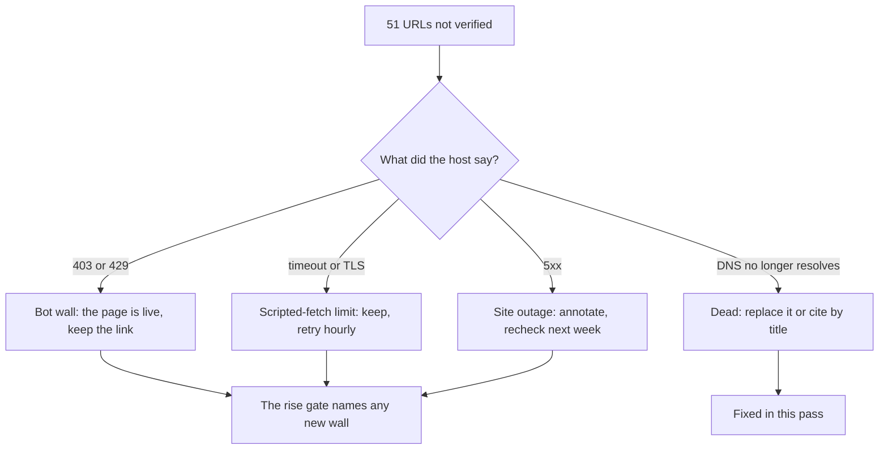

# Unverified citations — triage after the 2026-10-19 sweep

The sweep checked 513 URLs in 118 files on Python 3.12. It **served 476** and could not verify
**51**. Those 51 are not one kind of problem, and this file records what each kind means and what
to do about it.

| Bucket | Count | What it is | Action |
| :--- | ---: | :--- | :--- |
| `BLOCKED` | 27 | The host answered **403** to a script: Wiley, ACM, SAGE, ScienceDirect, Springer, MathWorks, ISO, MIT Press, W3C, raspberrypi.com, maxongroup.com. These open in a browser; several were `HTTP 200` when the citations were written. | Keep the link. No page carries a `Verified by scripts/check_links.py` badge unless the checker served it, so nothing here claims otherwise. |
| `UNREACHABLE` — timeouts | 18 | `st.com` app notes and wiki (10), Springer book pages (4), SparkFun tutorials (2), `openmodelica.org`, `sapien.ucsd.edu`. Read/handshake timeouts, retried once each; these are CDNs that throttle scripted fetches, not dead pages. | Keep. They are revalidated hourly by the cache's 6-hour rule for unverified verdicts, so a permanent change surfaces without a manual pass. |
| `UNREACHABLE` — TLS | 2 | `cds.caltech.edu/~murray` PDFs: the server sends an incomplete chain, which `urllib` rejects. The files are live. | Keep; a browser accepts the chain. |
| `SERVER_ERROR` | 1 | `fbsbook.org` answers 500 — the site's own outage, noted in the module that cites it. | Keep; already annotated in `05-control-and-estimation/05.1-…`. |
| **Dead** | 2 | `www.sze.hu` no longer resolves (the free *Mechatronics Handbook* PDF); `www.ulb.ac.be` no longer resolves (a Chinese-titled Preumont PDF). | Repaired below. |

## Repaired in this pass

- **The Mechatronics Handbook** — the `sze.hu` mirror is gone, so
  `resources/textbooks-and-papers.md` and `00-foundations/README.md` now link the
  [Internet Archive copy](https://archive.org/details/mechatronicshand0000unse) (CRC Press,
  2008; free to borrow).
- **Preumont, Active Vibration Control** — the `ulb.ac.be` mirror is gone and no live replacement
  was found, so the citation is now by title only rather than a link that 404s.
- **Raw UTF-8 URLs** — the Chinese-titled PDF was reported `UNREACHABLE` with an *ascii codec*
  error, not a network one: `http.client` encodes the request line as ASCII. `check_links.py` now
  percent-encodes the URL first (what a browser sends), covered by two tests in
  `tests/test_link_cache.py`. The host turned out to be dead as well, but the checker no longer
  reports a codec bug as a dead link.

## What is deliberately not done

Annotating all 27 bot walls in the prose would add noise without changing what a reader does:
the link still works. The weekly gate (`--fail-on-rise`) is what keeps the list from growing —
it fails on a URL that is unverified now and was not in the previous row, naming it, so a new
wall cannot hide behind a recovering page.
