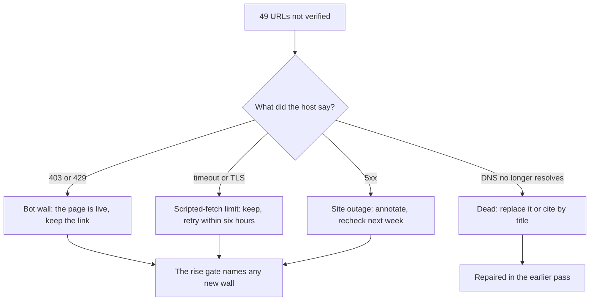

# Unverified citations — triage after the 2026-10-19 sweep

The sweep checked **512 URLs in 118 files** on Python 3.12: it **served 463**, could not verify
**49**, and failed none. Those three numbers partition the 512 — every URL gets exactly one
verdict, which is the identity the checker now refuses to record a history row without
(`served + not_checked + failed == urls`).

> An earlier draft of this page added the served count from the 18:15 row (476 of 513, 37
> unverified) to the unverified count from a later local cache (51), so its figures summed to 527.
> The buckets below are all from the recorded run above.

| Bucket | Count | What it is | Action |
| :--- | ---: | :--- | :--- |
| `BLOCKED` | 27 | The host answered **403** to a script: Wiley, ACM, SAGE, ScienceDirect, Springer, MathWorks, ISO, MIT Press, W3C, raspberrypi.com, maxongroup.com. | Keep the link. 15 of the 27 were confirmed in a real browser on 2026-10-19 (below); no page carries a `Verified by scripts/check_links.py` badge unless the checker served it, so nothing here claims otherwise. |
| `UNREACHABLE` — timeouts | 19 | `st.com` app notes and wiki (10), Springer book pages (4), SparkFun tutorials (2), `openmodelica.org`, `sapien.ucsd.edu`, `libero-project.github.io`. Read/handshake timeouts, retried once each; these are CDNs that throttle scripted fetches, not dead pages. | Keep. The cache keeps an unverified verdict for only 6 hours, so a permanent change surfaces without a manual pass. |
| `UNREACHABLE` — TLS | 2 | `cds.caltech.edu/~murray` PDFs: the server sends an incomplete chain, which `urllib` rejects. The files are live. | Keep; a browser accepts the chain. |
| `SERVER_ERROR` | 1 | `fbsbook.org` answers 500 — the site's own outage, noted in the module that cites it. | Keep; already annotated in `05-control-and-estimation/05.1-…`. |
| **Dead** | 0 in this run | Two dead mirrors were found in the earlier 51-URL cache and removed from the tree; neither is cited any more, so neither appears above. | Done — see below. |

The four live buckets add to **49**, the `not_checked` figure in the recorded history row:
27 + 19 + 2 + 1.

## Browser check of the bot walls (2026-10-19)

"These open in a browser" was an assertion, so `scripts/verify_bot_walls.mjs` now visits every
`BLOCKED` URL in Chromium and records the status, title and final URL (`.browser-verdicts.json`,
written by `npm run verify:walls`). On the 27 in the table:

- **15 served a real page** — Wiley, ACM, MIT Press, ISO, MathWorks (both), maxon, Raspberry Pi
  (both), Science.org, Microchip, All About Circuits and two more. Those citations are live; the
  sweep will still say `BLOCKED`, which is a statement about scripts, not about the page.
- **11 answered with a wall in a browser too** — six Cloudflare "Just a moment…" challenge pages
  (SAGE, ngspice, the Linux Foundation wiki, elmerfem, rug.nl, w3.org), one doi.org "Security
  Challenge" on the MDPI paper, and four ScienceDirect 403s. A human may clear the challenge; no
  scripted check can, so the weekly sweep will keep reporting them.
- **1 was genuinely broken** — `onlinelibrary.wiley.com/doi/book/10.1002/9781119505808` answered
  **404**: the citation's DOI was wrong by a digit. Crossref gives the book's DOI as
  `10.1002/9781119505730`, and the two pages that cite it now link that instead; in Chromium the
  corrected DOI answers with the same Cloudflare challenge, so it joins the walled group rather
  than the 15.

This is evidence gathering, not a second checker: a page that renders in Chromium is still
`BLOCKED` to `check_links.py`, and the sweep's verdicts and counts are unchanged.

## Repaired in the earlier pass

- **The Mechatronics Handbook** — the `sze.hu` mirror is gone, so
  `resources/textbooks-and-papers.md` and `00-foundations/README.md` now link the
  [Internet Archive copy](https://archive.org/details/mechatronicshand0000unse) (CRC Press,
  2008; free to borrow).
- **Preumont, Active Vibration Control** — the `ulb.ac.be` mirror is gone and no live replacement
  was found, so the citation is now by title only rather than a link that 404s.
- **Raw UTF-8 URLs** — the Chinese-titled PDF was reported `UNREACHABLE` with an *ascii codec*
  error, not a network one: `http.client` encodes the request line as ASCII. `check_links.py` now
  percent-encodes the URL first (what a browser sends), covered by two tests in
  `tests/test_link_cache.py`. The host turned out to be dead as well, but the checker no longer
  reports a codec bug as a dead link.

## What is deliberately not done

Annotating all 27 bot walls in the prose would add noise without changing what a reader does:
the link still works. The weekly gate (`--fail-on-rise`) is what keeps the list from growing —
it fails on a URL that is unverified now and was not in the previous row, naming it, so a new
wall cannot hide behind a recovering page.

A failed gate also **files an issue** (`scripts/file_rise_issue.py`): the new URLs with their
verdicts and the files citing them, one issue per distinct set, deduplicated by a fingerprint in
the body so a retried job cannot file twice. The issue is where the citation gets triaged; the
workflow log stays the raw evidence.

The tracker closes itself: each issue also records the URL list it tracks, and every scheduled run
compares that list with the sweep's current unverified pile. When none of an issue's URLs is
unverified any more, the run closes it with a comment naming the sweep — a wall that lifts needs no
human action. A stale state file is refused rather than trusted, so a run that never finished
cannot close an issue on evidence it did not collect.
