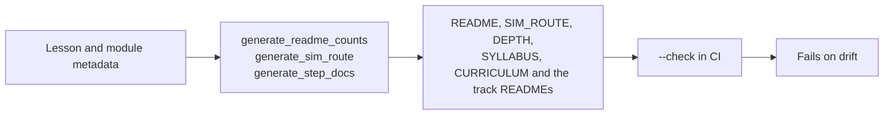

# Verification: what CI checks, and how to run it

> Moved out of the front page: a beginner does not need the badge wall or the script list to
> start, and a maintainer does. The front page links here.

[](https://github.com/TLE47/Mechatronics-Roadmap/actions/workflows/ci.yml)
[](https://github.com/TLE47/Mechatronics-Roadmap/actions/workflows/link-check.yml)
[](https://tle47.github.io/Mechatronics-Roadmap/)
[_%2B_MIT_(Code)-fbbf24)](../LICENSE)

## The numbers on the front page are generated



| Fact | Source | Check |
| :--- | :--- | :--- |
| 10 steps, lesson and module counts, step hours | `scripts/route_model.py` from each page's front matter | `python3.12 scripts/generate_readme_counts.py --check` |
| Arm hours, depth hours, the optional total, and the minimum finish | `scripts/generate_sim_route.py` | `python3.12 scripts/generate_sim_route.py --check` |
| What each of the ten steps costs, page by page, and each track's three depth layers | `scripts/route_model.py` from each page's front matter | `python3.12 scripts/generate_step_docs.py --check` |
| The README's Start here block and the workbench card | `app/src/data/startHere.json` (one file, read by both) | `python3.12 scripts/generate_start_here.py --check` |
| The callout on every lesson and module page: where to run it, or that there is no entry | `app/src/data/pythonLessonsData.ts`, the workbench's own registry | `python3.12 scripts/generate_run_callouts.py --check` |
| The try-it link under a marked code block, carrying that block's current text and the page's own entry | `app/src/tryLinks.ts`, encoding with the app's share codec from each page's `?lesson=` | `node --experimental-strip-types scripts/generate_try_links.mjs --check` |
| The name of every tab, and no page or label referring to one by position | `app/src/data/workbenchTabs.json`, read by `App.tsx` and by the callout generator | `python3.12 scripts/check_tab_names.py` |
| Which workbench entries a roadmap step asks for, and that every entry is claimed once | `app/src/practiceLinks.ts`, joining the roadmap and the registry by track and pass | `npm run test:practice` |
| Every count quoted anywhere in the docs | `scripts/check_consistency.py` | `python3.12 scripts/check_consistency.py` |

`check_consistency.py` is the contradiction detector: it compares a quoted count with the count
derived from the lesson files and `modules/_index.yaml`, and fails on a second name for a step
(`Tier`, `Pass`, or `Gate`) in a learner-facing page. It exists because the README once quoted a
hand-typed lesson count beside a generated table with one more row, and because the route total
once omitted all 23 lesson pages inside Tracks 00-08.

## Full local run

```bash
python3.12 scripts/check_all.py         # every gate CI's verify step runs, in CI's order (~12 s)
python3.12 scripts/check_workflows.py   # the workflow files themselves, before the push
python3.12 scripts/check_all.py --full  # + the 48-package exercise sweep and the unittest discovery
python3.12 scripts/run_all_labs.py      # the 13 reference simulations and labs
npm run test:practice                   # roadmap <-> workbench join
npm run test:theme                      # palette rules: stored pick, OS default, prefers-contrast, the three controls
npm run test:theme:e2e                  # the three controls + contrast on all 11 tabs, in all four palettes
npm run test:runtime                    # the worker: in-place Stop, input(), isolation, Pages fallback
npm run test:offline                    # the built bundle with no host headers: worker isolation, the take-offline button, offline reload, run and deep link
npm run test:takealong                  # the offline button's rules: which URLs it sends, how a size reads, what "ready" may claim
npm run test:share                      # the share link: round trip, the URL-safe alphabet, the measured cap, every malformed fragment
npm run test:inline                     # inline values: which lines bind, which value belongs where, the payload's validation
npm run test:symbols                    # go to definition: what counts as a def, the caret's word, the active file winning a tie
npm run test:layout                     # layout presets: which regions each shows, a stored value validated, the ⌥ digits
npm run test:vim                        # Vim keys: off until asked for, remembered, blocked storage, and the mode word the badge prints
npm run test:trace                      # the run trace: a payload from another thread, the step cap and its honest total, unreadable values cut
npm run test:cells                      # # %% cells: the boundaries, the preamble, and where "run to here" stops
npm run test:breakpoints                # the gutter's list: a toggle, per lesson, capped and evicted, lines that can run, and a dot that follows its statement through an edit
npm run test:try                        # try-it blocks: the marker rule, the lesson a page opens, the generated link read back by the app's own codec, and that every page is up to date
npm run test:backup                     # the archive: CRC vector, byte-for-byte round trip, the three refusals, and a merge that never deletes
npm run test:study                      # notes and highlights: kept per lesson, deduped by quote, capped and evicted, merged on restore
npm run test:review                     # FSRS-5: the 0.9-at-stability identity, grade order, lapses, the year cap, and the card join
npm run test:sitting                    # the sitting clock: idle cutoff, three-hour cap, backwards clock, totals, and focus's store
npm run test:portfolio                  # the export: a section only when it has content, quoting, the twenty-card cap, the time table
npm run test:e2e:backup                 # the header buttons in Chromium: write a zip, wipe, restore to the store and to the screen
npm run test:e2e:review                 # pin, comment, rate and reload in Chromium: the card is still scheduled after the reload
npm run test:e2e:focus                  # focus in Chromium: the chrome hides, the work stays, all three exits work, and a sitting is measured
npm run test:e2e:storage                # the migration in Chromium: a pre-IndexedDB bucket arrives whole, the screen shows it, new work stays in the database
npm run test:palette                    # ⌘K: the whole catalogue once, and the ranking order
npm run test:editor                     # slider directives and which lessons get helper tabs
npm run test:storage                    # the move to IndexedDB: the bucket fallback, the migration order, the coalesced write queue, the retry after a refused write
npm run test:traceback                  # Python's failure as data: the learner's frame, chained failures, both SyntaxError shapes, and the index entry it matches
npm run test:resume                     # the lesson the next visit reopens, which one the roadmap offers and when it hands forward, and the ids it refuses
npm run test:draft                      # the editor's unfinished work: kept per lesson, bounded, evicted, never a starter copy - and how much of it is written
npm run test:history                    # the versions behind the draft: filed on Run with its verdict, deduped, capped per lesson and in total
npm run test:codediff                   # the Diff panel's rules: a change is an exact line, gaps are trimmed to context, the coarse fallback stays true
npm run test:predict                    # the predict-first gate: lines not strings, four verdicts, a bounded store, and no way to be locked out
npm run test:watch                      # when the checks may re-run themselves: after a graded failure, on an edit, never past the gate
npm run test:announce                   # what a screen reader hears after a run: the verdict first, then the failing line itself
npm run test:scope                      # the Scope: NaN dropped, t/y aligned, the cursor's interpolation, zoom/pan windows clamped to the data, readable tables
npm run test:analysis                   # completions, hover and signatures without a browser: where the insert starts, Jedi's cursor coordinates, the call under the cursor, note shape, request and timeout rules
npm run test:checkhints                 # a failing check names its own rung; rung 2 is earned by a run made after the nudge
npm run test:fonts                      # the two self-hosted faces: named, imported, emitted, no CDN
npm run test:smoke                      # needs `npm ci` first
```

`test:backup` is the one suite that owns a file format, so it checks the format itself: the published
CRC-32 vector, a round trip that returns every byte of every entry, and the three ways a chosen file
can fail (not a zip, half a download, a zip a tool re-compressed) — each with its own sentence in the
UI. It then checks the merge a restore performs, because a merge that loses work is worse than no
backup: a flag set here survives a file that lacks it, a draft or a note written here beats the file's
copy, a highlight already kept is not doubled and an older file cannot erase a newer comment, an older
arriving version never evicts a newer one, and restoring the same file twice adds nothing. The last
check is a measurement rather than a claim: the caps of all seven stores, computed from the modules
that export them, come to ~2.0 M characters - the archive's size, and the number the bucket fallback
(`localStorage`, for a browser that refuses a database) still has to hold in case the store has to go
back there.

`test:traceback` is the failure card's arithmetic, without a browser: a failing print names its own
line and the source CPython printed beside it, a failure inside a function reports that function rather
than its caller, a chained failure reports the last block (the one that stopped the program), the
lesson's appended `_selfcheck` raising means there is no learner line to point at, the same check
calling a learner function that raises still names the learner's line, a custom harness list can be
handed in, both SyntaxError shapes parse (the worker's `SyntaxError (line N): msg`, with no frames, and
CPython's own with a caret that is not mistaken for a source line), captured stderr above a traceback
does not become the exception, Windows line endings parse the same, and a stop, a blank string or a
`SELF-CHECK PASS` line is not a failure at all. The index half pins the join: every entry is numbered
and carries the page's three labels, a heading that is not an exception never claims a traceback,
`ZeroDivisionError` matches the entry that names only the class, a `TypeError` only matches the message
the page quotes, and a `NameError` is honestly outside the index. The data itself is generated by
`python3 scripts/generate_error_index.py`, whose `--check` mode is a gate — editing the page without
regenerating the app's copy fails the build rather than leaving a card that disagrees with the document.

`test:storage` covers the move to IndexedDB, which is the one change in the app that can lose work
rather than show a wrong number. It pins the whole rulebook against a backend it can fail on demand: no
`indexedDB` means the store *is* the bucket (not a copy), a migration copies all six keys before it
deletes any of them and a refused copy leaves the bucket whole, the bucket wins over a database copy of
the same key, an entry only the database has is readable, reads are synchronous after `hydrate()` while
writes land on `flush()` coalesced per key, a clear empties the database, a failed write goes back on
the queue instead of being dropped, and a store that has not hydrated answers `null` ("not ready")
rather than an empty store. `test:e2e:storage` then does it in Chromium: a bucket holding all six
stores the way the previous build left it, a reload, and the checks that nothing was lost, the editor
and the study panel and the deck show the carried work, a note typed now lands in the database and not
in the bucket, and a further reload reads it back.

`test:study` pins the note and highlight rules without a browser: a note keeps its own line breaks and
is cleared to nothing by an empty box, a quote collapses to one line and the same passage pinned twice
updates instead of duplicating, a blank comment does not erase a written one, the per-lesson and
per-store caps evict the oldest writes, a corrupt or foreign store reads as what still parses, blocked
and full storage never throws into the render, and the merge a restore performs fills gaps without
ever overwriting a note written on this machine.
`test:e2e:backup` takes the archive the browser actually wrote, wipes `localStorage`, and restores it,
asserting the milestone tick returns **without a reload** — the App's own copy of the maps is what a
store-only restore would leave stale.

`test:review` is the scheduler checked as arithmetic: `R(S, S) = 0.9` exactly, the interval at a 90%
target equal to the stability, the four grades ordered in both initial stability and initial difficulty,
difficulty clamped over forty reviews from both extremes, Easy outlasting Good outlasting Hard, a late
answer teaching more than an early one, a lapse shortening stability while a success lengthens it, the
same-day answer being a nudge rather than a new lifetime, the 365-day cap, and `review` never mutating
its input. It then checks the join that turns notes into a deck: only a commented highlight is a card,
an id survives a re-pin, deleting the highlight or clearing the comment retires the card and prunes its
schedule on the next sync, the deck is ordered by due date, a restore keeps the more-reviewed schedule
and cannot send a studied card backwards, a foreign store reads as the part that parses, and blocked
storage empties the deck instead of throwing into the panel. `test:e2e:review` walks the same loop
through the UI - select the lesson heading, pin it, comment, open the deck, be asked before being
told, rate Good, reload, and find the card still scheduled - opens the portfolio export and checks that
the passage, its comment, the deck section and the measured sitting are in the file a learner hands
over, and then clears the comment to prove the card is retired rather than merely hidden.

`test:sitting` pins the clock that makes `docs/PILOT.md`'s `active_minutes` a measurement: the first
event opens a sitting, anything inside five minutes extends it, exactly the gap still extends it and a
minute more starts a new one, three hours of uninterrupted work closes at the cap and opens a fresh
one, a clock that went backwards never files a negative duration, one event is one stored entry, the
list holds 200 and drops the oldest, a store written by something else reads as the part that parses,
blocked storage never throws, and the totals quote a median (odd and even), the longest sitting and
only the sittings that started today. It also checks focus mode's store: the choice survives a reload,
the toggle broadcasts it once, and a store that refuses the write still returns the state to render.
`test:portfolio` reads the exported Markdown as text, which is the only way to catch what a browser
cannot: a document with three empty headings that read as "did nothing", a note starting with `#` that
becomes a heading and swallows the section after it, a 500-card deck pasted in whole, or a time table
whose minutes disagree with the totals above it. It checks the progress record is unchanged and
proportional (a fresh browser gets exactly three sections and no zero-count bullets), that lessons
appear in registry order with their notes quoted line by line, that passages are one line with their
comment after an em dash, that the deck reports due/next and caps at twenty with the count it left
out, that the table holds the most recent eight and agrees with the totals, and that two builds of one
state are byte-identical.
`test:e2e:focus` measures the mode in the browser: every `data-chrome` region is visible before the
toggle and hidden after, while the editor, the lesson and the study card stay; `Escape`, `⌘.` and the
pill each leave it; the choice survives a reload; and opening a lesson wrote exactly one sitting naming
that lesson, with the panel printing a duration rather than a blank line.

`test:runtime` is the one suite that cannot be a unit test: stopping a `while True:` in place needs
cross-origin isolation, a real `SharedArrayBuffer` and a real browser. It asserts the Stop answers by
interrupt (the session and its imports survive), that `input()` blocks the worker while the page
stays live, and that the no-buffer fallback still ends the run. It also walks the editor's analysis
path, because that shares the worker with runs: `math.` completes to `math.acos` with its signature
and keeps the module name when picked, the pointer over a name opens Jedi's card for it (`def acos`,
the call, the docstring) and the card closes when the pointer leaves, typing `math.acos(` shows the
signature with the argument marked and closing the call takes it away, an unused import is named on
its line and the note clears once the import is used, and a Run still works after the analyzers
installed. `npm run test:analysis` pins the rules underneath (insertion point, 1-based line /
0-based column, which call the cursor is inside and which argument is active, the dotted name under
the pointer, how a Jedi type or a pyflakes message is drawn, and that an answer is never mistaken for
a verdict). Ruff is a Rust binary and
cannot run in Pyodide, so pyflakes is the browser's linter and the suite says so rather than borrowing
the name. `test:palette` is the opposite -
pure TypeScript over the catalogue, pinning that every lesson, exercise, tab and command appears
exactly once and that ranking prefers the entry the learner typed (`P.1` over `P.10`). Both run in
CI; `test:runtime` is its own step because it downloads Pyodide.

The theme suites exist because the palette is a promise, not a preference. The unit suite pins the
rules a reader cannot see (a first visit stores nothing and follows `prefers-contrast` ahead of the
colour scheme, a corrupt key falls back to the OS, a blocked store does not throw, the flip moves
dark ↔ light while contrast and paper are each a real on/off that labels what it will give you), and the
browser suite measures legibility: every visible text run in every tab, in each of the four palettes,
composited over the
backgrounds it actually sits on. Anything below 3:1 fails the suite; `--warnings` names the runs between 3:1 and their size minimum, and
`--screenshots` writes one PNG per tab per theme to `.fb-scratch/theme/`. `test:theme` runs inside
`npm run test:workbench`; `test:theme:e2e` is its own CI step, because a seventh browser suite in the
parallel run pushed the older ones past their 30 s click timeouts.

`check_all.py --list` prints the gates it runs and which are heavy; `--only <gate>` re-runs one
after you regenerate something, and `--json` reports them machine-readably. The list is not a
second opinion about what matters: [`tests/test_check_all.py`](../tests/test_check_all.py) parses
the workflow's verify step and fails when the script and CI drift apart, so a gate added in one
place cannot go missing in the other. It exits `2` when handed an interpreter other than the
pinned 3.12, because two of the gates execute module code that needs 3.10+ syntax.

**The workflow files are the first gate, because nothing inside the job can report them.**
[`check_workflows.py`](../scripts/check_workflows.py) reads every `.github/workflows/*.yml` for the
lines YAML refuses - an unquoted `: ` in a value (YAML reads the second colon as another mapping
key), a tab in the indentation, a quote that never closes, a flow collection left open, a key set
twice in one mapping - and skips the places that rule does not apply: a `run: |` body is text, a
quoted value may hold any colon it likes, and `check:native` is not a separator. It needs no YAML
parser; PyYAML is not a dependency of this repository. Run 131 exists because a step name reading
`Check light/dark: toggle contract` made `ci.yml` unparseable for two commits, and GitHub reports
the result as a run that fails in 0 s with no jobs - so the gate that runs CI's commands locally
could not see it, since no job was ever created to run them. With `actionlint` on `PATH`
(`brew install actionlint`) the same command also runs the full lint and fails on its findings;
GitHub's runners do not preinstall it, which is why the built-in scan is the half that has to hold
everywhere. `npm run test:workflows` pins both directions: the historical broken line, and the false
positive that matters (two steps may each have a `name:`).

The same gates, plus the 48-package exercise sweep, the test discovery and the native-dependency
installs, run in [`.github/workflows/ci.yml`](../.github/workflows/ci.yml) on Ubuntu and macOS. The weekly
[`link-check.yml`](../.github/workflows/link-check.yml) lints every lesson, verifies links, and
compiles the Arduino sketches against the hosted toolchain; blocked citations are collected in
[`UNVERIFIED_CITATIONS.md`](UNVERIFIED_CITATIONS.md) and charted in the workbench's Link Health
tab.

`npm run test:smoke` and `npm run test:e2e` need `npm ci` first; the browser suites find
Chromium through Playwright or the documented fallback paths.

**`dist/` is rebuilt when it is older than its own sources.** Two gates read the bundle rather than the
sources — `npm run check:weight` and the Pages sweep — and a `dist/` from an earlier checkout fits every
budget and grades every exercise while describing code that is no longer there (Run 165 quoted a weight
that way). Both now share one rule ([`scripts/buildFreshness.mjs`](../scripts/buildFreshness.mjs), the
walk behind `staleSources`): the build is fresh when its newest output is at least as new as every
source. The weight gate exits `2` and names the newer files (`--allow-stale` overrides, and says so in
the report); the Pages sweep and `npm run test:workbench` rebuild instead, printing what made them. CI
builds before it measures, so the check costs nothing there and catches the local case — which is
where the bad number came from.

## What is asserted, not just run

- **Lesson size:** at most two new ideas per lesson (`lint_lessons.py`), checked from the
  front-matter `ideas` list.
- **Assertion quality:** every graded assert names what was expected and what arrived
  (`lint_assertions.py`), ratcheted against `docs/assertion-baseline.json`.
- **Route integrity:** every module appears exactly once across [`SIM_ROUTE.md`](SIM_ROUTE.md)
  and [`DEPTH.md`](DEPTH.md) — the arm route and the depth pass are disjoint — the ids exist on
  disk, and each total is the sum of its pages. The step/id map and depth matrix in
  [`CURRICULUM.md`](CURRICULUM.md) point at the same lists.
- **Minimum finish integrity:** [`MINIMUM.md`](MINIMUM.md) is generated from the same pages, its
  ids are a subset of the Core route, and its total is the sum of its own rows.
- **The capstone pass conditions:** a capstone in `app/src/lessonHarnesses.ts` verifies only when
  its own harness reports every graded number at target. 08.1 runs the learner's `repair_*`
  functions after their program with its own FK chord (≤ 1 mm tip error, < 5% overshoot); the Tier 3
  capstone (`EX.08-capstones.T3.07a`) runs their budget functions on an unseen design point
  (≤ 0.50 mm, ≥ 45°, the delay its spare margin buys, both sign-off verdicts). The browser E2E types
  a 10%-short repair into 08.1 and a doubled zero-order hold into the Tier 3 capstone, asserting
  1.20 mm and 42.7° stay on the cards and both lessons stay unverified.
- **Exercise coverage:** every graded package runs and every solution passes; the report CI
  reads is the same one the tests consume, so a package cannot be skipped silently.
- **Links and sketches:** weekly, with failures filed as `link-*` issues.

Contributor workflow and commit conventions: [`CONTRIBUTING.md`](../CONTRIBUTING.md). Change
history: [`CHANGELOG.md`](../CHANGELOG.md).
