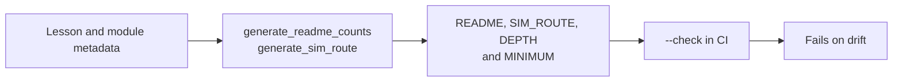

# Verification: what CI checks, and how to run it

> Moved out of the front page: a beginner does not need the badge wall or the script list to
> start, and a maintainer does. The front page links here.

[](https://github.com/TLE47/Mechatronics-Roadmap/actions/workflows/ci.yml)
[](https://github.com/TLE47/Mechatronics-Roadmap/actions/workflows/link-check.yml)
[](https://tle47.github.io/Mechatronics-Roadmap/)
[_%2B_MIT_(Code)-fbbf24)](../LICENSE)

## The numbers on the front page are generated



| Fact | Source | Check |
| :--- | :--- | :--- |
| 10 steps, lesson and module counts, step hours | `scripts/route_model.py` from each page's front matter | `python3.12 scripts/generate_readme_counts.py --check` |
| Arm hours, depth hours, the optional total, and the minimum finish | `scripts/generate_sim_route.py` | `python3.12 scripts/generate_sim_route.py --check` |
| The README's Start here block and the workbench card | `app/src/data/startHere.json` (one file, read by both) | `python3.12 scripts/generate_start_here.py --check` |
| Every count quoted anywhere in the docs | `scripts/check_consistency.py` | `python3.12 scripts/check_consistency.py` |

`check_consistency.py` is the contradiction detector: it compares a quoted count with the count
derived from the lesson files and `modules/_index.yaml`, and fails on a second name for a step
(`Tier`, `Pass`, or `Gate`) in a learner-facing page. It exists because the README once quoted a
hand-typed lesson count beside a generated table with one more row, and because the route total
once omitted all 23 lesson pages inside Tracks 00-08.

## Full local run

```bash
python3.12 scripts/verify_repo.py --verbose
python3.12 scripts/validate_modules.py
python3.12 scripts/lint_lessons.py
python3.12 scripts/check_ramp_lessons.py
python3.12 scripts/audit_step_size.py --check
python3.12 scripts/generate_sim_route.py --check
python3.12 scripts/generate_readme_counts.py --check
python3.12 scripts/generate_start_here.py --check
python3.12 scripts/check_consistency.py
python3.12 scripts/lint_assertions.py
python3.12 scripts/run_all_labs.py
python3.12 -m unittest discover -s tests
npm run test:smoke
```

The same list, plus the 48-package exercise sweep and the native-dependency installs, runs in
[`.github/workflows/ci.yml`](../.github/workflows/ci.yml) on Ubuntu and macOS. The weekly
[`link-check.yml`](../.github/workflows/link-check.yml) lints every lesson, verifies links, and
compiles the Arduino sketches against the hosted toolchain; blocked citations are collected in
[`UNVERIFIED_CITATIONS.md`](UNVERIFIED_CITATIONS.md) and charted in the workbench's Link Health
tab.

`npm run test:smoke` and `npm run test:e2e` need `npm ci` first; the browser suites find
Chromium through Playwright or the documented fallback paths.

## What is asserted, not just run

- **Lesson size:** at most two new ideas per lesson (`lint_lessons.py`), checked from the
  front-matter `ideas` list.
- **Assertion quality:** every graded assert names what was expected and what arrived
  (`lint_assertions.py`), ratcheted against `docs/assertion-baseline.json`.
- **Route integrity:** every module appears exactly once across [`SIM_ROUTE.md`](SIM_ROUTE.md)
  and [`DEPTH.md`](DEPTH.md) — the arm route and the depth pass are disjoint — the ids exist on
  disk, and each total is the sum of its pages. The step/id map and depth matrix in
  [`CURRICULUM.md`](CURRICULUM.md) point at the same lists.
- **Minimum finish integrity:** [`MINIMUM.md`](MINIMUM.md) is generated from the same pages, its
  ids are a subset of the Core route, and its total is the sum of its own rows.
- **The capstone pass conditions:** a capstone in `app/src/lessonHarnesses.ts` verifies only when
  its own harness reports every graded number at target. 08.1 runs the learner's `repair_*`
  functions after their program with its own FK chord (≤ 1 mm tip error, < 5% overshoot); the Tier 3
  capstone (`EX.08-capstones.T3.07a`) runs their budget functions on an unseen design point
  (≤ 0.50 mm, ≥ 45°, the delay its spare margin buys, both sign-off verdicts). The browser E2E types
  a 10%-short repair into 08.1 and a doubled zero-order hold into the Tier 3 capstone, asserting
  1.20 mm and 42.7° stay on the cards and both lessons stay unverified.
- **Exercise coverage:** every graded package runs and every solution passes; the report CI
  reads is the same one the tests consume, so a package cannot be skipped silently.
- **Links and sketches:** weekly, with failures filed as `link-*` issues.

Contributor workflow and commit conventions: [`CONTRIBUTING.md`](../CONTRIBUTING.md). Change
history: [`CHANGELOG.md`](../CHANGELOG.md).
