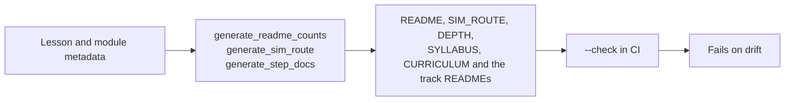

# Verification: what CI checks, and how to run it

> Moved out of the front page: a beginner does not need the badge wall or the script list to
> start, and a maintainer does. The front page links here.

[](https://github.com/TLE47/Mechatronics-Roadmap/actions/workflows/ci.yml)
[](https://github.com/TLE47/Mechatronics-Roadmap/actions/workflows/link-check.yml)
[](https://tle47.github.io/Mechatronics-Roadmap/)
[_%2B_MIT_(Code)-fbbf24)](../LICENSE)

## The numbers on the front page are generated



| Fact | Source | Check |
| :--- | :--- | :--- |
| 10 steps, lesson and module counts, step hours | `scripts/route_model.py` from each page's front matter | `python3.12 scripts/generate_readme_counts.py --check` |
| Arm hours, depth hours, the optional total, and the minimum finish | `scripts/generate_sim_route.py` | `python3.12 scripts/generate_sim_route.py --check` |
| What each of the ten steps costs, page by page, and each track's three depth layers | `scripts/route_model.py` from each page's front matter | `python3.12 scripts/generate_step_docs.py --check` |
| The README's Start here block and the workbench card | `app/src/data/startHere.json` (one file, read by both) | `python3.12 scripts/generate_start_here.py --check` |
| The callout on every lesson and module page: where to run it, or that there is no entry | `app/src/data/pythonLessonsData.ts`, the workbench's own registry | `python3.12 scripts/generate_run_callouts.py --check` |
| The searchable text of the 65 reading pages, which `⌘⇧F` fetches on demand | `scripts/route_model.py` (the page list) and the Markdown pages themselves | `python3.12 scripts/generate_prose_index.py --check` |
| The try-it link under a marked code block, carrying that block's current text and the page's own entry | `app/src/tryLinks.ts`, encoding with the app's share codec from each page's `?lesson=` | `node --experimental-strip-types scripts/generate_try_links.mjs --check` |
| The name of every tab, and no page or label referring to one by position | `app/src/data/workbenchTabs.json`, read by `App.tsx` and by the callout generator | `python3.12 scripts/check_tab_names.py` |
| Which workbench entries a roadmap step asks for, and that every entry is claimed once | `app/src/practiceLinks.ts`, joining the roadmap and the registry by track and pass | `npm run test:practice` |
| Which views the course-level nav is drawn on: the roadmap, and every tab with a guide for all four passes — never the runner, quiz, board, survey, dashboard or lesson page | `app/src/courseLevels.ts`, derived from `SIMULATOR_TIER_GUIDES` | `npm run test:levels` |
| The first-run tour: six steps, which ones wait for a real edit or a finished run, and that every `data-tour` anchor still exists (and no anchor is left with no step) | `app/src/tour.ts`, against the app's own source | `npm run test:firstrun` |
| Every count quoted anywhere in the docs | `scripts/check_consistency.py` | `python3.12 scripts/check_consistency.py` |
| The story: ten missions that each name their own spine step, ten recordings of at most 120 words, a ladder of 0..10 with a perk at every level, one part per mission, and no alias pointing at itself | `content/`, against `schemas/*.schema.json` | `npm run check:content` |
| The bundle the app imports is what `content/` says, and it is usable: every mission joins to lessons, every recording exists, every level unlocks something | `app/src/data/contentBundle.ts`, `contentRecordings.ts` | `npm run test:content` |
| The reward engine: a level from verified missions, an award granted once across a restore and a merge, no idle time, no randomness, a hint costs nothing, a missed week erases nothing, a changed grader asks for a re-verify | `app/src/gamification/*.ts`, rules from `content/rewards/rules.yaml` | `npm run test:game` |
| The 3.0 surfaces in a browser: the prologue and its red-checks warning, LV 1 with Mission 2 in progress, the Perk panel, the Black Box's open and locked rows, and one real pass filing exactly one award | the app, driven as a learner drives it | `npm run test:e2e:game` |
| Which page a visit opens: an explicit view, a lesson link, a first visit, a reload inside the sitting and a new sitting, plus a store that throws, an absent store and a clock that moved backwards; and Home's joins — today's first unverified check, the route's check counts, the newest notes one line each, and a reading position as words | `app/src/homeLanding.ts`, `app/src/homeData.ts` | `npm run test:home` |
| Home in a browser: a first visit stays on the workbench, a returning one lands on Home with today's one check, all twelve labs are doors, the route and review buttons open what they name, a reload stays, and `?lesson=` never lands on Home | the app, driven in Chromium | `npm run test:e2e:home` |
| Sound is off by default, one press starts it, the room arrives after the gesture, a control click is heard as its own kind, the panel's sections and faders reach the engine and the store, a preview plays the tick it names, the Interface switch silences presses and still works while silent, the Music source switches between the beds and the drone, a pass plays the verify cue, a run ducks the bed and its verdict lifts it, a mute silences the interface, and a reload arms rather than autoplays | `app/src/audio/*`, `SoundClicks.tsx`, `SoundSettingsPanel.tsx` and the header's control, driven in Chromium through the engine's debug snapshot | `npm run test:e2e:game` |
| The sound engine without a browser: the store's defaults and clamps (including a record written before the Room fader and the two switches existed), no context before a gesture, the graph built once and the limiter last, cue lengths and peaks, the cue rate limit, ducking and its history, the focus factor, the room table and its bus, the seven click roles and their classifier, pan, the click cap, the click switch and the preview that survives it, the two beds, the drone fallback, a chosen drone that never fetches, the gust, and both rain paths | `app/src/audio/{prefs,facade,engine,clickMap,ambience,musicCatalogue}.ts`, with a recording AudioContext double | `npm run test:audio` |
| The visual kit: every scene is drawable and honestly named in all twelve kinds (a graph's arrows land on boxes it has and no two of its boxes share a cell, a matrix's cells match its labels, a bitfield spans bits that exist, a plot's points stay inside its axes, a schematic's shunt hangs off a drawn part), an unknown id is refused rather than drawn blank, every figure, route and graph a committed page asks for exists and validates, and the arm's joints, reach, round trip, orbit, projection and trail obey their own limits | `app/src/visuals/{scenes,holoModel}.ts`, against the committed payloads | `npm run test:visuals` |
| A page's single-chain Mermaid flowchart becomes a `route` block with its labels intact, a branching one becomes a `graph` with its nodes, arrows and arrow labels, a graph past the readable ceiling is left out, and no Mermaid source reaches a payload | `scripts/generate_lesson_pages.py` | `python3 -m unittest tests.test_lesson_pages` |
| Every page carries at least one named figure and at least one map, and no teaching section is a wall of prose: the longest unbroken run of paragraphs is under 1,400 characters on the beginner track and 2,500 in a module, ramp page or chapter (exam sections exempt, and the gate is shown to fail on a 2,000-character paragraph) | the committed payloads | `python3 -m unittest tests.test_lesson_pages` (`ReadingPace`) |
| The built bundle draws the figures in the reading pane: a named scene, the page's own route, and a branching page's graph, each with a `role="img"` name and a caption, beside the editor | the app, driven in Chromium and Firefox | `npm run test:e2e:pages` |
| The three recorded files are what their generators make, and each set has its own weight | `app/src/audio/assets/rain-loop.m4a` (rendered) and `app/src/audio/assets/music/*.m4a` (cut from CC0 sources under `NOTICE.md`) | `node scripts/build_ambience.mjs --check`, `node scripts/build_music.mjs --check`, `npm run check:weight` (`audio`, `music`) |

**The run is shaped for one round trip per push.** A push starts a run only on `main`/`master` — a
feature branch is graded by its pull request, so the old `"**"` filter's second, identical run is gone
— and a `concurrency` group keyed on the pull request cancels the run a newer push supersedes (never on
`main`, whose run is the one that publishes). The build and the browser work are separate jobs:
`build-workbench` finishes at the gates that need no browser and publishes `dist/` as the
`workbench-dist` artifact; `workbench-suites`, `audit-suites` and `runtime-suites` fetch it (stamping the restored files newer
than the checkout, because an archive keeps the build job's clock and every suite would otherwise read
it as stale), restore `~/.cache/ms-playwright` under a key that follows `package-lock.json`, and run
side by side; and
`deploy-pages` needs all four, so a red audit cannot publish what it graded. The shape is guarded by
`tests/test_workflows.py` (`WorkflowSpeedTests`): one run per branch push, cancellation on pull
requests only, every browser command present exactly once, no suite job that rebuilds, the cache key,
and a deploy that waits for every lane.

`check_consistency.py` is the contradiction detector: it compares a quoted count with the count
derived from the lesson files and `modules/_index.yaml`, and fails on a second name for a step
(`Tier`, `Pass`, or `Gate`) in a learner-facing page. It exists because the README once quoted a
hand-typed lesson count beside a generated table with one more row, and because the route total
once omitted all 23 lesson pages inside Tracks 00-08.

**The 3.0 game is checked in three layers.** `scripts/test_content.mjs` reads the built bundle the way
one would read a lesson: does every mission name its own spine step, does every recording exist and
stay a voice memo, does every level above 0 unlock something. `scripts/test_gamification.mjs` runs
the reward engine on plain objects — it is where "granted once" is asserted, in both merge orders and
after a reload-equivalent second pass, and where a hint's cost and a missed week's forgiveness are
pinned to numbers rather than intentions. `scripts/e2e_game.mjs` is the only one that can answer
whether the game is *wired to the work*: it drives a real passing run and reads the ledger the app
wrote. The content build itself is also checked for staleness — `npm run check:content` fails when a
mission was edited without rebuilding, so the site cannot render a story the repository does not have.

**A browser suite waits for a condition, never a stopwatch.** `page.goto()`, then `waitForTimeout(n)`,
then `assert` measures how fast the runner is. On a machine sharing one dev server with three other
suites, `domcontentloaded` fires before the module graph has been fetched and compiled, so a coach mark
(or a stored record) written after that sleep is read too early — `scripts/e2e_tour.mjs` failed CI
exactly that way on `main` (`1 !== 0`, then `null !== 'welcome'` on the same commit). Every browser suite
opens with a readiness wait (`#root *`, `btn-theme-toggle`, or `waitForSelector` on the pane it audits)
and asserts after a bounded `waitForFunction` on the state it claims. The sleeps that remain are paints
— a 200 ms background transition, a 260 ms reflow settle — and each says so in a comment next to it.

## Full local run

```bash
python3.12 scripts/check_all.py         # every gate CI's verify step runs, in CI's order (~12 s)
python3.12 scripts/check_workflows.py   # the workflow files themselves, before the push
python3.12 scripts/check_doc_commands.py # every command the docs tell a reader to run still exists (Run 200)
python3.12 scripts/check_plan_rows.py   # the 2.0 gap page: every row closed, every `ships` row runnable (Run 203)
python3.12 scripts/generate_lesson_pages.py --check # the 92 reader payloads still match the lesson pages, and none is left for a page the registry dropped
python3.12 scripts/check_all.py --full  # + the 48-package exercise sweep and the unittest discovery
python3.12 scripts/run_all_labs.py      # the 13 reference simulations and labs
npm run test:practice                   # roadmap <-> workbench join
npm run test:home                       # the landing rule (explicit view, lesson link, first visit, sitting, new sitting) and Home's joins
npm run test:levels                     # the course-level nav only where a pane reads the pass: the roadmap and every four-pass guide banner, never the runner, quiz, board, survey, dashboard or lesson page
npm run test:firstrun                    # the first-run tour without a browser: the six steps, the edit and run gates, a first-try pass skipping the red-checks step, the stored record (junk, a future version, a blocked store), when it opens, the resume chip, a restore that never moves it backwards, and every data-tour anchor in the source
npm run test:e2e:tour                   # …and in a browser: the ring on the brief with the brief still clickable through it, no Next on the action steps, typing alone advancing step 3, a failed run explained, Finish, no reopen, dismissal, the deep-link chip, the resume chip, the phone sheet, and the palette replay
npm run test:theme                      # palette rules: stored pick, OS default, prefers-contrast, the three controls
npm run test:theme:e2e                  # the three controls + contrast on all 12 tabs, in all four palettes
npm run check:weight                    # the gzipped shell against docs/weight-budget.json in both build shapes: a local-only dist/ also builds the signed-in one into dist-signed-in/, grades it, and removes it
npm run check:lighthouse                # Lighthouse on the built bundle: best-practices, SEO and accessibility against docs/lighthouse-allowlist.json (performance not run)
npm run check:snapshot                  # the painted surface of all 52 surfaces (twelve tabs and Home, four palettes) against docs/surface-snapshot.json: geometry (2 px), control counts, resolved styles
npm run check:labels                    # the first screen's type, rendered at 1280x800: seven controls at rest, thirteen behind More, primary 13 px, controls 12 px, metadata 11 px, lesson text 17-18 px — and Home's controls and metadata at the same floors
npm run test:perf                       # the visit, timed: six moments on the built bundle, on a laptop and on a throttled phone, each against docs/perf-budget.json (add --record to write docs/PERF.md)
npm run test:perf:unit                  # the perf page and the budget without a browser: six moments, two profiles, no recorded row above its ceiling (a CI step)
npm run check:pilot                     # the sitting kit's six gates: the sitting record's rules, the export preflight, the transfer follow-up, the aggregate and the kit page's own commands
python3 tests/test_pilot_sitting.py     # where a beginner sitting stopped: a stop that cannot be counted refused, `finished` without a verified export refused, minutes checked against the export, and `N = 0` said out loud
npm run test:runtime                    # the worker: in-place Stop, input(), isolation, Pause/Step/Step in (into the lesson and into the plant)/Step out, breakpoints (conditional ones too), a parked frame's values changed, watch expressions answered at every park, Format with Black (one undo, a parse refusal left alone), Pages fallback
npm run test:offline                    # the built bundle with no host headers: worker isolation, the take-offline button, offline reload, run, deep link, and 01.4's formulas from the cached stylesheet and faces
npm run test:takealong                  # the offline button's rules: which URLs it sends, how a size reads, what "ready" may claim
npm run test:share                      # the share link: round trip, the URL-safe alphabet, the measured cap, every malformed fragment
npm run test:help                       # the stuck report: the sections a helper needs, the ladder left out, three printed caps, and the issue URL's own limit
npm run test:pair                       # the pair session's wires: both signals round-trip, the wrong box is named, junk and oversized messages are dropped, and a parse writes nothing
npm run test:collab                     # the co-editing document: seeded ids, one-keystroke diffs, convergence under concurrent edits in either order, unknown references, the wire rules, and a paste split into batches
npm run test:board                      # the Board card: each lesson's own sketch, a prediction graded against the serial CI proves, and the shape checks that refuse a malformed bridge
npm run check:panel                      # app/src/data/boardBridges.json still matches the five Arduino lesson pages it is generated from
npm run test:avr                        # every committed .hex runs in avr8js and prints its lesson's serial; Intel HEX corruption and a wrong expectation are refused
npm run check:firmware                  # each committed .hex was built from the sketch the page ships, and is the file app/src/data/firmware.json hashes
npm run test:inline                     # inline values: which lines bind, which value belongs where, the payload's validation
npm run test:symbols                    # go to definition: what counts as a def, the caret's word, the active file winning a tie
npm run test:layout                     # layout presets: which regions each shows, a stored value validated, the ⌥ digits, docking (the panel a preset can move, one field at a time), and Debug's divider (clamped, remembered, arrow-keyed, and reversed with the results docked left)
npm run test:reader                     # the lesson pane without a browser: inline Markdown and GitHub's anchor rule, the payload guard, and the reading-position store (anchors, clamps, a blocked store)
npm run test:keymap                     # the sheet's keys: the shipped six print as they always have, ⌘ and Ctrl are one chord, a character shortcut is the character, a rebind frees its old key, a clash or a browser key is refused with its sentence, a stored map is read field by field, and the sheet prints the map
npm run test:vim                        # Vim keys: off until asked for, remembered, blocked storage, and the mode word the badge prints
npm run test:trace                      # the run trace: a payload from another thread, the step cap and its honest total, unreadable values cut
npm run test:cells                      # # %% cells: the boundaries, the preamble, and where "run to here" stops
npm run test:breakpoints                # the gutter's list: a toggle, a condition and the dot it belongs to, per lesson, capped and evicted, an older store read back, lines that can run, and a dot that follows its statement through an edit
npm run test:try                        # try-it blocks: the marker rule, the lesson a page opens, the generated link read back by the app's own codec, and that every page is up to date
npm run test:backup                     # the archive: CRC vector, byte-for-byte round trip, the three refusals, and a merge that never deletes
npm run test:reset                      # erasing progress: eleven parts, one part vs its neighbours, the empty part skipped, the watermark, and the event
npm run test:merge                      # cloud sync: the merge rule, plus a reset newer than the other side (wins) and one older (loses)
npm run test:study                      # notes and highlights: kept per lesson, deduped by quote, capped per lesson and never evicted by count, merged on restore
npm run test:review                     # FSRS-5: the 0.9-at-stability identity, grade order, lapses, the year cap, and the card join
npm run test:sitting                    # the sitting clock: idle cutoff, three-hour cap, backwards clock, totals, and focus's store
npm run test:portfolio                  # the export: a section only when it has content, quoting, the twenty-card cap, the time table
npm run test:e2e:backup                 # the header buttons in Chromium: write a zip, wipe, restore to the store and to the screen
npm run test:e2e:reset                  # the reset panel in Chromium: a backup first, one part, two parts, everything, and preferences kept with no reload
npm run test:e2e:review                 # pin, comment, rate and reload in Chromium: the card is still scheduled after the reload
npm run test:e2e:focus                  # focus in Chromium: the chrome hides, the work stays, all three exits work, and a sitting is measured
npm run test:e2e:home                   # Home in Chromium: a returning visit lands there, every door opens, a reload stays, and a lesson link bypasses it
npm run test:e2e:storage                # the migration in Chromium: a pre-IndexedDB bucket arrives whole, the screen shows it, new work stays in the database
npm run test:palette                    # ⌘K, ⌘P and ⌘⇧F: the whole catalogue once, the ranking order, and that the sheet lists every key once
npm run test:search                     # ⌘⇧F inside the lessons: a starter line is the editor's line, a hint is not, the solution is not searchable, and the caps hold
npm run test:prose                      # ⌘⇧F in the 65 reading pages: the route's own list, no code/tables/callouts in the index, GitHub's anchor rule, a prose-only word found, heading beats body, and the caps
npm run test:editor                     # slider directives and which lessons get helper tabs
npm run test:storage                    # the move to IndexedDB: the bucket fallback, the migration order, the coalesced write queue, the retry after a refused write
npm run test:traceback                  # Python's failure as data: the learner's frame, chained failures, both SyntaxError shapes, and the index entry it matches
npm run test:resume                     # the lesson the next visit reopens, which one the roadmap offers and when it hands forward, and the ids it refuses
npm run test:draft                      # the editor's unfinished work: kept per lesson, bounded per draft and never evicted by count, never a starter copy - and how much of it is written
npm run test:history                    # the versions behind the draft: filed on Run with its verdict, deduped, capped per lesson and in total
npm run test:codediff                   # the Diff panel's rules: a change is an exact line, gaps are trimmed to context, the coarse fallback stays true
npm run test:predict                    # the predict-first gate: lines not strings, four verdicts, a bounded store, and no way to be locked out
npm run test:watch                      # when the checks may re-run themselves: after a graded failure, on an edit, never past the gate
npm run test:watches                    # the paused bar's pinned expressions: one line and a width, pinned once, five per lesson, junk in the store, a browser that refuses storage
npm run test:announce                   # what a screen reader hears after a run: the verdict first, then the failing line itself
npm run test:scope                      # the Scope: NaN dropped, t/y aligned, the cursor's interpolation, zoom/pan windows clamped to the data, readable tables
npm run test:analysis                   # completions, hover, signatures and the formatter without a browser: where the insert starts, Jedi's cursor coordinates, the call under the cursor, note shape, request and timeout rules, and Formatter's three outcomes (tidied, the parser's sentence, an install that says so)
npm run test:checkhints                 # a failing check names its own rung; rung 2 is earned by a run made after the nudge
npm run test:fonts                      # the self-hosted faces — Inter, JetBrains Mono and KaTeX's 19 maths faces: imported, emitted, nothing remote
npm run test:smoke                      # needs `npm ci` first
```

`test:backup` is the one suite that owns a file format, so it checks the format itself: the published
CRC-32 vector, a round trip that returns every byte of every entry, and the three ways a chosen file
can fail (not a zip, half a download, a zip a tool re-compressed) — each with its own sentence in the
UI. It then checks the merge a restore performs, because a merge that loses work is worse than no
backup: a flag set here survives a file that lacks it, a draft or a note written here beats the file's
copy, a highlight already kept is not doubled and an older file cannot erase a newer comment, an older
arriving version never evicts a newer one, and restoring the same file twice adds nothing. The last
check is a measurement rather than a claim: the caps of all seven stores, computed from the modules
that export them, come to ~6.5 M characters - the archive's worst case, and a number the 5 MB bucket
fallback (`localStorage`, for a browser that refuses a database) is no longer promised to hold. The
fallback can fill, and a write it refuses returns false so the editor and the study panel say *Not
saved* rather than dropping an older lesson; authoring in IndexedDB is bounded by the disk.

`test:traceback` is the failure card's arithmetic, without a browser: a failing print names its own
line and the source CPython printed beside it, a failure inside a function reports that function rather
than its caller, a chained failure reports the last block (the one that stopped the program), the
lesson's appended `_selfcheck` raising means there is no learner line to point at, the same check
calling a learner function that raises still names the learner's line, a custom harness list can be
handed in, both SyntaxError shapes parse (the worker's `SyntaxError (line N): msg`, with no frames, and
CPython's own with a caret that is not mistaken for a source line), captured stderr above a traceback
does not become the exception, Windows line endings parse the same, and a stop, a blank string or a
`SELF-CHECK PASS` line is not a failure at all. The index half pins the join: every entry is numbered
and carries the page's three labels, a heading that is not an exception never claims a traceback,
`ZeroDivisionError` matches the entry that names only the class, a `TypeError` only matches the message
the page quotes, and a `NameError` is honestly outside the index. The data itself is generated by
`python3 scripts/generate_error_index.py`, whose `--check` mode is a gate — editing the page without
regenerating the app's copy fails the build rather than leaving a card that disagrees with the document.

`test:storage` covers the move to IndexedDB, which is the one change in the app that can lose work
rather than show a wrong number. It pins the whole rulebook against a backend it can fail on demand: no
`indexedDB` means the store *is* the bucket (not a copy), a migration copies all six keys before it
deletes any of them and a refused copy leaves the bucket whole, the bucket wins over a database copy of
the same key, an entry only the database has is readable, reads are synchronous after `hydrate()` while
writes land on `flush()` coalesced per key, a clear empties the database, a failed write goes back on
the queue instead of being dropped, and a store that has not hydrated answers `null` ("not ready")
rather than an empty store. The capped stores still evict where their own caps say to; the authored
ones (drafts, notes, highlights) apply only their per-entry caps and never drop a lesson for being old. `test:e2e:storage` then does it in Chromium: a bucket holding all six
stores the way the previous build left it, a reload, and the checks that nothing was lost, the editor
and the study panel and the deck show the carried work, a note typed now lands in the database and not
in the bucket, and a further reload reads it back.

`test:study` pins the note and highlight rules without a browser: a note keeps its own line breaks and
is cleared to nothing by an empty box, a quote collapses to one line and the same passage pinned twice
updates instead of duplicating, a blank comment does not erase a written one, the per-lesson caps evict
the oldest highlights of that lesson, a corrupt or foreign store reads as what still parses, blocked and
full storage never throws into the render and returns false instead of claiming a write, every lesson's
note survives however many are written (40 in the suite), and the merge a restore performs fills gaps
without ever overwriting a note written on this machine.
`test:e2e:backup` takes the archive the browser actually wrote, wipes `localStorage`, and restores it,
asserting the milestone tick returns **without a reload** — the App's own copy of the maps is what a
store-only restore would leave stale.

`test:review` is the scheduler checked as arithmetic: `R(S, S) = 0.9` exactly, the interval at a 90%
target equal to the stability, the four grades ordered in both initial stability and initial difficulty,
difficulty clamped over forty reviews from both extremes, Easy outlasting Good outlasting Hard, a late
answer teaching more than an early one, a lapse shortening stability while a success lengthens it, the
same-day answer being a nudge rather than a new lifetime, the 365-day cap, and `review` never mutating
its input. It then checks the join that turns notes into a deck: only a commented highlight is a card,
an id survives a re-pin, deleting the highlight or clearing the comment retires the card and prunes its
schedule on the next sync, the deck is ordered by due date, a restore keeps the more-reviewed schedule
and cannot send a studied card backwards, a foreign store reads as the part that parses, and blocked
storage empties the deck instead of throwing into the panel. `test:e2e:review` walks the same loop
through the UI - select the lesson heading, pin it, comment, open the deck, be asked before being
told, rate Good, reload, and find the card still scheduled - opens the portfolio export and checks that
the passage, its comment, the deck section and the measured sitting are in the file a learner hands
over, and then clears the comment to prove the card is retired rather than merely hidden.

`test:sitting` pins the clock that makes `docs/PILOT.md`'s `active_minutes` a measurement: the first
event opens a sitting, anything inside five minutes extends it, exactly the gap still extends it and a
minute more starts a new one, three hours of uninterrupted work closes at the cap and opens a fresh
one, a clock that went backwards never files a negative duration, one event is one stored entry, the
list holds 200 and drops the oldest, a store written by something else reads as the part that parses,
blocked storage never throws, and the totals quote a median (odd and even), the longest sitting and
only the sittings that started today. It also checks focus mode's store: the choice survives a reload,
the toggle broadcasts it once, and a store that refuses the write still returns the state to render.
Debug's divider is measured on the **built bundle**, because it is about where a boundary lands: `⌥4`
at 1440 px, a pointer drag to 35% leaves a 416 px editor of 1188 px of free space with `aria-valuenow`
agreeing (the activity bar owns the other 196 px), `Home`/`End` land on the 30%/70% clamps, and a
reload puts the divider back where it was left. The arithmetic underneath (`test:layout`) is pinned without a browser: a share is clamped, a
stored `0`, `1`, `banana` or `''` reads as the even split, a pointer outside the container clamps at
the ends, a collapsed container gives no share at all, and a blocked store costs the memory rather
than the drag.

**Docking and the activity bar are measured where they land, too.** The same built-bundle step presses
the dock button with the results in Debug and asserts the results end before the editor starts, both
on the same row, the editor still over 320 px and `aria-valuenow` still the *editor's* share — then
drags to 65% of the free space and requires a 35% editor, because the pointer mapping reverses with
the panel, and presses `Home` for the editor's widest. A reload must bring back the side and the
share. Switching to Study then puts the **lesson text** on the second cell — 472 px, starting where
the editor ends, on one row — and a reload keeps it there. At 1440 px the tab rail is an
activity bar: a column, beside the workbench rather than above
it, with no sideways scroll and every label wide enough to read. Below `xl` the built bundle's tablet
pass keeps the horizontal rail the page has always had, and requires **zero** elements past the right
edge at 834 px, not just a document that does not scroll. Two kinds of box are geometry rather than
layout and are counted separately instead of failing the row: an SVG `<path>` inside a KaTeX delimiter,
and the children of KaTeX's screen-reader-only MathML copy (`.katex-mathml`, clipped by its own
stylesheet) — Firefox on Linux lays those `<mo>` boxes out wider than macOS does, which is what put 34
of them past a CI tablet's edge while the page itself scrolled by 0 px. The exemption checks the clip,
so an unclipped math box is still counted, and the pass line prints how many were skipped. The rules
underneath are pinned by
`test:layout` without a browser: which preset can move which panel (and that Write and Read move
nothing), the other side's words, a stored side that is junk field by field, and the reversed
template, pointer and keys together.

**The sheet's rebinder is measured in the browser and pinned without one.** `test:keymap` (16 checks)
holds the shipped six to the strings the sheet has always printed, proves ⌘K and Ctrl+K are one chord
while Shift is exact, matches the sheet's `?` as a **character** (a synthetic press reports no Shift,
and a French keyboard needs none), and walks the refusals — a clash named after the action that has
the key, the browser's own chords, a bare letter, a key with no printable name — each leaving the old
key working. It also reads a stored map field by field and prints the map through `shortcutRows`. The
browser step rebinds focus to `⌘⇧J`, checks the sheet printed it, presses the new chord for focus
mode, **reloads** and presses it again, tries `⌘K` (refused: “already the palette”) and resets all
keys before confirming `⌘.` answers again.

**A pair session is walked between two browsers, and its format is pinned without one.** `test:pair`
(22 checks) round-trips an invitation and a reply, proves an invitation pasted into the reply box is
named as that mistake (and vice versa), refuses a code from another build or build version, a cut-off
paste and a description with no text, and walks the message rules: unknown kinds and versions, a
non-string code, a sender's 400-character handle cut to 40, and an attempt at the 24,000-character cap
allowed while one character past it is dropped rather than truncated. It also freezes a message and
parses it, which is how "a parse is not a write" is pinned. Browser step 7g-i-c runs **two pages**: the
host starts a session and copies the invitation, the guest opens it in a fresh context (so its own
lesson is P.1) and returns a reply, the host pastes it and both read **Connected**; **Send my attempt**
lands on the guest as a card that names P.2 — the guest's editor is untouched — and **Open P.2** then
**Load their code** is what puts the host's text in the guest's editor.

**A shared document is pinned by convergence, not by a screenshot.** `test:collab` (26 checks) holds
the RGA to the only claim that matters — two copies that see the same ops in either order end up with
the same text. It seeds a document and reads it back character by character, turns one keystroke, a
middle insert and a replaced character into the smallest complete description of each, and then merges:
an insert replayed on a second copy, two workbenches inserting at one origin and at different ones, an
insert beside a delete of neighbouring text, two people typing a loop into one file, and a hundred
random edits per side — applied as alternating batches on one copy and as each stream in turn on the
other — must leave one text. It also pins the failure modes the sheet cannot show: an origin this
replica never saw places its character at the start rather than dropping it, a duplicate insert and a
delete of something already gone change nothing, a character typed after a tombstone keeps its place,
and every malformed batch (`t` of two characters, slot 9, sequence 0, a half-formed origin, an empty
or over-long array) is refused whole. A 450-character paste becomes three batches inside the channel's
cap, and applying them in order leaves the other copy holding exactly the pasted text. Browser step
7g-i-d then runs the same channel with the editors joined: the host offers, the guest's sheet names the
lesson, **Accept and co-edit** leaves both editors holding one text, a keystroke typed on the guest
arrives on the host and one typed on the host arrives on the guest, **the host's ⌘Z takes back only
the host's line and the guest's line survives**, and after **Stop co-editing** a keystroke stays on the
screen it was typed on. Leaving the session ends it on the host's status line.

**The help report is pinned as text, and the sheet is walked in the browser.** `test:help` (20 checks)
holds the report to the lesson's id, title, page and the verdict in the badge's words; keeps a hint's
text out of it while printing how many rungs are open; and measures each cap — 120 lines of code, 1,200
characters per output block, 4,000 characters of Markdown — with the sentence that says how much was
left. It also round-trips the pre-filled issue through `URLSearchParams` (a `<` in the learner's words
stays data) and refuses an oversized URL with its measured length. Browser step 3c presses **Ask for
help** after a `NameError`, reads the report out of the sheet, types the question and sees it appear,
reads the clipboard back, and checks the issue anchor's decoded body against what was on screen.

`test:portfolio` reads the exported Markdown as text, which is the only way to catch what a browser
cannot: a document with three empty headings that read as "did nothing", a note starting with `#` that
becomes a heading and swallows the section after it, a 500-card deck pasted in whole, or a time table
whose minutes disagree with the totals above it. It checks the progress record is unchanged and
proportional (a fresh browser gets exactly three sections and no zero-count bullets), that lessons
appear in registry order with their notes quoted line by line, that passages are one line with their
comment after an em dash, that the deck reports due/next and caps at twenty with the count it left
out, that the table holds the most recent eight and agrees with the totals, and that two builds of one
state are byte-identical.
`test:e2e:focus` measures the mode in the browser: every `data-chrome` region is visible before the
toggle and hidden after, while the editor, the lesson and the study card stay; `Escape`, `⌘.` and the
pill each leave it; the choice survives a reload; and opening a lesson wrote exactly one sitting naming
that lesson, with the panel printing a duration rather than a blank line. It also counts the visit in
the learning log: one `lesson_open` per visit, on the dev server where `React.StrictMode` replays every
effect, so a pilot export is not read with its visit count doubled.

`test:runtime` is the one suite that cannot be a unit test: stopping a `while True:` in place needs
cross-origin isolation, a real `SharedArrayBuffer` and a real browser. It asserts the Stop answers by
interrupt (the session and its imports survive), that `input()` blocks the worker while the page
stays live, and that the no-buffer fallback still ends the run. It also walks the editor's analysis
path, because that shares the worker with runs: `math.` completes to `math.acos` with its signature
and keeps the module name when picked, the pointer over a name opens Jedi's card for it (`def acos`,
the call, the docstring) and the card closes when the pointer leaves, typing `math.acos(` shows the
signature with the argument marked and closing the call takes it away, an unused import is named on
its line and the note clears once the import is used, and a Run still works after the analyzers
installed. The same step covers the **style half**: one buffer carrying both `if value == None` and a
90-character string literal must be answered with `E711 comparison to None` on its line, must *not*
be answered with `E501`, and the strip must name `pycodestyle` — the absence is a policy pinned as
hard as the presence, because the line-length rule is the one a checker would add first and the one
that measures 740 hits on this repo's own lesson code. `npm run test:analysis` pins the rules
underneath (insertion point, 1-based line / 0-based column, which call the cursor is inside and which
argument is active, the dotted name under the pointer, how a Jedi type or a pyflakes or pycodestyle
message is drawn and that both tools' notes keep the order the worker sorted them into, and that an
answer is never mistaken for a verdict). Ruff is a Rust binary and
cannot run in Pyodide, so the lint is pyflakes and pycodestyle — the tools Ruff reimplements — and the
suite says which answered rather than borrowing the name. `test:palette` is the opposite -
pure TypeScript over the catalogue, pinning that every lesson, exercise, tab and command appears
exactly once and that ranking prefers the entry the learner typed (`P.1` over `P.10`). Both run in
CI; `test:runtime` is its own step because it downloads Pyodide.

The theme suites exist because the palette is a promise, not a preference. The unit suite pins the
rules a reader cannot see (a first visit stores nothing and follows `prefers-contrast` ahead of the
colour scheme, a corrupt key falls back to the OS, a blocked store does not throw, the flip moves
dark ↔ light while contrast and paper are each a real on/off that labels what it will give you), and the
browser suite measures legibility: every visible text run in every tab, in each of the four palettes,
composited over the
backgrounds it actually sits on. Anything below 3:1 fails the suite; `--warnings` names the runs between 3:1 and their size minimum, and
`--screenshots` writes one PNG per tab per theme to `.fb-scratch/theme/`. `test:theme` runs inside
`npm run test:workbench`; `test:theme:e2e` is its own CI step, because a seventh browser suite in the
parallel run pushed the older ones past their 30 s click timeouts.

**Two gates ask what the screen is, not what it does.** `npm run check:lighthouse` runs Lighthouse 13
against the built bundle served at the Pages base path, for the three categories whose audits are facts
— `best-practices`, `seo`, `accessibility` — and fails on any audit below a full score that
[`docs/lighthouse-allowlist.json`](lighthouse-allowlist.json) does not explain. `performance` is not run
at all: this repository does not gate wall-clock numbers, and a score printed but not gated reads as a
promise the build does not keep. The allowlist is the accessibility list's ratchet applied to audits —
unlisted fails, an entry firing on more items than its `max_items` fails, and an entry nothing fires on
fails as stale. Its first run found three real defects that the axe gate had passed (**two header
buttons whose words are `hidden` below 1536 px, so they were unnamed icon buttons; a lesson card's `h3`
skipping the level under the page's only `h1`; and the docking control's `aria-label` describing the
move without containing the visible `List → Right`, WCAG 2.5.3**), all three fixed in the same run; the
fourth finding, `valid-source-maps`, is the one allowed entry, because the bundle is built from this
public repository and maps would roughly double what Pages serves.

**Both default palettes are pinned, not inherited.** Lighthouse has no setting for
`prefers-color-scheme`, so a run without a pin grades whatever desktop it happens to be on: the Mac
this was written on reports dark, a Linux runner with no preference reports light, and the same commit
scored 100 here and 97 there (Run 223). The gate asks Chrome for dark and then for light, and before
each audit it asks the browser itself — one `Runtime.evaluate` over the DevTools socket — which palette
it resolved. A browser that stops honouring the launch flag fails the run with exit 2 naming the flag,
so the gate cannot quietly go back to grading the machine. `max_items` is read per palette, and an
allowlist entry may name a `theme` when a finding belongs to one palette. High contrast and paper are
not run here: they are never a first visit's palette, and `check:axe` and `test:theme:e2e` already
measure them per palette.

`npm run check:labels` is the rendered half of §3 in [`PLAN-2.1a.md`](PLAN-2.1a.md): source can say
`text-[10.5px]`, but only a browser knows what a label measures after the cascade and the root font
size. It opens the built bundle in Chromium at 1280×800, reads the computed size of every control and
every line of metadata on the first screen, and fails below **12 px for a control, 13 px for a primary
action, 11 px for metadata, 17–18 px for a lesson paragraph**. It also holds the row itself: at rest
the runner's toolbar carries at most seven controls by id (four presets, the dock toggle, More, Run),
More must reveal all thirteen folded ids, and none of them may be visible before it is opened. That is
what makes "quieter" a check rather than a opinion — and it is why the folded controls are still
measured rather than assumed: `hidden` is a visual fold, never a smaller type size.

`python3 scripts/pilot_sitting.py` is the §5 kit's record, and its rules are about what a claim needs: a
participant sitting is one JSON file beside their export (`pilot-data/<date>-<initials>/sitting.json`)
holding every stop with its minute, page and kind, the minutes the export measured, and the answers the
observer gave. `--check` refuses the claims the evidence does not support — `finished: true` without a
verified export and the graded loop, `active_minutes` that drifted from the export's sittings, an
`overhead_minutes` that is not `elapsed - active`, a stop without a minute/page/kind, a help type the
log contradicts — and `--status` counts a folder only when it holds an export **and** a closed record,
printing `N (non-author) = 0` until then so the results page cannot look like a result. `--issue` renders
the observation ticket's body from the same record — every stop as a row, an unanswered field as `not
answered`, and no body at all when the evidence does not support the claims — so filing a sitting is one
command rather than a retype. `--debrief` is the other half of that: the answers the sitting alone
supplies — whether the first lesson was found unaided and in how many minutes, `understood_error` with the
message it is about, `knew_next`, `their_fix`, and the graded loop — are written in one command that
audits a copy first and **writes nothing when an answer would make the record unfilable** (`finished yes`
with no graded loop, a find with no minute, a minute past the sitting), so the mistake is caught while the
participant is still in the room. Pinned by `python3 tests/test_pilot_sitting.py` (51 checks, the last
twenty-one over the ticket, its render, the debrief and the find) and run with the rest of the kit by
`npm run check:pilot`.

`python3 scripts/pilot_results.py` is the page itself: [`docs/pilot-results.md`](pilot-results.md) is
rendered from the participant folders, counting with the same `counted()` predicate `--status` prints — an
export **and** a closed, audited record — and refusing to quote a record whose claim its own evidence
turns down (it appears in a `not counted` line instead). The stage table groups by the record's `stage`,
and the funnel, time, help, top-10 and delayed-transfer tables are read from the records and their
follow-up files rather than summarised by hand. `--check` fails when the committed page and the folders
disagree, so a typed `N` cannot survive a gate; the author walk is written in [`AUTHOR_WALK.md`](AUTHOR_WALK.md)
and inlined, so the narrative stays one copy. Pinned by `python3 tests/test_pilot_results.py` (12 checks)
and both gates are part of `npm run check:pilot`.

`npm run test:perf` is the other half of §4 in [`PLAN-2.1a.md`](PLAN-2.1a.md), and it is the only gate
here that measures **time**. It drives the built bundle (the artifact Pages serves, through
`startStaticServer`) in the same Chromium the runtime suite uses, and records six moments in the order a
first visit happens: navigation → the lesson's own prose, the pane → the first keystroke CodeMirror
echoes, the first run → its first output (Pyodide warming), a warm run → its output, a lesson switch →
an editor that takes a keystroke, and a reload → the typed draft back in place. Two profiles, because an
average of them describes neither: `laptop` (1440×900, DPR 1, nothing throttled) and `phone` (390×844,
DPR 3, 4× CPU slowdown and Lighthouse's own Slow 4G over the DevTools protocol). Both pin the light
palette and ask for reduced motion, so the palette and a fade's duration are not extra variables.

What it grades is **ceilings**, not the numbers: [`docs/perf-budget.json`](perf-budget.json) holds them
at roughly three to four times the value recorded in [`docs/PERF.md`](PERF.md), looser where the number
is small enough for scheduler noise to dominate. A doubling fails; a busy afternoon does not. A moment
the run could not measure, or one the budget forgets to name, fails too — a gate that passes by omission
is worse than no gate. Numbers are recorded with `--record`, one row per date, machine and profile,
because a number without both is not a measurement.

The walk is deliberately **not** a CI step: six wall-clock moments on a shared runner would be a
function of its contention, which is the same reason `check:lighthouse` does not score performance.
What CI runs is `npm run test:perf:unit` — no browser, ~60 ms — which fails when the page, the budget
and the walk stop describing the same six moments, or when a recorded row sits above its own ceiling.

`npm run check:snapshot` records the **painted surface** of all 52 surfaces — the twelve tabs and Home, in each of the four palettes — header,
activity rail, main pane and first panel geometry, the count of buttons, inputs, links, headings,
canvases and tables, and the colours, type and `--bg/--panel/--text/--accent` the browser resolved — and
fails when any of it moves. It is deliberately **not a pixel diff**: a baseline captured on the Mac this
was written on does not survive the trip to the Linux runner, and a gate whose first red build is
antialiasing is a gate people disable. Box numbers are compared with a 2 px tolerance (subpixel
rounding is not a finding); counts and resolved styles are exact. Determinism is what makes it a gate
rather than a screenshot library: two consecutive sweeps record byte-identical files, and a deliberately
perturbed baseline (a header 12 px taller, a button counted twice) fails with the field named, while a
2 px nudge passes — both measured, not assumed. It is the only check in the repository that notices a
panel that stopped being a panel.

`check_all.py --list` prints the gates it runs and which are heavy; `--only <gate>` re-runs one
after you regenerate something, and `--json` reports them machine-readably. The list is not a
second opinion about what matters: [`tests/test_check_all.py`](../tests/test_check_all.py) parses
the workflow's verify step and fails when the script and CI drift apart, so a gate added in one
place cannot go missing in the other. It exits `2` when handed an interpreter other than the
pinned 3.12, because two of the gates execute module code that needs 3.10+ syntax.

**A command in the docs is a gate, not a hope.** [`check_doc_commands.py`](../scripts/check_doc_commands.py)
reads the instruction pages (this file, the plan, `README.md`, `CONTRIBUTING.md`, `app/README.md`,
`docs/README.md`) and both workflow files, collects every `npm run <script>` and every
`scripts/<name>.py` they name, and fails when one of them does not exist - naming the page, the line and
the missing target. Run 200 exists because `npm run test:e2e:storage` was quoted in the plan and had
never been added to `package.json`: a reader who followed it got `Missing script`, and no existing gate
looked at prose. It is the counterpart of `check_all.py --check` rows, which keep a *generated* page
honest; this one keeps the *instructions* honest, including the ones that only a maintainer runs
(`--json`, `--verbose`, `--strict`, exit `1` on a finding, `2` on a bad command line).

**The gap page is a contract, so it has a gate of its own (Run 203).**
[`check_plan_rows.py`](../scripts/check_plan_rows.py) reads `docs/PLAN-2.0-GAP.md` and enforces the two
things that page now claims. A row's verdict must be one of `ships`, `partial` or `missing`, and **no
row may be open**: the plan is closed, so a `partial` or `missing` fails the build the moment it is
written, and the failing line says which row reopened it. Each `ships` row must also name something a
reader can run — an `npm run <script>` that is in `package.json`, a `scripts/…` or `tests/…` path on
disk, or a `browser step <id>` that one of the Playwright suites actually numbers — because a `ships`
without a command is a memory, and memory is what the page existed to replace. Both directions were
wrong once: Run 200 corrected two rows that had stayed `partial` after the work landed, and the same
page had two `ships` rows (the worker runtime, CodeMirror) that named no suite at all. A row that is
cited but cannot run fails by name and path; a plan whose table stops parsing fails on a floor of 20
rows rather than reading as a page with nothing left to check; and a table inside a fence is a quotation,
not a claim. `tests/test_plan_rows.py` (19 cases) pins each rule on small plans written in a temporary
tree — a reopened row, an invented verdict, a dead script, an absent path, a step no suite numbers, a
repeated item, a truncated row, a fenced example, a page with no verdict column — and then reads this
repository's own page, so the gate is green on the real file and not only on synthetic input.

**The page's numbers are measured, not remembered (Run 206).** Run 204 swept every count on the page by
hand and found eight stale; a sweep that has to be repeated is not a gate. So a number whose owner is a
file or a generated artifact is now written with a marker after it — `36<!-- plan-fact:gates_total -->`,
which Markdown renders as nothing — and [`docs/plan-facts.json`](plan-facts.json) names what owns each
one: the gate list in `check_all.py` (all of it, and the subset every push runs), the tab registry, the
surface snapshot, the prose index split into reading pages and arm modules, the error index, the
committed firmware in kilobytes, the measured bundle total, and the starters and solutions on disk.
The gate recomputes all eleven, fails on a disagreement (`the page says 56; the committed firmware, in
kilobytes: 51`), on a marker naming a fact nobody defined, on a fact that is defined but no longer
quoted (so deleting a claim cannot leave a dead fact behind), and on a fact that cannot be measured —
a missing file or a bad pointer is reported, never skipped. Facts are deliberately limited to numbers
with one authoritative source.

**The runtime row's checks are named, not counted (Run 207).** `checks 15–16` in the debugger row points
at a numbered step of `scripts/e2e_runtime.mjs`, so the gate resolves it the way `browser step 5d-ii` is
resolved against the Playwright suites: renumbering the runtime suite fails the page instead of quietly
pointing the row at another check. The three check *counts* the page used to quote (`test:avr` 14,
`test:help` 20, `test:pair` 22) were removed for the same reason the facts stop where they do: a count
that changes every time a suite gains a case is the run's to report, not the page's to promise, and a
gate that cannot read it should not be asked to defend it. The suites still say their own number when
they run.

**The one thing the tab cannot run is C, and the card says so.** The five Arduino lessons — Stage 0's
four plus Track 01's H-bridge lab — are sketches for an `arduino:avr:uno`; this app holds CPython, and
an AVR toolchain is a multi-megabyte wasm build the bundle does not carry. The roadmap's **Board** card bridges the gap where it can be
bridged: it renders the lesson's own `Full Solution` from `app/src/data/boardBridges.json` — generated
from the five pages by `scripts/extract_and_compile_sketches.py --write-panel`, with `--check-panel` as
its drift gate, so a lesson that edits its sketch cannot leave the card on the old program — copies it
for the learner, and links to Wokwi or Tinkercad in a new tab with the three steps written out. The
grading is the half this repository owns: *what does the serial print?* is compared with the exact text
CI proves by compiling the same sketch against a host mock of `Arduino.h` and checking it against the
lesson's `### Expected Output`, under the runner's own whitespace rule (`app/src/outputMatch.ts`), so a
wrong value is named by line and a reflowed copy still passes. A link and not an `iframe` is a
requirement, not a preference: the document is isolated with `COEP: require-corp` for
`SharedArrayBuffer`, and a cross-origin frame from a site that sends no CORP header renders as an empty
box. The card states the seam in its own words — the board runs elsewhere, it needs the network, and
nothing pasted there comes back — and the graded prediction is filed in the learning log as a run
(`npm run test:board`, browser step 15).

**The roadmap's cards fold the same way (Run 244; the offer left for Home in Run 257).** The trail and
the Board card each grow once a learner has done something, and both carry the same toggle in the
header. Folded, each keeps the line that says what it is — the trail's totals line, the Board card's
heading and the lesson it holds — and the detail is behind one press. One implementation rather than
copies: `app/src/fold.ts` owns the store and the hook, `app/src/components/FoldToggle.tsx` the button,
and the keys sit beside the palette and the layout in `localStorage` rather than in a backup, so an
archive restored on another machine cannot decide which cards this one has open. `aria-expanded`
carries the state, the accessible name begins with the visible word (WCAG 2.5.3), and each card
carries `data-collapsed` so a test reads the state rather than a class. `npm run test:e2e:trail` folds
the trail across a reload; the workbench suite does the same for the Board card (step 15b). The resume
offer is no longer a folding card: it is Home's Continue section (`npm run test:e2e:home`), the page's
first action, and it is always open.

**The Board tab runs the compiled sketch (Run 202).** The gap the card points across is now closed on
this side too: `scripts/extract_and_compile_sketches.py --write-firmware` compiles each `Full Solution`
for `arduino:avr:uno` with `arduino-cli` and commits the machine code to `app/public/firmware/` — 51 kB
of Intel HEX, served rather than bundled — with `app/src/data/firmware.json` recording the hash of the
sketch each hex was built from and of the file itself. The tab fetches that hex the first time Run is
pressed, so `avr8js` is a lazy chunk (`vendor-avr`, 9.2 kB gzipped) and a first visit pays nothing for
it, and executes it with Timer0/1/2 (Timer0 is `millis()`, therefore `delay()`), the three I/O ports and
the USART as the serial monitor (`app/src/avrSim.ts`). Two gates hold the claim: `--check-firmware`
proves the bytes were built from the sketch the page still ships — a rebuild is not byte-compared,
because a newer toolchain changes the machine code rather than the behaviour — and `npm run test:avr`
runs every committed hex through the same module the tab imports and asserts its serial is the lesson's,
plus the refusals (a corrupted record, a truncated file, a wrong expectation running to the budget).
What the tab cannot do is stated on it: an **edit** runs on a board or in CI, and unconnected inputs
read 0 exactly as they do in the host mock CI compiles against, which is why the serial matches. The
twelfth tab moved the tab-name gate to 12, the surface snapshot from 44 pairs to 48, axe to 12 tabs ×
4 palettes, and `js_gzip`/`total` in `docs/weight-budget.json` by hand with the reason written there
(browser step 16).

**The workflow files are the first gate, because nothing inside the job can report them.**
[`check_workflows.py`](../scripts/check_workflows.py) reads every `.github/workflows/*.yml` for the
lines YAML refuses - an unquoted `: ` in a value (YAML reads the second colon as another mapping
key), a tab in the indentation, a quote that never closes, a flow collection left open, a key set
twice in one mapping - and skips the places that rule does not apply: a `run: |` body is text, a
quoted value may hold any colon it likes, and `check:native` is not a separator. It needs no YAML
parser; PyYAML is not a dependency of this repository. Run 131 exists because a step name reading
`Check light/dark: toggle contract` made `ci.yml` unparseable for two commits, and GitHub reports
the result as a run that fails in 0 s with no jobs - so the gate that runs CI's commands locally
could not see it, since no job was ever created to run them. With `actionlint` on `PATH`
(`brew install actionlint`) the same command also runs the full lint and fails on its findings;
GitHub's runners do not preinstall it, which is why the built-in scan is the half that has to hold
everywhere. `npm run test:workflows` pins both directions: the historical broken line, and the false
positive that matters (two steps may each have a `name:`).

The same gates, plus the 48-package exercise sweep, the test discovery and the native-dependency
installs, run in [`.github/workflows/ci.yml`](../.github/workflows/ci.yml) on Ubuntu and macOS. The weekly
[`link-check.yml`](../.github/workflows/link-check.yml) lints every lesson, verifies links, and
compiles the Arduino sketches against the hosted toolchain; blocked citations are collected in
[`UNVERIFIED_CITATIONS.md`](UNVERIFIED_CITATIONS.md) and charted in the workbench's Link Health
tab. The chart is generated from the sweep's history file, and the weekly job's own commit regenerates
it *with* the new row — `ci.yml` fails the pair when they disagree, so they cannot land apart;
`tests/test_link_history_data.py` holds that step to generating first and committing both paths.

`npm run test:smoke` and `npm run test:e2e` need `npm ci` first; the browser suites find
Chromium through Playwright or the documented fallback paths.

**`dist/` is rebuilt when it is older than its own sources.** Two gates read the bundle rather than the
sources — `npm run check:weight` and the Pages sweep — and a `dist/` from an earlier checkout fits every
budget and grades every exercise while describing code that is no longer there (Run 165 quoted a weight
that way). Both now share one rule ([`scripts/buildFreshness.mjs`](../scripts/buildFreshness.mjs), the
walk behind `staleSources`): the build is fresh when its newest output is at least as new as every
source. The weight gate exits `2` and names the newer files (`--allow-stale` overrides, and says so in
the report); the Pages sweep and `npm run test:workbench` rebuild instead, printing what made them. CI
builds before it measures, so the check costs nothing there and catches the local case — which is
where the bad number came from. The weight gate also grades the shape that *ships*: when `dist/` is
the local-only build it builds the signed-in one beside it (placeholders, not credentials), measures
it against `signed_in`'s ceilings and deletes it, so a breach that only exists with the account
library present fails locally instead of on the runner (Run 226). CI's `dist/` is already signed-in,
so nothing extra is built there.

## Accounts, sync and the admin area

`npm run test:accounts` runs the account rules under Node's type stripping, with no browser and no
project: email and password checks, the callback-error sentences, the return-to sanitiser (a scheme,
`//host`, a backslash, encoded `..` and another project's base path all become the site root), the
keep-both workspace merge (one-sided data kept, identical copies collapsed, two different drafts/notes
both retained, highlights unioned by quote, re-merging the result stable), the dashboard model and the
admin gate. `npm run test:merge` still pins the progress merge. `npm run test:schema`
([`tests/test_accounts_schema.py`](../tests/test_accounts_schema.py)) reads the migrations and the Edge
Functions as text and fails if a table is created without RLS, forced RLS or the revoke-first grants; if
the role table ever gains a write grant; if a write policy is open with `using (true)`; if a privileged
function does not establish the caller from the JWT; if an admin write is unaudited, loses the last-admin
guard or drops the MFA check; if a server-only credential name appears under `app/src`; or if the docs
lose the setup, privacy or bootstrap story.

What this cannot prove is a real Supabase project, so two scripts run against staging instead, by hand,
and never in CI: `npm run check:staging` creates confirmed test accounts and asserts, in 18 checks,
two-account isolation in both directions, the role self-write refusal, a learner's JWT refused by
`admin-action` and `curriculum-pr`, an admin at `aal1` refused and at `aal2` admitted after a real TOTP
enrolment, the announcement write / public read / clear, promote and demote, the last-admin `409`, an
audit row per write, export, and deletion of the auth user with its rows; `npm run test:e2e:two-factor`
drives the account panel in a browser — first-time enrolment from the secret it shows, a code that
verifies, an announcement saved by the resulting `aal2` session, and a second browser asked for a code
instead of a new secret. `npm run check:staging` found the assurance check asking the SDK for the level
of a session it does not keep; it now reads the `aal` claim of the token `getUser()` validated. Still
manual: the confirmation email, the Google round trip, the two-browser draft conflict, the offline merge
and the GitHub App pull request ([`ACCOUNTS.md`](ACCOUNTS.md), *Release checks*). CI stays on the
local-only build — no account keys are required for a push to be green, which is also what keeps a fresh
clone working.

## What is asserted, not just run

- **Lesson size:** at most two new ideas per lesson (`lint_lessons.py`), checked from the
  front-matter `ideas` list.
- **Assertion quality:** every graded assert names what was expected and what arrived
  (`lint_assertions.py`), ratcheted against `docs/assertion-baseline.json`.
- **Route integrity:** every module appears exactly once across [`SIM_ROUTE.md`](SIM_ROUTE.md)
  and [`DEPTH.md`](DEPTH.md) — the arm route and the depth pass are disjoint — the ids exist on
  disk, and each total is the sum of its pages. The step/id map and depth matrix in
  [`CURRICULUM.md`](CURRICULUM.md) point at the same lists.
- **Minimum finish integrity:** [`MINIMUM.md`](MINIMUM.md) is generated from the same pages, its
  ids are a subset of the Core route, and its total is the sum of its own rows.
- **The capstone pass conditions:** a capstone in `app/src/lessonHarnesses.ts` verifies only when
  its own harness reports every graded number at target. 08.1 runs the learner's `repair_*`
  functions after their program with its own FK chord (≤ 1 mm tip error, < 5% overshoot); the Tier 3
  capstone (`EX.08-capstones.T3.07a`) runs their budget functions on an unseen design point
  (≤ 0.50 mm, ≥ 45°, the delay its spare margin buys, both sign-off verdicts). The browser E2E types
  a 10%-short repair into 08.1 and a doubled zero-order hold into the Tier 3 capstone, asserting
  1.20 mm and 42.7° stay on the cards and both lessons stay unverified.
- **The lesson pane's source:** every reader payload is generated from the page the registry names
  (`scripts/generate_lesson_pages.py`), with `--check` as the drift gate and `tests/test_lesson_pages.py`
  pinning what must not be copied — the **Full Solution** (locked behind Load Solution in the workbench),
  the generated run callouts and the ladder-gate exam. A page edited without its payload rebuilt fails.
- **Exercise coverage:** every graded package runs and every solution passes; the report CI
  reads is the same one the tests consume, so a package cannot be skipped silently.
- **Links and sketches:** weekly, with failures filed as `link-*` issues.

Contributor workflow and commit conventions: [`CONTRIBUTING.md`](../CONTRIBUTING.md). Change
history: [`CHANGELOG.md`](../CHANGELOG.md).
