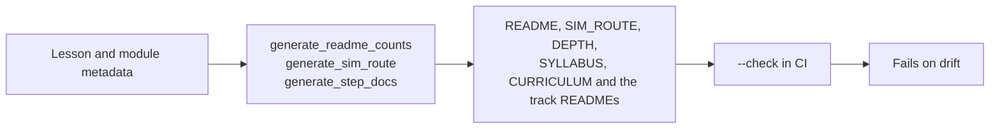

# Verification: what CI checks, and how to run it

> Moved out of the front page: a beginner does not need the badge wall or the script list to
> start, and a maintainer does. The front page links here.

[](https://github.com/TLE47/Mechatronics-Roadmap/actions/workflows/ci.yml)
[](https://github.com/TLE47/Mechatronics-Roadmap/actions/workflows/link-check.yml)
[](https://tle47.github.io/Mechatronics-Roadmap/)
[_%2B_MIT_(Code)-fbbf24)](../LICENSE)

## The numbers on the front page are generated



| Fact | Source | Check |
| :--- | :--- | :--- |
| 10 steps, lesson and module counts, step hours | `scripts/route_model.py` from each page's front matter | `python3.12 scripts/generate_readme_counts.py --check` |
| Arm hours, depth hours, the optional total, and the minimum finish | `scripts/generate_sim_route.py` | `python3.12 scripts/generate_sim_route.py --check` |
| What each of the ten steps costs, page by page, and each track's three depth layers | `scripts/route_model.py` from each page's front matter | `python3.12 scripts/generate_step_docs.py --check` |
| The README's Start here block and the workbench card | `app/src/data/startHere.json` (one file, read by both) | `python3.12 scripts/generate_start_here.py --check` |
| The callout on every lesson and module page: where to run it, or that there is no entry | `app/src/data/pythonLessonsData.ts`, the workbench's own registry | `python3.12 scripts/generate_run_callouts.py --check` |
| The name of every tab, and no page or label referring to one by position | `app/src/data/workbenchTabs.json`, read by `App.tsx` and by the callout generator | `python3.12 scripts/check_tab_names.py` |
| Which workbench entries a roadmap step asks for, and that every entry is claimed once | `app/src/practiceLinks.ts`, joining the roadmap and the registry by track and pass | `npm run test:practice` |
| Every count quoted anywhere in the docs | `scripts/check_consistency.py` | `python3.12 scripts/check_consistency.py` |

`check_consistency.py` is the contradiction detector: it compares a quoted count with the count
derived from the lesson files and `modules/_index.yaml`, and fails on a second name for a step
(`Tier`, `Pass`, or `Gate`) in a learner-facing page. It exists because the README once quoted a
hand-typed lesson count beside a generated table with one more row, and because the route total
once omitted all 23 lesson pages inside Tracks 00-08.

## Full local run

```bash
python3.12 scripts/check_all.py         # every gate CI's verify step runs, in CI's order (~12 s)
python3.12 scripts/check_workflows.py   # the workflow files themselves, before the push
python3.12 scripts/check_all.py --full  # + the 48-package exercise sweep and the unittest discovery
python3.12 scripts/run_all_labs.py      # the 13 reference simulations and labs
npm run test:practice                   # roadmap <-> workbench join
npm run test:theme                      # light/dark rules: stored pick, OS default, data-theme
npm run test:theme:e2e                  # toggle contract + contrast on all 11 tabs, both themes
npm run test:runtime                    # the worker: in-place Stop, input(), isolation, Pages fallback
npm run test:offline                    # the built bundle with no host headers: worker isolation, the take-offline button, offline reload, run and deep link
npm run test:takealong                  # the offline button's rules: which URLs it sends, how a size reads, what "ready" may claim
npm run test:backup                     # the archive: CRC vector, byte-for-byte round trip, the three refusals, and a merge that never deletes
npm run test:e2e:backup                 # the header buttons in Chromium: write a zip, wipe, restore to the store and to the screen
npm run test:palette                    # ⌘K: the whole catalogue once, and the ranking order
npm run test:editor                     # slider directives and which lessons get helper tabs
npm run test:resume                     # the lesson the next visit reopens, which one the roadmap offers and when it hands forward, and the ids it refuses
npm run test:draft                      # the editor's unfinished work: kept per lesson, bounded, evicted, never a starter copy - and how much of it is written
npm run test:history                    # the versions behind the draft: filed on Run with its verdict, deduped, capped per lesson and in total
npm run test:scope                      # the Scope: NaN dropped, t/y aligned, the cursor's interpolation, zoom/pan windows clamped to the data, readable tables
npm run test:checkhints                 # a failing check names its own rung; rung 2 is earned by a run made after the nudge
npm run test:fonts                      # the two self-hosted faces: named, imported, emitted, no CDN
npm run test:smoke                      # needs `npm ci` first
```

`test:backup` is the one suite that owns a file format, so it checks the format itself: the published
CRC-32 vector, a round trip that returns every byte of every entry, and the three ways a chosen file
can fail (not a zip, half a download, a zip a tool re-compressed) — each with its own sentence in the
UI. It then checks the merge a restore performs, because a merge that loses work is worse than no
backup: a flag set here survives a file that lacks it, a draft written here beats the file's copy, an
older arriving version never evicts a newer one, and restoring the same file twice adds nothing.
`test:e2e:backup` takes the archive the browser actually wrote, wipes `localStorage`, and restores it,
asserting the milestone tick returns **without a reload** — the App's own copy of the maps is what a
store-only restore would leave stale.

`test:runtime` is the one suite that cannot be a unit test: stopping a `while True:` in place needs
cross-origin isolation, a real `SharedArrayBuffer` and a real browser. It asserts the Stop answers by
interrupt (the session and its imports survive), that `input()` blocks the worker while the page
stays live, and that the no-buffer fallback still ends the run. `test:palette` is the opposite -
pure TypeScript over the catalogue, pinning that every lesson, exercise, tab and command appears
exactly once and that ranking prefers the entry the learner typed (`P.1` over `P.10`). Both run in
CI; `test:runtime` is its own step because it downloads Pyodide.

The theme pair exists because the palette is a promise, not a preference. The unit suite pins the
rules a reader cannot see (a first visit stores nothing, a corrupt key falls back to the OS, a
blocked store does not throw), and the browser suite measures legibility: every visible text run in
every tab, in both modes, composited over the backgrounds it actually sits on. Anything below 3:1
fails the suite; `--warnings` names the runs between 3:1 and their size minimum, and
`--screenshots` writes one PNG per tab per theme to `.fb-scratch/theme/`. `test:theme` runs inside
`npm run test:workbench`; `test:theme:e2e` is its own CI step, because a seventh browser suite in the
parallel run pushed the older ones past their 30 s click timeouts.

`check_all.py --list` prints the gates it runs and which are heavy; `--only <gate>` re-runs one
after you regenerate something, and `--json` reports them machine-readably. The list is not a
second opinion about what matters: [`tests/test_check_all.py`](../tests/test_check_all.py) parses
the workflow's verify step and fails when the script and CI drift apart, so a gate added in one
place cannot go missing in the other. It exits `2` when handed an interpreter other than the
pinned 3.12, because two of the gates execute module code that needs 3.10+ syntax.

**The workflow files are the first gate, because nothing inside the job can report them.**
[`check_workflows.py`](../scripts/check_workflows.py) reads every `.github/workflows/*.yml` for the
lines YAML refuses - an unquoted `: ` in a value (YAML reads the second colon as another mapping
key), a tab in the indentation, a quote that never closes, a flow collection left open, a key set
twice in one mapping - and skips the places that rule does not apply: a `run: |` body is text, a
quoted value may hold any colon it likes, and `check:native` is not a separator. It needs no YAML
parser; PyYAML is not a dependency of this repository. Run 131 exists because a step name reading
`Check light/dark: toggle contract` made `ci.yml` unparseable for two commits, and GitHub reports
the result as a run that fails in 0 s with no jobs - so the gate that runs CI's commands locally
could not see it, since no job was ever created to run them. With `actionlint` on `PATH`
(`brew install actionlint`) the same command also runs the full lint and fails on its findings;
GitHub's runners do not preinstall it, which is why the built-in scan is the half that has to hold
everywhere. `npm run test:workflows` pins both directions: the historical broken line, and the false
positive that matters (two steps may each have a `name:`).

The same gates, plus the 48-package exercise sweep, the test discovery and the native-dependency
installs, run in [`.github/workflows/ci.yml`](../.github/workflows/ci.yml) on Ubuntu and macOS. The weekly
[`link-check.yml`](../.github/workflows/link-check.yml) lints every lesson, verifies links, and
compiles the Arduino sketches against the hosted toolchain; blocked citations are collected in
[`UNVERIFIED_CITATIONS.md`](UNVERIFIED_CITATIONS.md) and charted in the workbench's Link Health
tab.

`npm run test:smoke` and `npm run test:e2e` need `npm ci` first; the browser suites find
Chromium through Playwright or the documented fallback paths.

## What is asserted, not just run

- **Lesson size:** at most two new ideas per lesson (`lint_lessons.py`), checked from the
  front-matter `ideas` list.
- **Assertion quality:** every graded assert names what was expected and what arrived
  (`lint_assertions.py`), ratcheted against `docs/assertion-baseline.json`.
- **Route integrity:** every module appears exactly once across [`SIM_ROUTE.md`](SIM_ROUTE.md)
  and [`DEPTH.md`](DEPTH.md) — the arm route and the depth pass are disjoint — the ids exist on
  disk, and each total is the sum of its pages. The step/id map and depth matrix in
  [`CURRICULUM.md`](CURRICULUM.md) point at the same lists.
- **Minimum finish integrity:** [`MINIMUM.md`](MINIMUM.md) is generated from the same pages, its
  ids are a subset of the Core route, and its total is the sum of its own rows.
- **The capstone pass conditions:** a capstone in `app/src/lessonHarnesses.ts` verifies only when
  its own harness reports every graded number at target. 08.1 runs the learner's `repair_*`
  functions after their program with its own FK chord (≤ 1 mm tip error, < 5% overshoot); the Tier 3
  capstone (`EX.08-capstones.T3.07a`) runs their budget functions on an unseen design point
  (≤ 0.50 mm, ≥ 45°, the delay its spare margin buys, both sign-off verdicts). The browser E2E types
  a 10%-short repair into 08.1 and a doubled zero-order hold into the Tier 3 capstone, asserting
  1.20 mm and 42.7° stay on the cards and both lessons stay unverified.
- **Exercise coverage:** every graded package runs and every solution passes; the report CI
  reads is the same one the tests consume, so a package cannot be skipped silently.
- **Links and sketches:** weekly, with failures filed as `link-*` issues.

Contributor workflow and commit conventions: [`CONTRIBUTING.md`](../CONTRIBUTING.md). Change
history: [`CHANGELOG.md`](../CHANGELOG.md).
