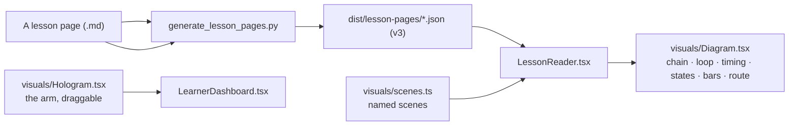

# Visuals: the pictures beside the words

The reading pane is where this course keeps its walls of text: 92 pages, most of them 15–29 thousand
characters of prose, tables and code. A page that *describes* a signal chain, a control loop, a safe
bring-up sequence or a page-by-page route is read better when the same thing is drawn above it. This
page is what draws them, what a figure is allowed to be, and which checks keep it honest.

Every picture here is **app-drawn SVG**: no image files, no Mermaid runtime, no canvas library beyond
the arm. That is not purity for its own sake — it is what makes a figure cost a few hundred bytes of
data instead of a 300 kB renderer, follow the four palettes without a second asset, and carry its own
accessible name.



## Two kinds of picture

| Kind | Where it comes from | How many pages | What it answers |
| :--- | :--- | :--- | :--- |
| **A named scene** | A line `<!-- figure: control-loop \| … -->` in the page's Markdown, naming an entry in [`app/src/visuals/scenes.ts`](../app/src/visuals/scenes.ts) | 39 | "what is the chain / loop / timing this section describes?" |
| **A route** | The page's own Mermaid `flowchart`, when it is a single chain, parsed by the generator into a `route` block | 82 | "where does this lesson go, and what is the next checkpoint?" |

A scene is data, not drawing code: `Diagram.tsx` has one renderer per kind, so a new diagram is an
edit to a table and every figure shares the same rules. A route is not a scene at all — it is the page's
own words, laid out vertically with numbered steps, because 170 pages already wrote that map and the
reader used to drop it.

### The six kinds

| Kind | Drawn as | Used for |
| :--- | :--- | :--- |
| `chain` | a row of boxes with arrows | signal chains, power chains, the toolchain, position→velocity→acceleration |
| `loop` | four boxes on an ellipse | the closed loop, the debug loop, the training loop |
| `timing` | labelled curves on shared axes | step responses, quadrature edges, aliasing, loop deadlines, Bode margins, PWM/ADC timing |
| `states` | a vertical list of gates | safe bring-up, PLC states |
| `bars` | horizontal bars with a maximum | where a fault's cost lands, where the time goes |
| `route` | numbered steps, top to bottom | the page's own flowchart |

The 21 named scenes live in `SCENES` and are covered by `scripts/test_visuals.mjs`: every id is
kebab-case, every caption is a sentence (not a fragment), a chain has at least two boxes, a loop at
least three stages, a timing figure at least one series with two finite samples, a state figure has one
gate label per arrow, and a bar never draws outside its own axis.

## The arm, as a hologram

`visuals/Hologram.tsx` is the one picture you can grab: a two-link arm projected from 3D, with a neck
(yaw/pitch) that orbits the view and a shoulder/elbow you can pose. It is the dashboard's top tile, and
its geometry lives in [`holoModel.ts`](../app/src/visuals/holoModel.ts) as pure functions — forward
kinematics, inverse kinematics, the orbit clamp, the projection, the phosphor trail.

Keeping the model pure is what lets the suite prove the claims the component makes: joints clamp at
their mechanical stops, IK round-trips FK inside the reach and returns `null` outside it, the demo's
figure-eight never asks for a pose the hardware could not take, the projection is deterministic, and the
trail stops growing at its limit. The SVG view is a consumer of that model; a React Three Fiber view
could be swapped in later without moving a single assertion.

## What a figure may never do

- **No motion.** A figure is a still, so `prefers-reduced-motion` has nothing to switch off.
- **No hard-coded colour.** Every stroke and fill is a CSS custom property the palettes define
  (`--ink`, `--body`, `--muted`, `--line`, `--line-soft`, `--accent`, `--canvas`), so dark, light, paper
  and high contrast need no special case.
- **No unlabelled picture.** Each figure is `role="img"` with an `aria-label` built from its title and
  caption, and its caption is a `<figcaption>` — it belongs to the picture in the accessibility tree and
  cannot be mistaken for the next paragraph.
- **No silent blank.** A `figure` id this build does not know renders a visible "this build has no
  figure called …" note, because a diagram that vanishes reads as a page that never had one.
- **No invented graph.** A Mermaid flowchart that branches — two lessons feeding one, a fan-out to a
  joint Jacobian — is *not* redrawn as a list. Ten pages keep their graph in the Markdown and get no
  figure; the alternative would be a picture that says something the page does not.

## Adding one

A lesson figure is one line, at the point in the page where it belongs:

```markdown
## Learn

<!-- figure: control-loop | The whole lesson tunes these four arrows. -->
```

The comment form is deliberate: GitHub hides it, so the page still reads as prose in the repository,
and the workbench shows the diagram. The id must be a scene this build draws (`SCENES`), and the caption
is the sentence under the picture. A new scene is a new entry in `scenes.ts`; if it is a new *kind* of
picture, that is one branch in `Diagram.tsx` and one assertion in `test_visuals.mjs`.

## What it costs

| Metric | Measured | Ceiling | Why |
| :--- | :--- | :--- | :--- |
| `entry_gzip` | 510.4 kB | 520 kB | the figures are app code on the first-screen chunk: the reader draws them beside the text |
| `largest_js_gzip` | 326.5 kB | 335 kB | the runner chunk carries the kit |
| `reader_gzip` | 680.8 kB | 720 kB | the payloads grew a `route` block; still fetched one page at a time |

No audio file, no image, no font. The whole visual kit — scene library, renderer, arm model, hologram —
is 5.6 kB gzipped on a chunk that already existed.

## The checks

| Claim | Command |
| :--- | :--- |
| A scene is drawable, ids are honest, an unknown id is refused, the arm obeys its own limits, and every committed page's figures and routes exist and validate | `npm run test:visuals` |
| The generator turns a single-chain flowchart into a route, leaves a branching one out, and never copies Mermaid source into a payload | `python3 -m unittest tests.test_lesson_pages` |
| The built bundle draws a named figure and the page's route in the reading pane, each with a name and a caption, and the page still reads beside the editor | `npm run test:e2e:pages` |
| The pane's structure did not move in any palette | `npm run check:snapshot` |
| Nothing added is a serious or critical accessibility violation | `npm run check:axe` |
| What all of it costs | `npm run check:weight` |
