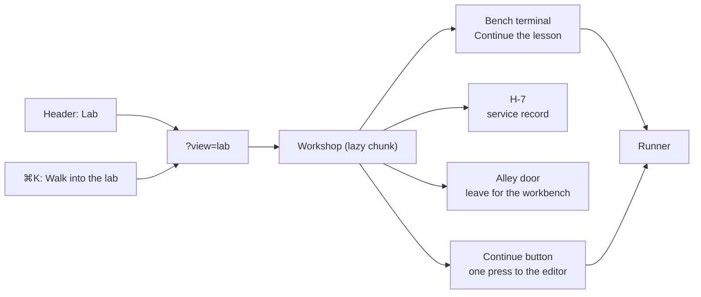

# The workshop: a room, not a gate

The plan's fourth layer is a place: a lit workshop under a rail arch, the arm on the bench, H-7 in
the corner, the alley door behind you. This is that room's first shippable version — one 2.5D
diorama, two depth lanes, three hotspots — built so the atmosphere can never cost a learner a
lesson.

**Open it** with the header's **Lab** button (`?view=lab` is the same page as an address), or from
`⌘K` → *Walk into the lab (the workshop)*.



## The three rules the room obeys

1. **Walking is optional.** A **Continue** button above the room opens the lesson the workbench
   would resume, in one press. Nothing in the room is required to study, and the room never covers
   the editor.
2. **Every hotspot is also a menu row.** The room paints three buttons; the panel underneath lists
   the same three, built from the same array (`HOTSPOTS` in `app/src/workshop.ts`). A keyboard or
   screen-reader learner never has to find a coordinate, and the status line says where the figure
   stands in words.
3. **Movement is the learner's choice.** `prefers-reduced-motion` turns the 240 ms walk into an
   instant move (the figure's transition is `none`, and the global reduced-motion rule already
   zeroes the rest). Nothing loops, nothing autoplays, and the room is silent unless sound is on.

## Moving and using the room

| Input | Action |
| :--- | :--- |
| `A` / `←`, `D` / `→` | Walk one step along the room, clamped at the walls |
| `W` / `↑`, `S` / `↓` | Step between the bench lane (back) and the floor lane (front) |
| `E` | Use the hotspot you are standing at (lane must match, distance inside `REACH`) |
| Click / tap the floor | Walk to that point |
| Click / tap a hotspot | Walk there and use it — one click, from anywhere in the room |
| `Tab`, then `Enter` / `Space` | Focus a hotspot button and activate it |

The model (`app/src/workshop.ts`) owns every rule: `STEP` (0.06 of the room), `REACH` (0.075),
`START`, the key map, clamping and the status line. `app/src/components/game/Workshop.tsx` only
draws what it decides, which is why the rules are unit-tested without a browser.

## What each hotspot does

| Hotspot | In the room | Action |
| :--- | :--- | :--- |
| Bench terminal | at the controller board | **Continue the lesson** — the same offer the dashboard uses, opened in the runner |
| H-7 | the one-armed robot | Toggles its **service record**: capabilities restored (`verifiedMissionCount`), the next mission, and the names already earned. Nothing is granted here — it reads the verified store. |
| Alley door | the near wall | Leaves for the workbench |

The room also prints H-7's **Rebuild** progress (missions verified out of ten) under the scene, from
the same store the dashboard's LV bar and Rebuild meter read.

## Where the code is

| File | Owns |
| :--- | :--- |
| `app/src/workshop.ts` | the hotspots, start pose, step, reach, key map, clamping, the status sentence |
| `app/src/components/game/Workshop.tsx` | the diorama (parallax city, arch, bench, figure), the hotspot buttons, the menu, the keyboard listener, the H-7 card |
| `app/src/App.tsx` | `?view=lab`, the header's door, and the lazy chunk (`React.lazy`) |
| `scripts/test_workshop.mjs` | the rules, in Node |
| `scripts/e2e_workshop.mjs` | the room in Chromium: doors, keys, one-click hotspots, reduced motion, and axe |

The room is a first-paint decision: it is its own chunk, like the dashboard, so a learner who never
walks in downloads neither the room nor its street. Its header door is one small button; the weight
record in `docs/weight-budget.json` names the allowance it needed.

## The gates

```bash
npm run test:workshop       # 10 checks: the rules, the key map, reach, walkability, the status line
npm run test:e2e:workshop   # 9 browser checks: doors, keys, Continue, hotspots, reduced motion, axe
npm run check:snapshot      # 48 surfaces: the header's new door is +1 button everywhere
npm run check:axe           # 12 tabs × 4 palettes (the lab audits itself in its own suite)
```

The lab is a whole page, not a tab, so the tab sweep cannot see it. `test:e2e:workshop` injects the
same axe-core build and fails on any serious or critical finding in the two default palettes; minor
and moderate rules are reported and do not fail, the same bar the tab gate sets.
