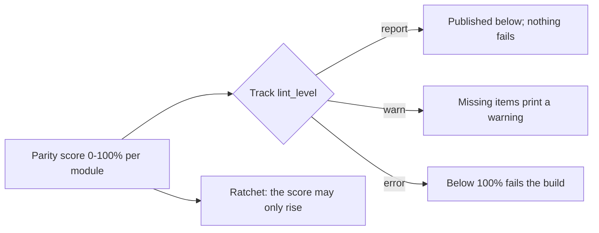

# Tier-Parity Coverage — Advanced Bridge Modules

Generated by `scripts/module_parity.py` from `docs/QUALITY_SPEC.md` — do not edit by hand.
Run `python3 scripts/module_parity.py` to refresh it, `--update-baseline` when a score is
meant to rise (the ratchet refuses a drop), and `--check` in CI.

Parity = **Structure 25% + Executable 30% + Ladder 30% + Validated 15%**, over the items this
repository can measure today. A module carrying the `TODO-AUTHOR` scaffold marker scores 0.
Everything the spec asks for that has no artifact yet is listed under *Not yet instrumented*
rather than scored as zero.

## By track

| Track | Modules | Structure | Executable | Ladder | Validated | Parity | Shared plant | Level |
| :--- | :---: | :---: | :---: | :---: | :---: | :---: | :--- | :--- |
| `00` | 12 | 55% | 52% | 75% | 29% | **56.1%** | 0 arm · 0 exempt · 0 unhooked · 12 undeclared | `report` |
| `01` | 7 | 59% | 40% | 100% | 0% | **56.6%** | 0 arm · 0 exempt · 0 unhooked · 7 undeclared | `report` |
| `02` | 3 | 78% | 60% | 83% | 33% | **67.6%** | 1 arm · 0 exempt · 0 unhooked · 2 undeclared | `report` |
| `03` | 3 | 70% | 47% | 75% | 17% | **56.5%** | 0 arm · 0 exempt · 0 unhooked · 3 undeclared | `report` |
| `04` | 7 | 59% | 43% | 75% | 7% | **51.1%** | 0 arm · 0 exempt · 0 unhooked · 7 undeclared | `report` |
| `05` | 3 | 70% | 47% | 75% | 17% | **56.5%** | 0 arm · 0 exempt · 0 unhooked · 3 undeclared | `report` |
| `06` | 5 | 60% | 56% | 75% | 40% | **60.3%** | 0 arm · 0 exempt · 0 unhooked · 5 undeclared | `report` |
| `07` | 3 | 70% | 47% | 75% | 17% | **56.5%** | 0 arm · 0 exempt · 0 unhooked · 3 undeclared | `report` |
| `08` | 1 | 60% | 40% | 75% | 0% | **49.5%** | 0 arm · 0 exempt · 0 unhooked · 1 undeclared | `report` |

## By tier

| Tier | Modules | Parity |
| :--- | :---: | :---: |
| Tier 1 | 16 | **52.0%** |
| Tier 2 | 18 | **62.2%** |
| Tier 3 | 10 | **53.8%** |

## Per module (44 modules, overall **56.6%**)

| Module | Tier | Structure | Executable | Ladder | Validated | Parity | Shared plant | Missing |
| :--- | :---: | :---: | :---: | :---: | :---: | :---: | :--- | :--- |
| `00-foundations.T1.00a` | 1 | 50% | 40% | 75% | 0% | **47.0%** | **undeclared** | 9 item(s) |
| `00-foundations.T1.00b` | 1 | 50% | 40% | 75% | 0% | **47.0%** | **undeclared** | 9 item(s) |
| `00-foundations.T1.00c` | 1 | 50% | 40% | 75% | 0% | **47.0%** | **undeclared** | 9 item(s) |
| `00-foundations.T1.00d` | 1 | 50% | 40% | 75% | 0% | **47.0%** | **undeclared** | 9 item(s) |
| `00-foundations.T1.00e` | 1 | 75% | 40% | 75% | 0% | **53.2%** | **undeclared** | 8 item(s) |
| `00-foundations.T2.00a` | 2 | 50% | 60% | 75% | 50% | **60.5%** | **undeclared** | 7 item(s) |
| `00-foundations.T2.00b` | 2 | 50% | 60% | 75% | 50% | **60.5%** | **undeclared** | 7 item(s) |
| `00-foundations.T2.00c` | 2 | 50% | 60% | 75% | 50% | **60.5%** | **undeclared** | 7 item(s) |
| `00-foundations.T2.00d` | 2 | 50% | 60% | 75% | 50% | **60.5%** | **undeclared** | 7 item(s) |
| `00-foundations.T2.00e` | 2 | 50% | 60% | 75% | 50% | **60.5%** | **undeclared** | 7 item(s) |
| `00-foundations.T2.00f` | 2 | 75% | 60% | 75% | 50% | **66.8%** | **undeclared** | 6 item(s) |
| `00-foundations.T3.00a` | 3 | 60% | 60% | 75% | 50% | **63.0%** | **undeclared** | 7 item(s) |
| `01-electronics.T1.01a` | 1 | 50% | 40% | 100% | 0% | **54.5%** | **undeclared** | 7 item(s) |
| `01-electronics.T1.01b` | 1 | 75% | 40% | 100% | 0% | **60.8%** | **undeclared** | 6 item(s) |
| `01-electronics.T1.01c` | 1 | 50% | 40% | 100% | 0% | **54.5%** | **undeclared** | 7 item(s) |
| `01-electronics.T1.01d` | 1 | 50% | 40% | 100% | 0% | **54.5%** | **undeclared** | 7 item(s) |
| `01-electronics.T2.01a` | 2 | 50% | 40% | 100% | 0% | **54.5%** | **undeclared** | 7 item(s) |
| `01-electronics.T2.01b` | 2 | 75% | 40% | 100% | 0% | **60.8%** | **undeclared** | 6 item(s) |
| `01-electronics.T3.01a` | 3 | 60% | 40% | 100% | 0% | **57.0%** | **undeclared** | 7 item(s) |
| `02-mechanics.T1.02a` | 1 | 75% | 40% | 75% | 0% | **53.2%** | **undeclared** | 8 item(s) |
| `02-mechanics.T2.02a` | 2 | 100% | 100% | 100% | 100% | **100.0%** | `arm` | 0 item(s) |
| `02-mechanics.T3.02a` | 3 | 60% | 40% | 75% | 0% | **49.5%** | **undeclared** | 9 item(s) |
| `03-sensors.T1.03a` | 1 | 75% | 40% | 75% | 0% | **53.2%** | **undeclared** | 8 item(s) |
| `03-sensors.T2.03a` | 2 | 75% | 60% | 75% | 50% | **66.8%** | **undeclared** | 6 item(s) |
| `03-sensors.T3.03a` | 3 | 60% | 40% | 75% | 0% | **49.5%** | **undeclared** | 9 item(s) |
| `04-embedded.T1.04a` | 1 | 50% | 40% | 75% | 0% | **47.0%** | **undeclared** | 9 item(s) |
| `04-embedded.T1.04b` | 1 | 75% | 40% | 75% | 0% | **53.2%** | **undeclared** | 8 item(s) |
| `04-embedded.T2.04a` | 2 | 50% | 40% | 75% | 0% | **47.0%** | **undeclared** | 9 item(s) |
| `04-embedded.T2.04b` | 2 | 50% | 40% | 75% | 0% | **47.0%** | **undeclared** | 9 item(s) |
| `04-embedded.T2.04c` | 2 | 50% | 40% | 75% | 0% | **47.0%** | **undeclared** | 9 item(s) |
| `04-embedded.T2.04d` | 2 | 75% | 60% | 75% | 50% | **66.8%** | **undeclared** | 6 item(s) |
| `04-embedded.T3.04a` | 3 | 60% | 40% | 75% | 0% | **49.5%** | **undeclared** | 9 item(s) |
| `05-control.T1.05a` | 1 | 75% | 40% | 75% | 0% | **53.2%** | **undeclared** | 8 item(s) |
| `05-control.T2.05a` | 2 | 75% | 60% | 75% | 50% | **66.8%** | **undeclared** | 6 item(s) |
| `05-control.T3.05a` | 3 | 60% | 40% | 75% | 0% | **49.5%** | **undeclared** | 9 item(s) |
| `06-robotics.T1.06a` | 1 | 75% | 40% | 75% | 0% | **53.2%** | **undeclared** | 8 item(s) |
| `06-robotics.T2.06a` | 2 | 50% | 60% | 75% | 50% | **60.5%** | **undeclared** | 7 item(s) |
| `06-robotics.T2.06b` | 2 | 75% | 60% | 75% | 50% | **66.8%** | **undeclared** | 6 item(s) |
| `06-robotics.T3.06a` | 3 | 40% | 60% | 75% | 50% | **58.0%** | **undeclared** | 8 item(s) |
| `06-robotics.T3.06b` | 3 | 60% | 60% | 75% | 50% | **63.0%** | **undeclared** | 7 item(s) |
| `07-systems.T1.07a` | 1 | 75% | 40% | 75% | 0% | **53.2%** | **undeclared** | 8 item(s) |
| `07-systems.T2.07a` | 2 | 75% | 60% | 75% | 50% | **66.8%** | **undeclared** | 6 item(s) |
| `07-systems.T3.06a` | 3 | 60% | 40% | 75% | 0% | **49.5%** | **undeclared** | 9 item(s) |
| `08-capstones.T3.07a` | 3 | 60% | 40% | 75% | 0% | **49.5%** | **undeclared** | 9 item(s) |

## Ladder stages (named markers, all modules)

| Stage | Modules carrying it | Gate |
| :--- | :---: | :--- |
| `1_recall` | 44/44 | gated by `lint_modules.py` |
| `2_see_it` | 44/44 | gated by `lint_modules.py` |
| `3_predict` | 8/44 | **gap** |
| `4_worked_example` | 44/44 | gated by `lint_modules.py` |
| `5_practice_host` | 44/44 | gated by `lint_modules.py` |
| `6_break_it` | 8/44 | **gap** |
| `7_transfer` | 44/44 | gated by `lint_modules.py` |
| `8_integrate` | 44/44 | gated by `lint_modules.py` |

## Shared plant

The plan's Definition of Done asks every module to use the shared plant *where relevant*, and
that is now a **scored** item in the Executable layer rather than a promise: `plant:
tier1_arm_motor` **and** an `import mechalab_plant` inside a python block (`arm`), or `plant:
none` with a `plant_note:` reason (`none`, reasoned). A bare mention in prose, a declaration
with no import, an unexplained exemption and a missing key all score zero - `unhooked` and
`undeclared` below - so a module that ignores the arm is visible in its own score instead of
being implied by silence.

- On the shared arm: **1/44** - `02-mechanics.T2.02a`
- Declared exempt, with a reason: **0/44**
- Declared but not hooked up (`plant: tier1_arm_motor` with no `import mechalab_plant` in a
  python block, or `plant: none` with no reason): **0/44**
- Undeclared: **43/44**

The plant itself, its provenance rule and the workbench import contract:
[`resources/plants/README.md`](../resources/plants/README.md).

## Validation evidence

A percentage cannot say *what kind* of evidence stands behind it, so this table does. The
columns are deliberately separate: a module can be content-complete and author-tested while
its transfer retention is still unmeasured, and collapsing those into one *validated* flag is
what this section exists to stop. **100% means 100% of the requirements instrumented today,**
not demonstrated learner mastery.

| Module | Parity | Reference solution tested | Behaviour-graded | Browser E2E | Author dogfood | Delayed transfer | Independent learner |
| :--- | :---: | :---: | :---: | :---: | :--- | :---: | :---: |
| `00-foundations.T1.00a` | **47.0%** | `-` | `-` | `-` | `-` | `-` | `-` |
| `00-foundations.T1.00b` | **47.0%** | `-` | `-` | `-` | `-` | `-` | `-` |
| `00-foundations.T1.00c` | **47.0%** | `-` | `-` | `-` | `-` | `-` | `-` |
| `00-foundations.T1.00d` | **47.0%** | `-` | `-` | `-` | `-` | `-` | `-` |
| `00-foundations.T1.00e` | **53.2%** | `-` | `-` | `-` | `-` | `-` | `-` |
| `00-foundations.T2.00a` | **60.5%** | yes | yes | yes (`e2e_pages_bundle.mjs`) | `-` | `-` | `-` |
| `00-foundations.T2.00b` | **60.5%** | yes | yes | yes (`e2e_pages_bundle.mjs`) | `-` | `-` | `-` |
| `00-foundations.T2.00c` | **60.5%** | yes | yes | yes (`e2e_pages_bundle.mjs`) | `-` | `-` | `-` |
| `00-foundations.T2.00d` | **60.5%** | yes | yes | yes (`e2e_pages_bundle.mjs`) | `-` | `-` | `-` |
| `00-foundations.T2.00e` | **60.5%** | yes | yes | yes (`e2e_pages_bundle.mjs`) | `-` | `-` | `-` |
| `00-foundations.T2.00f` | **66.8%** | yes | yes | yes (`e2e_pages_bundle.mjs`) | `-` | `-` | `-` |
| `00-foundations.T3.00a` | **63.0%** | yes | yes | yes (`e2e_pages_bundle.mjs`) | `-` | `-` | `-` |
| `01-electronics.T1.01a` | **54.5%** | `-` | `-` | `-` | `-` | `-` | `-` |
| `01-electronics.T1.01b` | **60.8%** | `-` | `-` | `-` | `-` | `-` | `-` |
| `01-electronics.T1.01c` | **54.5%** | `-` | `-` | `-` | `-` | `-` | `-` |
| `01-electronics.T1.01d` | **54.5%** | `-` | `-` | `-` | `-` | `-` | `-` |
| `01-electronics.T2.01a` | **54.5%** | `-` | `-` | `-` | `-` | `-` | `-` |
| `01-electronics.T2.01b` | **60.8%** | `-` | `-` | `-` | `-` | `-` | `-` |
| `01-electronics.T3.01a` | **57.0%** | `-` | `-` | `-` | `-` | `-` | `-` |
| `02-mechanics.T1.02a` | **53.2%** | `-` | `-` | `-` | `-` | `-` | `-` |
| `02-mechanics.T2.02a` | **100.0%** | yes | yes | yes (`e2e_pages_bundle.mjs`) | 2026-10-16, 13 min, 0 hints | - | `-` |
| `02-mechanics.T3.02a` | **49.5%** | `-` | `-` | `-` | `-` | `-` | `-` |
| `03-sensors.T1.03a` | **53.2%** | `-` | `-` | `-` | `-` | `-` | `-` |
| `03-sensors.T2.03a` | **66.8%** | yes | yes | yes (`e2e_pages_bundle.mjs`) | `-` | `-` | `-` |
| `03-sensors.T3.03a` | **49.5%** | `-` | `-` | `-` | `-` | `-` | `-` |
| `04-embedded.T1.04a` | **47.0%** | `-` | `-` | `-` | `-` | `-` | `-` |
| `04-embedded.T1.04b` | **53.2%** | `-` | `-` | `-` | `-` | `-` | `-` |
| `04-embedded.T2.04a` | **47.0%** | `-` | `-` | `-` | `-` | `-` | `-` |
| `04-embedded.T2.04b` | **47.0%** | `-` | `-` | `-` | `-` | `-` | `-` |
| `04-embedded.T2.04c` | **47.0%** | `-` | `-` | `-` | `-` | `-` | `-` |
| `04-embedded.T2.04d` | **66.8%** | yes | yes | yes (`e2e_pages_bundle.mjs`) | `-` | `-` | `-` |
| `04-embedded.T3.04a` | **49.5%** | `-` | `-` | `-` | `-` | `-` | `-` |
| `05-control.T1.05a` | **53.2%** | `-` | `-` | `-` | `-` | `-` | `-` |
| `05-control.T2.05a` | **66.8%** | yes | yes | yes (`e2e_pages_bundle.mjs`) | `-` | `-` | `-` |
| `05-control.T3.05a` | **49.5%** | `-` | `-` | `-` | `-` | `-` | `-` |
| `06-robotics.T1.06a` | **53.2%** | `-` | `-` | `-` | `-` | `-` | `-` |
| `06-robotics.T2.06a` | **60.5%** | yes | yes | yes (`e2e_pages_bundle.mjs`) | `-` | `-` | `-` |
| `06-robotics.T2.06b` | **66.8%** | yes | yes | yes (`e2e_pages_bundle.mjs`) | `-` | `-` | `-` |
| `06-robotics.T3.06a` | **58.0%** | yes | yes | yes (`e2e_pages_bundle.mjs`) | `-` | `-` | `-` |
| `06-robotics.T3.06b` | **63.0%** | yes | yes | yes (`e2e_pages_bundle.mjs`) | `-` | `-` | `-` |
| `07-systems.T1.07a` | **53.2%** | `-` | `-` | `-` | `-` | `-` | `-` |
| `07-systems.T2.07a` | **66.8%** | yes | yes | yes (`e2e_pages_bundle.mjs`) | `-` | `-` | `-` |
| `07-systems.T3.06a` | **49.5%** | `-` | `-` | `-` | `-` | `-` | `-` |
| `08-capstones.T3.07a` | **49.5%** | `-` | `-` | `-` | `-` | `-` | `-` |

**Behaviour-graded** means `exercises/<module>/exercise.json` exists *and*
`scripts/run_exercise.py` passes: the starter fails on its own `NotImplementedError`, the
reference solution passes the behaviour and transfer suites, and every planted fault fails the
test that names it. The tests the harness runs are the same ones CI runs.

## Not yet instrumented

The plan asks for these too. No artifact exists for them yet, so they are listed rather than
scored - each one is a piece of work, not a zero:

- **Behavioural tests for the other 28 modules:** 16 exercise packages exist
  (`00-foundations.T2.00a`-`T2.00f`, `02-mechanics.T2.02a`, `03-sensors.T2.03a`,
  `04-embedded.T2.04d`, `05-control.T2.05a`, `06-robotics.T2.06a`-`T2.06b` and
  `07-systems.T2.07a`), and they are the template. `INSTRUCTOR_TESTS` in
  `scripts/generate_python_lessons_data.py` covers the beginner lessons only, so the remaining
  bridge modules ship no graded exercise of their own and their rows read `-` in the
  Behaviour-graded column.
- **Module exercises in the workbench:** each of those 16 packages is generated into the app
  as a self-checking entry and `scripts/e2e_pages_bundle.mjs` drives all of them on the built
  bundle, so the browser path is measured on 16 exercises, not assumed from one.
- **Maths-claims audit:** absolute claims (`guaranteed`, `always`, `never`, `positive definite`)
  with their stated assumptions, and a counterexample test where a claim is easy to get wrong.
- **Transfer-task retention:** whether the Transfer task still passes 1-2 weeks later, and
  arrival times from a real beginner pilot (`docs/dogfood-log.md` records author-dogfood only).

