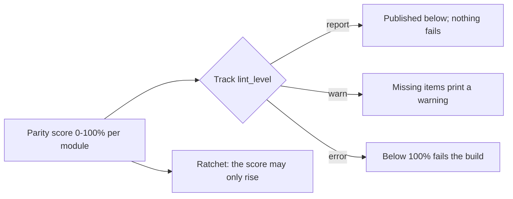

# Tier-Parity Coverage — Advanced Bridge Modules

Generated by `scripts/module_parity.py` from `docs/QUALITY_SPEC.md` — do not edit by hand.
Run `python3 scripts/module_parity.py` to refresh it, `--update-baseline` when a score is
meant to rise (the ratchet refuses a drop), and `--check` in CI.

Parity = **Structure 25% + Executable 30% + Ladder 30% + Validated 15%**, over the items this
repository can measure today. A module carrying the `TODO-AUTHOR` scaffold marker scores 0.
Everything the spec asks for that has no artifact yet is listed under *Not yet instrumented*
rather than scored as zero.

## By track

| Track | Modules | Structure | Executable | Ladder | Validated | Parity | Level |
| :--- | :---: | :---: | :---: | :---: | :---: | :---: | :--- |
| `00` | 12 | 55% | 50% | 75% | 0% | **51.2%** | `report` |
| `01` | 7 | 59% | 50% | 100% | 0% | **59.6%** | `report` |
| `02` | 3 | 70% | 50% | 75% | 0% | **55.0%** | `report` |
| `03` | 3 | 70% | 50% | 75% | 0% | **55.0%** | `report` |
| `04` | 7 | 59% | 50% | 75% | 0% | **52.1%** | `report` |
| `05` | 3 | 70% | 50% | 75% | 0% | **55.0%** | `report` |
| `06` | 5 | 60% | 50% | 75% | 0% | **52.5%** | `report` |
| `07` | 3 | 70% | 50% | 75% | 0% | **55.0%** | `report` |
| `08` | 1 | 60% | 50% | 75% | 0% | **52.5%** | `report` |

## By tier

| Tier | Modules | Parity |
| :--- | :---: | :---: |
| Tier 1 | 16 | **55.0%** |
| Tier 2 | 18 | **53.6%** |
| Tier 3 | 10 | **52.8%** |

## Per module (44 modules, overall **53.9%**)

| Module | Tier | Structure | Executable | Ladder | Validated | Parity | Missing |
| :--- | :---: | :---: | :---: | :---: | :---: | :---: | :--- |
| `00-foundations.T1.00a` | 1 | 50% | 50% | 75% | 0% | **50.0%** | 7 item(s) |
| `00-foundations.T1.00b` | 1 | 50% | 50% | 75% | 0% | **50.0%** | 7 item(s) |
| `00-foundations.T1.00c` | 1 | 50% | 50% | 75% | 0% | **50.0%** | 7 item(s) |
| `00-foundations.T1.00d` | 1 | 50% | 50% | 75% | 0% | **50.0%** | 7 item(s) |
| `00-foundations.T1.00e` | 1 | 75% | 50% | 75% | 0% | **56.2%** | 6 item(s) |
| `00-foundations.T2.00a` | 2 | 50% | 50% | 75% | 0% | **50.0%** | 7 item(s) |
| `00-foundations.T2.00b` | 2 | 50% | 50% | 75% | 0% | **50.0%** | 7 item(s) |
| `00-foundations.T2.00c` | 2 | 50% | 50% | 75% | 0% | **50.0%** | 7 item(s) |
| `00-foundations.T2.00d` | 2 | 50% | 50% | 75% | 0% | **50.0%** | 7 item(s) |
| `00-foundations.T2.00e` | 2 | 50% | 50% | 75% | 0% | **50.0%** | 7 item(s) |
| `00-foundations.T2.00f` | 2 | 75% | 50% | 75% | 0% | **56.2%** | 6 item(s) |
| `00-foundations.T3.00a` | 3 | 60% | 50% | 75% | 0% | **52.5%** | 7 item(s) |
| `01-electronics.T1.01a` | 1 | 50% | 50% | 100% | 0% | **57.5%** | 5 item(s) |
| `01-electronics.T1.01b` | 1 | 75% | 50% | 100% | 0% | **63.7%** | 4 item(s) |
| `01-electronics.T1.01c` | 1 | 50% | 50% | 100% | 0% | **57.5%** | 5 item(s) |
| `01-electronics.T1.01d` | 1 | 50% | 50% | 100% | 0% | **57.5%** | 5 item(s) |
| `01-electronics.T2.01a` | 2 | 50% | 50% | 100% | 0% | **57.5%** | 5 item(s) |
| `01-electronics.T2.01b` | 2 | 75% | 50% | 100% | 0% | **63.7%** | 4 item(s) |
| `01-electronics.T3.01a` | 3 | 60% | 50% | 100% | 0% | **60.0%** | 5 item(s) |
| `02-mechanics.T1.02a` | 1 | 75% | 50% | 75% | 0% | **56.2%** | 6 item(s) |
| `02-mechanics.T2.02a` | 2 | 75% | 50% | 75% | 0% | **56.2%** | 6 item(s) |
| `02-mechanics.T3.02a` | 3 | 60% | 50% | 75% | 0% | **52.5%** | 7 item(s) |
| `03-sensors.T1.03a` | 1 | 75% | 50% | 75% | 0% | **56.2%** | 6 item(s) |
| `03-sensors.T2.03a` | 2 | 75% | 50% | 75% | 0% | **56.2%** | 6 item(s) |
| `03-sensors.T3.03a` | 3 | 60% | 50% | 75% | 0% | **52.5%** | 7 item(s) |
| `04-embedded.T1.04a` | 1 | 50% | 50% | 75% | 0% | **50.0%** | 7 item(s) |
| `04-embedded.T1.04b` | 1 | 75% | 50% | 75% | 0% | **56.2%** | 6 item(s) |
| `04-embedded.T2.04a` | 2 | 50% | 50% | 75% | 0% | **50.0%** | 7 item(s) |
| `04-embedded.T2.04b` | 2 | 50% | 50% | 75% | 0% | **50.0%** | 7 item(s) |
| `04-embedded.T2.04c` | 2 | 50% | 50% | 75% | 0% | **50.0%** | 7 item(s) |
| `04-embedded.T2.04d` | 2 | 75% | 50% | 75% | 0% | **56.2%** | 6 item(s) |
| `04-embedded.T3.04a` | 3 | 60% | 50% | 75% | 0% | **52.5%** | 7 item(s) |
| `05-control.T1.05a` | 1 | 75% | 50% | 75% | 0% | **56.2%** | 6 item(s) |
| `05-control.T2.05a` | 2 | 75% | 50% | 75% | 0% | **56.2%** | 6 item(s) |
| `05-control.T3.05a` | 3 | 60% | 50% | 75% | 0% | **52.5%** | 7 item(s) |
| `06-robotics.T1.06a` | 1 | 75% | 50% | 75% | 0% | **56.2%** | 6 item(s) |
| `06-robotics.T2.06a` | 2 | 50% | 50% | 75% | 0% | **50.0%** | 7 item(s) |
| `06-robotics.T2.06b` | 2 | 75% | 50% | 75% | 0% | **56.2%** | 6 item(s) |
| `06-robotics.T3.06a` | 3 | 40% | 50% | 75% | 0% | **47.5%** | 8 item(s) |
| `06-robotics.T3.06b` | 3 | 60% | 50% | 75% | 0% | **52.5%** | 7 item(s) |
| `07-systems.T1.07a` | 1 | 75% | 50% | 75% | 0% | **56.2%** | 6 item(s) |
| `07-systems.T2.07a` | 2 | 75% | 50% | 75% | 0% | **56.2%** | 6 item(s) |
| `07-systems.T3.06a` | 3 | 60% | 50% | 75% | 0% | **52.5%** | 7 item(s) |
| `08-capstones.T3.07a` | 3 | 60% | 50% | 75% | 0% | **52.5%** | 7 item(s) |

## Ladder stages (named markers, all modules)

| Stage | Modules carrying it | Gate |
| :--- | :---: | :--- |
| `1_recall` | 44/44 | gated by `lint_modules.py` |
| `2_see_it` | 44/44 | gated by `lint_modules.py` |
| `3_predict` | 7/44 | **gap** |
| `4_worked_example` | 44/44 | gated by `lint_modules.py` |
| `5_practice_host` | 44/44 | gated by `lint_modules.py` |
| `6_break_it` | 7/44 | **gap** |
| `7_transfer` | 44/44 | gated by `lint_modules.py` |
| `8_integrate` | 44/44 | gated by `lint_modules.py` |

## Not yet instrumented

The plan asks for these too. No artifact exists for them yet, so they are listed rather than
scored - each one is a piece of work, not a zero:

- **Behavioural tests for module exercises:** `INSTRUCTOR_TESTS` in
  `scripts/generate_python_lessons_data.py` covers the 36 beginner lessons only; module
  exercises have no equivalent harness yet.
- **Module exercises in the workbench:** only lessons are generated into the app, so no module
  exercise runs in the browser today, and the Pages E2E suite therefore tests no T2/T3 exercise.
- **Maths-claims audit:** absolute claims (`guaranteed`, `always`, `never`, `positive definite`)
  with their stated assumptions, and a counterexample test where a claim is easy to get wrong.
- **Transfer-task retention:** whether the Transfer task still passes 1-2 weeks later, and
  arrival times from a real beginner pilot (`docs/dogfood-log.md` records author-dogfood only).

