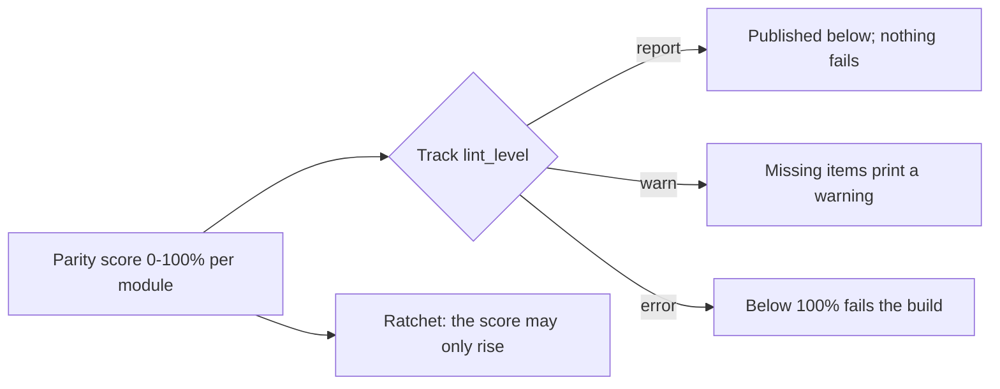

# Tier-Parity Coverage — Advanced Bridge Modules

Generated by `scripts/module_parity.py` from `docs/QUALITY_SPEC.md` — do not edit by hand.
Run `python3 scripts/module_parity.py` to refresh it, `--update-baseline` when a score is
meant to rise (the ratchet refuses a drop), and `--check` in CI.

Parity = **Structure 25% + Executable 30% + Ladder 30% + Validated 15%**, over the items this
repository can measure today. A module carrying the `TODO-AUTHOR` scaffold marker scores 0.
Everything the spec asks for that has no artifact yet is listed under *Not yet instrumented*
rather than scored as zero.

## By track

| Track | Modules | Structure | Executable | Ladder | Validated | Parity | Shared plant | Level |
| :--- | :---: | :---: | :---: | :---: | :---: | :---: | :--- | :--- |
| `00` | 12 | 100% | 100% | 100% | 92% | **98.8%** | 12 arm · 0 exempt · 0 unhooked · 0 undeclared | `report` |
| `01` | 7 | 100% | 100% | 100% | 50% | **92.5%** | 7 arm · 0 exempt · 0 unhooked · 0 undeclared | `report` |
| `02` | 3 | 100% | 100% | 100% | 67% | **95.0%** | 3 arm · 0 exempt · 0 unhooked · 0 undeclared | `report` |
| `03` | 3 | 100% | 100% | 100% | 50% | **92.5%** | 3 arm · 0 exempt · 0 unhooked · 0 undeclared | `report` |
| `04` | 7 | 100% | 100% | 100% | 50% | **92.5%** | 7 arm · 0 exempt · 0 unhooked · 0 undeclared | `report` |
| `05` | 5 | 100% | 100% | 100% | 50% | **92.5%** | 5 arm · 0 exempt · 0 unhooked · 0 undeclared | `report` |
| `06` | 5 | 100% | 100% | 100% | 50% | **92.5%** | 5 arm · 0 exempt · 0 unhooked · 0 undeclared | `report` |
| `07` | 3 | 100% | 100% | 100% | 50% | **92.5%** | 3 arm · 0 exempt · 0 unhooked · 0 undeclared | `report` |
| `08` | 1 | 100% | 100% | 100% | 50% | **92.5%** | 1 arm · 0 exempt · 0 unhooked · 0 undeclared | `report` |

## By tier

| Tier | Modules | Parity |
| :--- | :---: | :---: |
| Tier 1 | 16 | **94.8%** |
| Tier 2 | 18 | **95.0%** |
| Tier 3 | 12 | **92.5%** |

## Per module (46 modules, overall **94.3%**)

| Module | Tier | Structure | Executable | Ladder | Validated | Parity | Shared plant | Missing |
| :--- | :---: | :---: | :---: | :---: | :---: | :---: | :--- | :--- |
| `00-foundations.T1.00a` | 1 | 100% | 100% | 100% | 100% | **100.0%** | `arm` | 0 item(s) |
| `00-foundations.T1.00b` | 1 | 100% | 100% | 100% | 100% | **100.0%** | `arm` | 0 item(s) |
| `00-foundations.T1.00c` | 1 | 100% | 100% | 100% | 100% | **100.0%** | `arm` | 0 item(s) |
| `00-foundations.T1.00d` | 1 | 100% | 100% | 100% | 100% | **100.0%** | `arm` | 0 item(s) |
| `00-foundations.T1.00e` | 1 | 100% | 100% | 100% | 100% | **100.0%** | `arm` | 0 item(s) |
| `00-foundations.T2.00a` | 2 | 100% | 100% | 100% | 100% | **100.0%** | `arm` | 0 item(s) |
| `00-foundations.T2.00b` | 2 | 100% | 100% | 100% | 100% | **100.0%** | `arm` | 0 item(s) |
| `00-foundations.T2.00c` | 2 | 100% | 100% | 100% | 100% | **100.0%** | `arm` | 0 item(s) |
| `00-foundations.T2.00d` | 2 | 100% | 100% | 100% | 100% | **100.0%** | `arm` | 0 item(s) |
| `00-foundations.T2.00e` | 2 | 100% | 100% | 100% | 100% | **100.0%** | `arm` | 0 item(s) |
| `00-foundations.T2.00f` | 2 | 100% | 100% | 100% | 50% | **92.5%** | `arm` | 1 item(s) |
| `00-foundations.T3.00a` | 3 | 100% | 100% | 100% | 50% | **92.5%** | `arm` | 1 item(s) |
| `01-electronics.T1.01a` | 1 | 100% | 100% | 100% | 50% | **92.5%** | `arm` | 1 item(s) |
| `01-electronics.T1.01b` | 1 | 100% | 100% | 100% | 50% | **92.5%** | `arm` | 1 item(s) |
| `01-electronics.T1.01c` | 1 | 100% | 100% | 100% | 50% | **92.5%** | `arm` | 1 item(s) |
| `01-electronics.T1.01d` | 1 | 100% | 100% | 100% | 50% | **92.5%** | `arm` | 1 item(s) |
| `01-electronics.T2.01a` | 2 | 100% | 100% | 100% | 50% | **92.5%** | `arm` | 1 item(s) |
| `01-electronics.T2.01b` | 2 | 100% | 100% | 100% | 50% | **92.5%** | `arm` | 1 item(s) |
| `01-electronics.T3.01a` | 3 | 100% | 100% | 100% | 50% | **92.5%** | `arm` | 1 item(s) |
| `02-mechanics.T1.02a` | 1 | 100% | 100% | 100% | 50% | **92.5%** | `arm` | 1 item(s) |
| `02-mechanics.T2.02a` | 2 | 100% | 100% | 100% | 100% | **100.0%** | `arm` | 0 item(s) |
| `02-mechanics.T3.02a` | 3 | 100% | 100% | 100% | 50% | **92.5%** | `arm` | 1 item(s) |
| `03-sensors.T1.03a` | 1 | 100% | 100% | 100% | 50% | **92.5%** | `arm` | 1 item(s) |
| `03-sensors.T2.03a` | 2 | 100% | 100% | 100% | 50% | **92.5%** | `arm` | 1 item(s) |
| `03-sensors.T3.03a` | 3 | 100% | 100% | 100% | 50% | **92.5%** | `arm` | 1 item(s) |
| `04-embedded.T1.04a` | 1 | 100% | 100% | 100% | 50% | **92.5%** | `arm` | 1 item(s) |
| `04-embedded.T1.04b` | 1 | 100% | 100% | 100% | 50% | **92.5%** | `arm` | 1 item(s) |
| `04-embedded.T2.04a` | 2 | 100% | 100% | 100% | 50% | **92.5%** | `arm` | 1 item(s) |
| `04-embedded.T2.04b` | 2 | 100% | 100% | 100% | 50% | **92.5%** | `arm` | 1 item(s) |
| `04-embedded.T2.04c` | 2 | 100% | 100% | 100% | 50% | **92.5%** | `arm` | 1 item(s) |
| `04-embedded.T2.04d` | 2 | 100% | 100% | 100% | 50% | **92.5%** | `arm` | 1 item(s) |
| `04-embedded.T3.04a` | 3 | 100% | 100% | 100% | 50% | **92.5%** | `arm` | 1 item(s) |
| `05-control.T1.05a` | 1 | 100% | 100% | 100% | 50% | **92.5%** | `arm` | 1 item(s) |
| `05-control.T2.05a` | 2 | 100% | 100% | 100% | 50% | **92.5%** | `arm` | 1 item(s) |
| `05-control.T3.05a` | 3 | 100% | 100% | 100% | 50% | **92.5%** | `arm` | 1 item(s) |
| `05-control.T3.05b` | 3 | 100% | 100% | 100% | 50% | **92.5%** | `arm` | 1 item(s) |
| `05-control.T3.05c` | 3 | 100% | 100% | 100% | 50% | **92.5%** | `arm` | 1 item(s) |
| `06-robotics.T1.06a` | 1 | 100% | 100% | 100% | 50% | **92.5%** | `arm` | 1 item(s) |
| `06-robotics.T2.06a` | 2 | 100% | 100% | 100% | 50% | **92.5%** | `arm` | 1 item(s) |
| `06-robotics.T2.06b` | 2 | 100% | 100% | 100% | 50% | **92.5%** | `arm` | 1 item(s) |
| `06-robotics.T3.06a` | 3 | 100% | 100% | 100% | 50% | **92.5%** | `arm` | 1 item(s) |
| `06-robotics.T3.06b` | 3 | 100% | 100% | 100% | 50% | **92.5%** | `arm` | 1 item(s) |
| `07-systems.T1.07a` | 1 | 100% | 100% | 100% | 50% | **92.5%** | `arm` | 1 item(s) |
| `07-systems.T2.07a` | 2 | 100% | 100% | 100% | 50% | **92.5%** | `arm` | 1 item(s) |
| `07-systems.T3.06a` | 3 | 100% | 100% | 100% | 50% | **92.5%** | `arm` | 1 item(s) |
| `08-capstones.T3.07a` | 3 | 100% | 100% | 100% | 50% | **92.5%** | `arm` | 1 item(s) |

## Ladder stages (named markers, all modules)

| Stage | Modules carrying it | Gate |
| :--- | :---: | :--- |
| `1_recall` | 46/46 | gated by `lint_modules.py` |
| `2_see_it` | 46/46 | gated by `lint_modules.py` |
| `3_predict` | 46/46 | gated by `lint_modules.py` |
| `4_worked_example` | 46/46 | gated by `lint_modules.py` |
| `5_practice_host` | 46/46 | gated by `lint_modules.py` |
| `6_break_it` | 46/46 | gated by `lint_modules.py` |
| `7_transfer` | 46/46 | gated by `lint_modules.py` |
| `8_integrate` | 46/46 | gated by `lint_modules.py` |

## Shared plant

The plan's Definition of Done asks every module to use the shared plant *where relevant*, and
that is now a **scored** item in the Executable layer rather than a promise: `plant:
tier1_arm_motor` **and** an `import mechalab_plant` inside a python block (`arm`), or `plant:
none` with a `plant_note:` reason (`none`, reasoned). A bare mention in prose, a declaration
with no import, an unexplained exemption and a missing key all score zero - `unhooked` and
`undeclared` below - so a module that ignores the arm is visible in its own score instead of
being implied by silence.

- On the shared arm: **46/46** - `00-foundations.T1.00a`, `00-foundations.T1.00b`, `00-foundations.T1.00c`, `00-foundations.T1.00d`, `00-foundations.T1.00e`, `00-foundations.T2.00a`, `00-foundations.T2.00b`, `00-foundations.T2.00c`, `00-foundations.T2.00d`, `00-foundations.T2.00e`, `00-foundations.T2.00f`, `00-foundations.T3.00a`, `01-electronics.T1.01a`, `01-electronics.T1.01b`, `01-electronics.T1.01c`, `01-electronics.T1.01d`, `01-electronics.T2.01a`, `01-electronics.T2.01b`, `01-electronics.T3.01a`, `02-mechanics.T1.02a`, `02-mechanics.T2.02a`, `02-mechanics.T3.02a`, `03-sensors.T1.03a`, `03-sensors.T2.03a`, `03-sensors.T3.03a`, `04-embedded.T1.04a`, `04-embedded.T1.04b`, `04-embedded.T2.04a`, `04-embedded.T2.04b`, `04-embedded.T2.04c`, `04-embedded.T2.04d`, `04-embedded.T3.04a`, `05-control.T1.05a`, `05-control.T2.05a`, `05-control.T3.05a`, `05-control.T3.05b`, `05-control.T3.05c`, `06-robotics.T1.06a`, `06-robotics.T2.06a`, `06-robotics.T2.06b`, `06-robotics.T3.06a`, `06-robotics.T3.06b`, `07-systems.T1.07a`, `07-systems.T2.07a`, `07-systems.T3.06a`, `08-capstones.T3.07a`
- Declared exempt, with a reason: **0/46**
- Declared but not hooked up (`plant: tier1_arm_motor` with no `import mechalab_plant` in a
  python block, or `plant: none` with no reason): **0/46**
- Undeclared: **0/46**

The plant itself, its provenance rule and the workbench import contract:
[`resources/plants/README.md`](../resources/plants/README.md).

## Validation evidence

A percentage cannot say *what kind* of evidence stands behind it, so this table does. The
columns are deliberately separate: a module can be content-complete and author-tested while
its transfer retention is still unmeasured, and collapsing those into one *validated* flag is
what this section exists to stop. **100% means 100% of the requirements instrumented today,**
not demonstrated learner mastery.

| Module | Parity | Reference solution tested | Behaviour-graded | Browser E2E | Author dogfood | Delayed transfer | Independent learner |
| :--- | :---: | :---: | :---: | :---: | :--- | :---: | :---: |
| `00-foundations.T1.00a` | **100.0%** | yes | yes | yes (`e2e_pages_bundle.mjs`) | 2026-10-17, 2 min, 0 hints | - | `-` |
| `00-foundations.T1.00b` | **100.0%** | yes | yes | yes (`e2e_pages_bundle.mjs`) | 2026-10-17, 2 min, 0 hints | - | `-` |
| `00-foundations.T1.00c` | **100.0%** | yes | yes | yes (`e2e_pages_bundle.mjs`) | 2026-10-17, 2 min, 0 hints | - | `-` |
| `00-foundations.T1.00d` | **100.0%** | yes | yes | yes (`e2e_pages_bundle.mjs`) | 2026-10-17, 1 min, 0 hints | - | `-` |
| `00-foundations.T1.00e` | **100.0%** | yes | yes | yes (`e2e_pages_bundle.mjs`) | 2026-10-17, 2 min, 0 hints | - | `-` |
| `00-foundations.T2.00a` | **100.0%** | yes | yes | yes (`e2e_pages_bundle.mjs`) | 2026-10-17, 1 min, 0 hints | - | `-` |
| `00-foundations.T2.00b` | **100.0%** | yes | yes | yes (`e2e_pages_bundle.mjs`) | 2026-10-17, 1 min, 0 hints | - | `-` |
| `00-foundations.T2.00c` | **100.0%** | yes | yes | yes (`e2e_pages_bundle.mjs`) | 2026-10-17, 1 min, 0 hints | - | `-` |
| `00-foundations.T2.00d` | **100.0%** | yes | yes | yes (`e2e_pages_bundle.mjs`) | 2026-10-17, 1 min, 0 hints | - | `-` |
| `00-foundations.T2.00e` | **100.0%** | yes | yes | yes (`e2e_pages_bundle.mjs`) | 2026-10-17, 1 min, 0 hints | - | `-` |
| `00-foundations.T2.00f` | **92.5%** | yes | yes | yes (`e2e_pages_bundle.mjs`) | `-` | `-` | `-` |
| `00-foundations.T3.00a` | **92.5%** | yes | yes | yes (`e2e_pages_bundle.mjs`) | `-` | `-` | `-` |
| `01-electronics.T1.01a` | **92.5%** | yes | yes | yes (`e2e_pages_bundle.mjs`) | `-` | `-` | `-` |
| `01-electronics.T1.01b` | **92.5%** | yes | yes | yes (`e2e_pages_bundle.mjs`) | `-` | `-` | `-` |
| `01-electronics.T1.01c` | **92.5%** | yes | yes | yes (`e2e_pages_bundle.mjs`) | `-` | `-` | `-` |
| `01-electronics.T1.01d` | **92.5%** | yes | yes | yes (`e2e_pages_bundle.mjs`) | `-` | `-` | `-` |
| `01-electronics.T2.01a` | **92.5%** | yes | yes | yes (`e2e_pages_bundle.mjs`) | `-` | `-` | `-` |
| `01-electronics.T2.01b` | **92.5%** | yes | yes | yes (`e2e_pages_bundle.mjs`) | `-` | `-` | `-` |
| `01-electronics.T3.01a` | **92.5%** | yes | yes | yes (`e2e_pages_bundle.mjs`) | `-` | `-` | `-` |
| `02-mechanics.T1.02a` | **92.5%** | yes | yes | yes (`e2e_pages_bundle.mjs`) | `-` | `-` | `-` |
| `02-mechanics.T2.02a` | **100.0%** | yes | yes | yes (`e2e_pages_bundle.mjs`) | 2026-10-16, 13 min, 0 hints | - | `-` |
| `02-mechanics.T3.02a` | **92.5%** | yes | yes | yes (`e2e_pages_bundle.mjs`) | `-` | `-` | `-` |
| `03-sensors.T1.03a` | **92.5%** | yes | yes | yes (`e2e_pages_bundle.mjs`) | `-` | `-` | `-` |
| `03-sensors.T2.03a` | **92.5%** | yes | yes | yes (`e2e_pages_bundle.mjs`) | `-` | `-` | `-` |
| `03-sensors.T3.03a` | **92.5%** | yes | yes | yes (`e2e_pages_bundle.mjs`) | `-` | `-` | `-` |
| `04-embedded.T1.04a` | **92.5%** | yes | yes | yes (`e2e_pages_bundle.mjs`) | `-` | `-` | `-` |
| `04-embedded.T1.04b` | **92.5%** | yes | yes | yes (`e2e_pages_bundle.mjs`) | `-` | `-` | `-` |
| `04-embedded.T2.04a` | **92.5%** | yes | yes | yes (`e2e_pages_bundle.mjs`) | `-` | `-` | `-` |
| `04-embedded.T2.04b` | **92.5%** | yes | yes | yes (`e2e_pages_bundle.mjs`) | `-` | `-` | `-` |
| `04-embedded.T2.04c` | **92.5%** | yes | yes | yes (`e2e_pages_bundle.mjs`) | `-` | `-` | `-` |
| `04-embedded.T2.04d` | **92.5%** | yes | yes | yes (`e2e_pages_bundle.mjs`) | `-` | `-` | `-` |
| `04-embedded.T3.04a` | **92.5%** | yes | yes | yes (`e2e_pages_bundle.mjs`) | `-` | `-` | `-` |
| `05-control.T1.05a` | **92.5%** | yes | yes | yes (`e2e_pages_bundle.mjs`) | `-` | `-` | `-` |
| `05-control.T2.05a` | **92.5%** | yes | yes | yes (`e2e_pages_bundle.mjs`) | `-` | `-` | `-` |
| `05-control.T3.05a` | **92.5%** | yes | yes | yes (`e2e_pages_bundle.mjs`) | `-` | `-` | `-` |
| `05-control.T3.05b` | **92.5%** | yes | yes | yes (`e2e_pages_bundle.mjs`) | `-` | `-` | `-` |
| `05-control.T3.05c` | **92.5%** | yes | yes | yes (`e2e_pages_bundle.mjs`) | `-` | `-` | `-` |
| `06-robotics.T1.06a` | **92.5%** | yes | yes | yes (`e2e_pages_bundle.mjs`) | `-` | `-` | `-` |
| `06-robotics.T2.06a` | **92.5%** | yes | yes | yes (`e2e_pages_bundle.mjs`) | `-` | `-` | `-` |
| `06-robotics.T2.06b` | **92.5%** | yes | yes | yes (`e2e_pages_bundle.mjs`) | `-` | `-` | `-` |
| `06-robotics.T3.06a` | **92.5%** | yes | yes | yes (`e2e_pages_bundle.mjs`) | `-` | `-` | `-` |
| `06-robotics.T3.06b` | **92.5%** | yes | yes | yes (`e2e_pages_bundle.mjs`) | `-` | `-` | `-` |
| `07-systems.T1.07a` | **92.5%** | yes | yes | yes (`e2e_pages_bundle.mjs`) | `-` | `-` | `-` |
| `07-systems.T2.07a` | **92.5%** | yes | yes | yes (`e2e_pages_bundle.mjs`) | `-` | `-` | `-` |
| `07-systems.T3.06a` | **92.5%** | yes | yes | yes (`e2e_pages_bundle.mjs`) | `-` | `-` | `-` |
| `08-capstones.T3.07a` | **92.5%** | yes | yes | yes (`e2e_pages_bundle.mjs`) | `-` | `-` | `-` |

**Behaviour-graded** means `exercises/<module>/exercise.json` exists *and*
`scripts/run_exercise.py` passes: the starter fails on its own `NotImplementedError`, the
reference solution passes the behaviour and transfer suites, and every planted fault fails the
test that names it. The tests the harness runs are the same ones CI runs.

## The exercise registry

Read from `exercises/` when this file is generated, so the counts cannot drift from the table
above:

- **Graded packages: 46 of 46 modules**, every bridge module.
- **Browser-driven: 46 of 46 graded packages**, each discovered from its manifest by `scripts/e2e_pages_bundle.mjs`.
- **Behaviour-graded rows:** 46 of 46 read `yes` in the table above.

## Not yet instrumented

The plan asks for these too. No artifact exists for them yet, so they are listed rather than
scored - each one is a piece of work, not a zero:

- **Maths-claims audit:** absolute claims (`guaranteed`, `always`, `never`, `positive definite`)
  with their stated assumptions, and a counterexample test where a claim is easy to get wrong.
- **Transfer-task retention:** whether the Transfer task still passes 1-2 weeks later, and
  arrival times from a real beginner pilot (`docs/dogfood-log.md` records author-dogfood only).

