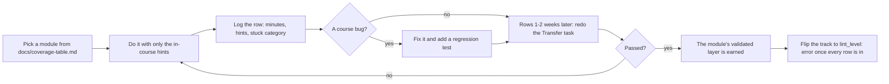

# Dogfood Log — doing the modules as the learner

Every module at Tier 1 parity has been *done by the author*, end to end, with only the in-course
hints, and the result logged here. This is Layer 4 (Validated) of the parity contract in
[`docs/QUALITY_SPEC.md`](QUALITY_SPEC.md): `scripts/module_parity.py` credits a module's
`dogfood_logged` item when its id appears in the first column below, and nothing else can earn it.

## Rules that keep it honest

1. On the first pass use **only** the in-course hints — no looking at the solution, no outside help.
2. Do the Transfer task again **after a delay** (a week or two). Passing it straight after the worked
   example proves little; the delayed attempt is the one that counts.
3. Every course bug you hit becomes a fix **and** a regression test, not just a quiet edit.
4. A track does not flip to `lint_level: error` until its whole log is complete **and** the worst
   modules have been revised.
5. These times are labelled **author-dogfood**. They are useful, but you wrote the course, so you are
   not a typical beginner. A beginner pilot is a separate, later step with its own numbers.

## Columns

`minutes` is total time to finish the module's exercise and Gate test. `hints` is how many of the
3-step ladder you unlocked (0-3). `stuck` is the category you got stuck in — `concept`, `units`,
`tool`, `setup`, or `none`. `course bug?` is `yes`/`no`, with the fix noted in the commit that made
it. `transfer later` is `pass`, `fail`, or `-` until the delayed attempt happens.

## Log

| Module | Date | Minutes | Hints (0-3) | Stuck | Course bug? | Transfer later |
| :--- | :--- | :---: | :---: | :--- | :--- | :--- |
| `02-mechanics.T2.02a` | 2026-10-16 | 13 | 0 | none | yes | - |

### Evidence, item by item
One "validated" flag hid four different claims. This table separates them, and a row is only as
strong as its weakest measured column:

| Standard | `02-mechanics.T2.02a` | Evidence |
| :--- | :--- | :--- |
| Content complete | met | 100% of the requirements instrumented today (`docs/coverage-table.md`) |
| Reference solution tested | met | `exercises/02-mechanics.T2.02a/solution.py` passes 14 unittest cases |
| Learner exercise behaviour-graded | met | `scripts/run_exercise.py` 12/12: starter fails, solution passes, 4 faults each fail their named test, print-only passes nothing |
| Browser workflow tested | met (browser) | `scripts/e2e_pages_bundle.mjs` drives `EX.02-mechanics.T2.02a` on the built bundle: starter fails on its hole, reference prints the PASS line, output badge MATCHED |
| Author first pass | met | the row above, 13 min, 0 hints |
| Delayed transfer | **pending** | `transfer later` is `-` until the 1-2 week retry |
| Independent learner | **not run** | no beginner pilot yet |

Rows above are **author-dogfood**: the author who wrote the module did its exercise and Gate test with
only the in-course hints. `02-mechanics.T2.02a` is the first row, added when it became the reference
module (the template every later module copies). Its `yes` in *course bug?* covers two fixes the run
found, both with a test: the two CI scripts that execute module python blocks had the shared plant
nowhere on `sys.path`, so a plant-wired module could not run on the runner at all, and the parity
scorer's `difficulty:` parser rejected the trailing `# comment` that `docs/QUALITY_SPEC.md` §2 writes
in its own example (`tests/test_module_parity.py` holds both halves).
