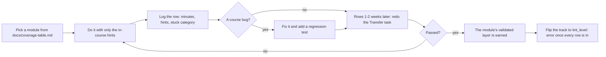

# Dogfood Log — doing the modules as the learner

Every module at Tier 1 parity has been *done by the author*, end to end, with only the in-course
hints, and the result logged here. This is Layer 4 (Validated) of the parity contract in
[`docs/QUALITY_SPEC.md`](QUALITY_SPEC.md): `scripts/module_parity.py` credits a module's
`dogfood_logged` item when its id appears in the first column below, and nothing else can earn it.

## Rules that keep it honest

1. On the first pass use **only** the in-course hints — no looking at the solution, no outside help.
2. Do the Transfer task again **after a delay** (a week or two). Passing it straight after the worked
   example proves little; the delayed attempt is the one that counts.
3. Every course bug you hit becomes a fix **and** a regression test, not just a quiet edit.
4. A track does not flip to `lint_level: error` until its whole log is complete **and** the worst
   modules have been revised.
5. These times are labelled **author-dogfood**. They are useful, but you wrote the course, so you are
   not a typical beginner. A beginner pilot is a separate, later step with its own numbers.

## Columns

`minutes` is total time to finish the module's exercise and Gate test. `hints` is how many of the
3-step ladder you unlocked (0-3). `stuck` is the category you got stuck in — `concept`, `units`,
`tool`, `setup`, or `none`. `course bug?` is `yes`/`no`, with the fix noted in the commit that made
it. `transfer later` is `pass`, `fail`, or `-` until the delayed attempt happens.

## Log

| Module | Date | Minutes | Hints (0-3) | Stuck | Course bug? | Transfer later |
| :--- | :--- | :---: | :---: | :--- | :--- | :--- |
| `02-mechanics.T2.02a` | 2026-10-16 | 13 | 0 | none | yes | - |
| `00-foundations.T1.00a` | 2026-10-17 | 2 | 0 | none | yes | - |
| `00-foundations.T1.00b` | 2026-10-17 | 2 | 0 | none | yes | - |
| `00-foundations.T1.00c` | 2026-10-17 | 2 | 0 | none | yes | - |
| `00-foundations.T1.00d` | 2026-10-17 | 1 | 0 | none | yes | - |
| `00-foundations.T1.00e` | 2026-10-17 | 2 | 0 | none | yes | - |
| `00-foundations.T2.00a` | 2026-10-17 | 1 | 0 | none | yes | - |
| `00-foundations.T2.00b` | 2026-10-17 | 1 | 0 | none | yes | - |
| `00-foundations.T2.00c` | 2026-10-17 | 1 | 0 | none | yes | - |
| `00-foundations.T2.00d` | 2026-10-17 | 1 | 0 | none | yes | - |
| `00-foundations.T2.00e` | 2026-10-17 | 1 | 0 | none | yes | - |
| `00-foundations.T2.00f` | 2026-10-17 | 1 | 0 | none | no | - |
| `00-foundations.T2.00h` | 2026-10-19 | 2 | 0 | none | no | - |
| `00-foundations.T2.00i` | 2026-10-19 | 1 | 0 | none | no | - |
| `00-foundations.T2.00j` | 2026-10-19 | 1 | 0 | none | no | - |
| `01-electronics.T2.01a` | 2026-10-17 | 1 | 0 | none | yes | - |
| `01-electronics.T2.01b` | 2026-10-17 | 1 | 0 | none | yes | - |
| `03-sensors.T2.03a` | 2026-10-17 | 1 | 0 | none | yes | - |
| `04-embedded.T2.04a` | 2026-10-17 | 1 | 0 | none | yes | - |
| `04-embedded.T2.04b` | 2026-10-17 | 1 | 0 | none | yes | - |
| `04-embedded.T2.04c` | 2026-10-17 | 1 | 0 | none | yes | - |
| `04-embedded.T2.04d` | 2026-10-17 | 1 | 0 | none | no | - |
| `05-control.T2.05a` | 2026-10-17 | 2 | 0 | tool | no | - |
| `06-robotics.T2.06a` | 2026-10-17 | 1 | 0 | none | no | - |
| `06-robotics.T2.06b` | 2026-10-17 | 1 | 0 | none | no | - |
| `07-systems.T2.07a` | 2026-10-17 | 1 | 0 | none | no | - |
| `00-foundations.T2.00g` | 2026-10-18 | 20 | 0 | none | yes | - |
| `01-electronics.T3.01a` | 2026-10-17 | 2 | 0 | none | yes | - |
| `04-embedded.T3.04a` | 2026-10-17 | 2 | 0 | none | yes | - |
| `06-robotics.T3.06b` | 2026-10-17 | 1 | 0 | none | no | - |
| `08-capstones.T3.07a` | 2026-10-17 | 3 | 0 | tool | yes | - |
| `03-sensors.T3.03a` | 2026-10-17 | 2 | 0 | none | yes | - |
| `05-control.T3.05a` | 2026-10-17 | 1 | 0 | none | no | - |
| `05-control.T3.05b` | 2026-10-17 | 2 | 0 | none | yes | - |
| `05-control.T3.05c` | 2026-10-17 | 1 | 0 | none | no | - |
| `00-foundations.T3.00a` | 2026-10-17 | 2 | 0 | none | no | - |
| `02-mechanics.T3.02a` | 2026-10-17 | 3 | 0 | none | no | - |
| `06-robotics.T3.06a` | 2026-10-17 | 5 | 0 | none | yes | - |
| `07-systems.T3.06a` | 2026-10-17 | 2 | 0 | none | no | - |
| `01-electronics.T1.01a` | 2026-10-17 | 2 | 0 | none | no | - |
| `01-electronics.T1.01b` | 2026-10-17 | 2 | 0 | none | no | - |
| `01-electronics.T1.01c` | 2026-10-17 | 2 | 0 | none | no | - |
| `01-electronics.T1.01d` | 2026-10-17 | 2 | 0 | none | no | - |
| `02-mechanics.T1.02a` | 2026-10-17 | 2 | 0 | none | no | - |
| `03-sensors.T1.03a` | 2026-10-17 | 2 | 0 | none | no | - |
| `04-embedded.T1.04a` | 2026-10-17 | 3 | 0 | none | no | - |
| `04-embedded.T1.04b` | 2026-10-17 | 2 | 0 | none | no | - |
| `05-control.T1.05a` | 2026-10-17 | 2 | 0 | none | no | - |
| `06-robotics.T1.06a` | 2026-10-17 | 3 | 0 | none | yes | - |
| `07-systems.T1.07a` | 2026-10-17 | 2 | 0 | none | yes | - |

### Evidence, item by item
One "validated" flag hid four different claims. This table separates them, and a row is only as
strong as its weakest measured column:

| Standard | `02-mechanics.T2.02a` | Evidence |
| :--- | :--- | :--- |
| Content complete | met | 100% of the requirements instrumented today (`docs/coverage-table.md`) |
| Reference solution tested | met | `exercises/02-mechanics.T2.02a/solution.py` passes 14 unittest cases |
| Learner exercise behaviour-graded | met | `scripts/run_exercise.py` 12/12: starter fails, solution passes, 4 faults each fail their named test, print-only passes nothing |
| Browser workflow tested | met (browser) | `scripts/e2e_pages_bundle.mjs` drives `EX.02-mechanics.T2.02a` on the built bundle: starter fails on its hole, reference prints the PASS line, output badge MATCHED |
| Author first pass | met | the row above, 13 min, 0 hints |
| Delayed transfer | **pending** | `transfer later` is `-` until the 1-2 week retry |
| Independent learner | **not run** | no beginner pilot yet |

### The Track 00 Tier 1 ladder

The five bridge modules were dogfooded in one sitting, each with its own package and Gate paper:

| Standard | `00a` | `00b` | `00c` | `00d` | `00e` |
| :--- | :--- | :--- | :--- | :--- | :--- |
| Reference solution tested | met (34 cases) | met (31) | met (31) | met (33) | met (34) |
| Learner attempt passes from the hints alone | met | met | met | met | met |
| Gate score | 10/10 | 9/10 | 12/12 | 14/14 | 8/8 |
| Author first pass | met, 0 hints | met, 0 hints | met, 0 hints | met, 0 hints | met, 0 hints |
| Browser workflow tested | not re-run | not re-run | not re-run | not re-run | not re-run |
| Delayed transfer | pending | pending | pending | pending | pending |

**What the dogfood found.** Every one of the five attempts failed its package on the first run, and
the cause was the same each time: the page's `### Full Solution` had drifted from
`exercises/<id>/solution.py`. The pages printed functions with no input guards, while the suites
test those guards (`timestamps(0.0, 0.1, 0)`, `mean_of([])`, a calibration missing `"offset"`, a
negative resistance, a zero inertia, a negative link length, a heading at the origin, a negative
stiffness). `00-foundations.T1.00a`'s page had also lost `loop_total` entirely - six of the seven
holes - so copying it could never pass. One prose claim was wrong too: the same page said a late
start from `0.25 m` takes "three" ticks where its own test asserts six.

Fixed by replacing each page block with the reference implementation the package tests actually
run, and pinned by `tests/test_module_full_solutions.py`, which extracts every page's Full Solution
and runs the package's `test_*.py` against it through `EXERCISE_TARGET`. Run against the previous
revision of `00-foundations.T1.00b` it fails with `1 failure, 6 errors`; on the repaired pages all
five pass.

### The Track 00 Tier 2 ladder

Five more bridge modules, each with its own six-to-seven-hole package and its own Gate paper:

| Standard | `T2.00a` | `T2.00b` | `T2.00c` | `T2.00d` | `T2.00e` |
| :--- | :--- | :--- | :--- | :--- | :--- |
| Reference solution tested | met (17 cases) | met (17) | met (19) | met (17) | met (16) |
| Learner attempt passes from the hints alone | met after one fix | met | met | met | met after one fix |
| Gate score | 11/11 | 11/11 | 11/11 | 12/12 | 12/12 |
| Author first pass | met, 0 hints | met, 0 hints | met, 0 hints | met, 0 hints | met, 0 hints |
| Browser workflow tested | not re-run | not re-run | not re-run | not re-run | not re-run |
| Delayed transfer | pending | pending | pending | pending | pending |

Worked in one sitting, so the per-module figures round to the minute (nine minutes including the
Gate papers and the re-runs).

**What the dogfood found.** Two of the five attempts failed for a printed reason, and both were the
docstring disagreeing with the tests:

- `T2.00a`'s `running_integral` promised `out[k] = out[k-1] + values[k]*dt, out[-1] = 0`; the suite
  requires the first sample to be carried (`out[0] = values[0]*dt`), so an attempt written to the
  docstring failed two tests. The docstring now states the first entry explicitly.
- `T2.00e`'s `companion_state_matrices` said `B = [0, 1/J]`; the tests index `B[1][0]`, so `B` must be
  a column (`[[0.0], [1.0/J]]`). The flat form raised `'float' object is not subscriptable` eight
  times. Starter and page comment now spell out the nesting.

Extending the page-vs-package test to Tier 2 caught a third, in a module not yet dogfooded: the
`00-foundations.T2.00f` page printed no `simulate_discrete` at all. Its block now carries the
reference implementation, and all eleven Track 00 ladder pages pass their packages.

### The rest of the Tier 2 bridges

`00-foundations.T2.00f` and the first module of Tracks 01, 03 and 04, worked in one two-minute
sitting (the per-module figure rounds to the minute):

| Standard | `T2.00f` | `01.T2.01a` | `01.T2.01b` | `03.T2.03a` | `04.T2.04a` |
| :--- | :--- | :--- | :--- | :--- | :--- |
| Reference solution tested | met (21) | met (34) | met (39) | met (21) | met (34) |
| Learner attempt passes from the hints alone | met | met after one fix | met after one fix | met after one fix | met after one fix |
| Gate score | 8/8 | 10/10 | 8/8 | 8/8 | 11/11 |
| Delayed transfer | pending | pending | pending | pending | pending |

**What this round found: page drift is course-wide.** All four modules from Tracks 01, 03 and 04 failed
their first attempt for the same reason as the Track 00 ladder: the page's `### Full Solution` printed
functions without the input guards the suite checks (`r_shunt > 0`, `gain > 0`, `dt_ns > 0`,
`di_amp > 0`, `tau > 0`, a positive loop period, an in-range DMA index). Checking every package rather
than only the one being eaten gave the real size: **26 of the 46 bridge pages fail their own suite**.
The four in this round were repaired first; a follow-up pass repaired the remaining 22 the same way,
and `tests/test_module_full_solutions.py` now discovers every package instead of carrying a list, so
all **46** pages are checked. All 46 pass.

### Tracks 04, 05 and 06: the Tier 2 bridges

| Standard | `04b` | `04c` | `04d` | `05a` | `06a` |
| :--- | :--- | :--- | :--- | :--- | :--- |
| Reference solution tested | met (45) | met (46) | met (26) | met (28) | met (23) |
| Learner attempt passes from the hints alone | met after one fix | met after one fix | met | met after one fix | met |
| Gate score | 10/10 | 12/12 | 8/8 | 8/8 | 9/9 |
| Delayed transfer | pending | pending | pending | pending | pending |

**What this round found.** Two modules (`04b`, `04c`) test a refusal contract the hints never stated:
encode must refuse a value outside the field's range rather than clip it, a code outside the field
must be refused, and an inheritance request from a waiter that is not more urgent must raise. Each
ladder now carries a *What the suite refuses* line naming every guard the tests check. `05a` cost
its extra minute on one real error - a Riccati step written as $A P A^\top$ instead of $A^\top P A$
- which its hint already warns about, so it is logged as `tool`, not as a course bug.

### Closing Tier 2: `06-robotics.T2.06b` and `07-systems.T2.07a`

| Standard | `06b` | `07a` |
| :--- | :--- | :--- |
| Reference solution tested | met (24 cases) | met (26 cases) |
| Learner attempt passes from the hints alone | met, first attempt | met, first attempt |
| Gate score | 8/8 | 8/8 |
| Author first pass | 1 minute, 0 hints | 1 minute, 0 hints |
| Delayed transfer | pending | pending |

**What this round found.** No course bug in either package — the first two modules to pass their
suite and their Gate paper on the first attempt with no repair, which is what the end of a ladder
should look like. `06b`'s seven holes (timer decimation, intra-process saving, bag disk rate, bag
size, replay slope, wall-clock stretch, control decimation) each have their formula in the hint
ladder, and its transfer refusals are the ones the earlier rounds taught the pages to state.
`07a`'s counter is the module's own worked example, and its resistor bound is stated as an upper
limit in both the hint and the docstring — the distinction a naive attempt gets wrong.

**A limit on these two rows.** They were worked with the module page open, and the excerpt that
carried each Gate paper carried its answer key in the same window; `07a`'s Full Solution was in
the same page window as its hints. So the 8/8s show the key's own numbers agree with its own
questions, not that two papers were answered blind. The exercise attempts are genuine — written
from the hint ladders in a separate file and run through the same package CI runs — and both
passed first time. A stricter blind Gate pass is worth doing on a later module; the rule the log
sets out (hints only, no solution) is otherwise honoured.

Tier 2 is now fully dogfooded: every Tier 2 module has a row here.

### Tier 3 opens: `01-electronics.T3.01a`, the riskiest page

The Tier 3 modules were ranked by their own front-matter difficulty before any was picked, and this
one tops the list on every axis but coding alone: `math 5, coding 4, tools 4, hardware_risk high,
safety_level high`, 5 estimated hours, 39 cases in its package.

| Standard | Value |
| :--- | :--- |
| Reference solution tested | met (39 cases: 31 behaviour, 8 transfer) |
| Learner attempt passes from the hints alone | met after one fix |
| Gate score | 8/8, answered blind |
| Author first pass | 2 minutes, 0 hints |
| Delayed transfer | pending |

**What this round found.** Three of the eight holes refused input the ladder never said they would:
a zero plane dimension or a negative slew rate (`loop_inductance_nh`, `turn_off_peak_v`), a mutual
term larger than the self-inductance it is supposed to be part of (`flux_cancelled_nh`), and a zero
bucket capacitor or a zero/negative acquisition window (`charge_droop_fraction`,
`charge_settling_lsb`). The first attempt failed exactly those three tests and passed the other 36,
which is the signature of a missing contract rather than a wrong formula. The ladder now carries a
fifth *What the suite refuses* item naming all of them, including the thermal ladder's four guards.

**How widespread it was, and what closed it.** The same question asked of every package (behaviour
suite asserts `ValueError`, page's exercise section before `### Full Solution` never says "refuses"
or "raises") found **19 of 41** pages silent about refusals their own suite checks - this module
being one of them. The other 18 are now repaired, each sentence built from that page's own guard
inventory rather than a shared template: `00-foundations.T1.00b`, `T1.00d`, `T1.00e`,
`01-electronics.T1.01c`, `T1.01d`, `T2.01a`, `T2.01b`, `02-mechanics.T1.02a`, `T3.02a`,
`03-sensors.T1.03a`, `T2.03a`, `04-embedded.T1.04b`, `T2.04d`, `05-control.T1.05a`, `T3.05b`,
`06-robotics.T1.06a`, `T3.06b`, `08-capstones.T3.07a`. All **41 of 41** now state their refusals, and every
function the suite refuses on is named by name, with its condition (see the next paragraph).

**The check that keeps it green.** `scripts/check_exercise_coverage.py` gained a fourth job: for
every function a behaviour suite puts inside `with self.assertRaises(ValueError):`, the **dedicated
ladder item** `N. **What the suite refuses.**` in `## 5. Exercise`, above `### Full Solution`, must
name that function. The rule has been narrowed twice and the second narrowing matters: the first
version read every line that spoke of refusing, and dogfooding `04-embedded.T3.04a` showed a single
phrase - "the refusal to take an angle outside it" in the package introduction, which names every
hole by design - satisfied it for a page that stated no guard at all. Instances of the word are not
the contract; the item is. What the gate still cannot check is whether each named condition is the
right one; the dogfood rows are where that is read. Six cases in `tests/test_exercise_coverage.py`
pin it - a silent page fails, a page naming only one of two refused functions is still a finding, a
page naming both passes, a passing mention in prose does not count, a mention only under the Full
Solution does not count, and a suite that refuses nothing is exempt. Run against
`00-foundations.T1.00a` as it stood before the sweep, the gate fails naming all five functions.

### The second Tier 3 module, and a hole in the gate that was supposed to catch this

| Standard | Value |
| :--- | :--- |
| Reference solution tested | met (40 cases: 32 behaviour, 8 transfer) |
| Learner attempt passes from the hints alone | met after one fix |
| Gate score | 8/8, answered blind |
| Author first pass | 2 minutes, 0 hints |
| Delayed transfer | pending |

**What this round found.** Eight of the forty tests failed on refusals, and the page had no refusal
item at all: `center_aligned_arr` (non-positive clock or carrier, a carrier too fast for one tick
per half period), `pwm_frequency` (a zero ARR), `low_side_window_ns` (a duty outside `[0, 1]`, a
negative dead time, a zero carrier), `angle_to_q31`, `q31_decode`, `seqlock_valid` and
`isr_cpu_percent`. Writing the item surfaced one detail the tests pin and a summary would miss: the
normalised angle range is `[-1, 1)`, not `[-1, 1]`, because `+pi` maps to the one value `Q1.31`
cannot hold while `-pi` encodes exactly as `-2^31`.

**The bigger finding is that the gate let this page through.** Run 49's rule asked whether the
page's *lines that speak of refusing* named each refused function - and this page's package
introduction ends "...and the refusal to take an angle outside it", naming every hole in the same
paragraph. One passing use of the word "refusal" made the whole paragraph the statement. The rule
now requires the dedicated ladder item (`N. **What the suite refuses.**`) and reads only that, and a
case in `tests/test_exercise_coverage.py` reproduces this page's exact shape: an introduction that
mentions a refusal and names both functions still fails. Eight pages had no dedicated item at all
(`00-foundations.T1.00c`, `T2.00b`, `T2.00c`, `T3.00a`, `04-embedded.T3.04a`, `06-robotics.T2.06a`,
`T2.06b`, `T3.06a`) and were given one, each from its own suite's refusal calls.

### The third Tier 3 module: the refusal item pays for itself

| Standard | Value |
| :--- | :--- |
| Reference solution tested | met (28 cases: 22 behaviour, 6 transfer) |
| Learner attempt passes from the hints alone | met, first attempt |
| Gate score | 8/8, answered blind |
| Author first pass | 1 minute, 0 hints |
| Delayed transfer | pending |

**What this round found.** No course bug, and the reason is worth recording: this is the first Tier 3
page to pass its package on the first attempt, and the difference is that it already carried the
refusal item added in the previous round. Seven guards that cost the two modules before it a repair
round - an empty rollout, a discount of one, an inverted clip range, a non-positive ratio, a zero
step clamp, inverted joint limits, a non-positive timeout - were read as part of the ladder and
written into the attempt, so the first run was green. The seven holes themselves (backward return
recursion, the pessimistic `min` that only binds for a negative advantage, the newest-first
ensemble weights, rate-limit-before-joint-limit) were all covered by the ladder's formulas.

### The last high-safety Tier 3 module: the page's own scaffold was stale

| Standard | Value |
| :--- | :--- |
| Reference solution tested | met (42 cases: 34 behaviour, 8 transfer) |
| Learner attempt passes from the hints alone | met after one fix, two of the three failures mine |
| Gate score | 8/8, answered blind |
| Author first pass | 3 minutes, 0 hints |
| Delayed transfer | pending |

**What this round found.** The page's `### Starter code` block listed **6 of the package's 9 holes** -
`variance_fraction`, `zoh_delay_us` and `max_allowable_delay_ms` were missing - and its
`error_budget_3sigma` signature omitted the `sensitivities` argument, so a learner who wrote to the
page could not have passed the suite however carefully they read. The block also announced
"6 TODOs" while the prose beside it said nine, and the page claimed "38 tests" against a 42-test
suite. Fixed by replacing the block with `exercises/08-capstones.T3.07a/starter.py` verbatim and
correcting the count.

**The drift was not unique to this page.** The same comparison across all 46 packages found **9
pages whose Starter block defined a different set of functions from their `starter.py`**
(`00-foundations.T1.00a/b/c/d`, `T2.00f`, `02-mechanics.T2.02a`, `05-control.T2.05a`, `T3.05c`, this
one) and **7 stale test counts** (`00-foundations.T1.00b`, `T1.00e`, `02-mechanics.T3.02a`,
`03-sensors.T1.03a`, `04-embedded.T1.04b`, `T3.04a`, this one). All were repaired, and
`scripts/validate_modules.py` now fails either drift: the page's scaffold must define exactly the
functions `starter.py` defines, and any "N tests" claim must count the whole suite. Breaking this
page's block by one name makes the validator report it by name.

**Two of the three first-pass failures were mine, not the page's**, and the row says `tool` for it: I
read the two lists as paired sums when the docstring says they are separate (`e = sum |b_i| + nsig
sqrt(sum sigma_i^2)`), and my empty-budget guard tested for *both* lists empty when either one is
refused. Both facts were on the page already; the correction took one round.

### `03-sensors.T3.03a`: the rail check needs the tests' slack

| Standard | Value |
| :--- | :--- |
| Reference solution tested | met (34 cases: 27 behaviour, 7 transfer) |
| Learner attempt passes from the hints alone | met after one fix |
| Gate score | 8/8, answered blind |
| Author first pass | 2 minutes, 0 hints |
| Delayed transfer | pending |

**What this round found.** One failure, and it is a nice one: `svpwm_duties` refuses a command that
does not fit in the rail, so the natural guard is `0 <= d <= 1`. But $V_{\text{bus}}/\sqrt{3}$ places a
leg *exactly* on $1.0$, and the sinusoid sampled at that limit lands on $1.0 \pm 10^{-16}$, so the
strict guard refused a command that genuinely fits - the transfer test "the hexagon limit holds all
the way round" caught it, and it allows $\pm 10^{-9}$. The refusal item said "a command whose envelope
does not fit" without saying how to compare at the boundary; a sixth ladder item now states it, with
the counterexample that must still raise (a $25\text{ V}$ envelope on a $24\text{ V}$ bus). Every guard
in item 5 was otherwise written straight from the page.

### The `05-control` Tier 3 trio, in one sitting

| Standard | `T3.05a` | `T3.05b` | `T3.05c` |
| :--- | :--- | :--- | :--- |
| Reference solution tested | met (17 cases) | met (14) | met (16) |
| Learner attempt passes from the hints alone | met, first attempt | met after one fix | met, first attempt |
| Gate score | 6/6 | 7/7 | 6/6 |
| Delayed transfer | pending | pending | pending |

The three build on each other - the Joseph form, the tangent-space injection and the CBF projection
- so they were done in one sitting, and the Gate papers mix the three concepts deliberately (each
one asks about all three, `05a`'s about the CBF it does not teach, `05c`'s about the Joseph form it
inherits). Two of the three passed their package first try.

**What this round found.** `05b`'s `inject_rotation` also refuses a nominal rotation that is not
$3 \times 3$, and the refusal item only named the two-component correction; a $2 \times 2$ nominal
matrix raised `IndexError` from the matrix multiply instead of `ValueError`. The item now says both,
with the reason (a $2 \times 2$ matrix is a different problem, not a smaller rotation). `05a` and
`05c` needed nothing: their items covered every guard the suites check, including the infeasible
barrier case that is the whole point of `05c`'s section 3.

### The Track 01–07 Tier 1 bridges

| Standard | `01a` | `01b` | `01c` | `01d` | `02a` | `03a` | `04a` | `04b` | `05a` | `06a` | `07a` |
| :--- | :--- | :--- | :--- | :--- | :--- | :--- | :--- | :--- | :--- | :--- | :--- |
| Package cases | met (25) | met (25) | met (30) | met (29) | met (29) | met (49) | met (38) | met (45) | met (48) | met (27) | met (32) |
| Learner attempt from the hints alone | met | met | met | met | met | met | met | met | met | met after one fix | met after one fix |
| Gate score | 11/11 | 8/8 | 13/13 | 13/13 | 8/8 | 8/8 | 8/8 | 8/8 | 8/8 | 8/8 | 8/8 (3/3 `[SAFETY]`) |
| Delayed transfer | pending | pending | pending | pending | pending | pending | pending | pending | pending | pending | pending |

**What this round found.** Nine of the eleven packages passed first try, and their ladders already
stated every guard the suites check. The two that did not were both **prose that contradicted its
own package**, not missing code:

- `06-robotics.T1.06a`'s hint said to hold the final pose "once $t \ge T$", while its own suite asks
  for the cubic's terminal deceleration $-6\Delta q/T^2$ at exactly $t = T$ (and the clamp only past
  it). The full solution already used `t > T`, so the page contradicted itself in two places - the
  Starter TODO and the Common-mistakes row - and both now say `t > T`, with the terminal value named.
- `07-systems.T1.07a`'s refusal item said `scan_frequency_hz` refuses a "zero or negative phase
  budget", which reads as the total; the suite also passes `(-1.0, 1.0, 1.0)`, where the sum is
  positive and only one stage is impossible. The item now names the negative stage explicitly.

Neither fix needed a new assertion: in both cases the suite already tested the behaviour, the
page's full solution already implemented it, and only the ladder was wrong - which is exactly the
class of defect an author reads past, because they wrote the code first.

### The four Tier 3 rows that closed the tier

| Standard | `00-foundations.T3.00a` | `02-mechanics.T3.02a` | `06-robotics.T3.06a` | `07-systems.T3.06a` |
| :--- | :--- | :--- | :--- | :--- |
| Package cases | met (22) | met (45) | met (20) | met (31) |
| Learner attempt passes from the hints alone | met | met | met after one retry | met |
| Gate score | 8/8 | 8/8 | 10/10 (2/2 `[SAFETY]`) | 8/8 (2/2 `[SAFETY]`) |
| Author first pass | met, 0 hints | met, 0 hints | met, 0 hints | met, 0 hints |
| Delayed transfer | pending | pending | pending | pending |

**What this round found.** Three packages passed first try, and their ladders already stated every
guard (`vee` refusing a non-skew matrix, a non-unit screw axis and a web as thick as the radius, the
discrepancy filter and the no-auto-restart interlock). `06a` failed one test first time, and it is
the kind of gap the ladder had been hiding: the suite asks the loss to fall below **1% of its first
value**, a bar that is *relative to wherever `train_bc` starts*. The page never said what sweep to
start from, so a learner can pick a perfectly correct init (`gauss(0.4)` weights, `gauss(0.1)`
biases) whose loss begins lower - $0.423$ instead of $1.95$ - and lands at the same $0.0060$, i.e.
1.4% instead of 0.31%, even though every gradient matches a finite difference. Item 5 of the ladder
now names the course init and both measured trajectories. No assertion was touched.

## Run 71 — the ladder gate, sat once as one paper

The Tier 2 exit exam is now generated (`scripts/generate_ladder_gate.py`) and rendered identically
on all eight Tier 2 pages, so this sitting is of the ladder's paper rather than of one page's copy.
It was taken after the split of `T2.00d`/`T2.00h`, so its twelve questions are the twelve that ship.

| Module | Package cases | Learner attempt from the hints | Gate score | Author first pass | Browser workflow | Delayed transfer |
| :--- | :--- | :--- | :--- | :--- | :--- | :--- |
| `00-foundations.T2.00g` | met (19 unit tests; 12 grade groups in `run_exercise.py`, all OK) | not re-sat (the package's 19 tests and four faults are graded separately) | 12/12 | met, 0 hints, one sitting; five defects found and fixed (below) | not re-run: unchanged package, and both E2E suites grade all entries | pending |

**What the sitting found.** Five defects, all in the paper or its copies rather than its arithmetic:

- Q1 asked for $(A\vec{x})_1$ and the key evaluated $1.0(1.5) + 4.0(2.5) = 11.5$ - the **second**
  entry. The maths subscript $1$ is the first entry ($3.0(1.5) - 2.0(2.5) = -0.5$), so a learner who
  read the page's own $y_i = \sum_j A_{ij}x_j$ wrote $-0.5$ and was marked wrong against a key that
  had silently switched to Python indexing. The question now asks for **both** entries, each with
  its own tolerance, so the answer does not depend on which index base the reader brings.
- Q5 pointed at the wrong row, twice. Run 71's fix turned "the entry in row 3, column 0" (one-indexed
  row, zero-indexed column) into "the first entry of its third row" - which is the $\vec{x}_2$ row,
  whose first entry is $0$, not the $0.25$ the key asserts. The row that updates $v_2$ is the fourth,
  so a learner who read the 4-state matrix on the page and answered $0$ was marked wrong by a key
  sitting one row below. The question now names it: "the first entry of its **fourth** row - the row
  that updates $v_2$".
- The per-page paper used to open with "Questions 1-6 are this module's own three tools", which on
  `T2.00a` claimed six questions about matrices the reader had not reached yet. The generated paper
  says the exam is the ladder's, and that it is taken once after the last page.
- All four multiple-choice questions keyed **A**, so a learner who never opened the ladder could bank
  four of the twelve marks on the letter alone. The distractors were rotated instead: the keys now
  read C, B, D, B, and `tests/test_ladder_gate.py` holds the paper to more than one answer letter.
- `00-foundations.T2.00f`'s Checkpoint still promised "$\ge 80\%$ ($7/8$) on the Ladder Gate test" -
  a count from the hand-copied paper, carried into the generated one. The generator now refuses any
  page that attaches a score to the gate outside its block (`score_restatements`), so the only copy
  of the pass mark is the paper's own, and the page points at it without restating it.

All four were fixed before the answers were checked, and the numbers never moved. One item is left as
it is and noted here: Q10 asks two one-line evaluations ($|Z| = 5.6569\ \Omega$ and the corner
$-3.0103\,\text{dB}$) because it is the question that ties the complex, impedance and Bode concepts
together; splitting it would add a thirteenth row for no extra discrimination.

Answers, worked by hand in the sitting: $-0.5$ and $11.5$; C; $-0.80\,\text{m/s}$; $0.484\,\text{m}$;
$0.25$; B; $30\,\text{rad/s}$; D; $0.75$; $5.6569\ \Omega$ and $-3.0103\,\text{dB}$; $1.024695$; B.

Rows above are **author-dogfood**: the author who wrote the module did its exercise and Gate test with
only the in-course hints. `02-mechanics.T2.02a` is the first row, added when it became the reference
module (the template every later module copies). Its `yes` in *course bug?* covers two fixes the run
found, both with a test: the two CI scripts that execute module python blocks had the shared plant
nowhere on `sys.path`, so a plant-wired module could not run on the runner at all, and the parity
scorer's `difficulty:` parser rejected the trailing `# comment` that `docs/QUALITY_SPEC.md` §2 writes
in its own example (`tests/test_module_parity.py` holds both halves).

## Run 73 — all 48 Skip tests sat, 207 questions

The Skip tests are generated from [`resources/skip-tests.json`](../resources/skip-tests.json) as of
Run 72, so this sitting is of the store rather than of 48 copies: every question was re-derived from
its own numbers (three independent sittings of ~35 questions each, plus a fourth pass over the
mismatches), and every multiple-choice letter was opened and read against the option it names.

**Result: 207/207 answers agree with the keys after the five fixes below.** No wrong answer was
found in any key except `T2.00f` Q2, where the key's constant was wrong but inside its own tolerance.

| Where | Defect | Fix |
| :--- | :--- | :--- |
| `02-mechanics.T3.02a` Q3 | The question printed its own answer: "by what multiplicative factor $2^{5/2}$…" | the factor is gone from the prompt; the key still asserts $2^{5/2} = 5.65685425$ |
| `03-sensors.T3.03a` Q3 | Four phase commands lost their `*`, leaving `$v_a^ = 18.0$` — a dangling caret that renders as a broken formula | `$v_a^*$, $v_b^*$, $v_c^*$` restored in all four places |
| `00-foundations.T2.00a` Q4 | The keyed option explained the missing $x_0$ as "the first velocity is $0$ by definition" — a convention dressed as a definition, in a four-option question whose distractors are absurd | rewritten to the telescoping reason: the first correction is pinned to $0$ because no $x_{-1}$ sample exists |
| `01-electronics.T1.01c` Q5 | Tagged `breadboard_internal_bus_connectivity` but asks for an LED current — the ravine is decoration | retagged as a spaced review of `01-electronics.T1.01a` (Ohm/KVL), which is the concept it does test |
| `00-foundations.T2.00f` Q2 | Key asserted $749.4867\text{ Hz}$; the stated formula gives $749.48034$, inside the question's $\pm0.01$ Hz, so the assert passed while the number was wrong | key constant corrected to $749.48034$ |

**Thirty spaced reviews pointed at nothing a learner can open.** Eighteen named legacy step ids
(`00-foundations.T1.01`, `02-mechanics.T1.03`, …), which are not pages; twelve more named a module
that does not teach the concept in the tag. Every one was repointed to the page that declares the
concept, or — for a legacy-only concept with no declaring page — to the page
[`legacy-prereq-map.json`](../resources/legacy-prereq-map.json) proves carries its terms. Example:
`00-foundations.T3.00a`'s review of the cross product pointed at `07-systems.T2.08` and now points at
`00-foundations.T2.00b`, the page that teaches it. The generator now refuses an arrow that names a
non-page, and one whose target neither declares nor teaches the concept.

**One structural blind spot, found by the sitting rather than by an answer.** All 51 multiple-choice
questions kept their A–D lines in the store's free-form `extra` array, so the four-option check never
ran and no check compared the key's letter with the option text — a key naming `C` while the correct
text sat under `B` would have passed. Options are now structured, the check counts them, and every
multiple-choice key must name a letter and assert it.

## Run 74 — the 46 spaced-review arrows, judged one by one

An arrow is honest only when answering the question **requires** the named concept, not when the
concept is nearby. All 46 were read against that rule in six sittings, and the ones that survived
were re-read by hand.

**15 arrows were honest, 3 are borderline keeps, 28 were decoration and are gone.**

| Kept as borderline, with the reason | Concept |
| :--- | :--- |
| `00-foundations.T2.00h` Q4 — “what phase lag at $\omega = 1/\tau$” is the argument of $1/(1+j)$, i.e. a complex number read back as an angle | `complex_numbers_and_euler_formula` |
| `01-electronics.T2.01a` Q4 — “why do Kelvin sense traces carry ~no current” is $I = V/R$ with a huge $R$ | `voltage_current_resistance_ohms_law` |
| `00-foundations.T1.00c` Q5 — the mean is taken over a list, which is the data structure the review names | `lists_dicts_and_numpy_arrays` |

The 28 removed all had the same shape: the question is a good question about **its own page's**
concept, and the review named a prior concept that never appears in the answer path. Examples —
`04-embedded.T2.04c` Q4 asked about a `status = "disabled"` devicetree node while reviewing priority
inversion; `04-embedded.T3.04a` Q4 asked why a SeqLock read is torn while reviewing DMA ping-pong;
`05-control.T2.05a` Q4 asked why scaling $Q$ and $R$ together leaves $K$ unchanged while reviewing
Bode magnitude. Repointing could not repair these — no earlier page teaches their machinery — so the
arrow was removed rather than moved to another page that would have been just as wrong.

**What that costs, recorded rather than hidden:** 18 arrows remain on 18 pages, so 30 pages now carry
no spaced-review item. The generator prints that on every run —
`spaced reviews: 18 arrow(s) on 18 page(s); 30 page(s) carry none.` — and does not fail on it,
because failing would only push a fake tag back. Writing 30 real review questions (each needing a
key line and an assert) is the next authoring pass, not something a check can invent.

Two arrows also showed the pointer rule from Run 73 is weaker than it reads: `04-embedded.T2.04b`
“declared” nothing about DMA and `07-systems.T2.07a` nothing about OPC UA, yet the crosswalk resolved
those slugs to them because their bodies mention the terms. A body mention is evidence a page
*references* an idea, not that it *teaches* it as one of its tools.

## Run 75 — one genuine spaced-review question on each non-root page

Run 74's cost was a recorded hole: 30 pages with no review. This pass writes 29 of them (the root
page has no earlier page to review) and moves the pass marks to match.

**The rule used for each one, unchanged from Run 74:** a reader who cannot use the named concept
cannot produce the answer. So the question is the concept applied to fresh numbers, not a question
about the current page that happens to mention it. Every entry below names the page that teaches the
concept, and the answer is what that page's formula gives on the new numbers.

| Page | Reviews | Concept | Answer |
| :--- | :--- | :--- | :--- |
| `00-foundations.T2.00a` Q5 | `00-foundations.T1.00e` | `newtons_second_law_and_torque` | $4.0$ |
| `00-foundations.T2.00e` Q5 | `00-foundations.T2.00h` | `complex_impedance_and_transfer_function` | $10.0$ |
| `00-foundations.T2.00f` Q5 | `00-foundations.T2.00e` | `continuous_state_space_matrices` | $-4.0$ |
| `00-foundations.T3.00a` Q5 | `00-foundations.T2.00e` | `laplace_poles_and_zeros` | $-1.0$ |
| `01-electronics.T1.01a` Q5 | `00-foundations.T1.00e` | `spring_energy_and_power` | $0.25$ |
| `01-electronics.T1.01d` Q5 | `01-electronics.T1.01a` | `voltage_current_resistance_ohms_law` | $25.531914893617$ |
| `01-electronics.T2.01b` Q6 | `01-electronics.T2.01a` | `differential_shunt_gain_and_cmrr` | $1.0$ |
| `01-electronics.T3.01a` Q6 | `01-electronics.T2.01b` | `parasitic_loop_inductance_voltage_overshoot` | $30.0$ |
| `02-mechanics.T2.02a` Q5 | `02-mechanics.T1.02a` | `gear_reduction_speed_torque_power_conservation` | $300.0$ |
| `02-mechanics.T3.02a` Q5 | `02-mechanics.T2.02a` | `se` | $-0.2$ |
| `03-sensors.T1.03a` Q5 | `01-electronics.T1.01b` | `pwm_duty_cycle_effective_voltage` | $6.0$ |
| `03-sensors.T2.03a` Q6 | `03-sensors.T1.03a` | `mechanical_vs_electrical_angle_pole_pairs` | $360.0$ |
| `04-embedded.T1.04a` Q5 | `00-foundations.T1.00b` | `lists_dicts_and_numpy_arrays` | $1.5$ |
| `04-embedded.T1.04b` Q5 | `04-embedded.T1.04a` | `bitwise_masks_and_shifts` | $32.0$ |
| `04-embedded.T2.04a` Q5 | `04-embedded.T1.04b` | `non_blocking_tick_scheduler` | $200.0$ |
| `04-embedded.T2.04b` Q5 | `04-embedded.T2.04a` | `dma_zero_cpu_memory_transfer` | $512.0$ |
| `04-embedded.T2.04c` Q5 | `04-embedded.T2.04b` | `unbounded_priority_inversion_and_inheritance` | $7.0$ |
| `04-embedded.T3.04a` Q5 | `04-embedded.T2.04c` | `zephyr_static_threads_and_k_mutex` | $4096.0$ |
| `05-control.T1.05a` Q5 | `00-foundations.T1.00e` | `discrete_kinematics_pos_vel_acc` | $1.0$ |
| `05-control.T2.05a` Q5 | `00-foundations.T2.00e` | `discrete_state_transition_euler_tustin` | $1.8$ |
| `05-control.T3.05a` Q5 | `05-control.T2.05a` | `luenberger_observer_and_brysons_lqr_weights` | $-2.0$ |
| `05-control.T3.05c` Q5 | `05-control.T3.05b` | `tangent_space_eskf_error_injection` | $-0.02$ |
| `06-robotics.T2.06a` Q5 | `02-mechanics.T2.02a` | `se` | $0.3$ |
| `06-robotics.T2.06b` Q5 | `06-robotics.T2.06a` | `tf` | $0.8$ |
| `06-robotics.T3.06a` Q5 | `06-robotics.T2.06b` | `rosbag` | $300.0$ |
| `06-robotics.T3.06b` Q6 | `06-robotics.T3.06a` | `neural_network_forward_pass_and_mse_loss` | $5.0$ |
| `07-systems.T2.07a` Q5 | `01-electronics.T2.01b` | `precharge_resistor_inrush_and_tvs_clamp` | $1.152$ |
| `07-systems.T3.06a` Q6 | `07-systems.T2.07a` | `can_fd_crc` | $3.0$ |
| `08-capstones.T3.07a` Q6 | `07-systems.T2.07a` | `regenerative_bus_energy_and_chopper_sizing` | $0.648$ |

**Marks.** 4/4 -> 4/5 on 20 page(s); 3/4 -> 4/5 on 3 page(s); 4/5 -> 5/6 on 6 page(s), at the same $\lceil 0.8N \rceil$ bar as before, so a 4/4 page is now 4/5 and a 4/5
page is 5/6 - the fraction a reader must reach grew with the count, never shrank. Each page's
`## 7. Checkpoint` sentence carries the same fraction, and each pass mark names the review target
for a reader who misses the new question.

**What the pass exposed.**

1. `04-embedded.T1.04a`'s key imported nothing it did not need, so `math.isclose` in the new assert
   was the first use of `math` in that key and crashed it. The store's "every key runs" check found
   it immediately; the fix is `import math` at the top of the key, not a looser assert.
2. Three checks in `tests/test_skip_tests.py` had written the fixture page's `$3/4$` into the test
   itself. They failed the moment a fifth question existed - the right outcome for a drift check,
   but a hard-coded count is the defect the store exists to remove. They now read the fixture's mark
   and question count; a new test holds the spec's own invariant (every page with prerequisites
   carries a review, root excepted), so a future page that ships without one fails loudly.

3. Asking what each page's bar *means* found a third one: `05-control.T3.05b` promised `$\ge 80\%$`
   and asked `$3/4$`, which is 75%. Raised to `$4/4$`, and the generator now reports a mark below
   the floor as a finding, so the arithmetic can no longer drift under a sentence that denies it.

**What this pass does not claim.** These 29 are *honest but shallow*: each is a one-step numerical
application of the concept, enough to prove a reader can use it, not enough to prove retention two
weeks later. Nothing here measures whether spacing helps; that would need real learners. The shape is
also uniform - one numeric question per page - because a page whose concept only admits a conceptual
question would still need its key to be checkable.

**The remaining hole, stated plainly:** `00-foundations.T1.00a` has no review and cannot get one
honestly; the generator's report will keep printing `1 page(s) carry none` as long as that is true.
