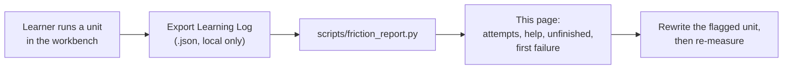

# Friction report — **no learning logs yet**

<!-- Generated by scripts/friction_report.py - do not edit by hand. -->

> **This page contains no data.** No exported learning log has been processed, so every
> measure below is undefined rather than zero: N = 0 learners, 0 events. The workbench's
> **Export Learning Log (.json)** button produces the input; this script turns it into the
> table a revision is planned from.

## What it will measure

| Measure | Red flag | Why that number |
| :--- | :--- | :--- |
| Attempts to verify (P50 / P80) | P80 > 8 | One learner in five needing nine runs means the lesson, not the learner |
| Help used (hint 3 or solution) | > 35% of opened units | The hint ladder is meant to be occasional |
| Unfinished at export | > 10% of opened units | A unit learners leave is a unit that lost them |
| Most common first failure | > 50% of first failures | One shared failure is a missing paragraph |
| Median time to first success | none set yet | A first sitting that takes an hour is a different course |

## Limitations

- Local only: a learner who clears browser storage, or exports before finishing, contributes a
  partial log. The report states how many events it saw for this reason.
- No identity, no timestamps beyond the event clock, no code. It cannot say who, only what.
- Thresholds are the pilot's, not a validated difficulty model; they move when data says so.
