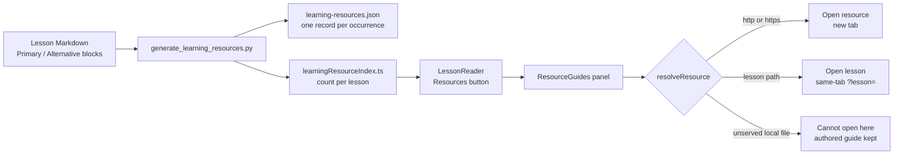

# Learning Resources — Phase 0 Repository Audit

**Status:** Phase 0 complete. The approved external-first Phase 1/2 slice, including internal lesson routing and explicit local-file fallback, is implemented; the embedded workspace remains deferred. See §10.
**Date:** 20 November 2026
**Plan:** `MechaLab Upgrade.txt` — Hybrid External Learning Workspace
**Scope reviewed:** `track-p`, `stage-0`, the eight numbered tracks, `modules`, `resources`, the reader payload pipeline, the workbench `.tsx` surface, the service worker, CI, and the existing link checker.

---

## 0. Executive summary

The plan's first phase asked for an architecture audit before any broad code changes. That audit is complete, and it found one blocker that changes the shape of the project:

> **The proposed embedded split view cannot ship as written under MechaLab's existing cross-origin isolation policy.** The document is served with `COEP: require-corp` so `SharedArrayBuffer` can back the in-place Python Stop/Pause controls. A cross-origin iframe must therefore send a compatible `Cross-Origin-Resource-Policy` (CORP) header. None of the P.1 resources does. The repository already documents this exact constraint in [`docs/VERIFICATION.md`](VERIFICATION.md) and [`docs/PLAN-2.0-GAP.md`](PLAN-2.0-GAP.md): "A link and not an `iframe` is a requirement, not a preference."

The rest of the audit is favourable to the plan:

- Lesson Markdown **is** a usable single source of truth. The lesson/module set contains **159 authored `Primary`/`Alternative` resource lines across 51 files** (**155 external links**), with **111 unique external URLs across 16 domains**.
- The generated reader payload and the workbench reader already render those sections as ordinary outbound links. There is no resource registry, resolver, reading-guide model, provider allowlist, or workspace yet.
- The P.1 pilot is smaller than the plan assumes: **4 resource entries, 2 unique URLs** (futurecoder and CS50P). P.1 does **not** cite `docs.python.org`; the official Python docs are cited elsewhere. The plan's "three pilot providers" should be corrected to "two providers and two unique URLs".
- The same URL can appear as both primary and alternative in one lesson with different instructions. P.1's futurecoder URL and CS50P URL each appear twice. The plan's `id = lessonId:shortHash(url)` would collide; the registry needs a stable **occurrence** identity or a merged guide with per-idea sections.
- A conservative, useful first release is still possible: generated registry + authored reading guides + an external resource card/launcher, using the existing browser split-view guidance. The iframe workspace should be deferred until a deliberate isolation decision is made and browser-tested.

The implemented slice is one generated read path, with three honest dispositions at the end of it:



**Phase 0 itself changed no app code, lesson Markdown, progress store, reader payload, or service worker.** Its additions were this report and the machine-readable inventory at [`learning-resources-domains.json`](learning-resources-domains.json). The approved follow-up is recorded in §10.

---

## 1. What exists today

| Layer | Current state | Consequence for the plan |
| :--- | :--- | :--- |
| Lesson content | Markdown pages under `track-p/`, `stage-0/`, numbered tracks, `modules/`, and `resources/`. The `## Learn` sections carry `Primary resource` / `Alternative resource` with `What to read`/`What to complete`, `What to skip`, and `Key takeaway`. | Authoritative source; do not create a second hand-maintained resource database. |
| Lesson registry | `scripts/generate_python_lessons_data.py` builds `app/src/data/pythonLessonsData.ts` from the same pages. It does **not** extract resources. | The plan can reuse `build_lessons()` for the lesson/path list, but the registry is a new generated artifact. |
| Reader payload | `scripts/generate_lesson_pages.py` copies page blocks to `app/public/lesson-pages/**/*.json`; `loadLessonPage()` fetches one page at a time. Resource bullets are ordinary blocks. | Resource data should be separate (lazy, per-lesson) rather than added to every reader payload or the entry bundle. |
| Reader UI | `LessonReader.tsx` renders the payload; `InlineMarkdown.tsx` turns links into `<a target="_blank" rel="noreferrer">`. A `Split view` button shows a tip telling the learner to open the resource in a new tab and use the browser's split view. | There is an existing, deliberate external-link path. An embedded workspace would be a new layer, not a replacement for the page text. |
| Link verification | `scripts/check_links.py` scans lesson/module pages, fetches URLs, verifies static-page headings, classifies SPAs (`futurecoder.io`, `falstad.com`, `phet.colorado.edu`, `wokwi.com/projects/...`), caches verdicts, and writes `LINK_REPORT.md`. | Reuse the parser, SPA knowledge, heading extraction, and cache. Do not make `prebuild` depend on the network. |
| Isolation | `app/public/sw.js` re-issues same-origin responses with `COEP: require-corp` and `COOP: same-origin`; Vite's dev/preview server sends the same pair. This is required for `SharedArrayBuffer` and the Python runtime's in-place Stop. | A cross-origin iframe without CORP is blocked. This is the blocker. |
| Base path | `vite.config.ts` uses `PAGES_BASE` (default `/Mechatronics-Roadmap/`); `lessonPageUrl()` uses `import.meta.env.BASE_URL`. | Any generated resource URL must respect the same base path. |
| Offline / service worker | Same-origin shell, assets, lesson registry, and Pyodide are cached; external sites are not. | Do not imply external resources work offline; do not cache third-party pages. |
| Tests / CI | `check_all.py`, `check:lessons`, link tests, reader tests, layout tests, browser suites, and a Pages deploy workflow. | A new registry needs a deterministic `--check` and a unit suite; it should not add network flakiness to CI. |

### 1.1 The P.1 pages, exactly

`track-p/P.1-variables-and-data-types.md` lines 61–73:

| Idea | Role | Resource | Authored guide |
| :--- | :--- | :--- | :--- |
| Idea 1: Storing values in named variables | Primary | futurecoder — "The Shell" and "Variables" (`https://futurecoder.io/course/#toc`) | Complete **The Shell**, **Variables**; skip String Basics, If Statements, For Loops, Lists, Functions; takeaway on assignment. |
| Idea 1 | Alternative | Harvard CS50P Lecture 0 Notes (`https://cs50.harvard.edu/python/2022/notes/0/`) | Read **Variables**, **Comments** (inline on the resource line). |
| Idea 2: Fundamental data types | Primary | Harvard CS50P Lecture 0 Notes (`https://cs50.harvard.edu/python/2022/notes/0/`) | Read **Formatting Strings**, **Integers or int**, **Float Basics**; skip Strings and Parameters, More on Strings, Def; takeaway on `int`/`float`/`str`/`bool`. |
| Idea 2 | Alternative | futurecoder — "String Basics" and "A Bit More About Strings" (`https://futurecoder.io/course/#toc`) | Complete **String Basics**, the **f-strings** page under **A Bit More About Strings**. |

Two consequences:

1. **The plan's P.1 provider list is inaccurate.** `docs.python.org` is not cited in P.1. The pilot is futurecoder + CS50P only.
2. **The plan's identity rule is insufficient.** Each unique URL occurs twice, with different reading instructions. A single `id` per URL would merge two distinct learning tasks. The registry should either:
   - key by `lessonId + ideaId + role + normalizedUrl` (a stable occurrence id), or
   - keep one resource record per URL with an array of guides, each carrying its idea/role.

The first is simpler for rendering and review; the second better matches "one resource, several uses". The audit recommends the occurrence id, with a `resourceKey` grouping field if a future view wants to collapse duplicates.

### 1.2 What does not exist

- No `app/src/features/learning-resources/` directory.
- No `learningResources.json` or generated resource type.
- No provider allowlist, URL safety helper, resolver, renderers, reading-guide model, or workspace.
- No resource-specific browser tests.
- No existing structured guide fields: the authored prose is in Markdown list items, and CS50P's headings sometimes sit inline on the resource line rather than in a child `What to read` bullet.

---

## 2. Inventory

### 2.1 Scope and method

The machine-readable inventory is [`learning-resources-domains.json`](learning-resources-domains.json). It records, for each domain, the reference count, unique URLs, and source files. Two scopes are included:

| Scope | Markdown files | URL references | Domains |
| :--- | ---: | ---: | ---: |
| Lesson/module citations (the same set as `check_links.py`) | 101 | 438 | 65 |
| All curriculum Markdown (adds READMEs and `resources/`) | 121 | 945 | 254 |

The **resource surface** — only the `Primary resource` / `Alternative resource` lines in the 101 lesson/module files — is the part the registry needs:

| Resource surface | Count |
| :--- | ---: |
| Lesson/module files with at least one resource line | 51 |
| Authored `Primary`/`Alternative` lines | 159 |
| External resource links | 155 |
| Unique external URLs (fragment stripped) | 111 |
| External domains | 16 |
| All resource links, including local links | 160 |
| Local/relative resource links (not external) | 5 |
| Lines requiring nested-bracket parsing | 1 |

The line that defeated the first quick parser is `06-robotics-and-autonomy/06.1-cubic-trajectories-and-compliant-joints.md:60`: its link title contains nested brackets (`("Unit interval [0, 1]")`). The tolerant parser used for the JSON handles it, but a naive parser drops the link; it is a parser regression fixture. The five local links are not failures: four name lessons and one is a Falstad import file. The registry keeps all five as `local` records; the panel resolves the four lesson paths to `?lesson=` routes and keeps the file visible with an explicit reason.

### 2.2 Resource domains (16)

| Domain | Entries | Typical role |
| :--- | ---: | :--- |
| `en.wikipedia.org` | 40 | Reference/definition |
| `learn.sparkfun.com` | 30 | Tutorial |
| `www.mathsisfun.com` | 22 | Explanation |
| `www.physicsclassroom.com` | 12 | Explanation |
| `cs50.harvard.edu` | 10 | Course notes |
| `docs.python.org` | 7 | Official docs |
| `hyperphysics.phy-astr.gsu.edu` | 6 | Reference |
| `docs.wokwi.com` | 6 | Tool docs |
| `futurecoder.io` | 6 | Interactive course |
| `phet.colorado.edu` | 4 | Simulation |
| `www.falstad.com` | 4 | Interactive circuit simulator |
| `hades.mech.northwestern.edu` | 3 | Textbook |
| `www.dynapar.com` | 2 | Encoder reference |
| `www.myphysicslab.com` | 1 | Simulation |
| `www.fbsbook.org` | 1 | Textbook |
| `betterexplained.com` | 1 | Explanation |

The 65-domain lesson citation count is larger because prose, figures, papers, and tool links are not resource entries. The 254-domain all-curriculum count also includes README tables, badges, package downloads, and local links. The registry should not treat every citation as a learning resource; the 16-domain surface is the authored resource model.

### 2.3 P.1 inventory

P.1 contributes 4 of the 159 authored lines and 2 of the 111 unique URLs. Both URLs are already in the link checker's scope:

- `futurecoder.io/course/#toc` is classified as an SPA. HTTP 200 only proves the app shell; the chapter names ("The Shell", "Variables", "String Basics", "f-strings") are `[verify in-app]` and must not be asserted as heading-verified.
- `cs50.harvard.edu/python/2022/notes/0/` returns HTTP 200 but redirects to `https://cs50.harvard.edu/python/notes/0/`. The authored URL is stale but working by redirect. The registry should either preserve the authored URL and record the final URL, or move to the canonical final URL in a separate content change. Do not silently rewrite lesson prose in a generated build.

---

## 3. Embedding compatibility matrix

### 3.1 Method and the decisive policy

The app is cross-origin isolated. In production the service worker adds:

```text
Cross-Origin-Embedder-Policy: require-corp
Cross-Origin-Opener-Policy: same-origin
Cross-Origin-Resource-Policy: cross-origin   # on the app's own responses
```

The same pair is sent by Vite dev/preview. This is not incidental: it is what allows `SharedArrayBuffer`, which the Python worker uses for in-place Stop/Pause. Removing it would change a core runtime guarantee.

Under `COEP: require-corp`, a cross-origin iframe must opt in with a compatible `Cross-Origin-Resource-Policy` (for example `cross-origin`). A site that sends no CORP is blocked even if it sends no `X-Frame-Options`. The repository already records this in two places:

- [`docs/VERIFICATION.md`](VERIFICATION.md): "A link and not an `iframe` is a requirement, not a preference: the document is isolated with `COEP: require-corp` for `SharedArrayBuffer`, and a cross-origin frame from a site that sends no CORP header renders as an empty box."
- [`docs/PLAN-2.0-GAP.md`](PLAN-2.0-GAP.md): the Wokwi iframe is "blocked outright" because neither Wokwi nor Tinkercad sends CORP.

The plan's "supported interactive resources can be embedded" must therefore be read as **YouTube's official player only**, unless the app's isolation strategy is deliberately changed or a separate non-isolated surface is introduced. No P.1 resource qualifies.

### 3.2 Point-in-time probe

Probe made from this VM with `urllib` and a normal browser User-Agent, following redirects. This is a header probe, not a browser embed test. Header values can change; the build-time verifier must re-check and record when.

| Example URL | HTTP | Final / notes | `X-Frame-Options` | CSP `frame-ancestors` | CORP | Verdict under this app |
| :--- | ---: | :--- | :--- | :--- | :--- | :--- |
| `futurecoder.io/course/` | 200 | no redirect | none | none | none | **Blocked by app COEP** (would need CORP) |
| `cs50.harvard.edu/python/2022/notes/0/` | 200 | redirects to `/python/notes/0/` | `SAMEORIGIN` | `'self'` | none | **Blocked by provider** |
| `docs.python.org/3/tutorial/` | 200 | — | none | none | none | **Blocked by app COEP** |
| `youtube-nocookie.com/embed/...` | 200 | official player endpoint | none | none | `cross-origin` | **Embeddable** (YouTube player only) |
| `www.youtube.com/watch?...` | 200 | watch page, not the player | `SAMEORIGIN` | none | none | Use the `-nocookie` player, not the watch page |
| `www.falstad.com/circuit/` | 200 | — | none | none | none | Blocked by app COEP |
| `phet.colorado.edu/en/simulations/...` | 200 | — | `SAMEORIGIN` | `'self' openstax.org *.openstax.org` | none | Blocked by provider |
| `wokwi.com/projects/` | 200 | redirects to login | none | none | none | Not embeddable (auth) |
| `learn.sparkfun.com/tutorials/capacitors` | 200 | — | `DENY` | none | none | Blocked by provider |
| `www.physicsclassroom.com/class/energy/...` | 200 | redirects to new tutorial path | none | none | none | Blocked by app COEP |
| `www.mathsisfun.com/physics/power.html` | 200 | — | none | none | none | Blocked by app COEP |
| `hyperphysics.phy-astr.gsu.edu/hbase/work.html` | — | TLS certificate hostname mismatch | unknown | unknown | unknown | **Unknown**; do not embed |
| `en.wikipedia.org/wiki/Damping` | 200 | — | none | no `frame-ancestors` | none | Blocked by app COEP |
| `www.allaboutcircuits.com/textbook/direct-current/` | 200 | — | `SAMEORIGIN` | none | none | Blocked by provider |
| `www.myphysicslab.com/springs/single-spring-en.html` | 200 | — | none | none | none | Blocked by app COEP |
| `www.3blue1brown.com/topics/differential-equations` | 200 | redirects to `/?topic=...` | none | none | none | Blocked by app COEP |
| `betterexplained.com/articles/...` | 200 | — | `SAMEORIGIN` | none | `cross-origin` | Blocked by provider (XFO) |
| `hades.mech.northwestern.edu/index.php/Modern_Robotics` | 200 | — | none | none | none | Blocked by app COEP |
| `ocw.mit.edu/courses/2-003sc-engineering-dynamics-fall-2011/` | 200 | — | none | none | none | Blocked by app COEP |
| `underactuated.mit.edu/` | 200 | — | none | none | none | Blocked by app COEP |
| `www.fbsbook.org/` | 200 | redirects to `fbswiki.org` | none | none | none | Blocked by app COEP |
| `databookuw.com/` | 200 | — | `SAMEORIGIN` | none | none | Blocked by provider |
| `www.ti.com/lit/pdf/slva689` | 200 | redirects to PDF | `SAMEORIGIN` | `ti.com` family | none | Blocked by provider |

**P.1 result: 0 of 2 unique resources is embeddable in the current app.** CS50P forbids framing; futurecoder would need a CORP opt-in that it does not send. The plan's "embedded workspace" has no P.1 content to demonstrate.

### 3.3 Why a browser test is still required before any iframe

The header matrix is necessary but not sufficient. If the plan later chooses a non-isolated or credentialless surface, verify:

- the frame actually renders (not an error page) and the console has no COEP/CSP errors;
- navigation inside the frame works without breaking the parent's history;
- the parent remains cross-origin isolated and Python Stop/Pause still work;
- Safari and Firefox behave like Chromium (credentialless and COEP support are not uniform);
- the provider's terms allow the embedding, not merely its headers.

No browser embed test was run in Phase 0. The repository's existing documentation is treated as the authoritative prior finding.

---

## 4. Licensing matrix

This is a **permission-to-reproduce** audit, not a legal opinion. Reader Mode (any local snapshot, excerpt, or adaptation) remains deferred. The safe default for every resource is: **link out, show the authored guide, never rehost the content**.

| Provider | Material in the course | License / terms | Reproduction / adaptation | Embedding | Phase 0 decision |
| :--- | :--- | :--- | :--- | :--- | :--- |
| futurecoder | Interactive Python course | Repository code: MIT (`github.com/alexmojaki/futurecoder`). Confirm asset-level exceptions before copying prose or images. | Do not copy course prose into the app until confirmed. | Header-permitted, but blocked by app COEP. | Link + guide only. |
| Harvard CS50P | Lecture notes | CC BY-NC-SA 4.0 (`cs50.harvard.edu/python/license/`) | Attribution, non-commercial, share-alike; not suitable for un-attributed Reader Mode excerpts. | `X-Frame-Options: SAMEORIGIN` and `frame-ancestors 'self'` — forbidden. | Link + guide only. |
| Python docs | Language/library docs | PSF License v2 (`docs.python.org/3/license.html`) | Reproduction allowed with the PSF notice; still requires attribution and care. | Header-permitted, but blocked by app COEP. | Link + guide only; Reader Mode deferred. |
| YouTube | Videos | YouTube Terms (`youtube.com/t/terms`) | No downloading or rehosting; use the official player. | Official `youtube-nocookie.com/embed/` player sends CORP: cross-origin. | The only verified embeddable renderer; use a click-to-load facade, never a raw watch-page iframe. |
| SparkFun | Tutorials | Terms not audited (`sparkfun.com/terms`) | Unknown. | `X-Frame-Options: DENY`. | Link only. |
| PhET | Simulations | Licensing page (`phet.colorado.edu/en/licensing`) — not audited in detail | Unknown; do not copy simulation assets. | Provider forbids framing. | Link only. |
| Wikipedia | Reference articles | CC BY-SA 4.0 (`en.wikipedia.org/wiki/Wikipedia:Copyrights`) | Attribution/share-alike if adapted; do not imply endorsement. | No CORP; blocked by app COEP. | Link + guide only. |
| Physics Classroom | Tutorials | Terms not audited | Unknown. | No CORP; blocked by app COEP. | Link only. |
| MathsIsFun | Explanations | Terms not audited | Unknown. | No CORP; blocked by app COEP. | Link only. |
| AllAboutCircuits | Textbook | Terms not audited | Unknown. | XFO SAMEORIGIN. | Link only. |
| MyPhysicsLab | Simulations | Terms not audited | Unknown. | No CORP; blocked by app COEP. | Link only. |
| BetterExplained | Articles | Terms not audited | Unknown. | XFO SAMEORIGIN (despite CORP). | Link only. |
| Hades / Modern Robotics | Textbook | Copyright; free preprint/videos | Do not rehost. | No CORP. | Link only. |
| MIT OCW | Course | OCW terms; likely CC BY-NC-SA, verify | Do not copy without attribution/license review. | No CORP. | Link only. |
| Underactuated Robotics | Textbook | Copyright; free online | Do not rehost. | No CORP. | Link only. |
| FBS / Åström–Murray | Textbook | Copyright; free PDF | Do not rehost. | No CORP. | Link only. |
| DataBook | Textbook | Copyright; free PDF | Do not rehost. | XFO SAMEORIGIN. | Link only. |
| TI | Application notes | TI terms | Do not rehost. | XFO/frame-ancestors restrict to TI. | Link only. |

**Reader Mode remains out of scope.** None of the P.1 material has been cleared for local reproduction. A future Reader Mode needs a per-resource license decision and an attribution surface; it cannot be inferred from "free to read".

---

## 5. Existing and proposed pipelines

### 5.1 Existing pipeline

```text
lesson Markdown
   ├─ generate_python_lessons_data.py ──> app/src/data/pythonLessonsData.ts (lesson registry, no resources)
   └─ generate_lesson_pages.py ─────────> app/public/lesson-pages/**/*.json
                                              │
                                     loadLessonPage(path)
                                              │
                                        LessonReader.tsx
                                              │
                                     InlineMarkdown <a target="_blank">
                                              │
                                        external site (new tab)

check_links.py ──> URL + heading verdicts / LINK_REPORT.md
```

### 5.2 Plan's proposed pipeline

```text
Markdown ──> resource extractor ──> learningResources.json ──> resolver ──> renderer/workspace
                                                                      ├─ native
                                                                      ├─ iframe
                                                                      ├─ reader
                                                                      └─ external
```

### 5.3 Audit-recommended pipeline (external-first, if approved)

```text
lesson Markdown (authoritative)
   └─ scripts/generate_learning_resources.py
        ├─ reuses generate_python_lessons_data.build_lessons() for ids/paths
        ├─ reuses check_links.py parsing rules for URLs/headings
        ├─ emits app/src/data/learningResources.json (deterministic)
        └─ --check fails when the registry differs

learningResources.json
   └─ pure resolver (provider allowlist + verified embed state + safety)
        ├─ YouTube native facade (only verified embeddable provider)
        ├─ external card + reading guide + open-in-new-tab/split-view tip
        └─ no iframe for P.1

LessonReader.tsx
   └─ resource entry point → reading guide panel/card → external site
```

The registry must be generated; it must not be a second manually maintained list. The resolver must be pure and testable without a browser. The authored guide must render even when no provider can be embedded.

---

## 6. Phase 0 file-by-file proposal (for review; §10 records the implemented subset)

The external-first slice implements the generator, JSON, index, panel, registry, resolver, and test
rows below, and the two documentation rows it owes: the isolation decision and drift gate are in
[`docs/VERIFICATION.md`](VERIFICATION.md), and the authoring contract is §8 of
[`docs/QUALITY_SPEC.md`](QUALITY_SPEC.md). The provider/renderer rows remain deferred with Phase 3.

### New files

| File | Purpose |
| :--- | :--- |
| `scripts/generate_learning_resources.py` | Parse `Primary`/`Alternative` entries from the same lesson list as `generate_python_lessons_data.py`; emit a deterministic registry; `--check` for CI. No network. |
| `app/public/learning-resources.json` | Generated registry, served on demand: occurrences, guides, provider keys, resource URLs, source path/line, verification state. |
| `app/src/data/learningResourceIndex.ts` | Small generated id → resource-count map; the reader imports this, not the full registry. |
| `app/src/features/learning-resources/types.ts` | `ResourceOccurrence`, `ReadingGuide`, `Provider`, `EmbedState`, `ResolvedResource` types. |
| `app/src/features/learning-resources/providers.ts` | Explicit provider allowlist and host matching. Unknown hosts are external-only. |
| `app/src/features/learning-resources/urlSafety.ts` | `http`/`https` only, no `javascript:`, no credentials in URLs, no arbitrary host interpolation. |
| `app/src/features/learning-resources/resolveResource.ts` | Pure resolver: embed state + provider + user choice → `native` / `iframe` / `reader` / `external`; external fallback always available. |
| `app/src/features/learning-resources/ResourceGuides.tsx` | Panel and cards: title, provider, reading guide, external/internal action, status, and an explicit local-file reason. |
| `app/src/features/learning-resources/registry.ts` | Types, lazy loader, and validation for the generated public JSON. |
| `app/src/features/learning-resources/resolver.ts` | Pure external/internal/unavailable resolver and http(s) URL safety guard. |
| `scripts/test_learning_resources.mjs` | Resolver, URL-safety, and committed-registry loader tests. |
| `tests/test_learning_resources.py` | Generator determinism, P.1 occurrence IDs, duplicate-URL guides, nested-bracket link, local-link classification. |

### Modified files (after approval)

| File | Change |
| :--- | :--- |
| `package.json` | Add `generate:resources`, `check:resources`, `test:resources`; ensure `predev`/`prebuild` run the generator **without network**. |
| `.github/workflows/ci.yml` / `scripts/check_all.py` | Add the deterministic `--check` and unit suite. Do not add a live embed probe to CI. |
| `app/src/components/LessonReader.tsx` | Mount a resource entry point only when the current lesson has a registry record. Do not alter reading position, notes, or progress. |
| `app/src/index.css` | Only if the approved panel/card needs tokens; reuse existing `bg-panel`, `border-line`, `text-muted`, etc. |
| `docs/VERIFICATION.md` | Record the final isolation/embedding decision so a future plan cannot silently reintroduce an iframe. |
| `docs/QUALITY_SPEC.md` | Add the resource-authoring rules: primary/alternative, guide fields, provider allowlist, no local snapshots. |

### Explicitly not changed

- Lesson Markdown (the 06.1 parser edge case is a parser fix, not a content rewrite).
- `pythonLessonsData.ts` lesson/progress fields.
- `app/public/lesson-pages/**` payloads (resource data stays separate and lazy).
- `app/public/sw.js` external caching (third-party pages must not be cached).
- Progress, notes, FSRS, gamification, or auth stores.
- No backend, no proxy, no rehosting.

---

## 7. Risks and blockers

| # | Risk / blocker | Severity | Mitigation / decision |
| :--- | :--- | :--- | :--- |
| 1 | **COEP: require-corp blocks every P.1 iframe.** futurecoder and Python docs send no CORP; CS50P denies framing. | **Critical** | Do not build the embedded workspace. Choose an isolation strategy (external-first, separate non-isolated resource window, or a tested credentialless/COEP change). |
| 2 | Provider policies differ from headers. A site can allow framing technically but forbid it in terms. | High | Provider allowlist + licensing review; default external. |
| 3 | Same URL, multiple guides. P.1's futurecoder and CS50P each occur twice. | High | Occurrence IDs; guide arrays; do not use `hash(url)` alone. |
| 4 | P.1 has no `docs.python.org` entry; the plan's pilot list is wrong. | Medium | Correct the pilot to futurecoder + CS50P; add docs.python.org only when a lesson cites it. |
| 5 | 159 authored lines have varied shapes: inline headings, child bullets, multi-URL bullets, local links, nested brackets. | High | Build a tolerant parser with fixtures; use `check_links.py` rules; fail `--check` on unparsed entries rather than silently dropping them. |
| 6 | Redirects and stale authored URLs (CS50P 2022 → canonical). | Medium | Record `authoredUrl` and `finalUrl`; do not rewrite Markdown in the generator. |
| 7 | Build-time network flakiness. | High | Registry generation is offline/deterministic; live verification is a separate, cached sweep. |
| 8 | Iframe lifecycle/persistence cannot be tested because no P.1 provider embeds. | High | Defer to a browser spike after an isolation decision. |
| 9 | The LessonReader already sits beside the editor; a third pane is not viable at common widths. | High | Use a panel/sheet from the reader; do not add a third column to Study. |
| 10 | External resources are not offline; the service worker does not cache them. | Medium | Say so in the UI; do not cache third-party content. |
| 11 | Reader Mode licensing is unresolved. | High | Keep deferred; no excerpts/snapshots. |
| 12 | Progress and lesson state must remain authoritative. | Medium | The resource layer is read-only; no new progress writes. |
| 13 | `check_links.py` treats futurecoder as an SPA and cannot verify chapter headings. | Medium | Preserve `[verify in-app]`; do not claim heading verification. |
| 14 | No CSP is served by GitHub Pages; adding embedded frames would widen the attack surface. | Medium | External links only; no untrusted embeds without a provider allowlist. |

---

## 8. Scope recommendation

### Gate decision required

The plan's Phase 2/3 assume an embedded split view. The audit cannot validate that assumption. Before writing app code, choose one of:

**A. External-first resource layer (recommended).**
Build the registry, reading guides, provider allowlist, and resource cards with a deliberate "Open resource" action and the existing browser split-view guidance. Keep the reader and Python runtime untouched. This delivers the authored guide and resource discovery without breaking isolation. It is implementable now and testable without third-party network behavior.

**B. Separate non-isolated resource window.**
A dedicated static resource page/window with no COEP could host a provider iframe, while the main workbench stays isolated. It is still not an in-app split view; it needs a new route, service-worker scope rules, popup behavior, and provider testing. Treat it as an architecture spike, not a Phase 2 detail.

**C. Change the isolation strategy.**
`COEP: credentialless` or dropping `require-corp` might permit some frames, but it risks `SharedArrayBuffer` and the Python Stop/Pause guarantees, and browser support is uneven. This needs a browser matrix (Chromium, Firefox, Safari) and a fallback plan. It also needs a security review.

**D. Defer resources.**
Keep the existing "Split view" tip and make no registry/UI changes. This is the lowest-risk option but does not implement the plan.

### Recommended first release (if A is approved)

1. **Phase 1:** generate the registry for the 159 authored lines / 111 unique URLs (155 external links); fail `--check` on unparsed resource lines; add fixtures for P.1, the nested-bracket line, local links, and duplicate URLs.
2. **Phase 2:** P.1 pilot with four resource cards and authored reading guides; "Open resource" opens the external site in a new tab; local Markdown links route to their lesson's `?lesson=` address, and an unserved local file stays visible with a reason; the existing browser split-view tip remains the side-by-side mechanism. No iframe.
3. **Defer Phase 3** (embedded workspace) until the isolation decision is made and a browser spike proves it.
4. **Phase 4/5:** hardening, then Reader Mode only with explicit licensing.

This is a plan revision, not a rejection of the goal. The authored reading guides are the part that keeps learners oriented; the iframe was the delivery mechanism that conflicts with the runtime.

---

## 9. Exit gate

- [x] Repository architecture inspected.
- [x] Complete external-domain inventory generated (`learning-resources-domains.json`).
- [x] Embedding compatibility matrix produced from live headers.
- [x] Licensing matrix produced; Reader Mode kept deferred.
- [x] Existing pipeline diagrammed; proposed pipeline documented.
- [x] File-by-file change list written.
- [x] Risks/blockers and scope recommendation written.
- [x] **Plan review / isolation decision** — external-first path approved.
- [x] Phase 1 registry implementation — completed in §10.
- [x] Phase 2 external-first UI, including local lesson routing — completed in §10.
- [ ] Phase 3 workspace — blocked by the COEP/CORP finding.

**No application code was changed in Phase 0.** The seven pre-existing walkthrough files in the worktree are unrelated and remain untouched; this audit adds only `docs/learning-resources-audit.md` and `docs/learning-resources-domains.json`.

---

## 10. Post-audit implementation — external-first slice

The approved path A is implemented. The embedded split view, native YouTube facade, and Reader Mode
remain deferred; no provider in P.1 can be embedded under the current isolation policy.

**Added**

- `scripts/generate_learning_resources.py` — parses the authored `Primary`/`Alternative` blocks and
  writes the registry and index; `--check` is deterministic and network-free.
- `app/public/learning-resources.json` — 51 lessons, 159 authored lines, 155 external resources,
  5 local links. It is served on demand, not imported into the entry bundle.
- `app/src/data/learningResourceIndex.ts` — the small count map (all 160 authored entries) that decides
  whether the reader shows the Resources button.
- `app/src/features/learning-resources/registry.ts`, `resolver.ts`, and `ResourceGuides.tsx` — a lazy
  loader, a pure resolver with URL safety and three dispositions (`external`, `internal`,
  `unavailable`), and the reading-guide panel. The panel maps every group resource; no local entry is
  filtered out.
- `app/src/components/LessonReader.tsx` — a Resources button and panel; it does not replace the page
  text and does not write progress.
- `tests/test_learning_resources.py`, `scripts/test_learning_resources.mjs` — generator, occurrence,
  duplicate-URL, local-link, loader, resolver and URL-safety tests.

**Behaviour**

The P.1 panel lists all four authored occurrences. The futurecoder occurrence from Idea 1 shows the
read/skip/takeaway guide; the CS50P occurrence from Idea 1 shows its inline headings; Idea 2's CS50P
and futurecoder entries keep their own guides. `Open resource` opens the author's page in a new tab.

Every other group is rendered the same way. A local Markdown link is resolved relative to its source
page against the authoritative lesson path map: the four lesson links become `?lesson=` routes to P.6,
P.1, or 02.1, with no new tab. The Falstad file in 01.4 is not served by the app, so its card keeps the
authored read guide and states: "Cannot open here. This local link (falstad/01.4-rc-lowpass.txt) is
not an app page or a lesson in this build. MechaLab cannot open it here; use the course repository to
open the file." No iframe is mounted, no external page is cached, and no progress or lesson state is
touched.

**Checks run**

- `npm run build` — passed (`tsc -b` + Vite build; registry copied to `dist/`).
- `npm run lint` — passed.
- `npm run test:resources` — passed: generator `--check`, 6 Python tests, 16 Node resolver/loader tests.
- `python3 scripts/check_all.py --only learning_resources` — passed.
- `python3 -m unittest -q tests.test_check_all` — passed (9 tests), so the gate is in the CI table.
- `python3 scripts/generate_learning_resources.py --check` — passed.
- Dev server on port 3000: app and registry both HTTP 200; the preview Host header returns 200.

**Documentation**

- [`docs/VERIFICATION.md`](VERIFICATION.md) carries the generated-check row for the registry and the
  Resources panel paragraph: every authored occurrence rendered, local lesson links routed in-app, a
  local file kept visible with its reason, and the link-not-`iframe` rule restated beside the existing
  Board card finding so a later plan cannot quietly reintroduce an embed.
- [`docs/QUALITY_SPEC.md`](QUALITY_SPEC.md) §8 is the resource-line contract: one primary and one
  alternative per idea, a required link, the authored read/skip/takeaway, occurrence-not-URL cards,
  relative-link handling, no rehosting or framing, a read-only panel, and the generate/check/test
  commands; §5's definition of done now requires the resource check to be green.
- [`docs/README.md`](README.md) indexes this audit under "How a claim is checked".

**Browser evidence**

Driven in the full cloud browser against the live dev preview, not inferred from HTTP status:

- P.1: the reader showed `Resources 4`; pressing it rendered four cards. The first card's authored
guide had `READ / COMPLETE`, `SKIP`, and `KEY TAKEAWAY`; the other three cards showed their own
authored fields. The four external hrefs were the authored futurecoder and CS50P URLs, each with
`target="_blank"`. Clicking the first opened a new tab at `https://futurecoder.io/course/#toc` while
the lesson tab stayed open. `document.querySelectorAll('iframe').length` was 0.
- P.2.5: `Resources 2` rendered both local links; the first was a same-tab `?lesson=P.6` link and
clicking it loaded P.6 (title: "Loading Modules (import) and Automated Self-Checks (assert)").
- 02.6: `Resources 2` rendered both local links, `?lesson=P.6` and `?lesson=02.1`.
- 01.4: `Resources 4` rendered all four entries, including the local Falstad file. Its authored read
guide and the explicit unavailable reason were visible; 0 iframes.
- Across these panels, all five local records were observed: four internal lesson routes and one
explicit local-file reason. The resolver suite covers all 155 external entries.

**Still open**

- Phase 3 embedded workspace: blocked by COEP/CORP; no P.1 provider qualifies. The decision is now
  recorded in [`docs/VERIFICATION.md`](VERIFICATION.md) and in §8 of
  [`docs/QUALITY_SPEC.md`](QUALITY_SPEC.md), so it needs a deliberate isolation change and a browser
  spike rather than a resource-layer edit.
- Reader Mode: deferred pending per-provider licensing; no excerpt or snapshot exists.
- Provider pages themselves are external and not cached; no offline claim is made for them.

## Appendix A — Reproducing the inventory

The counts above were produced from the repository root with a Python 3 regex inventory. The generated file includes every URL and source path for both scopes. The probe used:

```text
urllib.request with a normal User-Agent, redirects followed, 12 s timeout
headers recorded: Content-Type, X-Frame-Options, Content-Security-Policy,
                  Cross-Origin-Resource-Policy, Cross-Origin-Embedder-Policy
```

The probe is a point-in-time header check, not a browser test. Re-run it before changing an embed decision; do not hard-code a provider as embeddable from this report alone.

## Appendix B — Key repository references

- [`scripts/check_links.py`](../scripts/check_links.py) — parser, SPA classification, heading verification, cache.
- [`scripts/generate_python_lessons_data.py`](../scripts/generate_python_lessons_data.py) — authoritative lesson list.
- [`scripts/generate_lesson_pages.py`](../scripts/generate_lesson_pages.py) — reader payloads.
- [`app/src/components/LessonReader.tsx`](../app/src/components/LessonReader.tsx) — reader surface and existing split-view tip.
- [`app/src/components/InlineMarkdown.tsx`](../app/src/components/InlineMarkdown.tsx) — external links.
- [`app/public/sw.js`](../app/public/sw.js) — isolation headers and offline cache.
- [`docs/VERIFICATION.md`](VERIFICATION.md) — link-not-iframe requirement.
- [`docs/PLAN-2.0-GAP.md`](PLAN-2.0-GAP.md) — prior Wokwi iframe finding.
