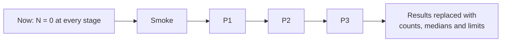

# Pilot results — **template, no participants yet**

> **This page contains no results.** No pilot has run: N = 0 at every stage, and every table below is
> empty on purpose. The protocol that fills it is [`docs/PILOT.md`](PILOT.md). Until a real sitting
> happens, every hour figure in the course is an author target, and no claim of beginner completion is
> made anywhere in this repository.

## Status

| Stage | Started | Finished | Notes |
| :--- | ---: | ---: | :--- |
| Smoke (Track P + Stage 0) | 0 | 0 | — |
| P1 (Tier 1) | 0 | 0 | — |
| P2 (Tier 2 Core) | 0 | 0 | — |
| P3 (Tier 3 Core) | 0 | 0 | — |

## Funnel

_Empty._ Record how many started each stage and how many finished, with the stage they left at.

## Time per stage

_Empty._ Median and range of `active_minutes`, per stage. No means, no percentages without counts.

## Help per lesson

_Empty._ Count of `help` values per lesson id, against the budget in [`docs/PILOT.md`](PILOT.md) §3
(fewer than 1 in 3 lessons needing help; no lesson needing help from more than half the participants).

## Top 10 stuck points

_Empty._ Each row becomes a course change, with the page that changed and the check that keeps it fixed.

| # | Lesson | Stuck type | Count | What changed |
| ---: | :--- | :--- | ---: | :--- |

## Before / after on revised pages

_Empty._ For each page revised from pilot evidence: the first-attempt result before, the result after,
and N for both.

## Delayed transfer

_Empty._ Attempts made 7–14 days after the lesson, and how many passed.

## Limitations

_Empty._ Every results stage states its own: self-selection, author-as-observer, small N, and anything
learned by watching rather than counting.
