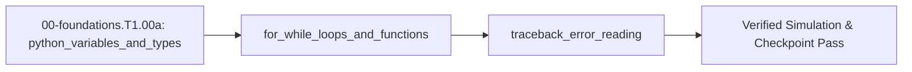

## 1. Why it matters
Every robot trajectory simulator, sensor parser, and motor controller test in this roadmap starts as a runnable Python script before touching microcontroller C++ or physical actuators. Learning how variables store physical measurements, how loops step time forward, and how error tracebacks pinpoint bugs lets you test control ideas safely on your computer. Already know this? Take the Skip test in section 7 first.

## 2. Intuition first
Picture a clipboard checklist beside a linear slider track with a ruler taped along its edge. At the top of the page you write the starting slider position in a box labeled Position, the push speed in a box labeled Speed, and the stopwatch click interval in a box labeled Step. Each time the stopwatch clicks, you look at your checklist, multiply Speed by Step, add that distance to the number inside the Position box, erase the old Position number, and write the new one in its place. A Python script is that exact checklist executed automatically from top to bottom: variables are the labeled boxes, a `while` or `for` loop is the repeated stopwatch click, a `def` function is a reusable recipe card, and a traceback is the line-number pointer Python prints when an instruction asks for something impossible like dividing by zero.

## 3. Formalization
1. **Variables and Assignment (`=`):** In Python, `pos_m = 0.0` stores the floating-point number $0.0\text{ m}$ (position in meters) inside the variable `pos_m`. An update statement evaluates the right-hand side first and writes the result into the left-hand name:

$$
x_{\text{new}} = x_{\text{old}} + \Delta x
$$

   Substituting $x_{\text{old}} = 0.25\text{ m}$ and step change $\Delta x = 0.125\text{ m}$ gives $x_{\text{new}} = 0.25\text{ m} + 0.125\text{ m} = 0.375\text{ m}$.
2. **Functions and Time-Stepping Loops (`while` / `for`):** A function `def step_position(pos_m, vel_m_s, dt_s):` takes current position $x$ in meters ($\text{m}$), constant velocity $v$ in meters per second ($\text{m/s}$), and time step $\Delta t$ in seconds ($\text{s}$), and returns the updated position:

$$
x_{k+1} = x_k + v \cdot \Delta t
$$

   Substituting $x_k = 0.0\text{ m}$, $v = 0.5\text{ m/s}$, and $\Delta t = 0.25\text{ s}$ yields $x_1 = 0.0\text{ m} + (0.5\text{ m/s})(0.25\text{ s}) = 0.125\text{ m}$.
3. **Reading Tracebacks:** When an expression divides a distance $\Delta x = 1.0\text{ m}$ by a zero time step $\Delta t = 0.0\text{ s}$ ($v = \Delta x / \Delta t$), Python halts and prints a traceback whose bottom line states the exception type (`ZeroDivisionError` or `NameError`) and the exact offending line number.
4. **Running Your First `.py` Script & Worked-Example Syntax Reader:**
   - **Canonical Repository Clone & `.venv` Bootstrap (Core Environment — Ubuntu 24.04 LTS / Windows 11 WSL2; see [`resources/open-source-toolchains.md` §0](../resources/open-source-toolchains.md#0-core-supported-os-environment-terminal-bootstrap--python-venv-setup)):** Open your terminal application, clone this repository into `mechalab`, create and activate your local Python virtual environment `.venv`, save the code block below into `step01.py`, and run it:
     ```bash
     git clone https://github.com/TLE47/Mechatronics-Roadmap.git mechalab
     cd mechalab
     python3 -m venv .venv
     source .venv/bin/activate          # Windows PowerShell: .\.venv\Scripts\Activate.ps1
     python3 step01.py
     ```
   - **Worked-Example Syntax Key:**
     - `import math` loads Python's built-in mathematical library (giving access to `math.isclose(a, b, rel_tol=1e-9)` for safe floating-point comparison).
     - `def step_position(pos_m: float, vel_m_s: float, dt_s: float) -> float:`: The `: float` after each parameter name and `-> float` before the colon are **optional Python type annotations (type hints)** that document that the inputs and returned result are floating-point decimal numbers (`float`); `return` sends the computed number back to the caller, and `steps += 1` is shorthand for `steps = steps + 1`.
     - Scientific notation `1e-9` means $1.0 \times 10^{-9} = 0.000000001$.
     - `assert <condition>` automatically verifies that `<condition>` is `True`; if it is `False`, Python immediately halts with an `AssertionError` so bugs are caught on the exact line they occur.
     - `try: ... except ZeroDivisionError as exc:` catches an expected error cleanly so you can inspect `type(exc).__name__` without crashing the script.
     - `f"steps={steps}, pos_m={pos_m:.3f} m"` is a formatted **f-string** that substitutes variables directly into text and formats `pos_m` to `3` decimal places (`.3f`).

## 4. Worked example
A robot slider starts at $x_0 = 0.0\text{ m}$ and moves at constant velocity $v = 0.5\text{ m/s}$ with time step $\Delta t = 0.25\text{ s}$ until reaching $1.0\text{ m}$ ($8$ steps of $0.125\text{ m}$), and then tests catching a `ZeroDivisionError`.

```python
import math

def step_position(pos_m: float, vel_m_s: float, dt_s: float) -> float:
    return pos_m + vel_m_s * dt_s

pos_m = 0.0
vel_m_s = 0.5
dt_s = 0.25
steps = 0

while pos_m < 1.0 - 1e-9:
    pos_m = step_position(pos_m, vel_m_s, dt_s)
    steps += 1

assert steps == 8
assert math.isclose(pos_m, 1.0, rel_tol=1e-9)

caught_error = ""
try:
    bad_ratio = 1.0 / 0.0
except ZeroDivisionError as exc:
    caught_error = type(exc).__name__

assert caught_error == "ZeroDivisionError"
print(f"steps={steps}, pos_m={pos_m:.3f} m, caught={caught_error}")
```
Expected output:
```text
steps=8, pos_m=1.000 m, caught=ZeroDivisionError
```

## 5. Exercise
Write a Python function `battery_voltage_after_steps(v_start, drop_per_step, n_steps)` that uses a `for` loop to subtract `drop_per_step` from `v_start` `n_steps` times. Verify that starting at $12.0\text{ V}$ with a drop of $0.15\text{ V}$ per step over $10$ steps returns `10.5` ($\pm 10^{-6}\text{ V}$).
- **If your result differs:** Check that you passed `range(n_steps)` (which runs `10` times) rather than `range(1, n_steps)` (which only runs `9` times and leaves `10.65` V).

### Graded package - the loop, the traceback and the formatting
[`exercises/00-foundations.T1.00a/`](../exercises/00-foundations.T1.00a/) turns this section into a test. `starter.py` holds seven holes: `step_position` ($x + v\Delta t$), `steps_to_target` (the counted `while` loop), `battery_voltage_after_steps` (the exercise, over `range(n_steps)`), `loop_total` (the Skip test's accumulator), `clamp_pwm` (the one-sided ceiling), `safe_divide` (which reports `type(exc).__name__` instead of crashing) and `format_position` (the `.3f` field). Edit it, then run the tests the way CI does:

```bash
EXERCISE_TARGET=exercises/00-foundations.T1.00a/starter.py \
  python3 -m unittest discover -s exercises/00-foundations.T1.00a -p 'test_*.py'
```

**34 tests.** The battery is checked at the exercise's $10.5\text{ V}$ and at the $10.65\text{ V}$ that nine drops give, so `range(1, n_steps)` fails on the exact number the module warns about; the step counter is checked at the worked example's eight ticks and at a late start's three, so returning the position instead of the count fails; the clamp is checked at the Skip test's $1.35 \to 1.0$ and exactly on the limit; the caught exception must come back named `ZeroDivisionError` rather than swallowed; and $2/3$ must print as `0.667`. The transfer suite runs the plant's own numbers: at its $1\text{ kHz}$ tick a $0.08\text{ m/s}$ move takes exactly $1000$ ticks of $8 \times 10^{-5}\text{ m}$, `range(1000)` accumulates $999000$, the $2.5\text{ N}\cdot\text{m}$ joint clamp is the same one-sided clamp, and a zero tick is refused before it can divide by zero. Five planted faults - `battery_off_by_one`, `steps_returns_position`, `clamp_inverted`, `divide_swallows`, `format_ignores_precision` - each fail the test named for them.

- **📚 What to Learn & Resources to Solve This Exercise:**
  - **Core Concepts to Review First:** Variable assignment (`=`), `for i in range(n_steps):` loops, and `def` functions with `return` in `## 3. Formalization` (Items 1–2) and `## 4. Worked example` above.
  - **Python Tutorial Links:** [Official Python Tutorial §3 (Numbers & Variables)](https://docs.python.org/3/tutorial/introduction.html) and [§4.2–4.7 (`for` Statements, `range()`, and Defining Functions)](https://docs.python.org/3/tutorial/controlflow.html).
  - **Curriculum & Toolchain Reference:** [Track 00 Level 0 On-Ramp (`00-foundations/README.md`)](../00-foundations/README.md#level-0-global-prerequisite-on-ramp-intuition--bench-tools) and [Open-Source Toolchains (`resources/open-source-toolchains.md`)](../resources/open-source-toolchains.md).

## 6. Simulation path
Run the Worked example script directly with `python3 step01.py` in your terminal (following the canonical environment bootstrap in [`resources/open-source-toolchains.md` §0](../resources/open-source-toolchains.md#0-core-supported-os-environment-terminal-bootstrap--python-venv-setup)), or open **Tab 1 (Architecture & Roadmap)** of the MechaLab Workbench (`npm run dev`) to inspect how discrete simulation steps drive every interactive physics plot in the browser with zero hardware.

No hardware required for this module (`hardware_required: false`). In Stage 0 (`L0.3`) and Track 04, the exact same `while` loop structure maps directly onto a microcontroller firmware loop:
```text
[PC Python Script: while pos_m < 1.0] ---> (USB Serial) ---> [MCU Timer Loop: pos_m += vel * dt]
```
Pass/fail verification in simulation: `steps == 8`, `pos_m == 1.000 m`, and `caught == ZeroDivisionError`.




## 7. Checkpoint
Pass criteria: run the worked example and exercise asserts with zero errors, or score $\ge 80\%$ ($4/4$) on the Skip test below.

### Skip test
1. `[Recall] [Concept: python_variables_and_types]` Compute the final numeric value of `x` (tolerance $\pm 10^{-9}$) after executing `x = 4.0; x = x + 1.5; x = x * 2.0`.
2. `[Apply] [Concept: for_while_loops_and_functions]` Trace this loop and compute the final integer value of `total` (tolerance $\pm 10^{-9}$) after it finishes:
```python
total = 0
for i in range(4):
    total += i * 2
```
3. `[Transfer] [Concept: for_while_loops_and_functions]` What value (tolerance $\pm 10^{-9}$) does `clamp_pwm(1.35, 1.0)` return when defined as `def clamp_pwm(u, u_max): return u_max if u > u_max else u`?
4. `[Concept: traceback_error_reading]` You run a motor script and Python prints `NameError: name 'kp_gain' is not defined` at line 12. Which option identifies the root cause?
   - **A.** `kp_gain` was set to `0.0` and caused a division by zero.
   - **B.** `kp_gain` was read before being assigned a value, or its variable name was misspelled.
   - **C.** The `math` module was not imported at the top of the file.
   - **D.** The `while` loop condition never became `False`.

**Answer key:**
```python
import math

x = 4.0
x = x + 1.5
x = x * 2.0
q1_x = x
q2_total = sum(i * 2 for i in range(4))
q3_clamped = 1.0 if 1.35 > 1.0 else 1.35
q4_choice = "B"

assert math.isclose(q1_x, 11.0, rel_tol=1e-9)
assert q2_total == 12
assert math.isclose(q3_clamped, 1.0, rel_tol=1e-9)
assert q4_choice == "B"
```
- **Pass mark:** $4/4$ ($80\%+$). If you missed Q1, study `## 3. Formalization`; Q2 or Q3, study `## 4. Worked example`; Q4, study `## 2. Intuition first`. On pass, proceed to `## 10. Next modules`.

## 8. Common mistakes
| Symptom | Root cause | 2-minute fix |
| :--- | :--- | :--- |
| `NameError: name 'vel_m_s' is not defined` | Variable used before assignment or spelled differently (`vel_ms` vs `vel_m_s`). | Initialize all state variables above the `while` loop and match spelling exactly. |
| Loop never stops (infinite loop) | Forgot to update `pos_m` inside the `while` block or used `dt_s = 0.0`. | Indent `pos_m = step_position(...)` inside the `while` body and verify `dt_s > 0`. |
| Function returns `None` instead of a number | Wrote `pos_m + vel_m_s * dt_s` inside `def` without the `return` keyword. | Prefix the output expression with `return`. |

## 9. Resources
- **Python Software Foundation — [*The Python Tutorial* (Sections 3–4: Numbers, Variables, `for`/`while` Loops & Functions)](https://docs.python.org/3/tutorial/):** Official beginner guide to numbers, variables, `while`/`for` loops, `range()`, and `def` functions needed for the exercise `[VERIFIED 2026-10-15]`.
- **MechaLab Root Roadmap ([`README.md`](../README.md)) & [Track 00 (`00-foundations/README.md`)](../00-foundations/README.md):** Explains how Stage 0 and Pass 1 (`Track 00 -> Track 08`) use Python time-stepping scripts before embedded C++ `[VERIFIED 2026-10-15]`.

## 10. Next modules
- Proceed to [`00-foundations.T1.00b`](00-foundations.T1.00b.md) (*Lists, Dictionaries, NumPy Arrays, Plotting & Git/Terminal Basics*).
