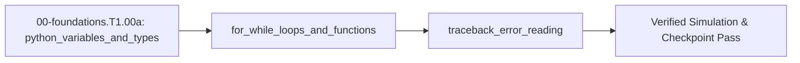

<!-- run-callout:start -->
> **Step 3 of 10 · Make a joint move: foundations**
>
> **Run this in the workbench.** [Open MechaLab with `EX.00-foundations.T1.00a` loaded](https://tle47.github.io/Mechatronics-Roadmap/?lesson=EX.00-foundations.T1.00a) - it opens on the **Run Python Lessons** tab with that entry selected. Starter code, hints and the graded check are ready; this page is the reading copy, and nothing you type here is saved.
<!-- run-callout:end -->

## 1. Why it matters
Every robot trajectory simulator, sensor parser, and motor controller test in this roadmap starts as a runnable Python script before touching microcontroller C++ or physical actuators. Learning how variables store physical measurements, how loops step time forward, and how error tracebacks pinpoint bugs lets you test control ideas safely on your computer. Already know this? Take the Skip test in section 7 first.

## 2. Intuition first
<!-- figure: toolchain | Every exercise on this page is the same four steps, and the check is the one that counts. -->

Picture a clipboard checklist beside a linear slider track with a ruler taped along its edge. At the top of the page you write the starting slider position in a box labeled Position, the push speed in a box labeled Speed, and the stopwatch click interval in a box labeled Step. Each time the stopwatch clicks, you look at your checklist, multiply Speed by Step, add that distance to the number inside the Position box, erase the old Position number, and write the new one in its place. A Python script is that exact checklist executed automatically from top to bottom: variables are the labeled boxes, a `while` or `for` loop is the repeated stopwatch click, a `def` function is a reusable recipe card, and a traceback is the line-number pointer Python prints when an instruction asks for something impossible like dividing by zero.

## 3. Formalization
1. **Variables and Assignment (`=`):** In Python, `pos_m = 0.0` stores the floating-point number $0.0\text{ m}$ (position in meters) inside the variable `pos_m`. An update statement evaluates the right-hand side first and writes the result into the left-hand name:

$$
x_{\text{new}} = x_{\text{old}} + \Delta x
$$

   Substituting $x_{\text{old}} = 0.25\text{ m}$ and step change $\Delta x = 0.125\text{ m}$ gives $x_{\text{new}} = 0.25\text{ m} + 0.125\text{ m} = 0.375\text{ m}$.
2. **Functions and Time-Stepping Loops (`while` / `for`):** A function `def step_position(pos_m, vel_m_s, dt_s):` takes current position $x$ in meters ($\text{m}$), constant velocity $v$ in meters per second ($\text{m/s}$), and time step $\Delta t$ in seconds ($\text{s}$), and returns the updated position:

$$
x_{k+1} = x_k + v \cdot \Delta t
$$

   Substituting $x_k = 0.0\text{ m}$, $v = 0.5\text{ m/s}$, and $\Delta t = 0.25\text{ s}$ yields $x_1 = 0.0\text{ m} + (0.5\text{ m/s})(0.25\text{ s}) = 0.125\text{ m}$.
3. **Reading Tracebacks:** When an expression divides a distance $\Delta x = 1.0\text{ m}$ by a zero time step $\Delta t = 0.0\text{ s}$ ($v = \Delta x / \Delta t$), Python halts and prints a traceback whose bottom line states the exception type (`ZeroDivisionError` or `NameError`) and the exact offending line number.
4. **Running Your First `.py` Script & Worked-Example Syntax Reader:**
   - **Canonical Repository Clone & `.venv` Bootstrap (Core Environment — Ubuntu 24.04 LTS / Windows 11 WSL2; see [`resources/open-source-toolchains.md` §0](../resources/open-source-toolchains.md#0-core-supported-os-environment-terminal-bootstrap--python-venv-setup)):** Open your terminal application, clone this repository into `mechalab`, create and activate your local Python virtual environment `.venv`, save the code block below into `step01.py`, and run it:
     ```bash
     git clone https://github.com/TLE47/Mechatronics-Roadmap.git mechalab
     cd mechalab
     python3 -m venv .venv
     source .venv/bin/activate          # Windows PowerShell: .\.venv\Scripts\Activate.ps1
     python3 step01.py
     ```
   - **Worked-Example Syntax Key:**
     - `import math` loads Python's built-in mathematical library (giving access to `math.isclose(a, b, rel_tol=1e-9)` for safe floating-point comparison).
     - `def step_position(pos_m: float, vel_m_s: float, dt_s: float) -> float:`: The `: float` after each parameter name and `-> float` before the colon are **optional Python type annotations (type hints)** that document that the inputs and returned result are floating-point decimal numbers (`float`); `return` sends the computed number back to the caller, and `steps += 1` is shorthand for `steps = steps + 1`.
     - Scientific notation `1e-9` means $1.0 \times 10^{-9} = 0.000000001$.
     - `assert <condition>` automatically verifies that `<condition>` is `True`; if it is `False`, Python immediately halts with an `AssertionError` so bugs are caught on the exact line they occur.
     - `try: ... except ZeroDivisionError as exc:` catches an expected error cleanly so you can inspect `type(exc).__name__` without crashing the script.
     - `f"steps={steps}, pos_m={pos_m:.3f} m"` is a formatted **f-string** that substitutes variables directly into text and formats `pos_m` to `3` decimal places (`.3f`).

## 4. Worked example
**Predict first (before you run it):** Write down three numbers before you run the block: how far one $0.25\text{ s}$ tick moves the slider at $v = 0.5\text{ m/s}$; how many ticks the `while` loop needs to reach $1.0\text{ m}$ from $x_0 = 0.0\text{ m}$; and the exact exception class name printed at the bottom of the traceback for `1.0 / 0.0`. Two tells that a wrong result is a mistake rather than a surprise: a final `pos_m` above $1.0\text{ m}$ means the loop body ran once more than the condition allowed, and any position that is not a whole multiple of the per-tick distance means `dt_s` or `vel_m_s` carried a wrong value.

A robot slider starts at $x_0 = 0.0\text{ m}$ and moves at constant velocity $v = 0.5\text{ m/s}$ with time step $\Delta t = 0.25\text{ s}$ until reaching $1.0\text{ m}$ ($8$ steps of $0.125\text{ m}$), and then tests catching a `ZeroDivisionError`.

<!-- try -->
```python
import math

def step_position(pos_m: float, vel_m_s: float, dt_s: float) -> float:
    return pos_m + vel_m_s * dt_s

pos_m = 0.0
vel_m_s = 0.5
dt_s = 0.25
steps = 0

while pos_m < 1.0 - 1e-9:
    pos_m = step_position(pos_m, vel_m_s, dt_s)
    steps += 1

assert steps == 8
assert math.isclose(pos_m, 1.0, rel_tol=1e-9)

caught_error = ""
try:
    bad_ratio = 1.0 / 0.0
except ZeroDivisionError as exc:
    caught_error = type(exc).__name__

assert caught_error == "ZeroDivisionError"
print(f"steps={steps}, pos_m={pos_m:.3f} m, caught={caught_error}")
```

Expected output:
```text
steps=8, pos_m=1.000 m, caught=ZeroDivisionError
```

<!-- try-link:start -->
> **Try this in the workbench.** [Open these 25 lines with `EX.00-foundations.T1.00a` loaded](https://tle47.github.io/Mechatronics-Roadmap/?lesson=EX.00-foundations.T1.00a#try=eyJ2IjoxLCJsZXNzb24iOiJFWC4wMC1mb3VuZGF0aW9ucy5UMS4wMGEiLCJjb2RlIjoiaW1wb3J0IG1hdGhcblxuZGVmIHN0ZXBfcG9zaXRpb24ocG9zX206IGZsb2F0LCB2ZWxfbV9zOiBmbG9hdCwgZHRfczogZmxvYXQpIC0-IGZsb2F0OlxuICAgIHJldHVybiBwb3NfbSArIHZlbF9tX3MgKiBkdF9zXG5cbnBvc19tID0gMC4wXG52ZWxfbV9zID0gMC41XG5kdF9zID0gMC4yNVxuc3RlcHMgPSAwXG5cbndoaWxlIHBvc19tIDwgMS4wIC0gMWUtOTpcbiAgICBwb3NfbSA9IHN0ZXBfcG9zaXRpb24ocG9zX20sIHZlbF9tX3MsIGR0X3MpXG4gICAgc3RlcHMgKz0gMVxuXG5hc3NlcnQgc3RlcHMgPT0gOFxuYXNzZXJ0IG1hdGguaXNjbG9zZShwb3NfbSwgMS4wLCByZWxfdG9sPTFlLTkpXG5cbmNhdWdodF9lcnJvciA9IFwiXCJcbnRyeTpcbiAgICBiYWRfcmF0aW8gPSAxLjAgLyAwLjBcbmV4Y2VwdCBaZXJvRGl2aXNpb25FcnJvciBhcyBleGM6XG4gICAgY2F1Z2h0X2Vycm9yID0gdHlwZShleGMpLl9fbmFtZV9fXG5cbmFzc2VydCBjYXVnaHRfZXJyb3IgPT0gXCJaZXJvRGl2aXNpb25FcnJvclwiXG5wcmludChmXCJzdGVwcz17c3RlcHN9LCBwb3NfbT17cG9zX206LjNmfSBtLCBjYXVnaHQ9e2NhdWdodF9lcnJvcn1cIikifQ) - it opens on the **Run Python Lessons** tab with the snippet in a scratch editor: Run prints what the snippet prints, nothing is graded, and the draft you have for `EX.00-foundations.T1.00a` is left alone.
<!-- try-link:end -->

## 5. Exercise
Write a Python function `battery_voltage_after_steps(v_start, drop_per_step, n_steps)` that uses a `for` loop to subtract `drop_per_step` from `v_start` `n_steps` times. Verify that starting at $12.0\text{ V}$ with a drop of $0.15\text{ V}$ per step over $10$ steps returns `10.5` ($\pm 10^{-6}\text{ V}$).
- **If your result differs:** Check that you passed `range(n_steps)` (which runs `10` times) rather than `range(1, n_steps)` (which only runs `9` times and leaves `10.65` V).

### Graded package - the loop, the traceback and the formatting
[`exercises/00-foundations.T1.00a/`](../exercises/00-foundations.T1.00a/) turns this section into a test. `starter.py` holds seven holes: `step_position` ($x + v\Delta t$), `steps_to_target` (the counted `while` loop), `battery_voltage_after_steps` (the exercise, over `range(n_steps)`), `loop_total` (the Skip test's accumulator), `clamp_pwm` (the one-sided ceiling), `safe_divide` (which reports `type(exc).__name__` instead of crashing) and `format_position` (the `.3f` field). Edit it, then run the tests the way CI does:

```bash
EXERCISE_TARGET=exercises/00-foundations.T1.00a/starter.py \
  python3 -m unittest discover -s exercises/00-foundations.T1.00a -p 'test_*.py'
```

**34 tests.** The battery is checked at the exercise's $10.5\text{ V}$ and at the $10.65\text{ V}$ that nine drops give, so `range(1, n_steps)` fails on the exact number the module warns about; the step counter is checked at the worked example's eight ticks and at a late start's six, so returning the position instead of the count fails; the clamp is checked at the Skip test's $1.35 \to 1.0$ and exactly on the limit; the caught exception must come back named `ZeroDivisionError` rather than swallowed; and $2/3$ must print as `0.667`. The transfer suite runs the plant's own numbers: at its $1\text{ kHz}$ tick a $0.08\text{ m/s}$ move takes exactly $1000$ ticks of $8 \times 10^{-5}\text{ m}$, `range(1000)` accumulates $999000$, the $2.5\text{ N}\cdot\text{m}$ joint clamp is the same one-sided clamp, and a zero tick is refused before it can divide by zero. Five planted faults - `battery_off_by_one`, `steps_returns_position`, `clamp_inverted`, `divide_swallows`, `format_ignores_precision` - each fail the test named for them.

- **📚 What to Learn & Resources to Solve This Exercise:**
  - **Core Concepts to Review First:** Variable assignment (`=`), `for i in range(n_steps):` loops, and `def` functions with `return` in `## 3. Formalization` (Items 1–2) and `## 4. Worked example` above.
  - **Python Tutorial Links:** [Official Python Tutorial §3 (Numbers & Variables)](https://docs.python.org/3/tutorial/introduction.html) and [§4.2–4.7 (`for` Statements, `range()`, and Defining Functions)](https://docs.python.org/3/tutorial/controlflow.html).
  - **Curriculum & Toolchain Reference:** [Track 00 Level 0 On-Ramp (`00-foundations/README.md`)](../00-foundations/README.md#level-0-global-prerequisite-on-ramp-intuition--bench-tools) and [Open-Source Toolchains (`resources/open-source-toolchains.md`)](../resources/open-source-toolchains.md).

### Starter code
```python
"""Exercise 00-foundations.T1.00a - the learner's file.

Seven small functions that make up one robot script: the position update, the loop that counts
steps to the end of the track, the battery sag, the Skip test's accumulator, the one-sided PWM
clamp, a division that reports the name of the exception it caught, and the three-decimal format.

    EXERCISE_TARGET=exercises/00-foundations.T1.00a/starter.py \
        python3 -m unittest discover -s exercises/00-foundations.T1.00a -p 'test_*.py'
"""


def step_position(pos_m, vel_m_s, dt_s):
    """x_next = x + v * dt."""
    raise NotImplementedError("TODO 1: multiply the speed by the time step, then add the position")


def steps_to_target(pos_0, vel_m_s, dt_s, target_m):
    """How many ticks of the loop the worked example takes to reach target_m."""
    raise NotImplementedError("TODO 2: a loop that runs while the position is short of the target, counting")


def battery_voltage_after_steps(v_start, drop_per_step, n_steps):
    """Subtract drop_per_step from v_start n_steps times."""
    raise NotImplementedError("TODO 3: the loop runs the step count times, not one fewer")


def loop_total(n_steps):
    """The Skip test's accumulator: sum of i*2 for i in range(n_steps)."""
    raise NotImplementedError("TODO 4: start at zero and add the running term inside the loop, not after")


def clamp_pwm(u, u_max):
    """One-sided ceiling: u_max when u is above it, u itself otherwise."""
    raise NotImplementedError("TODO 5: return the limit only when the command exceeds it, otherwise the command")


def safe_divide(numerator, denominator):
    """Return (value, error_name)."""
    raise NotImplementedError("TODO 6: catch the divide-by-zero error and report the exception's own type name")


def format_position(pos_m):
    """The worked example's `{pos_m:.3f}` field, on its own."""
    raise NotImplementedError("TODO 7: an f-string with three decimal places, not a plain conversion")


# The browser entry appends `selfcheck.py` below this line; on its own this file prints nothing.
```

### Hint ladder
1. **A loop is not a step count.** `step_position` answers "where am I after one tick"; `steps_to_target` answers "how many ticks", so it needs its own counter incremented inside the body. Returning `pos_m` at the end is the classic mix-up - it reads `1.0` where the worked example prints `8`.
2. **`range` runs a number of times, not to a number.** `range(n_steps)` yields `n_steps` values, so ten drops come from `range(10)`. `range(1, 10)` yields nine (1 through 9), which is exactly the `10.65` V the exercise warns about: $12.0 - 9 \times 0.15$.
3. **A traceback's bottom line names a type.** `type(exc).__name__` is `"ZeroDivisionError"`; `str(exc)` is the message (`"float division by zero"`), which is not what the exercise asks you to report.
4. **The format field does the rounding.** `f"{pos_m:.3f}"` turns `2/3` into `"0.667"`, while `str(2/3)` gives `"0.6666666666666666"`.
5. **What the suite refuses.** `steps_to_target` raises on a non-positive time step and on a velocity that is not positive (a stationary robot never arrives), `step_position` raises on a negative time step, `battery_voltage_after_steps` and `loop_total` raise on a negative count, and `clamp_pwm` raises on a non-positive ceiling - all `ValueError`, so a guard is part of the answer rather than defensive padding.

### Full Solution
```python
def step_position(pos_m, vel_m_s, dt_s):
    """x_next = x + v * dt. Negative time would run the simulator backwards."""
    if dt_s < 0.0:
        raise ValueError("time only runs forwards in this simulator")
    return pos_m + vel_m_s * dt_s


def steps_to_target(pos_0, vel_m_s, dt_s, target_m):
    """How many ticks of the loop the worked example takes to reach target_m."""
    if dt_s <= 0.0:
        raise ValueError("a zero time step never advances the position")
    if vel_m_s <= 0.0:
        raise ValueError("a robot that is not moving forward never reaches the target")
    steps = 0
    pos_m = pos_0
    while pos_m < target_m - 1e-9:
        pos_m = step_position(pos_m, vel_m_s, dt_s)
        steps += 1
    return steps


def battery_voltage_after_steps(v_start, drop_per_step, n_steps):
    """Subtract drop_per_step from v_start exactly n_steps times - range(n) has n terms."""
    if n_steps < 0:
        raise ValueError("a loop cannot run a negative number of times")
    v_now = v_start
    for _step in range(n_steps):
        v_now -= drop_per_step
    return v_now


def loop_total(n_steps):
    """The Skip test's accumulator: sum of i*2 for i in range(n_steps)."""
    if n_steps < 0:
        raise ValueError("a loop cannot run a negative number of times")
    total = 0
    for i in range(n_steps):
        total += i * 2
    return total


def clamp_pwm(u, u_max):
    """One-sided ceiling: u_max when u is above it, u itself otherwise."""
    if u_max <= 0.0:
        raise ValueError("a PWM ceiling must be positive")
    return u_max if u > u_max else u


def safe_divide(numerator, denominator):
    """Return (value, error_name) - a clean division reports an empty name."""
    try:
        return numerator / denominator, ""
    except ZeroDivisionError as exc:
        return None, type(exc).__name__


def format_position(pos_m):
    """The worked example's `{pos_m:.3f}` field, on its own."""
    return f"{pos_m:.3f}"


# No `__main__` block on purpose: the browser grades this file's stdout against the appended
# self-check's single PASS line, and a second print here would be a mismatch for a correct answer.

v_10 = battery_voltage_after_steps(12.0, 0.15, 10)
v_9 = battery_voltage_after_steps(12.0, 0.15, 9)
ticks = steps_to_target(0.0, 0.5, 0.25, 1.0)
clamped = clamp_pwm(1.35, 1.0)
value, error = safe_divide(1.0, 0.0)

assert abs(v_10 - 10.5) <= 1e-6
assert abs(v_9 - 10.65) <= 1e-6
assert ticks == 8
assert abs(clamped - 1.0) <= 1e-12
assert (value, error) == (None, "ZeroDivisionError")
assert format_position(2.0 / 3.0) == "0.667"

print("v_10=%.3f V | nine drops=%.3f V | ticks=%d | clamp=%.3f | error=%s"
      % (v_10, v_9, ticks, clamped, error))
```

Printed: `v_10=10.500 V | nine drops=10.650 V | ticks=8 | clamp=1.000 | error=ZeroDivisionError`.

**On the shared arm.** The Transfer suite runs this module's loop on the plant's 1 ms tick, so one 0.08 m/s step is 8e-5 m and 0.08 m is exactly 1000 ticks:

```python
import mechalab_plant as plant

tick_m = 0.08 * plant.DT
assert abs(tick_m - 8e-05) < 1e-15
assert round(0.08 / tick_m) == 1000
print("plant: tick=%.0f us, 0.08 m/s moves %.1e m per tick, %d ticks to 0.08 m"
      % (plant.DT * 1e6, tick_m, 1000))
```

### Break it on purpose
Inject the `range` fault the exercise hint warns about, keeping $V_{\text{start}} = 12.0\text{ V}$, `drop_per_step = 0.15` V and `n_steps = 10`:
- **Inject:** write `for _ in range(1, n_steps):` instead of `for _ in range(n_steps):`.
- **Symptom:** the function returns `10.65` V instead of `10.5` V — exactly one `drop_per_step` high, because the loop body ran `9` times.
- **Diagnose:** the gap is $0.15\text{ V}$, the size of a single drop, so the subtraction inside the loop is right and the count is wrong. A sign error would read $12.0 + 1.35 = 13.35\text{ V}$, and a drop typed as `0.015` would land near $11.85\text{ V}$; neither matches, which leaves the `range` bounds.
- **Fix:** use `range(n_steps)`, then confirm $12.0 - 10 \times 0.15 = 10.50\text{ V}$ to $\pm 10^{-6}\text{ V}$, and cross-check the count against the worked example's `8` ticks of $0.125\text{ m}$ for $1.0\text{ m}$.

## 6. Simulation path
Run the Worked example script directly with `python3 step01.py` in your terminal (following the canonical environment bootstrap in [`resources/open-source-toolchains.md` §0](../resources/open-source-toolchains.md#0-core-supported-os-environment-terminal-bootstrap--python-venv-setup)), or open **Architecture & Roadmap** of the MechaLab Workbench (`npm run dev`) to inspect how discrete simulation steps drive every interactive physics plot in the browser with zero hardware.

No hardware required for this module (`hardware_required: false`). In Stage 0 (`L0.3`) and Track 04, the exact same `while` loop structure maps directly onto a microcontroller firmware loop:
```text
[PC Python Script: while pos_m < 1.0] ---> (USB Serial) ---> [MCU Timer Loop: pos_m += vel * dt]
```
Pass/fail verification in simulation: `steps == 8`, `pos_m == 1.000 m`, and `caught == ZeroDivisionError`.




## 7. Checkpoint
Pass criteria: run the worked example and exercise asserts with zero errors, or score $\ge 80\%$ ($4/4$) on the Skip test below.

### Skip test
<!-- skip-test:start -->
1. `[Recall] [Concept: python_variables_and_types]` Compute the final numeric value of `x` (tolerance $\pm 10^{-9}$) after executing `x = 4.0; x = x + 1.5; x = x * 2.0`.
2. `[Apply] [Concept: for_while_loops_and_functions]` Trace this loop and compute the final integer value of `total` (tolerance $\pm 10^{-9}$) after it finishes:
```python
total = 0
for i in range(4):
    total += i * 2
```
3. `[Transfer] [Concept: for_while_loops_and_functions]` What value (tolerance $\pm 10^{-9}$) does `clamp_pwm(1.35, 1.0)` return when defined as `def clamp_pwm(u, u_max): return u_max if u > u_max else u`?
4. `[Concept: traceback_error_reading]` You run a motor script and Python prints `NameError: name 'kp_gain' is not defined` at line 12. Which option identifies the root cause?
   - **A.** `kp_gain` was set to `0.0` and caused a division by zero.
   - **B.** `kp_gain` was read before being assigned a value, or its variable name was misspelled.
   - **C.** The `math` module was not imported at the top of the file.
   - **D.** The `while` loop condition never became `False`.

**Answer key:**
```python
import math

x = 4.0
x = x + 1.5
x = x * 2.0
q1_x = x
q2_total = sum(i * 2 for i in range(4))
q3_clamped = 1.0 if 1.35 > 1.0 else 1.35
q4_choice = "B"

assert math.isclose(q1_x, 11.0, rel_tol=1e-9)
assert q2_total == 12
assert math.isclose(q3_clamped, 1.0, rel_tol=1e-9)
assert q4_choice == "B"
```
- **Pass mark:** $4/4$ ($80\%+$). If you missed Q1, study `## 3. Formalization`; Q2 or Q3, study `## 4. Worked example`; Q4, study `## 2. Intuition first`. On pass, proceed to `## 10. Next modules`.
<!-- skip-test:end -->

### Gate test
Covers the complete Track 00 Tier 1 bridge ladder (`00-foundations.T1.00a` $\to$ `00-foundations.T1.00b` $\to$ `00-foundations.T1.00c` $\to$ `00-foundations.T1.00d` $\to$ `00-foundations.T1.00e`) before Step 1.1 (`00-foundations.T1.01`):
1. `[Concept: python_variables_and_types]` Trace `val = 5.0; val -= 1.5; val *= 2.0` and compute the final `val` (tolerance $\pm 10^{-9}$).
2. `[Concept: python_variables_and_types]` A script's first line is `pos = pos + 1.0`. Which statement is correct?
   - **A.** It raises `NameError`, because the right-hand side `pos` is read before any value was bound to the name.
   - **B.** `pos` starts at `0.0`, so the line is equivalent to `pos = 1.0`.
   - **C.** Python binds the left-hand side first, so the line leaves `pos` at `1.0`.
   - **D.** It is a syntax error and the file never runs.
3. `[Concept: for_while_loops_and_functions]` Compute the integer returned by `sum(k * k for k in range(1, 6))`.
4. `[Concept: for_while_loops_and_functions]` In `for _ in range(1, 10):`, how many times does the loop body run?
   - **A.** 9
   - **B.** 10
   - **C.** 8
   - **D.** 11
5. `[Concept: traceback_error_reading]` A script evaluates `1.0 / 0.0`. Which exception class does the bottom line of the traceback name?
   - **A.** `ZeroDivisionError`
   - **B.** `NameError`
   - **C.** `TypeError`
   - **D.** `ValueError`
6. `[Concept: lists_dicts_and_numpy_arrays] [Concept: matplotlib_time_series_plotting]` For `arr = [3.0, 5.0, 7.0, 9.0]`, compute `sum(arr) / len(arr) + arr[-1]` (tolerance $\pm 10^{-9}$).
7. `[Concept: terminal_and_git_basics]` Which command shows the line-by-line changes you have made but not yet staged?
   - **A.** `git diff`
   - **B.** `git init`
   - **C.** `git clone`
   - **D.** `git log`
8. `[Concept: si_base_and_derived_units] [Concept: dimensional_analysis_unit_checks] [Concept: scientific_notation_and_prefixes]` A $4.7\ \text{k}\Omega$ resistor carries $2.0\ \text{mA}$. Report the voltage across it in volts and the power it dissipates in milliwatts (tolerance $\pm 10^{-9}$).
9. `[Concept: radians_unit_circle_and_atan2] [Concept: linear_functions_and_slope] [Concept: 2d_vectors_and_components]` A displacement vector has components $x = -0.40\ \text{m}$ and $y = 0.30\ \text{m}$. Report its magnitude in metres, its heading `math.degrees(math.atan2(y, x))` in degrees, and its slope $y/x$ (tolerance $\pm 10^{-9}$).
10. `[Concept: newtons_second_law_and_torque] [Concept: discrete_kinematics_pos_vel_acc] [Concept: spring_energy_and_power]` A $m = 0.50\ \text{kg}$ carriage moves at $v = 2.0\ \text{m/s}$ while a spring of stiffness $k = 40.0\ \text{N/m}$ is stretched by $x = 0.050\ \text{m}$. Compute (a) the total mechanical energy $E = \tfrac{1}{2}mv^2 + \tfrac{1}{2}kx^2$ in joules, (b) the spring force magnitude $kx$ in newtons, and (c) the position after one $\Delta t = 0.010\ \text{s}$ tick of `a = -k*x/m; v += a*dt; x += v*dt` (all tolerances $\pm 10^{-9}$).

**Gate answer key:**
```python
import math

g1 = 5.0
g1 -= 1.5
g1 *= 2.0
g2_choice = "A"
g3 = sum(k * k for k in range(1, 6))
g4_choice = "A"
g5_choice = "A"
arr = [3.0, 5.0, 7.0, 9.0]
g6 = sum(arr) / len(arr) + arr[-1]
g7_choice = "A"
g8_v = 4.7e3 * 2.0e-3
g8_p_mw = g8_v * 2.0e-3 * 1e3
g9_mag = math.hypot(-0.40, 0.30)
g9_heading = math.degrees(math.atan2(0.30, -0.40))
g9_slope = 0.30 / -0.40
g10_e = 0.5 * 0.50 * (2.0 ** 2) + 0.5 * 40.0 * (0.050 ** 2)
g10_force = 40.0 * 0.050
g10_v1 = 2.0 + (-40.0 * 0.050 / 0.50) * 0.010
g10_x1 = 0.050 + g10_v1 * 0.010

assert math.isclose(g1, 7.0, rel_tol=1e-9)
assert g2_choice == "A"
assert g3 == 55
assert g4_choice == "A"
assert g5_choice == "A"
assert math.isclose(g6, 15.0, rel_tol=1e-9)
assert g7_choice == "A"
assert math.isclose(g8_v, 9.4, rel_tol=1e-9)
assert math.isclose(g8_p_mw, 18.8, rel_tol=1e-9)
assert math.isclose(g9_mag, 0.5, rel_tol=1e-9)
assert math.isclose(g9_heading, 143.13010235415598, rel_tol=1e-12)
assert math.isclose(g9_slope, -0.75, rel_tol=1e-9)
assert math.isclose(g10_e, 1.05, rel_tol=1e-9)
assert math.isclose(g10_force, 2.0, rel_tol=1e-9)
assert math.isclose(g10_x1, 0.0696, rel_tol=1e-9)
```
- **Pass mark:** $\ge 80\%$ ($4/4$ on Skip test; $\ge 8/10$ on Gate test). Missed Gate Q1-Q2: study `00-foundations.T1.00a`; Q3-Q5: `00-foundations.T1.00a`; Q6: `00-foundations.T1.00b`; Q7: `00-foundations.T1.00b`; Q8: `00-foundations.T1.00c`; Q9: `00-foundations.T1.00d`; Q10: `00-foundations.T1.00e` and this module's `## 3. Formalization`.

## 8. Common mistakes
| Symptom | Root cause | 2-minute fix |
| :--- | :--- | :--- |
| `NameError: name 'vel_m_s' is not defined` | Variable used before assignment or spelled differently (`vel_ms` vs `vel_m_s`). | Initialize all state variables above the `while` loop and match spelling exactly. |
| Loop never stops (infinite loop) | Forgot to update `pos_m` inside the `while` block or used `dt_s = 0.0`. | Indent `pos_m = step_position(...)` inside the `while` body and verify `dt_s > 0`. |
| Function returns `None` instead of a number | Wrote `pos_m + vel_m_s * dt_s` inside `def` without the `return` keyword. | Prefix the output expression with `return`. |

## 9. Resources
- **Python Software Foundation — [*The Python Tutorial* (Sections 3–4: Numbers, Variables, `for`/`while` Loops & Functions)](https://docs.python.org/3/tutorial/):** Official beginner guide to numbers, variables, `while`/`for` loops, `range()`, and `def` functions needed for the exercise `[VERIFIED 2026-10-15]`.
- **MechaLab Root Roadmap ([`README.md`](../README.md)) & [Track 00 (`00-foundations/README.md`)](../00-foundations/README.md):** Explains how Stage 0 and Pass 1 (`Track 00 -> Track 08`) use Python time-stepping scripts before embedded C++ `[VERIFIED 2026-10-15]`.

## 10. Next modules

<!-- next-step:start -->
👉 **Next:** [Step 3 · Make a joint move: foundations — 00-foundations.T1.00b: Lists, Dictionaries, NumPy Arrays, Plotting & Git/Terminal Basics](00-foundations.T1.00b.md)
<!-- next-step:end -->
