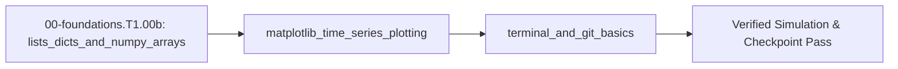

## 1. Why it matters
A 5-second test of a robot joint at $1\text{ kHz}$ records $5,000$ samples each of timestamp, angle, velocity, and motor current. You need lists, dictionaries, and vectorized arrays to compute tracking errors across thousands of samples at once, time-series plots to spot oscillations visually, and Git commits to roll back safely when a tuning change breaks your code. Already know this? Take the Skip test in section 7 first.

## 2. Intuition first
Think of a Python `list` as a numbered row of pigeonholes starting at slot `0` where each slot holds one timestamp reading in order, and a `dict` (dictionary) as a labeled parts cabinet where you look up a controller setting by name (`"slope"` or `"offset"`) instead of memorizing slot numbers. When you want to scale all $5,000$ pigeonholes from volts to amperes at once, a NumPy array acts like a synchronized conveyor belt that multiplies every slot simultaneously without stepping through them one by one. Finally, Git acts like a laboratory notebook with permanent ink snapshots: `git status` shows which pages changed today, and `git commit` seals a working checkpoint you can always restore.

## 3. Formalization
1. **Zero-Indexed Lists and Key-Value Dictionaries:** A sequence of $N$ timestamps $t_0, t_1, \dots, t_{N-1}$ with uniform spacing $\Delta t$ in seconds ($\text{s}$) satisfies:

$$
t_i = t_0 + i \cdot \Delta t, \quad i \in \{0, 1, \dots, N-1\}
$$

   For $t_0 = 0.0\text{ s}$, $\Delta t = 0.1\text{ s}$, and $i = 4$ (the last element, indexed as `t_s[-1]`), $t_4 = 0.0\text{ s} + 4 \times 0.1\text{ s} = 0.4\text{ s}$.
2. **Vectorized Array Scaling, Summary Statistics & Matplotlib Time-Series Plotting (`plt.plot`):** Given sensor slope $m$ in volts per second ($\text{V/s}$) and offset $b$ in volts ($\text{V}$), the voltage array $y_i = m t_i + b$ has sample mean $\bar{y}$ and peak-to-peak span $\Delta y_{\text{pp}}$:

$$
\bar{y} = \frac{1}{N}\sum_{i=0}^{N-1} y_i, \qquad \Delta y_{\text{pp}} = \max_i(y_i) - \min_i(y_i)
$$

   For $y = [0.5, 0.8, 1.1, 1.4, 1.7]\text{ V}$ ($N = 5$), $\bar{y} = \frac{5.5\text{ V}}{5} = 1.10\text{ V}$ and $\Delta y_{\text{pp}} = 1.7\text{ V} - 0.5\text{ V} = 1.20\text{ V}$.
3. **Terminal & Git Workflow:** Running `python3 script.py` executes the file, `git status` inspects modified files, `git diff` displays line-by-line edits, and `git commit -am "msg"` records a versioned snapshot.

## 4. Worked example
Generate $N = 5$ timestamps $t = [0.0, 0.1, 0.2, 0.3, 0.4]\text{ s}$, evaluate sensor readings $y = 3.0 t + 0.5\text{ V}$ using parameters stored in a dictionary, and verify the first/last elements, mean ($1.10\text{ V}$), and peak-to-peak span ($1.20\text{ V}$).

```python
import math

config = {"slope": 3.0, "offset": 0.5}
t_s = [0.0 + 0.1 * i for i in range(5)]
y_v = [config["slope"] * t + config["offset"] for t in t_s]

mean_v = sum(y_v) / len(y_v)
span_v = max(y_v) - min(y_v)

assert len(y_v) == 5
assert math.isclose(y_v[0], 0.5, rel_tol=1e-9)
assert math.isclose(y_v[-1], 1.7, rel_tol=1e-9)
assert math.isclose(mean_v, 1.1, rel_tol=1e-9)
assert math.isclose(span_v, 1.2, rel_tol=1e-9)
print(f"t={[round(x, 2) for x in t_s]}, y={[round(y, 2) for y in y_v]}, mean={mean_v:.2f}, span={span_v:.2f}")
```
Expected output:
```text
t=[0.0, 0.1, 0.2, 0.3, 0.4], y=[0.5, 0.8, 1.1, 1.4, 1.7], mean=1.10, span=1.20
```

## 5. Exercise
Given target angles `target = [1.0, 2.0, 3.0, 4.0]` rad and measured angles `measured = [0.9, 2.1, 2.8, 4.2]` rad, compute the per-sample error list `err = [t - m for t, m in zip(target, measured)]` and the Root-Mean-Square Error $\text{RMSE} = \sqrt{\frac{1}{N}\sum e_i^2}$. Verify that $\text{RMSE} \approx 0.1581139\text{ rad}$ ($\sqrt{0.025}\text{ rad}$, tolerance $\pm 10^{-6}\text{ rad}$).
- **If your result differs:** Make sure you square each error $e_i^2$ *before* averaging (`sum(e*e for e in err) / len(err)`), because averaging signed errors directly cancels $+0.1$ against $-0.1$ to give $0.0$.

- **📚 What to Learn & Resources to Solve This Exercise:**
  - **Prerequisite Foundations Module:** [`00-foundations.T1.00a`](00-foundations.T1.00a.md) (*Variables, Loops & Functions*).
  - **Core Concepts to Review First:** Python list indexing, `sum(samples) / len(samples)`, and `max(samples) - min(samples)` in `## 3. Formalization` (Items 1–2) and `## 4. Worked example` above.
  - **Python & NumPy Study Links:** [Python Tutorial §3.1.3 (Lists)](https://docs.python.org/3/tutorial/introduction.html#lists), [NumPy Absolute Beginners Tutorial (`numpy.org`)](https://numpy.org/doc/stable/user/absolute_beginners.html), [Matplotlib Pyplot Tutorial (`matplotlib.org`)](https://matplotlib.org/stable/tutorials/pyplot.html), and [Pro Git Book Ch. 1–2 (`git-scm.com`)](https://git-scm.com/book/en/v2).
  - **Curriculum Reference:** [Track 00 Tier 1 (`00-foundations/README.md`)](../00-foundations/README.md#tier-1-beginner--intuitive) and [Open-Source Toolchains (`resources/open-source-toolchains.md`)](../resources/open-source-toolchains.md).

## 6. Simulation path
Run the script in your terminal with `python3`, or inspect how time-series arrays (`t`, `q`, `i_q`) are plotted across **Tab 2** and **Tab 3** of the MechaLab Workbench (`resources/open-source-toolchains.md`).

No hardware required for this module (`hardware_required: false`). When you stream binary telemetry from a microcontroller in Track 04, incoming serial packets unpack directly into these timestamp and measurement arrays:
```text
[MCU 1 kHz Telemetry] ===(USB UART)===> [Python List/Array Buffer: t_s[], y_v[]] ===> [Time-Series Plot]
```
Pass/fail verification in simulation: `mean_v == 1.10 V` and `span_v == 1.20 V`.




## 7. Checkpoint
Pass criteria: run the worked example and exercise RMSE check with zero assertion failures, or score $\ge 80\%$ ($4/5$) on the Skip test below.

### Skip test
1. `[Recall] [Concept: lists_dicts_and_numpy_arrays]` For `samples = [10.0, 20.0, 30.0, 40.0]`, compute the numeric difference `samples[-1] - samples[0]` (tolerance $\pm 10^{-9}$).
2. `[Apply] [Concept: lists_dicts_and_numpy_arrays]` Evaluate `[2.5 * x - 1.0 for x in [0.0, 1.0, 2.0]]` and state the middle element (index `1`, tolerance $\pm 10^{-9}$).
3. `[Transfer] [Concept: matplotlib_time_series_plotting]` You record $1,000$ samples over $2.0\text{ s}$ starting at $t_0 = 0.0\text{ s}$ with step $\Delta t = 0.002\text{ s}$. What is the timestamp $t_{500}$ at index `500` in seconds (tolerance $\pm 10^{-9}\text{ s}$)?
4. `[Concept: terminal_and_git_basics]` Which Git command shows the exact line-by-line code changes you have made since the last commit before staging them?
   - **A.** `git init`
   - **B.** `git diff`
   - **C.** `git clone`
   - **D.** `git branch`
5. `[Spaced review -> 00-foundations.T1.00a — Concept: for_while_loops_and_functions] [Concept: lists_dicts_and_numpy_arrays]` Trace `s = 0; [s := s + k for k in range(1, 5)]` and state the final integer value of `s` (tolerance $\pm 10^{-9}$).

**Answer key:**
```python
import math

samples = [10.0, 20.0, 30.0, 40.0]
q1_diff = samples[-1] - samples[0]
q2_mid = [2.5 * x - 1.0 for x in [0.0, 1.0, 2.0]][1]
q3_t500 = 0.0 + 500 * 0.002
q4_git = "B"
q5_sum = sum(range(1, 5))

assert math.isclose(q1_diff, 30.0, rel_tol=1e-9)
assert math.isclose(q2_mid, 1.5, rel_tol=1e-9)
assert math.isclose(q3_t500, 1.0, rel_tol=1e-9)
assert q4_git == "B"
assert q5_sum == 10
```
- **Pass mark:** $4/5$ ($80\%+$). If you missed Q1 or Q2, study `## 3. Formalization`; if you missed Q3, study `## 4. Worked example`; if you missed Q4, study `## 2. Intuition first`; if you missed Q5, study `## 4. Worked example` (and review `00-foundations.T1.00a`). On pass, proceed to `## 10. Next modules`.

## 8. Common mistakes
| Symptom | Root cause | 2-minute fix |
| :--- | :--- | :--- |
| `[1, 2, 3] * 2` gives `[1, 2, 3, 1, 2, 3]` instead of `[2, 4, 6]` | Multiplying a standard Python `list` repeats the list instead of scaling elements. | Use `np.array([1, 2, 3]) * 2` or a list comprehension `[2 * x for x in lst]`. |
| `ValueError: x and y must have same first dimension` when plotting | Time list `t_s` has $N+1$ points while sensor list `y_v` has $N$ points. | Append to `t_s` and `y_v` inside the exact same loop iteration and check `len(t_s) == len(y_v)`. |
| `KeyError: 'Kp'` when reading parameter dictionary | Dictionary keys are case-sensitive (`"kp"` vs `"Kp"`). | Use consistent lowercase snake_case keys across your config dict. |

## 9. Resources
- **NumPy & Matplotlib Docs — [*NumPy Absolute Beginners Guide*](https://numpy.org/doc/stable/user/absolute_beginners.html) & [*Matplotlib Pyplot Tutorial*](https://matplotlib.org/stable/tutorials/pyplot.html) ([`resources/open-source-toolchains.md`](../resources/open-source-toolchains.md)):** Array slicing, vectorized operations, and time-series plotting `[UNVERIFIED]`.
- **Scott Chacon & Ben Straub — [*Pro Git* (`git-scm.com/book`)](https://git-scm.com/book/en/v2) & [Track 00 (`00-foundations/README.md`)](../00-foundations/README.md):** Command-line navigation, `git status`, `git add`, and `git commit` workflow `[VERIFIED 2026-10-15]`.

## 10. Next modules
- Proceed to [`00-foundations.T1.00c`](00-foundations.T1.00c.md) (*SI Units, Engineering Prefixes & Dimensional Analysis*).
