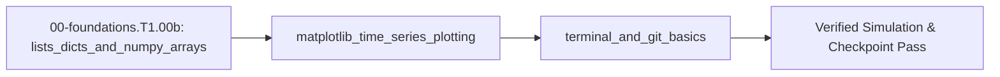

<!-- run-callout:start -->
> **Step 3 of 10 · Make a joint move: foundations**
>
> **Run this in the workbench.** [Open MechaLab with `EX.00-foundations.T1.00b` loaded](https://tle47.github.io/Mechatronics-Roadmap/?lesson=EX.00-foundations.T1.00b) - it opens on the **Run Python Lessons** tab with that entry selected. Starter code, hints and the graded check are ready; this page is the reading copy, and nothing you type here is saved.
<!-- run-callout:end -->

## 1. Why it matters
A 5-second test of a robot joint at $1\text{ kHz}$ records $5,000$ samples each of timestamp, angle, velocity, and motor current. You need lists, dictionaries, and vectorized arrays to compute tracking errors across thousands of samples at once, time-series plots to spot oscillations visually, and Git commits to roll back safely when a tuning change breaks your code. Already know this? Take the Skip test in section 7 first.

## 2. Intuition first

<!-- figure: array-shape | An array is a grid with a shape, and the shape is checked before the maths. -->

Think of a Python `list` as a numbered row of pigeonholes starting at slot `0` where each slot holds one timestamp reading in order, and a `dict` (dictionary) as a labeled parts cabinet where you look up a controller setting by name (`"slope"` or `"offset"`) instead of memorizing slot numbers. When you want to scale all $5,000$ pigeonholes from volts to amperes at once, a NumPy array acts like a synchronized conveyor belt that multiplies every slot simultaneously without stepping through them one by one. Finally, Git acts like a laboratory notebook with permanent ink snapshots: `git status` shows which pages changed today, and `git commit` seals a working checkpoint you can always restore.

## 3. Formalization
1. **Zero-Indexed Lists and Key-Value Dictionaries:** A sequence of $N$ timestamps $t_0, t_1, \dots, t_{N-1}$ with uniform spacing $\Delta t$ in seconds ($\text{s}$) satisfies:

$$
t_i = t_0 + i \cdot \Delta t, \quad i \in \{0, 1, \dots, N-1\}
$$

   For $t_0 = 0.0\text{ s}$, $\Delta t = 0.1\text{ s}$, and $i = 4$ (the last element, indexed as `t_s[-1]`), $t_4 = 0.0\text{ s} + 4 \times 0.1\text{ s} = 0.4\text{ s}$.
2. **Vectorized Array Scaling, Summary Statistics ($\Sigma$), `zip()` & Matplotlib Time-Series Plotting (`plt.plot`):** Given sensor slope $m$ in volts per second ($\text{V/s}$) and offset $b$ in volts ($\text{V}$), the voltage array $y_i = m t_i + b$ has sample mean $\bar{y}$ (where capital Greek Sigma $\sum_{i=0}^{N-1} y_i$ means "add up $y_0 + y_1 + \dots + y_{N-1}$", written `sum(y)` in Python) and peak-to-peak span $\Delta y_{\text{pp}}$:

$$
\bar{y} = \frac{1}{N}\sum_{i=0}^{N-1} y_i, \qquad \Delta y_{\text{pp}} = \max_i(y_i) - \min_i(y_i)
$$

   For $y = [0.5, 0.8, 1.1, 1.4, 1.7]\text{ V}$ ($N = 5$), $\bar{y} = \frac{5.5\text{ V}}{5} = 1.10\text{ V}$ and $\Delta y_{\text{pp}} = 1.7\text{ V} - 0.5\text{ V} = 1.20\text{ V}$. To iterate over two lists in parallel (such as `target` and `measured` in the Exercise below), `zip(target, measured)` pairs corresponding items `(target[0], measured[0]), (target[1], measured[1]), ...`. In interactive desktop scripts, `numpy` arrays (`np.array(t_s)`) and `matplotlib.pyplot` (`plt.plot(t_s, y_v); plt.xlabel("Time [s]"); plt.savefig("plot.png")`) plot these arrays in 3 lines.
3. **Python Virtual Environments (`venv` / `PEP 668`), Terminal & Git Workflow:**
   - **Activate Your Cloned Repository `.venv` & Install Scientific Packages:** Modern Linux (`Ubuntu 24.04`) and macOS block system-wide `pip install` with `error: externally-managed-environment (PEP 668)`. Inside the `mechalab` repository you cloned in [`00-foundations.T1.00a`](00-foundations.T1.00a.md) (`git clone https://github.com/TLE47/Mechatronics-Roadmap.git mechalab && cd mechalab`, see [`resources/open-source-toolchains.md` §0](../resources/open-source-toolchains.md#0-core-supported-os-environment-terminal-bootstrap--python-venv-setup)), activate `.venv` and install `numpy`, `matplotlib`, and `scipy`:
     ```bash
     cd mechalab && source .venv/bin/activate   # Windows PowerShell: .\.venv\Scripts\Activate.ps1
     pip install --upgrade pip numpy matplotlib scipy
     ```
   - **CLI & Git Commands:** `pwd` prints the current folder, `ls` lists files, `cd <dir>` changes folder, `python3 script.py` executes the file, `git status` inspects modified files in your cloned `mechalab` repo, `git diff` displays line-by-line edits, and `git commit -am "msg"` records a versioned snapshot.

## 4. Worked example
**Predict first (before you run it):** Before running the block, commit to three numbers: `y_v[0]` and `y_v[-1]` for `"slope": 3.0` and `"offset": 0.5` over $t = 0.0$ to $0.4\text{ s}$; the mean $\bar{y}$ of those five readings (decide first where the middle of an evenly spaced ramp must sit); and the peak-to-peak span. Two tells that a wrong result is a mistake rather than a surprise: a mean of `0.50` or `1.70` means an endpoint was reported instead of the average, and a span of `1.70` means `min()` was replaced by `0` rather than by the first reading.

Generate $N = 5$ timestamps $t = [0.0, 0.1, 0.2, 0.3, 0.4]\text{ s}$, evaluate sensor readings $y = 3.0 t + 0.5\text{ V}$ using parameters stored in a dictionary, and verify the first/last elements, mean ($1.10\text{ V}$), and peak-to-peak span ($1.20\text{ V}$).

```python
import math

config = {"slope": 3.0, "offset": 0.5}
t_s = [0.0 + 0.1 * i for i in range(5)]
y_v = [config["slope"] * t + config["offset"] for t in t_s]

mean_v = sum(y_v) / len(y_v)
span_v = max(y_v) - min(y_v)

assert len(y_v) == 5
assert math.isclose(y_v[0], 0.5, rel_tol=1e-9)
assert math.isclose(y_v[-1], 1.7, rel_tol=1e-9)
assert math.isclose(mean_v, 1.1, rel_tol=1e-9)
assert math.isclose(span_v, 1.2, rel_tol=1e-9)
print(f"t={[round(x, 2) for x in t_s]}, y={[round(y, 2) for y in y_v]}, mean={mean_v:.2f}, span={span_v:.2f}")
```
Expected output:
```text
t=[0.0, 0.1, 0.2, 0.3, 0.4], y=[0.5, 0.8, 1.1, 1.4, 1.7], mean=1.10, span=1.20
```

## 5. Exercise
Given target angles `target = [1.0, 2.0, 3.0, 4.0]` rad and measured angles `measured = [0.9, 2.1, 2.8, 4.2]` rad, compute the per-sample error list `err = [t - m for t, m in zip(target, measured)]` and the Root-Mean-Square Error $\text{RMSE} = \sqrt{\frac{1}{N}\sum e_i^2}$. Verify that $\text{RMSE} \approx 0.1581139\text{ rad}$ ($\sqrt{0.025}\text{ rad}$, tolerance $\pm 10^{-6}\text{ rad}$).
- **If your result differs:** Make sure you square each error $e_i^2$ *before* averaging (`sum(e*e for e in err) / len(err)`), because averaging signed errors directly cancels $+0.1$ against $-0.1$ to give $0.0$.

### Graded package - a recorded window, an RMS error and a Git lookup
[`exercises/00-foundations.T1.00b/`](../exercises/00-foundations.T1.00b/) turns this section into a test. `starter.py` holds seven holes: `timestamps` (the zero-indexed $t_0 + i\Delta t$ grid), `scaled_readings` (the `"slope"`/`"offset"` dictionary), `mean_of`, `peak_to_peak`, `errors` (paired by `zip()` and length-checked), `rmse` and `git_command` (the task-to-command lookup). Edit it, then run the tests the way CI does:

```bash
EXERCISE_TARGET=exercises/00-foundations.T1.00b/starter.py \
  python3 -m unittest discover -s exercises/00-foundations.T1.00b -p 'test_*.py'
```

**31 tests.** The worked trace is checked at its mean $1.10\text{ V}$ and span $1.20\text{ V}$, the Skip test's $t_{500} = 1.0\text{ s}$, and the exercise at $\text{RMSE} = 0.1581139\text{ rad}$ with a signed mean of exactly $0.0\text{ rad}$ - so an averaged signed error fails where a squared one passes. The transfer suite runs the plant's own recording: its $1\text{ kHz}$ tick for `plant.TICKS` is $1{,}001$ samples from $0.0$ to $1.0\text{ s}$, the 12-bit encoder's count ramp scales to $2047.5/4096$ turns, and the gravity torque over a $90^{\circ}$ sweep spans $0.318825\text{ N}\cdot\text{m}$. Six planted faults - `timestamps_off_by_one`, `scale_swaps_slope_offset`, `peak_to_peak_half_span`, `rmse_averages_signed_errors`, `errors_silently_zips`, `git_defaults_to_status` - each fail the test named for them.

- **📚 What to Learn & Resources to Solve This Exercise:**
  - **Prerequisite Foundations Module:** [`00-foundations.T1.00a`](00-foundations.T1.00a.md) (*Variables, Loops & Functions*).
  - **Core Concepts to Review First:** Python list indexing, `zip(target, measured)`, `sum(samples) / len(samples)`, and `max(samples) - min(samples)` in `## 3. Formalization` (Items 1–2) and `## 4. Worked example` above.
  - **Python & NumPy Study Links:** [Python Tutorial §3.1.3 (Lists)](https://docs.python.org/3/tutorial/introduction.html#lists), [NumPy Absolute Beginners Tutorial (`numpy.org`)](https://numpy.org/doc/stable/user/absolute_beginners.html), [Matplotlib Pyplot Tutorial (`matplotlib.org`)](https://matplotlib.org/stable/tutorials/pyplot.html), and [Pro Git Book Ch. 1–2 (`git-scm.com`)](https://git-scm.com/book/en/v2).
  - **Curriculum Reference:** [Track 00 Tier 1 (`00-foundations/README.md`)](../00-foundations/README.md#tier-1-beginner--intuitive) and [Open-Source Toolchains (`resources/open-source-toolchains.md`)](../resources/open-source-toolchains.md).

### Starter code
```python
"""Exercise 00-foundations.T1.00b - the learner's file.

A recorded window, a scaled sensor trace, the two summary statistics, the per-sample tracking
error with its RMS, and the Git command behind a task. Fill the seven TODOs:

    EXERCISE_TARGET=exercises/00-foundations.T1.00b/starter.py \
        python3 -m unittest discover -s exercises/00-foundations.T1.00b -p 'test_*.py'
"""

import math


def timestamps(t0_s, dt_s, n):
    """The timestamps of n evenly spaced steps from the start."""
    raise NotImplementedError("TODO 1: the timestamp of each evenly spaced step")


def scaled_readings(values, config):
    """The readings converted with the sensor's own named calibration."""
    raise NotImplementedError("TODO 2: the readings converted with the sensor's own named calibration")


def mean_of(values):
    """The sample mean."""
    raise NotImplementedError("TODO 3: the typical value of the sample")


def peak_to_peak(values):
    """The full span between the smallest and largest value."""
    raise NotImplementedError("TODO 4: the full span the samples cover")


def errors(target, measured):
    """The per-sample gap between the two series, in order."""
    raise NotImplementedError("TODO 5: the gap between target and measurement at each sample")


def rmse(target, measured):
    """The root-mean-square of the per-sample errors."""
    raise NotImplementedError("TODO 6: the overall error magnitude, with signs unable to cancel")


def git_command(task):
    """The command for a task."""
    raise NotImplementedError("TODO 7: the command recorded for the task, refusing an unknown one")


# The browser entry appends `selfcheck.py` below this line; on its own this file prints nothing.
```

### Hint ladder
1. **Zero-index, so `n` samples stop one short of `n`.** `timestamps(0.0, 0.1, 5)` must end at `0.4`, not `0.5`: `range(n)` gives `i = 0..n-1`. The Skip test's $t_{500}$ is `0.0 + 500 * 0.002 = 1.0 s`.
2. **The dictionary is the calibration.** Both constants arrive by name in `config`; a `KeyError` on `"Kp"` when the key is `"kp"` is the module's own common-mistake row, so read `config["slope"]` and `config["offset"]` exactly.
3. **Order the pairs before you subtract.** `zip(target, measured)` yields `(1.0, 0.9)`, then `(2.0, 2.1)`; target minus measured gives `+0.1, -0.1, +0.2, -0.2` rad. If your errors come back all positive, you zipped the lists in the other order.
4. **Square before you average.** `sum(err) / 4` is exactly `0.0` here - the signs cancel - while `sum(e*e for e in err) / 4` is `0.025`, and `math.sqrt` of that is `0.1581139` rad.

5. **What the suite refuses.** An empty trace (`mean_of`, `peak_to_peak`, `rmse`), a pair of traces of different lengths (`errors`, `rmse`), a `timestamps` call with a non-positive step or fewer than one sample, a `git_command` task other than the two it knows, and a `scaled_readings` config missing a key it needs all raise `ValueError`.

### Full Solution
```python
import math

# The module's terminal workflow, as a dictionary: the task you have, the command that does it.
GIT_TASKS = {
    "which lines changed": "git diff",
    "which files changed": "git status",
    "record a snapshot": 'git commit -am "msg"',
    "the history": "git log --oneline",
}


def timestamps(t0_s, dt_s, n):
    """t_i = t0 + i*dt for i = 0 .. n-1, zero-indexed like the list it returns."""
    if n < 1:
        raise ValueError("a recording needs at least one sample")
    if dt_s <= 0.0:
        raise ValueError("the sample spacing must be positive")
    return [t0_s + i * dt_s for i in range(n)]


def scaled_readings(values, config):
    """y_i = slope * x_i + offset, with both constants read from the config dictionary by name."""
    if not isinstance(config, dict):
        raise ValueError("the calibration must be a dictionary with 'slope' and 'offset'")
    for key in ("slope", "offset"):
        if key not in config:
            raise ValueError("the calibration dictionary has no %r key" % key)
    slope = config["slope"]
    offset = config["offset"]
    return [slope * value + offset for value in values]


def mean_of(values):
    """The sample mean, sum(values) / len(values)."""
    if not values:
        raise ValueError("an empty trace has no mean")
    return sum(values) / len(values)


def peak_to_peak(values):
    """The span a plot's y-axis has to cover: max(values) - min(values)."""
    if not values:
        raise ValueError("an empty trace has no span")
    return max(values) - min(values)


def errors(target, measured):
    """Per-sample tracking error e_i = target_i - measured_i, paired by zip()."""
    if len(target) != len(measured):
        raise ValueError(
            "target and measured must hold the same number of samples, not %d and %d"
            % (len(target), len(measured))
        )
    return [want - got for want, got in zip(target, measured)]


def rmse(target, measured):
    """Root-mean-square error: sqrt(mean(e_i^2)), the square taken before the average."""
    per_sample = errors(target, measured)
    if not per_sample:
        raise ValueError("an empty trace has no error")
    return math.sqrt(sum(error * error for error in per_sample) / len(per_sample))


def git_command(task):
    """The command for a task; an unknown task is refused instead of guessed."""
    if task not in GIT_TASKS:
        raise ValueError("no known Git task %r; try one of %s"
                         % (task, ", ".join(sorted(GIT_TASKS))))
    return GIT_TASKS[task]

config = {"slope": 3.0, "offset": 0.5}
t_s = timestamps(0.0, 0.1, 5)
y_v = scaled_readings(t_s, config)
target = [1.0, 2.0, 3.0, 4.0]
measured = [0.9, 2.1, 2.8, 4.2]
err = errors(target, measured)

assert len(y_v) == 5 and abs(y_v[-1] - 1.7) <= 1e-9
assert abs(mean_of(y_v) - 1.10) <= 1e-9
assert abs(peak_to_peak(y_v) - 1.20) <= 1e-9
assert abs(sum(err) / len(err) - 0.0) <= 1e-12
assert abs(rmse(target, measured) - 0.1581139) <= 1e-6

print("mean=%.2f V | span=%.2f V | signed mean=%.1f rad | RMSE=%.7f rad"
      % (mean_of(y_v), peak_to_peak(y_v), sum(err) / len(err), rmse(target, measured)))
```

Printed: `mean=1.10 V | span=1.20 V | signed mean=0.0 rad | RMSE=0.1581139 rad`.

**On the shared arm.** The Transfer suite builds its timestamp grid from the plant's `TICKS + 1` samples at `DT`, which is a one-second window:

```python
import mechalab_plant as plant

window = [k * plant.DT for k in range(plant.TICKS + 1)]
assert len(window) == 1001
assert abs(window[-1] - 1.0) < 1e-12
assert abs(sum(window) / len(window) - 0.5) < 1e-12
print("plant window: %d samples, mean %.3f s, span %.3f s"
      % (len(window), sum(window) / len(window), window[-1] - window[0]))
```

### Break it on purpose
Inject the error the exercise hint warns about, on the exercise's own lists `target = [1.0, 2.0, 3.0, 4.0]` and `measured = [0.9, 2.1, 2.8, 4.2]`:
- **Inject:** replace `sum(e * e for e in err) / len(err)` with `sum(err) / len(err)` — average the signed errors, then take the square root as if they had been squared.
- **Symptom:** `err` is `[0.1, -0.1, 0.2, -0.2]` rad, yet `rmse` prints `0.0000000` rad instead of `0.1581139` rad, because the four samples cancel in pairs and the sum is exactly `0.0`.
- **Diagnose:** a reported error of zero on four visibly non-zero samples can only mean the signs were let into the sum; a genuinely perfect controller would show `err` all zeros, which it does not. Squaring first gives $0.01 + 0.01 + 0.04 + 0.04 = 0.10$, then $0.10 / 4 = 0.025$ and $\sqrt{0.025} = 0.1581139$.
- **Fix:** square each error inside the sum, `sum(e * e for e in err) / len(err)`, and confirm $\text{RMSE} = 0.1581139\text{ rad}$ to $\pm 10^{-6}\text{ rad}$ — while the *mean* of the signed errors, a different quantity, is the one that comes back `0.0`.

## 6. Simulation path
Run the worked-example script in your terminal with `python3` (inside your `.venv`), or inspect how time-series arrays (`t`, `q`, `i_q`) are plotted across **Two-Mass & Notch Bode** and **25 kHz PMSM FOC** of the MechaLab Workbench (`resources/open-source-toolchains.md`).
- **Canonical First-Success Hands-On Practice (`NumPy` Array + `Matplotlib` Plot + `Git` Commit):**
  Inside your activated `.venv` (`source .venv/bin/activate`), run this 1-minute verification to practice creating a `numpy` array, saving a `matplotlib` plot to disk, and recording your first `git commit`:
  ```bash
  python3 -c "import numpy as np, matplotlib.pyplot as plt; t = np.linspace(0.0, 0.4, 5); y = 3.0 * t + 0.5; plt.plot(t, y, 'o-'); plt.xlabel('Time [s]'); plt.ylabel('Voltage [V]'); plt.savefig('t1_00b_plot.png'); print('Saved plot, mean=', float(np.mean(y)))"
  ls -lh t1_00b_plot.png               # Verify non-empty PNG file was created
  git status                           # Inspect untracked/modified files
  git add t1_00b_plot.png && git commit -m "Verify T1.00b NumPy and Matplotlib plot" && git log -n 1 --oneline
  ```
  *If `ModuleNotFoundError: No module named 'numpy'` occurs:* Activate your virtual environment first (`source .venv/bin/activate && pip install numpy matplotlib`). *If `git commit` asks `Please tell me who you are`:* Run `git config --global user.name "Your Name" && git config --global user.email "you@example.com"`.

No hardware required for this module (`hardware_required: false`). When you stream binary telemetry from a microcontroller in Track 04, incoming serial packets unpack directly into these timestamp and measurement arrays:
```text
[MCU 1 kHz Telemetry] ===(USB UART)===> [Python List/Array Buffer: t_s[], y_v[]] ===> [Time-Series Plot]
```
Pass/fail verification in simulation: `mean_v == 1.10 V` and `span_v == 1.20 V`.




## 7. Checkpoint
Pass criteria: run the worked example and exercise RMSE check with zero assertion failures, or score $\ge 80\%$ ($4/5$) on the Skip test below.

### Skip test
<!-- skip-test:start -->
1. `[Recall] [Concept: lists_dicts_and_numpy_arrays]` For `samples = [10.0, 20.0, 30.0, 40.0]`, compute the numeric difference `samples[-1] - samples[0]` (tolerance $\pm 10^{-9}$).
2. `[Apply] [Concept: lists_dicts_and_numpy_arrays]` Evaluate `[2.5 * x - 1.0 for x in [0.0, 1.0, 2.0]]` and state the middle element (index `1`, tolerance $\pm 10^{-9}$).
3. `[Transfer] [Concept: matplotlib_time_series_plotting]` You record $1,000$ samples over $2.0\text{ s}$ starting at $t_0 = 0.0\text{ s}$ with step $\Delta t = 0.002\text{ s}$. What is the timestamp $t_{500}$ at index `500` in seconds (tolerance $\pm 10^{-9}\text{ s}$)?
4. `[Concept: terminal_and_git_basics]` Which Git command shows the exact line-by-line code changes you have made since the last commit before staging them?
   - **A.** `git init`
   - **B.** `git diff`
   - **C.** `git clone`
   - **D.** `git branch`
5. `[Spaced review -> 00-foundations.T1.00a — Concept: for_while_loops_and_functions] [Concept: lists_dicts_and_numpy_arrays]` Trace `s = sum([k for k in range(1, 5)])` (i.e. $1 + 2 + 3 + 4$) and state the final integer value of `s` (tolerance $\pm 10^{-9}$).

**Answer key:**
```python
import math

samples = [10.0, 20.0, 30.0, 40.0]
q1_diff = samples[-1] - samples[0]
q2_mid = [2.5 * x - 1.0 for x in [0.0, 1.0, 2.0]][1]
q3_t500 = 0.0 + 500 * 0.002
q4_git = "B"
q5_sum = sum([k for k in range(1, 5)])

assert math.isclose(q1_diff, 30.0, rel_tol=1e-9)
assert math.isclose(q2_mid, 1.5, rel_tol=1e-9)
assert math.isclose(q3_t500, 1.0, rel_tol=1e-9)
assert q4_git == "B"
assert q5_sum == 10
```
- **Pass mark:** $4/5$ ($80\%+$). If you missed Q1 or Q2, study `## 3. Formalization`; if you missed Q3, study `## 4. Worked example`; if you missed Q4, study `## 2. Intuition first`; if you missed Q5, study `## 4. Worked example` (and review `00-foundations.T1.00a`). On pass, proceed to `## 10. Next modules`.
<!-- skip-test:end -->

### Gate test
Covers the complete Track 00 Tier 1 bridge ladder (`00-foundations.T1.00a` $\to$ `00-foundations.T1.00b` $\to$ `00-foundations.T1.00c` $\to$ `00-foundations.T1.00d` $\to$ `00-foundations.T1.00e`) before Step 1.1 (`00-foundations.T1.01`):
1. `[Concept: lists_dicts_and_numpy_arrays]` For `samples = [4.0, 8.0, 15.0, 16.0, 23.0, 42.0]`, compute `samples[-1] - samples[2]` (tolerance $\pm 10^{-9}$).
2. `[Concept: lists_dicts_and_numpy_arrays]` What does `[1.0, 2.0] * 2` evaluate to?
   - **A.** `[2.0, 4.0]`
   - **B.** `[1.0, 2.0, 1.0, 2.0]`
   - **C.** `[1.0, 2.0, 2.0]`
   - **D.** `TypeError`
3. `[Concept: matplotlib_time_series_plotting]` A recording holds $N = 500$ samples at $\Delta t = 0.004\ \text{s}$ starting at $t_0 = 0.0\ \text{s}$. Report the timestamp at index `499` in seconds (tolerance $\pm 10^{-9}$).
4. `[Concept: matplotlib_time_series_plotting]` `plt.plot(t, y)` raises `ValueError: x and y must have same first dimension`. Which cause matches that traceback?
   - **A.** `t` holds $N+1$ samples while `y` holds $N$, because one list was appended to once more than the other.
   - **B.** Both lists are empty.
   - **C.** `y` was scaled by a float.
   - **D.** The figure was never saved with `plt.savefig`.
5. `[Concept: terminal_and_git_basics]` Which single command records a versioned snapshot of every already-tracked change, with a message?
   - **A.** `git commit -am "msg"`
   - **B.** `git status`
   - **C.** `git diff`
   - **D.** `git clone`
6. `[Concept: python_variables_and_types] [Concept: for_while_loops_and_functions]` Trace the loop below and compute the final value of `total` (tolerance $\pm 10^{-9}$):
```python
total = 0.0
for k in range(3):
    total = total + 0.5 * k
```
7. `[Concept: traceback_error_reading]` A config dictionary was written with the key `"kp"`, but the code reads `config["Kp"]`. Which exception class does the traceback name?
   - **A.** `KeyError`
   - **B.** `IndexError`
   - **C.** `NameError`
   - **D.** `ZeroDivisionError`
8. `[Concept: si_base_and_derived_units] [Concept: dimensional_analysis_unit_checks] [Concept: scientific_notation_and_prefixes]` An RC filter has $R = 3.3\ \text{k}\Omega$ and $C = 2.2\ \mu\text{F}$. Report its time constant $\tau = RC$ in milliseconds (tolerance $\pm 10^{-9}$).
9. `[Concept: radians_unit_circle_and_atan2] [Concept: linear_functions_and_slope] [Concept: 2d_vectors_and_components]` A displacement has components $x = 0.60\ \text{m}$ and $y = -0.80\ \text{m}$. Report its magnitude in metres, its heading in degrees from `math.degrees(math.atan2(y, x))`, and its slope $y/x$ (tolerance $\pm 10^{-9}$).
10. `[Concept: newtons_second_law_and_torque] [Concept: discrete_kinematics_pos_vel_acc] [Concept: spring_energy_and_power]` A joint with inertia $J = 0.020\ \text{kg}\cdot\text{m}^2$ carries a net torque $\tau = 0.50\ \text{N}\cdot\text{m}$. Compute (a) its angular acceleration $\alpha = \tau/J$ in $\text{rad/s}^2$, (b) its angular speed after one $\Delta t = 0.002\ \text{s}$ tick from rest, and (c) the energy stored in a spring of stiffness $k = 25.0\ \text{N/m}$ stretched by $x = 0.080\ \text{m}$, in joules (all tolerances $\pm 10^{-9}$).

**Gate answer key:**
```python
import math

samples = [4.0, 8.0, 15.0, 16.0, 23.0, 42.0]
g1 = samples[-1] - samples[2]
g2_choice = "B"
g3 = 499 * 0.004
g4_choice = "A"
g5_choice = "A"
total = 0.0
for k in range(3):
    total = total + 0.5 * k
g6 = total
g7_choice = "A"
g8_ms = 3.3e3 * 2.2e-6 * 1e3
g9_mag = math.hypot(0.60, -0.80)
g9_heading = math.degrees(math.atan2(-0.80, 0.60))
g9_slope = -0.80 / 0.60
g10_alpha = 0.50 / 0.020
g10_omega = 0.0 + g10_alpha * 0.002
g10_energy = 0.5 * 25.0 * (0.080 ** 2)

assert math.isclose(g1, 27.0, rel_tol=1e-9)
assert g2_choice == "B"
assert math.isclose(g3, 1.996, rel_tol=1e-9)
assert g4_choice == "A"
assert g5_choice == "A"
assert math.isclose(g6, 1.5, rel_tol=1e-9)
assert g7_choice == "A"
assert math.isclose(g8_ms, 7.26, rel_tol=1e-9)
assert math.isclose(g9_mag, 1.0, rel_tol=1e-9)
assert math.isclose(g9_heading, -53.13010235415598, rel_tol=1e-12)
assert math.isclose(g9_slope, -1.3333333333333333, rel_tol=1e-12)
assert math.isclose(g10_alpha, 25.0, rel_tol=1e-9)
assert math.isclose(g10_omega, 0.05, rel_tol=1e-9)
assert math.isclose(g10_energy, 0.08, rel_tol=1e-9)
```
- **Pass mark:** $\ge 80\%$ ($4/5$ on Skip test; $\ge 8/10$ on Gate test). Missed Gate Q1-Q2: study `00-foundations.T1.00b` and `## 3. Formalization`; Q3-Q4: `00-foundations.T1.00b` and `## 4. Worked example`; Q5: `00-foundations.T1.00b` and `## 6. Simulation path`; Q6: `00-foundations.T1.00a`; Q7: `00-foundations.T1.00a`; Q8: `00-foundations.T1.00c`; Q9: `00-foundations.T1.00d`; Q10: `00-foundations.T1.00e`.

## 8. Common mistakes
| Symptom | Root cause | 2-minute fix |
| :--- | :--- | :--- |
| `[1, 2, 3] * 2` gives `[1, 2, 3, 1, 2, 3]` instead of `[2, 4, 6]` | Multiplying a standard Python `list` repeats the list instead of scaling elements. | Use `np.array([1, 2, 3]) * 2` or a list comprehension `[2 * x for x in lst]`. |
| `ValueError: x and y must have same first dimension` when plotting | Time list `t_s` has $N+1$ points while sensor list `y_v` has $N$ points. | Append to `t_s` and `y_v` inside the exact same loop iteration and check `len(t_s) == len(y_v)`. |
| `KeyError: 'Kp'` when reading parameter dictionary | Dictionary keys are case-sensitive (`"kp"` vs `"Kp"`). | Use consistent lowercase snake_case keys across your config dict. |

## 9. Resources
- **NumPy & Matplotlib Docs — [*NumPy Absolute Beginners Guide*](https://numpy.org/doc/stable/user/absolute_beginners.html) & [*Matplotlib Pyplot Tutorial*](https://matplotlib.org/stable/tutorials/pyplot.html) ([`resources/open-source-toolchains.md`](../resources/open-source-toolchains.md)):** Array slicing, vectorized operations, and time-series plotting `[VERIFIED 2026-10-15]`.
- **Scott Chacon & Ben Straub — [*Pro Git* (`git-scm.com/book`)](https://git-scm.com/book/en/v2) & [Track 00 (`00-foundations/README.md`)](../00-foundations/README.md):** Command-line navigation, `git status`, `git add`, and `git commit` workflow `[VERIFIED 2026-10-15]`.

## 10. Next modules

<!-- next-step:start -->
👉 **Next:** [Step 3 · Make a joint move: foundations — 00-foundations.T1.00c: SI Units, Engineering Prefixes & Dimensional Analysis](00-foundations.T1.00c.md)
<!-- next-step:end -->
