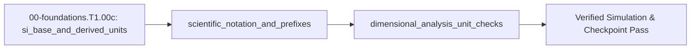

<!-- run-callout:start -->
> **Step 3 of 10 · Make a joint move: foundations**
>
> **Run this in the workbench.** [Open MechaLab with `EX.00-foundations.T1.00c` loaded](https://tle47.github.io/Mechatronics-Roadmap/?lesson=EX.00-foundations.T1.00c) - it opens on the **Run Python Lessons** tab with that entry selected. Starter code, hints and the graded check are ready; this page is the reading copy, and nothing you type here is saved.
<!-- run-callout:end -->

## 1. Why it matters
Real motors and power stages fail violently when units are mixed up: plugging a $1\text{ ms}$ sample period into a derivative formula as `dt = 1` instead of `dt = 0.001` multiplies motor torque commands by $1,000\times$, and confusing RPM with radians per second ruins back-EMF calculations. Dimensional analysis lets you catch wrong equations before running code by checking that units cancel cleanly on both sides of `=`. Already know this? Take the Skip test in section 7 first.

## 2. Intuition first

<!-- figure: unit-cancellation | Carry the units through the arithmetic; they cancel or the equation is wrong. -->

Imagine building a table where one blueprint sheet gives leg lengths in millimeters, another gives the tabletop in meters, and a third lists weight in grams. If you add the raw numbers $500$ and $1.2$ without converting them to the same ruler first, the table collapses. In engineering code, we adopt one universal rule: convert every incoming number at the boundary of your program into standard base SI units (meters, kilograms, seconds, amperes, volts, radians), tag variable names with their unit suffix (`omega_rad_s`, `tau_nm`, `dt_s`), and treat unit labels like fractions where matching top and bottom labels cancel out.

## 3. Formalization
1. **Base and Derived SI Units:** Store length in meters ($\text{m}$), mass in kilograms ($\text{kg}$), time in seconds ($\text{s}$), current in amperes ($\text{A}$), and plane angle in radians ($\text{rad}$). Mechanical power $P$ in watts ($\text{W} = \text{J/s} = \text{N}\cdot\text{m/s}$) is the product of torque $\tau$ in newton-meters ($\text{N}\cdot\text{m}$) and angular velocity $\omega$ in radians per second ($\text{rad/s}$):

$$
P = \tau \cdot \omega
$$

   Substituting $\tau = 0.45\text{ N}\cdot\text{m}$ and $\omega = 251.3274\text{ rad/s}$ gives $P = (0.45\text{ N}\cdot\text{m})(251.3274\text{ rad/s}) = 113.0973\text{ W}$.
2. **Engineering Prefixes ($10^{3k}$):** Convert prefixed datasheet quantities into base SI units on input: $\text{milli (m)} = 10^{-3}$, $\text{micro (}\mu\text{)} = 10^{-6}$, $\text{nano (n)} = 10^{-9}$, $\text{kilo (k)} = 10^{3}$, and $\text{mega (M)} = 10^{6}$. For an RC filter with resistance $R = 10\text{ k}\Omega = 10\times 10^3\,\Omega$ and capacitance $C = 100\text{ nF} = 100\times 10^{-9}\text{ F}$, the time constant $\tau_{RC}$ in seconds ($\text{s} = \Omega\cdot\text{F}$) is:

$$
\tau_{RC} = R \cdot C = (10\times 10^3\,\Omega)(100\times 10^{-9}\text{ F}) = 1.0\times 10^{-3}\text{ s} = 1.00\text{ ms}
$$

3. **Dimensional Cancellation (RPM to $\text{rad/s}$):** Given shaft speed $N$ in revolutions per minute ($\text{RPM}$), cancel revolutions and minutes using $2\pi\text{ rad} = 1\text{ rev}$ and $60\text{ s} = 1\text{ min}$:

$$
\omega = N\,\left[\frac{\text{rev}}{\text{min}}\right] \times \frac{2\pi\text{ rad}}{1\text{ rev}} \times \frac{1\text{ min}}{60\text{ s}}
$$

   For $N = 2400\text{ RPM}$, $\omega = 2400 \times \frac{2\pi}{60}\text{ rad/s} = 80\pi\text{ rad/s} \approx 251.3274\text{ rad/s}$.

## 4. Worked example
**Predict first (before you run it):** Commit to three numbers before running the block: $\omega$ for $N = 2400\text{ RPM}$ (decide first whether it should sit near $40$, $250$ or $2500\text{ rad/s}$); the shaft power from $\tau = 450\text{ mN}\cdot\text{m}$ at that speed; and $\tau_{RC}$ for the $10\text{ k}\Omega$ / $100\text{ nF}$ pair, in milliseconds. Two tells that a wrong result is a mistake rather than a surprise: a power near $113\text{ kW}$ means the torque entered as `450` instead of `0.45`, a factor of exactly $1000$; and a time constant of $1.0\text{ s}$ means the capacitance was read as $100\,\mu\text{F}$ ($10^{-6}$) rather than $100\text{ nF}$ ($10^{-9}$).

Convert $N = 2400\text{ RPM}$ and $\tau = 450\text{ mN}\cdot\text{m}$ into base SI units to compute mechanical shaft power $P$ in watts, and compute the time constant $\tau_{RC}$ of a $10\text{ k}\Omega$, $100\text{ nF}$ filter.

```python
import math

def rpm_to_rad_s(rpm: float) -> float:
    return rpm * (2.0 * math.pi / 60.0)

omega_rad_s = rpm_to_rad_s(2400.0)
tau_nm = 450.0 * 1e-3
power_w = tau_nm * omega_rad_s

rc_time_constant_s = (10.0 * 1e3) * (100.0 * 1e-9)  # 10 kOhm * 100 nF = 1 ms

assert math.isclose(omega_rad_s, 80.0 * math.pi, rel_tol=1e-9)
assert math.isclose(power_w, 113.0973355, rel_tol=1e-6)
assert math.isclose(rc_time_constant_s, 1.0e-3, rel_tol=1e-9)
print(f"omega={omega_rad_s:.2f} rad/s, P={power_w:.2f} W, tau_RC={rc_time_constant_s*1e3:.2f} ms")
```
Expected output:
```text
omega=251.33 rad/s, P=113.10 W, tau_RC=1.00 ms
```

## 5. Exercise
A $48\text{ V}$ supply delivers $I = 15\text{ A}$ through a PCB trace of resistance $R = 12\text{ m}\Omega$ ($12\times 10^{-3}\,\Omega$). Compute the voltage drop $V_{\text{drop}} = I R$ in volts ($\text{V}$) and the trace heat dissipation $P_{\text{loss}} = I^2 R$ in watts ($\text{W}$). Expected result: `V_drop = 0.18 V` and `P_loss = 2.70 W` (tolerance $\pm 10^{-6}$).
- **If your result differs:** Check that you converted $12\text{ m}\Omega$ to $0.012\,\Omega$ (`12e-3`) before multiplying by $15^2 = 225\text{ A}^2$.

### Graded package - prefixes, the trace and the unit algebra
[`exercises/00-foundations.T1.00c/`](../exercises/00-foundations.T1.00c/) turns this section into a test. `starter.py` holds seven holes: `rpm_to_rad_s` (the $2\pi/60$ factor), `prefix_scale` (milli, micro, nano, kilo, mega, and a refusal for a prefix that is not in the table), `trace_drop_v` ($IR$), `trace_loss_w` ($I^2R$), `rc_time_constant_s` ($RC$, in seconds), `shaft_power_w` ($\tau\omega$) and `loop_period_us` ($1/f$ in microseconds). Edit it, then run the tests the way CI does:

```bash
EXERCISE_TARGET=exercises/00-foundations.T1.00c/starter.py \
  python3 -m unittest discover -s exercises/00-foundations.T1.00c -p 'test_*.py'
```

**31 tests.** The conversion is checked at the worked example's $2400\text{ RPM}$, at the Skip test's $3000\text{ RPM}$ and at $60\text{ RPM} = 2\pi\text{ rad/s}$, so a factor of $60$ fails; the trace is checked at the exercise's $0.18\text{ V}$ and $2.7\text{ W}$ and at the Skip test's $100\text{ mV}$ shunt, so a loss computed as $IR$ fails; the prefix table is checked at $450\text{ mN}\cdot\text{m}$, $100\text{ nF}$ and $1\,\mu = 10^{-6}$, so nano mapped to $10^{-6}$ fails; the filter is checked at the worked example's $1\text{ ms}$; and the loop period at the Skip test's $40\,\mu\text{s}$. The transfer suite runs the plant's own constants: its $1\text{ ms}$ tick is exactly the $10\text{ k}\Omega$/$100\text{ nF}$ time constant, its $4096$-count encoder at one turn per second is $60\text{ RPM}$, its $2.5\text{ N}\cdot\text{m}$ clamp is $2500\text{ mN}\cdot\text{m}$, and the clamp at $100\text{ RPM}$ delivers $26.179939\text{ W}$. Five planted faults - `rpm_multiplies_by_60`, `nano_is_micro`, `loss_forgets_the_square`, `time_constant_in_milliseconds`, `period_in_milliseconds` - each fail the test named for them.

- **📚 What to Learn & Resources to Solve This Exercise:**
  - **Prerequisite Foundations Modules:** [`00-foundations.T1.00a`](00-foundations.T1.00a.md) (*Python Arithmetic & Functions*) and [`00-foundations.T1.00b`](00-foundations.T1.00b.md) (*Lists & Arrays*).
  - **Core Concepts to Review First:** SI prefix powers of ten ($\text{milli} = 10^{-3}, \text{micro} = 10^{-6}, \text{kilo} = 10^3$) and RPM-to-$\text{rad/s}$ factor-label cancellation ($\omega = \text{RPM} \times \frac{2\pi}{60}$) in `## 3. Formalization` (Items 1–3) and `## 4. Worked example` above.
  - **SI Units & Dimensional Analysis Study Links:** [NIST Guide to the SI: Metric Prefixes & Unit Conversions (`nist.gov`)](https://www.nist.gov/pml/owm/metric-si/si-units) and [SparkFun: Metric Prefixes & Scientific Notation Tutorial](https://learn.sparkfun.com/tutorials/metric-prefixes-and-si-units).
  - **Curriculum Reference:** [Track 00 Level 0 (`00-foundations/README.md`)](../00-foundations/README.md#level-0-global-prerequisite-on-ramp-intuition--bench-tools) and [Textbooks & Papers (`resources/textbooks-and-papers.md`)](../resources/textbooks-and-papers.md).

### Starter code
```python
"""Exercise 00-foundations.T1.00c - the learner's file.

Convert prefixed datasheet numbers into base SI units before doing arithmetic with them. Fill the
seven TODOs, then run the tests the way CI does:

    EXERCISE_TARGET=exercises/00-foundations.T1.00c/starter.py \
        python3 -m unittest discover -s exercises/00-foundations.T1.00c -p 'test_*.py'
"""

import math

PREFIXES = {
    "": 1.0,
    "k": 1e3,
    "M": 1e6,
    "m": 1e-3,
    "u": 1e-6,
    "\u00b5": 1e-6,
    "n": 1e-9,
}


def rpm_to_rad_s(rpm):
    """Revolutions per minute to radians per second."""
    raise NotImplementedError(
        "TODO 1: radians per second from revolutions per minute: a full turn is two pi radians, and a minute is sixty seconds"
    )


def prefix_scale(value, prefix):
    """A prefixed quantity in base SI units."""
    raise NotImplementedError("TODO 2: look the factor up in PREFIXES; refuse a prefix that is not there")


def trace_drop_v(current_a, resistance_ohm):
    """Voltage drop across a resistance."""
    raise NotImplementedError("TODO 3: Ohm's law: the current through the trace, times its resistance")


def trace_loss_w(current_a, resistance_ohm):
    """Heat dissipated in a resistance."""
    raise NotImplementedError("TODO 4: the current squared, times the resistance: 15 A through 12 mOhm is 2.7 W, not 0.18 W")


def rc_time_constant_s(resistance_ohm, capacitance_f):
    """RC time constant in seconds."""
    raise NotImplementedError("TODO 5: the resistance times the capacitance, with the farads already converted")


def shaft_power_w(torque_nm, omega_rad_s):
    """Mechanical shaft power."""
    raise NotImplementedError("TODO 6: torque times angular speed, with the speed in radians per second, so convert the RPM first")


def loop_period_us(frequency_hz):
    """One control-loop period, in microseconds."""
    raise NotImplementedError("TODO 7: the period is one over the frequency, in seconds; scale to microseconds with a million, not a thousand")


# The browser entry appends `selfcheck.py` below this line; on its own this file prints nothing.
```

### Hint ladder
1. **Every prefixed number becomes base SI before it is used.** $12\text{ m}\Omega$ is `12e-3` ohms, not `12`; $450\text{ mN}\cdot\text{m}$ is `0.45` N·m. `prefix_scale` is that conversion in one place, and the exercise's trace is `12 * 1e-3`.
2. **The RPM factor is fixed, not fitted.** $1\text{ rev} = 2\pi\text{ rad}$ and $1\text{ min} = 60\text{ s}$, so `rpm_to_rad_s` multiplies by `2*math.pi/60`. Using `60` instead is the planted fault: $2400 \times 60 = 144000$ rad/s instead of $251.3274$.
3. **Two powers, two formulas.** $V_{\text{drop}} = IR = 15 \times 0.012 = 0.18\text{ V}$; $P_{\text{loss}} = I^2R = 225 \times 0.012 = 2.70\text{ W}$. If both come back `0.18`, the square is missing from the loss.
4. **Seconds in, microseconds out is a factor of $10^6$.** $1/f$ is in seconds, so a $25\text{ kHz}$ loop's $4\times10^{-5}\text{ s}$ is `40` µs; multiplying by $10^3$ reports `0.04`, which is milliseconds mislabelled.

5. **What the suite refuses.** `prefix_scale` refuses a prefix that is not in its table, `trace_drop_v` and `trace_loss_w` refuse a negative resistance, `rc_time_constant_s` refuses a non-positive resistance or capacitance, and `loop_period_us` refuses a non-positive frequency - each raises `ValueError`.

### Full Solution
```python
import math

# The engineering prefixes the module names, as (value in base units) per one prefixed unit.
PREFIXES = {
    "": 1.0,
    "k": 1e3,
    "M": 1e6,
    "m": 1e-3,
    "u": 1e-6,
    "\u00b5": 1e-6,
    "n": 1e-9,
}


def rpm_to_rad_s(rpm):
    """omega = RPM * 2*pi / 60: revolutions per minute to radians per second."""
    return rpm * (2.0 * math.pi / 60.0)


def prefix_scale(value, prefix):
    """Convert a prefixed quantity into base SI units: 450 m -> 0.45, 100 n -> 1e-7."""
    try:
        factor = PREFIXES[prefix]
    except KeyError:
        raise ValueError("unknown SI prefix %r (known: %s)"
                         % (prefix, ", ".join(sorted(PREFIXES))))
    return value * factor


def trace_drop_v(current_a, resistance_ohm):
    """V_drop = I R, in volts, for a current already in amperes and a resistance in ohms."""
    if resistance_ohm < 0.0:
        raise ValueError("a resistance cannot be negative")
    return current_a * resistance_ohm


def trace_loss_w(current_a, resistance_ohm):
    """P_loss = I^2 R. The square is the whole point: 15 A through 12 mOhm burns 2.7 W, not 0.18 W."""
    if resistance_ohm < 0.0:
        raise ValueError("a resistance cannot be negative")
    return current_a * current_a * resistance_ohm


def rc_time_constant_s(resistance_ohm, capacitance_f):
    """tau_RC = R C. Ohms times farads is seconds: 10 kOhm * 100 nF = 1 ms."""
    if resistance_ohm <= 0.0:
        raise ValueError("a resistance must be positive")
    if capacitance_f <= 0.0:
        raise ValueError("a capacitance must be positive")
    return resistance_ohm * capacitance_f


def shaft_power_w(torque_nm, omega_rad_s):
    """P = tau omega, with omega in rad/s - never in RPM, which is 9.55x the wrong number."""
    return torque_nm * omega_rad_s


def loop_period_us(frequency_hz):
    """T_s = 1 / f, reported in microseconds: a 25 kHz loop ticks every 40 us, not every 0.04."""
    if frequency_hz <= 0.0:
        raise ValueError("a frequency must be positive")
    return 1e6 / frequency_hz


# No `__main__` block on purpose: the browser grades this file's stdout against the appended
# self-check's single PASS line, and a second print here would be a mismatch for a correct answer.

r_ohm = prefix_scale(12.0, "m")
v_drop = trace_drop_v(15.0, r_ohm)
p_loss = trace_loss_w(15.0, r_ohm)
omega = rpm_to_rad_s(2400.0)
tau_rc = rc_time_constant_s(prefix_scale(10.0, "k"), prefix_scale(100.0, "n"))

assert abs(r_ohm - 0.012) <= 1e-15
assert abs(v_drop - 0.18) <= 1e-6
assert abs(p_loss - 2.70) <= 1e-6
assert abs(omega - 80.0 * math.pi) <= 1e-9
assert abs(shaft_power_w(0.45, omega) - 113.0973355) <= 1e-6
assert abs(tau_rc - 1.0e-3) <= 1e-12
assert abs(loop_period_us(25000.0) - 40.0) <= 1e-9

print("R=%.4f ohm | V_drop=%.2f V | P_loss=%.2f W | omega=%.4f rad/s | tau_RC=%.2f ms | T_s=%.1f us"
      % (r_ohm, v_drop, p_loss, omega, tau_rc * 1e3, loop_period_us(25000.0)))
```

Printed: `R=0.0120 ohm | V_drop=0.18 V | P_loss=2.70 W | omega=251.3274 rad/s | tau_RC=1.00 ms | T_s=40.0 us`.

**On the shared arm.** The Transfer suite checks that the plant's 1 ms tick is the RC time constant of a 10 kOhm / 100 nF filter, and prices the plant's torque clamp at 100 RPM:

```python
import math
import mechalab_plant as plant

rc_s = 10e3 * 100e-9
assert abs(rc_s - plant.DT) < 1e-15
power_w = plant.TAU_LIMIT * (100.0 * 2.0 * math.pi / 60.0)
assert abs(power_w - 26.1799387799) < 1e-9
print("plant: RC=%.3f ms = one tick | 100 rpm at the %.1f N*m clamp = %.4f W"
      % (rc_s * 1e3, plant.TAU_LIMIT, power_w))
```

### Break it on purpose
Inject the `## 8. Common mistakes` row about multiplying torque straight by RPM, keeping $\tau = 0.45\text{ N}\cdot\text{m}$ and $N = 2400\text{ RPM}$:
- **Inject:** compute `power_w = tau_nm * 2400.0`, feeding RPM into $P = \tau\omega$ in place of the converted $\omega$.
- **Symptom:** `P = 1080.00 W` instead of `113.10 W`, a factor of $9.549$ too high — the table rounds it to $9.55\times$.
- **Diagnose:** that ratio is exactly $60 / 2\pi$, the RPM-to-$\text{rad/s}$ factor itself, so the torque is right and only the speed unit is wrong. A prefix slip would be $1000\times$ off, not $9.5\times$, and a wrong radius would not leave a pure constant factor — only an unconverted $\omega$ explains it.
- **Fix:** multiply the torque by `omega_rad_s` $= 2400 \times 2\pi/60 = 251.3274\text{ rad/s}$, which returns $113.10\text{ W}$ to $\pm 10^{-6}\text{ W}$ — the number the worked example asserts.

## 6. Simulation path
Run the worked example script in Python, then open **25 kHz PMSM FOC** in the MechaLab Workbench to see how rotor speed in $\text{RPM}$ ($2800\text{ RPM}$) converts to electrical $\text{rad/s}$ and shaft power in watts.

No hardware required for this module (`hardware_required: false`). On the physical bench in Stage 0 (`L0.2`), this unit discipline prevents DMM and oscilloscope scaling errors:
```text
[Datasheet: R=5 mOhm, I=20 A] ---> [SI Conversion: 0.005 Ohm * 20 A] ---> [DMM Readout: 0.100 V (100 mV)]
```
Pass/fail verification in simulation: `omega == 251.33 rad/s`, `P == 113.10 W`, and `tau_RC == 1.00 ms`.




## 7. Checkpoint
Pass criteria: run the worked example and exercise asserts with zero errors, or score $\ge 80\%$ ($4/5$) on the Skip test below.

### Skip test
<!-- skip-test:start -->
1. `[Recall] [Concept: dimensional_analysis_unit_checks]` Convert $3000\text{ RPM}$ into angular velocity $\omega$ in $\text{rad/s}$ (tolerance $\pm 0.01\text{ rad/s}$).
2. `[Apply] [Concept: scientific_notation_and_prefixes]` Compute the voltage drop in millivolts ($\text{mV}$, tolerance $\pm 0.01\text{ mV}$) across a $5\text{ m}\Omega$ shunt resistor carrying $20\text{ A}$.
3. `[Transfer] [Concept: scientific_notation_and_prefixes]` What is the loop period $T_s = 1 / f_s$ in microseconds ($\mu\text{s}$, tolerance $\pm 0.01\,\mu\text{s}$) for a $25\text{ kHz}$ FOC control loop?
4. `[Concept: si_base_and_derived_units]` Given position $x$ in $\text{m}$, velocity $v$ in $\text{m/s}$, acceleration $a$ in $\text{m/s}^2$, and time step $\Delta t$ in $\text{s}$, which expression is dimensionally valid?
   - **A.** $x_{\text{new}} = x + v + a\,\Delta t$
   - **B.** $x_{\text{new}} = x + v\,\Delta t + 0.5\,a\,\Delta t^2$
   - **C.** $x_{\text{new}} = x\,\Delta t + v + a / \Delta t$
   - **D.** $x_{\text{new}} = x + v / \Delta t$
5. `[Spaced review -> 00-foundations.T1.00b — Concept: lists_dicts_and_numpy_arrays] [Concept: si_base_and_derived_units]` Given `currents_ma = [500.0, 1500.0, 2500.0]`, compute the mean current in base amperes ($\text{A}$, tolerance $\pm 10^{-9}\text{ A}$).

**Answer key:**
```python
import math

q1_omega = 3000.0 * (2.0 * math.pi / 60.0)
q2_mv = (20.0 * 5.0e-3) * 1e3
q3_us = (1.0 / 25_000.0) * 1e6
q4_choice = "B"
q5_mean_a = (sum([500.0, 1500.0, 2500.0]) / 3.0) * 1e-3

assert math.isclose(q1_omega, 314.159265, rel_tol=1e-5)
assert math.isclose(q2_mv, 100.0, rel_tol=1e-9)
assert math.isclose(q3_us, 40.0, rel_tol=1e-9)
assert q4_choice == "B"
assert math.isclose(q5_mean_a, 1.5, rel_tol=1e-9)
```
- **Pass mark:** $4/5$ ($80\%+$). If you missed Q1 or Q4, study `## 3. Formalization`; if you missed Q2 or Q3, study `## 4. Worked example`; if you missed Q5, study `## 3. Formalization` (and review `00-foundations.T1.00b`). On pass, proceed to `## 10. Next modules`.
<!-- skip-test:end -->

### Gate test
Covers the complete Track 00 Tier 1 bridge ladder (`00-foundations.T1.00a` $\to$ `00-foundations.T1.00b` $\to$ `00-foundations.T1.00c` $\to$ `00-foundations.T1.00d` $\to$ `00-foundations.T1.00e`) before Step 1.1 (`00-foundations.T2.00a`):
1. `[Concept: si_base_and_derived_units]` A joint delivers $\tau = 0.32\ \text{N}\cdot\text{m}$ at $1500\ \text{RPM}$. Compute the shaft power $P = \tau\omega$ in watts (tolerance $\pm 10^{-3}\ \text{W}$).
2. `[Concept: scientific_notation_and_prefixes]` A $4.7\ \text{k}\Omega$ resistor and a $47\ \text{nF}$ capacitor form an RC filter. Compute $\tau_{RC} = RC$ in microseconds (tolerance $\pm 10^{-6}\ \mu\text{s}$).
3. `[Concept: dimensional_analysis_unit_checks]` Convert $900\ \text{RPM}$ into angular velocity in $\text{rad/s}$ (tolerance $\pm 10^{-4}\ \text{rad/s}$).
4. `[Concept: si_base_and_derived_units]` Which expression is dimensionally a kinetic energy in joules?
   - **A.** $E = \tfrac{1}{2} m v^2$
   - **B.** $E = m v / 2$
   - **C.** $E = m g / h$
   - **D.** $E = m v^2 / g$
5. `[Concept: scientific_notation_and_prefixes] [Concept: dimensional_analysis_unit_checks]` A $12\ \text{V}$ supply drives $2.2\ \text{k}\Omega$ in series with $330\ \Omega$. Compute the current in milliamperes (tolerance $\pm 10^{-3}\ \text{mA}$).
6. `[Concept: dimensional_analysis_unit_checks]` Which unit is identical to $\text{N}\cdot\text{m/s}$?
   - **A.** the watt ($\text{W}$)
   - **B.** the joule ($\text{J}$)
   - **C.** the newton ($\text{N}$)
   - **D.** the pascal ($\text{Pa}$)
7. `[Concept: python_variables_and_types] [Concept: traceback_error_reading]` Trace `gain = 2.5; gain *= 3.0; gain -= 0.5` and compute the final `gain` (tolerance $\pm 10^{-9}$).
8. `[Concept: for_while_loops_and_functions]` Compute the integer returned by `sum(k * k for k in range(1, 6))`.
9. `[Concept: lists_dicts_and_numpy_arrays] [Concept: matplotlib_time_series_plotting] [Concept: terminal_and_git_basics]` For `arr = [3.0, 5.0, 9.0, 11.0]`, compute `sum(arr) / len(arr) + arr[0]` (tolerance $\pm 10^{-9}$).
10. `[Concept: linear_functions_and_slope]` A sensor obeys $y = 0.25x + 0.4$ volts. Compute $y$ at $x = 8.0\ \text{A}$ (tolerance $\pm 10^{-9}\ \text{V}$).
11. `[Concept: radians_unit_circle_and_atan2] [Concept: 2d_vectors_and_components]` Compute `math.degrees(math.atan2(-0.5, 0.5))` in degrees (tolerance $\pm 10^{-9}$ degrees).
12. `[Concept: discrete_kinematics_pos_vel_acc] [Concept: newtons_second_law_and_torque] [Concept: spring_energy_and_power]` A $1.5\ \text{kg}$ carriage at rest is pushed by a constant $4.5\ \text{N}$ for $0.4\ \text{s}$. Compute its kinetic energy $\tfrac{1}{2} m v^2$ at the end, in joules (tolerance $\pm 10^{-9}\ \text{J}$).

**Gate answer key:**
```python
import math

g1_power_w = 0.32 * (1500.0 * 2.0 * math.pi / 60.0)
g2_rc_us = (4.7e3 * 47e-9) * 1e6
g3_omega = 900.0 * (2.0 * math.pi / 60.0)
g4_choice = "A"
g5_current_ma = 12.0 / (2.2e3 + 330.0) * 1e3
g6_choice = "A"
gain = 2.5
gain *= 3.0
gain -= 0.5
g7_gain = gain
g8_total = sum(k * k for k in range(1, 6))
arr = [3.0, 5.0, 9.0, 11.0]
g9_stat = sum(arr) / len(arr) + arr[0]
g10_v = 0.25 * 8.0 + 0.4
g11_deg = math.degrees(math.atan2(-0.5, 0.5))
force_n, mass_kg, dt_s = 4.5, 1.5, 0.4
v_ms = (force_n / mass_kg) * dt_s
g12_energy_j = 0.5 * mass_kg * v_ms ** 2

assert math.isclose(g1_power_w, 50.2655, abs_tol=1e-3)
assert math.isclose(g2_rc_us, 220.9, abs_tol=1e-6)
assert math.isclose(g3_omega, 94.2478, abs_tol=1e-4)
assert g4_choice == "A"
assert math.isclose(g5_current_ma, 4.743083, abs_tol=1e-3)
assert g6_choice == "A"
assert math.isclose(g7_gain, 7.0, rel_tol=1e-12)
assert g8_total == 55
assert math.isclose(g9_stat, 10.0, rel_tol=1e-12)
assert math.isclose(g10_v, 2.4, rel_tol=1e-12)
assert math.isclose(g11_deg, -45.0, rel_tol=1e-12)
assert math.isclose(g12_energy_j, 1.08, rel_tol=1e-9)
```
- **Pass mark:** $\ge 80\%$ ($4/5$ on Skip test; $\ge 10/12$ on Gate test). Missed Gate Q1-Q6: study this module's `## 3. Formalization`; Q7-Q8: `00-foundations.T1.00a`; Q9: `00-foundations.T1.00b`; Q10-Q11: `00-foundations.T1.00d`; Q12: `00-foundations.T1.00e`.

## 8. Common mistakes
| Symptom | Root cause | 2-minute fix |
| :--- | :--- | :--- |
| Derivative term $K_d (e_k - e_{k-1}) / \Delta t$ is $1000\times$ too small | Plugged $\Delta t = 1$ (milliseconds) instead of $\Delta t = 0.001\text{ s}$. | Name the variable `dt_s = 1.0e-3` and convert all times to seconds on entry. |
| Motor power calculation $P = \tau N$ is $9.55\times$ too high | Multiplied torque $\text{N}\cdot\text{m}$ directly by $\text{RPM}$ instead of $\omega$ in $\text{rad/s}$. | Multiply $\text{RPM}$ by $2\pi / 60 \approx 0.10472$ before computing $P = \tau\omega$. |
| Capacitor filter cutoff is off by $10^3$ | Confused nanofarads ($\text{nF} = 10^{-9}\text{ F}$) with microfarads ($\mu\text{F} = 10^{-6}\text{ F}$). | Write scientific notation explicitly (`100e-9` for $100\text{ nF}$). |

## 9. Resources
- **NIST — [*The International System of Units (SI): Prefixes & Dimensional Analysis* (`nist.gov`)](https://www.nist.gov/pml/owm/metric-si/si-units):** Official reference for SI base/derived units and engineering prefixes `[VERIFIED 2026-10-15]`.
- **W. Bolton — [*Mechatronics* (`resources/textbooks-and-papers.md`)](../resources/textbooks-and-papers.md) & [Track 00 (`00-foundations/README.md`)](../00-foundations/README.md):** Engineering unit conversions across electrical and mechanical domains `[VERIFIED 2026-10-15]`.

## 10. Next modules

<!-- next-step:start -->
👉 **Next:** [Step 3 · Make a joint move: foundations — 00-foundations.T1.00d: Linear Equations, Unit-Circle Trig, Radians, atan2 & 2D Vectors](00-foundations.T1.00d.md)
<!-- next-step:end -->
