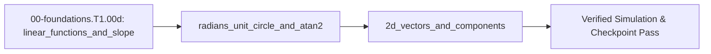

## 1. Why it matters
Robot joints rotate in angles while cameras and workpieces sit at Cartesian $(x, y)$ coordinates, and analog sensors output voltages that scale linearly with current or angle. Mastering linear calibration lines, radian angles on the unit circle, 2D vector projections, and four-quadrant `atan2(y, x)` prevents your robot arm from snapping $180^\circ$ into the wrong quadrant when crossing the negative $x$-axis. Already know this? Take the Skip test in section 7 first.

## 2. Intuition first
Lay a rigid $40\text{ cm}$ ruler flat on your desk with one end pinned at the origin $(0,0)$ and shine a flashlight straight down from the ceiling and straight across from the right wall. As you swing the ruler counter-clockwise by an angle $\theta$, its horizontal shadow on the desk bottom edge is the cosine projection ($x$), and its vertical shadow on the left wall is the sine projection ($y$). If someone tells you only the single fraction $y/x$, you cannot tell whether the ruler points up-and-left ($x < 0, y > 0$) or down-and-right ($x > 0, y < 0$) because both give a negative fraction—which is why robotics code always passes both shadows separately into `atan2(y, x)`.

## 3. Formalization
1. **Linear Calibration ($y = m x + b$):** An analog sensor with output $y$ in volts ($\text{V}$), input current $x$ in amperes ($\text{A}$), sensitivity slope $m = \frac{\Delta y}{\Delta x}$ in $\text{V/A}$, and zero-offset $b$ in $\text{V}$ obeys:

$$
y = m x + b
$$

   Substituting $m = 0.20\text{ V/A}$, $x = 5.0\text{ A}$, and $b = 1.65\text{ V}$ gives $y = (0.20\text{ V/A})(5.0\text{ A}) + 1.65\text{ V} = 2.65\text{ V}$.
2. **Radians and 2D Vector Projections:** One full revolution ($360^\circ$) spans $2\pi \approx 6.2832\text{ rad}$, so $\theta_{\text{rad}} = \theta_{\text{deg}}\frac{\pi}{180^\circ}$. A link of length $L$ in meters ($\text{m}$) at angle $\theta$ in radians has tip coordinates $(x, y)$ and Euclidean norm $r$:

$$
x = L\cos\theta, \qquad y = L\sin\theta, \qquad r = \sqrt{x^2 + y^2}
$$

   For $L = 0.40\text{ m}$ and $\theta = 135^\circ = 2.35619\text{ rad}$, $x = 0.40\cos(2.35619\text{ rad}) = -0.28284\text{ m}$, $y = 0.40\sin(2.35619\text{ rad}) = +0.28284\text{ m}$, and $r = \sqrt{(-0.28284\text{ m})^2 + (0.28284\text{ m})^2} = 0.40\text{ m}$.
3. **Four-Quadrant Angle Recovery (`atan2`):** Given tip coordinates $(x, y)$ in meters, $\theta = \operatorname{atan2}(y, x)$ inspects the signs of both $y$ and $x$ to return the unique angle in $(-\pi, +\pi]\text{ rad}$:

$$
\theta = \operatorname{atan2}(+0.28284\text{ m},\; -0.28284\text{ m}) = +2.35619\text{ rad} = +135.0^\circ
$$

   By contrast, single-argument $\arctan(y/x) = \arctan(-1.0) = -0.78540\text{ rad} = -45.0^\circ$ (wrong quadrant by $180^\circ$).

## 4. Worked example
**Predict first (before you run it):** Before running the block, commit to four results for $L = 0.40\text{ m}$ at $\theta = 135.0^\circ$: the sign of each tip coordinate; the Euclidean length $r$ (is it $0.40\text{ m}$, or the $|x| + |y|$ shortcut?); the degrees `math.atan2(y, x)` reports; and the degrees `math.atan(y / x)` reports instead of that. Two tells that a wrong result is a mistake rather than a surprise: a positive $x$ is impossible at $135^\circ$, since the angle sits in Quadrant II, and an `atan` reading of $135.0^\circ$ means the block never exercised the single-argument version at all.

Project a $L = 0.40\text{ m}$ link at $\theta = 135.0^\circ$ into $(x, y)$ coordinates, verify its length $r = 0.40\text{ m}$, and compare four-quadrant `math.atan2(y, x)` against `math.atan(y / x)`.

```python
import math

L_m = 0.40
theta_rad = math.radians(135.0)

tip = [L_m * math.cos(theta_rad), L_m * math.sin(theta_rad)]
length_m = math.hypot(tip[0], tip[1])
recovered_deg = math.degrees(math.atan2(tip[1], tip[0]))
wrong_atan_deg = math.degrees(math.atan(tip[1] / tip[0]))

assert math.isclose(length_m, L_m, rel_tol=1e-9)
assert math.isclose(recovered_deg, 135.0, rel_tol=1e-9)
assert math.isclose(wrong_atan_deg, -45.0, rel_tol=1e-9)
print(f"tip=({tip[0]:.4f}, {tip[1]:.4f}) m, atan2={recovered_deg:.1f} deg, atan={wrong_atan_deg:.1f} deg")
```
Expected output:
```text
tip=(-0.2828, 0.2828) m, atan2=135.0 deg, atan=-45.0 deg
```

## 5. Exercise
A robot base at $(0, 0)$ observes a target at $(x, y) = (-0.30\text{ m}, -0.40\text{ m})$ in Quadrant III. Compute the Euclidean distance $d = \sqrt{x^2 + y^2}$ in meters and the heading angle in degrees using `math.degrees(math.atan2(y, x))`. Expected result: `d = 0.50 m` and `theta = -126.8699 deg` (tolerance $\pm 0.01^\circ$).
- **If your result differs:** Check that you passed `y` first and `x` second in `math.atan2(y, x)`; passing `atan2(x, y)` swaps the axes and returns $-143.13^\circ$.

- **📚 What to Learn & Resources to Solve This Exercise:**
  - **Prerequisite Foundations Modules:** [`00-foundations.T1.00a`](00-foundations.T1.00a.md)–[`00-foundations.T1.00c`](00-foundations.T1.00c.md) (*Python Functions, Arrays & SI Units*).
  - **Core Concepts to Review First:** 2D vector tip coordinates $(L\cos\theta, L\sin\theta)$, Euclidean norm $\sqrt{x^2+y^2}$, and four-quadrant `math.atan2(y, x)` in `## 3. Formalization` (Items 2–3) and `## 4. Worked example` above.
  - **Trigonometry & 2D Vectors Study Links:** [3Blue1Brown: Essence of Linear Algebra — Vectors (`3blue1brown.com`)](https://www.3blue1brown.com/topics/linear-algebra), [Red Blob Games: Interactive 2D Trigonometry & `atan2` Guide](https://www.redblobgames.com/), and [Python `math.atan2` Documentation](https://docs.python.org/3/library/math.html#math.atan2).
  - **Curriculum Reference:** [Track 00 Tier 1 (`00-foundations/README.md`)](../00-foundations/README.md#tier-1-beginner--intuitive) and [Lynch & Park *Modern Robotics* (`resources/textbooks-and-papers.md`)](../resources/textbooks-and-papers.md).

### Graded package - the line, the norm and the heading
[`exercises/00-foundations.T1.00d/`](../exercises/00-foundations.T1.00d/) turns this section into a test. `starter.py` holds seven holes: `sensor_voltage` (the calibration line), `sensor_current` (subtract the offset *before* dividing), `polar_to_cartesian` ($\cos$ for $x$, $\sin$ for $y$, radians), `link_length` (the diagonal, not $|x| + |y|$), `heading_rad` (four-quadrant `atan2(y, x)`), `heading_deg` and `degrees_to_radians` ($\pi/180$). Edit it, then run the tests the way CI does:

```bash
EXERCISE_TARGET=exercises/00-foundations.T1.00d/starter.py \
  python3 -m unittest discover -s exercises/00-foundations.T1.00d -p 'test_*.py'
```

### Break it on purpose
Inject the single-argument arctan the `## 8. Common mistakes` table warns about, keeping the worked example's tip at $(-0.28284\text{ m},\ +0.28284\text{ m})$:
- **Inject:** replace `math.atan2(tip[1], tip[0])` with `math.atan(tip[1] / tip[0])` on those same coordinates.
- **Symptom:** the recovered heading prints `-45.0 deg` instead of `135.0 deg` — a $180^\circ$ error, while the tip is unchanged and the length still reads `0.40 m`.
- **Diagnose:** the projections and the norm survived, so $\cos$, $\sin$ and `hypot` are right and only the angle recovery is wrong. `atan` cannot return anything outside $(-90^\circ, +90^\circ)$, so $135^\circ$ was impossible before the code ran; the ratio $y/x = -1.0$ is identical for the correct tip and its $180^\circ$ mirror image, which is exactly the information the sign of $x$ supplies.
- **Fix:** pass both coordinates to `math.atan2(tip[1], tip[0])`, which returns `135.0 deg` to within $10^{-9}$ degrees, and check the exercise's target $(-0.30\text{ m},\ -0.40\text{ m})$ comes back `-126.8699 deg` rather than its $180^\circ$ mirror.

## 6. Simulation path
Run the worked example in Python and open **Tab 5 (URDF / MuJoCo & STO)** in the MechaLab Workbench to watch planar and 3D link angles map to tip $(x, y, z)$ coordinates in real time.

No hardware required for this module (`hardware_required: false`). In Track 03 (`Step 1.4`), an on-axis magnetic encoder (`AS5600`) uses two orthogonal Hall sensors ($B_x, B_y$) to run this exact `atan2(By, Bx)` calculation in silicon:
```text
[Diametric Magnet] ---> [Hall Sensors: Bx = B*cos(theta), By = B*sin(theta)] ---> [atan2(By, Bx) -> 12-bit Angle]
```
Pass/fail verification in simulation: `length_m == 0.40 m` and `recovered_deg == 135.0 deg`.




## 7. Checkpoint
Pass criteria: run the worked example and exercise asserts with zero errors, or score $\ge 80\%$ ($4/5$) on the Skip test below.

### Skip test
1. `[Recall] [Concept: 2d_vectors_and_components]` Compute the $x$-coordinate in meters (tolerance $\pm 10^{-4}\text{ m}$) of a $L = 0.20\text{ m}$ link at angle $\theta = 120^\circ$ ($2\pi/3\text{ rad}$).
2. `[Apply] [Concept: radians_unit_circle_and_atan2]` Compute the angle in degrees (tolerance $\pm 0.01^\circ$) returned by `math.degrees(math.atan2(-1.0, -1.0))` in Quadrant III.
3. `[Transfer] [Concept: linear_functions_and_slope]` A current sensor outputs $0.5\text{ V}$ at $0\text{ A}$ and $2.5\text{ V}$ at $10\text{ A}$. Compute the current $I$ in amperes (tolerance $\pm 0.01\text{ A}$) when the sensor outputs $V = 1.7\text{ V}$.
4. `[Concept: radians_unit_circle_and_atan2]` What happens if your code evaluates `math.atan(y / x)` instead of `math.atan2(y, x)` when the robot arm points straight up along the $+y$ axis ($x = 0.0\text{ m}, y = 0.25\text{ m}$)?
   - **A.** It returns $+\pi/2\text{ rad}$ ($+90^\circ$).
   - **B.** It raises `ZeroDivisionError: float division by zero` before `atan` is even called.
   - **C.** It returns $0.0\text{ rad}$.
   - **D.** It returns $-\pi/2\text{ rad}$ ($-90^\circ$).
5. `[Spaced review -> 00-foundations.T1.00c — Concept: dimensional_analysis_unit_checks] [Concept: radians_unit_circle_and_atan2]` Convert an angular speed of $180.0\text{ deg/s}$ into $\text{rad/s}$ (tolerance $\pm 10^{-4}\text{ rad/s}$).

**Answer key:**
```python
import math

q1_x = 0.20 * math.cos(math.radians(120.0))
q2_deg = math.degrees(math.atan2(-1.0, -1.0))
slope_a_per_v = (10.0 - 0.0) / (2.5 - 0.5)
q3_current_a = slope_a_per_v * (1.7 - 0.5)
q4_choice = "B"
q5_rad_s = math.radians(180.0)

assert math.isclose(q1_x, -0.10, rel_tol=1e-9)
assert math.isclose(q2_deg, -135.0, rel_tol=1e-9)
assert math.isclose(q3_current_a, 6.0, rel_tol=1e-9)
assert q4_choice == "B"
assert math.isclose(q5_rad_s, math.pi, rel_tol=1e-9)
```
- **Pass mark:** $4/5$ ($80\%+$). If you missed Q1, Q2, or Q3, study `## 3. Formalization`; if you missed Q4, study `## 4. Worked example`; if you missed Q5, study `## 3. Formalization` (and review `00-foundations.T1.00c`). On pass, proceed to `## 10. Next modules`.

## 8. Common mistakes
| Symptom | Root cause | 2-minute fix |
| :--- | :--- | :--- |
| `math.cos(90)` returns `-0.448` instead of `0.0` | Passed degrees (`90`) into `math.cos()`, which expects radians. | Wrap degree inputs with `math.radians(deg)` or store all angles in radians. |
| Heading angle is mirrored across the $y = x$ diagonal | Called `math.atan2(x, y)` instead of `math.atan2(y, x)`. | Remember the alphabetical trap: `atan2(y, x)` always takes vertical `y` first, horizontal `x` second. |
| Arm jerks by $180^\circ$ when crossing $x = 0$ | Used `math.atan(y / x)` instead of four-quadrant `math.atan2(y, x)`. | Replace every `atan(y / x)` with `math.atan2(y, x)`. |

## 9. Resources
- **Track 00 ([`00-foundations/README.md`](../00-foundations/README.md)) & [Python `math` Library Docs](https://docs.python.org/3/library/math.html):** Uses unit-circle trigonometry and `math.atan2(y, x)` directly in Step 1.1 $SO(2)$ rotation matrices `[VERIFIED 2026-10-15]`.
- **Track 02 ([`02-mechanics-kinematics-dynamics/README.md`](../02-mechanics-kinematics-dynamics/README.md)) & [Red Blob Games Interactive 2D Math](https://www.redblobgames.com/):** Uses 2D vector projections and `atan2` in Step 1.3 planar 2-link kinematics `[VERIFIED 2026-10-15]`.

## 10. Next modules
- Proceed to [`00-foundations.T1.00e`](00-foundations.T1.00e.md) (*Position, Velocity, Acceleration, Force, Mass, Energy & Torque in a Loop*).
