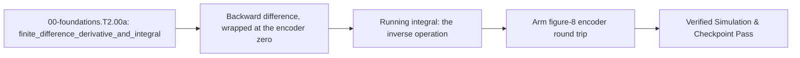

## 1. Why it matters
Every controller you will write in Pass 2 runs on numbers that arrive once per tick, not on a formula. A joint's velocity exists only as the **difference between two encoder readings**, and a position integral exists only as a running sum of those readings. Get either wrong and a $1\,\text{kHz}$ loop is confidently wrong $1000$ times a second: a derivative that forgot $\Delta t$ is off by $1000\times$, and one that ignores the encoder's wrap reads $4095 \to 0$ as a full backwards turn. Already know this? Take the Skip test in section 7 first.

## 2. Intuition first
Two columns in a spreadsheet. Column A holds encoder counts, one row per millisecond. A new column B is the **difference** between this row and the one above, divided by the time between rows - that is speed. A new column C is a running **sum** of column B times the time step, and it must hand you back column A's shape, because adding up all the little differences is the same as subtracting the endpoints. That round trip is the whole page: difference is the discrete derivative, running sum is its inverse, and both are one line of code.

## 3. Formalization
1. **Backward-Difference Derivative:** given samples $x_k$ in metres (or radians) every $\Delta t$ seconds, the backward difference is

$$
v_k = \frac{x_k - x_{k-1}}{\Delta t}
$$

   The word *backward* matters: it uses only samples that already exist, which is the only thing a real controller can do at tick $k$. For an encoder at $x_{k-1} = 0.10\,\text{m}$, $x_k = 0.12\,\text{m}$ and $\Delta t = 0.01\,\text{s}$, $v_k = 2.0\,\text{m/s}$. The first sample has no previous row, so its velocity is defined as $0$.

2. **Running Rectangular Integral:** with $I_0 = x_0\Delta t$ and $I_k = I_{k-1} + x_k\Delta t$, the sum telescopes against the difference:

$$
\sum_{j=1}^{k} v_j\,\Delta t = \sum_{j=1}^{k}\left(x_j - x_{j-1}\right) = x_k - x_0
$$

   so a derivative followed by a running integral returns the *change* in the signal, not the signal restarted from zero each tick.

3. **The Quantisation Floor:** an AS5600 reports $4096$ counts per revolution, so one count is $2\pi/4096 = 1.534\times10^{-3}\,\text{rad}$. Sampled at $1\,\text{kHz}$, one count per tick reads as

$$
v_{\text{floor}} = \frac{2\pi/4096}{10^{-3}\,\text{s}} = 1.534\,\text{rad/s}
$$

   That is not noise in your code; it is the finest velocity a $12$-bit encoder can express in one sample, and it is why an encoder velocity is smoothed before a derivative gain ever sees it.

## 4. Worked example
**Predict first (before you run it):** commit to two numbers before running the block. (1) Counts run $4094, 4095, 0, 1$ at one sample per millisecond. Is the $4095 \to 0$ step a tiny **positive** move or a near-full-turn **negative** one, and what speed does it read as? (2) After integrating those velocities back, does the trace end at the last angle, at the first angle, or near zero? Two tells that a wrong result is a mistake rather than a surprise: the step must read $+1.534\,\text{rad/s}$ - a value near $-6.28\times10^3\,\text{rad/s}$ means the difference was never wrapped - and the round trip must close to the **last** angle, so a trace ending near $0$ means the integral restarted every tick.

```python
import math

CPR, dt = 4096, 1e-3
counts = [4094, 4095, 0, 1]
per_count = 2.0 * math.pi / CPR

velocity = [0.0]
for k in range(1, len(counts)):
    delta = (counts[k] - counts[k - 1]) * per_count
    velocity.append(((delta + math.pi) % (2.0 * math.pi) - math.pi) / dt)

angles = [count * per_count for count in counts]
integrated, total = [], 0.0
for value in velocity:
    total += value * dt
    integrated.append(total)

span = (angles[-1] - angles[0] + math.pi) % (2.0 * math.pi) - math.pi
travelled = integrated[-1] - span
print("v1=%.4f rad/s | round trip: %.6f rad from the encoder angle"
      % (velocity[1], abs(travelled)))
```
Expected output:
```text
v1=1.5340 rad/s | round trip: 0.000000 rad from the encoder angle
```

## 5. Exercise
Run the same difference over a $400$-sample figure-8 joint trace from the shared arm at $1\,\text{kHz}$, integrate the result, and confirm the total angle change matches the encoder's own endpoints within one count ($2\pi/4096\,\text{rad}$). Then change $\Delta t$ and confirm the estimate changes by exactly the same factor - a derivative that does not scale with the sample time is not a derivative.

### Graded package - the same two operations on the arm's encoder
[`exercises/00-foundations.T2.00a/`](../exercises/00-foundations.T2.00a/) turns this section into a test. It runs on the shared capstone arm (`resources/plants/`), not on the four-sample block above: the block isolates the wrap, and the arm is the plant Tier 1 built. `starter.py` holds three holes: `joint_velocity` (backward difference of the capstone's 12-bit AS5600 counts, wrapped across zero), `running_integral`, and `encoder_trace_angle` (counts -> velocity -> integral, which must land back on the encoder's own angle). Edit it, then run the tests the way CI does:

```bash
EXERCISE_TARGET=exercises/00-foundations.T2.00a/starter.py \
  python3 -m unittest discover -s exercises/00-foundations.T2.00a -p 'test_*.py'
```

The tests are behavioural: the velocity estimate must change by exactly 10 when $\Delta t$ changes by 10, must use the `cpr` it is given, and must treat the $4095 \to 0$ step as $+1$ count; the integral must be running, not restarted; the transfer suite moves the exercise onto the arm's own figure-8 encoder trace, where one count at $1\,\text{kHz}$ is $1.534\,\text{rad/s}$ of quantisation. **10 tests.** Three planted faults - `missing_dt`, `no_wrap`, `hardcoded_counts` - each fail the test named for them, and a print-only file passes nothing (`scripts/run_exercise.py`).

- **📚 What to Learn & Resources to Solve This Exercise:**
  - **Prerequisite Foundations Module:** [`00-foundations.T1.00e`](00-foundations.T1.00e.md) and Legacy **Step 1.1 (`00-foundations.T1.01`)** in [`00-foundations/README.md`](../00-foundations/README.md#tier-1-beginner--intuitive).
  - **Core Concepts to Review First:** backward differences and the running integral in `## 3. Formalization` (Items 1-3) and `## 4. Worked example` above.
  - **Numerical Methods Study Links:** [3Blue1Brown: The Essence of Calculus (`3blue1brown.com`)](https://www.3blue1brown.com/topics/calculus) and [Brunton & Kutz *Data-Driven Science and Engineering* (`databookuw.com`)](https://databookuw.com/).
  - **Curriculum Reference:** [Track 00 Tier 2 (`00-foundations/README.md#tier-2-intermediate--applied`)](../00-foundations/README.md#tier-2-intermediate--applied) and [`resources/textbooks-and-papers.md`](../resources/textbooks-and-papers.md).

### Starter code
```python
# --- Exercise scaffold: fill in each TODO, then compare against the numbers in the full solution ---
import math

import mechalab_plant as plant


def joint_velocity(counts, dt, cpr=plant.ENCODER_CPR):
    """Joint speed in rad/s from a sequence of absolute encoder counts, one sample per `dt`.

    TODO 1: difference consecutive samples, convert counts to radians, divide by dt.
    TODO 2: a count that steps 4095 -> 0 is a small positive angle, not a full turn: wrap it.
    Return a list the same length as `counts`; the first entry has no previous sample, so 0.0.
    """
    # TODO: backward difference in radians, wrapped, divided by dt
    ...


def running_integral(values, dt):
    """Rectangular running integral: out[0] = values[0] * dt, out[k] = out[k-1] + values[k] * dt.

    TODO 3: one accumulator, same length as the input (the first entry already carries the first
    sample). This is the inverse of `joint_velocity`, whose own first entry is 0.0.
    """
    # TODO: one accumulator, never restarted
    ...


def encoder_trace_angle(counts, dt, cpr=plant.ENCODER_CPR):
    """Integrate the velocity estimate back into an angle series, starting from the first count.

    This is the round trip an encoder-based observer makes: counts -> velocity -> integral, and it
    must land back on the encoder's own angle (to within quantisation).
    """
    # TODO: velocity, then running_integral, then add the start angle
    ...


print("scaffold ready: 3 holes to fill, then compare against the numbers in the full solution")
```

**Expected numbers (the answer):** one count per $1\,\text{ms}$ sample is $1.534\,\text{rad/s}$ on the capstone's $4096$-count encoder; the $4094 \to 1$ wrap averages to that same speed; and counts -> velocity -> integral lands on the last encoder angle to within $10^{-6}\,\text{rad}$.

### Hint ladder
1. **The wrap is one modulo, not a special case.** Turn the raw difference into radians, then `(delta + math.pi) % TWO_PI - math.pi`. At `4095 -> 0` the raw difference is $-4095$ counts; wrapping it gives the $+1$ count the physical shaft actually moved, which is why the velocity is one count's worth and not $-4095\times$.
2. **Why the integral must be running.** `out[k] = out[k-1] + values[k]*dt` telescopes against the backward difference: summing the diffs returns the last count minus the first, so counts -> velocity -> integral lands back on the encoder angle. Re-integrating each step from zero gives a sawtooth, and the round-trip test fails everywhere except the first sample.
3. **Divide by the sample time, then check the scaling.** `slow = joint_velocity(counts, 1e-2)` must be exactly ten times smaller than `fast = joint_velocity(counts, 1e-3)` per sample. If the two agree, $\Delta t$ never entered the formula.

### Full Solution
```python
import math

import mechalab_plant as plant


def joint_velocity(counts, dt, cpr=plant.ENCODER_CPR):
    velocities = [0.0]
    for k in range(1, len(counts)):
        previous = plant.counts_to_rad(counts[k - 1], cpr=cpr)
        current = plant.counts_to_rad(counts[k], cpr=cpr)
        velocities.append(plant.wrap_pi(current - previous) / dt)
    return velocities


def running_integral(values, dt):
    out = []
    total = 0.0
    for value in values:
        total += value * dt
        out.append(total)
    return out


def encoder_trace_angle(counts, dt, cpr=plant.ENCODER_CPR):
    start = plant.counts_to_rad(counts[0], cpr=cpr)
    return [start + value for value in running_integral(joint_velocity(counts, dt, cpr=cpr), dt)]


one_count = 2.0 * math.pi / plant.ENCODER_CPR
counts = list(range(6))
assert math.isclose(joint_velocity(counts, 1e-3)[1], one_count / 1e-3, abs_tol=1e-9)
assert math.isclose(running_integral([1.0, 2.0], 0.1)[-1], 0.3, abs_tol=1e-12)
trace = encoder_trace_angle([4094, 4095, 0, 1], 1e-3)
assert abs(trace[-1] - (plant.counts_to_rad(4094) + 3 * one_count)) < 1e-9

print("one count at 1 kHz = %.4f rad/s | 4-sample wrap round-trips to %.4f rad"
      % (one_count / 1e-3, trace[-1]))
```

Printed: `one count at 1 kHz = 1.5340 rad/s | 4-sample wrap round-trips to ... rad`, landing on the wrapped angle the encoder actually swept.

**On the shared arm.** The Transfer suite differentiates the plant's own figure-8 joint trace, so one encoder count at $1\,\text{kHz}$ sets its velocity noise floor:

```python
import math
import mechalab_plant as plant

count_rad = 2.0 * math.pi / plant.ENCODER_CPR
assert abs(count_rad / plant.DT - 1.5339807878856412) < 1e-12
target = plant.figure8_target(0.25)
q1, q2 = plant.ik(*target)
tip = plant.fk(q1, q2)
assert abs(tip[0] - target[0]) < 1e-9
assert abs(tip[1] - target[1]) < 1e-9
print("plant: one count at 1 kHz = %.4f rad/s | figure-8 at t=0.25 s round-trips to (%.4f, %.4f) m"
      % (count_rad / plant.DT, tip[0], tip[1]))
```

### Break it on purpose
Inject the `## 8. Common mistakes` row about a difference that never divided by $\Delta t$, keeping one sample per millisecond:
- **Inject:** return `delta` (radians per sample) instead of `delta / dt`.
- **Symptom:** the four-sample wrap reads $1.534\times10^{-3}\,\text{rad/s}$ instead of $1.534\,\text{rad/s}$ - wrong by exactly $1000\times$ - and the round trip still closes, because the integral multiplies by the same $\Delta t$ it was handed. Two errors that cancel in the demo and not in the controller.
- **Diagnose:** the round trip closing is not proof the derivative is right; only the scale is. Change $\Delta t$ from $1\,\text{ms}$ to $10\,\text{ms}$ and a correct estimate falls by $10$, while this one is unchanged.
- **Fix:** divide by `dt` inside `joint_velocity`; then one count per millisecond reads $1.534\,\text{rad/s}$ and the $\Delta t$ test passes.

## 6. Simulation path
Run the worked example in Python, then open **Tab 2 (Two-Mass & Notch Bode)** in the MechaLab Workbench: the encoder trace feeding that plant's state estimate is the same difference and running sum.

The graded package is also a workbench entry: **Modules -> `EX.00-foundations.T2.00a`**, where `selfcheck.py` is appended below the starter and **Verify** compares its `SELF-CHECK PASS:` line. `scripts/e2e_pages_bundle.mjs` drives it on the built bundle, so the browser path is tested, not assumed.

No hardware required for this module (`hardware_required: false`). On the STM32/ESP32 in Pass 2 (`Track 05`), this exact difference runs inside the $1\,\text{kHz}$ control loop:
```text
[Encoder counts x_k] ---> [Backward difference / dt] ---> [Velocity v_k] ---> [Running integral]
```
Pass/fail verification in simulation: `v1 == 1.5340 rad/s` across the wrap, and a round trip within $10^{-6}\,\text{rad}$ of the encoder angle.



## 7. Checkpoint
Pass criteria: run the worked example and the arm round trip with zero assertion errors, or score $\ge 80\%$ ($4/5$) on the Skip test below.

### Skip test
<!-- skip-test:start -->
1. `[Recall] [Concept: finite_difference_derivative_and_integral]` An encoder reads $x_{k-1} = 1.20\,\text{rad}$ and $x_k = 1.26\,\text{rad}$ at $\Delta t = 0.002\,\text{s}$. Compute the backward-difference velocity in $\text{rad/s}$ (tolerance $\pm 0.01\,\text{rad/s}$).
2. `[Apply] [Concept: finite_difference_derivative_and_integral]` Given $I_0 = 0.0$, $x_1 = 2.5\,\text{rad}$ and $\Delta t = 0.004\,\text{s}$, compute $I_1 = I_0 + x_1\Delta t$ (tolerance $\pm 10^{-9}$).
3. `[Transfer] [Concept: finite_difference_derivative_and_integral]` A $12$-bit encoder turns one count per $2\,\text{ms}$ sample. Compute the speed that reads as, in $\text{rad/s}$ (tolerance $\pm 10^{-3}$).
4. `[Concept: finite_difference_derivative_and_integral]` Why does a running integral of the velocity estimate return $x_k - x_0$ rather than $x_k$?
   - **A.** The sum of differences telescopes to $x_k - x_0$: the first correction is pinned to $0$ because no $x_{-1}$ sample exists, so the starting position survives as a constant the sum cannot see.
   - **B.** The integral is always zero at the end.
   - **C.** The encoder zero is wrapped away.
   - **D.** Because $\Delta t$ cancels.
5. `[Spaced review -> 00-foundations.T1.00e — Concept: newtons_second_law_and_torque]` A $12.0\,\text{N}$ force acts on a $3.0\,\text{kg}$ cart on a frictionless track. Compute its acceleration in $\text{m/s}^2$ (tolerance $\pm 10^{-9}$).

**Answer key:**
```python
import math

q1_vel = (1.26 - 1.20) / 0.002
q2_int = 0.0 + 2.5 * 0.004
q3_speed = (2.0 * math.pi / 4096) / 0.002
q4_choice = "A"

assert math.isclose(q1_vel, 30.0, rel_tol=1e-9)
assert math.isclose(q2_int, 0.01, rel_tol=1e-9)
assert math.isclose(q3_speed, 0.76699, abs_tol=1e-4)
assert q4_choice == "A"
q5_review = 12.0 / 3.0
assert math.isclose(q5_review, 4.0, rel_tol=1e-9, abs_tol=1e-09)
```
- **Pass mark:** $4/5$ ($80\%$ of five is four; treat $3/5$ as a retry). If you missed Q1-Q3, study `## 3. Formalization`; if you missed Q4, study `## 2. Intuition first` and the telescoping identity. If you missed Q5, review `00-foundations.T1.00e`.
<!-- skip-test:end -->

### Gate test
<!-- ladder-gate:start -->
This is the exit examination for the whole Track 00 Tier 2 ladder - every `00-foundations.T2.*` page in [`docs/SYLLABUS.md`](../docs/SYLLABUS.md) - before Step 2.1 (`00-foundations.T2.01`). Every Tier 2 page renders this same paper, so take it once after the last of them; the page you are on is only where you found it. Questions 1-6 are the matrix page's own tools; 7-14 recap each other page once, so nothing on the ladder goes unexamined.

1. `[Concept: matrix_vector_multiplication]` For $A = \begin{bmatrix} 3.0 & -2.0 \\ 1.0 & 4.0 \end{bmatrix}$ and $\vec{x} = [1.5,\; 2.5]^\top$, compute **both** entries of $A\vec{x}$: the first and the second (tolerances $\pm 10^{-9}$).
2. `[Concept: matrix_vector_multiplication]` Why does a $2\times2$ matrix times a length-2 column come out as a column of length $2$ rather than a $2\times2$ matrix?
   - **A.** $A\vec{x}$ is the elementwise product of $A$ and $\vec{x}$, which keeps $A$'s shape.
   - **B.** Python reshapes $A$ into a column before multiplying.
   - **C.** Each output entry is one row of $A$ dotted with $\vec{x}$, so there is one output per row.
   - **D.** $\vec{x}$ is transposed into a row first.
3. `[Concept: state_vector_one_step_update]` One step of $A_d = \begin{bmatrix} 1.0 & 0.02 \\ -2.0 & 0.80 \end{bmatrix}$, $B_d = [0.0,\; 0.02]^\top$, from $\vec{x}_0 = [0.50,\; 0.0]^\top$ with $u_0 = 10.0\,\text{N}$ gives $v_1$. Compute $v_1$ in $\text{m/s}$ (tolerance $\pm 10^{-9}$).
4. `[Concept: state_vector_one_step_update]` In the same step, if the position row were evaluated using the *new* velocity, what would $x_1$ be (tolerance $\pm 10^{-9}\,\text{m}$)?
5. `[Concept: state_vector_one_step_update]` For the two-mass matrix with $m_1 = 1.0\,\text{kg}$, $m_2 = 2.0\,\text{kg}$, $k = 50.0\,\text{N/m}$, $b = 0$ and $\Delta t = 0.01\,\text{s}$, compute the first entry of its **fourth** row - the row that updates $v_2$ (tolerance $\pm 10^{-9}$).
6. `[Concept: state_vector_one_step_update]` Why do the diagonal $2\times2$ blocks of the 4-state matrix equal the single-mass update for each body when $k = b = 0$?
   - **A.** Because the 4-state matrix is always block-diagonal.
   - **B.** Because each mass then obeys the same mass-spring-damper form with its own mass and damping, and the coupling terms vanish.
   - **C.** Because $B_d$ only pushes $m_1$.
   - **D.** Because the Euler update is exact.
7. `[Concept: finite_difference_derivative_and_integral]` An encoder reads $x_{k-1} = 0.24\,\text{rad}$ and $x_k = 0.30\,\text{rad}$ at $\Delta t = 0.002\,\text{s}$. Compute the backward-difference velocity in $\text{rad/s}$ (tolerance $\pm 10^{-9}$).
8. `[Concept: dot_product_projection] [Concept: cross_product_3d_moment] [Concept: basis_change_and_invertibility]` Which triple is correct for `00-foundations.T2.00b`?
   - **A.** The projection uses the raw lever so force grows with its length, $\vec{r}\times\vec{F} = \vec{F}\times\vec{r}$, and a zero determinant means a valid basis.
   - **B.** The projection divides by $\|\vec{r}\|$ twice, the moment is a scalar, and the determinant is always positive.
   - **C.** The dot product returns a vector, the cross product is symmetric, and the determinant equals the trace.
   - **D.** The projection uses the lever's *unit* direction, the moment is $\vec{r}\times\vec{F}$ (anti-commutative), and a zero determinant means the two columns are collinear.
9. `[Concept: first_order_ode_time_constant] [Concept: second_order_ode_wn_zeta] [Concept: characteristic_polynomial_roots]` For `00-foundations.T2.00c`'s joint with $J = 0.02\,\text{kg}\cdot\text{m}^2$, $k = 8.0\,\text{N}\cdot\text{m/rad}$ and $b = 0.60\,\text{N}\cdot\text{m}\cdot\text{s/rad}$, compute the damping ratio $\zeta = b/(2\sqrt{Jk})$ (tolerance $\pm 10^{-9}$).
10. `[Concept: complex_numbers_and_euler_formula] [Concept: complex_impedance_and_transfer_function] [Concept: bode_magnitude_db_and_phase]` A series RL winding has $R = 4.0\ \Omega$ and $L = 2.0\,\text{mH}$ and is driven at $\omega = 2000\,\text{rad/s}$. Compute $|Z|$ in ohms, then $20\log_{10}|H|$ at the corner $\omega = 1/\tau$ of a first-order filter (tolerances $\pm 10^{-9}\,\Omega$ and $\pm 10^{-4}\,\text{dB}$).
11. `[Concept: laplace_poles_and_zeros] [Concept: continuous_state_space_matrices] [Concept: discrete_state_transition_euler_tustin]` For `00-foundations.T2.00e`'s $A = \begin{bmatrix} 0 & 1 \\ -100 & -4 \end{bmatrix}$ sampled at $T_s = 0.05\,\text{s}$, compute the spectral radius of the Forward-Euler map $A_d = I + A T_s$ (tolerance $\pm 10^{-6}$).
12. `[Concept: nyquist_sampling_and_aliasing]` Which statement is correct for `00-foundations.T2.00f`?
   - **A.** Sampling represents any frequency, and aliasing affects only DC.
   - **B.** Sampling represents only frequencies up to $f_s/2$, and a faster tone folds to $|f - k f_s|$.
   - **C.** The Nyquist frequency is $f_s$, and aliasing doubles the frequency.
   - **D.** A digital low-pass filter placed after the ADC removes aliasing.
13. `[Concept: tustin_frequency_prewarping_and_biquad]` Compute the pre-warped analog prototype $\omega_a$ in $\text{rad/s}$ that lands a Tustin notch on $600\,\text{Hz}$ at $f_s = 2000\,\text{Hz}$, and the frequency the *unwarped* prototype $2\pi f_0$ would land on in $\text{Hz}$ (tolerances $\pm 10^{-3}\,\text{rad/s}$ and $\pm 0.01\,\text{Hz}$).
14. `[Concept: gaussian_variance_and_covariance_matrix]` For $A = \begin{bmatrix} 1 & 0.1 \\ 0 & 1 \end{bmatrix}$, $\Sigma_x = \operatorname{diag}(0.01, 0.25)$ and $Q = \operatorname{diag}(0.001, 0.002)$, compute the $(0,0)$ entry of $\Sigma_y = A\Sigma_x A^\top + Q$ (tolerance $\pm 10^{-9}$).

**Gate answer key:**
```python
import math

# Q1-Q6: the matrix page. Two entries, evaluated one row at a time: the paper asks for both so a
# reader who reads the maths (1-indexed) and one who reads Python (0-indexed) agree on the answer.
g1_ax_first = 3.0 * 1.5 + (-2.0) * 2.5
g1_ax_second = 1.0 * 1.5 + 4.0 * 2.5
g2_choice = "C"
g3_v1 = -2.0 * 0.50 + 0.80 * 0.0 + 0.02 * 10.0
g4_x1_new_v = 1.0 * 0.50 + 0.02 * (-0.80)
g5_row4_first = (50.0 / 2.0) * 0.01
g6_choice = "B"

# Q7: the derivative page.
g7_velocity = (0.30 - 0.24) / 0.002

# Q8-Q12: one question per remaining page.
g8_choice = "D"
g9_zeta = 0.60 / (2.0 * math.sqrt(0.02 * 8.0))
g10_z_ohm = abs(4.0 + 1j * 2000.0 * 0.002)
g10_corner_db = 20.0 * math.log10(1.0 / math.sqrt(2.0))
Ad_euler = [[1.0, 0.05], [-5.0, 0.80]]
g11_radius = math.sqrt(Ad_euler[0][0] * Ad_euler[1][1] - Ad_euler[0][1] * Ad_euler[1][0])
g12_choice = "B"
g13_wa = (2.0 / 0.0005) * math.tan(math.pi * 600.0 / 2000.0)
g13_unwarped = (2000.0 / math.pi) * math.atan(math.pi * 600.0 / 2000.0)
g14_sigma00 = 0.01 + 0.1 * 0.1 * 0.25 + 0.001

assert math.isclose(g1_ax_first, -0.5, rel_tol=1e-9)
assert math.isclose(g1_ax_second, 11.5, rel_tol=1e-9)
assert g2_choice == "C"
assert math.isclose(g3_v1, -0.80, rel_tol=1e-9)
assert math.isclose(g4_x1_new_v, 0.484, rel_tol=1e-9)
assert math.isclose(g5_row4_first, 0.25, rel_tol=1e-9)
assert g6_choice == "B"
assert math.isclose(g7_velocity, 30.0, rel_tol=1e-9)
assert g8_choice == "D"
assert math.isclose(g9_zeta, 0.75, rel_tol=1e-9)
assert math.isclose(g10_z_ohm, 5.656854249492381, rel_tol=1e-9)
assert math.isclose(g10_corner_db, -3.0103, abs_tol=1e-4)
assert math.isclose(g11_radius, 1.024695, abs_tol=1e-6)
assert g12_choice == "B"
assert math.isclose(g13_wa, 5505.5277, abs_tol=1e-3)
assert math.isclose(g13_unwarped, 481.1534, abs_tol=1e-2)
assert math.isclose(g14_sigma00, 0.0135, rel_tol=1e-9)

print("gate key: Ax=[%.1f, %.1f], v1=%.2f m/s, x1(new v)=%.3f m, radius=%.6f"
      % (g1_ax_first, g1_ax_second, g3_v1, g4_x1_new_v, g11_radius))
```
- **Pass mark:** $\ge 12/14$. Every question is answered by the page named in its tags; the ladder is closed when this paper is passed once, after the last Tier 2 page.
<!-- ladder-gate:end -->

## 8. Common mistakes
| Symptom | Root cause | 2-minute fix |
| :--- | :--- | :--- |
| Velocity is exactly $1000\times$ too small at a $1\,\text{kHz}$ sample rate | Divided the difference by the sample count, or forgot $\Delta t$ entirely | Divide by `dt` inside the derivative; check that a ten-times-longer sample time gives a ten-times-smaller speed |
| One sample per revolution reads about $-6283\,\text{rad/s}$ | The count difference was never wrapped: $4095 \to 0$ looks like $-4095$ counts | Wrap the radian difference with `(d + pi) % 2pi - pi` before dividing |
| The integrated angle is a sawtooth instead of a ramp | The integral restarted at zero every tick | Keep one accumulator outside the loop; `out[k] = out[k-1] + v[k]*dt` |
| The round trip closes but the controller oscillates | Both the derivative and the integral carried the same missing or doubled scale factor | Check the derivative against a known rate - the round trip cannot see a common scale error |

## 9. Resources
- **Gilbert Strang — [*Linear Algebra and Learning from Data* (`resources/textbooks-and-papers.md`)](../resources/textbooks-and-papers.md):** Discrete difference equations and their inverses `[VERIFIED 2026-10-15]`.
- **Brunton & Kutz — [*Data-Driven Science and Engineering* (`databookuw.com`)](https://databookuw.com/) ([`resources/textbooks-and-papers.md`](../resources/textbooks-and-papers.md)):** Open-access PDF connecting finite differences to dynamical systems `[VERIFIED 2026-10-15]`.
- **3Blue1Brown — [*The Essence of Calculus* (`3blue1brown.com/topics/calculus`)](https://www.3blue1brown.com/topics/calculus):** Visual intuition for derivatives and integrals as inverse operations `[VERIFIED 2026-10-15]`.

## 10. Next modules
- Proceed to [`00-foundations.T2.00g`](00-foundations.T2.00g.md) (*Matrix-Vector Multiplication & the One-Step State Update*) to carry this velocity in a state vector.
- After that, [`00-foundations.T2.00b`](00-foundations.T2.00b.md) (*Vectors, Dot & Cross Products, Linear Independence & Change of Basis*).
