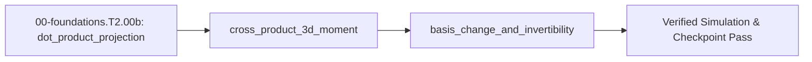

## 1. Why it matters
In 3D robot manipulators and field-oriented brushless drives, forces and magnetic fields act along tilted 3D axes while joints rotate around specific hinge vectors. You need the dot product to project forces onto a link axis, the 3D cross product to compute the moment vector $\vec{\tau} = \vec{r} \times \vec{F}$, and basis-change determinants to detect when a robot arm hits a kinematic singularity. Already know this? Take the Skip test in section 7 first.

## 2. Intuition first
Hold a wrench horizontally along your desk pointing northeast, and pull on the wrench handle with a string angled partly inward and partly upward. Only the component of pull parallel to the wrench shaft tries to stretch or compress the metal handle—that parallel overlap is measured by the **dot product**. Meanwhile, the components of pull perpendicular to the handle twist the bolt around an axis perpendicular to both the handle and the string (found by curling the fingers of your right hand from the wrench vector toward the force vector; your thumb points along the torque axis)—that perpendicular twist vector is the **cross product**. Finally, if two joint axes line up parallel to each other, they can no longer span 3D space independently, which is what a zero determinant warns you about.

## 3. Formalization
1. **3D Dot Product ($\vec{a} \cdot \vec{b}$):** Given force $\vec{F} = [F_x, F_y, F_z]^T$ in newtons ($\text{N}$) and unit link direction $\hat{u}_r = \vec{r} / \|\vec{r}\|$ (dimensionless), the axial force projection $F_{\text{axial}}$ in newtons ($\text{N}$) is:

$$
F_{\text{axial}} = \vec{F} \cdot \hat{u}_r = F_x u_{rx} + F_y u_{ry} + F_z u_{rz}
$$

   For $\vec{r} = [0.30, 0.40, 0.00]^T\text{ m}$ ($\|\vec{r}\| = 0.50\text{ m}$, so $\hat{u}_r = [0.60, 0.80, 0.00]^T$) and $\vec{F} = [0.0, -20.0, 15.0]^T\text{ N}$, $F_{\text{axial}} = (0)(0.60) + (-20.0\text{ N})(0.80) + (15.0\text{ N})(0) = -16.0\text{ N}$.
2. **3D Cross Product ($\vec{\tau} = \vec{r} \times \vec{F}$):** The 3D moment vector $\vec{\tau}$ in newton-meters ($\text{N}\cdot\text{m}$) at the shoulder origin is:

$$
\vec{\tau} = \vec{r} \times \vec{F} = \begin{bmatrix} r_y F_z - r_z F_y \\ r_z F_x - r_x F_z \\ r_x F_y - r_y F_x \end{bmatrix}
$$

   Substituting $\vec{r} = [0.30, 0.40, 0.00]^T\text{ m}$ and $\vec{F} = [0.0, -20.0, 15.0]^T\text{ N}$ gives $\vec{\tau} = [(0.40)(15.0) - 0,\; 0 - (0.30)(15.0),\; (0.30)(-20.0) - 0]^T = [6.0, -4.5, -6.0]^T\text{ N}\cdot\text{m}$, which is strictly orthogonal to $\vec{r}$ since $\vec{\tau}\cdot\vec{r} = 1.80 - 1.80 + 0 = 0.0\text{ N}\cdot\text{m}^2$.
3. **Linear Independence & Basis Determinant:** Two 2D column vectors $\vec{b}_1 = [a, c]^T$ and $\vec{b}_2 = [b, d]^T$ form an invertible basis matrix $B$ iff $\det(B) = a d - b c \neq 0$. For $B = \begin{bmatrix} 1.0 & 2.0 \\ 2.0 & 4.0 \end{bmatrix}$, $\det(B) = (1.0)(4.0) - (2.0)(2.0) = 0.0$ (collinear/singular).

## 4. Worked example
**Predict first (before you run it):** Commit to four numbers and one ordering before the block runs. For $\vec{r} = [0.30, 0.40, 0.00]^T\text{ m}$ and $\vec{F} = [0.0, -20.0, 15.0]^T\text{ N}$: (1) what is $\|\vec{r}\|$, and which component of $\vec{F}$ contributes to the axial projection? (2) What are the three components of $\vec{\tau} = \vec{r}\times\vec{F}$, and which of them has the largest magnitude? Two tells that a wrong answer is a mistake: $F_{\text{axial}}$ must be $-16.0\text{ N}$, and $-20.0\text{ N}$ means you dotted $\vec{F}$ with $\vec{r}$ itself instead of the unit vector $\hat{u}_r = [0.60, 0.80, 0.00]^T$; and $\vec{\tau}\cdot\vec{r}$ must be exactly $0.0\text{ N}\cdot\text{m}^2$, so a non-zero dot product means the middle ($y$) component was formed as $r_x F_z - r_z F_x$ instead of $r_z F_x - r_x F_z$.
Compute the axial force projection $F_{\text{axial}} = \vec{F}\cdot\hat{u}_r$ and 3D shoulder torque $\vec{\tau} = \vec{r}\times\vec{F}$ for lever arm $\vec{r} = [0.30, 0.40, 0.00]^T\text{ m}$ and wrist force $\vec{F} = [0.0, -20.0, 15.0]^T\text{ N}$, and assert orthogonality $\vec{\tau}\cdot\vec{r} = 0$.

```python
import math

def dot3(a: list[float], b: list[float]) -> float:
    return a[0] * b[0] + a[1] * b[1] + a[2] * b[2]

def cross3(a: list[float], b: list[float]) -> list[float]:
    return [
        a[1] * b[2] - a[2] * b[1],
        a[2] * b[0] - a[0] * b[2],
        a[0] * b[1] - a[1] * b[0],
    ]

r_m = [0.30, 0.40, 0.00]
F_n = [0.0, -20.0, 15.0]

r_norm = math.sqrt(dot3(r_m, r_m))
u_r = [c / r_norm for c in r_m]
f_axial_n = dot3(F_n, u_r)
tau_nm = cross3(r_m, F_n)

assert math.isclose(r_norm, 0.50, rel_tol=1e-9)
assert math.isclose(f_axial_n, -16.0, rel_tol=1e-9)
assert all(math.isclose(a, b, abs_tol=1e-9) for a, b in zip(tau_nm, [6.0, -4.5, -6.0]))
assert math.isclose(dot3(tau_nm, r_m), 0.0, abs_tol=1e-9)
print(f"F_axial={f_axial_n:.1f} N, tau={tau_nm} N*m")
```
Expected output:
```text
F_axial=-16.0 N, tau=[6.0, -4.5, -6.0] N*m
```

## 5. Exercise
Given lever arm $\vec{r} = [0.25, 0.00, 0.10]^T\text{ m}$ and payload force $\vec{F} = [10.0, 30.0, -20.0]^T\text{ N}$, compute $\vec{\tau} = \vec{r}\times\vec{F}$ and verify that $\vec{\tau}\cdot\vec{F} = 0.0\text{ N}^2\cdot\text{m}$. Expected result: `tau = [-3.0, 6.0, 7.5] N*m` (tolerance $\pm 10^{-6}\text{ N}\cdot\text{m}$).
- **If your result differs:** Check the middle ($y$) component sign of the cross product: $\tau_y = r_z F_x - r_x F_z = (0.10)(10.0) - (0.25)(-20.0) = +6.0\text{ N}\cdot\text{m}$, not $-6.0\text{ N}\cdot\text{m}$.

### Graded package - three tools, then the arm's own Jacobian
[`exercises/00-foundations.T2.00b/`](../exercises/00-foundations.T2.00b/) turns this section into a test. `starter.py` holds seven holes: `dot3`, `cross3`, `axial_force` (projection onto the lever's UNIT direction), `moment`, `det2`, `coordinates_in_basis` (Cramer's rule, refusing a singular pair), and `in_basis`. Edit it, then run the tests the way CI does:

```bash
EXERCISE_TARGET=exercises/00-foundations.T2.00b/starter.py \
  python3 -m unittest discover -s exercises/00-foundations.T2.00b -p 'test_*.py'
```

The tests are behavioural: the projection must not grow when the lever gets longer, the cross product must be antisymmetric and orthogonal to both inputs, the determinant must be zero for a collinear pair, a singular basis must raise `ValueError` rather than return infinities, and moments are checked at several levers. The transfer suite then uses the shared plant: a 0.20 kg payload's moment about the shoulder must equal `-m g x` *and* the shoulder torque from a finite-difference Jacobian, and the arm's Jacobian columns are used as a basis - tip velocity to joint rates and back, with the stretched pose refusing the inversion. Four planted faults - `flipped_cross`, `not_normalised`, `det_plus`, `hardcoded_moment` - each fail the test named for them.

- **📚 What to Learn & Resources to Solve This Exercise:**
  - **Prerequisite Foundations Modules:** [`00-foundations.T1.00d`](00-foundations.T1.00d.md) (*2D Vectors*) and [`00-foundations.T2.00a`](00-foundations.T2.00a.md) (*Matrix-Vector Multiplication*).
  - **Core Concepts to Review First:** 3D dot product $\vec{a}\cdot\vec{b} = \sum a_i b_i$ and 3D right-hand cross product $\vec{\tau} = \vec{r}\times\vec{F}$ in `## 3. Formalization` (Items 1–2) and `## 4. Worked example` above.
  - **Dot/Cross Product & Basis Change Study Links:** [3Blue1Brown: Dot Products and Cross Products (`3blue1brown.com`)](https://www.3blue1brown.com/lessons/cross-products) and [Lynch & Park *Modern Robotics* Ch. 3 (`hades.mech.northwestern.edu`)](https://hades.mech.northwestern.edu/index.php/Modern_Robotics).
  - **Curriculum Reference:** [Track 00 Tier 2 (`00-foundations/README.md#tier-2-intermediate--applied`)](../00-foundations/README.md#tier-2-intermediate--applied) and [Track 02 Tier 2 (`02-mechanics-kinematics-dynamics/README.md#tier-2-intermediate--applied`)](../02-mechanics-kinematics-dynamics/README.md#tier-2-intermediate--applied).

### Starter code
```python
# --- Exercise scaffold: fill in each TODO, then compare against the numbers in the full solution ---
import math


def dot3(a, b):
    """The 3D dot product."""
    # TODO 1: a_x b_x + a_y b_y + a_z b_z
    ...


def cross3(a, b):
    """The 3D cross product a x b, right-handed."""
    # TODO 2: three components, each a 2x2 difference
    ...


def axial_force(force, lever):
    """The component of `force` along the lever arm, in newtons."""
    # TODO 3: project onto the lever's UNIT direction - a longer lever must not multiply the force
    ...


def moment(lever, force):
    """The moment vector r x F in N*m."""
    # TODO 4: order matters - r x F is not F x r
    ...


def det2(b1, b2):
    """Determinant of the matrix whose columns are b1 = [a, c] and b2 = [b, d]."""
    # TODO 5: ad - bc; zero means the two directions are collinear
    ...


def coordinates_in_basis(vector, b1, b2):
    """(c1, c2) with c1*b1 + c2*b2 == vector; ValueError when the basis is singular."""
    # TODO 6: Cramer's rule, and refuse |det| < 1e-12 instead of returning inf or nan
    ...


def in_basis(vector, b1, b2):
    """Rebuild the vector from its coordinates."""
    # TODO 7: c1*b1 + c2*b2
    ...


print("scaffold ready: 7 TODOs to fill, then compare against the numbers in the full solution")
```

**Expected numbers (the answer):** $\vec{r} = [0.25, 0.00, 0.10]^T\text{ m}$ and $\vec{F} = [10.0, 30.0, -20.0]^T\text{ N}$ give $\vec{\tau} = [-3.0, 6.0, 7.5]^T\text{ N}\cdot\text{m}$ with $\vec{\tau}\cdot\vec{F} = 0.0$; the worked projection is $-16.0\text{ N}$; $\det([3.0, 1.5],[2.0, 4.0]) = 9.0$.

### Hint ladder
1. **The cross product is three copies of one $2\times2$ determinant.** $\tau_x = r_yF_z - r_zF_y$, $\tau_y = r_zF_x - r_xF_z$, $\tau_z = r_xF_y - r_yF_x$. The middle term's sign is the one people flip: with $r_x = 0.25$, $r_z = 0.10$ and $F_z = -20.0$ it is $0.10(10.0) - 0.25(-20.0) = +6.0$, not $-6.0$.
2. **Normalise before projecting, or length leaks into force.** $\lVert r\rVert = \sqrt{0.30^2 + 0.40^2} = 0.50$, so the unit lever is $(0.6, 0.8, 0)$ and $\vec{F}\cdot\hat{r} = 0(-0.6) + (-20)(0.8) + 15(0) = -16.0\text{ N}$. Projecting on the raw lever gives $-12.8$, and doubling the lever to $(3.0, 4.0, 0)$ would double it again - a wrench whose force grows with the handle.
3. **A basis is invertible exactly when its determinant is not zero.** For columns $b_1 = [a, c]$ and $b_2 = [b, d]$, $\det = ad - bc$ is the signed area they span; $b_1 = [1,2]$, $b_2 = [2,4]$ gives $4 - 4 = 0$ and the pair cannot reach every vector, so `coordinates_in_basis` must raise rather than divide by roughly zero.
4. **Check the round trip, not the arithmetic.** Rebuilding $c_1b_1 + c_2b_2$ from your own coordinates and comparing with the input vector catches a swapped Cramer numerator faster than re-deriving it: for $b_1 = [2,0]$, $b_2 = [1,1]$ and $v = [5,3]$ the answers are $c_1 = 1$, $c_2 = 3$.

5. **What the suite refuses.** `coordinates_in_basis` refuses a singular basis (parallel basis vectors): the coordinates are not unique there, so it raises `ValueError` instead of dividing by a zero determinant.

### Full Solution
```python
import math


def dot3(a, b):
    return a[0] * b[0] + a[1] * b[1] + a[2] * b[2]


def cross3(a, b):
    return [
        a[1] * b[2] - a[2] * b[1],
        a[2] * b[0] - a[0] * b[2],
        a[0] * b[1] - a[1] * b[0],
    ]


def axial_force(force, lever):
    length = math.sqrt(dot3(lever, lever))
    if length == 0.0:
        raise ValueError("a zero-length lever has no direction to project onto")
    return dot3(force, [component / length for component in lever])


def moment(lever, force):
    return cross3(lever, force)


def det2(b1, b2):
    return b1[0] * b2[1] - b2[0] * b1[1]


def coordinates_in_basis(vector, b1, b2):
    det = det2(b1, b2)
    if abs(det) < 1e-12:
        raise ValueError("singular basis: det = %.3e" % det)
    return ((vector[0] * b2[1] - b2[0] * vector[1]) / det,
            (b1[0] * vector[1] - vector[0] * b1[1]) / det)


def in_basis(vector, b1, b2):
    c1, c2 = coordinates_in_basis(vector, b1, b2)
    return [c1 * b1[0] + c2 * b2[0], c1 * b1[1] + c2 * b2[1]]


# The exercise: the lever arm and payload force from section 5.
r = [0.25, 0.00, 0.10]
F = [10.0, 30.0, -20.0]
tau = moment(r, F)

assert all(math.isclose(got, want, abs_tol=1e-9) for got, want in zip(tau, [-3.0, 6.0, 7.5]))
assert math.isclose(dot3(tau, F), 0.0, abs_tol=1e-9)
assert math.isclose(axial_force([0.0, -20.0, 15.0], [0.30, 0.40, 0.00]), -16.0, abs_tol=1e-9)
assert math.isclose(det2([3.0, 1.5], [2.0, 4.0]), 9.0, abs_tol=1e-12)
assert math.isclose(det2([1.0, 2.0], [2.0, 4.0]), 0.0, abs_tol=1e-12)
rebuild = in_basis([5.0, 3.0], [2.0, 0.0], [1.0, 1.0])
assert all(math.isclose(got, want, abs_tol=1e-12) for got, want in zip(rebuild, [5.0, 3.0]))
try:
    coordinates_in_basis([1.0, 1.0], [1.0, 2.0], [2.0, 4.0])
except ValueError:
    pass
else:
    raise AssertionError("a collinear basis must be refused, not inverted")

print("tau=(%.1f, %.1f, %.1f) N*m | tau.F=%.1f | F_axial=%.1f N | det=%.1f"
      % (tau[0], tau[1], tau[2], dot3(tau, F), axial_force([0.0, -20.0, 15.0], [0.30, 0.40, 0.00]),
         det2([3.0, 1.5], [2.0, 4.0])))
```

Printed: `tau=(-3.0, 6.0, 7.5) N*m | tau.F=0.0 | F_axial=-16.0 N | det=9.0` - the moment, the orthogonality check that a sign flip survives, the projection that must not scale with the lever, and the determinant that decides invertibility.

**On the shared arm.** The Transfer suite hangs a $0.20\text{ kg}$ payload at the arm's own tip and checks the moment against the plant's tip position:

```python
import math
import mechalab_plant as plant

q = plant.ik(0.08, 0.05)
x, y = plant.fk(*q)
assert math.isclose(math.hypot(x, y), math.hypot(0.08, 0.05), rel_tol=1e-12)
force = (0.0, -0.20 * plant.G)
moment_z = x * force[1] - y * force[0]          # the cross-product expansion
assert math.isclose(moment_z, -0.20 * plant.G * x, rel_tol=1e-15)
print("tip=(%.6f, %.6f) m | payload moment=%.6f N*m | reach=%.2f m"
      % (x, y, moment_z, plant.L1 + plant.L2))
```

### Break it on purpose
Inject the anti-commutation slip from the `## 8. Common mistakes` table and diagnose it without looking at the code, keeping $\vec{r} = [0.30, 0.40, 0.00]^T\text{ m}$ and $\vec{F} = [0.0, -20.0, 15.0]^T\text{ N}$:
- **Inject:** swap the operands, so the moment is computed as $\vec{F}\times\vec{r}$ instead of $\vec{r}\times\vec{F}$.
- **Symptom:** every component flips sign - $\vec{\tau} = [-6.0, +4.5, +6.0]^T\text{ N}\cdot\text{m}$ instead of $[6.0, -4.5, -6.0]^T$ - while $\vec{\tau}\cdot\vec{r}$ still reads $0.0\text{ N}\cdot\text{m}^2$ and $\|\vec{\tau}\|$ is still $9.60\text{ N}\cdot\text{m}$.
- **Diagnose:** orthogonality and magnitude are blind to the swap, so the usual assert cannot catch it; only the sign does. A $0.20\text{ kg}$ payload hanging at $x = 0.10\text{ m}$ must produce a moment about the shoulder of $-m g x = -0.1962\text{ N}\cdot\text{m}$ (a sagging, clockwise torque), and the swapped product returns $+0.1962\text{ N}\cdot\text{m}$, which would command the joint to lift instead of hold.
- **Fix:** put the lever arm first, $\vec{\tau} = \vec{r}\times\vec{F}$, then prove the sign on a case whose answer is known independently: the payload moment must come out $-0.1962\text{ N}\cdot\text{m}$ and $\vec{\tau}\cdot\vec{F}$ must vanish, so both orthogonality checks and the physical sign agree.

## 6. Simulation path
Run the worked example in Python, then open **Tab 5 (URDF / MuJoCo & STO)** in the MechaLab Workbench to inspect how 3D joint axes and link lever arms produce spatial torques across the 6-DOF arm.

The graded package is also a workbench entry: **Modules -> `EX.00-foundations.T2.00b`**, where `selfcheck.py` is appended below the starter and **Verify** compares its `SELF-CHECK PASS:` line. `scripts/e2e_pages_bundle.mjs` drives it on the built bundle, so the browser path is tested, not assumed.

No hardware required for this module (`hardware_required: false`). In Track 03 (`Step 2.4`), the Clarke transform changes basis from three $120^\circ$-spaced stator coil axes $(a, b, c)$ into two orthogonal $(\alpha, \beta)$ axes via this exact projection:
```text
[3-Phase Coil Currents ia, ib, ic] ---> [Change-of-Basis Dot Projections] ---> [Orthogonal i_alpha, i_beta]
```
Pass/fail verification in simulation: `F_axial == -16.0 N` and `tau == [6.0, -4.5, -6.0] N*m`.




## 7. Checkpoint
Pass criteria: run the worked example and exercise asserts with zero errors, or score $\ge 80\%$ ($4/5$) on the Skip test below.

### Skip test
<!-- skip-test:start -->
1. `[Recall] [Concept: dot_product_projection]` Compute the dot product $\vec{a}\cdot\vec{b}$ (tolerance $\pm 10^{-9}$) for $\vec{a} = [2.0, -3.0, 1.0]^T$ and $\vec{b} = [4.0, 1.0, -2.0]^T$.
2. `[Apply] [Concept: cross_product_3d_moment]` Compute the $z$-component $\tau_z$ in $\text{N}\cdot\text{m}$ (tolerance $\pm 10^{-9}$) of $\vec{\tau} = \vec{r}\times\vec{F}$ for $\vec{r} = [0.20, 0.10, 0.0]^T\text{ m}$ and $\vec{F} = [5.0, 25.0, 0.0]^T\text{ N}$.
3. `[Transfer] [Concept: basis_change_and_invertibility]` Compute the determinant $\det(B) = a d - b c$ (tolerance $\pm 10^{-9}$) of $B = \begin{bmatrix} 3.0 & 2.0 \\ 1.5 & 4.0 \end{bmatrix}$.
4. `[Concept: dot_product_projection]` What does a dot product $\vec{a}\cdot\vec{b} = 0$ between two non-zero 3D vectors tell you geometrically?
   - **A.** The vectors are parallel and point in the same direction.
   - **B.** The vectors are perpendicular ($90^\circ$ apart).
   - **C.** The cross product $\vec{a}\times\vec{b}$ is also zero.
   - **D.** The vectors point in opposite directions ($180^\circ$ apart).
5. `[Spaced review -> 00-foundations.T2.00g — Concept: matrix_vector_multiplication] [Concept: basis_change_and_invertibility]` Compute the first entry $(B\vec{v})_0$ (tolerance $\pm 10^{-9}$) for $B = \begin{bmatrix} 3.0 & 2.0 \\ 1.5 & 4.0 \end{bmatrix}$ and $\vec{v} = \begin{bmatrix} 2.0 \\ -1.0 \end{bmatrix}$.

**Answer key:**
```python
import math

q1_dot = 2.0 * 4.0 + (-3.0) * 1.0 + 1.0 * (-2.0)
q2_tau_z = 0.20 * 25.0 - 0.10 * 5.0
q3_det = 3.0 * 4.0 - 2.0 * 1.5
q4_choice = "B"
q5_row0 = 3.0 * 2.0 + 2.0 * (-1.0)

assert math.isclose(q1_dot, 3.0, rel_tol=1e-9)
assert math.isclose(q2_tau_z, 4.5, rel_tol=1e-9)
assert math.isclose(q3_det, 9.0, rel_tol=1e-9)
assert q4_choice == "B"
assert math.isclose(q5_row0, 4.0, rel_tol=1e-9)
```
- **Pass mark:** $4/5$ ($80\%+$). If you missed Q1 or Q4, study `## 3. Formalization`; if you missed Q2 or Q3, study `## 4. Worked example`; if you missed Q5, study `## 3. Formalization` (and review `00-foundations.T2.00a`). On pass, proceed to `## 10. Next modules`.
<!-- skip-test:end -->

### Gate test
<!-- ladder-gate:start -->
This is the exit examination for the whole Track 00 Tier 2 ladder - every `00-foundations.T2.*` page in [`docs/SYLLABUS.md`](../docs/SYLLABUS.md) - before Step 2.1 (`00-foundations.T2.01`). Every Tier 2 page renders this same paper, so take it once after the last of them; the page you are on is only where you found it. Questions 1-6 are the matrix page's own tools; 7-14 recap each other page once, so nothing on the ladder goes unexamined.

1. `[Concept: matrix_vector_multiplication]` For $A = \begin{bmatrix} 3.0 & -2.0 \\ 1.0 & 4.0 \end{bmatrix}$ and $\vec{x} = [1.5,\; 2.5]^\top$, compute **both** entries of $A\vec{x}$: the first and the second (tolerances $\pm 10^{-9}$).
2. `[Concept: matrix_vector_multiplication]` Why does a $2\times2$ matrix times a length-2 column come out as a column of length $2$ rather than a $2\times2$ matrix?
   - **A.** $A\vec{x}$ is the elementwise product of $A$ and $\vec{x}$, which keeps $A$'s shape.
   - **B.** Python reshapes $A$ into a column before multiplying.
   - **C.** Each output entry is one row of $A$ dotted with $\vec{x}$, so there is one output per row.
   - **D.** $\vec{x}$ is transposed into a row first.
3. `[Concept: state_vector_one_step_update]` One step of $A_d = \begin{bmatrix} 1.0 & 0.02 \\ -2.0 & 0.80 \end{bmatrix}$, $B_d = [0.0,\; 0.02]^\top$, from $\vec{x}_0 = [0.50,\; 0.0]^\top$ with $u_0 = 10.0\,\text{N}$ gives $v_1$. Compute $v_1$ in $\text{m/s}$ (tolerance $\pm 10^{-9}$).
4. `[Concept: state_vector_one_step_update]` In the same step, if the position row were evaluated using the *new* velocity, what would $x_1$ be (tolerance $\pm 10^{-9}\,\text{m}$)?
5. `[Concept: state_vector_one_step_update]` For the two-mass matrix with $m_1 = 1.0\,\text{kg}$, $m_2 = 2.0\,\text{kg}$, $k = 50.0\,\text{N/m}$, $b = 0$ and $\Delta t = 0.01\,\text{s}$, compute the first entry of its **fourth** row - the row that updates $v_2$ (tolerance $\pm 10^{-9}$).
6. `[Concept: state_vector_one_step_update]` Why do the diagonal $2\times2$ blocks of the 4-state matrix equal the single-mass update for each body when $k = b = 0$?
   - **A.** Because the 4-state matrix is always block-diagonal.
   - **B.** Because each mass then obeys the same mass-spring-damper form with its own mass and damping, and the coupling terms vanish.
   - **C.** Because $B_d$ only pushes $m_1$.
   - **D.** Because the Euler update is exact.
7. `[Concept: finite_difference_derivative_and_integral]` An encoder reads $x_{k-1} = 0.24\,\text{rad}$ and $x_k = 0.30\,\text{rad}$ at $\Delta t = 0.002\,\text{s}$. Compute the backward-difference velocity in $\text{rad/s}$ (tolerance $\pm 10^{-9}$).
8. `[Concept: dot_product_projection] [Concept: cross_product_3d_moment] [Concept: basis_change_and_invertibility]` Which triple is correct for `00-foundations.T2.00b`?
   - **A.** The projection uses the raw lever so force grows with its length, $\vec{r}\times\vec{F} = \vec{F}\times\vec{r}$, and a zero determinant means a valid basis.
   - **B.** The projection divides by $\|\vec{r}\|$ twice, the moment is a scalar, and the determinant is always positive.
   - **C.** The dot product returns a vector, the cross product is symmetric, and the determinant equals the trace.
   - **D.** The projection uses the lever's *unit* direction, the moment is $\vec{r}\times\vec{F}$ (anti-commutative), and a zero determinant means the two columns are collinear.
9. `[Concept: first_order_ode_time_constant] [Concept: second_order_ode_wn_zeta] [Concept: characteristic_polynomial_roots]` For `00-foundations.T2.00c`'s joint with $J = 0.02\,\text{kg}\cdot\text{m}^2$, $k = 8.0\,\text{N}\cdot\text{m/rad}$ and $b = 0.60\,\text{N}\cdot\text{m}\cdot\text{s/rad}$, compute the damping ratio $\zeta = b/(2\sqrt{Jk})$ (tolerance $\pm 10^{-9}$).
10. `[Concept: complex_numbers_and_euler_formula] [Concept: complex_impedance_and_transfer_function] [Concept: bode_magnitude_db_and_phase]` A series RL winding has $R = 4.0\ \Omega$ and $L = 2.0\,\text{mH}$ and is driven at $\omega = 2000\,\text{rad/s}$. Compute $|Z|$ in ohms, then $20\log_{10}|H|$ at the corner $\omega = 1/\tau$ of a first-order filter (tolerances $\pm 10^{-9}\,\Omega$ and $\pm 10^{-4}\,\text{dB}$).
11. `[Concept: laplace_poles_and_zeros] [Concept: continuous_state_space_matrices] [Concept: discrete_state_transition_euler_tustin]` For `00-foundations.T2.00e`'s $A = \begin{bmatrix} 0 & 1 \\ -100 & -4 \end{bmatrix}$ sampled at $T_s = 0.05\,\text{s}$, compute the spectral radius of the Forward-Euler map $A_d = I + A T_s$ (tolerance $\pm 10^{-6}$).
12. `[Concept: nyquist_sampling_and_aliasing]` Which statement is correct for `00-foundations.T2.00f`?
   - **A.** Sampling represents any frequency, and aliasing affects only DC.
   - **B.** Sampling represents only frequencies up to $f_s/2$, and a faster tone folds to $|f - k f_s|$.
   - **C.** The Nyquist frequency is $f_s$, and aliasing doubles the frequency.
   - **D.** A digital low-pass filter placed after the ADC removes aliasing.
13. `[Concept: tustin_frequency_prewarping_and_biquad]` Compute the pre-warped analog prototype $\omega_a$ in $\text{rad/s}$ that lands a Tustin notch on $600\,\text{Hz}$ at $f_s = 2000\,\text{Hz}$, and the frequency the *unwarped* prototype $2\pi f_0$ would land on in $\text{Hz}$ (tolerances $\pm 10^{-3}\,\text{rad/s}$ and $\pm 0.01\,\text{Hz}$).
14. `[Concept: gaussian_variance_and_covariance_matrix]` For $A = \begin{bmatrix} 1 & 0.1 \\ 0 & 1 \end{bmatrix}$, $\Sigma_x = \operatorname{diag}(0.01, 0.25)$ and $Q = \operatorname{diag}(0.001, 0.002)$, compute the $(0,0)$ entry of $\Sigma_y = A\Sigma_x A^\top + Q$ (tolerance $\pm 10^{-9}$).

**Gate answer key:**
```python
import math

# Q1-Q6: the matrix page. Two entries, evaluated one row at a time: the paper asks for both so a
# reader who reads the maths (1-indexed) and one who reads Python (0-indexed) agree on the answer.
g1_ax_first = 3.0 * 1.5 + (-2.0) * 2.5
g1_ax_second = 1.0 * 1.5 + 4.0 * 2.5
g2_choice = "C"
g3_v1 = -2.0 * 0.50 + 0.80 * 0.0 + 0.02 * 10.0
g4_x1_new_v = 1.0 * 0.50 + 0.02 * (-0.80)
g5_row4_first = (50.0 / 2.0) * 0.01
g6_choice = "B"

# Q7: the derivative page.
g7_velocity = (0.30 - 0.24) / 0.002

# Q8-Q12: one question per remaining page.
g8_choice = "D"
g9_zeta = 0.60 / (2.0 * math.sqrt(0.02 * 8.0))
g10_z_ohm = abs(4.0 + 1j * 2000.0 * 0.002)
g10_corner_db = 20.0 * math.log10(1.0 / math.sqrt(2.0))
Ad_euler = [[1.0, 0.05], [-5.0, 0.80]]
g11_radius = math.sqrt(Ad_euler[0][0] * Ad_euler[1][1] - Ad_euler[0][1] * Ad_euler[1][0])
g12_choice = "B"
g13_wa = (2.0 / 0.0005) * math.tan(math.pi * 600.0 / 2000.0)
g13_unwarped = (2000.0 / math.pi) * math.atan(math.pi * 600.0 / 2000.0)
g14_sigma00 = 0.01 + 0.1 * 0.1 * 0.25 + 0.001

assert math.isclose(g1_ax_first, -0.5, rel_tol=1e-9)
assert math.isclose(g1_ax_second, 11.5, rel_tol=1e-9)
assert g2_choice == "C"
assert math.isclose(g3_v1, -0.80, rel_tol=1e-9)
assert math.isclose(g4_x1_new_v, 0.484, rel_tol=1e-9)
assert math.isclose(g5_row4_first, 0.25, rel_tol=1e-9)
assert g6_choice == "B"
assert math.isclose(g7_velocity, 30.0, rel_tol=1e-9)
assert g8_choice == "D"
assert math.isclose(g9_zeta, 0.75, rel_tol=1e-9)
assert math.isclose(g10_z_ohm, 5.656854249492381, rel_tol=1e-9)
assert math.isclose(g10_corner_db, -3.0103, abs_tol=1e-4)
assert math.isclose(g11_radius, 1.024695, abs_tol=1e-6)
assert g12_choice == "B"
assert math.isclose(g13_wa, 5505.5277, abs_tol=1e-3)
assert math.isclose(g13_unwarped, 481.1534, abs_tol=1e-2)
assert math.isclose(g14_sigma00, 0.0135, rel_tol=1e-9)

print("gate key: Ax=[%.1f, %.1f], v1=%.2f m/s, x1(new v)=%.3f m, radius=%.6f"
      % (g1_ax_first, g1_ax_second, g3_v1, g4_x1_new_v, g11_radius))
```
- **Pass mark:** $\ge 12/14$. Every question is answered by the page named in its tags; the ladder is closed when this paper is passed once, after the last Tier 2 page.
<!-- ladder-gate:end -->

## 8. Common mistakes
| Symptom | Root cause | 2-minute fix |
| :--- | :--- | :--- |
| Torque vector points in the exact opposite direction ($-\vec{\tau}$) | Computed $\vec{F}\times\vec{r}$ instead of $\vec{r}\times\vec{F}$ (cross product is anti-commutative). | Always place the lever arm $\vec{r}$ (from joint to force application point) first in $\vec{r}\times\vec{F}$. |
| Cross product $\vec{\tau}$ fails orthogonality check $\vec{\tau}\cdot\vec{r} = 0$ | Flipped the sign of the middle ($y$) component ($r_x F_z - r_z F_x$ instead of $r_z F_x - r_x F_z$). | Assert `abs(dot3(tau, r)) < 1e-9` and `abs(dot3(tau, F)) < 1e-9` in every kinematics script. |
| Matrix inversion crashes with `LinAlgError: Singular matrix` | Arm is fully stretched out ($\theta_2 = 0$), making basis/Jacobian columns collinear ($\det = 0$). | Check $\lvert \det(B)\rvert  > 10^{-6}$ or use damped least-squares before inverting. |

## 9. Resources
- **Gilbert Strang — [*Linear Algebra and Learning from Data* (`resources/textbooks-and-papers.md`)](../resources/textbooks-and-papers.md) & [3Blue1Brown Cross Products](https://www.3blue1brown.com/lessons/cross-products):** Orthogonality, projections, determinants, and change of basis `[VERIFIED 2026-10-15]`.
- **Lynch & Park — [*Modern Robotics* (`hades.mech.northwestern.edu`)](https://hades.mech.northwestern.edu/index.php/Modern_Robotics) ([`resources/textbooks-and-papers.md`](../resources/textbooks-and-papers.md)):** Spatial moments $\vec{r}\times\vec{F}$ and coordinate frames `[VERIFIED 2026-10-15]`.

## 10. Next modules
- Proceed to [`00-foundations.T2.00c`](00-foundations.T2.00c.md) (*First- & Second-Order ODEs, Characteristic Roots, Natural Frequency & Damping Ratio*).
