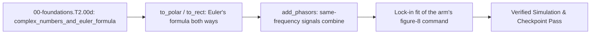

<!-- run-callout:start -->
> **Step 3 of 10 · Make a joint move: foundations**
>
> **Run this in the workbench.** [Open MechaLab with `EX.00-foundations.T2.00d` loaded](https://tle47.github.io/Mechatronics-Roadmap/?lesson=EX.00-foundations.T2.00d) - it opens on the **Run Python Lessons** tab with that entry selected. Starter code, hints and the graded check are ready; this page is the reading copy, and nothing you type here is saved.
<!-- run-callout:end -->

## 1. Why it matters
A sine wave has two numbers that matter - how big it is and when it peaks - and ordinary arithmetic keeps losing one of them. A complex number holds both at once: the magnitude is the amplitude, the angle is the phase, and Euler's formula $e^{j\phi} = \cos\phi + j\sin\phi$ is the bridge back to the time domain. Every later frequency-domain tool in this track - impedance, transfer functions, Bode plots, the Kalman filter's complex poles - is arithmetic on these two-number containers. Already know this? Take the Skip test in section 7 first.

## 2. Intuition first
Think of a clock face with an arrow from the centre. The arrow's **length** is the amplitude; the **position** of its tip around the face is the phase. Multiplying by $j$ turns the arrow a quarter turn counter-clockwise without changing its length; multiplying by $e^{j\phi}$ turns it by $\phi$. Adding two arrows tip-to-tail is what adding two same-frequency sinusoids does - which is why two equally loud tones $180^\circ$ apart cancel, and two $60^\circ$ apart make a louder single tone rather than two.

## 3. Formalization
1. **The complex plane and polar form:** a complex number $z = x + jy$ (with $j = \sqrt{-1}$) has magnitude and angle

$$
\lvert z\rvert = \sqrt{x^2 + y^2}, \qquad \angle z = \operatorname{atan2}(y, x)
$$

   and Euler's formula rewrites it as $z = \lvert z\rvert e^{j\angle z} = \lvert z\rvert(\cos\angle z + j\sin\angle z)$. For $z = 3 + 4j$: $\lvert z\rvert = 5$ and $\angle z = 53.13^\circ$.
2. **Multiplication rotates, addition combines:** $\lvert z_1z_2\rvert = \lvert z_1\rvert\lvert z_2\rvert$ and $\angle(z_1z_2) = \angle z_1 + \angle z_2$, so multiplying by $j = e^{j\pi/2}$ adds $90^\circ$ to the phase. Addition is the parallelogram rule: $z_1 + z_2$ is the tip-to-tail sum, and $\lvert z_1 + z_2\rvert \le \lvert z_1\rvert + \lvert z_2\rvert$.
3. **Sinusoid to phasor and back:** a same-frequency pair $A\cos(\omega t + \phi)$ is represented by the complex amplitude $A e^{j\phi}$. Adding two such signals is adding their phasors; converting back takes the real part after multiplying by $e^{j\omega t}$. Two unit phasors at $0^\circ$ and $60^\circ$ therefore sum to

$$
1 + e^{j60^\circ} = 1.5 + j0.8660 = \sqrt{3}\,e^{j30^\circ}
$$

   a single tone of amplitude $\sqrt{3} \approx 1.7321$ at $30^\circ$ - not amplitude $2$.

## 4. Worked example
**Predict first (before you run it):** commit to two numbers. (1) Two unit phasors $60^\circ$ apart: is the sum's magnitude $2.0$ or $\sqrt{3} \approx 1.7321$? (2) Is its angle exactly halfway between them, or pulled toward one? Two tells that a wrong result is a mistake: the sum of two equal-length arrows can only reach $2$ when they point the same way, so a magnitude of $2.0$ here means the angles were discarded; and the phase must land at $30^\circ$ by symmetry, so a small angle like $0^\circ$ means only the first phasor was kept.

```python
import cmath
import math

unit_0 = cmath.rect(1.0, 0.0)
unit_60 = cmath.rect(1.0, math.pi / 3.0)
total = unit_0 + unit_60

print("z=%.3f%+.3fj | sum: %.4f at %.2f deg | e^{j pi} = %.1f"
      % (total.real, total.imag, abs(total), math.degrees(cmath.phase(total)),
         cmath.rect(1.0, math.pi).real))
```
Expected output:
```text
z=1.500+0.866j | sum: 1.7321 at 30.00 deg | e^{j pi} = -1.0
```

## 5. Exercise
Take the two unit phasors above, check the sum is $\sqrt{3}$ at $30^\circ$ (tolerance $\pm 10^{-12}$), then rotate the sum by another $30^\circ$ and confirm the amplitude is unchanged and the angle doubles to $60^\circ$. Finally, add two phasors $180^\circ$ apart and confirm the result is zero to machine precision - the arithmetic that makes active noise cancellation and balanced differential signals work.

### Graded package - phasors fitted to the arm's commanded trajectory
[`exercises/00-foundations.T2.00d/`](../exercises/00-foundations.T2.00d/) turns this section into a test. `starter.py` holds three holes: `to_polar` (magnitude and phase, with no quadrant fix-ups), `to_rect` (Euler's formula in radians), and `add_phasors` (complex addition, not a magnitude sum). Edit it, then run the tests the way CI does:

```bash
EXERCISE_TARGET=exercises/00-foundations.T2.00d/starter.py \
  python3 -m unittest discover -s exercises/00-foundations.T2.00d -p 'test_*.py'
```

The tests are behavioural: the polar form is checked in all four quadrants, including the negative real axis at $\pi$; `to_rect` must send $\pi$ to $-1$ and $\pi/2$ to $j$, so a degrees argument fails immediately; opposite phasors must cancel exactly, while equal ones double and a $60^\circ$ pair gives $\sqrt{3}$ at $30^\circ$. **13 tests.** The transfer suite projects the plant's own figure-8 command onto its excitation's sine and cosine (a lock-in), reads the two coefficients as one complex number, and checks that the resynthesised tone matches the commanded samples. Three planted faults - `polar_drops_quadrant`, `rect_in_degrees`, `add_magnitudes` - each fail the test named for them, and a print-only file passes nothing (`scripts/run_exercise.py`).

- **📚 What to Learn & Resources to Solve This Exercise:**
  - **Prerequisite Foundations Module:** [`00-foundations.T2.00c`](00-foundations.T2.00c.md) (Natural Frequency $\omega_n$ & Damping Ratio $\zeta$).
  - **Core Concepts to Review First:** polar form, Euler's formula, rotation by multiplication, and phasor addition in `## 3. Formalization` (Items 1-3) and `## 4. Worked example` above.
  - **Complex Numbers & Phasor Study Links:** [3Blue1Brown: Euler's Formula and Complex Arithmetic (`3blue1brown.com`)](https://www.3blue1brown.com/topics/algebra) and [Python `cmath` Documentation](https://docs.python.org/3/library/cmath.html).
  - **Curriculum Reference:** [Track 00 Tier 2 (`00-foundations/README.md#tier-2-intermediate--applied`)](../00-foundations/README.md#tier-2-intermediate--applied).

### Starter code
```python
# --- Exercise scaffold: fill in each TODO, then compare against the numbers in the full solution ---
import cmath
import math

import mechalab_plant as plant


def to_polar(z):
    """(magnitude, phase_rad) of a complex number - Euler's formula, read backwards."""
    # TODO: abs(z) and cmath.phase(z), with no quadrant fix-ups
    ...


def to_rect(magnitude, phase_rad):
    """The complex number with that magnitude and phase, m e^{j phi}."""
    # TODO: Euler's formula, in radians
    ...


def add_phasors(z1, z2):
    """The phasor of the sum of two same-frequency sinusoids."""
    # TODO: complex addition, not a magnitude sum
    ...


print("scaffold ready: 3 holes to fill, then compare against the numbers in the full solution")
```

**Expected numbers (the answer):** $|3 + 4j| = 5.0$ at $53.13^\circ$; $e^{j\pi} = -1$; two unit phasors $60^\circ$ apart sum to $1.7321$ at $30.00^\circ$; opposite phasors sum to $0$.

### Hint ladder
1. **`cmath` already knows the quadrant.** `to_polar` is `abs(z)` and `cmath.phase(z)`; `atan2` handles all four quadrants, so adding a `+2*pi` or an `abs()` around the angle is the bug the quadrant test catches.
2. **`to_rect` takes radians.** `cmath.rect(mag, phi)` or `mag*(cos(phi) + 1j*sin(phi))`. At `phi = pi` it must return $-1$; if it returns something near $+1$, a degrees conversion slipped in.
3. **Adding phasors is adding complex numbers.** `z1 + z2`. Adding `abs(z1) + abs(z2)` throws the angles away and turns cancellation into a doubled amplitude.

### Full Solution
```python
import cmath
import math


def to_polar(z):
    return abs(z), cmath.phase(z)


def to_rect(magnitude, phase_rad):
    return cmath.rect(magnitude, phase_rad)


def add_phasors(z1, z2):
    return z1 + z2


assert math.isclose(abs(to_rect(2.0, math.pi / 3.0)), 2.0, abs_tol=1e-12)
assert math.isclose(to_rect(1.0, math.pi).real, -1.0, abs_tol=1e-12)
total = add_phasors(to_rect(1.0, 0.0), to_rect(1.0, math.pi / 3.0))
mag, phase = to_polar(total)
assert math.isclose(mag, math.sqrt(3.0), abs_tol=1e-12)
assert math.isclose(phase, math.pi / 6.0, abs_tol=1e-12)
assert abs(add_phasors(to_rect(1.0, 0.0), to_rect(1.0, math.pi))) < 1e-12

print("two unit phasors 60 deg apart: %.4f at %.2f deg" % (mag, math.degrees(phase)))
```

Printed: `two unit phasors 60 deg apart: 1.7321 at 30.00 deg`.

**On the shared arm.** The figure-8 command is two sinusoids; the transfer suite fits each channel into one complex number and hands it back through `to_polar`:

```python
import math
import mechalab_plant as plant

omega = 2.0 * math.pi * plant.FREQ_HZ
samples = [plant.figure8_target(k * plant.DT)[0] - plant.X0 for k in range(2000)]
a = 2.0 * sum(s * math.sin(omega * k * plant.DT) for k, s in enumerate(samples)) / len(samples)
b = 2.0 * sum(s * math.cos(omega * k * plant.DT) for k, s in enumerate(samples)) / len(samples)
print("x channel: amplitude %.4f m at %.4f deg (commanded %.4f m)"
      % (math.hypot(a, b), math.degrees(math.atan2(b, a)), plant.AX))
```

The fit returns the plant's own $A_x = 0.03\,\text{m}$ at $0^\circ$, which is what makes the phasor a measurement rather than a definition.

### Break it on purpose
Inject the `## 8. Common mistakes` row about adding magnitudes and diagnose it from one number:
- **Inject:** `add_phasors(z1, z2)` returns `complex(abs(z1) + abs(z2), 0.0)`.
- **Symptom:** two unit phasors $180^\circ$ apart, which must cancel, read $2.0$ at $0^\circ$; the $60^\circ$ pair reads $2.0$ at $0^\circ$ instead of $1.7321$ at $30^\circ$.
- **Diagnose:** the phase is always zero in the output, which no genuine sum of two angled phasors can produce; the amplitude equals the sum of the lengths, the upper bound the triangle inequality allows only when the angles coincide.
- **Fix:** add the complex numbers; then the opposite pair cancels to $10^{-12}$ and the $60^\circ$ pair gives $\sqrt{3}$ at $30^\circ$ exactly.

## 6. Simulation path
Open **Two-Mass & Notch Bode** in the MechaLab Workbench (`npm run dev`); its phasor readouts are the polar form this page builds, shown against the time-domain signal.

The graded package is also a workbench entry: **Modules -> `EX.00-foundations.T2.00d`**, where `selfcheck.py` is appended below the starter and **Verify** compares its `SELF-CHECK PASS:` line. `scripts/e2e_pages_bundle.mjs` drives it on the built bundle, so the browser path is tested, not assumed.

No hardware required for this module (`hardware_required: false`). On the STM32/ESP32 in Pass 2 (`Track 05`), the same phasor arithmetic runs in the current loop's rotating-frame transform:
```text
[i_alpha, i_beta] ---> [magnitude, angle] ---> [rotation by theta] ---> [i_d, i_q]
```
Pass/fail verification in simulation: `|3+4j| == 5.0`, `e^{j pi} == -1.0`, and the $60^\circ$ pair at `1.7321 at 30.00 deg`.



## 7. Checkpoint
Pass criteria: run the worked example and exercise asserts with zero errors, or score $\ge 80\%$ ($4/4$) on the Skip test below.

### Skip test
<!-- skip-test:start -->
1. `[Recall] [Concept: complex_numbers_and_euler_formula]` Compute the magnitude $|z|$ (tolerance $\pm 10^{-9}$) and phase angle in degrees $\angle z$ (tolerance $\pm 10^{-9}$) of the complex number $z = 3 + j4$.
2. `[Apply] [Concept: complex_numbers_and_euler_formula]` Evaluate $e^{j\pi}$ as a complex number (real and imaginary parts, tolerance $\pm 10^{-9}$).
3. `[Transfer] [Concept: complex_numbers_and_euler_formula]` Two unit phasors are $90^\circ$ apart. Compute the magnitude of their sum (tolerance $\pm 10^{-9}$).
4. `[Spaced review -> 00-foundations.T1.00d — Concept: radians_unit_circle_and_atan2] [Concept: complex_numbers_and_euler_formula]` Multiplying a phasor by $j$ does what to it?
   - **A.** Advances its phase by $90^\circ$ and leaves its magnitude alone.
   - **B.** Delays its phase by $90^\circ$ and doubles its magnitude.
   - **C.** Doubles its magnitude and leaves the phase.
   - **D.** Negates it.

**Answer key:**
```python
import cmath
import math

q1_mag = abs(3.0 + 4.0j)
q1_phase_deg = math.degrees(cmath.phase(3.0 + 4.0j))
q2 = cmath.rect(1.0, math.pi)
q3_mag = abs(cmath.rect(1.0, 0.0) + cmath.rect(1.0, math.pi / 2.0))
q4_choice = "A"

assert math.isclose(q1_phase_deg, 53.13010235415598, rel_tol=1e-9)
assert math.isclose(q1_mag, 5.0, rel_tol=1e-9)
assert math.isclose(q2.real, -1.0, abs_tol=1e-12) and math.isclose(q2.imag, 0.0, abs_tol=1e-12)
assert math.isclose(q3_mag, math.sqrt(2.0), rel_tol=1e-9)
assert q4_choice == "A"
```
- **Pass mark:** $4/4$ ($80\%+$). If you missed Q1-Q3, study `## 3. Formalization` items 1-3; if you missed Q4, study item 2. On pass, proceed to `## 10. Next modules`.
<!-- skip-test:end -->

### Gate test
<!-- ladder-gate:start -->
This is the exit examination for the whole Track 00 Tier 2 ladder - every `00-foundations.T2.*` page in [`docs/SYLLABUS.md`](../docs/SYLLABUS.md) - before Step 2.1 (`00-foundations.T2.01`). Every Tier 2 page renders this same paper, so take it once after the last of them; the page you are on is only where you found it. Questions 1-6 are the matrix page's own tools; 7-14 recap each other page once, so nothing on the ladder goes unexamined.

1. `[Concept: matrix_vector_multiplication]` For $A = \begin{bmatrix} 3.0 & -2.0 \\ 1.0 & 4.0 \end{bmatrix}$ and $\vec{x} = [1.5,\; 2.5]^\top$, compute **both** entries of $A\vec{x}$: the first and the second (tolerances $\pm 10^{-9}$).
2. `[Concept: matrix_vector_multiplication]` Why does a $2\times2$ matrix times a length-2 column come out as a column of length $2$ rather than a $2\times2$ matrix?
   - **A.** $A\vec{x}$ is the elementwise product of $A$ and $\vec{x}$, which keeps $A$'s shape.
   - **B.** Python reshapes $A$ into a column before multiplying.
   - **C.** Each output entry is one row of $A$ dotted with $\vec{x}$, so there is one output per row.
   - **D.** $\vec{x}$ is transposed into a row first.
3. `[Concept: state_vector_one_step_update]` One step of $A_d = \begin{bmatrix} 1.0 & 0.02 \\ -2.0 & 0.80 \end{bmatrix}$, $B_d = [0.0,\; 0.02]^\top$, from $\vec{x}_0 = [0.50,\; 0.0]^\top$ with $u_0 = 10.0\,\text{N}$ gives $v_1$. Compute $v_1$ in $\text{m/s}$ (tolerance $\pm 10^{-9}$).
4. `[Concept: state_vector_one_step_update]` In the same step, if the position row were evaluated using the *new* velocity, what would $x_1$ be (tolerance $\pm 10^{-9}\,\text{m}$)?
5. `[Concept: state_vector_one_step_update]` For the two-mass matrix with $m_1 = 1.0\,\text{kg}$, $m_2 = 2.0\,\text{kg}$, $k = 50.0\,\text{N/m}$, $b = 0$ and $\Delta t = 0.01\,\text{s}$, compute the first entry of its **fourth** row - the row that updates $v_2$ (tolerance $\pm 10^{-9}$).
6. `[Concept: state_vector_one_step_update]` Why do the diagonal $2\times2$ blocks of the 4-state matrix equal the single-mass update for each body when $k = b = 0$?
   - **A.** Because the 4-state matrix is always block-diagonal.
   - **B.** Because each mass then obeys the same mass-spring-damper form with its own mass and damping, and the coupling terms vanish.
   - **C.** Because $B_d$ only pushes $m_1$.
   - **D.** Because the Euler update is exact.
7. `[Concept: finite_difference_derivative_and_integral]` An encoder reads $x_{k-1} = 0.24\,\text{rad}$ and $x_k = 0.30\,\text{rad}$ at $\Delta t = 0.002\,\text{s}$. Compute the backward-difference velocity in $\text{rad/s}$ (tolerance $\pm 10^{-9}$).
8. `[Concept: dot_product_projection] [Concept: cross_product_3d_moment] [Concept: basis_change_and_invertibility]` Which triple is correct for `00-foundations.T2.00b`?
   - **A.** The projection uses the raw lever so force grows with its length, $\vec{r}\times\vec{F} = \vec{F}\times\vec{r}$, and a zero determinant means a valid basis.
   - **B.** The projection divides by $\|\vec{r}\|$ twice, the moment is a scalar, and the determinant is always positive.
   - **C.** The dot product returns a vector, the cross product is symmetric, and the determinant equals the trace.
   - **D.** The projection uses the lever's *unit* direction, the moment is $\vec{r}\times\vec{F}$ (anti-commutative), and a zero determinant means the two columns are collinear.
9. `[Concept: first_order_ode_time_constant] [Concept: second_order_ode_wn_zeta] [Concept: characteristic_polynomial_roots]` For `00-foundations.T2.00c`'s joint with $J = 0.02\,\text{kg}\cdot\text{m}^2$, $k = 8.0\,\text{N}\cdot\text{m/rad}$ and $b = 0.60\,\text{N}\cdot\text{m}\cdot\text{s/rad}$, compute the damping ratio $\zeta = b/(2\sqrt{Jk})$ (tolerance $\pm 10^{-9}$).
10. `[Concept: complex_numbers_and_euler_formula] [Concept: complex_impedance_and_transfer_function] [Concept: bode_magnitude_db_and_phase]` A series RL winding has $R = 4.0\ \Omega$ and $L = 2.0\,\text{mH}$ and is driven at $\omega = 2000\,\text{rad/s}$. Compute $|Z|$ in ohms, then $20\log_{10}|H|$ at the corner $\omega = 1/\tau$ of a first-order filter (tolerances $\pm 10^{-9}\,\Omega$ and $\pm 10^{-4}\,\text{dB}$).
11. `[Concept: laplace_poles_and_zeros] [Concept: continuous_state_space_matrices] [Concept: discrete_state_transition_euler_tustin]` For `00-foundations.T2.00e`'s $A = \begin{bmatrix} 0 & 1 \\ -100 & -4 \end{bmatrix}$ sampled at $T_s = 0.05\,\text{s}$, compute the spectral radius of the Forward-Euler map $A_d = I + A T_s$ (tolerance $\pm 10^{-6}$).
12. `[Concept: nyquist_sampling_and_aliasing]` Which statement is correct for `00-foundations.T2.00f`?
   - **A.** Sampling represents any frequency, and aliasing affects only DC.
   - **B.** Sampling represents only frequencies up to $f_s/2$, and a faster tone folds to $|f - k f_s|$.
   - **C.** The Nyquist frequency is $f_s$, and aliasing doubles the frequency.
   - **D.** A digital low-pass filter placed after the ADC removes aliasing.
13. `[Concept: tustin_frequency_prewarping_and_biquad]` Compute the pre-warped analog prototype $\omega_a$ in $\text{rad/s}$ that lands a Tustin notch on $600\,\text{Hz}$ at $f_s = 2000\,\text{Hz}$, and the frequency the *unwarped* prototype $2\pi f_0$ would land on in $\text{Hz}$ (tolerances $\pm 10^{-3}\,\text{rad/s}$ and $\pm 0.01\,\text{Hz}$).
14. `[Concept: gaussian_variance_and_covariance_matrix]` For $A = \begin{bmatrix} 1 & 0.1 \\ 0 & 1 \end{bmatrix}$, $\Sigma_x = \operatorname{diag}(0.01, 0.25)$ and $Q = \operatorname{diag}(0.001, 0.002)$, compute the $(0,0)$ entry of $\Sigma_y = A\Sigma_x A^\top + Q$ (tolerance $\pm 10^{-9}$).

**Gate answer key:**
```python
import math

# Q1-Q6: the matrix page. Two entries, evaluated one row at a time: the paper asks for both so a
# reader who reads the maths (1-indexed) and one who reads Python (0-indexed) agree on the answer.
g1_ax_first = 3.0 * 1.5 + (-2.0) * 2.5
g1_ax_second = 1.0 * 1.5 + 4.0 * 2.5
g2_choice = "C"
g3_v1 = -2.0 * 0.50 + 0.80 * 0.0 + 0.02 * 10.0
g4_x1_new_v = 1.0 * 0.50 + 0.02 * (-0.80)
g5_row4_first = (50.0 / 2.0) * 0.01
g6_choice = "B"

# Q7: the derivative page.
g7_velocity = (0.30 - 0.24) / 0.002

# Q8-Q12: one question per remaining page.
g8_choice = "D"
g9_zeta = 0.60 / (2.0 * math.sqrt(0.02 * 8.0))
g10_z_ohm = abs(4.0 + 1j * 2000.0 * 0.002)
g10_corner_db = 20.0 * math.log10(1.0 / math.sqrt(2.0))
Ad_euler = [[1.0, 0.05], [-5.0, 0.80]]
g11_radius = math.sqrt(Ad_euler[0][0] * Ad_euler[1][1] - Ad_euler[0][1] * Ad_euler[1][0])
g12_choice = "B"
g13_wa = (2.0 / 0.0005) * math.tan(math.pi * 600.0 / 2000.0)
g13_unwarped = (2000.0 / math.pi) * math.atan(math.pi * 600.0 / 2000.0)
g14_sigma00 = 0.01 + 0.1 * 0.1 * 0.25 + 0.001

assert math.isclose(g1_ax_first, -0.5, rel_tol=1e-9)
assert math.isclose(g1_ax_second, 11.5, rel_tol=1e-9)
assert g2_choice == "C"
assert math.isclose(g3_v1, -0.80, rel_tol=1e-9)
assert math.isclose(g4_x1_new_v, 0.484, rel_tol=1e-9)
assert math.isclose(g5_row4_first, 0.25, rel_tol=1e-9)
assert g6_choice == "B"
assert math.isclose(g7_velocity, 30.0, rel_tol=1e-9)
assert g8_choice == "D"
assert math.isclose(g9_zeta, 0.75, rel_tol=1e-9)
assert math.isclose(g10_z_ohm, 5.656854249492381, rel_tol=1e-9)
assert math.isclose(g10_corner_db, -3.0103, abs_tol=1e-4)
assert math.isclose(g11_radius, 1.024695, abs_tol=1e-6)
assert g12_choice == "B"
assert math.isclose(g13_wa, 5505.5277, abs_tol=1e-3)
assert math.isclose(g13_unwarped, 481.1534, abs_tol=1e-2)
assert math.isclose(g14_sigma00, 0.0135, rel_tol=1e-9)

print("gate key: Ax=[%.1f, %.1f], v1=%.2f m/s, x1(new v)=%.3f m, radius=%.6f"
      % (g1_ax_first, g1_ax_second, g3_v1, g4_x1_new_v, g11_radius))
```
- **Pass mark:** $\ge 12/14$. Every question is answered by the page named in its tags; the ladder is closed when this paper is passed once, after the last Tier 2 page.
<!-- ladder-gate:end -->

## 8. Common mistakes
| Symptom | Root cause | 2-minute fix |
| :--- | :--- | :--- |
| Phase is always positive, so the lower half plane mirrors upward | Computed `acos(real / magnitude)` instead of `atan2(imag, real)`. | Use `cmath.phase(z)` (or `math.atan2`) and keep the sign it returns. |
| `to_rect(1, pi)` returns about $+1$ instead of $-1$ | Fed an angle in radians to a function that converted from degrees. | Check the unit at the boundary: internal helpers take radians, display takes degrees. |
| Two opposite signals "add" to double amplitude | Added magnitudes and dropped the phase. | Add the complex numbers; cancellation is what makes the sum smaller than the parts. |
| A phasor's magnitude changes when it is rotated | Multiplied by an angle instead of $e^{j\phi}$. | Rotation by $\phi$ multiplies by a unit-magnitude phasor: magnitude stays, phase adds. |

## 9. Resources
- **Oppenheim & Willsky — [*Signals and Systems* (`resources/textbooks-and-papers.md`)](../resources/textbooks-and-papers.md) & [3Blue1Brown: Euler's Formula (`3blue1brown.com`)](https://www.3blue1brown.com/topics/algebra):** Complex numbers and phasors as two-number containers `[VERIFIED 2026-10-15]`.
- **Track 00 ([`00-foundations/README.md#tier-2-intermediate--applied`](../00-foundations/README.md#tier-2-intermediate--applied)):** Feeds `00-foundations.T2.00h`'s impedance and Bode plots directly `[VERIFIED 2026-10-15]`.

## 10. Next modules
- Proceed to [`00-foundations.T2.00h`](00-foundations.T2.00h.md) (*Winding Impedance, Transfer Functions, Decibels & the Resonance Peak*), where these phasors become a ratio.
- After that, [`00-foundations.T2.00e`](00-foundations.T2.00e.md) (Laplace Transform, Poles/Zeros, State-Space $\dot{x} = Ax + Bu$, Matrix Exponential & Discretization).
