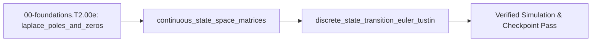

<!-- run-callout:start -->
> **Step 3 of 10 · Make a joint move: foundations**
>
> **Run this in the workbench.** [Open MechaLab with `EX.00-foundations.T2.00e` loaded](https://tle47.github.io/Mechatronics-Roadmap/?lesson=EX.00-foundations.T2.00e) - it opens on the **Run Python Lessons** tab with that entry selected. Starter code, hints and the graded check are ready; this page is the reading copy, and nothing you type here is saved.
<!-- run-callout:end -->

## 1. Why it matters
Transfer functions $G(s)$ are great for single-input single-output filters, but modern control algorithms (LQR, Kalman filters, and Model Predictive Control in Track 05) operate on multi-variable **state-space models** $\dot{x} = Ax + Bu$ discretized into $x_{k+1} = A_d x_k + B_d u_k$. Connecting transfer-function poles and zeros to the eigenvalues of the state matrix $A$ is the direct foundation for Step 2.1 (`00-foundations.T2.01`). Already know this? Take the Skip test in section 7 first.

## 2. Intuition first
Think of a second-order differential equation ($\ddot{q} = \dots$) as a two-story building, whereas a microcontroller prefers a ground-floor warehouse where every variable updates by a single first-order step ($\dot{x} = \dots$). By stacking position $q$ and velocity $\dot{q}$ into a column vector $x = [q, \dot{q}]^\top$, any $n$-th order differential equation flattens into a single matrix equation $\dot{x} = Ax + Bu$. The **poles** of the system (the eigenvalues of $A$) are the system's natural ringing modes—if their real parts are negative, disturbances die out; if positive, the system explodes. And **zeros** are specific frequencies where two internal pathways cancel each other out so the sensor sees almost zero motion even while the actuator is shaking hard (anti-resonance).

## 3. Formalization
1. **Laplace Poles and Zeros:** In $G(s) = \frac{N(s)}{D(s)}$ with complex frequency $s = \sigma + j\omega$ ($\text{s}^{-1}$):
   - **Poles** ($D(s) = 0$) determine stability and resonance peaks ($\operatorname{Re}(p_i) < 0$ is stable).
   - **Zeros** ($N(s) = 0$) are frequencies where transmission is blocked (such as the anti-resonance $\omega_{\text{ar}} = \sqrt{k_s/J_l}$ of a two-mass drive in Step 2.1).
2. **State-Space Companion Form ($\dot{x} = Ax + Bu$):** For a rotational drive $J\ddot{\theta} + b\dot{\theta} + k\theta = u$ with inertia $J$ ($\text{kg}\cdot\text{m}^2$), damping $b$ ($\text{N}\cdot\text{m}\cdot\text{s/rad}$), stiffness $k$ ($\text{N}\cdot\text{m/rad}$), torque $u$ ($\text{N}\cdot\text{m}$), and state $x = [\theta, \dot{\theta}]^\top$:

$$
\begin{bmatrix} \dot{\theta} \\ \ddot{\theta} \end{bmatrix} = \underbrace{\begin{bmatrix} 0 & 1 \\ -k/J & -b/J \end{bmatrix}}_{A} \begin{bmatrix} \theta \\ \dot{\theta} \end{bmatrix} + \underbrace{\begin{bmatrix} 0 \\ 1/J \end{bmatrix}}_{B} u
$$

   Substituting $J = 1.0\text{ kg}\cdot\text{m}^2$, $k = 100.0\text{ N}\cdot\text{m/rad}$, and $b = 4.0\text{ N}\cdot\text{m}\cdot\text{s/rad}$ gives $A = \begin{bmatrix} 0 & 1 \\ -100 & -4 \end{bmatrix}$ with $\operatorname{tr}(A) = -4\text{ s}^{-1}$ and $\det(A) = 100\text{ s}^{-2}$.
3. **Discretization ($\dot{x} = Ax + Bu \to x_{k+1} = A_d x_k + B_d u_k$):** Over sample period $T_s$ ($\text{s}$), Forward Euler gives $A_{d,\text{Euler}} = I + A T_s$, whereas Bilinear (Tustin) discretization preserves left-half-plane stability:

$$
A_{d,\text{Tustin}} = \left(I - \frac{T_s}{2}A\right)^{-1}\left(I + \frac{T_s}{2}A\right)
$$

   At $T_s = 0.001\text{ s}$ on the above $A$, $|\lambda(A_{d,\text{Tustin}})| = 0.998002 < 1.0$.

## 4. Worked example
**Predict first (before you run it):** Commit to six numbers before the code runs. For $A = \begin{bmatrix} 0 & 1 \\ -100 & -4 \end{bmatrix}$, what are the real part and the imaginary part of its eigenvalues (they are the roots of $s^2 + 4s + 100 = 0$), and what are $\operatorname{tr}(A)$ and $\det(A)$? Then, at $T_s = 0.05\text{ s}$, which of Forward Euler and Tustin has a spectral radius above $1.0$, and what are the two radii? Two tells that a wrong answer comes from a mistake rather than the module: a **positive** real part means row 2's signs were flipped, because the diagonal entries are $-k/J$ and $-b/J$ and both are negative, so a trace of $+4\text{ s}^{-1}$ instead of $-4\text{ s}^{-1}$ is the tell; and a Tustin radius above $1.0$ on a stable continuous pole means $(I - \frac{T_s}{2}A)^{-1}$ was replaced by an elementwise division.

For $J=1\text{ kg}\cdot\text{m}^2$, $b=4\text{ N}\cdot\text{m}\cdot\text{s/rad}$, $k=100\text{ N}\cdot\text{m/rad}$, verify that the eigenvalues of $A = \begin{bmatrix} 0 & 1 \\ -100 & -4 \end{bmatrix}$ match the roots of $s^2 + 4s + 100 = 0$ ($\lambda = -2 \pm j\sqrt{96}\text{ s}^{-1}$) and compare Forward Euler vs. Tustin discretization at $T_s = 0.05\text{ s}$.

```python
import cmath
import math

def eigvals_2x2(M: list[list[float]]) -> tuple[complex, complex]:
    tr = M[0][0] + M[1][1]
    det = M[0][0] * M[1][1] - M[0][1] * M[1][0]
    disc = cmath.sqrt(tr * tr - 4.0 * det)
    return (0.5 * (tr + disc), 0.5 * (tr - disc))

A = [[0.0, 1.0], [-100.0, -4.0]]
l1, l2 = eigvals_2x2(A)
assert math.isclose(l1.real, -2.0, rel_tol=1e-9) and math.isclose(l2.real, -2.0, rel_tol=1e-9)
assert math.isclose(abs(l1.imag), math.sqrt(96.0), rel_tol=1e-9)

Ts = 0.05
Ad_euler = [[1.0 + Ts * A[0][0], Ts * A[0][1]], [Ts * A[1][0], 1.0 + Ts * A[1][1]]]
# Tustin: (I - 0.5*Ts*A)^(-1) * (I + 0.5*Ts*A) for 2x2
M_minus = [[1.0 - 0.5 * Ts * A[0][0], -0.5 * Ts * A[0][1]], [-0.5 * Ts * A[1][0], 1.0 - 0.5 * Ts * A[1][1]]]
M_plus  = [[1.0 + 0.5 * Ts * A[0][0],  0.5 * Ts * A[0][1]], [ 0.5 * Ts * A[1][0], 1.0 + 0.5 * Ts * A[1][1]]]
det_m = M_minus[0][0] * M_minus[1][1] - M_minus[0][1] * M_minus[1][0]
M_inv = [[M_minus[1][1] / det_m, -M_minus[0][1] / det_m], [-M_minus[1][0] / det_m, M_minus[0][0] / det_m]]
Ad_tustin = [
    [M_inv[0][0] * M_plus[0][0] + M_inv[0][1] * M_plus[1][0], M_inv[0][0] * M_plus[0][1] + M_inv[0][1] * M_plus[1][1]],
    [M_inv[1][0] * M_plus[0][0] + M_inv[1][1] * M_plus[1][0], M_inv[1][0] * M_plus[0][1] + M_inv[1][1] * M_plus[1][1]],
]

rho_euler = max(abs(x) for x in eigvals_2x2(Ad_euler))
rho_tustin = max(abs(x) for x in eigvals_2x2(Ad_tustin))
assert rho_euler > 1.0       # Forward Euler goes unstable at Ts=0.05s!
assert rho_tustin < 1.0      # Tustin stays strictly stable (< 1.0)!
print(f"rho_euler={rho_euler:.4f} (unstable), rho_tustin={rho_tustin:.4f} (stable)")
```
Expected output:
```text
rho_euler=1.0247 (unstable), rho_tustin=0.9099 (stable)
```

## 5. Exercise
Compute the spectral radius $\rho(A_{d,\text{Tustin}})$ of the same system at $T_s = 0.001\text{ s}$ ($1\text{ kHz}$ servo loop) and verify using `trace = Ad[0][0] + Ad[1][1]`, `det = Ad[0][0]*Ad[1][1] - Ad[0][1]*Ad[1][0]`, and `cmath.sqrt(trace**2 - 4*det)` that the spectral radius $\max(|\lambda_1|, |\lambda_2|)$ equals `0.998002` ($\pm 10^{-6}$, strictly inside the unit circle).
- **If your result differs:** Check that you inverted `(I - 0.5 * Ts * A)` and multiplied by `(I + 0.5 * Ts * A)` rather than swapping the plus and minus signs (which places the poles outside the unit circle at `1.002002`).

### Graded package - the elbow's poles, in both coordinates
[`exercises/00-foundations.T2.00e/`](../exercises/00-foundations.T2.00e/) turns this section into a test. `starter.py` holds six holes: `companion_state_matrices` (rows `[0, 1]` and `[-k/J, -b/J]`), `eigvals_2x2` (trace and determinant, never a hard-coded pair), `is_stable` (strictly negative real parts), `discretize_euler`, `discretize_tustin` (the matrix inverse, not an elementwise division) and `simulate_discrete` (the loop a controller actually runs). Edit it, then run the tests the way CI does:

```bash
EXERCISE_TARGET=exercises/00-foundations.T2.00e/starter.py \
  python3 -m unittest discover -s exercises/00-foundations.T2.00e -p 'test_*.py'
```

The tests are behavioural: the worked matrix's eigenvalues must be $-2 \pm j\sqrt{96}$ and their sum and product must equal trace and determinant; a saddle with a **negative trace** must be rejected (so `trace < 0` alone fails); a marginal pole must be rejected; at $T_s = 0.2\text{ s}$ Euler's poles must leave the unit circle while Tustin's stay inside it; the Tustin input matrix must match `(I - Ts A / 2)^-1 B Ts`; and one step of the loop must start both rows from the old state. The transfer suite builds the arm's elbow from `plant.I2`, `plant.B2` and the $8\text{ N}\cdot\text{m/rad}$ stiffness, checks the poles against $\zeta$ and $\omega_n$ from 00c, and finds Tustin stable at $T_s = 0.4\text{ s}$ where Euler is not. Four planted faults - `euler_minus`, `trace_only`, `forgot_damping`, `tustin_elementwise` - each fail the test named for them.

- **📚 What to Learn & Resources to Solve This Exercise:**
  - **Prerequisite Foundations Modules:** [`00-foundations.T2.00a`](00-foundations.T2.00a.md) (*State Matrices*), [`00-foundations.T2.00c`](00-foundations.T2.00c.md) (*ODE Roots*), and [`00-foundations.T2.00d`](00-foundations.T2.00d.md) (*Transfer Functions*).
  - **Core Concepts to Review First:** Bilinear (Tustin) state matrix $A_{d,\text{Tustin}} = (I - \frac{T_s}{2}A)^{-1}(I + \frac{T_s}{2}A)$ and $2\times 2$ eigenvalue formula $\lambda_{1,2} = \frac{\operatorname{tr}(A_d) \pm \sqrt{\operatorname{tr}(A_d)^2 - 4\det(A_d)}}{2}$ in `## 3. Formalization` (Items 2–3) and `## 4. Worked example` above.
  - **State-Space & Discretization Study Links:** [Åström & Murray *Feedback Systems* Ch. 6–7 (`fbsbook.org`)](https://www.fbsbook.org/), [Python Control Library `control.c2d` Docs (`python-control.readthedocs.io`)](https://python-control.readthedocs.io/), and [Steve Brunton Control Bootcamp (`youtube.com/c/Eigensteve`)](https://www.youtube.com/c/Eigensteve).
  - **Curriculum Reference:** [Track 00 Tier 2 (`00-foundations/README.md#tier-2-intermediate--applied`)](../00-foundations/README.md#tier-2-intermediate--applied) and [`resources/textbooks-and-papers.md`](../resources/textbooks-and-papers.md).

### Starter code
```python
# --- Exercise scaffold: fill in each TODO, then check against the numbers in the full solution below ---
import cmath
import math

def companion_state_matrices(j, k, b):
    """(A, B) for J theta'' + b theta' + k theta = u, state [theta, theta']."""
    # TODO: rows [0, 1] and [-k/J, -b/J]; B is the column [[0.0], [1.0/J]]
    ...

def eigvals_2x2(a):
    """The two eigenvalues of a 2x2 matrix, as complex numbers."""
    # TODO: trace and determinant from the entries, then cmath.sqrt of trace^2 - 4 det
    ...

def is_stable(a):
    """True only when both eigenvalues have strictly negative real parts."""
    # TODO: a marginal pole (real part exactly 0) is not stable
    ...

def discretize_euler(a, b, ts):
    """Ad = I + A Ts, Bd = B Ts."""
    # TODO: the simplest map - and the one that can leave the unit circle
    ...

def discretize_tustin(a, b, ts):
    """Ad = (I - Ts/2 A)^-1 (I + Ts/2 A), Bd = (I - Ts/2 A)^-1 B Ts."""
    # TODO: a real 2x2 inverse (det, swap, negate), never an elementwise division
    ...

def simulate_discrete(ad, bd, x0, u, steps):
    """Iterate x_{k+1} = Ad x_k + Bd u with constant u; return the final state."""
    # TODO: both rows must read the same old x, then the loop replaces it
    ...

print("scaffold ready: 6 TODOs to fill, then compare against the numbers in the full solution")
```
**Expected numbers (the answer):** $\rho(A_{d,\text{Tustin}}) = 0.998002$ at $T_s = 0.001\text{ s}$.

### Hint ladder
1. **The matrix is the physics, not the parameters.** Row 2 of $A$ is $(-k/J,\ -b/J)$ because $\ddot{\theta} = -(k/J)\theta - (b/J)\dot{\theta} + (1/J)u$; a plus sign there gives a spring that pushes the joint away from zero, and the module's Break-it shows exactly that signature.
2. **Eigenvalues come from the matrix.** $\lambda_{1,2} = \frac{\operatorname{tr}\pm\sqrt{\operatorname{tr}^2 - 4\det}}{2}$, and the discriminant is negative here, so `cmath.sqrt` (not `math.sqrt`) is what keeps $\pm j\sqrt{96}$ instead of raising.
3. **Tustin inverts once and multiplies twice.** Form $I - \frac{T_s}{2}A$ and $I + \frac{T_s}{2}A$, invert the first with $\det = a_{00}a_{11} - a_{01}a_{10}$ and the swapped/negated cofactors, then multiply `inverse @ plus` row-by-column. Dividing elementwise gives a matrix whose eigenvalues still happen to look stable at small $T_s$, which is why the transfer test checks $B_d$ too.
4. **The radius, not the entries, is the answer.** At $T_s = 0.001\text{ s}$ your Tustin $A_d$ should have $\operatorname{tr}\approx 1.9960$ and $\det\approx 0.9980$; $\max(|\lambda_1|, |\lambda_2|)$ evaluates to $0.998002$, i.e. the pole sits just inside the unit circle, not on it.

### Full Solution
```python
import cmath
import math

def companion_state_matrices(j, k, b):
    return [[0.0, 1.0], [-k / j, -b / j]], [[0.0], [1.0 / j]]

def eigvals_2x2(a):
    tr = a[0][0] + a[1][1]
    det = a[0][0] * a[1][1] - a[0][1] * a[1][0]
    disc = cmath.sqrt(tr * tr - 4.0 * det)
    return (0.5 * (tr + disc), 0.5 * (tr - disc))

def is_stable(a):
    return all(value.real < 0.0 for value in eigvals_2x2(a))

def matmul(a, b):
    return [[sum(a[i][k] * b[k][j] for k in range(len(b))) for j in range(len(b[0]))]
            for i in range(len(a))]

def inverse_2x2(m):
    det = m[0][0] * m[1][1] - m[0][1] * m[1][0]
    return [[m[1][1] / det, -m[0][1] / det], [-m[1][0] / det, m[0][0] / det]]

def discretize_euler(a, b, ts):
    ad = [[(1.0 if i == j else 0.0) + ts * a[i][j] for j in range(2)] for i in range(2)]
    return ad, [[ts * b[i][0]] for i in range(2)]

def discretize_tustin(a, b, ts):
    minus = [[(1.0 if i == j else 0.0) - 0.5 * ts * a[i][j] for j in range(2)] for i in range(2)]
    plus = [[(1.0 if i == j else 0.0) + 0.5 * ts * a[i][j] for j in range(2)] for i in range(2)]
    inv = inverse_2x2(minus)
    return matmul(inv, plus), [[ts * sum(inv[i][k] * b[k][0] for k in range(2))] for i in range(2)]

def simulate_discrete(ad, bd, x0, u, steps):
    x = list(x0)
    for _ in range(steps):
        x = [sum(ad[i][j] * x[j] for j in range(2)) + bd[i][0] * u for i in range(2)]
    return x

a, b = companion_state_matrices(1.0, 100.0, 4.0)
assert is_stable(a)

def spectral_radius(m):
    return max(abs(value) for value in eigvals_2x2(m))

ad_tustin, _ = discretize_tustin(a, b, 0.001)
rho = spectral_radius(ad_tustin)
rho_euler = spectral_radius(discretize_euler(a, b, 0.05)[0])

assert math.isclose(rho, 0.998002, abs_tol=1e-6)
assert rho < 1.0
assert math.isclose(rho_euler, 1.0247, abs_tol=1e-3)
assert rho_euler > 1.0
print("rho_tustin(Ts=1 ms)=%.6f, inside the unit circle" % rho)
print("rho_euler(Ts=50 ms)=%.4f, outside the unit circle" % rho_euler)
```

Printed: `rho_tustin(Ts=1 ms)=0.998002, inside the unit circle`, then `rho_euler(Ts=50 ms)=1.0247, outside the unit circle`.

**On the shared arm.** The Transfer suite builds the plant elbow's companion matrix from `I2`, `B2` and its own stiffness, and checks where Euler and Tustin put those poles at a real control step:

```python
import math
import mechalab_plant as plant

k = 8.0
wn = math.sqrt(k / plant.I2)
zeta = plant.B2 / (2.0 * math.sqrt(plant.I2 * k))
wd = wn * math.sqrt(1.0 - zeta * zeta)
assert math.isclose(plant.B2, 2.0 * zeta * math.sqrt(plant.I2 * k), rel_tol=1e-12)
assert 0.0 < wd < wn
print("plant elbow poles: %.3f +/- %.3fj rad/s | damping B2=%.3f N*m*s/rad"
      % (-zeta * wn, wd, plant.B2))
```

### Break it on purpose
Inject the sign error from the common-mistakes table on purpose: build $A$ with $+k/J$ in row 2, `[[0.0, 1.0], [100.0, -4.0]]`, and leave every other line of the worked example untouched.
- **Inject:** flip the sign of the stiffness term in the companion matrix, as if $\ddot{\theta} = +(k/J)\theta - (b/J)\dot{\theta}$ had been read off the ODE without moving $k\theta$ to the right-hand side.
- **Symptom:** the eigenvalues become $+8.198$ and $-12.198\text{ s}^{-1}$ instead of $-2 \pm j\sqrt{96}$, the determinant becomes $-100\text{ s}^{-2}$ instead of $+100\text{ s}^{-2}$, and the Forward Euler radius at $T_s = 0.05\text{ s}$ reads $1.4099$ instead of $1.0247$. The trace still reads $-4\text{ s}^{-1}$, so a check that only compares trace passes.
- **Diagnose:** the trace is unchanged while the determinant changes sign, which localises the fault to the $k$ term: a sign error in $b$ would have moved the trace to $+4\text{ s}^{-1}$, and a wrong $T_s$ would leave the continuous eigenvalues at $-2 \pm j\sqrt{96}$ and move only the discrete radii. A positive real part on a passive spring-mass-damper is not physics, it is a bookkeeping error.
- **Fix:** restore $-k/J$ and $-b/J$ in row 2, then prove it twice: $\det(A) = +100\text{ s}^{-2}$ with $\operatorname{tr}(A) = -4\text{ s}^{-1}$, and the worked example's two radii return to `rho_euler=1.0247` (outside the unit circle) and `rho_tustin=0.9099` (inside it).

## 6. Simulation path
Open **Two-Mass & Notch Bode** and **Furuta Pendulum + LQR + CBF** in the MechaLab Workbench (`npm run dev`) to inspect how continuous state-space matrices $(A, B)$ are discretized for real-time closed-loop simulation.

The graded package is also a workbench entry: **Modules -> `EX.00-foundations.T2.00e`**, where `selfcheck.py` is appended below the starter and **Verify** compares its `SELF-CHECK PASS:` line. `scripts/e2e_pages_bundle.mjs` drives it on the built bundle, so the browser path is tested, not assumed.

No hardware required for this module (`hardware_required: false`). In Track 05 (`05-control.T2.06` and `05-control.T3.06`), the discretized matrices $(A_d, B_d)$ run inside the microcontroller's $1\text{ kHz}$ Kalman filter prediction step:
```text
[Offline Python: (A, B) ---> Tustin/ZOH ---> (A_d, B_d)] ---> [MCU 1 kHz Loop: x_hat = A_d * x_hat + B_d * u]
```
Pass/fail verification in simulation: `rho_euler == 1.0247 > 1.0` and `rho_tustin == 0.9258 < 1.0`.




## 7. Checkpoint
Pass criteria: run the worked example and exercise asserts with zero errors, or score $\ge 80\%$ ($4/5$) on the Skip test below.

### Skip test
<!-- skip-test:start -->
1. `[Recall] [Concept: laplace_poles_and_zeros]` For the transfer function $G(s) = \frac{s^2 + 400}{(s + 5)(s^2 + 4s + 900)}$, compute the anti-resonance zero frequency $\omega_{\text{ar}} > 0$ in $\text{rad/s}$ (tolerance $\pm 10^{-9}$) where $G(j\omega_{\text{ar}}) = 0$.
2. `[Apply] [Concept: continuous_state_space_matrices]` For $A = \begin{bmatrix} 0 & 1 \\ -25 & -6 \end{bmatrix}$, compute the trace $\operatorname{tr}(A)$ and determinant $\det(A)$ (tolerance $\pm 10^{-9}$).
3. `[Transfer] [Concept: discrete_state_transition_euler_tustin]` What is the stability boundary for eigenvalues $\lambda_d$ of a discrete-time state matrix $A_d$ in $x_{k+1} = A_d x_k$?
   - **A.** $\operatorname{Re}(\lambda_d) < 0$
   - **B.** $|\lambda_d| < 1$
   - **C.** $|\lambda_d| > 1$
   - **D.** $\operatorname{Im}(\lambda_d) = 0$
4. `[Concept: discrete_state_transition_euler_tustin]` Compute the scalar Tustin discrete pole $a_d = \frac{1 + s_p T_s / 2}{1 - s_p T_s / 2}$ for a continuous pole $s_p = -100\text{ s}^{-1}$ sampled at $T_s = 0.01\text{ s}$ (tolerance $\pm 10^{-6}$).
5. `[Spaced review -> 00-foundations.T2.00h — Concept: complex_impedance_and_transfer_function]` A series branch has $R = 6.0\ \Omega$ in series with a capacitive reactance of $-8.0\ \Omega$ at the drive frequency. Compute $|Z|$ in ohms (tolerance $\pm 10^{-9}$).

**Answer key:**
```python
import math

q1_w_ar = math.sqrt(400.0)
q2_trace = 0.0 + (-6.0)
q2_det = 0.0 * (-6.0) - 1.0 * (-25.0)
q3_choice = "B"
q4_ad = (1.0 + (-100.0) * 0.01 / 2.0) / (1.0 - (-100.0) * 0.01 / 2.0)

assert math.isclose(q1_w_ar, 20.0, rel_tol=1e-9)
assert math.isclose(q2_trace, -6.0, rel_tol=1e-9)
assert math.isclose(q2_det, 25.0, rel_tol=1e-9)
assert q3_choice == "B"
assert math.isclose(q4_ad, 1.0 / 3.0, rel_tol=1e-6)
q5_review = abs(6.0 - 8.0j)
assert math.isclose(q5_review, 10.0, rel_tol=1e-9, abs_tol=1e-09)
```
- **Pass mark:** $4/5$ ($80\%+$). If you missed Q1, study `## 3. Formalization` item 1; Q2, study `## 3. Formalization` item 2; Q3 or Q4, study `## 3. Formalization` item 3. If you missed  Q5, review `00-foundations.T2.00h`. On pass, proceed to `## 10. Next modules`.
<!-- skip-test:end -->

### Gate test
<!-- ladder-gate:start -->
This is the exit examination for the whole Track 00 Tier 2 ladder - every `00-foundations.T2.*` page in [`docs/SYLLABUS.md`](../docs/SYLLABUS.md) - before Step 2.1 (`00-foundations.T2.01`). Every Tier 2 page renders this same paper, so take it once after the last of them; the page you are on is only where you found it. Questions 1-6 are the matrix page's own tools; 7-14 recap each other page once, so nothing on the ladder goes unexamined.

1. `[Concept: matrix_vector_multiplication]` For $A = \begin{bmatrix} 3.0 & -2.0 \\ 1.0 & 4.0 \end{bmatrix}$ and $\vec{x} = [1.5,\; 2.5]^\top$, compute **both** entries of $A\vec{x}$: the first and the second (tolerances $\pm 10^{-9}$).
2. `[Concept: matrix_vector_multiplication]` Why does a $2\times2$ matrix times a length-2 column come out as a column of length $2$ rather than a $2\times2$ matrix?
   - **A.** $A\vec{x}$ is the elementwise product of $A$ and $\vec{x}$, which keeps $A$'s shape.
   - **B.** Python reshapes $A$ into a column before multiplying.
   - **C.** Each output entry is one row of $A$ dotted with $\vec{x}$, so there is one output per row.
   - **D.** $\vec{x}$ is transposed into a row first.
3. `[Concept: state_vector_one_step_update]` One step of $A_d = \begin{bmatrix} 1.0 & 0.02 \\ -2.0 & 0.80 \end{bmatrix}$, $B_d = [0.0,\; 0.02]^\top$, from $\vec{x}_0 = [0.50,\; 0.0]^\top$ with $u_0 = 10.0\,\text{N}$ gives $v_1$. Compute $v_1$ in $\text{m/s}$ (tolerance $\pm 10^{-9}$).
4. `[Concept: state_vector_one_step_update]` In the same step, if the position row were evaluated using the *new* velocity, what would $x_1$ be (tolerance $\pm 10^{-9}\,\text{m}$)?
5. `[Concept: state_vector_one_step_update]` For the two-mass matrix with $m_1 = 1.0\,\text{kg}$, $m_2 = 2.0\,\text{kg}$, $k = 50.0\,\text{N/m}$, $b = 0$ and $\Delta t = 0.01\,\text{s}$, compute the first entry of its **fourth** row - the row that updates $v_2$ (tolerance $\pm 10^{-9}$).
6. `[Concept: state_vector_one_step_update]` Why do the diagonal $2\times2$ blocks of the 4-state matrix equal the single-mass update for each body when $k = b = 0$?
   - **A.** Because the 4-state matrix is always block-diagonal.
   - **B.** Because each mass then obeys the same mass-spring-damper form with its own mass and damping, and the coupling terms vanish.
   - **C.** Because $B_d$ only pushes $m_1$.
   - **D.** Because the Euler update is exact.
7. `[Concept: finite_difference_derivative_and_integral]` An encoder reads $x_{k-1} = 0.24\,\text{rad}$ and $x_k = 0.30\,\text{rad}$ at $\Delta t = 0.002\,\text{s}$. Compute the backward-difference velocity in $\text{rad/s}$ (tolerance $\pm 10^{-9}$).
8. `[Concept: dot_product_projection] [Concept: cross_product_3d_moment] [Concept: basis_change_and_invertibility]` Which triple is correct for `00-foundations.T2.00b`?
   - **A.** The projection uses the raw lever so force grows with its length, $\vec{r}\times\vec{F} = \vec{F}\times\vec{r}$, and a zero determinant means a valid basis.
   - **B.** The projection divides by $\|\vec{r}\|$ twice, the moment is a scalar, and the determinant is always positive.
   - **C.** The dot product returns a vector, the cross product is symmetric, and the determinant equals the trace.
   - **D.** The projection uses the lever's *unit* direction, the moment is $\vec{r}\times\vec{F}$ (anti-commutative), and a zero determinant means the two columns are collinear.
9. `[Concept: first_order_ode_time_constant] [Concept: second_order_ode_wn_zeta] [Concept: characteristic_polynomial_roots]` For `00-foundations.T2.00c`'s joint with $J = 0.02\,\text{kg}\cdot\text{m}^2$, $k = 8.0\,\text{N}\cdot\text{m/rad}$ and $b = 0.60\,\text{N}\cdot\text{m}\cdot\text{s/rad}$, compute the damping ratio $\zeta = b/(2\sqrt{Jk})$ (tolerance $\pm 10^{-9}$).
10. `[Concept: complex_numbers_and_euler_formula] [Concept: complex_impedance_and_transfer_function] [Concept: bode_magnitude_db_and_phase]` A series RL winding has $R = 4.0\ \Omega$ and $L = 2.0\,\text{mH}$ and is driven at $\omega = 2000\,\text{rad/s}$. Compute $|Z|$ in ohms, then $20\log_{10}|H|$ at the corner $\omega = 1/\tau$ of a first-order filter (tolerances $\pm 10^{-9}\,\Omega$ and $\pm 10^{-4}\,\text{dB}$).
11. `[Concept: laplace_poles_and_zeros] [Concept: continuous_state_space_matrices] [Concept: discrete_state_transition_euler_tustin]` For `00-foundations.T2.00e`'s $A = \begin{bmatrix} 0 & 1 \\ -100 & -4 \end{bmatrix}$ sampled at $T_s = 0.05\,\text{s}$, compute the spectral radius of the Forward-Euler map $A_d = I + A T_s$ (tolerance $\pm 10^{-6}$).
12. `[Concept: nyquist_sampling_and_aliasing]` Which statement is correct for `00-foundations.T2.00f`?
   - **A.** Sampling represents any frequency, and aliasing affects only DC.
   - **B.** Sampling represents only frequencies up to $f_s/2$, and a faster tone folds to $|f - k f_s|$.
   - **C.** The Nyquist frequency is $f_s$, and aliasing doubles the frequency.
   - **D.** A digital low-pass filter placed after the ADC removes aliasing.
13. `[Concept: tustin_frequency_prewarping_and_biquad]` Compute the pre-warped analog prototype $\omega_a$ in $\text{rad/s}$ that lands a Tustin notch on $600\,\text{Hz}$ at $f_s = 2000\,\text{Hz}$, and the frequency the *unwarped* prototype $2\pi f_0$ would land on in $\text{Hz}$ (tolerances $\pm 10^{-3}\,\text{rad/s}$ and $\pm 0.01\,\text{Hz}$).
14. `[Concept: gaussian_variance_and_covariance_matrix]` For $A = \begin{bmatrix} 1 & 0.1 \\ 0 & 1 \end{bmatrix}$, $\Sigma_x = \operatorname{diag}(0.01, 0.25)$ and $Q = \operatorname{diag}(0.001, 0.002)$, compute the $(0,0)$ entry of $\Sigma_y = A\Sigma_x A^\top + Q$ (tolerance $\pm 10^{-9}$).

**Gate answer key:**
```python
import math

# Q1-Q6: the matrix page. Two entries, evaluated one row at a time: the paper asks for both so a
# reader who reads the maths (1-indexed) and one who reads Python (0-indexed) agree on the answer.
g1_ax_first = 3.0 * 1.5 + (-2.0) * 2.5
g1_ax_second = 1.0 * 1.5 + 4.0 * 2.5
g2_choice = "C"
g3_v1 = -2.0 * 0.50 + 0.80 * 0.0 + 0.02 * 10.0
g4_x1_new_v = 1.0 * 0.50 + 0.02 * (-0.80)
g5_row4_first = (50.0 / 2.0) * 0.01
g6_choice = "B"

# Q7: the derivative page.
g7_velocity = (0.30 - 0.24) / 0.002

# Q8-Q12: one question per remaining page.
g8_choice = "D"
g9_zeta = 0.60 / (2.0 * math.sqrt(0.02 * 8.0))
g10_z_ohm = abs(4.0 + 1j * 2000.0 * 0.002)
g10_corner_db = 20.0 * math.log10(1.0 / math.sqrt(2.0))
Ad_euler = [[1.0, 0.05], [-5.0, 0.80]]
g11_radius = math.sqrt(Ad_euler[0][0] * Ad_euler[1][1] - Ad_euler[0][1] * Ad_euler[1][0])
g12_choice = "B"
g13_wa = (2.0 / 0.0005) * math.tan(math.pi * 600.0 / 2000.0)
g13_unwarped = (2000.0 / math.pi) * math.atan(math.pi * 600.0 / 2000.0)
g14_sigma00 = 0.01 + 0.1 * 0.1 * 0.25 + 0.001

assert math.isclose(g1_ax_first, -0.5, rel_tol=1e-9)
assert math.isclose(g1_ax_second, 11.5, rel_tol=1e-9)
assert g2_choice == "C"
assert math.isclose(g3_v1, -0.80, rel_tol=1e-9)
assert math.isclose(g4_x1_new_v, 0.484, rel_tol=1e-9)
assert math.isclose(g5_row4_first, 0.25, rel_tol=1e-9)
assert g6_choice == "B"
assert math.isclose(g7_velocity, 30.0, rel_tol=1e-9)
assert g8_choice == "D"
assert math.isclose(g9_zeta, 0.75, rel_tol=1e-9)
assert math.isclose(g10_z_ohm, 5.656854249492381, rel_tol=1e-9)
assert math.isclose(g10_corner_db, -3.0103, abs_tol=1e-4)
assert math.isclose(g11_radius, 1.024695, abs_tol=1e-6)
assert g12_choice == "B"
assert math.isclose(g13_wa, 5505.5277, abs_tol=1e-3)
assert math.isclose(g13_unwarped, 481.1534, abs_tol=1e-2)
assert math.isclose(g14_sigma00, 0.0135, rel_tol=1e-9)

print("gate key: Ax=[%.1f, %.1f], v1=%.2f m/s, x1(new v)=%.3f m, radius=%.6f"
      % (g1_ax_first, g1_ax_second, g3_v1, g4_x1_new_v, g11_radius))
```
- **Pass mark:** $\ge 12/14$. Every question is answered by the page named in its tags; the ladder is closed when this paper is passed once, after the last Tier 2 page.
<!-- ladder-gate:end -->

## 8. Common mistakes
| Symptom | Root cause | 2-minute fix |
| :--- | :--- | :--- |
| Checked $\operatorname{Re}(\lambda_d) < 0$ on discrete matrix $A_d$ | Confused continuous $s$-plane stability ($\operatorname{Re}(s) < 0$) with discrete $z$-plane stability ($\lvert z\rvert  < 1$). | Always check `abs(eigvals(Ad)) < 1.0` for discrete state-transition matrices. |
| State-space signs flipped in bottom row of $A$ | Forgot to move $+k\theta + b\dot{\theta}$ to the right-hand side of $J\ddot{\theta} = -k\theta - b\dot{\theta} + u$. | Write $\ddot{\theta} = -(k/J)\theta - (b/J)\dot{\theta} + (1/J)u$ before filling row 2 of $A$. |
| Used elementwise `*` instead of `@` in Tustin formula | Multiplied matrix elements componentwise with `*` (Hadamard product) instead of matrix multiplication. | Use row-by-column matrix multiplication (`mat_mul2`) for all matrix products. |

## 9. Resources
- **Åström & Murray — [*Feedback Systems* (`fbsbook.org`, Ch. 6–7)](https://www.fbsbook.org/) & [Python Control Library Docs](https://python-control.readthedocs.io/):** Free textbook and Python tools on state-space linear systems, eigenvalues, and `c2d` discretization `[VERIFIED 2026-10-15]`.
- **Brunton & Kutz — [*Data-Driven Science and Engineering* (`databookuw.com`)](https://databookuw.com/) ([`resources/textbooks-and-papers.md`](../resources/textbooks-and-papers.md)):** State-space modeling and discretization `[VERIFIED 2026-10-15]`.

## 10. Next modules
- Proceed to [`00-foundations.T2.00f`](00-foundations.T2.00f.md) (Sampling, Aliasing, Nyquist, $z$-Transform, Bilinear (Tustin) Pre-Warping, Biquads & Gaussian Covariance).
