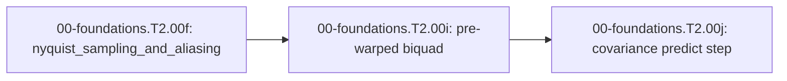

<!-- run-callout:start -->
> **Step 3 of 10 · Make a joint move: foundations**
>
> **Run this in the workbench.** [Open MechaLab with `EX.00-foundations.T2.00f` loaded](https://tle47.github.io/Mechatronics-Roadmap/?lesson=EX.00-foundations.T2.00f) - it opens on the **Run Python Lessons** tab with that entry selected. Starter code, hints and the graded check are ready; this page is the reading copy, and nothing you type here is saved.
<!-- run-callout:end -->

## 1. Why it matters
A digital controller sees the world only at its sample instants. Anything faster than half the sample rate does not disappear - it comes back as a **slower frequency that was never there**, and no amount of digital filtering can tell the two apart afterwards. At the capstone's $1\,\text{kHz}$ tick a $1.8\,\text{kHz}$ vibration reads as $200\,\text{Hz}$, and a controller tuned to reject $200\,\text{Hz}$ will happily reject a resonance it never had. This page is the one place that arithmetic is taught; the notch filter that removes an in-band tone is `00-foundations.T2.00i`, and the uncertainty that survives sampling is `00-foundations.T2.00j`. Already know this? Take the Skip test in section 7 first.

## 2. Intuition first
<!-- figure: aliasing | The anti-alias filter exists because every sampled wave has a slower twin at the sample rate. -->

Think of a film of a wagon wheel. The camera takes 24 pictures a second, the wheel turns faster than 12 revolutions a second, and the spokes appear to crawl backwards. Nothing is wrong with the wheel or the camera - the sampling grid is simply too coarse to represent the motion, so it reports the nearest motion it *can* represent. The alias frequency is that nearest motion, and it always lands between zero and half the frame rate.

The second half of the idea is the seam. Half the sample rate is called the **Nyquist frequency**, and it is a mirror: $3.9\,\text{kHz}$ sampled at $4\,\text{kHz}$ and $100\,\text{Hz}$ sampled at $4\,\text{kHz}$ produce exactly the same numbers. Once both are inside the same samples, only the analog filter that ran *before* the ADC can separate them.

## 3. Formalization
1. **Sample rate and Nyquist limit:** a converter that reads once every $T_s$ seconds has sample rate $f_s = 1/T_s$ in hertz, and can represent frequencies only up to

$$
f_{\text{Nyquist}} = \frac{f_s}{2}.
$$

   A tone exactly at $f_s/2$ is representable but ambiguous in phase; anything above it is not representable at all.
2. **Folding and mirroring:** an analog frequency $f$ sampled at $f_s$ appears at

$$
f_{\text{alias}} = \left| f - k f_s \right| \in \left[ 0, \frac{f_s}{2} \right],
$$

   where $k$ is the integer that brings the result into that interval. In code the same rule is one remainder followed by one reflection: `folded = fmod(|f|, fs)`, and if `folded > fs/2` then `folded = fs - folded`. Substituting $f = 3150\,\text{Hz}$ and $f_s = 4000\,\text{Hz}$ gives a remainder of $3150$, which is past Nyquist, so the answer is $4000 - 3150 = 850\,\text{Hz}$.
3. **Why a digital filter cannot undo it:** after sampling, an alias at $850\,\text{Hz}$ and a genuine $850\,\text{Hz}$ tone produce the identical sample sequence. Any filter that removes one removes the other. The only defence is **analog attenuation before the ADC** - the RC or Bessel filter from `00-foundations.T2.00h`, whose stopband starts below $f_s/2$.

## 4. Worked example
**Predict first (before you run it):** commit to two numbers. (1) A $3150\,\text{Hz}$ switching harmonic is sampled at $f_s = 4000\,\text{Hz}$ - what frequency appears in the data? (2) A $9000\,\text{Hz}$ tone at the same rate - what frequency does *that* appear as? Two tells that a wrong answer is a mistake rather than a surprise: any alias outside $[0, 2000]\,\text{Hz}$ means the fold ran but the mirror did not, and an alias of $3150$ means neither ran.

```python
import math

fs = 4000.0
nyquist = 0.5 * fs


def alias_of(f_sig):
    folded = math.fmod(abs(f_sig), fs)
    return fs - folded if folded > nyquist else folded


alias_3150 = alias_of(3150.0)
alias_9000 = alias_of(9000.0)

assert math.isclose(nyquist, 2000.0, abs_tol=1e-12)
assert math.isclose(alias_3150, 850.0, abs_tol=1e-12)
assert math.isclose(alias_9000, 1000.0, abs_tol=1e-12)
assert 0.0 <= alias_3150 <= nyquist
print("fs=%.0f Hz | Nyquist=%.0f Hz | 3150 Hz -> %.0f Hz | 9000 Hz -> %.0f Hz"
      % (fs, nyquist, alias_3150, alias_9000))
```
Expected output:
```text
fs=4000 Hz | Nyquist=2000 Hz | 3150 Hz -> 850 Hz | 9000 Hz -> 1000 Hz
```

## 5. Exercise
Compute the alias of a $2700\,\text{Hz}$ structural resonance sampled at $f_s = 2000\,\text{Hz}$, and of a $3000\,\text{Hz}$ tone sampled at $f_s = 4000\,\text{Hz}$. Verify $700.0\,\text{Hz}$ and $1000.0\,\text{Hz}$ respectively ($\pm 10^{-9}$).
- **If your result differs:** for $2700$ at $2000$ the remainder is already $700$, below Nyquist, so nothing is reflected; a result of $1300$ means the reflection ran when it should not have. For $3000$ at $4000$ the remainder is $3000$, above Nyquist, so it reflects to $4000 - 3000 = 1000$.

### Graded package - aliasing the arm's own elbow mode
[`exercises/00-foundations.T2.00f/`](../exercises/00-foundations.T2.00f/) turns this section into a test. `starter.py` holds two holes: `nyquist_hz(fs)` and `alias_hz(f_sig, fs)` (fold **and** mirror). Edit it, then run the tests the way CI does:

```bash
EXERCISE_TARGET=exercises/00-foundations.T2.00f/starter.py \
  python3 -m unittest discover -s exercises/00-foundations.T2.00f -p 'test_*.py'
```

The tests are behavioural: 3150 Hz at 4 kHz must fold to 850 Hz and 9000 Hz to 1000 Hz; 100 Hz and Nyquist itself must pass through unchanged; $3/4$ of the sample rate must mirror down to $1/4$ of it; and negative or zero sample rates must be refused rather than silently half-applied. The transfer suite drives the shared plant: the elbow's damped mode sits above 6 Hz, so a 12 Hz controller folds it to $12 - f$ while the capstone's 1 kHz tick passes it untouched. **9 tests.** Three planted faults - `alias_no_mirror`, `alias_no_fold`, `nyquist_unhalved` - each fail the test named for them, and a print-only file passes nothing (`scripts/run_exercise.py`).

1. **What the suite refuses.** `nyquist_hz` raises `ValueError` for a sample rate that is zero or negative, because a converter that never samples has no representable band; `alias_hz` raises `ValueError` for the same rate, so a mistyped `fs` fails loudly instead of folding everything to zero. Both refusals are tested, so a submission that returns `0.0` for a nonsense rate fails rather than passing.

- **📚 What to Learn & Resources to Solve This Exercise:**
  - **Prerequisite Foundations Module:** [`00-foundations.T2.00e`](00-foundations.T2.00e.md) (*Laplace, State-Space & Euler/Tustin Discretization*).
  - **Core Concepts to Review First:** the Nyquist limit $f_s/2$ and the fold-and-mirror rule $f_{\text{alias}} = |f - k f_s|$ in `## 3. Formalization` (Items 1-2) and `## 4. Worked example` above.
  - **Sampling & Aliasing Study Links:** [The Scientist and Engineer's Guide to DSP, Ch. 3 (`dspguide.com`)](https://www.dspguide.com/ch3.htm) and [Julius O. Smith III, *Introduction to Digital Filters* (`ccrma.stanford.edu/~jos/filters/`)](https://ccrma.stanford.edu/~jos/filters/).
  - **Curriculum Reference:** [Track 00 Tier 2 (`00-foundations/README.md#tier-2-intermediate--applied`)](../00-foundations/README.md#tier-2-intermediate--applied).

### Starter code
```python
"""Exercise 00-foundations.T2.00f - the learner's file.

Two numbers a sampler owes you: the highest frequency it can represent, and where a faster
tone really lands. Fill the two TODOs:

    EXERCISE_TARGET=exercises/00-foundations.T2.00f/starter.py \
        python3 -m unittest discover -s exercises/00-foundations.T2.00f -p 'test_*.py'
"""


def nyquist_hz(fs):
    """The highest frequency a sample rate `fs` can represent, in Hz."""
    raise NotImplementedError("TODO 1: fs / 2")


def alias_hz(f_sig, fs):
    """The frequency in [0, fs/2] that `f_sig` appears as after sampling at `fs`."""
    raise NotImplementedError("TODO 2: fold with fmod and mirror the second half down")
```

**Expected numbers (the answer):** $f_{\text{alias}}(2700\,\text{Hz} @ 2000\,\text{Hz}) = 700.0\,\text{Hz}$ and $f_{\text{alias}}(3000\,\text{Hz} @ 4000\,\text{Hz}) = 1000.0\,\text{Hz}$.

### Hint ladder
1. **Halve the rate, then guard it.** `nyquist_hz` is `0.5 * fs`; a rate at or below zero has no band, so it raises.
2. **Aliasing is folding, then mirroring.** `math.fmod(2700, 2000)` already gives $700$, but $3150$ at $4000$ gives $3150$, which is above Nyquist - so subtract from $f_s$ whenever the remainder exceeds $f_s/2$.
3. **Check the seam.** $3000$ at $4000$ and $1000$ at $4000$ must return the same number; if they differ, the reflection is missing.
4. **Nyquist itself is allowed.** $2000$ at $4000$ must return $2000$, so the comparison is `>` and not `>=`.

### Full Solution
```python
def nyquist_hz(fs):
    """Half the sample rate."""
    if fs <= 0.0:
        raise ValueError("nyquist_hz: sample rate must be positive, got %r" % (fs,))
    return 0.5 * fs


def alias_hz(f_sig, fs):
    """Fold `f_sig` into [0, fs/2].

    `fmod` gives the remainder one fold down; a remainder past Nyquist is the mirror image of a
    frequency below it, so it is subtracted from fs.
    """
    if fs <= 0.0:
        raise ValueError("alias_hz: sample rate must be positive, got %r" % (fs,))
    folded = math.fmod(abs(f_sig), fs)
    if folded > 0.5 * fs:
        folded = fs - folded
    return folded


import math  # noqa: E402  (after the definitions, so the starter block matches the page)

assert math.isclose(nyquist_hz(4000.0), 2000.0, abs_tol=1e-12)
assert math.isclose(alias_hz(2700.0, 2000.0), 700.0, abs_tol=1e-12)
assert math.isclose(alias_hz(3000.0, 4000.0), 1000.0, abs_tol=1e-12)
print("nyquist(4000)=%.1f Hz | alias(2700 @ 2000)=%.1f Hz | alias(3000 @ 4000)=%.1f Hz"
      % (nyquist_hz(4000.0), alias_hz(2700.0, 2000.0), alias_hz(3000.0, 4000.0)))
```

Printed: `nyquist(4000)=2000.0 Hz | alias(2700 @ 2000)=700.0 Hz | alias(3000 @ 4000)=1000.0 Hz`.

**On the shared arm.** The transfer suite samples the plant's elbow. Its damped mode is above $6\,\text{Hz}$, so a $12\,\text{Hz}$ loop folds it, while the $1\,\text{kHz}$ capstone tick does not:

```python
import math
import mechalab_plant as plant

k = 8.0
wn = math.sqrt(k / plant.I2)
zeta = plant.B2 / (2.0 * math.sqrt(plant.I2 * k))
f_damped = wn * math.sqrt(1.0 - zeta * zeta) / (2.0 * math.pi)
assert f_damped > 6.0
print("elbow damped mode=%.3f Hz | at 12 Hz it reads %.3f Hz | at 1 kHz it reads %.3f Hz"
      % (f_damped, 12.0 - f_damped, f_damped))
```

### Break it on purpose
Inject the `alias_no_mirror` fault: fold with `fmod` and stop there.
- **Inject:** return `math.fmod(abs(f_sig), fs)` without the reflection.
- **Symptom:** $3150$ at $4000$ reports $3150\,\text{Hz}$, a frequency the sampler cannot represent, while $2700$ at $2000$ still reports $700$ - so half the examples look right.
- **Diagnose:** the returned value breaks the contract $0 \le f \le f_s/2$. Any output above Nyquist is proof the reflection is missing; a genuine low tone never needs one.
- **Fix:** reflect with `fs - folded` when `folded > fs/2`, then assert the seam: $3000$ and $1000$ at $4\,\text{kHz}$ must agree.

## 6. Simulation path
Run the worked example in Python, then open **Two-Mass & Notch Bode** in the MechaLab Workbench and set the sample rate to $4\,\text{kHz}$: the alias of the $850\,\text{Hz}$ notch's neighbourhood is what the coarse-rate display shows.

The graded package is also a workbench entry: **Modules -> `EX.00-foundations.T2.00f`**, where `selfcheck.py` is appended below the starter and **Verify** compares its `SELF-CHECK PASS:` line. `scripts/e2e_pages_bundle.mjs` drives it on the built bundle, so the browser path is tested, not assumed.

No hardware required for this module (`hardware_required: false`). On the STM32/ESP32 in Pass 2, this arithmetic decides the ADC trigger rate and the analog filter in front of it:
```text
[Analog Sensor] ---> [RC Anti-Alias Filter] ---> [ADC @ f_s] ---> [samples]
```
Pass/fail verification in simulation: `alias(3150 @ 4000) == 850 Hz`, `alias(9000 @ 4000) == 1000 Hz`, and $0 \le f_{\text{alias}} \le f_s/2$ for every input.



## 7. Checkpoint
Pass criteria: run the worked example and the exercise with zero assertion errors, or score $\ge 80\%$ ($4/5$) on the Skip test below. The ladder's Gate paper in section 7 is taken once, after the last Tier 2 page.

### Skip test
<!-- skip-test:start -->
1. `[Recall] [Concept: nyquist_sampling_and_aliasing]` A $3150\text{ Hz}$ motor switching harmonic is sampled at $f_s = 4000\text{ Hz}$ without an anti-aliasing filter. What alias frequency $f_{\text{alias}} \in [0, 2000]\text{ Hz}$ (tolerance $\pm 10^{-9}$) appears in the digital data?
2. `[Apply] [Concept: nyquist_sampling_and_aliasing]` A $3900\text{ Hz}$ tone is sampled at $f_s = 4000\text{ Hz}$. Compute its alias in $\text{Hz}$ (tolerance $\pm 10^{-9}$).
3. `[Transfer] [Concept: nyquist_sampling_and_aliasing]` Why can no digital filter recover a $3150\text{ Hz}$ tone that was sampled at $4000\text{ Hz}$ without an analog filter?
   - **A.** Because digital filters only work below $100\text{ Hz}$.
   - **B.** Because the samples of the $3150\text{ Hz}$ tone are identical to those of an $850\text{ Hz}$ tone, so removing one removes the other; only an analog filter ahead of the ADC can tell them apart.
   - **C.** Because the ADC needs double-precision floating point.
   - **D.** Because folding amplifies high frequencies.
4. `[Concept: nyquist_sampling_and_aliasing]` A tone arrives at exactly $f_s/2$. What does the sampler report?
   - **A.** Nothing: the converter refuses to digitise it.
   - **B.** Exactly $f_s/2$, but its phase is unrecoverable, so the reading is ambiguous.
   - **C.** Zero, because the tone sits on the seam.
   - **D.** $f_s$, because the mirror doubles it.
5. `[Spaced review -> 00-foundations.T2.00e — Concept: continuous_state_space_matrices]` For $A = \begin{bmatrix} 0 & 1 \\ -100 & -4 \end{bmatrix}$, compute $\operatorname{tr}(A)$ (tolerance $\pm 10^{-9}$).

**Answer key:**
```python
import math

q1_alias_hz = abs(3150.0 - 4000.0)
q2_alias_hz = 4000.0 - 3900.0
q3_choice = "B"
q4_choice = "B"
q5_review = 0.0 + (-4.0)

assert math.isclose(q1_alias_hz, 850.0, rel_tol=1e-9)
assert math.isclose(q2_alias_hz, 100.0, rel_tol=1e-9)
assert q3_choice == "B"
assert q4_choice == "B"
assert math.isclose(q5_review, -4.0, rel_tol=1e-9, abs_tol=1e-9)

```
- **Pass mark:** $4/5$ ($80\%+$). If you missed Q1 or Q4, study `## 3. Formalization` items 1-2; Q2, study item 2; Q3, study item 3. If you missed Q5, review `00-foundations.T2.00e`. On pass, proceed to `## 10. Next modules`.
<!-- skip-test:end -->

### Gate test
<!-- ladder-gate:start -->
This is the exit examination for the whole Track 00 Tier 2 ladder - every `00-foundations.T2.*` page in [`docs/SYLLABUS.md`](../docs/SYLLABUS.md) - before Step 2.1 (`00-foundations.T2.01`). Every Tier 2 page renders this same paper, so take it once after the last of them; the page you are on is only where you found it. Questions 1-6 are the matrix page's own tools; 7-14 recap each other page once, so nothing on the ladder goes unexamined.

1. `[Concept: matrix_vector_multiplication]` For $A = \begin{bmatrix} 3.0 & -2.0 \\ 1.0 & 4.0 \end{bmatrix}$ and $\vec{x} = [1.5,\; 2.5]^\top$, compute **both** entries of $A\vec{x}$: the first and the second (tolerances $\pm 10^{-9}$).
2. `[Concept: matrix_vector_multiplication]` Why does a $2\times2$ matrix times a length-2 column come out as a column of length $2$ rather than a $2\times2$ matrix?
   - **A.** $A\vec{x}$ is the elementwise product of $A$ and $\vec{x}$, which keeps $A$'s shape.
   - **B.** Python reshapes $A$ into a column before multiplying.
   - **C.** Each output entry is one row of $A$ dotted with $\vec{x}$, so there is one output per row.
   - **D.** $\vec{x}$ is transposed into a row first.
3. `[Concept: state_vector_one_step_update]` One step of $A_d = \begin{bmatrix} 1.0 & 0.02 \\ -2.0 & 0.80 \end{bmatrix}$, $B_d = [0.0,\; 0.02]^\top$, from $\vec{x}_0 = [0.50,\; 0.0]^\top$ with $u_0 = 10.0\,\text{N}$ gives $v_1$. Compute $v_1$ in $\text{m/s}$ (tolerance $\pm 10^{-9}$).
4. `[Concept: state_vector_one_step_update]` In the same step, if the position row were evaluated using the *new* velocity, what would $x_1$ be (tolerance $\pm 10^{-9}\,\text{m}$)?
5. `[Concept: state_vector_one_step_update]` For the two-mass matrix with $m_1 = 1.0\,\text{kg}$, $m_2 = 2.0\,\text{kg}$, $k = 50.0\,\text{N/m}$, $b = 0$ and $\Delta t = 0.01\,\text{s}$, compute the first entry of its **fourth** row - the row that updates $v_2$ (tolerance $\pm 10^{-9}$).
6. `[Concept: state_vector_one_step_update]` Why do the diagonal $2\times2$ blocks of the 4-state matrix equal the single-mass update for each body when $k = b = 0$?
   - **A.** Because the 4-state matrix is always block-diagonal.
   - **B.** Because each mass then obeys the same mass-spring-damper form with its own mass and damping, and the coupling terms vanish.
   - **C.** Because $B_d$ only pushes $m_1$.
   - **D.** Because the Euler update is exact.
7. `[Concept: finite_difference_derivative_and_integral]` An encoder reads $x_{k-1} = 0.24\,\text{rad}$ and $x_k = 0.30\,\text{rad}$ at $\Delta t = 0.002\,\text{s}$. Compute the backward-difference velocity in $\text{rad/s}$ (tolerance $\pm 10^{-9}$).
8. `[Concept: dot_product_projection] [Concept: cross_product_3d_moment] [Concept: basis_change_and_invertibility]` Which triple is correct for `00-foundations.T2.00b`?
   - **A.** The projection uses the raw lever so force grows with its length, $\vec{r}\times\vec{F} = \vec{F}\times\vec{r}$, and a zero determinant means a valid basis.
   - **B.** The projection divides by $\|\vec{r}\|$ twice, the moment is a scalar, and the determinant is always positive.
   - **C.** The dot product returns a vector, the cross product is symmetric, and the determinant equals the trace.
   - **D.** The projection uses the lever's *unit* direction, the moment is $\vec{r}\times\vec{F}$ (anti-commutative), and a zero determinant means the two columns are collinear.
9. `[Concept: first_order_ode_time_constant] [Concept: second_order_ode_wn_zeta] [Concept: characteristic_polynomial_roots]` For `00-foundations.T2.00c`'s joint with $J = 0.02\,\text{kg}\cdot\text{m}^2$, $k = 8.0\,\text{N}\cdot\text{m/rad}$ and $b = 0.60\,\text{N}\cdot\text{m}\cdot\text{s/rad}$, compute the damping ratio $\zeta = b/(2\sqrt{Jk})$ (tolerance $\pm 10^{-9}$).
10. `[Concept: complex_numbers_and_euler_formula] [Concept: complex_impedance_and_transfer_function] [Concept: bode_magnitude_db_and_phase]` A series RL winding has $R = 4.0\ \Omega$ and $L = 2.0\,\text{mH}$ and is driven at $\omega = 2000\,\text{rad/s}$. Compute $|Z|$ in ohms, then $20\log_{10}|H|$ at the corner $\omega = 1/\tau$ of a first-order filter (tolerances $\pm 10^{-9}\,\Omega$ and $\pm 10^{-4}\,\text{dB}$).
11. `[Concept: laplace_poles_and_zeros] [Concept: continuous_state_space_matrices] [Concept: discrete_state_transition_euler_tustin]` For `00-foundations.T2.00e`'s $A = \begin{bmatrix} 0 & 1 \\ -100 & -4 \end{bmatrix}$ sampled at $T_s = 0.05\,\text{s}$, compute the spectral radius of the Forward-Euler map $A_d = I + A T_s$ (tolerance $\pm 10^{-6}$).
12. `[Concept: nyquist_sampling_and_aliasing]` Which statement is correct for `00-foundations.T2.00f`?
   - **A.** Sampling represents any frequency, and aliasing affects only DC.
   - **B.** Sampling represents only frequencies up to $f_s/2$, and a faster tone folds to $|f - k f_s|$.
   - **C.** The Nyquist frequency is $f_s$, and aliasing doubles the frequency.
   - **D.** A digital low-pass filter placed after the ADC removes aliasing.
13. `[Concept: tustin_frequency_prewarping_and_biquad]` Compute the pre-warped analog prototype $\omega_a$ in $\text{rad/s}$ that lands a Tustin notch on $600\,\text{Hz}$ at $f_s = 2000\,\text{Hz}$, and the frequency the *unwarped* prototype $2\pi f_0$ would land on in $\text{Hz}$ (tolerances $\pm 10^{-3}\,\text{rad/s}$ and $\pm 0.01\,\text{Hz}$).
14. `[Concept: gaussian_variance_and_covariance_matrix]` For $A = \begin{bmatrix} 1 & 0.1 \\ 0 & 1 \end{bmatrix}$, $\Sigma_x = \operatorname{diag}(0.01, 0.25)$ and $Q = \operatorname{diag}(0.001, 0.002)$, compute the $(0,0)$ entry of $\Sigma_y = A\Sigma_x A^\top + Q$ (tolerance $\pm 10^{-9}$).

**Gate answer key:**
```python
import math

# Q1-Q6: the matrix page. Two entries, evaluated one row at a time: the paper asks for both so a
# reader who reads the maths (1-indexed) and one who reads Python (0-indexed) agree on the answer.
g1_ax_first = 3.0 * 1.5 + (-2.0) * 2.5
g1_ax_second = 1.0 * 1.5 + 4.0 * 2.5
g2_choice = "C"
g3_v1 = -2.0 * 0.50 + 0.80 * 0.0 + 0.02 * 10.0
g4_x1_new_v = 1.0 * 0.50 + 0.02 * (-0.80)
g5_row4_first = (50.0 / 2.0) * 0.01
g6_choice = "B"

# Q7: the derivative page.
g7_velocity = (0.30 - 0.24) / 0.002

# Q8-Q12: one question per remaining page.
g8_choice = "D"
g9_zeta = 0.60 / (2.0 * math.sqrt(0.02 * 8.0))
g10_z_ohm = abs(4.0 + 1j * 2000.0 * 0.002)
g10_corner_db = 20.0 * math.log10(1.0 / math.sqrt(2.0))
Ad_euler = [[1.0, 0.05], [-5.0, 0.80]]
g11_radius = math.sqrt(Ad_euler[0][0] * Ad_euler[1][1] - Ad_euler[0][1] * Ad_euler[1][0])
g12_choice = "B"
g13_wa = (2.0 / 0.0005) * math.tan(math.pi * 600.0 / 2000.0)
g13_unwarped = (2000.0 / math.pi) * math.atan(math.pi * 600.0 / 2000.0)
g14_sigma00 = 0.01 + 0.1 * 0.1 * 0.25 + 0.001

assert math.isclose(g1_ax_first, -0.5, rel_tol=1e-9)
assert math.isclose(g1_ax_second, 11.5, rel_tol=1e-9)
assert g2_choice == "C"
assert math.isclose(g3_v1, -0.80, rel_tol=1e-9)
assert math.isclose(g4_x1_new_v, 0.484, rel_tol=1e-9)
assert math.isclose(g5_row4_first, 0.25, rel_tol=1e-9)
assert g6_choice == "B"
assert math.isclose(g7_velocity, 30.0, rel_tol=1e-9)
assert g8_choice == "D"
assert math.isclose(g9_zeta, 0.75, rel_tol=1e-9)
assert math.isclose(g10_z_ohm, 5.656854249492381, rel_tol=1e-9)
assert math.isclose(g10_corner_db, -3.0103, abs_tol=1e-4)
assert math.isclose(g11_radius, 1.024695, abs_tol=1e-6)
assert g12_choice == "B"
assert math.isclose(g13_wa, 5505.5277, abs_tol=1e-3)
assert math.isclose(g13_unwarped, 481.1534, abs_tol=1e-2)
assert math.isclose(g14_sigma00, 0.0135, rel_tol=1e-9)

print("gate key: Ax=[%.1f, %.1f], v1=%.2f m/s, x1(new v)=%.3f m, radius=%.6f"
      % (g1_ax_first, g1_ax_second, g3_v1, g4_x1_new_v, g11_radius))
```
- **Pass mark:** $\ge 12/14$. Every question is answered by the page named in its tags; the ladder is closed when this paper is passed once, after the last Tier 2 page.
<!-- ladder-gate:end -->

## 8. Common mistakes
| Symptom | Root cause | 2-minute fix |
| :--- | :--- | :--- |
| An alias comes out above Nyquist, e.g. $3150\,\text{Hz}$ at $4\,\text{kHz}$ | Folded with `fmod` and never mirrored | Reflect with `fs - folded` when `folded > fs/2`, then assert the result is in $[0, f_s/2]$ |
| $3000\,\text{Hz}$ and $1000\,\text{Hz}$ at $4\,\text{kHz}$ report different aliases | The reflection is applied on one side only | Both must land on $1000\,\text{Hz}$; that symmetry is the definition of the seam |
| Tried to remove aliased switching noise with a digital low-pass filter | Forgot the fold happens at the ADC, before any code runs | Put an analog RC or Bessel filter before the ADC pin so the tone is attenuated before it is sampled |

## 9. Resources
- **Steven W. Smith — [*The Scientist and Engineer's Guide to Digital Signal Processing*, Ch. 3 (`dspguide.com/ch3.htm`)](https://www.dspguide.com/ch3.htm) ([`resources/textbooks-and-papers.md`](../resources/textbooks-and-papers.md)):** Sampling, the Nyquist limit and aliasing, with worked worked-out folding examples `[VERIFIED 2026-10-15]`.
- **Julius O. Smith III — [*Introduction to Digital Filters* (`ccrma.stanford.edu/~jos/filters/`)](https://ccrma.stanford.edu/~jos/filters/):** The sampling theorem and why fold-down is unavoidable after conversion `[VERIFIED 2026-10-15]`.

## 10. Next modules

<!-- next-step:start -->
👉 **Next:** [Step 3 · Make a joint move: foundations — 00-foundations.T2.00i: Pre-Warped Tustin Biquads: Where the Notch Really Lands](00-foundations.T2.00i.md)
<!-- next-step:end -->
