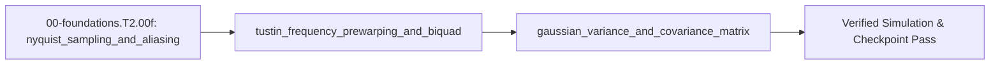

## 1. Why it matters
This is the final bridge module before Step 2.1 (`00-foundations.T2.01`). When a digital controller samples sensors at $f_s = 4\text{ kHz}$, high-frequency vibrations above $f_s/2$ fold down as fake low-frequency signals (aliasing), naive Tustin discretization shifts notch filter center frequencies downward (frequency warping), and multi-dimensional Kalman filters represent sensor uncertainty using covariance matrices $\Sigma$. Mastering these three tools unlocks all of Tier 2 (`2.1`–`2.8`). Already know this? Take the Skip test or the Ladder Gate test in section 7 first.

## 2. Intuition first
Have you ever watched a car commercial where the spoked wheels appear to spin backward even though the car is speeding forward? The camera shutter (sampling rate $f_s$) is taking snapshots too slowly to catch each spoke's true speed, so a fast rotation masquerades as a slow phantom rotation (**aliasing**). Next, when you map the infinite analog frequency axis onto a digital clock that repeats every $f_s$, the Tustin formula squishes frequencies like a fisheye camera lens (**frequency warping**)—so if you want a digital notch filter to land on $850\text{ Hz}$, you must aim slightly higher in analog first (**pre-warping**). Finally, a **covariance matrix** $\Sigma$ defines a 2D error ellipse showing how uncertain your position and velocity estimates are and whether an error in one tends to go hand-in-hand with an error in the other.

## 3. Formalization
1. **Nyquist Limit and Aliasing:** Sampling at rate $f_s = 1/T_s$ ($\text{Hz}$) can uniquely represent frequencies only up to the Nyquist frequency $f_{\text{Nyquist}} = f_s / 2$. Any analog frequency $f > f_s/2$ folds to an apparent alias frequency in $[0, f_s/2]$:

$$
f_{\text{alias}} = \left| f - k f_s \right| \in \left[0, \frac{f_s}{2}\right]
$$

   Substituting a $f = 3150\text{ Hz}$ vibration sampled at $f_s = 4000\text{ Hz}$ ($k=1$) gives $f_{\text{alias}} = |3150 - 4000| = 850\text{ Hz}$.
2. **Bilinear (Tustin) Warping and Pre-Warped Biquad (`TDF-II`):** The unwarped Tustin transform substitutes $s = \frac{2}{T_s}\frac{1 - z^{-1}}{1 + z^{-1}}$, which maps an analog target frequency $\omega_0 = 2\pi f_0$ ($\text{rad/s}$) to a lower digital frequency $\omega_{\text{actual}} = \frac{2}{T_s}\arctan\left(\frac{\omega_0 T_s}{2}\right)$. To force the digital notch to land on $f_0$, we **pre-warp** the analog prototype frequency $\omega_a$ before substituting:

$$
\omega_a = \frac{2}{T_s}\tan\left(\frac{\pi f_0}{f_s}\right)
$$

   At $f_0 = 850\text{ Hz}$ and $f_s = 4000\text{ Hz}$ ($T_s = 0.00025\text{ s}$), unwarped Tustin lands at $f_{\text{actual}} = \frac{4000}{\pi}\arctan\left(\frac{\pi\cdot 850}{4000}\right) = 749.49\text{ Hz}$ (missing by $100.51\text{ Hz}$!), whereas pre-warping uses $\omega_a = 8000\tan(0.2125\pi) = 6306.69\text{ rad/s}$ ($1003.74\text{ Hz}$) so the digital notch lands on $850.00\text{ Hz}$. The resulting $z$-domain biquad $H(z) = \frac{b_0 + b_1 z^{-1} + b_2 z^{-2}}{1 + a_1 z^{-1} + a_2 z^{-2}}$ executes in 2 delay states ($w_1, w_2$) via Transposed Direct Form II (`TDF-II`).
3. **Gaussian Variance and Covariance Matrix ($\Sigma$):** A scalar sensor with standard deviation $\sigma$ has variance $\sigma^2$. For a state vector $x \in \mathbb{R}^n$ with mean $\mu$, the symmetric positive semi-definite covariance matrix is $\Sigma = \mathbb{E}[(x - \mu)(x - \mu)^\top]$. Propagating $y = A x + w$ (where $w$ has covariance $Q$) updates the covariance via the quadratic sandwich rule:

$$
\Sigma_y = A \Sigma_x A^\top + Q
$$

   Substituting $A = \begin{bmatrix} 1 & 0.1 \\ 0 & 1 \end{bmatrix}$, $\Sigma_x = \begin{bmatrix} 1 & 0 \\ 0 & 4 \end{bmatrix}$, and $Q = 0$ gives $\Sigma_y = \begin{bmatrix} 1.04 & 0.4 \\ 0.4 & 4.0 \end{bmatrix}$.

## 4. Worked example
**Predict first (before you run it):** Commit to four numbers before running it: where unwarped Tustin lands an $850\text{ Hz}$ target sampled at $f_s = 4000\text{ Hz}$, how many hertz it misses by, the pre-warped analog frequency $\omega_a$ in $\text{rad/s}$, and the off-diagonal entry of $\Sigma_y$ for $A = \begin{bmatrix} 1 & 0.1 \\ 0 & 1 \end{bmatrix}$, $\Sigma_x = \operatorname{diag}(0.01, 0.25)$ and $Q = \operatorname{diag}(0.001, 0.002)$. Two tells: an unwarped prototype that lands exactly on $850.00\text{ Hz}$ means the pre-warp was applied twice, because the unwarped map is the one that misses; and a covariance whose off-diagonal comes out $0$ even though $A$ has an off-diagonal entry means $A \Sigma_x A^\top$ was computed as $A \Sigma_x$, dropping the transpose.

Compare an unwarped vs. pre-warped Tustin notch filter targeting $f_0 = 850\text{ Hz}$ at $f_s = 4000\text{ Hz}$ ($Q_{\text{notch}} = 5$), and verify the covariance propagation $\Sigma_y = A \Sigma_x A^\top + Q$.

```python
import math

fs = 4000.0
Ts = 1.0 / fs
f0 = 850.0
w0 = 2.0 * math.pi * f0

# 1. Unwarped Tustin lands at f_actual = (1/(pi*Ts)) * atan(w0 * Ts / 2)
f_unwarped = (1.0 / (math.pi * Ts)) * math.atan(w0 * Ts / 2.0)
miss_hz = f0 - f_unwarped
assert math.isclose(f_unwarped, 749.4803, abs_tol=1e-3)
assert math.isclose(miss_hz, 100.5197, abs_tol=1e-3)

# 2. Pre-warped analog frequency wa puts the digital notch right on f0 = 850.0 Hz
wa = (2.0 / Ts) * math.tan(math.pi * f0 / fs)
f_landed = (1.0 / (math.pi * Ts)) * math.atan(wa * Ts / 2.0)
assert math.isclose(f_landed, 850.0, rel_tol=1e-12)

# 3. 2x2 Covariance propagation: Sigma_y = A * Sigma_x * A^T + Q
# For A = [[1, 0.1], [0, 1]], Sigma_x = diag(0.01, 0.25), Q = diag(0.001, 0.002)
Sigma_y = [
    [0.01 + 0.1 * 0.1 * 0.25 + 0.001, 0.1 * 0.25],
    [0.1 * 0.25,                      0.25 + 0.002],
]
det_sy = Sigma_y[0][0] * Sigma_y[1][1] - Sigma_y[0][1] * Sigma_y[1][0]
assert math.isclose(Sigma_y[0][1], Sigma_y[1][0], rel_tol=1e-12)
assert Sigma_y[0][0] > 0.0 and det_sy > 0.0
print(f"Unwarped lands at {f_unwarped:.2f} Hz (misses by {miss_hz:.2f} Hz); pre-warped lands at {f_landed:.2f} Hz")
```
Expected output:
```text
Unwarped lands at 749.48 Hz (misses by 100.52 Hz); pre-warped lands at 850.00 Hz
```

## 5. Exercise
Compute the alias frequency $f_{\text{alias}} \in [0, f_s/2]$ when a $2700\text{ Hz}$ structural resonance is sampled at $f_s = 2000\text{ Hz}$ without an analog anti-aliasing filter, and compute the pre-warped analog frequency $\omega_a$ ($\text{rad/s}$) required to place a digital notch at $f_0 = 600\text{ Hz}$ when $f_s = 2000\text{ Hz}$. Verify $f_{\text{alias}} = 700.0\text{ Hz}$ and $\omega_a = 5505.5277\text{ rad/s}$ ($\pm 10^{-3}$).
- **If your result differs:** For aliasing, subtract the nearest integer multiple of $f_s$ ($|2700 - 1 \times 2000| = 700\text{ Hz}$). For pre-warping, check that $\tan(\pi f_0 / f_s)$ is evaluated in radians ($\pi \times 600 / 2000 = 0.3\pi\text{ rad}$).

### Graded package - sampling and estimating the arm's elbow
[`exercises/00-foundations.T2.00f/`](../exercises/00-foundations.T2.00f/) turns this section into a test. `starter.py` holds seven holes: `nyquist_hz`, `alias_hz` (fold **and** mirror), `tustin_hz` (where an analog frequency really lands), `prewarp_omega` (the exact inverse of that map), `notch_coeffs`, `apply_biquad` (Transposed Direct Form II) and `covariance_propagate` (the sandwich rule). Edit it, then run the tests the way CI does:

```bash
EXERCISE_TARGET=exercises/00-foundations.T2.00f/starter.py \
  python3 -m unittest discover -s exercises/00-foundations.T2.00f -p 'test_*.py'
```

The tests are behavioural: 3150 Hz at 4 kHz must alias to 850 Hz and 9000 Hz to 1000 Hz; 100 Hz and Nyquist itself must pass through; the pre-warp must land 850 Hz at 6306.69 rad/s and the round trip through `tustin_hz` must be an identity at four sample-rate pairs, while the unwarped prototype misses by 100.52 Hz; the notch must be symmetric, unity at DC, and actually null a sampled 850 Hz tone (RMS ratio below $10^{-3}$) while passing a 200 Hz one; and the covariance must reproduce `[[1.04, 0.4], [0.4, 4.0]]`. The transfer suite drives the plant itself: one closed-loop Euler step of the elbow must equal a `step_arm` tick to the plant's $O(T_s^2)$ ordering term and **not** to machine precision, the $8.2\text{ Hz}$ damped mode must alias to $3.8\text{ Hz}$ at a $12\text{ Hz}$ sample rate, and a 4000-sample Monte-Carlo of plant ticks must match the predicted covariance. Four planted faults - `alias_no_mirror`, `prewarp_unwarped`, `notch_unnormalized`, `covariance_no_transpose` - each fail the test named for them.

- **📚 What to Learn & Resources to Solve This Exercise:**
  - **Prerequisite Foundations Modules:** [`00-foundations.T2.00d`](00-foundations.T2.00d.md) (*Bode Plots*) and [`00-foundations.T2.00e`](00-foundations.T2.00e.md) (*Tustin Discretization*).
  - **Core Concepts to Review First:** Nyquist folding $f_{\text{alias}} = |f_{\text{sig}} - k f_s|$ and Tustin frequency pre-warping $\omega_a = \frac{2}{T_s}\tan\!\left(\frac{\pi f_0}{f_s}\right)$ in `## 3. Formalization` (Items 1–2) and `## 4. Worked example` above.
  - **DSP, Biquad & Pre-Warping Study Links:** [The Scientist and Engineer's Guide to DSP (`dspguide.com`, Ch. 3 Sampling & Aliasing)](https://www.dspguide.com/), [Audio EQ Cookbook Biquad Formulas (`w3.org/TR/audio-eq-cookbook`)](https://www.w3.org/TR/audio-eq-cookbook/), and [Roger Labbe *Kalman and Bayesian Filters in Python* (Gaussian Covariance)](https://github.com/rlabbe/Kalman-and-Bayesian-Filters-in-Python).
  - **Curriculum Reference:** [Track 00 Tier 2 (`00-foundations/README.md#tier-2-intermediate--applied`)](../00-foundations/README.md#tier-2-intermediate--applied) (Step 2.1 Pre-Warped TDF-II Biquad Notch).

### Starter code
```python
"""Exercise 00-foundations.T2.00f - the learner's file.

Three tools a digital controller needs before it can trust a sample: what the Nyquist limit folds
high frequencies down to, where Tustin actually puts a frequency, and how an error ellipse grows
across one step. Fill the seven TODOs:

    EXERCISE_TARGET=exercises/00-foundations.T2.00f/starter.py \
        python3 -m unittest discover -s exercises/00-foundations.T2.00f -p 'test_*.py'
"""

import math

import mechalab_plant as plant


def nyquist_hz(fs):
    """The highest frequency a sample rate `fs` can represent, in Hz."""
    raise NotImplementedError("TODO 1: fs / 2")


def alias_hz(f_sig, fs):
    """The frequency in [0, fs/2] that `f_sig` appears as after sampling at `fs`."""
    raise NotImplementedError("TODO 2: fold with fmod and mirror the second half down")


def tustin_hz(omega_rad_s, fs):
    """Where unwarped Tustin actually places an analog frequency, in Hz."""
    raise NotImplementedError("TODO 3: digital angle 2 atan(omega Ts / 2), then divide by 2 pi Ts")


def prewarp_omega(f0_hz, fs):
    """Analog prototype frequency that lands a Tustin filter exactly on f0_hz."""
    raise NotImplementedError("TODO 4: (2 / Ts) tan(pi f0 / fs)")


def notch_coeffs(f0_hz, fs, q):
    """(b0, b1, b2, a1, a2) for a unity-gain notch at f0_hz with quality factor q; a0 is 1."""
    raise NotImplementedError("TODO 5: alpha = sin(w0) / (2 q); b0 = b2 = 1 / (1 + alpha)")


def apply_biquad(coeffs, samples):
    """Run the TDF-II biquad over `samples` and return one output sample per input."""
    raise NotImplementedError("TODO 6: two delay states, w1 and w2, updated in that order")


def covariance_propagate(a, sigma, q):
    """One predict step: A Sigma A^T + Q, for 2x2 matrices."""
    raise NotImplementedError("TODO 7: the sandwich rule, both sides of Sigma")

def simulate_discrete(ad, bd, x0, u, steps):
    """Kept from 00e: iterate x_{k+1} = Ad x_k + Bd u with a constant u."""
    x = list(x0)
    for _ in range(steps):
        x = [sum(ad[i][j] * x[j] for j in range(2)) + bd[i][0] * u for i in range(2)]
    return x


# The browser entry appends `selfcheck.py` below this line; on its own this file prints nothing.
```
**Expected numbers (the answer):** $f_{\text{alias}} = 700.0\text{ Hz}$ and $\omega_a = 5505.5277\text{ rad/s}$.

### Hint ladder
1. **Aliasing is folding, then mirroring.** `math.fmod(2700, 2000)` already gives $700$, but a case like $1300\text{ Hz}$ at $2000\text{ Hz}$ lands on $700$ too and a case like $3150$ at $4000$ gives $3150$, which is above Nyquist - so subtract from $f_s$ whenever the remainder exceeds $f_s/2$.
2. **Pre-warping is the inverse map, not a correction factor.** Unwarped Tustin maps $\omega_a$ to $f = \frac{1}{\pi T_s}\arctan(\omega_a T_s/2)$; invert it and you get $\omega_a = \frac{2}{T_s}\tan(\pi f_0/f_s)$. At $600\text{ Hz}$ on $2000\text{ Hz}$ the tangent argument is $0.3\pi$ radians, and `math.tan` takes radians, never degrees.
3. **Check the round trip, not the number.** `tustin_hz(prewarp_omega(600.0, 2000.0), 2000.0)` must return $600.0$ to $10^{-9}$; if it returns something like $520\text{ Hz}$, the tangent was applied to a frequency already divided by $f_s$.
4. **The sandwich has two multiplications.** $A\Sigma$ then $(A\Sigma)A^\top$; dropping the transpose leaves a non-symmetric matrix, which the module's Transfer test rejects on symmetry alone before it even compares entries.

### Full Solution
```python
import math

import mechalab_plant as plant  # noqa: F401  (kept so the submission imports what the module uses)


def nyquist_hz(fs):
    """Half the sample rate."""
    return 0.5 * fs


def alias_hz(f_sig, fs):
    """Fold `f_sig` into [0, fs/2].

    `fmod` gives the remainder one fold down; a remainder past Nyquist is the mirror image of a
    frequency below it, so it is subtracted from fs.
    """
    folded = math.fmod(abs(f_sig), fs)
    if folded > 0.5 * fs:
        folded = fs - folded
    return folded


def tustin_hz(omega_rad_s, fs):
    """`s = j omega` maps to `z = e^{j theta}` with `theta = 2 atan(omega Ts / 2)`."""
    ts = 1.0 / fs
    return math.atan(omega_rad_s * ts / 2.0) / (math.pi * ts)


def prewarp_omega(f0_hz, fs):
    """Inverse of `tustin_hz` at f0: the analog frequency Tustin must be handed."""
    ts = 1.0 / fs
    return (2.0 / ts) * math.tan(math.pi * f0_hz / fs)


def notch_coeffs(f0_hz, fs, q):
    """Notch with zeros on the unit circle at e^{+-j w0}: a true null at f0, unity at DC."""
    w0 = 2.0 * math.pi * f0_hz / fs
    alpha = math.sin(w0) / (2.0 * q)
    norm = 1.0 / (1.0 + alpha)
    b0 = norm
    b1 = -2.0 * math.cos(w0) * norm
    a1 = b1
    a2 = (1.0 - alpha) * norm
    return (b0, b1, b0, a1, a2)


def apply_biquad(coeffs, samples):
    """Transposed Direct Form II, a0 normalized to 1."""
    b0, b1, b2, a1, a2 = coeffs
    w1 = 0.0
    w2 = 0.0
    out = []
    for x in samples:
        y = b0 * x + w1
        w1 = b1 * x - a1 * y + w2
        w2 = b2 * x - a2 * y
        out.append(y)
    return out


def covariance_propagate(a, sigma, q):
    """Sigma' = A Sigma A^T + Q."""
    asigma = [[sum(a[i][k] * sigma[k][j] for k in range(2)) for j in range(2)] for i in range(2)]
    out = [[0.0, 0.0], [0.0, 0.0]]
    for i in range(2):
        for j in range(2):
            out[i][j] = sum(asigma[i][k] * a[j][k] for k in range(2)) + q[i][j]
    return out


def simulate_discrete(ad, bd, x0, u, steps):
    """Kept from 00e: iterate x_{k+1} = Ad x_k + Bd u with a constant u."""
    x = list(x0)
    for _ in range(steps):
        x = [sum(ad[i][j] * x[j] for j in range(2)) + bd[i][0] * u for i in range(2)]
    return x


# No `__main__` block on purpose: the browser grades this file's stdout against the appended
# self-check's single PASS line, and a second print here would be a mismatch for a correct answer.

f_alias = alias_hz(2700.0, 2000.0)
wa = prewarp_omega(600.0, 2000.0)
round_trip = tustin_hz(wa, 2000.0)
sigma_y = covariance_propagate([[1.0, 0.1], [0.0, 1.0]], [[1.0, 0.0], [0.0, 4.0]],
                               [[0.0, 0.0], [0.0, 0.0]])

assert math.isclose(f_alias, 700.0, abs_tol=1e-3)
assert math.isclose(wa, 5505.5277, abs_tol=1e-3)
assert math.isclose(round_trip, 600.0, abs_tol=1e-9)
assert math.isclose(sigma_y[0][0], 1.04, abs_tol=1e-12)
assert math.isclose(sigma_y[0][1], 0.4, abs_tol=1e-12) and math.isclose(sigma_y[1][0], 0.4, abs_tol=1e-12)
assert math.isclose(sigma_y[1][1], 4.0, abs_tol=1e-12)
print("alias(2700 Hz @ 2 kHz)=%.1f Hz | prewarp(600 Hz @ 2 kHz)=%.4f rad/s (round trip %.6f Hz)"
      % (f_alias, wa, round_trip))
print("Sigma_y=[[%.4f, %.4f], [%.4f, %.4f]]" % (sigma_y[0][0], sigma_y[0][1], sigma_y[1][0], sigma_y[1][1]))
```

Printed: `alias(2700 Hz @ 2 kHz)=700.0 Hz | prewarp(600 Hz @ 2 kHz)=5505.5277 rad/s (round trip 600.000000 Hz)`, then `Sigma_y=[[1.0400, 0.4000], [0.4000, 4.0000]]`.

**On the shared arm.** The Transfer suite samples the plant's elbow: its damped mode against the 1 kHz tick and a 12 Hz loop, and the encoder's quantisation as a covariance:

```python
import math
import mechalab_plant as plant

k = 8.0
wn = math.sqrt(k / plant.I2)
zeta = plant.B2 / (2.0 * math.sqrt(plant.I2 * k))
f_damped = wn * math.sqrt(1.0 - zeta * zeta) / (2.0 * math.pi)
assert f_damped > 6.0                                   # the 12 Hz test's Nyquist limit
assert math.isclose(1.0 / plant.DT, 1000.0, rel_tol=1e-15)
sigma_q = (2.0 * math.pi / plant.ENCODER_CPR) / math.sqrt(12.0)
print("damped mode=%.3f Hz | fs=%.0f Hz | one-count sigma=%.3e rad"
      % (f_damped, 1.0 / plant.DT, sigma_q))
```

### Break it on purpose
Inject the `prewarp_unwarped` fault on purpose: design the $850\text{ Hz}$ notch from $\omega_0 = 2\pi f_0$ instead of the pre-warped prototype, and leave the biquad normalization alone.
- **Inject:** pass the target frequency straight into the Tustin substitution, as if the analog and digital frequency axes were the same line.
- **Symptom:** the notch centre lands at $749.48\text{ Hz}$ - a $100.52\text{ Hz}$ miss - so a true $850\text{ Hz}$ resonance is left almost unattenuated while a $749.5\text{ Hz}$ component is nulled instead. Symmetry and unity DC gain still hold, so every coefficient check except the landing frequency passes.
- **Diagnose:** the landing frequency is exactly the unwarped map's output: `tustin_hz(2 * math.pi * f0, fs)` returns $749.48\text{ Hz}$, while `tustin_hz(prewarp_omega(f0, fs), fs)` returns $850.00\text{ Hz}$ - the round trip is an identity only when the pre-warp is applied first, which localises the fault to the prototype frequency. A normalization error would move the DC gain and break the $b_0 = b_2$, $a_1 = b_1$ symmetry; a coefficient sign error would null nothing at all, including the target tone.
- **Fix:** pre-warp with $\omega_a = \frac{2}{T_s}\tan(\pi f_0/f_s) = 6306.69\text{ rad/s}$ at $850/4000$, then prove it twice: `tustin_hz(omega_a, fs)` returns $850.00\text{ Hz}$ to $10^{-9}$, and a sampled $850\text{ Hz}$ tone loses more than $99.9\%$ of its energy (RMS ratio below $10^{-3}$) while a $200\text{ Hz}$ tone passes through.

## 6. Simulation path
Open **Tab 2 (Two-Mass & Notch Bode)** in the MechaLab Workbench (`npm run dev`) and toggle pre-warping ON vs. OFF at $f_0 = 850\text{ Hz}$, $f_s = 4000\text{ Hz}$ to watch the notch center shift from $749.5\text{ Hz}$ right onto the $850\text{ Hz}$ resonance peak.

The graded package is also a workbench entry: **Modules -> `EX.00-foundations.T2.00f`**, where `selfcheck.py` is appended below the starter and **Verify** compares its `SELF-CHECK PASS:` line. `scripts/e2e_pages_bundle.mjs` drives it on the built bundle, so the browser path is tested, not assumed.

No hardware required for this module (`hardware_required: false`). In Step 2.1 (`00-foundations.T2.01`) and Step 2.4 (`03-sensors.T2.04`), the 5 pre-warped biquad coefficients $(b_0, b_1, b_2, a_1, a_2)$ execute inside the microcontroller's `TDF-II` filter loop on every ADC/encoder sample:
```text
[Analog Sensor] ---> [RC Anti-Alias Filter] ---> [ADC @ f_s=4 kHz] ---> [TDF-II Pre-Warped Biquad Notch]
```
Pass/fail verification in simulation: `f_unwarped == 749.49 Hz`, `f_landed == 850.00 Hz`, and `Sigma_y` symmetric positive definite.




## 7. Checkpoint
Pass criteria: score $\ge 80\%$ ($4/5$) on the module Skip test to pass this module, or pass the ladder's Gate paper below - it states its own pass mark, and it is taken once, after the last Tier 2 page - to verify readiness for Step 2.1 (`00-foundations.T2.01`).

### Skip test
<!-- skip-test:start -->
1. `[Recall] [Concept: nyquist_sampling_and_aliasing]` A $3150\text{ Hz}$ motor switching harmonic is sampled at $f_s = 4000\text{ Hz}$ without an anti-aliasing filter. What alias frequency $f_{\text{alias}} \in [0, 2000]\text{ Hz}$ (tolerance $\pm 10^{-9}$) appears in the digital data?
2. `[Apply] [Concept: tustin_frequency_prewarping_and_biquad]` Compute the actual digital notch frequency $f_{\text{unwarped}}$ in $\text{Hz}$ (tolerance $\pm 0.01\text{ Hz}$) when an unwarped Tustin transform is applied to $f_0 = 850\text{ Hz}$ at $f_s = 4000\text{ Hz}$.
3. `[Transfer] [Concept: tustin_frequency_prewarping_and_biquad]` Why can a digital biquad notch filter **never** un-alias a signal that exceeded $f_s/2$ *before* the ADC sampled it?
   - **A.** Because digital filters only work below $100\text{ Hz}$.
   - **B.** Because once sampling folds $f > f_s/2$ into $[0, f_s/2]$, the aliased samples are mathematically indistinguishable from a true low-frequency signal; an **analog** anti-aliasing filter must precede the ADC.
   - **C.** Because TDF-II biquads require double-precision floating point.
   - **D.** Because Tustin pre-warping amplifies high frequencies.
4. `[Concept: gaussian_variance_and_covariance_matrix]` Given $\Sigma_x = \begin{bmatrix} 1.0 & 0.0 \\ 0.0 & 4.0 \end{bmatrix}$ and $A = \begin{bmatrix} 1.0 & 0.5 \\ 0.0 & 1.0 \end{bmatrix}$, compute the $(0,0)$ entry of $\Sigma_y = A \Sigma_x A^\top$ (tolerance $\pm 10^{-9}$).
5. `[Spaced review -> 00-foundations.T2.00e — Concept: continuous_state_space_matrices]` For $A = \begin{bmatrix} 0 & 1 \\ -100 & -4 \end{bmatrix}$, compute $\operatorname{tr}(A)$ (tolerance $\pm 10^{-9}$).

**Answer key:**
```python
import math

q1_alias_hz = abs(3150.0 - 4000.0)
q2_unwarped_hz = (4000.0 / math.pi) * math.atan(math.pi * 850.0 / 4000.0)
q3_choice = "B"
q4_sigma00 = 1.0 * 1.0 * 1.0 + 0.5 * 4.0 * 0.5

assert math.isclose(q1_alias_hz, 850.0, rel_tol=1e-9)
assert math.isclose(q2_unwarped_hz, 749.48034, abs_tol=1e-2)
assert q3_choice == "B"
assert math.isclose(q4_sigma00, 2.0, rel_tol=1e-9)
q5_review = 0.0 + (-4.0)
assert math.isclose(q5_review, -4.0, rel_tol=1e-9, abs_tol=1e-09)
```
- **Pass mark:** $4/5$ ($80\%+$). If you missed Q1, study `## 3. Formalization` item 1; Q2 or Q3, study `## 3. Formalization` item 2; Q4, study `## 3. Formalization` item 3. If you missed  Q5, review `00-foundations.T2.00e`. On pass, proceed to `## 10. Next modules`.
<!-- skip-test:end -->

### Gate test
<!-- ladder-gate:start -->
This is the exit examination for the whole Track 00 Tier 2 ladder - every `00-foundations.T2.*` page in [`docs/SYLLABUS.md`](../docs/SYLLABUS.md) - before Step 2.1 (`00-foundations.T2.01`). Every Tier 2 page renders this same paper, so take it once after the last of them; the page you are on is only where you found it. Questions 1-6 are the matrix page's own tools; 7-12 recap each other page once, so nothing on the ladder goes unexamined.

1. `[Concept: matrix_vector_multiplication]` For $A = \begin{bmatrix} 3.0 & -2.0 \\ 1.0 & 4.0 \end{bmatrix}$ and $\vec{x} = [1.5,\; 2.5]^\top$, compute **both** entries of $A\vec{x}$: the first and the second (tolerances $\pm 10^{-9}$).
2. `[Concept: matrix_vector_multiplication]` Why does a $2\times2$ matrix times a length-2 column come out as a column of length $2$ rather than a $2\times2$ matrix?
   - **A.** $A\vec{x}$ is the elementwise product of $A$ and $\vec{x}$, which keeps $A$'s shape.
   - **B.** Python reshapes $A$ into a column before multiplying.
   - **C.** Each output entry is one row of $A$ dotted with $\vec{x}$, so there is one output per row.
   - **D.** $\vec{x}$ is transposed into a row first.
3. `[Concept: state_vector_one_step_update]` One step of $A_d = \begin{bmatrix} 1.0 & 0.02 \\ -2.0 & 0.80 \end{bmatrix}$, $B_d = [0.0,\; 0.02]^\top$, from $\vec{x}_0 = [0.50,\; 0.0]^\top$ with $u_0 = 10.0\,\text{N}$ gives $v_1$. Compute $v_1$ in $\text{m/s}$ (tolerance $\pm 10^{-9}$).
4. `[Concept: state_vector_one_step_update]` In the same step, if the position row were evaluated using the *new* velocity, what would $x_1$ be (tolerance $\pm 10^{-9}\,\text{m}$)?
5. `[Concept: state_vector_one_step_update]` For the two-mass matrix with $m_1 = 1.0\,\text{kg}$, $m_2 = 2.0\,\text{kg}$, $k = 50.0\,\text{N/m}$, $b = 0$ and $\Delta t = 0.01\,\text{s}$, compute the first entry of its **fourth** row - the row that updates $v_2$ (tolerance $\pm 10^{-9}$).
6. `[Concept: state_vector_one_step_update]` Why do the diagonal $2\times2$ blocks of the 4-state matrix equal the single-mass update for each body when $k = b = 0$?
   - **A.** Because the 4-state matrix is always block-diagonal.
   - **B.** Because each mass then obeys the same mass-spring-damper form with its own mass and damping, and the coupling terms vanish.
   - **C.** Because $B_d$ only pushes $m_1$.
   - **D.** Because the Euler update is exact.
7. `[Concept: finite_difference_derivative_and_integral]` An encoder reads $x_{k-1} = 0.24\,\text{rad}$ and $x_k = 0.30\,\text{rad}$ at $\Delta t = 0.002\,\text{s}$. Compute the backward-difference velocity in $\text{rad/s}$ (tolerance $\pm 10^{-9}$).
8. `[Concept: dot_product_projection] [Concept: cross_product_3d_moment] [Concept: basis_change_and_invertibility]` Which triple is correct for `00-foundations.T2.00b`?
   - **A.** The projection uses the raw lever so force grows with its length, $\vec{r}\times\vec{F} = \vec{F}\times\vec{r}$, and a zero determinant means a valid basis.
   - **B.** The projection divides by $\|\vec{r}\|$ twice, the moment is a scalar, and the determinant is always positive.
   - **C.** The dot product returns a vector, the cross product is symmetric, and the determinant equals the trace.
   - **D.** The projection uses the lever's *unit* direction, the moment is $\vec{r}\times\vec{F}$ (anti-commutative), and a zero determinant means the two columns are collinear.
9. `[Concept: first_order_ode_time_constant] [Concept: second_order_ode_wn_zeta] [Concept: characteristic_polynomial_roots]` For `00-foundations.T2.00c`'s joint with $J = 0.02\,\text{kg}\cdot\text{m}^2$, $k = 8.0\,\text{N}\cdot\text{m/rad}$ and $b = 0.60\,\text{N}\cdot\text{m}\cdot\text{s/rad}$, compute the damping ratio $\zeta = b/(2\sqrt{Jk})$ (tolerance $\pm 10^{-9}$).
10. `[Concept: complex_numbers_and_euler_formula] [Concept: complex_impedance_and_transfer_function] [Concept: bode_magnitude_db_and_phase]` A series RL winding has $R = 4.0\ \Omega$ and $L = 2.0\,\text{mH}$ and is driven at $\omega = 2000\,\text{rad/s}$. Compute $|Z|$ in ohms, then $20\log_{10}|H|$ at the corner $\omega = 1/\tau$ of a first-order filter (tolerances $\pm 10^{-9}\,\Omega$ and $\pm 10^{-4}\,\text{dB}$).
11. `[Concept: laplace_poles_and_zeros] [Concept: continuous_state_space_matrices] [Concept: discrete_state_transition_euler_tustin]` For `00-foundations.T2.00e`'s $A = \begin{bmatrix} 0 & 1 \\ -100 & -4 \end{bmatrix}$ sampled at $T_s = 0.05\,\text{s}$, compute the spectral radius of the Forward-Euler map $A_d = I + A T_s$ (tolerance $\pm 10^{-6}$).
12. `[Concept: nyquist_sampling_and_aliasing] [Concept: tustin_frequency_prewarping_and_biquad] [Concept: gaussian_variance_and_covariance_matrix]` Which triple is correct for `00-foundations.T2.00f`?
   - **A.** Sampling represents any frequency, aliasing affects only DC, and Tustin never warps.
   - **B.** Sampling represents only frequencies up to $f_s/2$, a faster tone folds to $|f - k f_s|$, and pre-warping lifts the analog target so the digital notch lands on $f_0$.
   - **C.** The Nyquist frequency is $f_s$, aliasing doubles the frequency, and pre-warping is a gain correction.
   - **D.** Covariance is a scalar, the sample rate is irrelevant to stability, and every bilinear pole lands outside the unit circle.

**Gate answer key:**
```python
import math

# Q1-Q6: the matrix page. Two entries, evaluated one row at a time: the paper asks for both so a
# reader who reads the maths (1-indexed) and one who reads Python (0-indexed) agree on the answer.
g1_ax_first = 3.0 * 1.5 + (-2.0) * 2.5
g1_ax_second = 1.0 * 1.5 + 4.0 * 2.5
g2_choice = "C"
g3_v1 = -2.0 * 0.50 + 0.80 * 0.0 + 0.02 * 10.0
g4_x1_new_v = 1.0 * 0.50 + 0.02 * (-0.80)
g5_row4_first = (50.0 / 2.0) * 0.01
g6_choice = "B"

# Q7: the derivative page.
g7_velocity = (0.30 - 0.24) / 0.002

# Q8-Q12: one question per remaining page.
g8_choice = "D"
g9_zeta = 0.60 / (2.0 * math.sqrt(0.02 * 8.0))
g10_z_ohm = abs(4.0 + 1j * 2000.0 * 0.002)
g10_corner_db = 20.0 * math.log10(1.0 / math.sqrt(2.0))
Ad_euler = [[1.0, 0.05], [-5.0, 0.80]]
g11_radius = math.sqrt(Ad_euler[0][0] * Ad_euler[1][1] - Ad_euler[0][1] * Ad_euler[1][0])
g12_choice = "B"

assert math.isclose(g1_ax_first, -0.5, rel_tol=1e-9)
assert math.isclose(g1_ax_second, 11.5, rel_tol=1e-9)
assert g2_choice == "C"
assert math.isclose(g3_v1, -0.80, rel_tol=1e-9)
assert math.isclose(g4_x1_new_v, 0.484, rel_tol=1e-9)
assert math.isclose(g5_row4_first, 0.25, rel_tol=1e-9)
assert g6_choice == "B"
assert math.isclose(g7_velocity, 30.0, rel_tol=1e-9)
assert g8_choice == "D"
assert math.isclose(g9_zeta, 0.75, rel_tol=1e-9)
assert math.isclose(g10_z_ohm, 5.656854249492381, rel_tol=1e-9)
assert math.isclose(g10_corner_db, -3.0103, abs_tol=1e-4)
assert math.isclose(g11_radius, 1.024695, abs_tol=1e-6)
assert g12_choice == "B"

print("gate key: Ax=[%.1f, %.1f], v1=%.2f m/s, x1(new v)=%.3f m, radius=%.6f"
      % (g1_ax_first, g1_ax_second, g3_v1, g4_x1_new_v, g11_radius))
```
- **Pass mark:** $\ge 10/12$. Every question is answered by the page named in its tags; the ladder is closed when this paper is passed once, after the last Tier 2 page.
<!-- ladder-gate:end -->

## 8. Common mistakes
| Symptom | Root cause | 2-minute fix |
| :--- | :--- | :--- |
| Notch filter misses $850\text{ Hz}$ resonance and lands at $749.5\text{ Hz}$ | Substituted $s = \frac{2}{T_s}\frac{1-z^{-1}}{1+z^{-1}}$ using unwarped $\omega_0 = 2\pi f_0$. | Pre-warp the analog notch frequency using $\omega_a = \frac{2}{T_s}\tan(\pi f_0 / f_s)$ before computing biquad coefficients. |
| Tried to remove aliased switching noise using a digital low-pass filter | Forgot that frequencies above $f_s/2$ fold into the baseband *at the moment of ADC sampling*. | Place an analog RC or Bessel anti-aliasing filter before the ADC pin so high frequencies are attenuated before sampling. |
| Covariance matrix $\Sigma$ loses symmetry in `float32` | Accumulated floating-point rounding errors across thousands of updates. | Enforce $\Sigma \leftarrow \frac{1}{2}(\Sigma + \Sigma^\top)$ and use the Joseph form in Step 3.6. |

## 9. Resources
- **Julius O. Smith III — [*Introduction to Digital Filters* (`ccrma.stanford.edu/~jos/filters/`)](https://ccrma.stanford.edu/~jos/filters/) & [DSP Guide (`dspguide.com`)](https://www.dspguide.com/) ([`resources/textbooks-and-papers.md`](../resources/textbooks-and-papers.md)):** Standard biquad and Tustin pre-warping derivations `[VERIFIED 2026-10-15]`.
- **Track 00 ([`00-foundations/README.md#tier-2-intermediate--applied`](../00-foundations/README.md#tier-2-intermediate--applied)):** Directly continues into Step 2.1 (`00-foundations.T2.01`) `[VERIFIED 2026-10-15]`.

## 10. Next modules
- Proceed to legacy **Step 2.1 (`00-foundations.T2.01`)** in [`00-foundations/README.md`](../00-foundations/README.md#tier-2-intermediate--applied).
