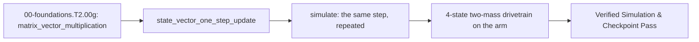

<!-- run-callout:start -->
> **Step 3 of 10 · Make a joint move: foundations**
>
> **Run this in the workbench.** [Open MechaLab with `EX.00-foundations.T2.00g` loaded](https://tle47.github.io/Mechatronics-Roadmap/?lesson=EX.00-foundations.T2.00g) - it opens on the **Run Python Lessons** tab with that entry selected. Starter code, hints and the graded check are ready; this page is the reading copy, and nothing you type here is saved.
<!-- run-callout:end -->

## 1. Why it matters
The backward difference from `00-foundations.T2.00a` turns a sequence of samples into a velocity. This page turns that velocity into a **state**: one column that holds everything the next tick needs, advanced by one matrix-vector product. Writing the update as $\vec{x}_{k+1} = A_d\vec{x}_k + B_d u_k$ is not notation for its own sake - a two-mass drivetrain has four states, a Kalman filter nine, and the same six lines of code advance all of them. Already know this? Take the Skip test in section 7 first.

## 2. Intuition first

<!-- figure: state-update | One product advances the state by one tick. -->

Picture a spreadsheet. Column A is the cart's position and column B is its velocity. The next row follows two fixed recipes: "new position $= 1 \times$ old position $+ \Delta t \times$ old velocity," and "new velocity $= -\frac{k}{m}\Delta t \times$ old position $+ (1 - \frac{b}{m}\Delta t) \times$ old velocity $+ \frac{\Delta t}{m} \times$ force." Those four multipliers are the whole model. Put them in a $2\times2$ grid and the two force weights in a $2\times1$ column, and you never write the recipes again: each row of the grid is dotted with the state column, which is exactly what the spreadsheet row did by hand.

## 3. Formalization
1. **Matrix-Vector Multiplication ($\vec{y} = A\vec{x}$):** for an $m\times n$ matrix $A$ and a column $\vec{x}$ of length $n$, the output has one entry per **row**: $y_i = \sum_{j=1}^{n} A_{ij}x_j$. The shape rule is the operation: the column length must equal the row width, and the result's length equals the row count. A $2\times2$ times a length-2 column gives a length-2 column, never a $2\times2$ matrix.
2. **Discrete State-Vector One-Step Update ($\vec{x}_{k+1} = A_d\vec{x}_k + B_d u_k$):** for a mass $m$ (kg), stiffness $k$ (N/m), damping $b$ (N$\cdot$s/m), state $\vec{x}_k = [x_k,\; v_k]^\top$, and force $u_k$ (N):

$$
\begin{bmatrix} x_{k+1} \\ v_{k+1} \end{bmatrix} = \underbrace{\begin{bmatrix} 1 & \Delta t \\ -\frac{k}{m}\Delta t & 1 - \frac{b}{m}\Delta t \end{bmatrix}}_{A_d} \begin{bmatrix} x_k \\ v_k \end{bmatrix} + \underbrace{\begin{bmatrix} 0 \\ \frac{\Delta t}{m} \end{bmatrix}}_{B_d} u_k
$$

   Every row reads the **old** state. With $m = 1.0\,\text{kg}$, $k = 100.0\,\text{N/m}$, $b = 10.0\,\text{N}\cdot\text{s/m}$, $\Delta t = 0.01\,\text{s}$, $\vec{x}_0 = [0.10,\; 0.20]^\top$ and $u_0 = 0$, the position row gives $x_1 = 0.10 + 0.01(0.20) = 0.1020\,\text{m}$ and the velocity row gives $v_1 = -1.0(0.10) + 0.90(0.20) = 0.0800\,\text{m/s}$.
3. **The same step, four states:** two masses joined by a spring $k$ and damper $b$, with the force applied only to $m_1$ and state $[x_1,\; v_1,\; x_2,\; v_2]^\top$:

$$
A_d = \begin{bmatrix}
1 & \Delta t & 0 & 0\\
-\frac{k}{m_1}\Delta t & 1-\frac{b}{m_1}\Delta t & \frac{k}{m_1}\Delta t & \frac{b}{m_1}\Delta t\\
0 & 0 & 1 & \Delta t\\
\frac{k}{m_2}\Delta t & \frac{b}{m_2}\Delta t & -\frac{k}{m_2}\Delta t & 1-\frac{b}{m_2}\Delta t
\end{bmatrix}, \qquad B_d = \begin{bmatrix} 0 \\ \frac{\Delta t}{m_1} \\ 0 \\ 0 \end{bmatrix}
$$

   The $2\times2$ blocks on the diagonal are the single-mass update for each body; the off-diagonal terms are the coupling, and they are the only reason a matrix is worth the trouble.

## 4. Worked example
**Predict first (before you run it):** commit to two numbers. (1) With the values above and $\vec{x}_0 = [0.10,\; 0.20]^\top$, what are $x_1$ and $v_1$? (2) If you then read the velocity row as "use the **new** position," what would $v_1$ become instead? Two tells that a wrong result is a mistake rather than a surprise: $x_1$ must be slightly **larger** than $0.10\,\text{m}$ because the state already carries velocity, so a value below $0.10$ means the position row took the new velocity; and $v_1$ must be exactly $0.0800\,\text{m/s}$, so $+0.0700$ means the velocity row used the already-updated $x_1$.

```python
import math

m, k, b, dt = 1.0, 100.0, 10.0, 0.01
Ad = [[1.0, dt], [-(k / m) * dt, 1.0 - (b / m) * dt]]
Bd = [0.0, dt / m]


def mat_vec(A, x):
    return [sum(a * xi for a, xi in zip(row, x)) for row in A]


x0 = [0.10, 0.20]
x1 = [value + Bd[i] * 0.0 for i, value in enumerate(mat_vec(Ad, x0))]
v1_scalar = x0[1] + dt * ((-k * x0[0] - b * x0[1]) / m)

two_mass = [
    [1.0, dt, 0.0, 0.0],
    [-(k / m) * dt, 1.0 - (b / m) * dt, (k / m) * dt, (b / m) * dt],
    [0.0, 0.0, 1.0, dt],
    [(k / 2.0) * dt, (b / 2.0) * dt, -(k / 2.0) * dt, 1.0 - (b / 2.0) * dt],  # m2 = 2.0 kg
]

# Numerical check of the second mass's row, and a sign check: with x1 = 0.10 m, x2 = 0 and both at rest,
# the spring must accelerate m2 toward m1, so its velocity rises.
assert math.isclose(two_mass[3][0], (k / 2.0) * dt) and math.isclose(two_mass[3][2], -(k / 2.0) * dt)
push = mat_vec(two_mass, [0.10, 0.0, 0.0, 0.0])[3]
assert math.isclose(push, 0.05) and push > 0.0

print("x1=%.4f m, v1=%.4f m/s | row 1 = %.2f | m2 row = [%.2f, %.2f, %.2f, %.4f] | m2 push = %.2f m/s"
      % (x1[0], x1[1], v1_scalar, *two_mass[3], push))
```
Expected output:
```text
x1=0.1020 m, v1=0.0800 m/s | row 1 = 0.08 | m2 row = [0.50, 0.05, -0.50, 0.9500] | m2 push = 0.05 m/s
```

## 5. Exercise
Run the same step for `500` steps ($5.0\,\text{s}$) with a constant $u_0 = 5.0\,\text{N}$, starting from rest at $x = 0.10\,\text{m}$. Position must settle at Hooke equilibrium $x_{\text{eq}} = u_0/k = 0.0500\,\text{m}$ (tolerance $\pm 10^{-3}\,\text{m}$) with velocity under $10^{-4}\,\text{m/s}$. Then repeat with the 4-state two-mass matrices above: the force on $m_1$ must eventually drag $m_2$ along, and with $k = b = 0$ the two diagonal blocks must equal the $2\times2$ matrices for each mass on its own.

### Graded package - the same six steps on the arm's own joints
[`exercises/00-foundations.T2.00g/`](../exercises/00-foundations.T2.00g/) turns this section into a test, on the shared capstone arm (`resources/plants/`) rather than the $1\,\text{kg}$ cart: the cart isolates the arithmetic, and the arm is the plant Tier 1 built. `starter.py` holds six holes: `mat_vec` (one dot product per row, with the shape check), `state_matrices`, `one_step`, `simulate`, `two_mass_matrices` (the $4\times4$ drivetrain) and `position_trace`. Edit it, then run the tests the way CI does:

```bash
EXERCISE_TARGET=exercises/00-foundations.T2.00g/starter.py \
  python3 -m unittest discover -s exercises/00-foundations.T2.00g -p 'test_*.py'
```

The tests are behavioural: the dot product is checked on a fixture whose rows differ, so a diagonal-only or elementwise product cannot pass; a wrong-length column and a ragged matrix are refused; the one-step test uses a state that *carries velocity*, where an ordered update is wrong by $2\times10^{-3}$; the matrices must use the caller's $m$, $k$, $b$, $\Delta t$ rather than the worked example's; the trace must start at the initial position and carry `steps + 1` samples. The transfer suite runs the shoulder joint's own decay against `plant.step_arm` tick for tick and the arm's two inertias as a 4-state drivetrain. **19 tests.** Four planted faults - `elementwise_product`, `sequential_update`, `hardcoded_matrices`, `force_in_position_row` - each fail the test named for them, and a print-only file passes nothing (`scripts/run_exercise.py`).

1. **What the suite refuses.** `mat_vec` raises `ValueError` for an empty matrix, a ragged matrix, or a column whose length is not the row width; `one_step` raises `ValueError` when the state or input column length disagrees with `Ad`; `simulate` raises `ValueError` for negative `steps`; `state_matrices` raises `ValueError` for a non-positive mass. A silently truncated product is the bug these guards exist to make loud.

- **📚 What to Learn & Resources to Solve This Exercise:**
  - **Prerequisite Foundations Module:** [`00-foundations.T2.00a`](00-foundations.T2.00a.md) and Legacy **Step 2.1 (`00-foundations.T2.01`)** in [`00-foundations/README.md`](../00-foundations/README.md#tier-2-intermediate--applied).
  - **Core Concepts to Review First:** matrix-vector multiplication and the simultaneous state update in `## 3. Formalization` (Items 1-3) and `## 4. Worked example` above.
  - **Linear Algebra & State-Space Study Links:** [3Blue1Brown: Linear Transformations and Matrices (`3blue1brown.com`)](https://www.3blue1brown.com/lessons/linear-transformations) and [Brunton & Kutz *Data-Driven Science and Engineering* (`databookuw.com`)](https://databookuw.com/).
  - **Curriculum Reference:** [Track 00 Tier 2 (`00-foundations/README.md#tier-2-intermediate--applied`)](../00-foundations/README.md#tier-2-intermediate--applied) and [`resources/textbooks-and-papers.md`](../resources/textbooks-and-papers.md).

### Starter code
```python
# --- Exercise scaffold: fill in each TODO, then compare against the numbers in the full solution ---
import math

import mechalab_plant as plant


def mat_vec(A, x):
    """The matrix-vector product, as a list of `len(A)` numbers.

    Refuse (ValueError) an empty matrix or one whose rows are not all `len(x)` long - the shape
    check is what turns a silent truncation into a message.
    """
    # TODO: the matrix-vector product, refusing a shape that does not line up
    ...


def state_matrices(m, k, b, dt):
    """(Ad, Bd) for the mass-spring-damper Euler update, state [position, velocity]."""
    # TODO: the state and input matrices for this mass-spring-damper at this step size
    ...


def one_step(Ad, Bd, x, u):
    """The state one step later, with every component read from the OLD x.

    Refuse (ValueError) a state or input column whose length disagrees with `Ad`.
    """
    # TODO: the state after one step, with every component read from the old state
    ...


def simulate(Ad, Bd, x0, u, steps):
    """Run `steps` one_steps with a constant input `u`; return the final state.

    Refuse (ValueError) a negative `steps`.
    """
    # TODO: the final state after this many steps, refusing a negative count
    ...


def two_mass_matrices(m1, m2, k, b, dt):
    """(Ad, Bd) for a force on `m1` coupled to `m2` by spring `k` and damper `b`.

    State order is [x1, v1, x2, v2], and the force acts on the first mass.
    """
    # TODO: the four-state matrices for the two-mass drivetrain
    ...


def position_trace(Ad, Bd, x0, u, steps):
    """The first state component at every sample, starting with x0's: len == steps + 1."""
    # TODO: the first state component at every sample, from the start through the last step
    ...


print("scaffold ready: 6 TODOs to fill, then compare against the numbers in the full solution")
```

**Expected numbers (the answer):** $m = 1.0\,\text{kg}$, $k = 100\,\text{N/m}$, $b = 10$, $\Delta t = 0.01\,\text{s}$ give $x_{\text{eq}} = 0.0500\,\text{m}$ after $500$ steps with $v \to 0$; one step from $[0.10,\; 0.20]$ with $u = 0$ gives $x_1 = 0.1020\,\text{m}$, $v_1 = 0.0800\,\text{m/s}$; and the arm's shoulder velocity decays by exactly $1 - b\Delta t/I$ per tick, which `plant.step_arm` reproduces.

### Hint ladder
1. **One dot product per row, not per entry.** `mat_vec` is `[sum(a * xi for a, xi in zip(row, x)) for row in A]`. If the output length equals the row length and the entries pairwise multiply, you have written an elementwise product; a fixture with $A$'s two rows different catches it.
2. **The shape check is the lesson.** `len(x)` must equal every row's width. A ragged matrix has no width at all, so `any(len(row) != len(x) for row in A)` refuses both cases with one message - and it is what the `mat_vec([[1, 2], [3]], [...])` test expects.
3. **Both rows read the old state.** Compute `Ax = mat_vec(Ad, x)` first, then add `Bd[i] * u`. Writing `x[0]` before computing the velocity row feeds the *new* position into it, and the test's state $[0.10,\; 0.20]$ separates the two answers.
4. **A 4x4 is the 2x2 twice plus coupling.** Rows 0-1 are $m_1$: its own $[1, \Delta t]$ and $[-\frac{k}{m_1}\Delta t,\; 1 - \frac{b}{m_1}\Delta t]$, then $+\frac{k}{m_1}\Delta t$ and $+\frac{b}{m_1}\Delta t$ against $x_2, v_2$. Rows 2-3 are $m_2$ with the signs flipped, because the spring pulls it the other way. `Bd` is zero except $\Delta t/m_1$ in the $v_1$ row.

### Full Solution
```python
import math


def mat_vec(A, x):
    if not A:
        raise ValueError("mat_vec: A has no rows")
    n = len(x)
    if any(len(row) != n for row in A):
        raise ValueError("mat_vec: every row of A must have %d entries, got %s"
                         % (n, [len(row) for row in A]))
    return [sum(a * xi for a, xi in zip(row, x)) for row in A]


def state_matrices(m, k, b, dt):
    if m <= 0.0:
        raise ValueError("state_matrices: mass must be positive, got %r" % (m,))
    Ad = [[1.0, dt], [-(k / m) * dt, 1.0 - (b / m) * dt]]
    Bd = [0.0, dt / m]
    return Ad, Bd


def one_step(Ad, Bd, x, u):
    if len(x) != len(Ad) or len(Bd) != len(Ad):
        raise ValueError("one_step: state, input and matrix dimensions disagree")
    Ax = mat_vec(Ad, x)
    return [Ax[i] + Bd[i] * u for i in range(len(Ax))]


def simulate(Ad, Bd, x0, u, steps):
    if steps < 0:
        raise ValueError("simulate: steps must be non-negative, got %r" % (steps,))
    x = list(x0)
    for _ in range(steps):
        x = one_step(Ad, Bd, x, u)
    return x


def two_mass_matrices(m1, m2, k, b, dt):
    if m1 <= 0.0 or m2 <= 0.0:
        raise ValueError("two_mass_matrices: both masses must be positive")
    Ad = [
        [1.0, dt, 0.0, 0.0],
        [-(k / m1) * dt, 1.0 - (b / m1) * dt, (k / m1) * dt, (b / m1) * dt],
        [0.0, 0.0, 1.0, dt],
        [(k / m2) * dt, (b / m2) * dt, -(k / m2) * dt, 1.0 - (b / m2) * dt],
    ]
    Bd = [0.0, dt / m1, 0.0, 0.0]
    return Ad, Bd


def position_trace(Ad, Bd, x0, u, steps):
    x = list(x0)
    out = [x[0]]
    for _ in range(steps):
        x = one_step(Ad, Bd, x, u)
        out.append(x[0])
    return out


Ad, Bd = state_matrices(1.0, 100.0, 10.0, 0.01)
assert mat_vec([[2.0, -1.0], [0.5, 3.0]], [4.0, 2.0]) == [6.0, 8.0]
stepped = one_step(Ad, Bd, [0.10, 0.20], 0.0)
assert math.isclose(stepped[0], 0.102, abs_tol=1e-12), stepped
assert math.isclose(stepped[1], 0.08, abs_tol=1e-12), stepped
final = simulate(Ad, Bd, [0.10, 0.0], 5.0, 500)
assert math.isclose(final[0], 0.05, abs_tol=1e-3), final
assert math.isclose(final[1], 0.0, abs_tol=1e-4), final
A4, B4 = two_mass_matrices(1.0, 2.0, 50.0, 3.0, 0.001)
assert len(A4) == 4 and B4[1] == 0.001 and B4[0] == 0.0

print("500 steps of 0.01 s -> x=%.4f m, v=%.4f m/s | 4-state drivetrain built"
      % (final[0], final[1]))
```

Printed: `500 steps of 0.01 s -> x=0.0500 m, v=... m/s`, the position settling on $u_0/k = 0.0500\,\text{m}$ with the velocity under $10^{-4}\,\text{m/s}$ of rest.

**On the shared arm.** The Transfer suite compares the matrix model against the plant's own tick: with zero torque and gravity off, velocity is integrated by the same first-order update, so 200 ticks of `plant.step_arm` and `simulate` must agree to $10^{-12}$. It also runs the arm's two inertias ($I_1 = 0.008$, $I_2 = 0.003\,\text{kg}\cdot\text{m}^2$) as a coupled 4-state drivetrain - the step a single joint's $2\times2$ cannot carry:

```python
import math
import mechalab_plant as plant

Ad, _Bd = [[1.0, plant.DT], [0.0, 1.0 - plant.B1 * plant.DT / plant.I1]], [0.0, 0.0]
state = (0.5, 0.5, 1.5, 0.0)
for _ in range(200):
    state = plant.step_arm(state, (0.0, 0.0), dt=plant.DT, gravity=False)
decay = math.exp(-plant.B1 * 200 * plant.DT / plant.I1)
print("plant tick: dq1=%.9f rad/s | exp decay predicts %.9f"
      % (state[2], 1.5 * decay))
```
The two numbers agree to six decimals, which is why the transfer test can demand $10^{-12}$ against the tick and only $2\times10^{-3}$ against the closed form - Euler's own discretisation error, not a modelling mistake.

### Break it on purpose
Inject the `## 8. Common mistakes` row about a force that entered the position row, and diagnose it from the numbers alone, keeping $m = 1.0\,\text{kg}$, $k = 100\,\text{N/m}$, $b = 10\,\text{N}\cdot\text{s/m}$ and $\Delta t = 0.01\,\text{s}$:
- **Inject:** set $B_d = [\Delta t/m,\; 0]^\top$ instead of $[0,\; \Delta t/m]^\top$.
- **Symptom:** from rest at $x_0 = 0.10\,\text{m}$ with $u_0 = 5.0\,\text{N}$, one step gives $x_1 = 0.1500\,\text{m}$ and $v_1 = -1.0(0.10) = -0.1000\,\text{m/s}$. The cart jumps $5\,\text{cm}$ before it has any velocity, and the velocity never sees the force at all.
- **Diagnose:** the units localise it. $B_d u_k$ sits in a velocity row, so it must be $\text{m/s}$; $(\Delta t/m)u_0 = 0.05\,\text{m/s}$ is a velocity increment, while the same number in row 0 is a displacement added in one tick. The $A_d$ rows are untouched, which rules them out.
- **Fix:** put the force back in row 1; then $x_1 = 0.1000\,\text{m}$, $v_1 = -0.0500\,\text{m/s}$, and 500 steps land on $x_{\text{eq}} = 0.0500\,\text{m}$ within $10^{-3}\,\text{m}$.

## 6. Simulation path
Run the worked example in Python, then open **Two-Mass & Notch Bode** in the MechaLab Workbench: the plant there is the 4-state matrix updater this page builds, driven by a motor and a flexible shaft.

The graded package is also a workbench entry: **Modules -> `EX.00-foundations.T2.00g`**, where `selfcheck.py` is appended below the starter and **Verify** compares its `SELF-CHECK PASS:` line. `scripts/e2e_pages_bundle.mjs` drives it on the built bundle, so the browser path is tested, not assumed.

No hardware required for this module (`hardware_required: false`). On the STM32/ESP32 in Pass 2 (`Track 05`), this exact matrix-vector product executes inside the $1\,\text{kHz}$ Kalman filter prediction step:
```text
[State Vector x_k] ---> [Matrix Multiply: x_{k+1} = Ad * x_k + Bd * u_k] ---> [Predicted State x_{k+1}]
```
Pass/fail verification in simulation: `x1 == 0.1020 m`, `v1 == 0.0800 m/s`, and the 500-step equilibrium at `0.0500 m`.



## 7. Checkpoint
Pass criteria: run the worked example and the 500-step equilibrium exercise with zero assertion errors, or score $\ge 80\%$ ($4/5$) on the Skip test below.

### Skip test
<!-- skip-test:start -->
1. `[Recall] [Concept: matrix_vector_multiplication]` Multiply $A = \begin{bmatrix} 2.0 & -1.0 \\ 0.5 & 3.0 \end{bmatrix}$ by $\vec{x} = [4.0,\; 2.0]^\top$ and report the second row entry $(A\vec{x})_1$ (tolerance $\pm 10^{-9}$).
2. `[Apply] [Concept: matrix_vector_multiplication]` For $A = \begin{bmatrix} 1.0 & 2.0 & 3.0 \\ -1.0 & 0.0 & 1.0 \end{bmatrix}$ and $\vec{x} = [1.0,\; 2.0,\; 3.0]^\top$, compute $(A\vec{x})_0$ (tolerance $\pm 10^{-9}$).
3. `[Transfer] [Concept: state_vector_one_step_update]` With $A_d = \begin{bmatrix} 1.0 & 0.01 \\ -1.0 & 0.90 \end{bmatrix}$, $B_d = [0.0,\; 0.01]^\top$, $\vec{x}_0 = [0.0,\; 1.0]^\top$ and $u_0 = 0$, compute $x_1$ (tolerance $\pm 10^{-9}\,\text{m}$).
4. `[Concept: state_vector_one_step_update]` Why must both new components be computed before either is written back into $\vec{x}$?
   - **A.** Every row of $A_d$ multiplies the *old* state; writing $x_{k+1}$ into `x[0]` first feeds the new position into the velocity row.
   - **B.** Python lists cannot be assigned in place.
   - **C.** The velocity row is by definition computed from the new position.
   - **D.** Because $B_d$ has a zero in the position row.
5. `[Spaced review -> 00-foundations.T2.00a — Concept: finite_difference_derivative_and_integral]` From $I_0 = 0.50\,\text{m}\cdot\text{s}$, one more sample $x_k = 0.12\,\text{m}$ at $\Delta t = 0.01\,\text{s}$ gives $I_1 = I_0 + x_k\Delta t$. Compute $I_1$ (tolerance $\pm 10^{-9}$).

**Answer key:**
```python
import math

q1_ax1 = 0.5 * 4.0 + 3.0 * 2.0
q2_ax0 = 1.0 * 1.0 + 2.0 * 2.0 + 3.0 * 3.0
q3_x1 = 1.0 * 0.0 + 0.01 * 1.0
q4_choice = "A"
q5_integral = 0.50 + 0.12 * 0.01

assert math.isclose(q1_ax1, 8.0, rel_tol=1e-9)
assert math.isclose(q2_ax0, 14.0, rel_tol=1e-9)
assert math.isclose(q3_x1, 0.01, rel_tol=1e-9)
assert q4_choice == "A"
assert math.isclose(q5_integral, 0.5012, rel_tol=1e-9)
```
- **Pass mark:** $4/5$ ($80\%+$). If you missed Q1 or Q2, study `## 3. Formalization` Items 1-2; if you missed Q3 or Q4, study `## 4. Worked example` and `## 5. Exercise` Hint 3; if you missed Q5, review `00-foundations.T2.00a`. On pass, proceed to `## 10. Next modules`.
<!-- skip-test:end -->

### Gate test
<!-- ladder-gate:start -->
This is the exit examination for the whole Track 00 Tier 2 ladder - every `00-foundations.T2.*` page in [`docs/SYLLABUS.md`](../docs/SYLLABUS.md) - before Step 2.1 (`00-foundations.T2.01`). Every Tier 2 page renders this same paper, so take it once after the last of them; the page you are on is only where you found it. Questions 1-6 are the matrix page's own tools; 7-14 recap each other page once, so nothing on the ladder goes unexamined.

1. `[Concept: matrix_vector_multiplication]` For $A = \begin{bmatrix} 3.0 & -2.0 \\ 1.0 & 4.0 \end{bmatrix}$ and $\vec{x} = [1.5,\; 2.5]^\top$, compute **both** entries of $A\vec{x}$: the first and the second (tolerances $\pm 10^{-9}$).
2. `[Concept: matrix_vector_multiplication]` Why does a $2\times2$ matrix times a length-2 column come out as a column of length $2$ rather than a $2\times2$ matrix?
   - **A.** $A\vec{x}$ is the elementwise product of $A$ and $\vec{x}$, which keeps $A$'s shape.
   - **B.** Python reshapes $A$ into a column before multiplying.
   - **C.** Each output entry is one row of $A$ dotted with $\vec{x}$, so there is one output per row.
   - **D.** $\vec{x}$ is transposed into a row first.
3. `[Concept: state_vector_one_step_update]` One step of $A_d = \begin{bmatrix} 1.0 & 0.02 \\ -2.0 & 0.80 \end{bmatrix}$, $B_d = [0.0,\; 0.02]^\top$, from $\vec{x}_0 = [0.50,\; 0.0]^\top$ with $u_0 = 10.0\,\text{N}$ gives $v_1$. Compute $v_1$ in $\text{m/s}$ (tolerance $\pm 10^{-9}$).
4. `[Concept: state_vector_one_step_update]` In the same step, if the position row were evaluated using the *new* velocity, what would $x_1$ be (tolerance $\pm 10^{-9}\,\text{m}$)?
5. `[Concept: state_vector_one_step_update]` For the two-mass matrix with $m_1 = 1.0\,\text{kg}$, $m_2 = 2.0\,\text{kg}$, $k = 50.0\,\text{N/m}$, $b = 0$ and $\Delta t = 0.01\,\text{s}$, compute the first entry of its **fourth** row - the row that updates $v_2$ (tolerance $\pm 10^{-9}$).
6. `[Concept: state_vector_one_step_update]` Why do the diagonal $2\times2$ blocks of the 4-state matrix equal the single-mass update for each body when $k = b = 0$?
   - **A.** Because the 4-state matrix is always block-diagonal.
   - **B.** Because each mass then obeys the same mass-spring-damper form with its own mass and damping, and the coupling terms vanish.
   - **C.** Because $B_d$ only pushes $m_1$.
   - **D.** Because the Euler update is exact.
7. `[Concept: finite_difference_derivative_and_integral]` An encoder reads $x_{k-1} = 0.24\,\text{rad}$ and $x_k = 0.30\,\text{rad}$ at $\Delta t = 0.002\,\text{s}$. Compute the backward-difference velocity in $\text{rad/s}$ (tolerance $\pm 10^{-9}$).
8. `[Concept: dot_product_projection] [Concept: cross_product_3d_moment] [Concept: basis_change_and_invertibility]` Which triple is correct for `00-foundations.T2.00b`?
   - **A.** The projection uses the raw lever so force grows with its length, $\vec{r}\times\vec{F} = \vec{F}\times\vec{r}$, and a zero determinant means a valid basis.
   - **B.** The projection divides by $\|\vec{r}\|$ twice, the moment is a scalar, and the determinant is always positive.
   - **C.** The dot product returns a vector, the cross product is symmetric, and the determinant equals the trace.
   - **D.** The projection uses the lever's *unit* direction, the moment is $\vec{r}\times\vec{F}$ (anti-commutative), and a zero determinant means the two columns are collinear.
9. `[Concept: first_order_ode_time_constant] [Concept: second_order_ode_wn_zeta] [Concept: characteristic_polynomial_roots]` For `00-foundations.T2.00c`'s joint with $J = 0.02\,\text{kg}\cdot\text{m}^2$, $k = 8.0\,\text{N}\cdot\text{m/rad}$ and $b = 0.60\,\text{N}\cdot\text{m}\cdot\text{s/rad}$, compute the damping ratio $\zeta = b/(2\sqrt{Jk})$ (tolerance $\pm 10^{-9}$).
10. `[Concept: complex_numbers_and_euler_formula] [Concept: complex_impedance_and_transfer_function] [Concept: bode_magnitude_db_and_phase]` A series RL winding has $R = 4.0\ \Omega$ and $L = 2.0\,\text{mH}$ and is driven at $\omega = 2000\,\text{rad/s}$. Compute $|Z|$ in ohms, then $20\log_{10}|H|$ at the corner $\omega = 1/\tau$ of a first-order filter (tolerances $\pm 10^{-9}\,\Omega$ and $\pm 10^{-4}\,\text{dB}$).
11. `[Concept: laplace_poles_and_zeros] [Concept: continuous_state_space_matrices] [Concept: discrete_state_transition_euler_tustin]` For `00-foundations.T2.00e`'s $A = \begin{bmatrix} 0 & 1 \\ -100 & -4 \end{bmatrix}$ sampled at $T_s = 0.05\,\text{s}$, compute the spectral radius of the Forward-Euler map $A_d = I + A T_s$ (tolerance $\pm 10^{-6}$).
12. `[Concept: nyquist_sampling_and_aliasing]` Which statement is correct for `00-foundations.T2.00f`?
   - **A.** Sampling represents any frequency, and aliasing affects only DC.
   - **B.** Sampling represents only frequencies up to $f_s/2$, and a faster tone folds to $|f - k f_s|$.
   - **C.** The Nyquist frequency is $f_s$, and aliasing doubles the frequency.
   - **D.** A digital low-pass filter placed after the ADC removes aliasing.
13. `[Concept: tustin_frequency_prewarping_and_biquad]` Compute the pre-warped analog prototype $\omega_a$ in $\text{rad/s}$ that lands a Tustin notch on $600\,\text{Hz}$ at $f_s = 2000\,\text{Hz}$, and the frequency the *unwarped* prototype $2\pi f_0$ would land on in $\text{Hz}$ (tolerances $\pm 10^{-3}\,\text{rad/s}$ and $\pm 0.01\,\text{Hz}$).
14. `[Concept: gaussian_variance_and_covariance_matrix]` For $A = \begin{bmatrix} 1 & 0.1 \\ 0 & 1 \end{bmatrix}$, $\Sigma_x = \operatorname{diag}(0.01, 0.25)$ and $Q = \operatorname{diag}(0.001, 0.002)$, compute the $(0,0)$ entry of $\Sigma_y = A\Sigma_x A^\top + Q$ (tolerance $\pm 10^{-9}$).

**Gate answer key:**
```python
import math

# Q1-Q6: the matrix page. Two entries, evaluated one row at a time: the paper asks for both so a
# reader who reads the maths (1-indexed) and one who reads Python (0-indexed) agree on the answer.
g1_ax_first = 3.0 * 1.5 + (-2.0) * 2.5
g1_ax_second = 1.0 * 1.5 + 4.0 * 2.5
g2_choice = "C"
g3_v1 = -2.0 * 0.50 + 0.80 * 0.0 + 0.02 * 10.0
g4_x1_new_v = 1.0 * 0.50 + 0.02 * (-0.80)
g5_row4_first = (50.0 / 2.0) * 0.01
g6_choice = "B"

# Q7: the derivative page.
g7_velocity = (0.30 - 0.24) / 0.002

# Q8-Q12: one question per remaining page.
g8_choice = "D"
g9_zeta = 0.60 / (2.0 * math.sqrt(0.02 * 8.0))
g10_z_ohm = abs(4.0 + 1j * 2000.0 * 0.002)
g10_corner_db = 20.0 * math.log10(1.0 / math.sqrt(2.0))
Ad_euler = [[1.0, 0.05], [-5.0, 0.80]]
g11_radius = math.sqrt(Ad_euler[0][0] * Ad_euler[1][1] - Ad_euler[0][1] * Ad_euler[1][0])
g12_choice = "B"
g13_wa = (2.0 / 0.0005) * math.tan(math.pi * 600.0 / 2000.0)
g13_unwarped = (2000.0 / math.pi) * math.atan(math.pi * 600.0 / 2000.0)
g14_sigma00 = 0.01 + 0.1 * 0.1 * 0.25 + 0.001

assert math.isclose(g1_ax_first, -0.5, rel_tol=1e-9)
assert math.isclose(g1_ax_second, 11.5, rel_tol=1e-9)
assert g2_choice == "C"
assert math.isclose(g3_v1, -0.80, rel_tol=1e-9)
assert math.isclose(g4_x1_new_v, 0.484, rel_tol=1e-9)
assert math.isclose(g5_row4_first, 0.25, rel_tol=1e-9)
assert g6_choice == "B"
assert math.isclose(g7_velocity, 30.0, rel_tol=1e-9)
assert g8_choice == "D"
assert math.isclose(g9_zeta, 0.75, rel_tol=1e-9)
assert math.isclose(g10_z_ohm, 5.656854249492381, rel_tol=1e-9)
assert math.isclose(g10_corner_db, -3.0103, abs_tol=1e-4)
assert math.isclose(g11_radius, 1.024695, abs_tol=1e-6)
assert g12_choice == "B"
assert math.isclose(g13_wa, 5505.5277, abs_tol=1e-3)
assert math.isclose(g13_unwarped, 481.1534, abs_tol=1e-2)
assert math.isclose(g14_sigma00, 0.0135, rel_tol=1e-9)

print("gate key: Ax=[%.1f, %.1f], v1=%.2f m/s, x1(new v)=%.3f m, radius=%.6f"
      % (g1_ax_first, g1_ax_second, g3_v1, g4_x1_new_v, g11_radius))
```
- **Pass mark:** $\ge 12/14$. Every question is answered by the page named in its tags; the ladder is closed when this paper is passed once, after the last Tier 2 page.
<!-- ladder-gate:end -->

## 8. Common mistakes
| Symptom | Root cause | 2-minute fix |
| :--- | :--- | :--- |
| In matrix math, `A * x` gives a list of paired products, or only the diagonal survives | Wrote the elementwise product (or reached for `*` in NumPy) instead of the row-by-row dot product | Use a dot product per row, or `A @ x` in NumPy; check the output length equals the row count |
| A product silently drops the last entry of $\vec{x}$ | The column was longer than the rows and `zip` truncated it | Check `len(x)` against every row width and raise `ValueError` before multiplying |
| Matrix update diverges even with positive damping $b$ | Wrote $x_{k+1}$ into `x[0]` before evaluating the velocity row | Compute the full new vector into new names, then assign it back |
| The cart jumps before it has any velocity | $B_d$ put $\Delta t/m$ in the position row | $B_d u_k$ lands in a velocity slot, so it must be $[0,\; \Delta t/m]^\top$ |
| A 4-state drivetrain's second mass never moves | Off-diagonal coupling terms left at zero | The $\pm \frac{k}{m_i}\Delta t$ and $\pm \frac{b}{m_i}\Delta t$ terms are the spring and damper |

## 9. Resources
- **Gilbert Strang — [*Linear Algebra and Learning from Data* (`resources/textbooks-and-papers.md`)](../resources/textbooks-and-papers.md):** Matrix-vector multiplication and discrete difference equations `[VERIFIED 2026-10-15]`.
- **Brunton & Kutz — [*Data-Driven Science and Engineering* (`databookuw.com`)](https://databookuw.com/) ([`resources/textbooks-and-papers.md`](../resources/textbooks-and-papers.md)):** Open-access PDF connecting linear algebra to dynamical systems `[VERIFIED 2026-10-15]`.
- **3Blue1Brown — [*Essence of Linear Algebra* (`3blue1brown.com/topics/linear-algebra`)](https://www.3blue1brown.com/topics/linear-algebra):** Visual intuition for matrices as linear transformations `[VERIFIED 2026-10-15]`.

## 10. Next modules

<!-- next-step:start -->
👉 **Next:** [Step 3 · Make a joint move: foundations — 00-foundations.T2.00b: Vectors, Dot & Cross Products, Linear Independence & Change of Basis](00-foundations.T2.00b.md)
<!-- next-step:end -->
