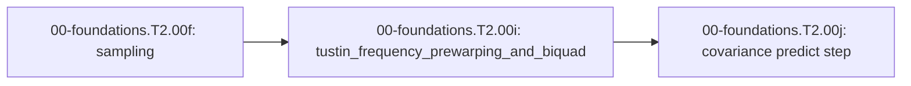

<!-- run-callout:start -->
> **Step 3 of 10 · Make a joint move: foundations**
>
> **Run this in the workbench.** [Open MechaLab with `EX.00-foundations.T2.00i` loaded](https://tle47.github.io/Mechatronics-Roadmap/?lesson=EX.00-foundations.T2.00i) - it opens on the **Run Python Lessons** tab with that entry selected. Starter code, hints and the graded check are ready; this page is the reading copy, and nothing you type here is saved.
<!-- run-callout:end -->

## 1. Why it matters
`00-foundations.T2.00e` turned a continuous transfer function into a difference equation with the Tustin substitution. That substitution is not free: it bends the frequency axis, so a filter designed for $850\,\text{Hz}$ in the analog domain lands at $749\,\text{Hz}$ in code - and a resonance at the frequency you meant to kill survives untouched. This page is the correction, and the five coefficients it produces are the ones a microcontroller runs on every ADC sample in Tier 2. Sampling that decides which frequencies exist at all is `00-foundations.T2.00f`; the uncertainty that survives the filter is `00-foundations.T2.00j`.

## 2. Intuition first
Picture a fisheye lens pointed at a ruler. The middle of the ruler maps almost one-to-one, but the marks near the edge get squeezed together, so an object you place at the $850\,\text{mm}$ mark photographs at $749\,\text{mm}$. The lens is the Tustin map; the squeezing near the edge is frequency warping, and it is worst close to Nyquist.

Pre-warping is the fix you already know from moving furniture: measure where the lens *puts* things, then place the object further out so it photographs where you wanted. You do not change the lens - you change the analog target you hand it. That is why the pre-warped analog frequency $6306.69\,\text{rad/s}$ is *higher* than $2\pi \cdot 850$: it compensates for the squeeze.

## 3. Formalization
1. **The Tustin map and where it actually lands.** Substituting

$$
s = \frac{2}{T_s}\frac{1 - z^{-1}}{1 + z^{-1}}
$$

   maps an analog frequency $\omega$ to the digital angle $\theta = 2\arctan(\omega T_s/2)$, so the frequency a discretised filter really responds to is

$$
f_{\text{actual}} = \frac{1}{\pi T_s}\arctan\!\left(\frac{\omega T_s}{2}\right).
$$

   At $\omega = 2\pi \cdot 850\,\text{rad/s}$ and $f_s = 4000\,\text{Hz}$ this gives $749.48\,\text{Hz}$, a miss of $100.52\,\text{Hz}$.
2. **Pre-warping is the inverse map.** To make the digital filter land on $f_0$, hand Tustin the analog frequency

$$
\omega_a = \frac{2}{T_s}\tan\!\left(\frac{\pi f_0}{f_s}\right).
$$

   At $f_0 = 850\,\text{Hz}$, $f_s = 4000\,\text{Hz}$ this is $6306.69\,\text{rad/s}$ ($1003.74\,\text{Hz}$ analog), and the round trip returns $850.00\,\text{Hz}$. The correction grows without bound as $f_0 \to f_s/2$, which is why a target at or above Nyquist is refused rather than silently clipped.
3. **The biquad it produces (Transposed Direct Form II).** A unity-gain notch with quality factor $Q$ has, with $\alpha = \sin \omega_0 / (2Q)$ and $\omega_0 = 2\pi f_0/f_s$,

$$
b_0 = b_2 = \frac{1}{1+\alpha}, \qquad b_1 = a_1 = \frac{-2\cos\omega_0}{1+\alpha}, \qquad a_2 = \frac{1-\alpha}{1+\alpha},
$$

   executed with two delay states: $y_k = b_0 x_k + w_1$, then $w_1 = b_1 x_k - a_1 y_k + w_2$, then $w_2 = b_2 x_k - a_2 y_k$. At $f_0 = 850\,\text{Hz}$, $Q = 5$: $b_0 = 0.911380$, $b_1 = a_1 = -0.425515$, $a_2 = 0.822760$.

## 4. Worked example
**Predict first (before you run it):** commit to three numbers. (1) Where does unwarped Tustin put an $850\,\text{Hz}$ target at $f_s = 4000\,\text{Hz}$? (2) How many hertz does it miss by? (3) What pre-warped analog frequency lands it on $850\,\text{Hz}$? Two tells: a landing frequency of exactly $850.00\,\text{Hz}$ means the pre-warp was applied twice, because the unwarped map is the one that misses; and a pre-warped $\omega_a$ *below* $2\pi \cdot 850$ has the sign of the correction backwards.

```python
import math

fs = 4000.0
ts = 1.0 / fs
f0 = 850.0
w0 = 2.0 * math.pi * f0

f_unwarped = math.atan(w0 * ts / 2.0) / (math.pi * ts)
miss_hz = f0 - f_unwarped

wa = (2.0 / ts) * math.tan(math.pi * f0 / fs)
f_landed = math.atan(wa * ts / 2.0) / (math.pi * ts)

assert math.isclose(f_unwarped, 749.4803, abs_tol=1e-3)
assert math.isclose(miss_hz, 100.5197, abs_tol=1e-3)
assert math.isclose(f_landed, 850.0, rel_tol=1e-12)
print("unwarped %.2f Hz (miss %.2f Hz) | prewarped %.2f Hz | wa %.2f rad/s"
      % (f_unwarped, miss_hz, f_landed, wa))
```
Expected output:
```text
unwarped 749.48 Hz (miss 100.52 Hz) | prewarped 850.00 Hz | wa 6306.69 rad/s
```

## 5. Exercise
Design a notch for $f_0 = 600\,\text{Hz}$ at $f_s = 2000\,\text{Hz}$ and verify $\omega_a = 5505.5277\,\text{rad/s}$ ($\pm 10^{-3}$), then show that `tustin_hz(prewarp_omega(600.0, 2000.0), 2000.0)` returns $600.0\,\text{Hz}$ to $10^{-9}$.
- **If your result differs:** the tangent argument is $\pi f_0/f_s = 0.3\pi$ radians; `math.tan` takes radians, never degrees. A round trip that returns something near $520\,\text{Hz}$ means the tangent was applied to a frequency already divided by $f_s$.

### Graded package - notching the arm's own elbow mode
[`exercises/00-foundations.T2.00i/`](../exercises/00-foundations.T2.00i/) turns this section into a test. `starter.py` holds four holes: `tustin_hz` (where an analog frequency really lands), `prewarp_omega` (the exact inverse), `notch_coeffs` and `apply_biquad` (Transposed Direct Form II). Edit it, then run the tests the way CI does:

```bash
EXERCISE_TARGET=exercises/00-foundations.T2.00i/starter.py \
  python3 -m unittest discover -s exercises/00-foundations.T2.00i -p 'test_*.py'
```

The tests are behavioural: the pre-warp must land $850\,\text{Hz}$ at $6306.69\,\text{rad/s}$ and the round trip must be an identity at four sample-rate pairs while the unwarped prototype misses by $100.52\,\text{Hz}$; an enormous analog frequency must approach Nyquist from below without reaching it; the notch must be symmetric, unity at DC, and actually null a sampled $850\,\text{Hz}$ tone while passing a $200\,\text{Hz}$ one; and the delay states must start at rest. The transfer suite notches the plant's own damped elbow mode at the $1\,\text{kHz}$ tick. **13 tests.** Three planted faults - `prewarp_unwarped`, `notch_unnormalized`, `biquad_wrong_order` - each fail the test named for them, and a print-only file passes nothing (`scripts/run_exercise.py`).

1. **What the suite refuses.** `tustin_hz` raises `ValueError` for a sample rate that is zero or negative, because the map has no $T_s$ to scale by; `prewarp_omega` raises `ValueError` for a negative target or one at or above $f_s/2$, where the tangent runs to infinity and the pre-warp has no finite answer; `notch_coeffs` raises `ValueError` for a quality factor that is zero or negative and for a target outside $(0, f_s/2)$; and `apply_biquad` raises `ValueError` when the coefficient tuple is not exactly five numbers, so a truncated tuple fails loudly instead of filtering with a silent zero. Every one of those refusals is tested.

- **📚 What to Learn & Resources to Solve This Exercise:**
  - **Prerequisite Foundations Modules:** [`00-foundations.T2.00e`](00-foundations.T2.00e.md) (*Euler/Tustin Discretization*) and [`00-foundations.T2.00f`](00-foundations.T2.00f.md) (*Nyquist Sampling & Aliasing*).
  - **Core Concepts to Review First:** the Tustin landing frequency and the pre-warp $\omega_a = \frac{2}{T_s}\tan(\pi f_0/f_s)$ in `## 3. Formalization` (Items 1-3) and `## 4. Worked example` above.
  - **Biquad & DSP Study Links:** [Audio EQ Cookbook (`w3.org/TR/audio-eq-cookbook`)](https://www.w3.org/TR/audio-eq-cookbook/) and [Julius O. Smith III, *Introduction to Digital Filters* (`ccrma.stanford.edu/~jos/filters/`)](https://ccrma.stanford.edu/~jos/filters/).
  - **Curriculum Reference:** [Track 00 Tier 2 (`00-foundations/README.md#tier-2-intermediate--applied`)](../00-foundations/README.md#tier-2-intermediate--applied).

### Starter code
```python
"""Exercise 00-foundations.T2.00i - the learner's file.

Where Tustin really places a frequency, the pre-warp that moves it back, and the biquad the five
coefficients run. Fill the four TODOs:

    EXERCISE_TARGET=exercises/00-foundations.T2.00i/starter.py \
        python3 -m unittest discover -s exercises/00-foundations.T2.00i -p 'test_*.py'
"""


def tustin_hz(omega_rad_s, fs):
    """Where unwarped Tustin actually places an analog frequency, in Hz."""
    raise NotImplementedError("TODO 1: digital angle 2 atan(omega Ts / 2), then divide by 2 pi Ts")


def prewarp_omega(f0_hz, fs):
    """Analog prototype frequency that lands a Tustin filter exactly on f0_hz."""
    raise NotImplementedError("TODO 2: (2 / Ts) tan(pi f0 / fs)")


def notch_coeffs(f0_hz, fs, q):
    """(b0, b1, b2, a1, a2) for a unity-gain notch at f0_hz with quality factor q; a0 is 1."""
    raise NotImplementedError("TODO 3: alpha = sin(w0) / (2 q); b0 = b2 = 1 / (1 + alpha)")


def apply_biquad(coeffs, samples):
    """Run the TDF-II biquad over `samples` and return one output sample per input."""
    raise NotImplementedError("TODO 4: two delay states, w1 and w2, updated in that order")
```

**Expected numbers (the answer):** $\omega_a(600\,\text{Hz} @ 2000\,\text{Hz}) = 5505.5277\,\text{rad/s}$, and the round trip through `tustin_hz` returns $600.0\,\text{Hz}$ to $10^{-9}$.

### Hint ladder
1. **Invert the map, do not scale it.** Unwarped Tustin maps $\omega_a$ to $f = \frac{1}{\pi T_s}\arctan(\omega_a T_s/2)$; invert that and you get $\omega_a = \frac{2}{T_s}\tan(\pi f_0/f_s)$.
2. **Radians in the tangent.** At $600\,\text{Hz}$ on $2000\,\text{Hz}$ the argument is $0.3\pi$ radians; `math.tan` never takes degrees.
3. **Check the round trip, not the number.** `tustin_hz(prewarp_omega(600.0, 2000.0), 2000.0)` must return $600.0$ to $10^{-9}$.
4. **The notch's symmetry is free.** With $\alpha = \sin\omega_0/(2Q)$ and normalization $1/(1+\alpha)$, $b_2 = b_0$ and $a_1 = b_1$ fall out; if they do not, the normalization was applied to one coefficient and not the others.

### Full Solution
```python
import math


def tustin_hz(omega_rad_s, fs):
    """`s = j omega` maps to `z = e^{j theta}` with `theta = 2 atan(omega Ts / 2)`."""
    if fs <= 0.0:
        raise ValueError("tustin_hz: sample rate must be positive, got %r" % (fs,))
    ts = 1.0 / fs
    return math.atan(omega_rad_s * ts / 2.0) / (math.pi * ts)


def prewarp_omega(f0_hz, fs):
    """Inverse of `tustin_hz` at f0: the analog frequency Tustin must be handed."""
    if fs <= 0.0:
        raise ValueError("prewarp_omega: sample rate must be positive, got %r" % (fs,))
    if not 0.0 <= f0_hz < 0.5 * fs:
        raise ValueError("prewarp_omega: target must lie in [0, fs/2), got %r" % (f0_hz,))
    ts = 1.0 / fs
    return (2.0 / ts) * math.tan(math.pi * f0_hz / fs)


def notch_coeffs(f0_hz, fs, q):
    """Notch with zeros on the unit circle at e^{+-j w0}: a true null at f0, unity at DC."""
    if fs <= 0.0:
        raise ValueError("notch_coeffs: sample rate must be positive, got %r" % (fs,))
    if not 0.0 < f0_hz < 0.5 * fs:
        raise ValueError("notch_coeffs: notch must lie in (0, fs/2), got %r" % (f0_hz,))
    if q <= 0.0:
        raise ValueError("notch_coeffs: quality factor must be positive, got %r" % (q,))
    w0 = 2.0 * math.pi * f0_hz / fs
    alpha = math.sin(w0) / (2.0 * q)
    norm = 1.0 / (1.0 + alpha)
    b0 = norm
    b1 = -2.0 * math.cos(w0) * norm
    a1 = b1
    a2 = (1.0 - alpha) * norm
    return (b0, b1, b0, a1, a2)


def apply_biquad(coeffs, samples):
    """Transposed Direct Form II, a0 normalized to 1."""
    if len(coeffs) != 5:
        raise ValueError("apply_biquad: expected 5 coefficients, got %d" % (len(coeffs),))
    b0, b1, b2, a1, a2 = coeffs
    w1 = 0.0
    w2 = 0.0
    out = []
    for x in samples:
        y = b0 * x + w1
        w1 = b1 * x - a1 * y + w2
        w2 = b2 * x - a2 * y
        out.append(y)
    return out


wa = prewarp_omega(600.0, 2000.0)
round_trip = tustin_hz(wa, 2000.0)
assert math.isclose(wa, 5505.5277, abs_tol=1e-3)
assert math.isclose(round_trip, 600.0, abs_tol=1e-9)
print("prewarp(600 Hz @ 2 kHz)=%.4f rad/s | round trip %.6f Hz" % (wa, round_trip))
```

Printed: `prewarp(600 Hz @ 2 kHz)=5505.5277 rad/s | round trip 600.000000 Hz`.

**On the shared arm.** The transfer suite notches the plant's own damped elbow mode, pre-warped at the $1\,\text{kHz}$ capstone tick:

```python
import math
import mechalab_plant as plant

k = 8.0
wn = math.sqrt(k / plant.I2)
zeta = plant.B2 / (2.0 * math.sqrt(plant.I2 * k))
f_damped = wn * math.sqrt(1.0 - zeta * zeta) / (2.0 * math.pi)
fs = 1.0 / plant.DT
wa = (2.0 / plant.DT) * math.tan(math.pi * f_damped / fs)
landed = math.atan(wa * plant.DT / 2.0) / (math.pi * plant.DT)
assert math.isclose(landed, f_damped, abs_tol=1e-9)
print("elbow mode=%.3f Hz | prewarped prototype=%.3f rad/s | lands at %.3f Hz"
      % (f_damped, wa, landed))
```

### Break it on purpose
Inject the `prewarp_unwarped` fault on purpose: design the $850\,\text{Hz}$ notch from $\omega_0 = 2\pi f_0$ instead of the pre-warped prototype, and leave the biquad normalization alone.
- **Inject:** pass the target frequency straight into the Tustin substitution, as if the analog and digital frequency axes were the same line.
- **Symptom:** the notch centre lands at $749.48\,\text{Hz}$ - a $100.52\,\text{Hz}$ miss - so a true $850\,\text{Hz}$ resonance is left almost unattenuated while a $749.5\,\text{Hz}$ component is nulled instead. Symmetry and unity DC gain still hold, so every coefficient check except the landing frequency passes.
- **Diagnose:** the landing frequency is exactly the unwarped map's output: `tustin_hz(2 * math.pi * f0, fs)` returns $749.48\,\text{Hz}$, while `tustin_hz(prewarp_omega(f0, fs), fs)` returns $850.00\,\text{Hz}$ - the round trip is an identity only when the pre-warp is applied first, which localises the fault to the prototype frequency.
- **Fix:** pre-warp with $\omega_a = 6306.69\,\text{rad/s}$ at $850/4000$, then prove it twice: the round trip returns $850.00\,\text{Hz}$ to $10^{-9}$, and a sampled $850\,\text{Hz}$ tone loses more than $99.9\%$ of its energy while a $200\,\text{Hz}$ tone passes through.

## 6. Simulation path
Open **Two-Mass & Notch Bode** in the MechaLab Workbench (`npm run dev`) and toggle pre-warping ON vs. OFF at $f_0 = 850\,\text{Hz}$, $f_s = 4000\,\text{Hz}$ to watch the notch centre shift from $749.5\,\text{Hz}$ onto the $850\,\text{Hz}$ resonance peak.

The graded package is also a workbench entry: **Modules -> `EX.00-foundations.T2.00i`**, where `selfcheck.py` is appended below the starter and **Verify** compares its `SELF-CHECK PASS:` line. `scripts/e2e_pages_bundle.mjs` drives it on the built bundle, so the browser path is tested, not assumed.

No hardware required for this module (`hardware_required: false`). In Step 2.1 (`00-foundations.T2.01`) the five pre-warped coefficients execute inside the microcontroller's `TDF-II` loop on every encoder sample:
```text
[ADC @ f_s] ---> [Pre-Warped TDF-II Biquad Notch] ---> [clean signal]
```
Pass/fail verification in simulation: `f_unwarped == 749.48 Hz`, `f_landed == 850.00 Hz`, and a $200\,\text{Hz}$ tone passing at unity gain.



## 7. Checkpoint
Pass criteria: run the worked example and the exercise with zero assertion errors, or score $\ge 80\%$ ($4/5$) on the Skip test below. The ladder's Gate paper is taken once, after the last Tier 2 page.

### Skip test
<!-- skip-test:start -->
1. `[Recall] [Concept: tustin_frequency_prewarping_and_biquad]` Compute the actual digital notch frequency $f_{\text{unwarped}}$ in $\text{Hz}$ (tolerance $\pm 0.01\text{ Hz}$) when an unwarped Tustin transform is applied to $f_0 = 850\text{ Hz}$ at $f_s = 4000\text{ Hz}$.
2. `[Apply] [Concept: tustin_frequency_prewarping_and_biquad]` Compute the pre-warped analog prototype frequency $\omega_a$ in $\text{rad/s}$ (tolerance $\pm 10^{-3}$) that lands a Tustin notch on $f_0 = 600\text{ Hz}$ at $f_s = 2000\text{ Hz}$.
3. `[Transfer] [Concept: tustin_frequency_prewarping_and_biquad]` Why does the pre-warped analog frequency exceed $2\pi f_0$ rather than fall below it?
   - **A.** Because the tangent term is a gain correction that always adds energy.
   - **B.** Because Tustin squeezes frequencies toward Nyquist, so the analog target must be placed above $f_0$ for the warped image to land on $f_0$.
   - **C.** Because the sample rate is doubled by the substitution.
   - **D.** Because the notch's quality factor scales the frequency.
4. `[Concept: tustin_frequency_prewarping_and_biquad]` In the unity-gain notch coefficients, why must $a_1 = b_1$ and $b_2 = b_0$?
   - **A.** Because the filter is second order, and second-order filters are always symmetric.
   - **B.** Because the zeros sit in mirror-image pairs on the unit circle and the same normalization divides every coefficient, so the reflection makes the pairs equal.
   - **C.** Because the quality factor is fixed at 5.
   - **D.** Because $a_0$ is set to 1.
5. `[Spaced review -> 00-foundations.T2.00f — Concept: nyquist_sampling_and_aliasing]` A $3900\text{ Hz}$ tone is sampled at $f_s = 4000\text{ Hz}$. Compute its alias in $\text{Hz}$ (tolerance $\pm 10^{-9}$).

**Answer key:**
```python
import math

q1_unwarped_hz = (4000.0 / math.pi) * math.atan(math.pi * 850.0 / 4000.0)
q2_wa = (2.0 / 0.0005) * math.tan(math.pi * 600.0 / 2000.0)
q3_choice = "B"
q4_choice = "B"
q5_alias_hz = 4000.0 - 3900.0

assert math.isclose(q1_unwarped_hz, 749.48034, abs_tol=1e-2)
assert math.isclose(q2_wa, 5505.5277, abs_tol=1e-3)
assert q3_choice == "B"
assert q4_choice == "B"
assert math.isclose(q5_alias_hz, 100.0, rel_tol=1e-9)

```
- **Pass mark:** $4/5$ ($80\%+$). If you missed Q1 or Q3, study `## 3. Formalization` items 1-2; Q2, study item 2; Q4, study item 3. If you missed Q5, review `00-foundations.T2.00f`. On pass, proceed to `## 10. Next modules`.
<!-- skip-test:end -->

### Gate test
<!-- ladder-gate:start -->
This is the exit examination for the whole Track 00 Tier 2 ladder - every `00-foundations.T2.*` page in [`docs/SYLLABUS.md`](../docs/SYLLABUS.md) - before Step 2.1 (`00-foundations.T2.01`). Every Tier 2 page renders this same paper, so take it once after the last of them; the page you are on is only where you found it. Questions 1-6 are the matrix page's own tools; 7-14 recap each other page once, so nothing on the ladder goes unexamined.

1. `[Concept: matrix_vector_multiplication]` For $A = \begin{bmatrix} 3.0 & -2.0 \\ 1.0 & 4.0 \end{bmatrix}$ and $\vec{x} = [1.5,\; 2.5]^\top$, compute **both** entries of $A\vec{x}$: the first and the second (tolerances $\pm 10^{-9}$).
2. `[Concept: matrix_vector_multiplication]` Why does a $2\times2$ matrix times a length-2 column come out as a column of length $2$ rather than a $2\times2$ matrix?
   - **A.** $A\vec{x}$ is the elementwise product of $A$ and $\vec{x}$, which keeps $A$'s shape.
   - **B.** Python reshapes $A$ into a column before multiplying.
   - **C.** Each output entry is one row of $A$ dotted with $\vec{x}$, so there is one output per row.
   - **D.** $\vec{x}$ is transposed into a row first.
3. `[Concept: state_vector_one_step_update]` One step of $A_d = \begin{bmatrix} 1.0 & 0.02 \\ -2.0 & 0.80 \end{bmatrix}$, $B_d = [0.0,\; 0.02]^\top$, from $\vec{x}_0 = [0.50,\; 0.0]^\top$ with $u_0 = 10.0\,\text{N}$ gives $v_1$. Compute $v_1$ in $\text{m/s}$ (tolerance $\pm 10^{-9}$).
4. `[Concept: state_vector_one_step_update]` In the same step, if the position row were evaluated using the *new* velocity, what would $x_1$ be (tolerance $\pm 10^{-9}\,\text{m}$)?
5. `[Concept: state_vector_one_step_update]` For the two-mass matrix with $m_1 = 1.0\,\text{kg}$, $m_2 = 2.0\,\text{kg}$, $k = 50.0\,\text{N/m}$, $b = 0$ and $\Delta t = 0.01\,\text{s}$, compute the first entry of its **fourth** row - the row that updates $v_2$ (tolerance $\pm 10^{-9}$).
6. `[Concept: state_vector_one_step_update]` Why do the diagonal $2\times2$ blocks of the 4-state matrix equal the single-mass update for each body when $k = b = 0$?
   - **A.** Because the 4-state matrix is always block-diagonal.
   - **B.** Because each mass then obeys the same mass-spring-damper form with its own mass and damping, and the coupling terms vanish.
   - **C.** Because $B_d$ only pushes $m_1$.
   - **D.** Because the Euler update is exact.
7. `[Concept: finite_difference_derivative_and_integral]` An encoder reads $x_{k-1} = 0.24\,\text{rad}$ and $x_k = 0.30\,\text{rad}$ at $\Delta t = 0.002\,\text{s}$. Compute the backward-difference velocity in $\text{rad/s}$ (tolerance $\pm 10^{-9}$).
8. `[Concept: dot_product_projection] [Concept: cross_product_3d_moment] [Concept: basis_change_and_invertibility]` Which triple is correct for `00-foundations.T2.00b`?
   - **A.** The projection uses the raw lever so force grows with its length, $\vec{r}\times\vec{F} = \vec{F}\times\vec{r}$, and a zero determinant means a valid basis.
   - **B.** The projection divides by $\|\vec{r}\|$ twice, the moment is a scalar, and the determinant is always positive.
   - **C.** The dot product returns a vector, the cross product is symmetric, and the determinant equals the trace.
   - **D.** The projection uses the lever's *unit* direction, the moment is $\vec{r}\times\vec{F}$ (anti-commutative), and a zero determinant means the two columns are collinear.
9. `[Concept: first_order_ode_time_constant] [Concept: second_order_ode_wn_zeta] [Concept: characteristic_polynomial_roots]` For `00-foundations.T2.00c`'s joint with $J = 0.02\,\text{kg}\cdot\text{m}^2$, $k = 8.0\,\text{N}\cdot\text{m/rad}$ and $b = 0.60\,\text{N}\cdot\text{m}\cdot\text{s/rad}$, compute the damping ratio $\zeta = b/(2\sqrt{Jk})$ (tolerance $\pm 10^{-9}$).
10. `[Concept: complex_numbers_and_euler_formula] [Concept: complex_impedance_and_transfer_function] [Concept: bode_magnitude_db_and_phase]` A series RL winding has $R = 4.0\ \Omega$ and $L = 2.0\,\text{mH}$ and is driven at $\omega = 2000\,\text{rad/s}$. Compute $|Z|$ in ohms, then $20\log_{10}|H|$ at the corner $\omega = 1/\tau$ of a first-order filter (tolerances $\pm 10^{-9}\,\Omega$ and $\pm 10^{-4}\,\text{dB}$).
11. `[Concept: laplace_poles_and_zeros] [Concept: continuous_state_space_matrices] [Concept: discrete_state_transition_euler_tustin]` For `00-foundations.T2.00e`'s $A = \begin{bmatrix} 0 & 1 \\ -100 & -4 \end{bmatrix}$ sampled at $T_s = 0.05\,\text{s}$, compute the spectral radius of the Forward-Euler map $A_d = I + A T_s$ (tolerance $\pm 10^{-6}$).
12. `[Concept: nyquist_sampling_and_aliasing]` Which statement is correct for `00-foundations.T2.00f`?
   - **A.** Sampling represents any frequency, and aliasing affects only DC.
   - **B.** Sampling represents only frequencies up to $f_s/2$, and a faster tone folds to $|f - k f_s|$.
   - **C.** The Nyquist frequency is $f_s$, and aliasing doubles the frequency.
   - **D.** A digital low-pass filter placed after the ADC removes aliasing.
13. `[Concept: tustin_frequency_prewarping_and_biquad]` Compute the pre-warped analog prototype $\omega_a$ in $\text{rad/s}$ that lands a Tustin notch on $600\,\text{Hz}$ at $f_s = 2000\,\text{Hz}$, and the frequency the *unwarped* prototype $2\pi f_0$ would land on in $\text{Hz}$ (tolerances $\pm 10^{-3}\,\text{rad/s}$ and $\pm 0.01\,\text{Hz}$).
14. `[Concept: gaussian_variance_and_covariance_matrix]` For $A = \begin{bmatrix} 1 & 0.1 \\ 0 & 1 \end{bmatrix}$, $\Sigma_x = \operatorname{diag}(0.01, 0.25)$ and $Q = \operatorname{diag}(0.001, 0.002)$, compute the $(0,0)$ entry of $\Sigma_y = A\Sigma_x A^\top + Q$ (tolerance $\pm 10^{-9}$).

**Gate answer key:**
```python
import math

# Q1-Q6: the matrix page. Two entries, evaluated one row at a time: the paper asks for both so a
# reader who reads the maths (1-indexed) and one who reads Python (0-indexed) agree on the answer.
g1_ax_first = 3.0 * 1.5 + (-2.0) * 2.5
g1_ax_second = 1.0 * 1.5 + 4.0 * 2.5
g2_choice = "C"
g3_v1 = -2.0 * 0.50 + 0.80 * 0.0 + 0.02 * 10.0
g4_x1_new_v = 1.0 * 0.50 + 0.02 * (-0.80)
g5_row4_first = (50.0 / 2.0) * 0.01
g6_choice = "B"

# Q7: the derivative page.
g7_velocity = (0.30 - 0.24) / 0.002

# Q8-Q12: one question per remaining page.
g8_choice = "D"
g9_zeta = 0.60 / (2.0 * math.sqrt(0.02 * 8.0))
g10_z_ohm = abs(4.0 + 1j * 2000.0 * 0.002)
g10_corner_db = 20.0 * math.log10(1.0 / math.sqrt(2.0))
Ad_euler = [[1.0, 0.05], [-5.0, 0.80]]
g11_radius = math.sqrt(Ad_euler[0][0] * Ad_euler[1][1] - Ad_euler[0][1] * Ad_euler[1][0])
g12_choice = "B"
g13_wa = (2.0 / 0.0005) * math.tan(math.pi * 600.0 / 2000.0)
g13_unwarped = (2000.0 / math.pi) * math.atan(math.pi * 600.0 / 2000.0)
g14_sigma00 = 0.01 + 0.1 * 0.1 * 0.25 + 0.001

assert math.isclose(g1_ax_first, -0.5, rel_tol=1e-9)
assert math.isclose(g1_ax_second, 11.5, rel_tol=1e-9)
assert g2_choice == "C"
assert math.isclose(g3_v1, -0.80, rel_tol=1e-9)
assert math.isclose(g4_x1_new_v, 0.484, rel_tol=1e-9)
assert math.isclose(g5_row4_first, 0.25, rel_tol=1e-9)
assert g6_choice == "B"
assert math.isclose(g7_velocity, 30.0, rel_tol=1e-9)
assert g8_choice == "D"
assert math.isclose(g9_zeta, 0.75, rel_tol=1e-9)
assert math.isclose(g10_z_ohm, 5.656854249492381, rel_tol=1e-9)
assert math.isclose(g10_corner_db, -3.0103, abs_tol=1e-4)
assert math.isclose(g11_radius, 1.024695, abs_tol=1e-6)
assert g12_choice == "B"
assert math.isclose(g13_wa, 5505.5277, abs_tol=1e-3)
assert math.isclose(g13_unwarped, 481.1534, abs_tol=1e-2)
assert math.isclose(g14_sigma00, 0.0135, rel_tol=1e-9)

print("gate key: Ax=[%.1f, %.1f], v1=%.2f m/s, x1(new v)=%.3f m, radius=%.6f"
      % (g1_ax_first, g1_ax_second, g3_v1, g4_x1_new_v, g11_radius))
```
- **Pass mark:** $\ge 12/14$. Every question is answered by the page named in its tags; the ladder is closed when this paper is passed once, after the last Tier 2 page.
<!-- ladder-gate:end -->

## 8. Common mistakes
| Symptom | Root cause | 2-minute fix |
| :--- | :--- | :--- |
| Notch filter misses the $850\,\text{Hz}$ resonance and lands at $749.5\,\text{Hz}$ | Substituted $s = \frac{2}{T_s}\frac{1-z^{-1}}{1+z^{-1}}$ with the unwarped $\omega_0 = 2\pi f_0$ | Pre-warp with $\omega_a = \frac{2}{T_s}\tan(\pi f_0/f_s)$ before computing the coefficients |
| Pre-warp returns a negative or absurd number | `math.tan` handed degrees, or a target at or above $f_s/2$ | Pass radians, and refuse $f_0 \ge f_s/2$ where the tangent has no finite answer |
| The notch nulls nothing at all | The filter's output was fed back into the numerator's delay instead of the denominator's | Update $w_1 = b_1 x - a_1 y + w_2$ and $w_2 = b_2 x - a_2 y$, using the *output* $y$ for the feedback terms |

## 9. Resources
- **Robert Bristow-Johnson — [*Audio EQ Cookbook* (`w3.org/TR/audio-eq-cookbook`)](https://www.w3.org/TR/audio-eq-cookbook/):** The biquad coefficient formulas and their normalization `[VERIFIED 2026-10-15]`.
- **Julius O. Smith III — [*Introduction to Digital Filters* (`ccrma.stanford.edu/~jos/filters/`)](https://ccrma.stanford.edu/~jos/filters/):** Bilinear transformation, frequency warping and pre-warping derivations `[VERIFIED 2026-10-15]`.

## 10. Next modules

<!-- next-step:start -->
👉 **Next:** [Step 3 · Make a joint move: foundations — 00-foundations.T2.00j: Gaussian Variance, Covariance & the Predict Step](00-foundations.T2.00j.md)
<!-- next-step:end -->
