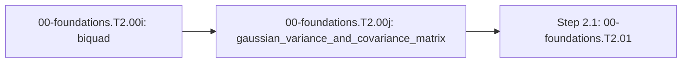

<!-- run-callout:start -->
> **Run this in the workbench.** [Open MechaLab](https://tle47.github.io/Mechatronics-Roadmap/) → **Tab 2, Run Python Lessons** → search `EX.00-foundations.T2.00j` and pick it from the list. The starter code, hints and graded check live there; this page is the reading copy, and nothing you type here is saved.
<!-- run-callout:end -->

## 1. Why it matters
Every estimator in Tier 3 answers one question the model alone cannot: *how wrong am I, and in which direction?* A single number cannot hold that. A joint's position error and velocity error are coupled - if the position reads high, the velocity is probably reading high too - and a Kalman filter's predict step has to carry both the two spreads and that coupling forward through the same matrix that advances the state. This page is the last bridge module before Step 2.1 (`00-foundations.T2.01`). What sampling does to a signal is `00-foundations.T2.00f`; the filter that cleans it is `00-foundations.T2.00i`; this page is the uncertainty that survives both.

## 2. Intuition first
Picture a laser pointer held by a slightly shaky hand. The dot wanders, and if you mark where it lands a thousand times you get a blob, not a circle. The blob's width left-to-right is one variance and its height up-and-down is another; if the hand drifts diagonally, the blob is a tilted ellipse, and that tilt *is* the covariance.

Now push the pointer through a lens that stretches the horizontal axis. The blob stretches with it, and so does the tilt. The predict step is that lens, applied to the ellipse: propagate the state with $A$, and the ellipse with $A$ on both sides - because a matrix acting on a shape squeezes it along one axis and stretches it along another, the error has to be transformed on the way in *and* on the way out.

## 3. Formalization
1. **Variance and standard deviation.** For a scalar reading with standard deviation $\sigma$, the variance is $\sigma^2$ in the reading's units squared. An encoder quantised to $\Delta = 2\pi/\text{CPR}$ radians contributes a uniform error with standard deviation $\sigma_q = \Delta/\sqrt{12}$, so its variance is $\sigma_q^2$. A variance adds when independent errors add, which is why the sum is in units squared.
2. **The covariance matrix.** For a state vector $x \in \mathbb{R}^n$ with mean $\mu$,

$$
\Sigma = \mathbb{E}\left[(x - \mu)(x - \mu)^\top\right],
$$

   a symmetric positive semi-definite matrix whose diagonal holds the variances and whose off-diagonal entry $\Sigma_{ij}$ is positive when the two errors tend to move together. A scalar covariance is a special case: $\Sigma = [\sigma^2]$ for a one-state estimator.
3. **The predict step.** Propagating $y = Ax + w$, where $w$ is zero-mean noise with covariance $Q$, gives

$$
\Sigma_y = A\,\Sigma_x\,A^\top + Q.
$$

   With $A = \begin{bmatrix} 1 & 0.1 \\ 0 & 1 \end{bmatrix}$, $\Sigma_x = \operatorname{diag}(0.01, 0.25)$ and $Q = \operatorname{diag}(0.001, 0.002)$, the product is $\begin{bmatrix} 0.0125 & 0.025 \\ 0.025 & 0.25 \end{bmatrix}$ and adding $Q$ gives $\Sigma_y = \begin{bmatrix} 0.0135 & 0.025 \\ 0.025 & 0.252 \end{bmatrix}$: the position variance grew from $0.01$ to $0.0135$ purely because the velocity uncertainty leaked into it through the $0.1$ coupling.

## 4. Worked example
**Predict first (before you run it):** commit to three numbers for $A = \begin{bmatrix} 1 & 0.1 \\ 0 & 1 \end{bmatrix}$, $\Sigma_x = \operatorname{diag}(0.01, 0.25)$ and $Q = \operatorname{diag}(0.001, 0.002)$: the new $(0,0)$ entry, the new $(0,1)$ entry, and whether the determinant stays positive. Two tells: a $(0,1)$ of zero means $A\Sigma_x A^\top$ was computed as $A\Sigma_x$, dropping the transpose; and a $(0,0)$ of exactly $0.011$ means $Q$ was added but the coupling was not.

```python
import math

A = [[1.0, 0.1], [0.0, 1.0]]
Sigma = [[0.01, 0.0], [0.0, 0.25]]
Q = [[0.001, 0.0], [0.0, 0.002]]


def transpose(a):
    return [list(row) for row in zip(*a)]


def matmul(a, b):
    return [[sum(a[i][k] * b[k][j] for k in range(len(b))) for j in range(len(b[0]))]
            for i in range(len(a))]


asig = matmul(A, Sigma)
Sy = matmul(asig, transpose(A))
Sy = [[Sy[i][j] + Q[i][j] for j in range(2)] for i in range(2)]
det = Sy[0][0] * Sy[1][1] - Sy[0][1] * Sy[1][0]

assert math.isclose(Sy[0][0], 0.0135, abs_tol=1e-12)
assert math.isclose(Sy[0][1], 0.025, abs_tol=1e-12)
assert math.isclose(Sy[0][1], Sy[1][0], abs_tol=1e-12)
assert det > 0.0
print("Sigma_y = [[%.4f, %.4f], [%.4f, %.4f]] | det = %.6f"
      % (Sy[0][0], Sy[0][1], Sy[1][0], Sy[1][1], det))
```
Expected output:
```text
Sigma_y = [[0.0135, 0.0250], [0.0250, 0.2520]] | det = 0.002777
```

## 5. Exercise
Reproduce the example above, then run the integration task: one predict step for the arm's elbow at the plant's own $1\,\text{kHz}$ tick, and compare the predicted variance against a 4000-sample Monte-Carlo of the same plant. Verify that $\Sigma_y$ stays symmetric, that its determinant stays positive, and that the Monte-Carlo position variance agrees with the prediction to within $15\%$.
- **If your result differs:** a symmetric prediction with a zero off-diagonal means the transpose was dropped; a prediction that grows wildly means $Q$ was multiplied rather than added; a Monte-Carlo that never moves means the sampler was given a zero spread.

### Graded package - the predict step on the arm's elbow
[`exercises/00-foundations.T2.00j/`](../exercises/00-foundations.T2.00j/) turns this section into a test. `starter.py` holds two holes: `covariance_propagate(a, sigma, q)` (the sandwich rule) and `symmetrize(sigma)` (the re-symmetrising guard a long filter run needs). Edit it, then run the tests the way CI does:

```bash
EXERCISE_TARGET=exercises/00-foundations.T2.00j/starter.py \
  python3 -m unittest discover -s exercises/00-foundations.T2.00j -p 'test_*.py'
```

The tests are behavioural: the module's own example must reproduce `[[0.0135, 0.025], [0.025, 0.252]]`; a diagonal $Q$ must be added, not multiplied; a coupling matrix must push variance from the second state into the first; and `symmetrize` must average a deliberately one-sided matrix while leaving a symmetric one untouched. The transfer suite is the integration task - it runs the plant's own tick as a matrix, compares the predicted covariance against a 4000-draw Monte-Carlo, and checks that predicting twice grows the variance without breaking symmetry. **9 tests.** Three planted faults - `covariance_no_transpose`, `covariance_ignores_q`, `symmetrize_one_sided` - each fail the test named for them, and a print-only file passes nothing (`scripts/run_exercise.py`).

1. **What the suite refuses.** `covariance_propagate` raises `ValueError` when `a`, `sigma` or `q` is not exactly $2\times2$, because a silent shape mismatch in a covariance product is the one bug that produces a plausible-looking matrix; `symmetrize` raises `ValueError` for anything that is not a square $n\times n$ matrix, so a ragged input fails at the door instead of averaging the wrong cells. Both refusals are tested.

- **📚 What to Learn & Resources to Solve This Exercise:**
  - **Prerequisite Foundations Modules:** [`00-foundations.T2.00g`](00-foundations.T2.00g.md) (*Matrix-Vector Multiplication*) and [`00-foundations.T2.00i`](00-foundations.T2.00i.md) (*Pre-Warped Tustin Biquads*).
  - **Core Concepts to Review First:** the covariance definition and the sandwich rule $A\Sigma A^\top + Q$ in `## 3. Formalization` (Items 1-3) and `## 4. Worked example` above.
  - **Estimation & Covariance Study Links:** [Roger Labbe, *Kalman and Bayesian Filters in Python* (`github.com/rlabbe/Kalman-and-Bayesian-Filters-in-Python`)](https://github.com/rlabbe/Kalman-and-Bayesian-Filters-in-Python) and [Brunton & Kutz, *Data-Driven Science and Engineering* (`databookuw.com`)](https://databookuw.com/).
  - **Curriculum Reference:** [Track 00 Tier 2 (`00-foundations/README.md#tier-2-intermediate--applied`)](../00-foundations/README.md#tier-2-intermediate--applied).

### Starter code
```python
"""Exercise 00-foundations.T2.00j - the learner's file.

The error ellipse a predict step carries: A Sigma A^T + Q, and the guard that keeps it symmetric
over a long run. Fill the two TODOs:

    EXERCISE_TARGET=exercises/00-foundations.T2.00j/starter.py \
        python3 -m unittest discover -s exercises/00-foundations.T2.00j -p 'test_*.py'
"""


def covariance_propagate(a, sigma, q):
    """One predict step: A Sigma A^T + Q, for 2x2 matrices.

    Refuse (ValueError) any argument that is not exactly 2x2.
    """
    raise NotImplementedError("TODO 1: the sandwich rule, both sides of Sigma")


def symmetrize(sigma):
    """(sigma + sigma^T) / 2, for a square matrix of any size.

    Refuse (ValueError) a ragged or non-square matrix.
    """
    raise NotImplementedError("TODO 2: average each cell with its transpose")
```

**Expected numbers (the answer):** the module's example gives $\Sigma_y = \begin{bmatrix} 0.0135 & 0.025 \\ 0.025 & 0.252 \end{bmatrix}$, and the elbow's Monte-Carlo position variance agrees with the prediction to within $15\%$ at 4000 draws.

### Hint ladder
1. **Two multiplications, not one.** Compute $A\Sigma$ first, then $(A\Sigma)A^\top$; the second factor is the transpose, and dropping it leaves a non-symmetric matrix the tests reject on symmetry alone.
2. **$Q$ is added after, and to every cell.** A diagonal $Q$ still has to be added as a full matrix, because the off-diagonal calls must not be skipped when $Q$ is not diagonal in a later exercise.
3. **Symmetrise is an average.** `(sigma[i][j] + sigma[j][i]) / 2` for each cell; applying it to an already-symmetric matrix must return the same numbers.
4. **The plant's map is semi-implicit.** The transfer test uses the position-updated-first matrix, which is why the position variance carries a $dt^2$ term the naive Euler matrix misses.

### Full Solution
```python
def _check_2x2(name, matrix):
    if len(matrix) != 2 or any(len(row) != 2 for row in matrix):
        raise ValueError("%s: expected a 2x2 matrix, got %r" % (name, matrix))


def covariance_propagate(a, sigma, q):
    """Sigma' = A Sigma A^T + Q."""
    _check_2x2("covariance_propagate(a)", a)
    _check_2x2("covariance_propagate(sigma)", sigma)
    _check_2x2("covariance_propagate(q)", q)
    asigma = [[sum(a[i][k] * sigma[k][j] for k in range(2)) for j in range(2)]
              for i in range(2)]
    out = [[0.0, 0.0], [0.0, 0.0]]
    for i in range(2):
        for j in range(2):
            out[i][j] = sum(asigma[i][k] * a[j][k] for k in range(2)) + q[i][j]
    return out


def symmetrize(sigma):
    """(sigma + sigma^T) / 2."""
    rows = len(sigma)
    if any(len(row) != rows for row in sigma):
        raise ValueError("symmetrize: expected a square matrix, got %r" % (sigma,))
    return [[0.5 * (sigma[i][j] + sigma[j][i]) for j in range(rows)] for i in range(rows)]


sy = covariance_propagate([[1.0, 0.1], [0.0, 1.0]], [[0.01, 0.0], [0.0, 0.25]],
                          [[0.001, 0.0], [0.0, 0.002]])
assert abs(sy[0][0] - 0.0135) < 1e-12
assert abs(sy[0][1] - 0.025) < 1e-12
assert sy[0][1] == sy[1][0]
print("Sigma_y=[[%.4f, %.4f], [%.4f, %.4f]]" % (sy[0][0], sy[0][1], sy[1][0], sy[1][1]))
```

Printed: `Sigma_y=[[0.0135, 0.0250], [0.0250, 0.2520]]`.

**On the shared arm - the integration task.** The transfer suite runs the plant's tick as a matrix and compares the prediction against a Monte-Carlo of the same states:

```python
import math
import mechalab_plant as plant

k, j, b, dt = 8.0, plant.I2, plant.B2, plant.DT
ad = [[1.0 - dt * dt * k / j, dt * (1.0 - dt * b / j)], [-dt * k / j, 1.0 - dt * b / j]]
sigma_q = (2.0 * math.pi / plant.ENCODER_CPR) / math.sqrt(12.0)
print("elbow predict matrix: [[%.9f, %.9f], [%.9f, %.9f]] | one-count sigma=%.3e rad"
      % (ad[0][0], ad[0][1], ad[1][0], ad[1][1], sigma_q))
```

### Break it on purpose
Inject the `covariance_no_transpose` fault: compute $A\Sigma_x + Q$ and stop.
- **Inject:** drop the second multiplication by $A^\top$.
- **Symptom:** the $(0,1)$ and $(1,0)$ entries no longer match, and the matrix may stop being positive semi-definite, so a filter that consumes it can produce a negative variance.
- **Diagnose:** symmetry alone localises it - a covariance matrix is symmetric by definition, so an asymmetric result cannot come from the data, only from the algebra. Compare $\Sigma_{01} = \sum_k (A\Sigma)_{0k}A_{1k}$ with $\Sigma_{10}$ and they differ by exactly the missing transpose.
- **Fix:** multiply by $A^\top$ as well, then assert both symmetry and a positive determinant before handing the matrix to the update step.

## 6. Simulation path
Run the worked example in Python, then open **Tab 2 (Two-Mass & Notch Bode)** in the MechaLab Workbench: the uncertainty band drawn around the position trace is this page's covariance, propagated with the same matrix that advances the states.

The graded package is also a workbench entry: **Modules -> `EX.00-foundations.T2.00j`**, where `selfcheck.py` is appended below the starter and **Verify** compares its `SELF-CHECK PASS:` line. `scripts/e2e_pages_bundle.mjs` drives it on the built bundle, so the browser path is tested, not assumed.

No hardware required for this module (`hardware_required: false`). In Step 3.6 the same step runs inside the embedded ESKF's predict phase on every IMU sample:
```text
[x_k, P_k] ---> [A P A^T + Q] ---> [x_{k+1}, P_{k+1}]
```
Pass/fail verification in simulation: the module example reproduces `[[0.0135, 0.025], [0.025, 0.252]]`, $\Sigma_y$ is symmetric, and its determinant is positive.



## 7. Checkpoint
Pass criteria: run the worked example and the integration task with zero assertion errors, or score $\ge 80\%$ ($4/5$) on the Skip test below. The ladder's Gate paper is taken once, after this last Tier 2 page.

### Skip test
<!-- skip-test:start -->
1. `[Recall] [Concept: gaussian_variance_and_covariance_matrix]` Given $\Sigma_x = \begin{bmatrix} 1.0 & 0.0 \\ 0.0 & 4.0 \end{bmatrix}$ and $A = \begin{bmatrix} 1.0 & 0.5 \\ 0.0 & 1.0 \end{bmatrix}$, compute the $(0,0)$ entry of $\Sigma_y = A \Sigma_x A^\top$ (tolerance $\pm 10^{-9}$).
2. `[Apply] [Concept: gaussian_variance_and_covariance_matrix]` For the same $A$ and $\Sigma_x$, with $Q = \operatorname{diag}(0.1, 0.2)$, compute the $(1,1)$ entry of $\Sigma_y$ (tolerance $\pm 10^{-9}$).
3. `[Transfer] [Concept: gaussian_variance_and_covariance_matrix]` Why must the covariance be multiplied by $A$ on both sides rather than once?
   - **A.** Because the matrix has to be symmetric, and any single multiplication is asymmetric.
   - **B.** Because $A$ changes the shape the error lives in: it stretches each axis on the way in and the coupled error on the way out, so both factors carry the transformation.
   - **C.** Because $Q$ is always diagonal.
   - **D.** Because the state vector has two components.
4. `[Concept: gaussian_variance_and_covariance_matrix]` A counter quantises to $\Delta = 2\pi/4096$ radians, with the error uniform over one count. Compute the variance of one count's error in $\text{rad}^2$ (tolerance $\pm 10^{-3}$ relative).
5. `[Spaced review -> 00-foundations.T2.00i — Concept: tustin_frequency_prewarping_and_biquad]` Compute the pre-warped analog frequency $\omega_a$ in $\text{rad/s}$ that lands a Tustin notch on $600\text{ Hz}$ at $f_s = 2000\text{ Hz}$ (tolerance $\pm 10^{-3}$).

**Answer key:**
```python
import math

q1_sigma00 = 1.0 * 1.0 * 1.0 + 0.5 * 4.0 * 0.5
q2_sigma11 = 0.0 * 0.0 * 1.0 + 1.0 * 4.0 * 1.0 + 0.2
q3_choice = "B"
q4_variance = (2.0 * math.pi / 4096.0) ** 2 / 12.0
q5_wa = (2.0 / 0.0005) * math.tan(math.pi * 600.0 / 2000.0)

assert math.isclose(q1_sigma00, 2.0, rel_tol=1e-9)
assert math.isclose(q2_sigma11, 4.2, rel_tol=1e-9)
assert q3_choice == "B"
assert math.isclose(q4_variance, 1.9609e-7, rel_tol=1e-3)
assert math.isclose(q5_wa, 5505.5277, abs_tol=1e-3)

```
- **Pass mark:** $4/5$ ($80\%+$). If you missed Q1 or Q3, study `## 3. Formalization` items 2-3; Q2, study item 3; Q4, study item 1. If you missed Q5, review `00-foundations.T2.00i`. On pass, proceed to `## 10. Next modules`.
<!-- skip-test:end -->

### Gate test
<!-- ladder-gate:start -->
This is the exit examination for the whole Track 00 Tier 2 ladder - every `00-foundations.T2.*` page in [`docs/SYLLABUS.md`](../docs/SYLLABUS.md) - before Step 2.1 (`00-foundations.T2.01`). Every Tier 2 page renders this same paper, so take it once after the last of them; the page you are on is only where you found it. Questions 1-6 are the matrix page's own tools; 7-14 recap each other page once, so nothing on the ladder goes unexamined.

1. `[Concept: matrix_vector_multiplication]` For $A = \begin{bmatrix} 3.0 & -2.0 \\ 1.0 & 4.0 \end{bmatrix}$ and $\vec{x} = [1.5,\; 2.5]^\top$, compute **both** entries of $A\vec{x}$: the first and the second (tolerances $\pm 10^{-9}$).
2. `[Concept: matrix_vector_multiplication]` Why does a $2\times2$ matrix times a length-2 column come out as a column of length $2$ rather than a $2\times2$ matrix?
   - **A.** $A\vec{x}$ is the elementwise product of $A$ and $\vec{x}$, which keeps $A$'s shape.
   - **B.** Python reshapes $A$ into a column before multiplying.
   - **C.** Each output entry is one row of $A$ dotted with $\vec{x}$, so there is one output per row.
   - **D.** $\vec{x}$ is transposed into a row first.
3. `[Concept: state_vector_one_step_update]` One step of $A_d = \begin{bmatrix} 1.0 & 0.02 \\ -2.0 & 0.80 \end{bmatrix}$, $B_d = [0.0,\; 0.02]^\top$, from $\vec{x}_0 = [0.50,\; 0.0]^\top$ with $u_0 = 10.0\,\text{N}$ gives $v_1$. Compute $v_1$ in $\text{m/s}$ (tolerance $\pm 10^{-9}$).
4. `[Concept: state_vector_one_step_update]` In the same step, if the position row were evaluated using the *new* velocity, what would $x_1$ be (tolerance $\pm 10^{-9}\,\text{m}$)?
5. `[Concept: state_vector_one_step_update]` For the two-mass matrix with $m_1 = 1.0\,\text{kg}$, $m_2 = 2.0\,\text{kg}$, $k = 50.0\,\text{N/m}$, $b = 0$ and $\Delta t = 0.01\,\text{s}$, compute the first entry of its **fourth** row - the row that updates $v_2$ (tolerance $\pm 10^{-9}$).
6. `[Concept: state_vector_one_step_update]` Why do the diagonal $2\times2$ blocks of the 4-state matrix equal the single-mass update for each body when $k = b = 0$?
   - **A.** Because the 4-state matrix is always block-diagonal.
   - **B.** Because each mass then obeys the same mass-spring-damper form with its own mass and damping, and the coupling terms vanish.
   - **C.** Because $B_d$ only pushes $m_1$.
   - **D.** Because the Euler update is exact.
7. `[Concept: finite_difference_derivative_and_integral]` An encoder reads $x_{k-1} = 0.24\,\text{rad}$ and $x_k = 0.30\,\text{rad}$ at $\Delta t = 0.002\,\text{s}$. Compute the backward-difference velocity in $\text{rad/s}$ (tolerance $\pm 10^{-9}$).
8. `[Concept: dot_product_projection] [Concept: cross_product_3d_moment] [Concept: basis_change_and_invertibility]` Which triple is correct for `00-foundations.T2.00b`?
   - **A.** The projection uses the raw lever so force grows with its length, $\vec{r}\times\vec{F} = \vec{F}\times\vec{r}$, and a zero determinant means a valid basis.
   - **B.** The projection divides by $\|\vec{r}\|$ twice, the moment is a scalar, and the determinant is always positive.
   - **C.** The dot product returns a vector, the cross product is symmetric, and the determinant equals the trace.
   - **D.** The projection uses the lever's *unit* direction, the moment is $\vec{r}\times\vec{F}$ (anti-commutative), and a zero determinant means the two columns are collinear.
9. `[Concept: first_order_ode_time_constant] [Concept: second_order_ode_wn_zeta] [Concept: characteristic_polynomial_roots]` For `00-foundations.T2.00c`'s joint with $J = 0.02\,\text{kg}\cdot\text{m}^2$, $k = 8.0\,\text{N}\cdot\text{m/rad}$ and $b = 0.60\,\text{N}\cdot\text{m}\cdot\text{s/rad}$, compute the damping ratio $\zeta = b/(2\sqrt{Jk})$ (tolerance $\pm 10^{-9}$).
10. `[Concept: complex_numbers_and_euler_formula] [Concept: complex_impedance_and_transfer_function] [Concept: bode_magnitude_db_and_phase]` A series RL winding has $R = 4.0\ \Omega$ and $L = 2.0\,\text{mH}$ and is driven at $\omega = 2000\,\text{rad/s}$. Compute $|Z|$ in ohms, then $20\log_{10}|H|$ at the corner $\omega = 1/\tau$ of a first-order filter (tolerances $\pm 10^{-9}\,\Omega$ and $\pm 10^{-4}\,\text{dB}$).
11. `[Concept: laplace_poles_and_zeros] [Concept: continuous_state_space_matrices] [Concept: discrete_state_transition_euler_tustin]` For `00-foundations.T2.00e`'s $A = \begin{bmatrix} 0 & 1 \\ -100 & -4 \end{bmatrix}$ sampled at $T_s = 0.05\,\text{s}$, compute the spectral radius of the Forward-Euler map $A_d = I + A T_s$ (tolerance $\pm 10^{-6}$).
12. `[Concept: nyquist_sampling_and_aliasing]` Which statement is correct for `00-foundations.T2.00f`?
   - **A.** Sampling represents any frequency, and aliasing affects only DC.
   - **B.** Sampling represents only frequencies up to $f_s/2$, and a faster tone folds to $|f - k f_s|$.
   - **C.** The Nyquist frequency is $f_s$, and aliasing doubles the frequency.
   - **D.** A digital low-pass filter placed after the ADC removes aliasing.
13. `[Concept: tustin_frequency_prewarping_and_biquad]` Compute the pre-warped analog prototype $\omega_a$ in $\text{rad/s}$ that lands a Tustin notch on $600\,\text{Hz}$ at $f_s = 2000\,\text{Hz}$, and the frequency the *unwarped* prototype $2\pi f_0$ would land on in $\text{Hz}$ (tolerances $\pm 10^{-3}\,\text{rad/s}$ and $\pm 0.01\,\text{Hz}$).
14. `[Concept: gaussian_variance_and_covariance_matrix]` For $A = \begin{bmatrix} 1 & 0.1 \\ 0 & 1 \end{bmatrix}$, $\Sigma_x = \operatorname{diag}(0.01, 0.25)$ and $Q = \operatorname{diag}(0.001, 0.002)$, compute the $(0,0)$ entry of $\Sigma_y = A\Sigma_x A^\top + Q$ (tolerance $\pm 10^{-9}$).

**Gate answer key:**
```python
import math

# Q1-Q6: the matrix page. Two entries, evaluated one row at a time: the paper asks for both so a
# reader who reads the maths (1-indexed) and one who reads Python (0-indexed) agree on the answer.
g1_ax_first = 3.0 * 1.5 + (-2.0) * 2.5
g1_ax_second = 1.0 * 1.5 + 4.0 * 2.5
g2_choice = "C"
g3_v1 = -2.0 * 0.50 + 0.80 * 0.0 + 0.02 * 10.0
g4_x1_new_v = 1.0 * 0.50 + 0.02 * (-0.80)
g5_row4_first = (50.0 / 2.0) * 0.01
g6_choice = "B"

# Q7: the derivative page.
g7_velocity = (0.30 - 0.24) / 0.002

# Q8-Q12: one question per remaining page.
g8_choice = "D"
g9_zeta = 0.60 / (2.0 * math.sqrt(0.02 * 8.0))
g10_z_ohm = abs(4.0 + 1j * 2000.0 * 0.002)
g10_corner_db = 20.0 * math.log10(1.0 / math.sqrt(2.0))
Ad_euler = [[1.0, 0.05], [-5.0, 0.80]]
g11_radius = math.sqrt(Ad_euler[0][0] * Ad_euler[1][1] - Ad_euler[0][1] * Ad_euler[1][0])
g12_choice = "B"
g13_wa = (2.0 / 0.0005) * math.tan(math.pi * 600.0 / 2000.0)
g13_unwarped = (2000.0 / math.pi) * math.atan(math.pi * 600.0 / 2000.0)
g14_sigma00 = 0.01 + 0.1 * 0.1 * 0.25 + 0.001

assert math.isclose(g1_ax_first, -0.5, rel_tol=1e-9)
assert math.isclose(g1_ax_second, 11.5, rel_tol=1e-9)
assert g2_choice == "C"
assert math.isclose(g3_v1, -0.80, rel_tol=1e-9)
assert math.isclose(g4_x1_new_v, 0.484, rel_tol=1e-9)
assert math.isclose(g5_row4_first, 0.25, rel_tol=1e-9)
assert g6_choice == "B"
assert math.isclose(g7_velocity, 30.0, rel_tol=1e-9)
assert g8_choice == "D"
assert math.isclose(g9_zeta, 0.75, rel_tol=1e-9)
assert math.isclose(g10_z_ohm, 5.656854249492381, rel_tol=1e-9)
assert math.isclose(g10_corner_db, -3.0103, abs_tol=1e-4)
assert math.isclose(g11_radius, 1.024695, abs_tol=1e-6)
assert g12_choice == "B"
assert math.isclose(g13_wa, 5505.5277, abs_tol=1e-3)
assert math.isclose(g13_unwarped, 481.1534, abs_tol=1e-2)
assert math.isclose(g14_sigma00, 0.0135, rel_tol=1e-9)

print("gate key: Ax=[%.1f, %.1f], v1=%.2f m/s, x1(new v)=%.3f m, radius=%.6f"
      % (g1_ax_first, g1_ax_second, g3_v1, g4_x1_new_v, g11_radius))
```
- **Pass mark:** $\ge 12/14$. Every question is answered by the page named in its tags; the ladder is closed when this paper is passed once, after the last Tier 2 page.
<!-- ladder-gate:end -->

## 8. Common mistakes
| Symptom | Root cause | 2-minute fix |
| :--- | :--- | :--- |
| The predicted covariance is asymmetric | Computed $A\Sigma$ and stopped, or multiplied by $A$ twice | Multiply by $A$ on the left and $A^\top$ on the right; the result must be symmetric |
| A variance goes *down* after a predict step with $Q = 0$ | The matrix shrank the state it was applied to | A predict step cannot reduce variance below $A\Sigma A^\top$; check which matrix was used |
| The Monte-Carlo disagrees with the prediction | The prediction used forward-Euler while the plant steps position with the new velocity | Use the plant's semi-implicit matrix, which carries the $dt^2 k/J$ term in the position row |
| Negative numbers appear on the diagonal after thousands of updates | Floating-point drift in a long filter run | Symmetrise with $\frac{1}{2}(\Sigma + \Sigma^\top)$ and use the Joseph form in Step 3.6 |

## 9. Resources
- **Roger Labbe — [*Kalman and Bayesian Filters in Python* (`github.com/rlabbe/Kalman-and-Bayesian-Filters-in-Python`)](https://github.com/rlabbe/Kalman-and-Bayesian-Filters-in-Python):** Gaussian covariance, the predict step and its Monte-Carlo validation `[VERIFIED 2026-10-15]`.
- **Brunton & Kutz — [*Data-Driven Science and Engineering* (`databookuw.com`)](https://databookuw.com/):** State-space dynamics and uncertainty propagation `[VERIFIED 2026-10-15]`.

## 10. Next modules
- The Track 00 Tier 2 ladder is closed. Proceed to legacy **Step 2.1 (`00-foundations.T2.01`)** in [`00-foundations/README.md`](../00-foundations/README.md#tier-2-intermediate--applied).
