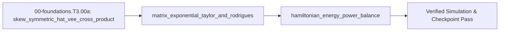

<!-- run-callout:start -->
> **Run this in the workbench.** [Open MechaLab on `EX.00-foundations.T3.00a`](https://tle47.github.io/Mechatronics-Roadmap/?lesson=EX.00-foundations.T3.00a) - Tab 2 opens with that entry selected, starter code, hints and graded check ready. This page is the reading copy, and nothing you type here is saved.
<!-- run-callout:end -->

## 1. Why it matters
This is the bridge module before Step 3.1 (`00-foundations.T3.01`), which launches Tier 3 across the entire roadmap. In Tier 3 (`3.1`–`3.8`), 3D orientations are updated on the curved manifold $SO(3)$ (never by adding Euler angles!), linear state-space models are discretized exactly via the matrix exponential $e^{AT_s}$, and multi-domain mechatronic models are checked for physical passivity via Hamiltonian energy balance $\dot{H} = u^\top y - d(t) \le u^\top y$. Connecting the 3D cross product $\omega \times v$ to a $3\times 3$ **skew-symmetric matrix $[\omega]_\times$** makes Rodrigues' rotation formula and Lie algebra $\mathfrak{so}(3)$ completely natural. Already know this? Take the Skip test or the Ladder Gate test in section 7 first.

## 2. Intuition first
Suppose a rigid body is spinning with angular velocity vector $\omega \in \mathbb{R}^3$. The velocity of any point $v$ attached to the body is the cross product $\dot{v} = \omega \times v$. By rewriting $\omega \times v$ as a $3\times 3$ matrix multiplication $[\omega]_\times v$, the rotational differential equation becomes $\dot{R} = [\omega]_\times R$—which mirrors the exact form of the scalar differential equation $\dot{x} = a x$ whose solution is $x(t) = e^{at}x(0)$! Indeed, the exact 3D rotation matrix after turning about unit axis $\hat{u}$ by angle $\theta$ is the **matrix exponential** $R = \exp(\theta[\hat{u}]_\times)$. And because $[\hat{u}]_\times^3 = -[\hat{u}]_\times$, all higher powers in the infinite Taylor series $I + A + \frac{A^2}{2!} + \frac{A^3}{3!} + \cdots$ collapse neatly into **Rodrigues' closed-form formula** $R = I + \sin\theta[\hat{u}]_\times + (1 - \cos\theta)[\hat{u}]_\times^2$! Finally, **Hamiltonian passivity** says that if you write down total stored energy $H(x) = E_{\text{kinetic}} + E_{\text{potential}} + E_{\text{magnetic}} + E_{\text{electric}}$, any skew-symmetric internal coupling matrix $J = -J^\top$ (like gyroscopic forces or motor back-EMF $\tau = K_t i \leftrightarrow v = K_e \omega$) transfers power between domains with **zero net energy creation** ($x^\top J x \equiv 0$).

## 3. Formalization
1. **Skew-Symmetric Hat Map $[\cdot]_\times : \mathbb{R}^3 \to \mathfrak{so}(3)$ and Vee Inverse $[\cdot]^\vee$:** For $\omega = [\omega_x, \omega_y, \omega_z]^\top$ ($\text{rad/s}$):

$$
[\omega]_\times = \begin{bmatrix} 0 & -\omega_z & \omega_y \\ \omega_z & 0 & -\omega_x \\ -\omega_y & \omega_x & 0 \end{bmatrix}, \quad [\omega]_\times^\top = -[\omega]_\times, \quad [\omega]_\times v = \omega \times v
$$

   For any vector $v \in \mathbb{R}^3$, $v^\top [\omega]_\times v = v \cdot (\omega \times v) \equiv 0$ (power-conserving orthogonality).
2. **Matrix Exponential & Rodrigues' Rotation Formula on $SO(3)$:** For rotation vector $\phi = \theta \hat{u} \in \mathbb{R}^3$ ($\theta = \|\phi\|\text{ rad}$, $\|\hat{u}\| = 1$), the cubic identity $[\hat{u}]_\times^3 = -[\hat{u}]_\times$ collapses the Taylor series $\exp([\phi]_\times) = \sum_{k=0}^\infty \frac{1}{k!}[\phi]_\times^k$ into:

$$
R(\phi) = \exp([\phi]_\times) = I_3 + \frac{\sin\theta}{\theta}[\phi]_\times + \frac{1 - \cos\theta}{\theta^2}[\phi]_\times^2 \in SO(3)
$$

   with small-angle Taylor guard $\frac{\sin\theta}{\theta} \approx 1 - \frac{\theta^2}{6}$ and $\frac{1 - \cos\theta}{\theta^2} \approx \frac{1}{2} - \frac{\theta^2}{24}$ for $\theta < 10^{-7}\text{ rad}$ to prevent $0/0$ `NaN`. Every output satisfies $R^\top R = I_3$ and $\det(R) = +1$.
3. **Unit-Quaternion Kinematics & Spherical Linear Interpolation (SLERP):** A unit quaternion $q = (w, \vec{v})$ with $\|q\| = 1$ encodes the same rotation as $R = \exp([\phi]_\times)$ with half the angle: $q(\phi) = \left(\cos(\theta/2),\ \hat{u}\sin(\theta/2)\right)$ for $\phi = \theta\hat{u}$, so $q$ and $-q$ are the same attitude. For body-frame angular velocity $\omega$ ($\text{rad/s}$), the kinematics are $\dot q = \frac{1}{2} q \otimes (0, \omega)$, and $\|\dot q\| = \frac{1}{2}\|\omega\|$ - differentiating a unit quaternion only ever moves it tangentially to the unit sphere. Between two unit quaternions the constant-speed arc on $S^3$ is

$$
\operatorname{slerp}(q_0, q_1, t) = \frac{\sin((1-t)\Omega)}{\sin\Omega}\,q_0 + \frac{\sin(t\Omega)}{\sin\Omega}\,q_1, \qquad \Omega = \cos^{-1}(q_0 \cdot q_1)
$$

   with $q_1 \to -q_1$ whenever $q_0 \cdot q_1 < 0$: the two signs are the same attitude, but the unsigned dot product would interpolate the long way round the sphere.

4. **Port-Hamiltonian Energy Balance ($\dot{x} = (J - R_d)\nabla H(x) + B u$):** With total stored energy $H(x) = \frac{1}{2}x^\top Q_H x \ge 0$, skew-symmetric interconnection $J = -J^\top$, and symmetric positive semi-definite damping $R_d = R_d^\top \succeq 0$, the rate of change of stored energy is:

$$
\dot{H} = (\nabla H)^\top \dot{x} = \underbrace{(\nabla H)^\top J (\nabla H)}_{=\,0} - \underbrace{(\nabla H)^\top R_d (\nabla H)}_{\ge\,0\text{ (dissipated heat)}} + \underbrace{u^\top y}_{\text{supplied power}} \le u^\top y
$$


### Use & Understand
Reach for this module whenever a 3D orientation has to be integrated or a linear model has to be discretized exactly: robot joints, IMU frames, camera extrinsics. The habit it installs is that a rotation is applied by multiplying matrices, never by adding angles, and that an increment is a tangent vector pushed through $\exp$.

Run the worked example once and read four facts off it. A quarter turn about $Z$ sends $[1,0,0]^\top$ to $[0,1,0]^\top$; a rotation vector of length $10^{-9}\,\text{rad}$ still returns $\det(R)=1$ exactly, because the small-angle guard replaces the $0/0$; $\operatorname{tr}([\hat{u}]_\times^2)=-2$ for any unit axis, since the eigenvalues are $0,\pm i$; and $v^\top[\omega]_\times v=0$ for every $v$, which is the algebraic statement that a cross product cannot do work.

Plausibility checks that catch most mistakes before a control loop ever sees the result:
- $R^\top R=I_3$ to $10^{-12}$ and $\det R=+1$ — a $-1$ means a reflection slipped into the series.
- $\|Rv\|=\|v\|$, and the hat map's sign: $[\omega]_\times v$ must equal $\omega\times v$, not $v\times\omega$.
- In the energy balance $\dot H\le u^\top y$, with equality only when $R_d=0$; a positive $\dot H$ on a passive system is a sign error in $J$ or $R_d$, not a discovery.
- For the discretization, $e^{AT_s}$ must agree with a fine-grained simulation as $T_s\to0$, and $\|e^{AT_s}\|$ must stay bounded for a stable $A$.

Section 6 names the workbench tab (Tab 8) and the graded package that run these numbers; nothing here needs hardware.

### Derive & Extend
Where Rodrigues' formula comes from, in five steps.
1. **The differential equation.** A body rotating at constant $\omega=\theta\hat{u}$ satisfies $\dot R=[\omega]_\times R$; with $R(0)=I$ its unique solution is $R(t)=\exp(t[\omega]_\times)$.
2. **The cubic identity.** Write $K=[\hat{u}]_\times$. Then $K^2=\hat{u}\hat{u}^\top-I$, so $K\hat{u}=\hat{u}\times\hat{u}=0$ and

$$
K^3=K(\hat{u}\hat{u}^\top-I)=0-K=-K .
$$

3. **Collapsing the series.** Odd powers repeat as $K^{2m+1}=(-1)^mK$ and even ones as $K^{2m+2}=(-1)^mK^2$, so the exponential splits into two scalar series:

$$
\exp(\theta K)=I+\Big(\sum_{m\ge0}\frac{(-1)^m\theta^{2m+1}}{(2m+1)!}\Big)K+\Big(\sum_{m\ge0}\frac{(-1)^m\theta^{2m+2}}{(2m+2)!}\Big)K^2
=I+\sin\theta\,K+(1-\cos\theta)\,K^2 ,
$$

which is §3 item 2 once $\theta K=[\phi]_\times$ is factored back in.
4. **Why the determinant is one.** $\theta K$ is skew, so its eigenvalues are $0$ and $\pm i\theta$ and $\operatorname{tr}(\theta K)=0$. Therefore $\det\exp(\theta K)=e^{\operatorname{tr}(\theta K)}=1$, and $\exp(\theta K)^\top\exp(\theta K)=\exp(-\theta K)\exp(\theta K)=I$ because the two commute. The small-angle truncation $R\approx I+\theta K$ therefore drifts off $SO(3)$ by $O(\theta^2)$, never into a reflection.
5. **Extend.** A screw motion adds translation. For the $4\times4$ twist $\xi=(v,\omega)$, the exponential keeps the same Rodrigues block for $R$ and returns $V(\theta)v$ for the position, with

$$
V(\theta)=I+\frac{1-\cos\theta}{\theta^2}[\phi]_\times+\frac{\theta-\sin\theta}{\theta^3}[\phi]_\times^2 .
$$

Derive $V(\theta)$ by integrating $\dot p=R(t)v$ over $[0,\theta]$, and confirm that $v=0$ reduces the twist to the four numbers the worked example computes. Then show that a screw of pitch $h$ about an axis through $q$ uses $v=-\omega\times q+h\omega$, so the pitch and the axis offset enter the same exponential rather than a separate translation.

## 4. Worked example
**Predict first (before you run it):** Commit to three numbers before the code runs: which basis vector $\exp([0, 0, \pi/2]_\times)$ sends $[1, 0, 0]^\top$ to, $\det(R)$ for a rotation vector of length $10^{-9}\text{ rad}$, and $\operatorname{tr}([\hat{u}]_\times^2)$ for a unit axis $\hat{u}$. Two tells: a result of $[0, -1, 0]^\top$ instead of $[0, 1, 0]^\top$ means the hat map is transposed (so it computes $v \times \omega$); and a determinant of `nan` or $0$ at $\theta = 10^{-9}$ means the small-angle branch was skipped, leaving $\frac{1-\cos\theta}{\theta^2}$ to divide `0.0 / 0.0`.

Verify that $[\omega]_\times v = \omega \times v$ and $v^\top [\omega]_\times v = 0$, compute $R = \exp([\phi]_\times)$ via Rodrigues' formula for both a normal angle ($\theta = \pi/2\text{ rad}$ about $Z$) and a tiny angle ($\theta = 10^{-9}\text{ rad}$), and verify $x^\top J x = 0$ on a coupled electromechanical motor-inertia system.

```python
import math

Mat3 = list[list[float]]
Vec3 = list[float]

def hat(w: Vec3) -> Mat3:
    wx, wy, wz = w[0], w[1], w[2]
    return [[0.0, -wz,  wy],
            [ wz, 0.0, -wx],
            [-wy,  wx, 0.0]]

def mat3_mul(A: Mat3, B: Mat3) -> Mat3:
    return [[sum(A[i][k] * B[k][j] for k in range(3)) for j in range(3)] for i in range(3)]

def mat3_vec(A: Mat3, v: Vec3) -> Vec3:
    return [sum(A[i][j] * v[j] for j in range(3)) for i in range(3)]

def exp_so3(phi: Vec3) -> Mat3:
    theta = math.sqrt(sum(x * x for x in phi))
    K = hat(phi)
    K2 = mat3_mul(K, K)
    if theta < 1e-7:
        c1 = 1.0 - (theta ** 2) / 6.0
        c2 = 0.5 - (theta ** 2) / 24.0
    else:
        c1 = math.sin(theta) / theta
        c2 = (1.0 - math.cos(theta)) / (theta ** 2)
    return [[(1.0 if i == j else 0.0) + c1 * K[i][j] + c2 * K2[i][j] for j in range(3)] for i in range(3)]

w = [1.5, -2.0, 3.0]
v = [0.4, 0.8, -0.5]
cross_wv = [w[1]*v[2] - w[2]*v[1], w[2]*v[0] - w[0]*v[2], w[0]*v[1] - w[1]*v[0]]
hw_v = mat3_vec(hat(w), v)
assert all(math.isclose(hw_v[i], cross_wv[i], rel_tol=1e-12) for i in range(3))
assert math.isclose(sum(v[i] * hw_v[i] for i in range(3)), 0.0, abs_tol=1e-15)

R_z90 = exp_so3([0.0, 0.0, math.pi / 2.0])
R_tiny = exp_so3([1e-9, -1e-9, 1e-9])
rot_x = mat3_vec(R_z90, [1.0, 0.0, 0.0])
assert all(math.isclose(rot_x[i], [0.0, 1.0, 0.0][i], abs_tol=1e-12) for i in range(3))
det_tiny = (
    R_tiny[0][0] * (R_tiny[1][1] * R_tiny[2][2] - R_tiny[1][2] * R_tiny[2][1])
    - R_tiny[0][1] * (R_tiny[1][0] * R_tiny[2][2] - R_tiny[1][2] * R_tiny[2][0])
    + R_tiny[0][2] * (R_tiny[1][0] * R_tiny[2][1] - R_tiny[1][1] * R_tiny[2][0])
)
assert math.isclose(det_tiny, 1.0, rel_tol=1e-14)
print(f"R_z90*[1,0,0]={[round(x, 4) for x in rot_x]}, det(R_tiny)={det_tiny:.12f}")
```
Expected output:
```text
R_z90*[1,0,0]=[0.0, 1.0, 0.0], det(R_tiny)=1.000000000000
```

## 5. Exercise
Verify the cubic identity $[\hat{u}]_\times^3 = -[\hat{u}]_\times$ in Python for the unit vector $\hat{u} = [1/\sqrt{3},\ -1/\sqrt{3},\ 1/\sqrt{3}]^\top$ by computing `K = hat(u)` and asserting `max(abs(K3[r][c] + K[r][c]) for r in range(3) for c in range(3)) < 1e-15`.
- **If your result differs:** Make sure $\hat{u}$ is normalized to unit length ($\|\hat{u}\| = 1$) first; for a non-unit vector $\phi$ of length $\theta$, the identity is $[\phi]_\times^3 = -\theta^2 [\phi]_\times$.

### Graded package - the arm turned about its base
[`exercises/00-foundations.T3.00a/`](../exercises/00-foundations.T3.00a/) turns this section into a test. `starter.py` holds six holes: `hat`, `vee` (which must **refuse** a matrix that is not skew), `mat3_mul`, `mat3_vec`, `exp_so3` (Rodrigues with its small-angle branch) and `energy_rate` (the power balance, dissipation included). Edit it, then run the tests the way CI does:

```bash
EXERCISE_TARGET=exercises/00-foundations.T3.00a/starter.py \
  python3 -m unittest discover -s exercises/00-foundations.T3.00a -p 'test_*.py'
```

The tests are behavioural: `[w]_x v` must equal `w x v` on three pairs (a transposed sign passes every skew and orthogonality check and fails only this one); `R^T R = I` and `det R = 1` for four rotation vectors, including one of length $\pi$; a rotation vector of **any** length must work, so `sin(theta) K` without the `/theta` is exposed; the nanoradian case must still be `I + [phi]_x` to $10^{-17}$; and a skew coupling must do no work. The transfer suite rotates the shared arm: `exp_so3([0, 0, theta])` applied to the tip must equal `fk(q1 + theta, q2)` to $10^{-12}$, a full turn must return the arm to itself, and the plant's published `gravity_torque` must equal the central-difference gradient of the arm's potential energy - with the damping term lowering the energy by exactly $b_1 \dot q_1^2 + b_2 \dot q_2^2$. Four planted faults - `hat_transposed`, `rodrigues_over_rotates`, `small_angle_identity`, `vee_no_check` - each fail the test named for them.

- **📚 What to Learn & Resources to Solve This Exercise:**
  - **Prerequisite Foundations Modules:** [`00-foundations.T2.00b`](00-foundations.T2.00b.md) (*3D Cross Product*), [`00-foundations.T2.00e`](00-foundations.T2.00e.md) (*Matrix Exponential*), and Legacy **Step 2.1 (`00-foundations.T2.01`)**.
  - **Core Concepts to Review First:** Skew-symmetric hat matrix $[\hat{u}]_\times$, cubic identity $[\hat{u}]_\times^3 = -[\hat{u}]_\times$ for unit axis $\|\hat{u}\| = 1$, and Rodrigues' rotation formula in `## 3. Formalization` (Items 1–2) and `## 4. Worked example` above.
  - **Lie Theory & $SO(3)$ Study Links:** [Joan Solà et al., *A Micro Lie Theory for State Estimation in Robotics* (`arXiv:1812.01537`, §II.A–II.B)](https://arxiv.org/abs/1812.01537), [Lynch & Park *Modern Robotics* Ch. 3.2 (`hades.mech.northwestern.edu`)](https://hades.mech.northwestern.edu/index.php/Modern_Robotics), and [Sophus C++ Lie Groups Library (`github.com/strasdat/Sophus`)](https://github.com/strasdat/Sophus).
  - **Curriculum Reference:** [Track 00 Tier 3 (`00-foundations/README.md#tier-3-advanced--production`)](../00-foundations/README.md#tier-3-advanced--production) (Step 3.1 Lie Groups $SO(3)/SE(3)$).

### Starter code
```python
# --- Exercise scaffold: fill in each TODO, then check against the numbers in the full solution below ---
import math

def hat(w):
    """The 3x3 skew matrix with `[w]_x v == w x v`."""
    # TODO: rows [0, -wz, wy], [wz, 0, -wx], [-wy, wx, 0] - the signs are the cross product
    ...

def vee(m):
    """Inverse of `hat`; raise ValueError when `m` is not skew-symmetric."""
    # TODO: check the three off-diagonal pairs and the zero diagonal first, then read the vector
    ...

def mat3_mul(a, b):
    """Row-by-column product of two 3x3 matrices."""
    # TODO: a[i][k] * b[k][j] summed over k - never a Hadamard product
    ...

def mat3_vec(a, v):
    """Matrix times vector."""
    # TODO: one row at a time
    ...

def exp_so3(phi):
    """`exp([phi]_x)` by Rodrigues' formula, for a rotation vector of any length."""
    # TODO: I + (sin t / t) K + ((1 - cos t) / t^2) K^2, with the Taylor branch below t = 1e-7
    ...

def energy_rate(h_grad, x_dot, dissipation=0.0):
    """Power balance `dH/dt = grad(H) . x_dot - dissipation`."""
    # TODO: a dot product, with the dissipation subtracted
    ...

print("scaffold ready: 6 TODOs to fill, then compare against the numbers in the full solution")
```
**Expected numbers (the answer):** $\max\lvert[\hat{u}]_\times^3 + [\hat{u}]_\times\rvert < 10^{-15}$ for the unit axis $\hat{u} = [1/\sqrt{3}, -1/\sqrt{3}, 1/\sqrt{3}]^\top$.

### Hint ladder
1. **The hat map is the cross product in matrix form.** Row 0 is $(0, -\omega_z, \omega_y)$; check it on one pair before anything else, because a transposed hat map still passes every skew-symmetry check and fails only `[w]v == w x v`.
2. **Unit axis is what makes the cube collapse.** For $\|\hat{u}\| = 1$, $[\hat{u}]_\times^2 = \hat{u}\hat{u}^\top - I$ and $[\hat{u}]_\times^3 = -[\hat{u}]_\times$; for a general $\phi$ of length $\theta$, the same line reads $[\phi]_\times^3 = -\theta^2[\phi]_\times$, which is why Rodrigues divides by $\theta$ and $\theta^2$.
3. **Keep the small-angle branch.** Below $\theta = 10^{-7}$ use $1 - \theta^2/6$ and $\tfrac{1}{2} - \theta^2/24$; computing $(1-\cos\theta)/\theta^2$ directly at a nanoradian subtracts two nearly equal numbers and the matrix stops being orthogonal.
4. **Test the exponent at the hard end.** After filling the holes, $R = $ `exp_so3([0, 0, math.pi/2])` should send $[1,0,0]^\top$ to $[0,1,0]^\top$ and have $\det R = 1$; if it is exact at $\|\phi\| = 1$ but wrong at $\pi/2$, the coefficients are missing their $1/\theta$ and $1/\theta^2$.

5. **What the suite refuses.** `vee` refuses a matrix that is not skew-symmetric: the inverse of the hat map exists only there, so it raises `ValueError` rather than returning the upper triangle and calling it a vector.

### Full Solution
```python
import math

def hat(w):
    wx, wy, wz = w[0], w[1], w[2]
    return [[0.0, -wz, wy], [wz, 0.0, -wx], [-wy, wx, 0.0]]

def vee(m):
    if any(abs(m[i][i]) > 1e-12 for i in range(3)) or any(
            abs(m[i][j] + m[j][i]) > 1e-12 for i in range(3) for j in range(i + 1, 3)):
        raise ValueError("vee needs a skew-symmetric matrix")
    return [m[2][1], m[0][2], m[1][0]]

def mat3_mul(a, b):
    return [[sum(a[i][k] * b[k][j] for k in range(3)) for j in range(3)] for i in range(3)]

def mat3_vec(a, v):
    return [sum(a[i][j] * v[j] for j in range(3)) for i in range(3)]

def exp_so3(phi):
    theta = math.sqrt(sum(value * value for value in phi))
    k = hat(phi)
    k2 = mat3_mul(k, k)
    if theta < 1e-7:
        c1, c2 = 1.0 - theta * theta / 6.0, 0.5 - theta * theta / 24.0
    else:
        c1, c2 = math.sin(theta) / theta, (1.0 - math.cos(theta)) / (theta * theta)
    return [[(1.0 if i == j else 0.0) + c1 * k[i][j] + c2 * k2[i][j] for j in range(3)]
            for i in range(3)]

def energy_rate(h_grad, x_dot, dissipation=0.0):
    return sum(g * v for g, v in zip(h_grad, x_dot)) - dissipation

unit = [1.0 / math.sqrt(3.0), -1.0 / math.sqrt(3.0), 1.0 / math.sqrt(3.0)]
k = hat(unit)
k3 = mat3_mul(k, mat3_mul(k, k))
residual = max(abs(k3[r][c] + k[r][c]) for r in range(3) for c in range(3))
assert residual < 1e-15
assert all(math.isclose(a, b, abs_tol=1e-12) for a, b in zip(vee(k), unit))

r_z90 = exp_so3([0.0, 0.0, math.pi / 2.0])
rotated = mat3_vec(r_z90, [1.0, 0.0, 0.0])
det = (r_z90[0][0] * (r_z90[1][1] * r_z90[2][2] - r_z90[1][2] * r_z90[2][1])
       - r_z90[0][1] * (r_z90[1][0] * r_z90[2][2] - r_z90[1][2] * r_z90[2][0])
       + r_z90[0][2] * (r_z90[1][0] * r_z90[2][1] - r_z90[1][1] * r_z90[2][0]))
assert math.isclose(det, 1.0, abs_tol=1e-12)
assert all(math.isclose(rotated[i], [0.0, 1.0, 0.0][i], abs_tol=1e-12) for i in range(3))

# A skew-symmetric coupling does no work: x_dot = J grad(H) has grad(H) . x_dot = 0.
grad_h = [0.4, -0.8, 0.5]
power = energy_rate(grad_h, mat3_vec(hat([1.0, 2.0, 3.0]), grad_h))
assert abs(power) < 1e-15
print("cubic identity holds: True | vee round trip: True")
print("R_z90 * [1,0,0] = [%.1f, %.1f, %.1f] | det = %.12f | skew power = %.1f W"
      % (rotated[0], rotated[1], rotated[2], det, round(power, 12)))
```

Printed: `cubic identity holds: True | vee round trip: True`, then `R_z90 * [1,0,0] = [0.0, 1.0, 0.0] | det = 1.000000000000 | skew power = 0.0 W`.

**On the shared arm.** The Transfer suite rotates the plant's own tip about the base axis and checks that $e^{[0,0,\theta]}$ agrees with advancing $q_1$ by $\theta$:

```python
import math
import mechalab_plant as plant

q1, q2, theta = 0.30, 0.40, 0.90
x, y = plant.fk(q1 + theta, q2)
tip_x, tip_y = plant.fk(q1, q2)
c, s = math.cos(theta), math.sin(theta)
turned_x, turned_y = c * tip_x - s * tip_y, s * tip_x + c * tip_y
assert math.isclose(turned_x, x, abs_tol=1e-12)
assert math.isclose(turned_y, y, abs_tol=1e-12)
assert math.isclose(math.hypot(turned_x, turned_y), math.hypot(tip_x, tip_y), rel_tol=1e-12)
print("base rotation of %.2f rad takes the tip to (%.6f, %.6f) m, norm preserved"
      % (theta, turned_x, turned_y))
```

### Break it on purpose
Inject the `rodrigues_over_rotates` fault on purpose: apply the unit-axis form $I + \sin\theta\,[\phi]_\times + (1-\cos\theta)[\phi]_\times^2$ to a rotation *vector* $\phi$, instead of dividing the coefficients by $\theta$ and $\theta^2$. It is exact at $\|\phi\| = 1\text{ rad}$, where both normalisations are $1$.
- **Inject:** set $c_1 = \sin\theta$ and $c_2 = 1-\cos\theta$ rather than $c_1 = \frac{\sin\theta}{\theta}$ and $c_2 = \frac{1-\cos\theta}{\theta^2}$, keeping the small-angle branch unchanged.
- **Symptom:** for the $\pi/2$ rotation about $Z$ the matrix stops being a rotation: $R = \begin{bmatrix} -1.4674 & -1.5708 & 0 \\ 1.5708 & -1.4674 & 0 \\ 0 & 0 & 1 \end{bmatrix}$, so $\det(R) = 4.6207$ instead of $1$ and $\max\lvert R^\top R - I\rvert = 3.6207$ (measured on the planted fault). The nanoradian case is unaffected - the small-angle branch catches it - so a suite that only tests tiny angles sees nothing.
- **Diagnose:** the tell is that the same code is *exact* at $\|\phi\| = 1\text{ rad}$ ($R[0][0] = \cos 1 = 0.5403$, $R[0][1] = -\sin 1 = -0.8415$), where $1/\theta = 1/\theta^2 = 1$. A transposed hat map or a wrong sign would fail at $1\text{ rad}$ too, and the small-angle branch only covers $\theta < 10^{-7}$; an error that appears only away from $\theta = 1$ and grows with $\theta$ is the missing normalisation.
- **Fix:** divide both coefficients by the angle, $c_1 = \frac{\sin\theta}{\theta}$ and $c_2 = \frac{1-\cos\theta}{\theta^2}$ (or use $1 - \theta^2/6$ and $\tfrac{1}{2} - \theta^2/24$ below $10^{-7}\text{ rad}$), then prove it at the hard end: $R^\top R = I$ to $10^{-14}$ and $\det(R) = 1$ for a rotation vector of length $\pi$, plus the nanoradian case equal to $I + [\phi]_\times$ to $10^{-17}$.

## 6. Simulation path
Open **Tab 8 (6-DOF Manifold Attitude ESKF on $SO(3)$)** in the MechaLab Workbench (`npm run dev`) to watch how `exp_so3(omega * dt)` integrates 3D gyroscope measurements on $SO(3)$ without gimbal lock or loss of orthogonality.

The graded package is also a workbench entry: **Modules -> `EX.00-foundations.T3.00a`**, where `selfcheck.py` is appended below the starter and **Verify** compares its `SELF-CHECK PASS:` line. `scripts/e2e_pages_bundle.mjs` drives it on the built bundle, so the browser path is tested, not assumed.

No hardware required for this module (`hardware_required: false`). In Step 3.1 (`00-foundations.T3.01`) and Step 3.6 (`05-control.T3.06`), `exp_so3` executes at $1\text{ kHz}$ inside the microcontroller's Joseph-form Error-State Kalman Filter to inject attitude error $\delta\theta \in \mathbb{R}^3$ back onto the nominal orientation manifold:
```text
[IMU Gyro omega] ---> [Nominal Propagate: R_{k+1} = R_k * exp([omega*dt]_x)] <--- [ESKF Error Reset: exp([d_theta]_x)]
```
Pass/fail verification in simulation: `mat_vec3(hat(w), v) == cross3(w, v)`, `R_tiny.T @ R_tiny == I_3` within $10^{-14}$, and `det(R_tiny) == 1.0`.




## 7. Checkpoint
Pass criteria: score $\ge 80\%$ ($4/5$) on the Skip test or score $\ge 80\%$ ($8/10$) on the Ladder Gate test below to unlock Step 3.1 (`00-foundations.T3.01`).

### Skip test
<!-- skip-test:start -->
1. `[Recall] [Concept: skew_symmetric_hat_vee_cross_product]` Given $\omega = [1.0, 2.0, 0.0]^\top\text{ rad/s}$ and $v = [0.0, 3.0, 0.0]^\top\text{ m}$, compute the $z$-component of $([\omega]_\times v) = \omega_x v_y - \omega_y v_x$ in $\text{m/s}$ (tolerance $\pm 10^{-9}$).
2. `[Apply] [Concept: skew_symmetric_hat_vee_cross_product]` Given $\omega = [0.0, 0.0, 4.0]^\top\text{ rad/s}$ and $v = [2.0, 0.0, 0.0]^\top\text{ m}$, compute the $y$-component of $([\omega]_\times v)$ in $\text{m/s}$ (tolerance $\pm 10^{-9}$).
3. `[Transfer] [Concept: matrix_exponential_taylor_and_rodrigues]` Using the small-angle Taylor guard $c_2(\theta) = \frac{1}{2} - \frac{\theta^2}{24}$, compute $c_2(\theta)$ at $\theta = 0.24\text{ rad}$ (tolerance $\pm 10^{-9}$).
4. `[Concept: hamiltonian_energy_power_balance]` Why does the skew-symmetric interconnection matrix $J = -J^\top$ in a port-Hamiltonian system $\dot{x} = (J - R_d)\nabla H(x)$ contribute **zero** net power to $\dot{H} = (\nabla H)^\top \dot{x}$?
   - **A.** Because $J$ is the zero matrix.
   - **B.** Because for any column vector $z = \nabla H$ and skew-symmetric matrix $J^\top = -J$, the scalar $s = z^\top J z$ equals its own transpose $s^\top = z^\top J^\top z = -z^\top J z = -s$, so $z^\top J z \equiv 0$ identically!
   - **C.** Because $\nabla H$ is always zero.
   - **D.** Because energy is not conserved in mechanics.
5. `[Spaced review -> 00-foundations.T2.00e — Concept: laplace_poles_and_zeros]` The transfer function $1/(s^2 + 3s + 2)$ has two real poles. Compute the **slower** one - the pole closer to the origin - in $\text{s}^{-1}$ (tolerance $\pm 10^{-9}$).

**Answer key:**
```python
import math

q1_vz = 1.0 * 3.0 - 2.0 * 0.0
# (0, 0, 4) x (2, 0, 0) = (0, 8, 0)
q2_vy = 4.0 * 2.0 - 0.0 * 0.0
q3_c2 = 0.5 - (0.24 ** 2) / 24.0
q4_choice = "B"

assert math.isclose(q1_vz, 3.0, rel_tol=1e-9)
assert math.isclose(q2_vy, 8.0, rel_tol=1e-9)
assert math.isclose(q3_c2, 0.4976, rel_tol=1e-9)
assert q4_choice == "B"
q5_review = (-3.0 + math.sqrt(9.0 - 8.0)) / 2.0
assert math.isclose(q5_review, -1.0, rel_tol=1e-9, abs_tol=1e-09)
```
- **Pass mark:** $4/5$ ($80\%+$). If you missed Q1 or Q2, study `## 3. Formalization` item 1; Q3, study `## 3. Formalization` item 2; Q4, study `## 3. Formalization` item 4. If you missed  Q5, review `00-foundations.T2.00e`. On pass, proceed to `## 10. Next modules`.
<!-- skip-test:end -->

### Gate test
Covers the complete Track 00 Tier 3 bridge ladder (`00-foundations.T3.00a`) before Step 3.1 (`00-foundations.T3.01`):
1. `[Concept: skew_symmetric_hat_vee_cross_product]` For $\omega = [1.0, 2.0, 3.0]^\top$, what is the $(1, 0)$ entry (row 1, col 0, 0-indexed) of $[\omega]_\times = \begin{bmatrix} 0 & -\omega_z & \omega_y \\ \omega_z & 0 & -\omega_x \\ -\omega_y & \omega_x & 0 \end{bmatrix}$ (tolerance $\pm 10^{-9}$)?
2. `[Concept: skew_symmetric_hat_vee_cross_product]` For any vector $\omega \in \mathbb{R}^3$, what vector is $[\omega]_\times \omega = \omega \times \omega$? (Report its Euclidean norm $\|[\omega]_\times \omega\|$, tolerance $\pm 10^{-12}$.)
3. `[Concept: matrix_exponential_taylor_and_rodrigues]` What is the determinant $\det(\exp([\phi]_\times))$ of the matrix exponential of any skew-symmetric matrix $[\phi]_\times \in \mathfrak{so}(3)$ (tolerance $\pm 10^{-12}$)?
4. `[Concept: matrix_exponential_taylor_and_rodrigues]` Why must a production implementation of Rodrigues' formula switch to the Taylor expansion $1 - \theta^2/6$ and $\frac{1}{2} - \theta^2/24$ when $\theta = \|\phi\| < 10^{-7}\text{ rad}$?
   - **A.** Because evaluating $\frac{\sin\theta}{\theta}$ and $\frac{1 - \cos\theta}{\theta^2}$ directly at $\theta = 0$ divides `0.0 / 0.0`, producing `NaN` that corrupts the entire state estimator!
   - **B.** Because `math.sin` only accepts integers.
   - **C.** Because small angles are not in $SO(3)$.
   - **D.** To make the code run slower.
5. `[Concept: matrix_exponential_taylor_and_rodrigues]` Compute the $x$-coordinate of the vector $[0.0, 1.0, 0.0]^\top$ after rotating by $\phi = [0.0, 0.0, \pi/2]^\top\text{ rad}$ ($+90^\circ$ about $+Z$) via $\exp([\phi]_\times)$ (tolerance $\pm 10^{-9}$).
6. `[Concept: matrix_exponential_taylor_and_rodrigues]` For a unit axis $\hat{u}$ ($\|\hat{u}\| = 1$), what is the trace $\operatorname{tr}([\hat{u}]_\times^2)$ of the squared skew-symmetric matrix $[\hat{u}]_\times^2 = \hat{u}\hat{u}^\top - I_3$ (tolerance $\pm 10^{-9}$)?
7. `[Concept: hamiltonian_energy_power_balance]` A DC motor has stored magnetic + kinetic energy $H(i, \omega) = \frac{1}{2} L i^2 + \frac{1}{2} J \omega^2$, winding resistance $R = 2.0\ \Omega$, and viscous damping $b = 0.10\text{ N}\cdot\text{m}\cdot\text{s/rad}$. When $i = 3.0\text{ A}$ and $\omega = 10.0\text{ rad/s}$ with zero external input ($u = 0$), compute the instantaneous power dissipation rate $d = R i^2 + b \omega^2 = -\dot{H}$ in watts ($\text{W}$, tolerance $\pm 10^{-9}$).
8. `[Concept: hamiltonian_energy_power_balance]` Why does a passive mechanical or electrical system ($\dot{H} \le u^\top y$) guarantee stability when unforced ($u = 0$) and $H(x)$ is positive definite?
   - **A.** Because $H(x) > 0$ serves as a physical Lyapunov function whose time derivative $\dot{H}(x) = -(\nabla H)^\top R_d (\nabla H) \le 0$ can never increase stored energy!
   - **B.** Because $R_d$ is negative definite.
   - **C.** Because passive systems have infinite bandwidth.
   - **D.** Because $H(x)$ is always negative.

9. `[Concept: unit_quaternion_kinematics_slerp]` $q_0 = (1, 0, 0, 0)$ and $q_1 = (0, 1, 0, 0)$ are a quarter-turn apart ($\Omega = \pi/2$). At $t = 0.5$ the SLERP weights are $\sin(\pi/4)/\sin(\pi/2)$ each. Compute the scalar part $w$ of $\operatorname{slerp}(q_0, q_1, 0.5)$ (tolerance $\pm 10^{-9}$).
10. `[Concept: unit_quaternion_kinematics_slerp]` A body spins at $\omega = 3.0\ \text{rad/s}$ about one axis with $\|q\| = 1$. Compute $\|\dot q\| = \frac{1}{2}\|\omega\|$ in $\text{s}^{-1}$ (tolerance $\pm 10^{-12}$).

**Gate answer key:**
```python
import math

g1_entry10 = 3.0
g2_norm_cross_self = 0.0
g3_det = 1.0
g4_choice = "A"
g5_x_rot = -1.0
# For u = [1, 0, 0], K^2 = diag(0, -1, -1) -> trace(K^2) = -2.0
g6_tr_k2 = 0.0 + (-1.0) + (-1.0)
g7_dissip_w = 2.0 * (3.0 ** 2) + 0.10 * (10.0 ** 2)
g8_choice = "A"
g9_slerp_w = math.cos(math.pi / 4.0)
g10_qdot_norm = 0.5 * 3.0

assert math.isclose(g1_entry10, 3.0, rel_tol=1e-9)
assert math.isclose(g2_norm_cross_self, 0.0, abs_tol=1e-12)
assert math.isclose(g3_det, 1.0, rel_tol=1e-12)
assert g4_choice == "A"
assert math.isclose(g5_x_rot, -1.0, rel_tol=1e-9)
assert math.isclose(g6_tr_k2, -2.0, rel_tol=1e-9)
assert math.isclose(g7_dissip_w, 28.0, rel_tol=1e-9)
assert g8_choice == "A"
assert math.isclose(g9_slerp_w, 0.707106781, abs_tol=1e-9)
assert math.isclose(g10_qdot_norm, 1.5, rel_tol=1e-12)
```
- **Pass mark:** $8/10$ ($80\%+$). Remediation: Q1–Q2 $\to$ `## 3. Formalization` item 1; Q3–Q6 $\to$ `## 3. Formalization` item 2; Q7–Q8 $\to$ `## 3. Formalization` item 4; Q9–Q10 $\to$ `## 3. Formalization` item 3.

## 8. Common mistakes
| Symptom | Root cause | 2-minute fix |
| :--- | :--- | :--- |
| Attitude estimator outputs `NaN` when the robot sits completely still ($\omega = 0$) | Divided by $\theta = \|\omega\Delta t\| = 0$ in $\frac{\sin\theta}{\theta}$ without a small-angle Taylor guard. | Branch on `if theta < 1e-7:` and use $1 - \theta^2/6$ and $\frac{1}{2} - \theta^2/24$. |
| Signs of $[\omega]_\times$ are transposed ($[\omega]_\times v = v \times \omega$ instead of $\omega \times v$) | Put $+\omega_z$ instead of $-\omega_z$ in row 0, col 1 of $[\omega]_\times$. | Always verify `mat_vec3(hat(w), v) == cross3(w, v)` in a unit test. |
| Added two rotation matrices $R_1 + R_2$ or integrated $\dot{R}$ with Euler addition $R_{k+1} = R_k + \dot{R}\Delta t$ | $SO(3)$ is a curved multiplicative group, not a flat vector space; adding matrices destroys orthogonality ($R^\top R \ne I$). | Always update rotations multiplicatively on the manifold via $R_{k+1} = R_k \exp([\omega_k \Delta t]_\times)$. |

## 9. Resources
- **Joan Solà et al. — [*A Micro Lie Theory for State Estimation in Robotics* (`arXiv:1812.01537`)](https://arxiv.org/abs/1812.01537) ([`resources/textbooks-and-papers.md`](../resources/textbooks-and-papers.md)):** Concise robotics tutorial on $SO(3)$, $SE(3)$, hat/vee operators, and exponential/logarithmic maps `[VERIFIED 2026-10-15]`.
- **Track 00 ([`00-foundations/README.md#tier-3-advanced--production`](../00-foundations/README.md#tier-3-advanced--production)):** Directly continues into Step 3.1 (`00-foundations.T3.01`) `[VERIFIED 2026-10-15]`.

## 10. Next modules
- Proceed to legacy **Step 3.1 (`00-foundations.T3.01`)** in [`00-foundations/README.md`](../00-foundations/README.md#tier-3-advanced--production).
